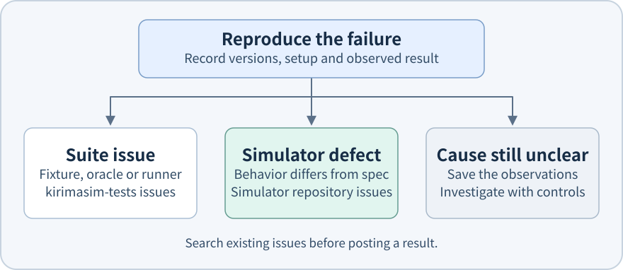

# OpenCode handoff

[English](HANDOFF.md) / [日本語](HANDOFF.ja.md)

## Status as of November 27, 2026 (JST)

- The handoff starts from `main` at `06f00049`, which adds 44 regression fixtures and their verification records. All four GitHub Actions `Check` jobs for that commit passed. [Commit](https://github.com/kurochan001/kirimasim-tests/commit/06f00049d0ee834b9d7d54e8939c6078cd7f2cc3) · [Check](https://github.com/kurochan001/kirimasim-tests/actions/runs/45995209954)
- The suite has reviewed test mappings for **all 12,332 IEEE 1800-2023 requirements (100%)**. Saved execution evidence covers 11,204 requirements across environments, including 6,462 reproducible with public tools. [Summary JSON](coverage/behavior-summary.json) · [How to read the summary](docs/behavior-coverage-summary.en.md)
- The Nightly run for the previous commit, `fcaeb425`, failed to build Ghost and Lyra and skipped Lyra execution. The Icarus, Verilator, kirimasim, and publication jobs succeeded. [Nightly](https://github.com/kurochan001/kirimasim-tests/actions/runs/45927477463)

## Ghost failure triage

The latest local full run recorded 16,895 simulation cases, with 16,650 passes and 245 failures. The triage accounts for them as follows.

- 55 cases are tracked in 14 new `kirimasim-tests` issues (#92–#105). Two other cases share the question raised in existing issue #76. [New issues](https://github.com/kurochan001/kirimasim-tests/issues?q=is%3Aissue+label%3Abug+created%3A2026-11-26..2026-11-27) · [Existing issue #76](https://github.com/kurochan001/kirimasim-tests/issues/76)
- Of the remaining cases, 83 are associated with 52 new `sukimasim` issues, 10 relate to existing `sukimasim` issues, and 95 still need a cause established.
- This workspace has `full.json` (full results), `suite-side/created.json` (suite issue-to-case mapping), and `created-issues.json` (sukimasim issue records) under `out/ghost-triage-20261127/`. Git ignores `out/`. Use independently written reproducers in public issues and keep private diagnostics and runtime profiles local. [Posting policy](docs/faq.en.md#q45-may-i-post-commercial-simulator-output-or-diagnostics-in-an-issue)

## Resume work

Open the repository root in OpenCode and point it to this file. Check the branch and worktree with `git status --short --branch` and `git log -1 --oneline`.



1. Check the open suite issues. Issue #92 is a starting point. Filtering only checkpoint progress lines let four cases pass, while the control case with a callback mismatch still failed. [Issue #92](https://github.com/kurochan001/kirimasim-tests/issues/92)
2. Reproduce tests that require a dedicated setup with the interactive controls, compile settings, and staged inputs named in their issues. Report cases as unrun when the setup cannot be verified. Investigate behavioral differences that reproduce once the setup is in place. [Interactive execution #93](https://github.com/kurochan001/kirimasim-tests/issues/93) · [Compile settings #94](https://github.com/kurochan001/kirimasim-tests/issues/94) · [Library maps #95](https://github.com/kurochan001/kirimasim-tests/issues/95)
3. To resume Nightly investigation, check a new run on the current `main`. Rerunning an earlier workflow uses the commit from that run. [Nightly instructions](docs/nightly-results.en.md)

Use a requirement's `source_spans` to identify the section and block, then inspect an authorized copy of IEEE 1800-2023 and the existing files in `tests/chNN/`. Run new tests with the applicable runners and record the input fingerprint, observed differences, and acceptance checks before adding a mapping. When the standard permits several outcomes, confirm that the required preconditions and controls held and record the observation. [Requirements ledger](coverage/behaviors.json) · [Source index](coverage/requirement-source-index.json) · [Mapping procedure](docs/requirements-to-tests-method.en.md)

## Verification commands

```sh
python3 tools/lint_metadata.py tests/chNN/test_example.sv
python3 tools/behavior_coverage.py --check --require-source-reviewed
python3 tools/requirement_matching.py --check
python3 tools/suite_catalog.py --check
python3 tools/suite_stats.py --check
python3 tools/coverage_depth.py --check --minimum-tests 2
python3 tools/documentation_languages.py --check
python3 -m unittest discover -s tools -p 'test_*.py'
```

After changing tests, regenerate the affected reports with their `--update` commands. After editing paired handwritten documents, run `python3 tools/documentation_languages.py --record`. Ghost replays require an accessible executable and strict runtime profile. Individual records identify the portions reproducible with public tools. [Evidence and replay instructions](coverage/README.en.md) · [CI workflow](.github/workflows/check.yml)

For a focused replay of one case from #92 and its control, set `GHOST_BIN`, `GHOST_INCLUDE`, and `GHOST_PROFILE` to local paths. Use separate `--json` destinations for the before and after runs so you can compare both results.

```sh
python3 tools/run_ghost.py --simulator "$GHOST_BIN" --include "$GHOST_INCLUDE" \
  --profile "$GHOST_PROFILE" --json out/checkpoint-replay.json \
  tests/ch38/test_vpi_end_save_data_is_available_at_start_of_restart.sv \
  tests/ch38/test_vpi_restart_preserves_restart_callbacks_and_drops_value_change.sv
```

## Verification history

- For the §4.3 reference scheduler, all three configurations matched the allowed traces on Icarus, Ghost, Verilator, and kirimasim. The configurations include a control and two cases with competing writes. [Qualification record](coverage/qualification/scheduler-reference-20261125.json)
- For §11.4.14.1 class streaming, Ghost returned `35` in the acyclic control. The separate process terminated with signal 11 after confirming the self-reference. The standard leaves the cyclic result undefined. [Qualification record](coverage/qualification/class-stream-cycle-20261125.json)
- For §36.12.3, a legacy VPI application read a memory in a Verilog-1995 partition. Icarus and Ghost both returned `29` and `61`. [Qualification record](coverage/qualification/vpi-legacy-partition-memory-20261125.json)
- The §25.9 virtual interface requirement is mapped to a group that checks legal waits and four required rejections together. Strict Ghost accepted the illegal `always_comb` case and the simulation printed `47`. The result records a mismatch. [Qualification record](coverage/qualification/virtual-sensitivity-20261126.json)
- The owner-specific protection key tests for §34.5.10.2 and §34.5.16.2 identify six duplicate registrations and recover models and digests using registrations under separate owners. [Qualification record](coverage/qualification/protect-owner-key-uniqueness-20261127.json)
- The three remaining Chapter 34 viewport requirements are now mapped. Access checks use two local policies in both source orders and read or write objects in the recovered simulation through VPI. Slang accepted all six out-of-envelope or unknown target variants. [Qualification record](coverage/qualification/protect-viewport-20261127.json)
- The §37.2.2 restart test restores the checkpoint and observes the old handle keys in Ghost's internal table. All eight keys stayed present, and the previous value-change and end-of-simulation callbacks fired after restart. [Qualification record](coverage/qualification/vpi-restart-release-20261127.json)
- The six remaining Chapter 30 pulse control requirements are mapped. The reference runner applies launch settings through specify and SDF, and Ghost measures the resulting waveforms. [Qualification record](coverage/qualification/global-pulse-options-20261127.json)
- The twelve remaining Chapter 4 requirements are mapped to public VPI and assertion traces plus reference checks for conceptual control points. The standalone Ghost scheduler ran an Active event ahead of pending Reactive work. [Qualification record](coverage/qualification/pli-region-controls-20261127.json)
- The four remaining Chapter 31 timing requirements are mapped. Ghost reported three width and six setup checks with a common notifier after explicit vector expansion. The projected negative timing cases matched, and the original negative checks produced a different trace. [Qualification record](coverage/qualification/timing-options-20261127.json)
- The four remaining Chapter 17 requirements are mapped. Yosys enumerated 21 two-step traces with a fixed constant and Ghost accepted every explicit replay. In six unmodified runs, the constant stayed at zero and each sampled step reported the same failed assumption. [Qualification record](coverage/qualification/checker-free-choices-20261127.json)
- Annex K is fully mapped. The C and C++ header checks preserved legacy VPI object type aliases and detected new identifiers at both reserved boundaries. [Qualification record](coverage/qualification/vpi-base-object-codes-20261127.json)
- The §37.14 indexed-port and input-delay test found that Ghost read back the configured delays, missed valid port-bit selections, and propagated the signal immediately. The reference run checks the declared index bounds and the delayed transitions. [Qualification record](coverage/qualification/vpi-input-port-delays-20261127.json)
- Annex H is fully mapped. C and C++ checked the two deprecated DPI source-header macros. Both reference hosts and Ghost reused the same compiled library for the header-independent application. The source-dependent builds detected a layout mismatch when exchanged between reference hosts. [Qualification record](coverage/qualification/dpi-legacy-source-layout-20261127.json)
- Chapter 40 is fully mapped. The reference runner associates two logical names with different physical layouts and reads each entry through Ghost and Verilator's CLI coverage tools. Both merge the complementary hits to three per cover property. The native standard calls in Ghost returned no coverage to save and no entry to merge. [Qualification record](coverage/qualification/coverage-database-storage-20261127.json)
- Chapter 19 is fully mapped. Verilator produced 5, 9, 13 and 13 automatic bins for the same four-bit coverpoint under implementation caps of 5, 9, 13 and 20. The two-bit control always had four bins, and both points reached full coverage after a complete input sweep. [Qualification record](coverage/qualification/automatic-bin-limit-20261127.json)
- The §7.3.1 test compares an unpacked union generated by Verilator with C declarations. The layouts match and values transfer in both directions. Swapping two fields in one generated structure produces a different layout and stops the transfer. [Qualification record](coverage/qualification/unpacked-union-c-layout-20261127.json)
- Chapter 36 is fully mapped. A test adapter set one run-wide default for two unbound VPI libraries and delegated to Ghost's current or 1995 entry points. Two compile-bound libraries kept their modes under both settings. Ordinary Ghost runs observed the current view in both unbound libraries. [Qualification record](coverage/qualification/vpi-host-default-modes-20261127.json)
- Chapter 33 is fully mapped. The reference binder loaded four independently compiled Yosys cells and a compiled configuration after removing the staged SystemVerilog sources. Slang selected the same source hierarchy, and Ghost printed the values proved by Yosys. Verilator 5.054 selected the same leaf for both instances. [Qualification record](coverage/qualification/config-precompiled-cells-20261127.json)
- The §38.15 reference provider used distinct format IDs for a bit-plane structure and four-state counts. Ghost and Icarus supplied matching 40-bit and 10-bit vectors. Changing just the provider's bit-plane ID removed that payload. [Qualification record](coverage/qualification/vpi-misc-format-extensions-20261127.json)
- The protected-object VPI tests moved two encrypted ranges to the other side of the same design. The reference adapter flipped the denied property and navigation operations and preserved type, protection flag, argument iteration and expression size. Ghost supplied the VPI objects for both recovered layouts. [Qualification record](coverage/qualification/vpi-protected-access-20261127.json)
- The protected statement callback test swaps the protection range between two named blocks. The reference adapter rejects individual registration and omits the protected block, delay and assignment from module-wide registration. Ghost executes both branches in each run. [Qualification record](coverage/qualification/vpi-protected-callbacks-20261127.json)
- Chapter 8 is fully mapped. The reference weak-view adapter observes actual Verilator object and wrapper destruction. Two views clear together after the last strong handle is dropped, and a SystemVerilog associative array keeps its numeric key through ID reuse. [Qualification record](coverage/qualification/weak-reference-collection-20261127.json)
- Chapter 38 is fully mapped. A reference adapter observes actual Verilator destruction, selects the class typespec and individual object callbacks, and retires the associated handle records after callback return. The companion Ghost test keeps a static local and its callback live after its task returns. [Qualification record](coverage/qualification/vpi-class-reclaim-20261127.json)
- The Chapter 37 lifetime tests pair the class collection fixture with two overlapping automatic calls. The reference adapter reads each frame's actual locals during callbacks and removes their handles at return while the calling threads remain live. Ghost delivered the frame start callbacks before the task body, and the locals could only be read after the body began. [Qualification record](coverage/qualification/vpi-automatic-frame-lifetime-20261127.json)
- Ghost verified the other transient object types in one run, including an outdated array reference, a block-scoped reference, thread termination, iterator exhaustion, scheduled event delivery and release, and removal of one of two timer callbacks. [Qualification record](coverage/qualification/vpi-other-transient-20261127.json)
- The Chapter 37.83 test checks both VPI relationship directions for attributes on primitive terminals, path terminals, module paths, timing checks, and UDP table entries. The helper populates attributes on real Ghost-created owners, and the public VPI client detects a misdirected iterator and a wrong parent in the contrast run. [Qualification record](coverage/qualification/vpi-extended-attributes-20261127.json)
- The interface ownership fixture uses Ghost-created programs, interfaces and paths to check both directions of their VPI relationships. In the private parent hierarchy contrast, Ghost's legacy module lookup returns the outer module for an interface path. [Qualification record](coverage/qualification/vpi-interface-ownership-20261127.json)
- The constraint and structure pattern test reads Slang's parsed flags and member labels and verifies their public VPI accessors on Ghost objects. In the ordinary Ghost run the pure constraint flag is false and the named nested patterns have no names. [Qualification record](coverage/qualification/vpi-pattern-constraint-20261127.json)
- The diagram checker classifies the inventoried IEEE PDF's outlines and fonts, and the native Ghost test verifies common VPI properties and relationships for all four instance kinds. [Qualification record](coverage/qualification/vpi-diagram-key-20261127.json)
- The §37.41 test compares the identity of the two reference objects reached through task and function VPI views. Swapping the two parents changes both identity checks while both ordinary declarations retain their module parents. [Qualification record](coverage/qualification/vpi-task-reference-parent-20261127.json)
- The §7.8.5 group checks dynamically sized keys and Slang's rejection of a key containing a real member. Ghost compares event identity correctly but assigns two different events to one entry. The ordinary test expects two entries. [Qualification record](coverage/qualification/associative-key-equality-20261127.json)
- The §9.7 test controls five processes from initial and always procedures and their fork descendants. The reference guard rejects all four operations on a final-origin handle. Ghost's internal API accepts the calls when the guard is removed. [Qualification record](coverage/qualification/process-control-target-origins-20261127.json)
- The Chapter 2 tests resolve dated and undated references from the inventoried IEEE PDF and publisher records. The two selected VPI releases expose different object types for the same array. Historical editions exercise the inclusion of a published amendment and two corrigenda. [Qualification record](coverage/qualification/normative-reference-editions-20261127.json)
- All 12,332 ledger requirements have reviewed test mappings. Saved execution evidence covers 11,204 requirements across tools. [Clause coverage](docs/behavior-coverage.en.md)
