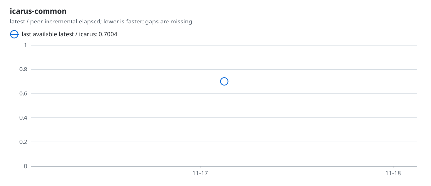
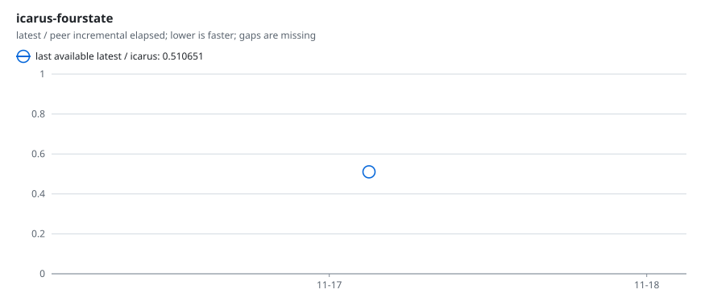

# 日次・週次シミュレーション速度ベンチマーク

[English](README.md) / [日本語](README.ja.md)

機能テストのNightlyとは独立しています。GitHub標準ランナーの値は参考値で、5回の測定から統計的有意性を断言しません。

## 最新の日次測定

[JSON](latest-daily.json)

**測定回:** `actions-44183926839-1` — complete
2026-11-17T21:58:35.859990+00:00 → 2026-11-17T22:47:19.050032+00:00

比率は最新kirimasimの差分時間÷比較対象の差分時間です。1未満なら最新kirimasimが速いことを示します。

この環境での参考値です。失敗・欠測はゼロ秒ではありません。

[JSON](runs/actions-44183926839-1.json) · [Actions logs / ログ](https://github.com/kurochan001/kirimasim-tests/actions/runs/44183926839/attempts/1) · [Method / 測定方法](https://github.com/kurochan001/kirimasim-tests/blob/main/docs/daily-benchmark.md)

環境: github-hosted-ubuntu-24.04 / AMD EPYC 9V74 80-Core Processor / Linux-7.0.0-1017-azure-x86_64-with-glibc2.39

<details><summary>測定条件</summary>

```json
{
  "machine": {
    "os": "Linux-7.0.0-1017-azure-x86_64-with-glibc2.39",
    "cores": 4,
    "cpu": "AMD EPYC 9V74 80-Core Processor",
    "memory_gib": 16,
    "distribution": "Ubuntu 24.04.5 LTS",
    "architecture": "x86_64"
  },
  "compiler": "g++ (Ubuntu 13.3.0-6ubuntu2~24.04.1) 13.3.0",
  "profile": "daily",
  "environment": "github-hosted-ubuntu-24.04",
  "image_os": "ubuntu24",
  "image_version": "20261111.370.1",
  "settings": {
    "runs": 5,
    "warmups": 1,
    "timeout_seconds": 600,
    "short_seconds": 0.05,
    "regression_warning_ratio": 1.15,
    "simulation_threads": 1,
    "waveforms": false,
    "assertions": false,
    "verilator_build_jobs": 1
  },
  "mode": "formal",
  "runs": 5,
  "tool_builds": {
    "latest": {
      "compiler": "g++ (Ubuntu 13.3.0-6ubuntu2~24.04.1) 13.3.0",
      "c_compiler": "gcc (Ubuntu 13.3.0-6ubuntu2~24.04.1) 13.3.0",
      "flags": {
        "CC": "gcc",
        "CXX": "g++",
        "CFLAGS": "",
        "CXXFLAGS": "",
        "preset": "release",
        "cmake": "-O3 -DNDEBUG -ffp-contract=off, no fast-math",
        "make_jobs": 2
      }
    },
    "baseline": {
      "compiler": "g++ (Ubuntu 13.3.0-6ubuntu2~24.04.1) 13.3.0",
      "c_compiler": "gcc (Ubuntu 13.3.0-6ubuntu2~24.04.1) 13.3.0",
      "flags": {
        "CC": "gcc",
        "CXX": "g++",
        "CFLAGS": "",
        "CXXFLAGS": "",
        "preset": "release",
        "cmake": "-O3 -DNDEBUG -ffp-contract=off, no fast-math",
        "make_jobs": 2
      }
    },
    "icarus": {
      "compiler": "g++ (Ubuntu 13.3.0-6ubuntu2~24.04.1) 13.3.0",
      "c_compiler": "gcc (Ubuntu 13.3.0-6ubuntu2~24.04.1) 13.3.0",
      "flags": {
        "CC": "gcc",
        "CXX": "g++",
        "CFLAGS": "",
        "CXXFLAGS": "",
        "preset": "release",
        "cmake": "-O3 -DNDEBUG -ffp-contract=off, no fast-math",
        "make_jobs": 2
      }
    },
    "verilator": {
      "compiler": "g++ (Ubuntu 13.3.0-6ubuntu2~24.04.1) 13.3.0",
      "c_compiler": "gcc (Ubuntu 13.3.0-6ubuntu2~24.04.1) 13.3.0",
      "flags": {
        "CC": "gcc",
        "CXX": "g++",
        "CFLAGS": "",
        "CXXFLAGS": "",
        "preset": "release",
        "cmake": "-O3 -DNDEBUG -ffp-contract=off, no fast-math",
        "make_jobs": 2
      }
    }
  },
  "verilator_options": "--binary --timing --threads 1 --build-jobs 1; default C++ optimization; assertions/tracing off",
  "icarus_options": "-g2012; vvp -n; single process",
  "kirimasim_options": "default four-state; interpreter; no waveform/assertion request"
}
```

</details>

- `latest`: `234f65f6b2057b8a52cb779b984075f157fd2775` — kirimasim 0.1.1 (commit 234f65f6b205), built with GNU 13.3.0
- `baseline`: `cfa2ccd75989c1ebb9ed63303271183377364cf0` — kirimasim 0.1.0 (commit cfa2ccd75989), built with GNU 13.3.0
- `icarus`: `dfeee909ed9f20b4870dd93423156c0170c0e1ff` — Icarus Verilog version 13.0 (stable) (dfeee90-dirty)
- `verilator`: `bbb60a403932a9f695cb6ff001ceb73de6ad9234` — Verilator 5.054 2026-11-01 rev vUNKNOWN-built20261117-bbb60a4

定義・測定処理の識別情報: `{'config_sha256': '56c0140f54b187d0bc8506e9ab0627cbdc616b69d2a1910aa6fd9b324b2ab9b7', 'driver_sha256': '0037fb4780de47740de92f102487477aac29570998a2aa3ca095bbcbb94219fa', 'comparison_sha256': '2896f429781d5eaff2d0ecec465726de342f840892056d20304d2df179ad6be0', 'history_sha256': '50af56d972f3e551c2a9bc7ae0b8ee158405c6ab25ab7f97c36cd32bebe90f8a', 'setup_sha256': '35fd0861a6a91f6bd13719ca3a926142a8a248cb672d9499e328bfdd04c791e3', 'adapter_sha256': '4811f9d50d4a09d8794710296d644350468c49a9579a794f27af42ac9fb6b5bc', 'benchmark_commit': 'cfa2ccd75989c1ebb9ed63303271183377364cf0', 'reference_sha256': {'bench/reference_expanded.py': 'a1196d79efb88425f61cc69ba1d9ec99542f7f5dc41fac2a07ade82090b00f4a', 'bench/reference_fourstate_mix.py': '586fb643e9ef9df9e304df83e04e711aa1b875e6cb4393e6e3c98cd1707b70e1'}}`

| ケース | 処理系 | 状態 | ビルド秒 | T(1)中央値秒 | T(N)中央値秒 | 差分秒 | T(N) MAD秒 | RSS MiB | 最新/対象 | 理由・注意 |
|---|---|---|---:|---:|---:|---:|---:|---:|---:|---|
| casez_struct (N=5000000) | latest | measured | — | 0.0044197 | 4.1807 | 4.1763 | 0.01272 | 28.543 | — |  |
| casez_struct (N=5000000) | baseline | measured | — | 0.0044772 | 5.7962 | 5.7918 | 0.063084 | 28.391 | 0.72107 |  |
| casez_struct (N=5000000) | icarus | measured | 0.0051881 | 0.0033991 | 6.2944 | 6.291 | 0.071033 | 7.3633 | 0.66385 |  |
| casez_struct (N=5000000) | verilator | measured | 5.3074 | 0.0016226 | 0.025076 | 0.023454 | 4.7922e-05 | 3.832 | 178.07 | short incremental time; sensitive to timing noise |
| comb_chain (N=3000000) | latest | measured | — | 0.0041822 | 11.818 | 11.814 | 0.0090099 | 28.344 | — |  |
| comb_chain (N=3000000) | baseline | measured | — | 0.0043007 | 15.747 | 15.743 | 0.052578 | 28.355 | 0.75045 |  |
| comb_chain (N=3000000) | icarus | measured | 0.0059455 | 0.0033368 | 20.721 | 20.718 | 0.04047 | 7.4375 | 0.57024 |  |
| comb_chain (N=3000000) | verilator | measured | 6.1249 | 0.0011598 | 0.35426 | 0.3531 | 0.0001187 | 3.8477 | 33.458 |  |
| dyn_queue (N=4000000) | latest | measured | — | 0.0041791 | 4.9964 | 4.9922 | 0.0050679 | 28.484 | — |  |
| dyn_queue (N=4000000) | baseline | measured | — | 0.0050398 | 6.1787 | 6.1736 | 0.047512 | 28.215 | 0.80863 |  |
| dyn_queue (N=4000000) | icarus | measured | 0.0049462 | 0.003382 | 11.21 | 11.207 | 0.080489 | 7.3711 | 0.44547 |  |
| dyn_queue (N=4000000) | verilator | measured | 5.3979 | 0.001618 | 0.1239 | 0.12228 | 0.00071227 | 3.8477 | 40.825 |  |
| fork_join (N=4000000) | latest | measured | — | 0.0042549 | 7.0537 | 7.0495 | 0.013555 | 28.289 | — |  |
| fork_join (N=4000000) | baseline | measured | — | 0.004309 | 8.399 | 8.3947 | 0.043258 | 28.188 | 0.83976 |  |
| fork_join (N=4000000) | icarus | measured | 0.0058685 | 0.0032386 | 9.9055 | 9.9023 | 0.095925 | 7.3359 | 0.71191 |  |
| fork_join (N=4000000) | verilator | measured | 6.2131 | 0.0011903 | 1.7863 | 1.7851 | 0.012612 | 3.8516 | 3.9491 |  |
| func_call (N=1500000) | latest | measured | — | 0.0040507 | 6.6859 | 6.6818 | 0.04684 | 28.438 | — |  |
| func_call (N=1500000) | baseline | measured | — | 0.0044719 | 8.1689 | 8.1645 | 0.0020462 | 28.152 | 0.8184 |  |
| func_call (N=1500000) | icarus | measured | 0.0049619 | 0.003358 | 16.807 | 16.803 | 0.070154 | 7.3125 | 0.39765 |  |
| func_call (N=1500000) | verilator | measured | 5.2689 | 0.0014271 | 0.0091062 | 0.0076791 | 3.7997e-05 | 0.55469 | 870.13 | short incremental time; sensitive to timing noise |
| gate_udp (N=400000) | latest | measured | — | 0.0053649 | 7.1224 | 7.117 | 0.011103 | 28.359 | — |  |
| gate_udp (N=400000) | baseline | measured | — | 0.0054177 | 8.7425 | 8.737 | 0.0093032 | 28.293 | 0.81458 |  |
| gate_udp (N=400000) | icarus | measured | 0.0066564 | 0.004767 | 5.2455 | 5.2408 | 0.0038856 | 7.4609 | 1.358 |  |
| gate_udp (N=400000) | verilator | measured | 6.2999 | 0.0012206 | 0.063101 | 0.06188 | 0.00022848 | 3.8516 | 115.01 |  |
| mem_rw (N=4000000) | latest | measured | — | 0.0061965 | 6.6288 | 6.6227 | 0.035234 | 28.359 | — |  |
| mem_rw (N=4000000) | baseline | measured | — | 0.0070424 | 8.3086 | 8.3016 | 0.095064 | 28.242 | 0.79776 |  |
| mem_rw (N=4000000) | icarus | measured | 0.0049489 | 0.0038017 | 6.8023 | 6.7985 | 0.025201 | 7.4023 | 0.97414 |  |
| mem_rw (N=4000000) | verilator | measured | 6.1066 | 0.0015918 | 1.0475 | 1.0459 | 0.0035232 | 3.8242 | 6.3319 |  |
| nba_burst (N=500000) | latest | measured | — | 0.0042512 | 0.13097 | 0.12672 | 0.00089094 | 124.55 | — |  |
| nba_burst (N=500000) | baseline | measured | — | 0.0046584 | 0.16692 | 0.16227 | 0.0026975 | 124.4 | 0.78092 |  |
| nba_burst (N=500000) | icarus | measured | 0.0049333 | 0.0028693 | 0.1913 | 0.18843 | 0.00072616 | 33.844 | 0.6725 |  |
| nba_burst (N=500000) | verilator | measured | 6.0808 | 0.0011527 | 0.0014303 | 0.00027766 | 3.98e-05 | 0.55469 | 456.38 | short incremental time; sensitive to timing noise |
| nba_shift (N=1000000) | latest | measured | — | 0.0043462 | 31.357 | 31.353 | 0.17438 | 28.453 | — |  |
| nba_shift (N=1000000) | baseline | measured | — | 0.0056184 | 40.38 | 40.375 | 0.4632 | 28.277 | 0.77654 |  |
| nba_shift (N=1000000) | icarus | measured | 0.0056877 | 0.003741 | 37.221 | 37.218 | 0.43245 | 7.4609 | 0.84242 |  |
| nba_shift (N=1000000) | verilator | measured | 6.266 | 0.0016204 | 0.30102 | 0.2994 | 0.0035069 | 3.8555 | 104.72 |  |
| proc_wait (N=1000000) | latest | measured | — | 0.0066546 | 10.845 | 10.838 | 0.062563 | 32.332 | — |  |
| proc_wait (N=1000000) | baseline | measured | — | 0.0067446 | 12.941 | 12.934 | 0.043495 | 30.219 | 0.83798 |  |
| proc_wait (N=1000000) | icarus | measured | 0.0063875 | 0.0047547 | 8.1389 | 8.1342 | 0.075643 | 7.8008 | 1.3324 |  |
| proc_wait (N=1000000) | verilator | measured | 8.0367 | 0.0012574 | 3.0546 | 3.0533 | 0.00089362 | 3.9844 | 3.5497 |  |
| string_fmt (N=500000) | latest | measured | — | 0.0038764 | 5.2107 | 5.2068 | 0.021957 | 28.422 | — |  |
| string_fmt (N=500000) | baseline | measured | — | 0.0048001 | 6.8961 | 6.8913 | 0.03313 | 28.227 | 0.75556 |  |
| string_fmt (N=500000) | icarus | measured | 0.0050692 | 0.0033703 | 16.724 | 16.721 | 0.0937 | 7.3672 | 0.3114 |  |
| string_fmt (N=500000) | verilator | measured | 5.2615 | 0.0016451 | 0.21937 | 0.21773 | 0.0027672 | 3.9609 | 23.915 |  |
| wide_arith (N=1500000) | latest | measured | — | 0.0045501 | 3.3391 | 3.3345 | 0.096065 | 28.48 | — |  |
| wide_arith (N=1500000) | baseline | measured | — | 0.0049742 | 7.6987 | 7.6937 | 0.071121 | 28.164 | 0.43341 |  |
| wide_arith (N=1500000) | icarus | measured | 0.0049472 | 0.0032971 | 13.229 | 13.225 | 0.078661 | 7.2969 | 0.25213 |  |
| wide_arith (N=1500000) | verilator | measured | 5.2893 | 0.0014921 | 0.1231 | 0.12161 | 0.00037563 | 3.7969 | 27.42 |  |
| fourstate_mix (N=1000000) | latest | measured | — | 0.0043853 | 1.5175 | 1.5131 | 0.011726 | 28.527 | — |  |
| fourstate_mix (N=1000000) | baseline | measured | — | 0.0051782 | 2.0554 | 2.0502 | 0.011963 | 28.418 | 0.73802 |  |
| fourstate_mix (N=1000000) | icarus | measured | 0.0067963 | 0.0033421 | 3.2998 | 3.2964 | 0.0092741 | 7.3555 | 0.45901 |  |
| fourstate_mix (N=1000000) | verilator | unsupported | — | — | — | — | — | — | — | X/Z observations require four-state semantics; excluded before execution |
| fifo_stream (N=200000) | latest | measured | — | 0.0050465 | 0.71501 | 0.70996 | 0.0028589 | 28.535 | — |  |
| fifo_stream (N=200000) | baseline | measured | — | 0.0052568 | 0.87005 | 0.8648 | 0.005006 | 28.391 | 0.82096 |  |
| fifo_stream (N=200000) | icarus | measured | 0.0058064 | 0.0034137 | 0.59318 | 0.58977 | 0.0042863 | 7.4141 | 1.2038 |  |
| fifo_stream (N=200000) | verilator | measured | 6.102 | 0.0012716 | 0.071879 | 0.070608 | 0.00081333 | 3.8438 | 10.055 |  |
| uart_loopback (N=20000) | latest | measured | — | 0.0045599 | 0.71528 | 0.71072 | 0.0024621 | 28.48 | — |  |
| uart_loopback (N=20000) | baseline | measured | — | 0.0054259 | 0.82307 | 0.81765 | 0.0023565 | 28.387 | 0.86923 |  |
| uart_loopback (N=20000) | icarus | measured | 0.0055904 | 0.0034713 | 0.36393 | 0.36046 | 0.00053441 | 7.4414 | 1.9717 |  |
| uart_loopback (N=20000) | verilator | measured | 6.0952 | 0.0016206 | 0.084535 | 0.082914 | 0.00019594 | 3.8164 | 8.5717 |  |
| bus_fabric (N=150000) | latest | measured | — | 0.0055218 | 2.0538 | 2.0482 | 0.010579 | 28.422 | — |  |
| bus_fabric (N=150000) | baseline | measured | — | 0.0056787 | 2.4278 | 2.4221 | 0.0089572 | 28.391 | 0.84564 |  |
| bus_fabric (N=150000) | icarus | measured | 0.0060727 | 0.0038538 | 0.78344 | 0.77958 | 0.0031652 | 7.4961 | 2.6274 |  |
| bus_fabric (N=150000) | verilator | measured | 6.1367 | 0.0011699 | 0.092942 | 0.091772 | 0.00022591 | 3.8516 | 22.319 |  |
| hierarchy_fanout (N=100000) | latest | measured | — | 0.0092592 | 11.872 | 11.862 | 0.1815 | 36.41 | — |  |
| hierarchy_fanout (N=100000) | baseline | measured | — | 0.0097564 | 14.453 | 14.444 | 0.10053 | 36.195 | 0.8213 |  |
| hierarchy_fanout (N=100000) | icarus | measured | 0.011038 | 0.011414 | 25.551 | 25.539 | 0.086938 | 8.3477 | 0.46448 |  |
| hierarchy_fanout (N=100000) | verilator | measured | 6.18 | 0.001615 | 0.050289 | 0.048674 | 4.5087e-05 | 3.8164 | 243.71 | short incremental time; sensitive to timing noise |
| event_fanout (N=50000) | latest | measured | — | 0.011755 | 3.3507 | 3.3389 | 0.025959 | 42.539 | — |  |
| event_fanout (N=50000) | baseline | measured | — | 0.011589 | 3.8497 | 3.8382 | 0.023904 | 42.371 | 0.86992 |  |
| event_fanout (N=50000) | icarus | measured | 0.012061 | 0.0094346 | 3.4992 | 3.4897 | 0.0013692 | 9.082 | 0.95678 |  |
| event_fanout (N=50000) | verilator | measured | 6.5229 | 0.0012018 | 0.060151 | 0.05895 | 0.00015932 | 3.8398 | 56.64 |  |
| word_boundary (N=4000000) | latest | measured | — | 0.0037481 | 7.0209 | 7.0171 | 0.016968 | 28.348 | — |  |
| word_boundary (N=4000000) | baseline | measured | — | 0.0048804 | 10.794 | 10.79 | 0.13364 | 28.25 | 0.65036 |  |
| word_boundary (N=4000000) | icarus | measured | 0.0049586 | 0.0032769 | 23.317 | 23.313 | 0.14719 | 7.3359 | 0.30099 |  |
| word_boundary (N=4000000) | verilator | measured | 5.2665 | 0.001601 | 0.038428 | 0.036827 | 5.7887e-05 | 3.8359 | 190.54 | short incremental time; sensitive to timing noise |
| wide_divide (N=80000) | latest | measured | — | 0.0043324 | 1.1779 | 1.1736 | 0.0055097 | 28.449 | — |  |
| wide_divide (N=80000) | baseline | measured | — | 0.0049339 | 1.2787 | 1.2737 | 0.003974 | 28.363 | 0.92138 |  |
| wide_divide (N=80000) | icarus | measured | 0.0057231 | 0.0029179 | 1.0286 | 1.0257 | 0.0048623 | 7.3477 | 1.1442 |  |
| wide_divide (N=80000) | verilator | measured | 5.3057 | 0.0011657 | 0.0094399 | 0.0082742 | 0.0002001 | 0.55078 | 141.84 | short incremental time; sensitive to timing noise |
| packed_slice (N=1500000) | latest | measured | — | 0.0040062 | 3.0431 | 3.0391 | 0.0071872 | 28.445 | — |  |
| packed_slice (N=1500000) | baseline | measured | — | 0.0052519 | 6.0644 | 6.0591 | 0.010622 | 28.234 | 0.50157 |  |
| packed_slice (N=1500000) | icarus | measured | 0.0052647 | 0.003262 | 8.4884 | 8.4851 | 0.10116 | 7.3164 | 0.35816 |  |
| packed_slice (N=1500000) | verilator | measured | 5.2839 | 0.0016341 | 0.086195 | 0.084561 | 0.00058502 | 3.8359 | 35.939 |  |
| memory_scatter (N=5000000) | latest | measured | — | 0.049643 | 4.3021 | 4.2524 | 0.0094095 | 42.445 | — |  |
| memory_scatter (N=5000000) | baseline | measured | — | 0.053196 | 6.2699 | 6.2167 | 0.044456 | 42.367 | 0.68403 |  |
| memory_scatter (N=5000000) | icarus | measured | 0.0050074 | 0.026912 | 13.015 | 12.988 | 0.068848 | 7.8242 | 0.32741 |  |
| memory_scatter (N=5000000) | verilator | measured | 5.3038 | 0.0013709 | 0.016198 | 0.014827 | 5.29e-05 | 3.918 | 286.79 | short incremental time; sensitive to timing noise |
| clock_domains (N=20000) | latest | measured | — | 0.0038731 | 0.20892 | 0.20505 | 0.0038684 | 28.488 | — |  |
| clock_domains (N=20000) | baseline | measured | — | 0.0045878 | 0.24899 | 0.24441 | 0.0052831 | 28.363 | 0.83896 |  |
| clock_domains (N=20000) | icarus | measured | 0.0050944 | 0.0032641 | 0.11443 | 0.11117 | 0.00059985 | 7.3789 | 1.8445 |  |
| clock_domains (N=20000) | verilator | measured | 6.134 | 0.0016293 | 0.075379 | 0.07375 | 0.00026783 | 3.8516 | 2.7803 |  |
| fourstate_arith (N=100000) | latest | measured | — | 0.0043642 | 0.15907 | 0.15471 | 0.00069884 | 28.512 | — |  |
| fourstate_arith (N=100000) | baseline | measured | — | 0.004846 | 0.1836 | 0.17875 | 0.0019463 | 28.352 | 0.8655 |  |
| fourstate_arith (N=100000) | icarus | measured | 0.0058983 | 0.0030614 | 0.25081 | 0.24775 | 0.00097525 | 7.3555 | 0.62447 |  |
| fourstate_arith (N=100000) | verilator | unsupported | — | — | — | — | — | — | — | X/Z observations require four-state semantics; excluded before execution |
| resolved_bus (N=50000) | latest | measured | — | 0.0041606 | 0.30879 | 0.30463 | 0.0012605 | 28.539 | — |  |
| resolved_bus (N=50000) | baseline | measured | — | 0.0053115 | 0.38475 | 0.37944 | 0.0020725 | 28.367 | 0.80284 |  |
| resolved_bus (N=50000) | icarus | measured | 0.006338 | 0.0034373 | 0.48644 | 0.48301 | 0.0021652 | 7.3789 | 0.63069 |  |
| resolved_bus (N=50000) | verilator | unsupported | — | — | — | — | — | — | — | X/Z observations require four-state semantics; excluded before execution |

固定した総合値の集合（全ケースの有効値が必要です）：

- **regression-common**: 0.75165; 12/12; casez_struct, comb_chain, dyn_queue, fork_join, func_call, gate_udp, mem_rw, nba_burst, nba_shift, proc_wait, string_fmt, wide_arith
- **regression-fourstate**: 0.73802; 1/1; fourstate_mix
- **icarus-common**: 0.62772; 12/12; casez_struct, comb_chain, dyn_queue, fork_join, func_call, gate_udp, mem_rw, nba_burst, nba_shift, proc_wait, string_fmt, wide_arith
- **icarus-fourstate**: 0.45901; 1/1; fourstate_mix
- **verilator-common**: 44.932; 12/12; casez_struct, comb_chain, dyn_queue, fork_join, func_call, gate_udp, mem_rw, nba_burst, nba_shift, proc_wait, string_fmt, wide_arith
- **expanded-regression-common**: 0.76045; 22/22; casez_struct, comb_chain, dyn_queue, fork_join, func_call, gate_udp, mem_rw, nba_burst, nba_shift, proc_wait, string_fmt, wide_arith, fifo_stream, uart_loopback, bus_fabric, hierarchy_fanout, event_fanout, word_boundary, wide_divide, packed_slice, memory_scatter, clock_domains
- **expanded-regression-fourstate**: 0.80042; 3/3; fourstate_mix, fourstate_arith, resolved_bus
- **expanded-icarus-common**: 0.72201; 22/22; casez_struct, comb_chain, dyn_queue, fork_join, func_call, gate_udp, mem_rw, nba_burst, nba_shift, proc_wait, string_fmt, wide_arith, fifo_stream, uart_loopback, bus_fabric, hierarchy_fanout, event_fanout, word_boundary, wide_divide, packed_slice, memory_scatter, clock_domains
- **expanded-icarus-fourstate**: 0.56544; 3/3; fourstate_mix, fourstate_arith, resolved_bus
- **expanded-verilator-common**: 43.944; 22/22; casez_struct, comb_chain, dyn_queue, fork_join, func_call, gate_udp, mem_rw, nba_burst, nba_shift, proc_wait, string_fmt, wide_arith, fifo_stream, uart_loopback, bus_fabric, hierarchy_fanout, event_fanout, word_boundary, wide_divide, packed_slice, memory_scatter, clock_domains
## 最新の週次測定

[JSON](latest-weekly.json)

**測定回:** `actions-44186811554-1` — complete
2026-11-17T22:58:29.331708+00:00 → 2026-11-17T23:35:53.816729+00:00

比率は最新kirimasimの差分時間÷比較対象の差分時間です。1未満なら最新kirimasimが速いことを示します。

この環境での参考値です。失敗・欠測はゼロ秒ではありません。

[JSON](runs/actions-44186811554-1.json) · [Actions logs / ログ](https://github.com/kurochan001/kirimasim-tests/actions/runs/44186811554/attempts/1) · [Method / 測定方法](https://github.com/kurochan001/kirimasim-tests/blob/main/docs/daily-benchmark.md)

環境: github-hosted-ubuntu-24.04 / AMD EPYC 7763 64-Core Processor / Linux-7.0.0-1017-azure-x86_64-with-glibc2.39

<details><summary>測定条件</summary>

```json
{
  "machine": {
    "os": "Linux-7.0.0-1017-azure-x86_64-with-glibc2.39",
    "cores": 4,
    "cpu": "AMD EPYC 7763 64-Core Processor",
    "memory_gib": 16,
    "distribution": "Ubuntu 24.04.5 LTS",
    "architecture": "x86_64"
  },
  "compiler": "g++ (Ubuntu 13.3.0-6ubuntu2~24.04.1) 13.3.0",
  "profile": "weekly",
  "environment": "github-hosted-ubuntu-24.04",
  "image_os": "ubuntu24",
  "image_version": "20261111.370.1",
  "settings": {
    "runs": 5,
    "warmups": 1,
    "timeout_seconds": 600,
    "short_seconds": 0.05,
    "regression_warning_ratio": 1.15,
    "simulation_threads": 1,
    "waveforms": false,
    "assertions": false,
    "verilator_build_jobs": 1
  },
  "mode": "formal",
  "runs": 5,
  "tool_builds": {
    "latest": {
      "compiler": "g++ (Ubuntu 13.3.0-6ubuntu2~24.04.1) 13.3.0",
      "c_compiler": "gcc (Ubuntu 13.3.0-6ubuntu2~24.04.1) 13.3.0",
      "flags": {
        "CC": "gcc",
        "CXX": "g++",
        "CFLAGS": "",
        "CXXFLAGS": "",
        "preset": "release",
        "cmake": "-O3 -DNDEBUG -ffp-contract=off, no fast-math",
        "make_jobs": 2
      }
    },
    "baseline": {
      "compiler": "g++ (Ubuntu 13.3.0-6ubuntu2~24.04.1) 13.3.0",
      "c_compiler": "gcc (Ubuntu 13.3.0-6ubuntu2~24.04.1) 13.3.0",
      "flags": {
        "CC": "gcc",
        "CXX": "g++",
        "CFLAGS": "",
        "CXXFLAGS": "",
        "preset": "release",
        "cmake": "-O3 -DNDEBUG -ffp-contract=off, no fast-math",
        "make_jobs": 2
      }
    },
    "icarus": {
      "compiler": "g++ (Ubuntu 13.3.0-6ubuntu2~24.04.1) 13.3.0",
      "c_compiler": "gcc (Ubuntu 13.3.0-6ubuntu2~24.04.1) 13.3.0",
      "flags": {
        "CC": "gcc",
        "CXX": "g++",
        "CFLAGS": "",
        "CXXFLAGS": "",
        "preset": "release",
        "cmake": "-O3 -DNDEBUG -ffp-contract=off, no fast-math",
        "make_jobs": 2
      }
    },
    "verilator": {
      "compiler": "g++ (Ubuntu 13.3.0-6ubuntu2~24.04.1) 13.3.0",
      "c_compiler": "gcc (Ubuntu 13.3.0-6ubuntu2~24.04.1) 13.3.0",
      "flags": {
        "CC": "gcc",
        "CXX": "g++",
        "CFLAGS": "",
        "CXXFLAGS": "",
        "preset": "release",
        "cmake": "-O3 -DNDEBUG -ffp-contract=off, no fast-math",
        "make_jobs": 2
      }
    }
  },
  "verilator_options": "--binary --timing --threads 1 --build-jobs 1; default C++ optimization; assertions/tracing off",
  "icarus_options": "-g2012; vvp -n; single process",
  "kirimasim_options": "default four-state; interpreter; no waveform/assertion request"
}
```

</details>

- `latest`: `441dddbd0fcd80aed298ca33311f2ee67aa8866c` — kirimasim 0.1.1 (commit 441dddbd0fcd), built with GNU 13.3.0
- `baseline`: `cfa2ccd75989c1ebb9ed63303271183377364cf0` — kirimasim 0.1.0 (commit cfa2ccd75989), built with GNU 13.3.0
- `icarus`: `dfeee909ed9f20b4870dd93423156c0170c0e1ff` — Icarus Verilog version 13.0 (stable) (dfeee90-dirty)
- `verilator`: `bbb60a403932a9f695cb6ff001ceb73de6ad9234` — Verilator 5.054 2026-11-01 rev vUNKNOWN-built20261117-bbb60a4

定義・測定処理の識別情報: `{'config_sha256': '56c0140f54b187d0bc8506e9ab0627cbdc616b69d2a1910aa6fd9b324b2ab9b7', 'driver_sha256': '0037fb4780de47740de92f102487477aac29570998a2aa3ca095bbcbb94219fa', 'comparison_sha256': '2896f429781d5eaff2d0ecec465726de342f840892056d20304d2df179ad6be0', 'history_sha256': '50af56d972f3e551c2a9bc7ae0b8ee158405c6ab25ab7f97c36cd32bebe90f8a', 'setup_sha256': '35fd0861a6a91f6bd13719ca3a926142a8a248cb672d9499e328bfdd04c791e3', 'adapter_sha256': '4811f9d50d4a09d8794710296d644350468c49a9579a794f27af42ac9fb6b5bc', 'benchmark_commit': 'cfa2ccd75989c1ebb9ed63303271183377364cf0', 'reference_sha256': {'bench/reference_expanded.py': 'a1196d79efb88425f61cc69ba1d9ec99542f7f5dc41fac2a07ade82090b00f4a', 'bench/reference_fourstate_mix.py': '586fb643e9ef9df9e304df83e04e711aa1b875e6cb4393e6e3c98cd1707b70e1'}}`

| ケース | 処理系 | 状態 | ビルド秒 | T(1)中央値秒 | T(N)中央値秒 | 差分秒 | T(N) MAD秒 | RSS MiB | 最新/対象 | 理由・注意 |
|---|---|---|---:|---:|---:|---:|---:|---:|---:|---|
| large_hierarchy (N=20000) | latest | measured | — | 0.1501 | 30.488 | 30.338 | 0.093651 | 108.37 | — |  |
| large_hierarchy (N=20000) | baseline | measured | — | 0.15133 | 37.609 | 37.458 | 0.22551 | 108.23 | 0.80991 |  |
| large_hierarchy (N=20000) | icarus | measured | 0.18767 | 0.10443 | 88.929 | 88.824 | 0.29512 | 22.973 | 0.34155 |  |
| large_hierarchy (N=20000) | verilator | measured | 15.048 | 0.0018306 | 0.10806 | 0.10623 | 0.0010759 | 3.7969 | 285.58 |  |
| large_memory (N=500000) | latest | measured | — | 0.11288 | 29.145 | 29.032 | 0.10063 | 44.539 | — |  |
| large_memory (N=500000) | baseline | measured | — | 0.146 | 41.798 | 41.652 | 0.24891 | 44.41 | 0.69701 |  |
| large_memory (N=500000) | icarus | measured | 0.0055652 | 0.21439 | 61.457 | 61.242 | 0.016669 | 11.301 | 0.47405 |  |
| large_memory (N=500000) | verilator | measured | 8.1158 | 0.0024141 | 0.13945 | 0.13704 | 0.00082314 | 4.7266 | 211.85 |  |
| stream_pipeline (N=250000) | latest | measured | — | 0.0085583 | 29.059 | 29.051 | 0.11181 | 28.254 | — |  |
| stream_pipeline (N=250000) | baseline | measured | — | 0.010272 | 38.925 | 38.915 | 0.24568 | 28.285 | 0.74652 |  |
| stream_pipeline (N=250000) | icarus | measured | 0.0087869 | 0.0063252 | 83.492 | 83.486 | 0.28265 | 7.4883 | 0.34797 |  |
| stream_pipeline (N=250000) | verilator | measured | 8.3722 | 0.0018094 | 0.13704 | 0.13523 | 0.00030075 | 3.707 | 214.82 |  |

固定した総合値の集合（全ケースの有効値が必要です）：

- **weekly-regression**: 0.74973; 3/3; large_hierarchy, large_memory, stream_pipeline
- **weekly-icarus**: 0.38336; 3/3; large_hierarchy, large_memory, stream_pipeline
- **weekly-verilator**: 235.12; 3/3; large_hierarchy, large_memory, stream_pipeline

## 環境・定義別の推移

### `079515db5b1afbed`

1 runs; 2026-11-17T22:58:29.331708+00:00 → 2026-11-17T22:58:29.331708+00:00

測定定義: `weekly-v1-scale`; ケース数: **3**


失敗を含む各回：

- [actions-44186811554-1](runs/actions-44186811554-1.json): complete — `441dddbd0fcd`
### `ff82f2d3ef6ff628`

1 runs; 2026-11-17T21:58:35.859990+00:00 → 2026-11-17T21:58:35.859990+00:00

測定定義: `daily-v3-expanded`; ケース数: **25**


失敗を含む各回：

- [actions-44183926839-1](runs/actions-44183926839-1.json): complete — `234f65f6b205`
### `962ea28f5124b999`

1 runs; 2026-11-17T15:00:17.437065+00:00 → 2026-11-17T15:00:17.437065+00:00

測定定義: `daily-v2-thirteen`; ケース数: **13**







失敗を含む各回：

- [actions-44103555558-1](runs/actions-44103555558-1.json): complete — `13d52dde3c49`
### `ff134f2dfe29a369`

1 runs; 2026-11-17T13:04:45.723115+00:00 → 2026-11-17T13:04:45.723115+00:00

測定定義: `daily-v1`; ケース数: **5**


失敗を含む各回：

- [actions-44085771320-1](runs/actions-44085771320-1.json): complete — `26f359bcd504`
