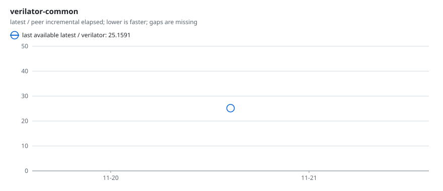
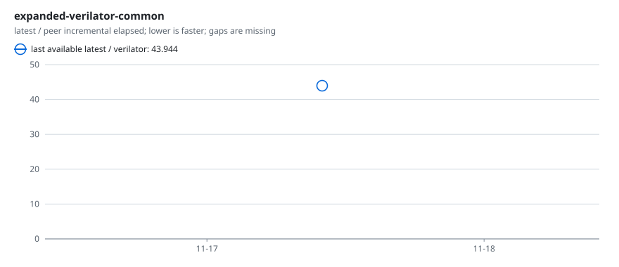

# 日次・週次シミュレーション速度ベンチマーク

[English](README.md) / [日本語](README.ja.md)

機能テストのNightlyとは独立しています。GitHub標準ランナーの値は参考値で、5回の測定から統計的有意性を断言しません。


日次25種類（共通22＋4値3）の等重み幾何平均です。比率はkirimasim÷Icarus 14.0 develの差分所要時間。0.97は所要時間が3%短い意味で、小さいほど高速です。

両開発版のコミットを測定開始時に一度解決します。JSTの各日の最後の正式測定を使い、1種類でも無効なら総合値は欠測です。環境・定義ごとに線を分けます。双方の変更が推移に影響するため、固定版との比較も下に残します。

[JSON](headline.json) · [Method / 測定方法](https://github.com/kurochan001/kirimasim-tests/blob/main/docs/daily-benchmark.md)

最新の総合測定: **2026-11-21 JST — 0.51516** (25/25; complete)

[Raw / 生データ](runs/actions-44850710627-1.json) · [Actions logs / ログ](https://github.com/kurochan001/kirimasim-tests/actions/runs/44850710627/attempts/1)

<details><summary>ケース別結果・固定版との比較・過去の系列</summary>

## 最新の日次測定

[JSON](latest-daily.json)

**測定回:** `actions-44850710627-1` — complete
2026-11-21T02:30:14.755165+00:00 → 2026-11-21T03:21:57.950262+00:00

比率は最新kirimasimの差分時間÷比較対象の差分時間です。1未満なら最新kirimasimが速いことを示します。

この環境での参考値です。失敗・欠測はゼロ秒ではありません。

[JSON](runs/actions-44850710627-1.json) · [Actions logs / ログ](https://github.com/kurochan001/kirimasim-tests/actions/runs/44850710627/attempts/1) · [Method / 測定方法](https://github.com/kurochan001/kirimasim-tests/blob/main/docs/daily-benchmark.md)

環境: github-hosted-ubuntu-24.04 / Intel(R) Xeon(R) 6975P-C / Linux-7.0.0-1014-aws-x86_64-with-glibc2.39

<details><summary>測定条件</summary>

```json
{
  "machine": {
    "os": "Linux-7.0.0-1014-aws-x86_64-with-glibc2.39",
    "cores": 4,
    "cpu": "Intel(R) Xeon(R) 6975P-C",
    "memory_gib": 15,
    "distribution": "Ubuntu 24.04.5 LTS",
    "architecture": "x86_64"
  },
  "compiler": "g++ (Ubuntu 13.3.0-6ubuntu2~24.04.1) 13.3.0",
  "profile": "daily",
  "environment": "github-hosted-ubuntu-24.04",
  "image_os": "ubuntu24",
  "image_version": "20261116.133.1",
  "settings": {
    "runs": 5,
    "warmups": 1,
    "timeout_seconds": 600,
    "short_seconds": 0.05,
    "regression_warning_ratio": 1.15,
    "simulation_threads": 1,
    "waveforms": false,
    "assertions": false,
    "verilator_build_jobs": 1
  },
  "mode": "formal",
  "runs": 5,
  "tool_builds": {
    "latest": {
      "compiler": "g++ (Ubuntu 13.3.0-6ubuntu2~24.04.1) 13.3.0",
      "c_compiler": "gcc (Ubuntu 13.3.0-6ubuntu2~24.04.1) 13.3.0",
      "flags": {
        "CC": "gcc",
        "CXX": "g++",
        "CFLAGS": "",
        "CXXFLAGS": "",
        "preset": "release",
        "cmake": "-O3 -DNDEBUG -ffp-contract=off, no fast-math",
        "make_jobs": 2
      }
    },
    "baseline": {
      "compiler": "g++ (Ubuntu 13.3.0-6ubuntu2~24.04.1) 13.3.0",
      "c_compiler": "gcc (Ubuntu 13.3.0-6ubuntu2~24.04.1) 13.3.0",
      "flags": {
        "CC": "gcc",
        "CXX": "g++",
        "CFLAGS": "",
        "CXXFLAGS": "",
        "preset": "release",
        "cmake": "-O3 -DNDEBUG -ffp-contract=off, no fast-math",
        "make_jobs": 2
      }
    },
    "icarus": {
      "compiler": "g++ (Ubuntu 13.3.0-6ubuntu2~24.04.1) 13.3.0",
      "c_compiler": "gcc (Ubuntu 13.3.0-6ubuntu2~24.04.1) 13.3.0",
      "flags": {
        "CC": "gcc",
        "CXX": "g++",
        "CFLAGS": "",
        "CXXFLAGS": "",
        "preset": "release",
        "cmake": "-O3 -DNDEBUG -ffp-contract=off, no fast-math",
        "make_jobs": 2
      }
    },
    "verilator": {
      "compiler": "g++ (Ubuntu 13.3.0-6ubuntu2~24.04.1) 13.3.0",
      "c_compiler": "gcc (Ubuntu 13.3.0-6ubuntu2~24.04.1) 13.3.0",
      "flags": {
        "CC": "gcc",
        "CXX": "g++",
        "CFLAGS": "",
        "CXXFLAGS": "",
        "preset": "release",
        "cmake": "-O3 -DNDEBUG -ffp-contract=off, no fast-math",
        "make_jobs": 2
      }
    },
    "icarus_devel": {
      "compiler": "g++ (Ubuntu 13.3.0-6ubuntu2~24.04.1) 13.3.0",
      "c_compiler": "gcc (Ubuntu 13.3.0-6ubuntu2~24.04.1) 13.3.0",
      "flags": {
        "CC": "gcc",
        "CXX": "g++",
        "CFLAGS": "",
        "CXXFLAGS": "",
        "preset": "release",
        "cmake": "-O3 -DNDEBUG -ffp-contract=off, no fast-math",
        "make_jobs": 2
      }
    }
  },
  "verilator_options": "--binary --timing --threads 1 --build-jobs 1; default C++ optimization; assertions/tracing off",
  "icarus_options": "-g2012; vvp -n; single process",
  "kirimasim_options": "default four-state; interpreter; no waveform/assertion request"
}
```

</details>

- `latest`: `256839f71089a52eb450a0fee196beaaa45895b0` — kirimasim 0.1.3 (commit 256839f71089), built with GNU 13.3.0
- `baseline`: `cfa2ccd75989c1ebb9ed63303271183377364cf0` — kirimasim 0.1.0 (commit cfa2ccd75989), built with GNU 13.3.0
- `icarus`: `dfeee909ed9f20b4870dd93423156c0170c0e1ff` — Icarus Verilog version 13.0 (stable) (dfeee90-dirty)
- `verilator`: `bbb60a403932a9f695cb6ff001ceb73de6ad9234` — Verilator 5.054 2026-11-01 rev vUNKNOWN-built20261121-bbb60a4
- `icarus_devel`: `c20d73fe3b36ca93ebcf5f1b67f85e0d5f61a91b` — Icarus Verilog version 14.0 (devel) (c20d73f)

定義・測定処理の識別情報: `{'config_sha256': '4006a76543b7c88eed78ba128e7459c54ac2ee82a78efdd401ac2d85643bef9b', 'driver_sha256': '0edb91f5cbc17e8d1eec9e77ab4c87fb7dbcf4b9ff57d233c5e94628770ad077', 'comparison_sha256': '2896f429781d5eaff2d0ecec465726de342f840892056d20304d2df179ad6be0', 'history_sha256': 'bda014f86bbbea0bd769b5458656bfda07cbcaec712624cfad17960b10b5c887', 'setup_sha256': 'aa89dd6c7df5268f361f96049069cfe68b524ff93819afc4351fcb557c91d8f9', 'adapter_sha256': '4811f9d50d4a09d8794710296d644350468c49a9579a794f27af42ac9fb6b5bc', 'benchmark_commit': 'cfa2ccd75989c1ebb9ed63303271183377364cf0', 'reference_sha256': {'bench/reference_expanded.py': 'a1196d79efb88425f61cc69ba1d9ec99542f7f5dc41fac2a07ade82090b00f4a', 'bench/reference_fourstate_mix.py': '586fb643e9ef9df9e304df83e04e711aa1b875e6cb4393e6e3c98cd1707b70e1'}}`

| ケース | 処理系 | 状態 | ビルド秒 | T(1)中央値秒 | T(N)中央値秒 | 差分秒 | T(N) MAD秒 | RSS MiB | 最新/対象 | 理由・注意 |
|---|---|---|---:|---:|---:|---:|---:|---:|---:|---|
| casez_struct (N=5000000) | latest | measured | — | 0.0051694 | 2.3778 | 2.3726 | 0.0035959 | 28.793 | — |  |
| casez_struct (N=5000000) | baseline | measured | — | 0.0049348 | 5.0198 | 5.0148 | 0.024431 | 28.496 | 0.47312 |  |
| casez_struct (N=5000000) | icarus | measured | 0.0034377 | 0.0027052 | 5.4708 | 5.4681 | 0.015568 | 7.3633 | 0.43391 |  |
| casez_struct (N=5000000) | verilator | measured | 4.5887 | 0.0012348 | 0.029482 | 0.028247 | 4.8886e-05 | 3.8359 | 83.995 | short incremental time; sensitive to timing noise |
| casez_struct (N=5000000) | icarus_devel | measured | 0.0036018 | 0.0024882 | 5.0812 | 5.0788 | 0.007242 | 7.5234 | 0.46717 |  |
| comb_chain (N=3000000) | latest | measured | — | 0.0045662 | 4.6834 | 4.6789 | 0.016776 | 28.453 | — |  |
| comb_chain (N=3000000) | baseline | measured | — | 0.0049536 | 13.446 | 13.441 | 0.06331 | 28.531 | 0.34811 |  |
| comb_chain (N=3000000) | icarus | measured | 0.0050026 | 0.0027009 | 19.257 | 19.254 | 0.050596 | 7.4297 | 0.243 |  |
| comb_chain (N=3000000) | verilator | measured | 5.3692 | 0.0013135 | 0.32208 | 0.32077 | 0.00055968 | 3.8438 | 14.587 |  |
| comb_chain (N=3000000) | icarus_devel | measured | 0.0036116 | 0.0024302 | 12.717 | 12.714 | 0.011047 | 7.582 | 0.368 |  |
| dyn_queue (N=4000000) | latest | measured | — | 0.0041056 | 3.425 | 3.4209 | 0.005439 | 28.773 | — |  |
| dyn_queue (N=4000000) | baseline | measured | — | 0.0046096 | 5.5208 | 5.5162 | 0.0031898 | 28.324 | 0.62015 |  |
| dyn_queue (N=4000000) | icarus | measured | 0.0044188 | 0.0027169 | 10.292 | 10.289 | 0.0079087 | 7.4023 | 0.33246 |  |
| dyn_queue (N=4000000) | verilator | measured | 4.712 | 0.0012487 | 0.10322 | 0.10197 | 0.00084005 | 3.8125 | 33.548 |  |
| dyn_queue (N=4000000) | icarus_devel | measured | 0.0034616 | 0.0024143 | 9.4094 | 9.407 | 0.0076413 | 7.6641 | 0.36365 |  |
| fork_join (N=4000000) | latest | measured | — | 0.0042185 | 4.5462 | 4.5419 | 0.010513 | 28.465 | — |  |
| fork_join (N=4000000) | baseline | measured | — | 0.0042795 | 6.9572 | 6.9529 | 0.065858 | 28.297 | 0.65324 |  |
| fork_join (N=4000000) | icarus | measured | 0.0039643 | 0.002319 | 8.9366 | 8.9343 | 0.011663 | 7.3477 | 0.50837 |  |
| fork_join (N=4000000) | verilator | measured | 5.3463 | 0.0011912 | 1.7662 | 1.765 | 0.0031817 | 3.8516 | 2.5733 |  |
| fork_join (N=4000000) | icarus_devel | measured | 0.0033949 | 0.0022096 | 6.8461 | 6.8439 | 0.0076095 | 7.4961 | 0.66365 |  |
| func_call (N=1500000) | latest | measured | — | 0.004134 | 3.9982 | 3.9941 | 0.017209 | 28.59 | — |  |
| func_call (N=1500000) | baseline | measured | — | 0.0044048 | 6.7252 | 6.7208 | 0.011876 | 28.422 | 0.59428 |  |
| func_call (N=1500000) | icarus | measured | 0.0037975 | 0.0025143 | 15.149 | 15.147 | 0.017676 | 7.3125 | 0.26369 |  |
| func_call (N=1500000) | verilator | measured | 4.5879 | 0.00097135 | 0.0082953 | 0.0073239 | 0.00013584 | 0.3125 | 545.35 | short incremental time; sensitive to timing noise |
| func_call (N=1500000) | icarus_devel | measured | 0.0034822 | 0.0023014 | 10.785 | 10.782 | 0.013642 | 7.5508 | 0.37043 |  |
| gate_udp (N=400000) | latest | measured | — | 0.0043934 | 2.8555 | 2.8512 | 0.0067619 | 28.734 | — |  |
| gate_udp (N=400000) | baseline | measured | — | 0.0044911 | 7.6129 | 7.6084 | 0.0016897 | 28.359 | 0.37474 |  |
| gate_udp (N=400000) | icarus | measured | 0.0045092 | 0.0029516 | 4.8902 | 4.8873 | 0.0092896 | 7.4727 | 0.58339 |  |
| gate_udp (N=400000) | verilator | measured | 5.2557 | 0.00093083 | 0.062454 | 0.061523 | 3.4227e-05 | 3.8516 | 46.343 |  |
| gate_udp (N=400000) | icarus_devel | measured | 0.0047358 | 0.0029608 | 4.568 | 4.5651 | 0.0081139 | 7.6562 | 0.62456 |  |
| mem_rw (N=4000000) | latest | measured | — | 0.0046462 | 2.9673 | 2.9627 | 0.003958 | 28.672 | — |  |
| mem_rw (N=4000000) | baseline | measured | — | 0.0053267 | 7.2554 | 7.2501 | 0.0055738 | 28.441 | 0.40864 |  |
| mem_rw (N=4000000) | icarus | measured | 0.0043632 | 0.0025624 | 6.0338 | 6.0312 | 0.011573 | 7.4375 | 0.49123 |  |
| mem_rw (N=4000000) | verilator | measured | 5.2496 | 0.00094611 | 0.97769 | 0.97674 | 0.0010007 | 3.8555 | 3.0332 |  |
| mem_rw (N=4000000) | icarus_devel | measured | 0.0035048 | 0.0025269 | 4.3478 | 4.3453 | 0.014947 | 7.5781 | 0.68182 |  |
| nba_burst (N=500000) | latest | measured | — | 0.0036705 | 0.08425 | 0.08058 | 0.0036043 | 124.65 | — |  |
| nba_burst (N=500000) | baseline | measured | — | 0.0036621 | 0.14689 | 0.14323 | 0.0029408 | 124.49 | 0.5626 |  |
| nba_burst (N=500000) | icarus | measured | 0.0039457 | 0.002049 | 0.16746 | 0.16542 | 0.0016701 | 33.812 | 0.48714 |  |
| nba_burst (N=500000) | verilator | measured | 5.2459 | 0.00094077 | 0.0011727 | 0.00023195 | 1.6499e-05 | 0.32031 | 347.4 | short incremental time; sensitive to timing noise |
| nba_burst (N=500000) | icarus_devel | measured | 0.0033706 | 0.0019808 | 0.16675 | 0.16477 | 0.00010878 | 34.004 | 0.48905 |  |
| nba_shift (N=1000000) | latest | measured | — | 0.0047102 | 11.291 | 11.287 | 0.088237 | 28.793 | — |  |
| nba_shift (N=1000000) | baseline | measured | — | 0.0052773 | 35.407 | 35.402 | 0.22229 | 28.332 | 0.31882 |  |
| nba_shift (N=1000000) | icarus | measured | 0.0039416 | 0.0028701 | 34.429 | 34.426 | 0.042323 | 7.5 | 0.32786 |  |
| nba_shift (N=1000000) | verilator | measured | 5.3809 | 0.0010555 | 0.28384 | 0.28278 | 0.00065909 | 3.8516 | 39.913 |  |
| nba_shift (N=1000000) | icarus_devel | measured | 0.0039488 | 0.002738 | 34.301 | 34.298 | 0.011724 | 7.6367 | 0.32908 |  |
| proc_wait (N=1000000) | latest | measured | — | 0.0072731 | 4.9369 | 4.9296 | 0.016983 | 32.684 | — |  |
| proc_wait (N=1000000) | baseline | measured | — | 0.0066363 | 10.436 | 10.429 | 0.0065142 | 30.375 | 0.47266 |  |
| proc_wait (N=1000000) | icarus | measured | 0.0064362 | 0.0037974 | 8.6506 | 8.6468 | 0.020162 | 7.8242 | 0.57011 |  |
| proc_wait (N=1000000) | verilator | measured | 7.1092 | 0.0013447 | 2.9285 | 2.9272 | 0.0033287 | 3.9844 | 1.6841 |  |
| proc_wait (N=1000000) | icarus_devel | measured | 0.0047059 | 0.0034585 | 8.4687 | 8.4652 | 0.022685 | 8.0977 | 0.58234 |  |
| string_fmt (N=500000) | latest | measured | — | 0.0047593 | 3.0893 | 3.0846 | 0.0023143 | 28.73 | — |  |
| string_fmt (N=500000) | baseline | measured | — | 0.0056449 | 5.7858 | 5.7801 | 0.010309 | 28.445 | 0.53365 |  |
| string_fmt (N=500000) | icarus | measured | 0.0044357 | 0.0026665 | 14.887 | 14.884 | 0.0061105 | 7.4258 | 0.20724 |  |
| string_fmt (N=500000) | verilator | measured | 4.7573 | 0.0012857 | 0.19942 | 0.19813 | 0.00046958 | 3.9609 | 15.568 |  |
| string_fmt (N=500000) | icarus_devel | measured | 0.0035146 | 0.0025363 | 11.522 | 11.52 | 0.022766 | 7.5664 | 0.26777 |  |
| wide_arith (N=1500000) | latest | measured | — | 0.0048432 | 2.5864 | 2.5816 | 0.011096 | 28.73 | — |  |
| wide_arith (N=1500000) | baseline | measured | — | 0.0047972 | 7.1297 | 7.1249 | 0.0047902 | 28.297 | 0.36233 |  |
| wide_arith (N=1500000) | icarus | measured | 0.0042099 | 0.0025333 | 14.528 | 14.525 | 0.0031026 | 7.3281 | 0.17773 |  |
| wide_arith (N=1500000) | verilator | measured | 4.632 | 0.0012898 | 0.1196 | 0.11831 | 7.8097e-05 | 3.8047 | 21.82 |  |
| wide_arith (N=1500000) | icarus_devel | measured | 0.003402 | 0.0021677 | 2.7133 | 2.7111 | 0.0023285 | 7.4688 | 0.95223 |  |
| fourstate_mix (N=1000000) | latest | measured | — | 0.0040545 | 0.74758 | 0.74352 | 0.00051617 | 28.773 | — |  |
| fourstate_mix (N=1000000) | baseline | measured | — | 0.0053211 | 1.7256 | 1.7203 | 0.004594 | 28.605 | 0.43221 |  |
| fourstate_mix (N=1000000) | icarus | measured | 0.004193 | 0.0026218 | 3.1787 | 3.1761 | 0.0049726 | 7.3789 | 0.2341 |  |
| fourstate_mix (N=1000000) | verilator | unsupported | — | — | — | — | — | — | — | X/Z observations require four-state semantics; excluded before execution |
| fourstate_mix (N=1000000) | icarus_devel | measured | 0.0036478 | 0.0026774 | 2.2355 | 2.2329 | 0.0011819 | 7.5508 | 0.33299 |  |
| fifo_stream (N=200000) | latest | measured | — | 0.0052957 | 0.32175 | 0.31645 | 0.0046163 | 28.773 | — |  |
| fifo_stream (N=200000) | baseline | measured | — | 0.0056366 | 0.76702 | 0.76138 | 0.0013386 | 28.465 | 0.41563 |  |
| fifo_stream (N=200000) | icarus | measured | 0.0040243 | 0.0024504 | 0.55312 | 0.55067 | 0.0013219 | 7.4453 | 0.57467 |  |
| fifo_stream (N=200000) | verilator | measured | 5.427 | 0.0012803 | 0.062648 | 0.061368 | 5.4943e-05 | 3.8164 | 5.1566 |  |
| fifo_stream (N=200000) | icarus_devel | measured | 0.0039657 | 0.0024381 | 0.48146 | 0.47902 | 0.00040321 | 7.5977 | 0.66062 |  |
| uart_loopback (N=20000) | latest | measured | — | 0.0051672 | 0.32138 | 0.31621 | 0.0027919 | 28.777 | — |  |
| uart_loopback (N=20000) | baseline | measured | — | 0.0051708 | 0.70515 | 0.69998 | 0.0018032 | 28.535 | 0.45174 |  |
| uart_loopback (N=20000) | icarus | measured | 0.0040178 | 0.0028504 | 0.33132 | 0.32847 | 0.0010766 | 7.4375 | 0.96266 |  |
| uart_loopback (N=20000) | verilator | measured | 5.4548 | 0.0012899 | 0.073251 | 0.071961 | 3.4135e-05 | 3.8516 | 4.3942 |  |
| uart_loopback (N=20000) | icarus_devel | measured | 0.0038909 | 0.0026476 | 0.29894 | 0.29629 | 0.00047308 | 7.543 | 1.0672 |  |
| bus_fabric (N=150000) | latest | measured | — | 0.0054263 | 0.81209 | 0.80667 | 0.0062331 | 28.707 | — |  |
| bus_fabric (N=150000) | baseline | measured | — | 0.0059254 | 2.1433 | 2.1374 | 0.0076451 | 28.48 | 0.3774 |  |
| bus_fabric (N=150000) | icarus | measured | 0.0042521 | 0.0030274 | 0.72289 | 0.71986 | 0.00076498 | 7.4922 | 1.1206 |  |
| bus_fabric (N=150000) | verilator | measured | 5.4164 | 0.0013319 | 0.081021 | 0.079689 | 5.6929e-05 | 3.8516 | 10.123 |  |
| bus_fabric (N=150000) | icarus_devel | measured | 0.0042185 | 0.0028113 | 0.6704 | 0.66759 | 0.0028726 | 7.6133 | 1.2083 |  |
| hierarchy_fanout (N=100000) | latest | measured | — | 0.0093278 | 4.0378 | 4.0285 | 0.013582 | 36.758 | — |  |
| hierarchy_fanout (N=100000) | baseline | measured | — | 0.0099164 | 11.278 | 11.268 | 0.0064314 | 36.414 | 0.35752 |  |
| hierarchy_fanout (N=100000) | icarus | measured | 0.0092636 | 0.008865 | 25.834 | 25.825 | 0.049947 | 8.2812 | 0.15599 |  |
| hierarchy_fanout (N=100000) | verilator | measured | 5.4827 | 0.001286 | 0.026344 | 0.025058 | 0.00018932 | 3.8164 | 160.76 | short incremental time; sensitive to timing noise |
| hierarchy_fanout (N=100000) | icarus_devel | measured | 0.0086011 | 0.0082621 | 7.9813 | 7.9731 | 0.022409 | 8.5 | 0.50526 |  |
| event_fanout (N=50000) | latest | measured | — | 0.012191 | 1.8513 | 1.8391 | 0.0029194 | 42.734 | — |  |
| event_fanout (N=50000) | baseline | measured | — | 0.012669 | 2.8745 | 2.8619 | 0.002192 | 42.484 | 0.64261 |  |
| event_fanout (N=50000) | icarus | measured | 0.010052 | 0.0071655 | 3.4319 | 3.4247 | 0.0072002 | 9.1172 | 0.537 |  |
| event_fanout (N=50000) | verilator | measured | 5.7552 | 0.0013349 | 0.054493 | 0.053158 | 4.9812e-05 | 3.8711 | 34.596 |  |
| event_fanout (N=50000) | icarus_devel | measured | 0.0093764 | 0.0069225 | 3.3481 | 3.3412 | 0.0046772 | 9.2734 | 0.55042 |  |
| word_boundary (N=4000000) | latest | measured | — | 0.0043698 | 4.7267 | 4.7224 | 0.016011 | 28.441 | — |  |
| word_boundary (N=4000000) | baseline | measured | — | 0.0050122 | 10.213 | 10.208 | 0.057086 | 28.398 | 0.46259 |  |
| word_boundary (N=4000000) | icarus | measured | 0.004119 | 0.0026143 | 23.954 | 23.951 | 0.064029 | 7.3359 | 0.19717 |  |
| word_boundary (N=4000000) | verilator | measured | 4.7146 | 0.0012669 | 0.037771 | 0.036504 | 0.00010329 | 3.8008 | 129.36 | short incremental time; sensitive to timing noise |
| word_boundary (N=4000000) | icarus_devel | measured | 0.003536 | 0.0023385 | 8.3838 | 8.3815 | 0.00089811 | 7.4766 | 0.56343 |  |
| wide_divide (N=80000) | latest | measured | — | 0.0044991 | 0.15734 | 0.15284 | 0.00051318 | 28.73 | — |  |
| wide_divide (N=80000) | baseline | measured | — | 0.0048041 | 1.159 | 1.1542 | 0.0027828 | 28.543 | 0.13242 |  |
| wide_divide (N=80000) | icarus | measured | 0.0041666 | 0.0023044 | 1.0654 | 1.0631 | 0.00089013 | 7.3164 | 0.14377 |  |
| wide_divide (N=80000) | verilator | measured | 4.6762 | 0.0010614 | 0.0094569 | 0.0083955 | 5.6042e-05 | 0.31641 | 18.205 | short incremental time; sensitive to timing noise |
| wide_divide (N=80000) | icarus_devel | measured | 0.0034355 | 0.002158 | 0.53324 | 0.53108 | 0.0006989 | 7.5508 | 0.28779 |  |
| packed_slice (N=1500000) | latest | measured | — | 0.0044042 | 2.1314 | 2.127 | 0.0037129 | 28.73 | — |  |
| packed_slice (N=1500000) | baseline | measured | — | 0.0050013 | 6.0799 | 6.0749 | 0.006903 | 28.336 | 0.35012 |  |
| packed_slice (N=1500000) | icarus | measured | 0.0048513 | 0.002671 | 8.8476 | 8.845 | 0.0096222 | 7.3477 | 0.24047 |  |
| packed_slice (N=1500000) | verilator | measured | 4.6881 | 0.0012715 | 0.092516 | 0.091245 | 7.3391e-05 | 3.8359 | 23.311 |  |
| packed_slice (N=1500000) | icarus_devel | measured | 0.0034745 | 0.0024581 | 3.3887 | 3.3863 | 0.004467 | 7.5117 | 0.62812 |  |
| memory_scatter (N=5000000) | latest | measured | — | 0.040921 | 2.3207 | 2.2798 | 0.0018141 | 42.668 | — |  |
| memory_scatter (N=5000000) | baseline | measured | — | 0.046974 | 5.1421 | 5.0951 | 0.0061633 | 42.48 | 0.44744 |  |
| memory_scatter (N=5000000) | icarus | measured | 0.003754 | 0.025683 | 12.278 | 12.253 | 0.0069064 | 7.8594 | 0.18606 |  |
| memory_scatter (N=5000000) | verilator | measured | 4.6435 | 0.0013605 | 0.0084028 | 0.0070423 | 1.1698e-05 | 0.3125 | 323.72 | short incremental time; sensitive to timing noise |
| memory_scatter (N=5000000) | icarus_devel | measured | 0.0034728 | 0.016491 | 6.9927 | 6.9762 | 0.0087234 | 8.0273 | 0.32679 |  |
| clock_domains (N=20000) | latest | measured | — | 0.0038129 | 0.089365 | 0.085552 | 0.0007071 | 28.668 | — |  |
| clock_domains (N=20000) | baseline | measured | — | 0.0041593 | 0.21064 | 0.20648 | 0.00061626 | 28.484 | 0.41433 |  |
| clock_domains (N=20000) | icarus | measured | 0.0040201 | 0.0022538 | 0.10772 | 0.10546 | 0.0005608 | 7.375 | 0.81121 |  |
| clock_domains (N=20000) | verilator | measured | 5.3204 | 0.0010364 | 0.073095 | 0.072058 | 0.00035556 | 3.8203 | 1.1873 |  |
| clock_domains (N=20000) | icarus_devel | measured | 0.0033986 | 0.0022021 | 0.10595 | 0.10374 | 0.00052573 | 7.5547 | 0.82464 |  |
| fourstate_arith (N=100000) | latest | measured | — | 0.0042913 | 0.11846 | 0.11417 | 0.00075229 | 28.793 | — |  |
| fourstate_arith (N=100000) | baseline | measured | — | 0.0043213 | 0.16972 | 0.1654 | 0.00082502 | 28.605 | 0.69026 |  |
| fourstate_arith (N=100000) | icarus | measured | 0.0043005 | 0.0021133 | 0.23787 | 0.23575 | 0.00054811 | 7.3477 | 0.48427 |  |
| fourstate_arith (N=100000) | verilator | unsupported | — | — | — | — | — | — | — | X/Z observations require four-state semantics; excluded before execution |
| fourstate_arith (N=100000) | icarus_devel | measured | 0.0035207 | 0.0021427 | 0.2228 | 0.22066 | 0.00018756 | 7.5469 | 0.5174 |  |
| resolved_bus (N=50000) | latest | measured | — | 0.0041429 | 0.1692 | 0.16506 | 0.00088117 | 28.73 | — |  |
| resolved_bus (N=50000) | baseline | measured | — | 0.0045387 | 0.34157 | 0.33703 | 0.00039659 | 28.457 | 0.48975 |  |
| resolved_bus (N=50000) | icarus | measured | 0.0035884 | 0.0025623 | 0.47111 | 0.46854 | 0.00082421 | 7.4258 | 0.35228 |  |
| resolved_bus (N=50000) | verilator | unsupported | — | — | — | — | — | — | — | X/Z observations require four-state semantics; excluded before execution |
| resolved_bus (N=50000) | icarus_devel | measured | 0.0035774 | 0.0026213 | 0.46257 | 0.45995 | 0.00041067 | 7.5977 | 0.35887 |  |

固定した総合値の集合（全ケースの有効値が必要です）：

- **regression-common**: 0.46398; 12/12; casez_struct, comb_chain, dyn_queue, fork_join, func_call, gate_udp, mem_rw, nba_burst, nba_shift, proc_wait, string_fmt, wide_arith
- **regression-fourstate**: 0.43221; 1/1; fourstate_mix
- **icarus-common**: 0.35856; 12/12; casez_struct, comb_chain, dyn_queue, fork_join, func_call, gate_udp, mem_rw, nba_burst, nba_shift, proc_wait, string_fmt, wide_arith
- **icarus-fourstate**: 0.2341; 1/1; fourstate_mix
- **verilator-common**: 25.159; 12/12; casez_struct, comb_chain, dyn_queue, fork_join, func_call, gate_udp, mem_rw, nba_burst, nba_shift, proc_wait, string_fmt, wide_arith
- **expanded-regression-common**: 0.42431; 22/22; casez_struct, comb_chain, dyn_queue, fork_join, func_call, gate_udp, mem_rw, nba_burst, nba_shift, proc_wait, string_fmt, wide_arith, fifo_stream, uart_loopback, bus_fabric, hierarchy_fanout, event_fanout, word_boundary, wide_divide, packed_slice, memory_scatter, clock_domains
- **expanded-regression-fourstate**: 0.5267; 3/3; fourstate_mix, fourstate_arith, resolved_bus
- **expanded-icarus-common**: 0.36546; 22/22; casez_struct, comb_chain, dyn_queue, fork_join, func_call, gate_udp, mem_rw, nba_burst, nba_shift, proc_wait, string_fmt, wide_arith, fifo_stream, uart_loopback, bus_fabric, hierarchy_fanout, event_fanout, word_boundary, wide_divide, packed_slice, memory_scatter, clock_domains
- **expanded-icarus-fourstate**: 0.34182; 3/3; fourstate_mix, fourstate_arith, resolved_bus
- **expanded-verilator-common**: 23.685; 22/22; casez_struct, comb_chain, dyn_queue, fork_join, func_call, gate_udp, mem_rw, nba_burst, nba_shift, proc_wait, string_fmt, wide_arith, fifo_stream, uart_loopback, bus_fabric, hierarchy_fanout, event_fanout, word_boundary, wide_divide, packed_slice, memory_scatter, clock_domains
- **daily-overall-icarus14**: 0.51516; 25/25; casez_struct, comb_chain, dyn_queue, fork_join, func_call, gate_udp, mem_rw, nba_burst, nba_shift, proc_wait, string_fmt, wide_arith, fourstate_mix, fifo_stream, uart_loopback, bus_fabric, hierarchy_fanout, event_fanout, word_boundary, wide_divide, packed_slice, memory_scatter, clock_domains, fourstate_arith, resolved_bus
## 最新の週次測定

[JSON](latest-weekly.json)

**測定回:** `actions-44186811554-1` — complete
2026-11-17T22:58:29.331708+00:00 → 2026-11-17T23:35:53.816729+00:00

比率は最新kirimasimの差分時間÷比較対象の差分時間です。1未満なら最新kirimasimが速いことを示します。

この環境での参考値です。失敗・欠測はゼロ秒ではありません。

[JSON](runs/actions-44186811554-1.json) · [Actions logs / ログ](https://github.com/kurochan001/kirimasim-tests/actions/runs/44186811554/attempts/1) · [Method / 測定方法](https://github.com/kurochan001/kirimasim-tests/blob/main/docs/daily-benchmark.md)

環境: github-hosted-ubuntu-24.04 / AMD EPYC 7763 64-Core Processor / Linux-7.0.0-1017-azure-x86_64-with-glibc2.39

<details><summary>測定条件</summary>

```json
{
  "machine": {
    "os": "Linux-7.0.0-1017-azure-x86_64-with-glibc2.39",
    "cores": 4,
    "cpu": "AMD EPYC 7763 64-Core Processor",
    "memory_gib": 16,
    "distribution": "Ubuntu 24.04.5 LTS",
    "architecture": "x86_64"
  },
  "compiler": "g++ (Ubuntu 13.3.0-6ubuntu2~24.04.1) 13.3.0",
  "profile": "weekly",
  "environment": "github-hosted-ubuntu-24.04",
  "image_os": "ubuntu24",
  "image_version": "20261111.370.1",
  "settings": {
    "runs": 5,
    "warmups": 1,
    "timeout_seconds": 600,
    "short_seconds": 0.05,
    "regression_warning_ratio": 1.15,
    "simulation_threads": 1,
    "waveforms": false,
    "assertions": false,
    "verilator_build_jobs": 1
  },
  "mode": "formal",
  "runs": 5,
  "tool_builds": {
    "latest": {
      "compiler": "g++ (Ubuntu 13.3.0-6ubuntu2~24.04.1) 13.3.0",
      "c_compiler": "gcc (Ubuntu 13.3.0-6ubuntu2~24.04.1) 13.3.0",
      "flags": {
        "CC": "gcc",
        "CXX": "g++",
        "CFLAGS": "",
        "CXXFLAGS": "",
        "preset": "release",
        "cmake": "-O3 -DNDEBUG -ffp-contract=off, no fast-math",
        "make_jobs": 2
      }
    },
    "baseline": {
      "compiler": "g++ (Ubuntu 13.3.0-6ubuntu2~24.04.1) 13.3.0",
      "c_compiler": "gcc (Ubuntu 13.3.0-6ubuntu2~24.04.1) 13.3.0",
      "flags": {
        "CC": "gcc",
        "CXX": "g++",
        "CFLAGS": "",
        "CXXFLAGS": "",
        "preset": "release",
        "cmake": "-O3 -DNDEBUG -ffp-contract=off, no fast-math",
        "make_jobs": 2
      }
    },
    "icarus": {
      "compiler": "g++ (Ubuntu 13.3.0-6ubuntu2~24.04.1) 13.3.0",
      "c_compiler": "gcc (Ubuntu 13.3.0-6ubuntu2~24.04.1) 13.3.0",
      "flags": {
        "CC": "gcc",
        "CXX": "g++",
        "CFLAGS": "",
        "CXXFLAGS": "",
        "preset": "release",
        "cmake": "-O3 -DNDEBUG -ffp-contract=off, no fast-math",
        "make_jobs": 2
      }
    },
    "verilator": {
      "compiler": "g++ (Ubuntu 13.3.0-6ubuntu2~24.04.1) 13.3.0",
      "c_compiler": "gcc (Ubuntu 13.3.0-6ubuntu2~24.04.1) 13.3.0",
      "flags": {
        "CC": "gcc",
        "CXX": "g++",
        "CFLAGS": "",
        "CXXFLAGS": "",
        "preset": "release",
        "cmake": "-O3 -DNDEBUG -ffp-contract=off, no fast-math",
        "make_jobs": 2
      }
    }
  },
  "verilator_options": "--binary --timing --threads 1 --build-jobs 1; default C++ optimization; assertions/tracing off",
  "icarus_options": "-g2012; vvp -n; single process",
  "kirimasim_options": "default four-state; interpreter; no waveform/assertion request"
}
```

</details>

- `latest`: `441dddbd0fcd80aed298ca33311f2ee67aa8866c` — kirimasim 0.1.1 (commit 441dddbd0fcd), built with GNU 13.3.0
- `baseline`: `cfa2ccd75989c1ebb9ed63303271183377364cf0` — kirimasim 0.1.0 (commit cfa2ccd75989), built with GNU 13.3.0
- `icarus`: `dfeee909ed9f20b4870dd93423156c0170c0e1ff` — Icarus Verilog version 13.0 (stable) (dfeee90-dirty)
- `verilator`: `bbb60a403932a9f695cb6ff001ceb73de6ad9234` — Verilator 5.054 2026-11-01 rev vUNKNOWN-built20261117-bbb60a4

定義・測定処理の識別情報: `{'config_sha256': '56c0140f54b187d0bc8506e9ab0627cbdc616b69d2a1910aa6fd9b324b2ab9b7', 'driver_sha256': '0037fb4780de47740de92f102487477aac29570998a2aa3ca095bbcbb94219fa', 'comparison_sha256': '2896f429781d5eaff2d0ecec465726de342f840892056d20304d2df179ad6be0', 'history_sha256': '50af56d972f3e551c2a9bc7ae0b8ee158405c6ab25ab7f97c36cd32bebe90f8a', 'setup_sha256': '35fd0861a6a91f6bd13719ca3a926142a8a248cb672d9499e328bfdd04c791e3', 'adapter_sha256': '4811f9d50d4a09d8794710296d644350468c49a9579a794f27af42ac9fb6b5bc', 'benchmark_commit': 'cfa2ccd75989c1ebb9ed63303271183377364cf0', 'reference_sha256': {'bench/reference_expanded.py': 'a1196d79efb88425f61cc69ba1d9ec99542f7f5dc41fac2a07ade82090b00f4a', 'bench/reference_fourstate_mix.py': '586fb643e9ef9df9e304df83e04e711aa1b875e6cb4393e6e3c98cd1707b70e1'}}`

| ケース | 処理系 | 状態 | ビルド秒 | T(1)中央値秒 | T(N)中央値秒 | 差分秒 | T(N) MAD秒 | RSS MiB | 最新/対象 | 理由・注意 |
|---|---|---|---:|---:|---:|---:|---:|---:|---:|---|
| large_hierarchy (N=20000) | latest | measured | — | 0.1501 | 30.488 | 30.338 | 0.093651 | 108.37 | — |  |
| large_hierarchy (N=20000) | baseline | measured | — | 0.15133 | 37.609 | 37.458 | 0.22551 | 108.23 | 0.80991 |  |
| large_hierarchy (N=20000) | icarus | measured | 0.18767 | 0.10443 | 88.929 | 88.824 | 0.29512 | 22.973 | 0.34155 |  |
| large_hierarchy (N=20000) | verilator | measured | 15.048 | 0.0018306 | 0.10806 | 0.10623 | 0.0010759 | 3.7969 | 285.58 |  |
| large_memory (N=500000) | latest | measured | — | 0.11288 | 29.145 | 29.032 | 0.10063 | 44.539 | — |  |
| large_memory (N=500000) | baseline | measured | — | 0.146 | 41.798 | 41.652 | 0.24891 | 44.41 | 0.69701 |  |
| large_memory (N=500000) | icarus | measured | 0.0055652 | 0.21439 | 61.457 | 61.242 | 0.016669 | 11.301 | 0.47405 |  |
| large_memory (N=500000) | verilator | measured | 8.1158 | 0.0024141 | 0.13945 | 0.13704 | 0.00082314 | 4.7266 | 211.85 |  |
| stream_pipeline (N=250000) | latest | measured | — | 0.0085583 | 29.059 | 29.051 | 0.11181 | 28.254 | — |  |
| stream_pipeline (N=250000) | baseline | measured | — | 0.010272 | 38.925 | 38.915 | 0.24568 | 28.285 | 0.74652 |  |
| stream_pipeline (N=250000) | icarus | measured | 0.0087869 | 0.0063252 | 83.492 | 83.486 | 0.28265 | 7.4883 | 0.34797 |  |
| stream_pipeline (N=250000) | verilator | measured | 8.3722 | 0.0018094 | 0.13704 | 0.13523 | 0.00030075 | 3.707 | 214.82 |  |

固定した総合値の集合（全ケースの有効値が必要です）：

- **weekly-regression**: 0.74973; 3/3; large_hierarchy, large_memory, stream_pipeline
- **weekly-icarus**: 0.38336; 3/3; large_hierarchy, large_memory, stream_pipeline
- **weekly-verilator**: 235.12; 3/3; large_hierarchy, large_memory, stream_pipeline

## 環境・定義別の推移

### `341b44a021dff5eb`

1 runs; 2026-11-21T02:30:14.755165+00:00 → 2026-11-21T02:30:14.755165+00:00

測定定義: `daily-v4-icarus14`; ケース数: **25**





失敗を含む各回：

- [actions-44850710627-1](runs/actions-44850710627-1.json): complete — `256839f71089`
### `cc3a300591d180c9`

3 runs; 2026-11-18T13:42:55.941756+00:00 → 2026-11-20T01:57:13.586055+00:00

測定定義: `daily-v4-icarus14`; ケース数: **25**


失敗を含む各回：

- [actions-44656096600-1](runs/actions-44656096600-1.json): complete — `cb97fc93bf6b`
- [actions-44440143026-1](runs/actions-44440143026-1.json): incomplete — `a6222f0656d4`
- [actions-44311501813-1](runs/actions-44311501813-1.json): complete — `441dddbd0fcd`
### `25a1c78c12d65db9`

1 runs; 2026-11-18T02:38:15.609997+00:00 → 2026-11-18T02:38:15.609997+00:00

測定定義: `daily-v3-expanded`; ケース数: **25**


失敗を含む各回：

- [actions-44223268236-1](runs/actions-44223268236-1.json): complete — `441dddbd0fcd`
### `079515db5b1afbed`

1 runs; 2026-11-17T22:58:29.331708+00:00 → 2026-11-17T22:58:29.331708+00:00

測定定義: `weekly-v1-scale`; ケース数: **3**


失敗を含む各回：

- [actions-44186811554-1](runs/actions-44186811554-1.json): complete — `441dddbd0fcd`
### `ff82f2d3ef6ff628`

1 runs; 2026-11-17T21:58:35.859990+00:00 → 2026-11-17T21:58:35.859990+00:00

測定定義: `daily-v3-expanded`; ケース数: **25**




失敗を含む各回：

- [actions-44183926839-1](runs/actions-44183926839-1.json): complete — `234f65f6b205`
### `962ea28f5124b999`

1 runs; 2026-11-17T15:00:17.437065+00:00 → 2026-11-17T15:00:17.437065+00:00

測定定義: `daily-v2-thirteen`; ケース数: **13**


失敗を含む各回：

- [actions-44103555558-1](runs/actions-44103555558-1.json): complete — `13d52dde3c49`
### `ff134f2dfe29a369`

1 runs; 2026-11-17T13:04:45.723115+00:00 → 2026-11-17T13:04:45.723115+00:00

測定定義: `daily-v1`; ケース数: **5**


失敗を含む各回：

- [actions-44085771320-1](runs/actions-44085771320-1.json): complete — `26f359bcd504`

<!-- holdout-start -->

## 最新の別枠の測定（報告のみ）

日次・週次の集合に入らない設計で、週に1回測ります。kirimasimの最適化の判断には使わず、日次の総合値・headline.json・総合グラフにも入れません。比較の集合には相手が実行できる条件だけを入れ、宣言した非対応は欠測として示します。

[JSON](latest-holdout.json)

**測定回:** `actions-44895777688-1` — complete
2026-11-21T10:52:36.743579+00:00 → 2026-11-21T11:00:32.675678+00:00

比率は最新kirimasimの差分時間÷比較対象の差分時間です。1未満なら最新kirimasimが速いことを示します。

この環境での参考値です。失敗・欠測はゼロ秒ではありません。

[JSON](holdout/runs/actions-44895777688-1.json) · [Actions logs / ログ](https://github.com/kurochan001/kirimasim-tests/actions/runs/44895777688/attempts/1) · [Method / 測定方法](https://github.com/kurochan001/kirimasim-tests/blob/main/docs/daily-benchmark.md)

環境: github-hosted-ubuntu-24.04 / Intel(R) Xeon(R) 6975P-C / Linux-7.0.0-1014-aws-x86_64-with-glibc2.39

<details><summary>測定条件</summary>

```json
{
  "machine": {
    "os": "Linux-7.0.0-1014-aws-x86_64-with-glibc2.39",
    "cores": 4,
    "cpu": "Intel(R) Xeon(R) 6975P-C",
    "memory_gib": 15,
    "distribution": "Ubuntu 24.04.5 LTS",
    "architecture": "x86_64"
  },
  "compiler": "g++ (Ubuntu 13.3.0-6ubuntu2~24.04.1) 13.3.0",
  "profile": "holdout",
  "environment": "github-hosted-ubuntu-24.04",
  "image_os": "ubuntu24",
  "image_version": "20261116.133.1",
  "settings": {
    "runs": 5,
    "warmups": 1,
    "timeout_seconds": 600,
    "short_seconds": 0.05,
    "regression_warning_ratio": 1.15,
    "simulation_threads": 1,
    "waveforms": false,
    "assertions": false,
    "verilator_build_jobs": 1
  },
  "mode": "formal",
  "runs": 5,
  "tool_builds": {
    "latest": {
      "compiler": "g++ (Ubuntu 13.3.0-6ubuntu2~24.04.1) 13.3.0",
      "c_compiler": "gcc (Ubuntu 13.3.0-6ubuntu2~24.04.1) 13.3.0",
      "flags": {
        "CC": "gcc",
        "CXX": "g++",
        "CFLAGS": "",
        "CXXFLAGS": "",
        "preset": "release",
        "cmake": "-O3 -DNDEBUG -ffp-contract=off, no fast-math",
        "make_jobs": 2
      }
    },
    "baseline": {
      "compiler": "g++ (Ubuntu 13.3.0-6ubuntu2~24.04.1) 13.3.0",
      "c_compiler": "gcc (Ubuntu 13.3.0-6ubuntu2~24.04.1) 13.3.0",
      "flags": {
        "CC": "gcc",
        "CXX": "g++",
        "CFLAGS": "",
        "CXXFLAGS": "",
        "preset": "release",
        "cmake": "-O3 -DNDEBUG -ffp-contract=off, no fast-math",
        "make_jobs": 2
      }
    },
    "icarus": {
      "compiler": "g++ (Ubuntu 13.3.0-6ubuntu2~24.04.1) 13.3.0",
      "c_compiler": "gcc (Ubuntu 13.3.0-6ubuntu2~24.04.1) 13.3.0",
      "flags": {
        "CC": "gcc",
        "CXX": "g++",
        "CFLAGS": "",
        "CXXFLAGS": "",
        "preset": "release",
        "cmake": "-O3 -DNDEBUG -ffp-contract=off, no fast-math",
        "make_jobs": 2
      }
    },
    "verilator": {
      "compiler": "g++ (Ubuntu 13.3.0-6ubuntu2~24.04.1) 13.3.0",
      "c_compiler": "gcc (Ubuntu 13.3.0-6ubuntu2~24.04.1) 13.3.0",
      "flags": {
        "CC": "gcc",
        "CXX": "g++",
        "CFLAGS": "",
        "CXXFLAGS": "",
        "preset": "release",
        "cmake": "-O3 -DNDEBUG -ffp-contract=off, no fast-math",
        "make_jobs": 2
      }
    },
    "icarus_devel": {
      "compiler": "g++ (Ubuntu 13.3.0-6ubuntu2~24.04.1) 13.3.0",
      "c_compiler": "gcc (Ubuntu 13.3.0-6ubuntu2~24.04.1) 13.3.0",
      "flags": {
        "CC": "gcc",
        "CXX": "g++",
        "CFLAGS": "",
        "CXXFLAGS": "",
        "preset": "release",
        "cmake": "-O3 -DNDEBUG -ffp-contract=off, no fast-math",
        "make_jobs": 2
      }
    }
  },
  "verilator_options": "--binary --timing --threads 1 --build-jobs 1; default C++ optimization; assertions/tracing off",
  "icarus_options": "-g2012; vvp -n; single process",
  "kirimasim_options": "default four-state; interpreter; no waveform/assertion request"
}
```

</details>

- `latest`: `557aae7ef84f67bb41dd7ac508a94cb00e411b45` — kirimasim 0.1.3 (commit 557aae7ef84f), built with GNU 13.3.0
- `baseline`: `cfa2ccd75989c1ebb9ed63303271183377364cf0` — kirimasim 0.1.0 (commit cfa2ccd75989), built with GNU 13.3.0
- `icarus`: `dfeee909ed9f20b4870dd93423156c0170c0e1ff` — Icarus Verilog version 13.0 (stable) (dfeee90-dirty)
- `verilator`: `bbb60a403932a9f695cb6ff001ceb73de6ad9234` — Verilator 5.054 2026-11-01 rev vUNKNOWN-built20261121-bbb60a4
- `icarus_devel`: `c20d73fe3b36ca93ebcf5f1b67f85e0d5f61a91b` — Icarus Verilog version 14.0 (devel) (c20d73f)

定義・測定処理の識別情報: `{'config_sha256': '3b1543f8256fb66a689c77e1e8350434b8ff9d645e4d507e1f433d8ade07d16f', 'driver_sha256': '0edb91f5cbc17e8d1eec9e77ab4c87fb7dbcf4b9ff57d233c5e94628770ad077', 'comparison_sha256': '2896f429781d5eaff2d0ecec465726de342f840892056d20304d2df179ad6be0', 'history_sha256': 'bda014f86bbbea0bd769b5458656bfda07cbcaec712624cfad17960b10b5c887', 'setup_sha256': 'aa89dd6c7df5268f361f96049069cfe68b524ff93819afc4351fcb557c91d8f9', 'adapter_sha256': '4811f9d50d4a09d8794710296d644350468c49a9579a794f27af42ac9fb6b5bc', 'benchmark_commit': 'cfa2ccd75989c1ebb9ed63303271183377364cf0', 'reference_sha256': {'bench/reference_expanded.py': 'a1196d79efb88425f61cc69ba1d9ec99542f7f5dc41fac2a07ade82090b00f4a', 'bench/reference_holdout.py': '422e7ec147459f8dca2f42b91af07e6c2cf05435345a7eb11757a93305c500c2'}}`

| ケース | 処理系 | 状態 | ビルド秒 | T(1)中央値秒 | T(N)中央値秒 | 差分秒 | T(N) MAD秒 | RSS MiB | 最新/対象 | 理由・注意 |
|---|---|---|---:|---:|---:|---:|---:|---:|---:|---|
| class_pool (N=800000) | latest | measured | — | 0.0054256 | 2.6649 | 2.6595 | 0.0077682 | 30.797 | — |  |
| class_pool (N=800000) | baseline | measured | — | 0.0058064 | 3.5732 | 3.5674 | 0.021868 | 30.363 | 0.74551 |  |
| class_pool (N=800000) | icarus | unsupported | — | — | — | — | — | — | — | Icarus Verilog 13.0 calls the base-class method instead of the virtual override for a base-class handle (8.20); 14.0 devel calls the override; declared before execution |
| class_pool (N=800000) | verilator | measured | 4.8922 | 0.0013617 | 0.08377 | 0.082409 | 9.63e-05 | 52.84 | 32.272 |  |
| class_pool (N=800000) | icarus_devel | measured | 0.0039864 | 0.0027551 | 3.6242 | 3.6215 | 0.012089 | 7.6406 | 0.73438 |  |
| dynarray_resize (N=120000) | latest | measured | — | 0.0048941 | 0.75963 | 0.75473 | 0.0020854 | 28.672 | — |  |
| dynarray_resize (N=120000) | baseline | measured | — | 0.0056328 | 1.3469 | 1.3412 | 0.0052747 | 28.383 | 0.56272 |  |
| dynarray_resize (N=120000) | icarus | measured | 0.0047433 | 0.0025335 | 3.1698 | 3.1673 | 0.013183 | 7.4258 | 0.23829 |  |
| dynarray_resize (N=120000) | verilator | measured | 4.8961 | 0.0013058 | 0.032786 | 0.031481 | 2.5507e-05 | 3.8125 | 23.975 | short incremental time; sensitive to timing noise |
| dynarray_resize (N=120000) | icarus_devel | measured | 0.0036834 | 0.0025002 | 2.4716 | 2.4691 | 0.0059044 | 7.6016 | 0.30567 |  |
| intf_modport (N=1000000) | latest | measured | — | 0.004813 | 1.6527 | 1.6478 | 0.0027844 | 28.551 | — |  |
| intf_modport (N=1000000) | baseline | measured | — | 0.0051333 | 3.5618 | 3.5567 | 0.0055416 | 28.371 | 0.46331 |  |
| intf_modport (N=1000000) | icarus | unsupported | — | — | — | — | — | — | — | Icarus Verilog 13.0 does not parse modport port declarations; 14.0 devel does; declared before execution |
| intf_modport (N=1000000) | verilator | measured | 5.6057 | 0.0013458 | 0.48589 | 0.48454 | 0.0011899 | 3.8516 | 3.4008 |  |
| intf_modport (N=1000000) | icarus_devel | measured | 0.0039414 | 0.0027787 | 2.0296 | 2.0268 | 0.004389 | 7.6328 | 0.81301 |  |
| real_filter (N=2000000) | latest | measured | — | 0.0048824 | 1.0304 | 1.0255 | 0.0055552 | 28.547 | — |  |
| real_filter (N=2000000) | baseline | measured | — | 0.0053232 | 2.0003 | 1.995 | 0.0076806 | 28.281 | 0.51404 |  |
| real_filter (N=2000000) | icarus | measured | 0.0037292 | 0.002635 | 4.8018 | 4.7991 | 0.0076281 | 7.4102 | 0.21368 |  |
| real_filter (N=2000000) | verilator | measured | 4.8536 | 0.00129 | 0.019835 | 0.018545 | 0.0001776 | 3.8359 | 55.297 | short incremental time; sensitive to timing noise |
| real_filter (N=2000000) | icarus_devel | measured | 0.0037701 | 0.0022286 | 3.2435 | 3.2412 | 0.013161 | 7.5547 | 0.31639 |  |
| force_release (N=1500000) | latest | measured | — | 0.0046733 | 1.5655 | 1.5608 | 0.0033471 | 28.609 | — |  |
| force_release (N=1500000) | baseline | measured | — | 0.0055195 | 2.6331 | 2.6275 | 0.00091318 | 28.379 | 0.59402 |  |
| force_release (N=1500000) | icarus | unsupported | — | — | — | — | — | — | — | Icarus Verilog evaluates the right-hand side of assign and force once (its &quot;sorry: procedural continuous assignments are not yet fully supported&quot;), while 10.6 reevaluates it when an operand changes; declared before execution |
| force_release (N=1500000) | verilator | measured | 5.63 | 0.0013671 | 0.19834 | 0.19697 | 0.0014066 | 3.8125 | 7.9241 |  |
| force_release (N=1500000) | icarus_devel | unsupported | — | — | — | — | — | — | — | Icarus Verilog evaluates the right-hand side of assign and force once (its &quot;sorry: procedural continuous assignments are not yet fully supported&quot;), while 10.6 reevaluates it when an operand changes; declared before execution |
| delayed_nets (N=400000) | latest | measured | — | 0.0053917 | 1.1971 | 1.1917 | 0.0039275 | 28.609 | — |  |
| delayed_nets (N=400000) | baseline | measured | — | 0.005423 | 2.1375 | 2.1321 | 0.0028362 | 28.391 | 0.55893 |  |
| delayed_nets (N=400000) | icarus | measured | 0.0040364 | 0.0027733 | 2.1664 | 2.1637 | 0.0050686 | 7.4297 | 0.55077 |  |
| delayed_nets (N=400000) | verilator | measured | 5.6755 | 0.0013482 | 0.56849 | 0.56714 | 0.0019837 | 3.8555 | 2.1012 |  |
| delayed_nets (N=400000) | icarus_devel | measured | 0.0038368 | 0.0025103 | 1.7728 | 1.7703 | 0.0064792 | 7.6211 | 0.67314 |  |
| specify_paths (N=400000) | latest | measured | — | 0.004494 | 1.8503 | 1.8459 | 0.0054363 | 28.672 | — |  |
| specify_paths (N=400000) | baseline | measured | — | 0.0055611 | 3.2602 | 3.2547 | 0.0096654 | 28.352 | 0.56714 |  |
| specify_paths (N=400000) | icarus | measured | 0.0041315 | 0.0028534 | 2.7407 | 2.7379 | 0.0033744 | 7.4453 | 0.67419 |  |
| specify_paths (N=400000) | verilator | unsupported | — | — | — | — | — | — | — | Verilator does not apply module path delays (30.4); its output equals that of zero-delay paths; declared before execution |
| specify_paths (N=400000) | icarus_devel | measured | 0.0040778 | 0.0027972 | 2.3329 | 2.3301 | 0.000841 | 7.6992 | 0.79218 |  |
| file_output (N=1000000) | latest | measured | — | 0.0048824 | 1.94 | 1.9351 | 0.0035669 | 28.664 | — |  |
| file_output (N=1000000) | baseline | measured | — | 0.0052705 | 2.5086 | 2.5033 | 0.0011287 | 28.336 | 0.77302 |  |
| file_output (N=1000000) | icarus | measured | 0.0038262 | 0.00282 | 3.8519 | 3.849 | 0.0058837 | 7.4258 | 0.50275 |  |
| file_output (N=1000000) | verilator | measured | 4.7794 | 0.0013784 | 0.5827 | 0.58132 | 0.00058363 | 3.9688 | 3.3288 |  |
| file_output (N=1000000) | icarus_devel | measured | 0.0037044 | 0.002491 | 3.523 | 3.5205 | 0.0049075 | 7.6211 | 0.54968 |  |
| bus_fabric_vcd (N=100000) | latest | measured | — | 0.0053022 | 0.85816 | 0.85285 | 0.0010495 | 28.586 | — |  |
| bus_fabric_vcd (N=100000) | baseline | measured | — | 0.0059164 | 1.7665 | 1.7606 | 0.0066831 | 28.371 | 0.48441 |  |
| bus_fabric_vcd (N=100000) | icarus | measured | 0.0044328 | 0.0034119 | 1.6523 | 1.6489 | 0.001296 | 7.6602 | 0.51723 |  |
| bus_fabric_vcd (N=100000) | verilator | measured | 6.77 | 0.0014054 | 0.13131 | 0.1299 | 0.00051485 | 4.0156 | 6.5652 |  |
| bus_fabric_vcd (N=100000) | icarus_devel | measured | 0.0045772 | 0.0032776 | 1.564 | 1.5607 | 0.0003921 | 7.8477 | 0.54646 |  |
| bus_fabric_fst (N=100000) | latest | measured | — | 0.0062468 | 1.1232 | 1.1169 | 0.023463 | 122.71 | — |  |
| bus_fabric_fst (N=100000) | baseline | measured | — | 0.0063862 | 2.0292 | 2.0228 | 0.021383 | 122.36 | 0.55217 |  |
| bus_fabric_fst (N=100000) | icarus | measured | 0.0045361 | 0.0037393 | 1.9475 | 1.9438 | 0.0054511 | 140.77 | 0.57461 |  |
| bus_fabric_fst (N=100000) | verilator | measured | 7.709 | 0.0017129 | 0.23354 | 0.23183 | 0.00052302 | 59.211 | 4.8178 |  |
| bus_fabric_fst (N=100000) | icarus_devel | measured | 0.0044664 | 0.0034067 | 1.8729 | 1.8695 | 0.012418 | 141.05 | 0.59745 |  |

固定した総合値の集合（全ケースの有効値が必要です）：

- **holdout-icarus14**: 0.56125; 9/9; class_pool, dynarray_resize, intf_modport, real_filter, delayed_nets, specify_paths, file_output, bus_fabric_vcd, bus_fabric_fst
- **holdout-regression**: 0.57411; 10/10; class_pool, dynarray_resize, intf_modport, real_filter, force_release, delayed_nets, specify_paths, file_output, bus_fabric_vcd, bus_fabric_fst
- **holdout-verilator**: 8.5916; 9/9; class_pool, dynarray_resize, intf_modport, real_filter, force_release, delayed_nets, file_output, bus_fabric_vcd, bus_fabric_fst

完全なNでの波形ファイルの大きさ（バイトの中央値。中身は比べていません）：

| 条件 | 処理系 | バイト |
|---|---|---:|
| bus_fabric_vcd (N=100000) | latest | 74,839,976 |
| bus_fabric_vcd (N=100000) | baseline | 74,839,978 |
| bus_fabric_vcd (N=100000) | icarus | 130,983,583 |
| bus_fabric_vcd (N=100000) | verilator | 62,699,582 |
| bus_fabric_vcd (N=100000) | icarus_devel | 130,983,583 |
| bus_fabric_fst (N=100000) | latest | 3,084,970 |
| bus_fabric_fst (N=100000) | baseline | 3,084,971 |
| bus_fabric_fst (N=100000) | icarus | 3,300,103 |
| bus_fabric_fst (N=100000) | verilator | 4,698,181 |
| bus_fabric_fst (N=100000) | icarus_devel | 3,300,103 |

失敗を含む別枠の各回：

- [actions-44895777688-1](holdout/runs/actions-44895777688-1.json): complete — `557aae7ef84f`

<!-- holdout-end -->
</details>
