# 日次・週次シミュレーション速度ベンチマーク

[English](README.md) / [日本語](README.ja.md)

機能テストのNightlyとは独立しています。GitHub標準ランナーの値は参考値で、5回の測定から統計的有意性を断言しません。


日次25種類（共通22＋4値3）の等重み幾何平均です。比率はkirimasim÷Icarus 14.0 develの差分所要時間。0.97は所要時間が3%短い意味で、小さいほど高速です。

両開発版のコミットを測定開始時に一度解決します。JSTの各日の最後の正式測定を使い、1種類でも無効なら総合値は欠測です。環境・定義ごとに線を分けます。双方の変更が推移に影響するため、固定版との比較も下に残します。

[JSON](headline.json) · [Method / 測定方法](https://github.com/kurochan001/kirimasim-tests/blob/main/docs/daily-benchmark.md)

最新の総合測定: **2026-11-26 JST — 0.5412** (25/25; complete)

[Raw / 生データ](runs/actions-45745212803-1.json) · [Actions logs / ログ](https://github.com/kurochan001/kirimasim-tests/actions/runs/45745212803/attempts/1)

<details><summary>ケース別結果・固定版との比較・過去の系列</summary>

## 最新の日次測定

[JSON](latest-daily.json)

**測定回:** `actions-45745212803-1` — complete
2026-11-26T03:20:54.621535+00:00 → 2026-11-26T04:13:30.816186+00:00

比率は最新kirimasimの差分時間÷比較対象の差分時間です。1未満なら最新kirimasimが速いことを示します。

この環境での参考値です。失敗・欠測はゼロ秒ではありません。

[JSON](runs/actions-45745212803-1.json) · [Actions logs / ログ](https://github.com/kurochan001/kirimasim-tests/actions/runs/45745212803/attempts/1) · [Method / 測定方法](https://github.com/kurochan001/kirimasim-tests/blob/main/docs/daily-benchmark.md)

環境: github-hosted-ubuntu-24.04 / Intel(R) Xeon(R) 6975P-C / Linux-7.0.0-1018-aws-x86_64-with-glibc2.39

<details><summary>測定条件</summary>

```json
{
  "machine": {
    "os": "Linux-7.0.0-1018-aws-x86_64-with-glibc2.39",
    "cores": 4,
    "cpu": "Intel(R) Xeon(R) 6975P-C",
    "memory_gib": 15,
    "distribution": "Ubuntu 24.04.5 LTS",
    "architecture": "x86_64"
  },
  "compiler": "g++ (Ubuntu 13.3.0-6ubuntu2~24.04.1) 13.3.0",
  "profile": "daily",
  "environment": "github-hosted-ubuntu-24.04",
  "image_os": "ubuntu24",
  "image_version": "20261122.23.1",
  "settings": {
    "runs": 5,
    "warmups": 1,
    "timeout_seconds": 600,
    "short_seconds": 0.05,
    "regression_warning_ratio": 1.15,
    "simulation_threads": 1,
    "waveforms": false,
    "assertions": false,
    "verilator_build_jobs": 1
  },
  "mode": "formal",
  "runs": 5,
  "tool_builds": {
    "latest": {
      "compiler": "g++ (Ubuntu 13.3.0-6ubuntu2~24.04.1) 13.3.0",
      "c_compiler": "gcc (Ubuntu 13.3.0-6ubuntu2~24.04.1) 13.3.0",
      "flags": {
        "CC": "gcc",
        "CXX": "g++",
        "CFLAGS": "",
        "CXXFLAGS": "",
        "preset": "release",
        "cmake": "-O3 -DNDEBUG -ffp-contract=off, no fast-math",
        "make_jobs": 2
      }
    },
    "baseline": {
      "compiler": "g++ (Ubuntu 13.3.0-6ubuntu2~24.04.1) 13.3.0",
      "c_compiler": "gcc (Ubuntu 13.3.0-6ubuntu2~24.04.1) 13.3.0",
      "flags": {
        "CC": "gcc",
        "CXX": "g++",
        "CFLAGS": "",
        "CXXFLAGS": "",
        "preset": "release",
        "cmake": "-O3 -DNDEBUG -ffp-contract=off, no fast-math",
        "make_jobs": 2
      }
    },
    "icarus": {
      "compiler": "g++ (Ubuntu 13.3.0-6ubuntu2~24.04.1) 13.3.0",
      "c_compiler": "gcc (Ubuntu 13.3.0-6ubuntu2~24.04.1) 13.3.0",
      "flags": {
        "CC": "gcc",
        "CXX": "g++",
        "CFLAGS": "",
        "CXXFLAGS": "",
        "preset": "release",
        "cmake": "-O3 -DNDEBUG -ffp-contract=off, no fast-math",
        "make_jobs": 2
      }
    },
    "verilator": {
      "compiler": "g++ (Ubuntu 13.3.0-6ubuntu2~24.04.1) 13.3.0",
      "c_compiler": "gcc (Ubuntu 13.3.0-6ubuntu2~24.04.1) 13.3.0",
      "flags": {
        "CC": "gcc",
        "CXX": "g++",
        "CFLAGS": "",
        "CXXFLAGS": "",
        "preset": "release",
        "cmake": "-O3 -DNDEBUG -ffp-contract=off, no fast-math",
        "make_jobs": 2
      }
    },
    "icarus_devel": {
      "compiler": "g++ (Ubuntu 13.3.0-6ubuntu2~24.04.1) 13.3.0",
      "c_compiler": "gcc (Ubuntu 13.3.0-6ubuntu2~24.04.1) 13.3.0",
      "flags": {
        "CC": "gcc",
        "CXX": "g++",
        "CFLAGS": "",
        "CXXFLAGS": "",
        "preset": "release",
        "cmake": "-O3 -DNDEBUG -ffp-contract=off, no fast-math",
        "make_jobs": 2
      }
    }
  },
  "verilator_options": "--binary --timing --threads 1 --build-jobs 1; default C++ optimization; assertions/tracing off",
  "icarus_options": "-g2012; vvp -n; single process",
  "kirimasim_options": "default four-state; interpreter; no waveform/assertion request"
}
```

</details>

- `latest`: `8a20a6d9337c9dd34b93b79917b206c1b5608bc9` — kirimasim 0.2.2 (commit 8a20a6d9337c), built with GNU 13.3.0
- `baseline`: `cfa2ccd75989c1ebb9ed63303271183377364cf0` — kirimasim 0.1.0 (commit cfa2ccd75989), built with GNU 13.3.0
- `icarus`: `dfeee909ed9f20b4870dd93423156c0170c0e1ff` — Icarus Verilog version 13.0 (stable) (dfeee90-dirty)
- `verilator`: `bbb60a403932a9f695cb6ff001ceb73de6ad9234` — Verilator 5.054 2026-11-01 rev vUNKNOWN-built20261126-bbb60a4
- `icarus_devel`: `24acba16baba765484df7b3f29c8fa931c10e6ec` — Icarus Verilog version 14.0 (devel) (24acba1)

定義・測定処理の識別情報: `{'config_sha256': '4006a76543b7c88eed78ba128e7459c54ac2ee82a78efdd401ac2d85643bef9b', 'driver_sha256': '0edb91f5cbc17e8d1eec9e77ab4c87fb7dbcf4b9ff57d233c5e94628770ad077', 'comparison_sha256': '2896f429781d5eaff2d0ecec465726de342f840892056d20304d2df179ad6be0', 'history_sha256': 'bda014f86bbbea0bd769b5458656bfda07cbcaec712624cfad17960b10b5c887', 'setup_sha256': 'aa89dd6c7df5268f361f96049069cfe68b524ff93819afc4351fcb557c91d8f9', 'adapter_sha256': '4811f9d50d4a09d8794710296d644350468c49a9579a794f27af42ac9fb6b5bc', 'benchmark_commit': 'cfa2ccd75989c1ebb9ed63303271183377364cf0', 'reference_sha256': {'bench/reference_expanded.py': 'a1196d79efb88425f61cc69ba1d9ec99542f7f5dc41fac2a07ade82090b00f4a', 'bench/reference_fourstate_mix.py': '586fb643e9ef9df9e304df83e04e711aa1b875e6cb4393e6e3c98cd1707b70e1'}}`

| ケース | 処理系 | 状態 | ビルド秒 | T(1)中央値秒 | T(N)中央値秒 | 差分秒 | T(N) MAD秒 | RSS MiB | 最新/対象 | 理由・注意 |
|---|---|---|---:|---:|---:|---:|---:|---:|---:|---|
| casez_struct (N=5000000) | latest | measured | — | 0.0049813 | 2.4691 | 2.4641 | 0.0036037 | 29.793 | — |  |
| casez_struct (N=5000000) | baseline | measured | — | 0.0051937 | 5.0905 | 5.0854 | 0.067925 | 28.531 | 0.48455 |  |
| casez_struct (N=5000000) | icarus | measured | 0.0036473 | 0.0027565 | 5.5136 | 5.5109 | 0.021004 | 7.3594 | 0.44714 |  |
| casez_struct (N=5000000) | verilator | measured | 4.6672 | 0.0012924 | 0.029581 | 0.028289 | 6.9562e-05 | 3.8047 | 87.105 | short incremental time; sensitive to timing noise |
| casez_struct (N=5000000) | icarus_devel | measured | 0.0036936 | 0.0024195 | 5.0914 | 5.089 | 0.01632 | 7.5625 | 0.48421 |  |
| comb_chain (N=3000000) | latest | measured | — | 0.0052828 | 3.8442 | 3.8389 | 0.013944 | 29.746 | — |  |
| comb_chain (N=3000000) | baseline | measured | — | 0.0052011 | 13.514 | 13.509 | 0.06949 | 28.543 | 0.28418 |  |
| comb_chain (N=3000000) | icarus | measured | 0.0038932 | 0.0026112 | 19.437 | 19.434 | 0.074294 | 7.4336 | 0.19754 |  |
| comb_chain (N=3000000) | verilator | measured | 5.4221 | 0.001291 | 0.32278 | 0.32149 | 7.8317e-05 | 3.8125 | 11.941 |  |
| comb_chain (N=3000000) | icarus_devel | measured | 0.0036255 | 0.0024923 | 13.101 | 13.098 | 0.056095 | 7.5781 | 0.29309 |  |
| dyn_queue (N=4000000) | latest | measured | — | 0.0051459 | 3.8952 | 3.8901 | 0.0038723 | 29.766 | — |  |
| dyn_queue (N=4000000) | baseline | measured | — | 0.0054848 | 5.5885 | 5.583 | 0.0082389 | 28.316 | 0.69677 |  |
| dyn_queue (N=4000000) | icarus | measured | 0.0037607 | 0.0027718 | 10.402 | 10.399 | 0.012779 | 7.3438 | 0.37407 |  |
| dyn_queue (N=4000000) | verilator | measured | 4.9841 | 0.0013506 | 0.10437 | 0.10302 | 0.00039731 | 3.8477 | 37.759 |  |
| dyn_queue (N=4000000) | icarus_devel | measured | 0.0037599 | 0.002702 | 9.8015 | 9.7988 | 0.017816 | 7.6641 | 0.397 |  |
| fork_join (N=4000000) | latest | measured | — | 0.0053401 | 5.0934 | 5.0881 | 0.021234 | 29.488 | — |  |
| fork_join (N=4000000) | baseline | measured | — | 0.0049218 | 7.0262 | 7.0213 | 0.0027389 | 28.316 | 0.72467 |  |
| fork_join (N=4000000) | icarus | measured | 0.0043151 | 0.002663 | 9.0151 | 9.0124 | 0.012676 | 7.3828 | 0.56456 |  |
| fork_join (N=4000000) | verilator | measured | 5.7482 | 0.0013739 | 1.7732 | 1.7718 | 0.003432 | 3.8477 | 2.8717 |  |
| fork_join (N=4000000) | icarus_devel | measured | 0.0038604 | 0.0022984 | 6.7856 | 6.7833 | 0.0067076 | 7.4961 | 0.75008 |  |
| func_call (N=1500000) | latest | measured | — | 0.0052532 | 4.3332 | 4.328 | 0.0029611 | 29.539 | — |  |
| func_call (N=1500000) | baseline | measured | — | 0.0051877 | 6.7555 | 6.7503 | 0.0072998 | 28.414 | 0.64116 |  |
| func_call (N=1500000) | icarus | measured | 0.005086 | 0.002805 | 15.281 | 15.278 | 0.013588 | 7.3477 | 0.28328 |  |
| func_call (N=1500000) | verilator | measured | 4.8829 | 0.0013028 | 0.0084627 | 0.0071599 | 0.00010497 | 0.31641 | 604.47 | short incremental time; sensitive to timing noise |
| func_call (N=1500000) | icarus_devel | measured | 0.0038284 | 0.002507 | 10.45 | 10.447 | 0.012482 | 7.5117 | 0.41427 |  |
| gate_udp (N=400000) | latest | measured | — | 0.0077724 | 4.9512 | 4.9434 | 0.0040074 | 33.617 | — |  |
| gate_udp (N=400000) | baseline | measured | — | 0.0057243 | 7.6728 | 7.6671 | 0.021786 | 28.312 | 0.64476 |  |
| gate_udp (N=400000) | icarus | measured | 0.0064365 | 0.0036071 | 4.9382 | 4.9346 | 0.012084 | 7.5 | 1.0018 |  |
| gate_udp (N=400000) | verilator | measured | 5.7659 | 0.0013465 | 0.063461 | 0.062114 | 3.0414e-05 | 3.8516 | 79.586 |  |
| gate_udp (N=400000) | icarus_devel | measured | 0.0049655 | 0.0034249 | 4.5491 | 4.5457 | 0.0041353 | 7.6602 | 1.0875 |  |
| mem_rw (N=4000000) | latest | measured | — | 0.0070257 | 3.3196 | 3.3126 | 0.0071613 | 29.797 | — |  |
| mem_rw (N=4000000) | baseline | measured | — | 0.0067333 | 7.2698 | 7.2631 | 0.011797 | 28.418 | 0.45609 |  |
| mem_rw (N=4000000) | icarus | measured | 0.0049196 | 0.0032246 | 6.0652 | 6.062 | 0.0060714 | 7.3984 | 0.54645 |  |
| mem_rw (N=4000000) | verilator | measured | 5.6979 | 0.0013829 | 0.97894 | 0.97756 | 0.00054218 | 3.832 | 3.3886 |  |
| mem_rw (N=4000000) | icarus_devel | measured | 0.003885 | 0.0031377 | 4.3943 | 4.3911 | 0.0083723 | 7.5508 | 0.75438 |  |
| nba_burst (N=500000) | latest | measured | — | 0.0054551 | 0.080387 | 0.074932 | 0.0011058 | 105.82 | — |  |
| nba_burst (N=500000) | baseline | measured | — | 0.0047324 | 0.15634 | 0.15161 | 0.0012591 | 124.5 | 0.49425 |  |
| nba_burst (N=500000) | icarus | measured | 0.0044525 | 0.0023719 | 0.17131 | 0.16893 | 0.00036611 | 33.828 | 0.44355 |  |
| nba_burst (N=500000) | verilator | measured | 5.7142 | 0.0013737 | 0.0013738 | 1.47e-07 | 3.0672e-05 | 0.31641 | 5.0974e+05 | short incremental time; sensitive to timing noise; incremental time is close to observed dispersion |
| nba_burst (N=500000) | icarus_devel | measured | 0.0037744 | 0.0024056 | 0.16649 | 0.16408 | 0.00051359 | 33.961 | 0.45667 |  |
| nba_shift (N=1000000) | latest | measured | — | 0.006938 | 12.174 | 12.167 | 0.012 | 31.609 | — |  |
| nba_shift (N=1000000) | baseline | measured | — | 0.0055234 | 35.86 | 35.855 | 0.11205 | 28.402 | 0.33933 |  |
| nba_shift (N=1000000) | icarus | measured | 0.0052042 | 0.0030155 | 34.871 | 34.868 | 0.17162 | 7.4961 | 0.34894 |  |
| nba_shift (N=1000000) | verilator | measured | 5.903 | 0.0013387 | 0.28769 | 0.28635 | 0.00078815 | 3.8477 | 42.489 |  |
| nba_shift (N=1000000) | icarus_devel | measured | 0.0043177 | 0.003031 | 33.773 | 33.769 | 0.036217 | 7.6367 | 0.36029 |  |
| proc_wait (N=1000000) | latest | measured | — | 0.010289 | 5.5247 | 5.5145 | 0.035701 | 39.809 | — |  |
| proc_wait (N=1000000) | baseline | measured | — | 0.007029 | 10.503 | 10.496 | 0.025241 | 30.332 | 0.5254 |  |
| proc_wait (N=1000000) | icarus | measured | 0.0071577 | 0.0038278 | 8.6783 | 8.6745 | 0.0175 | 7.8008 | 0.63571 |  |
| proc_wait (N=1000000) | verilator | measured | 7.4845 | 0.0014005 | 2.9516 | 2.9502 | 0.0055814 | 3.9844 | 1.8692 |  |
| proc_wait (N=1000000) | icarus_devel | measured | 0.0048595 | 0.0035325 | 8.4892 | 8.4857 | 0.01061 | 8.1055 | 0.64985 |  |
| string_fmt (N=500000) | latest | measured | — | 0.0048126 | 3.2182 | 3.2134 | 0.0086613 | 29.773 | — |  |
| string_fmt (N=500000) | baseline | measured | — | 0.005076 | 5.8584 | 5.8533 | 0.0020816 | 28.422 | 0.54899 |  |
| string_fmt (N=500000) | icarus | measured | 0.0041651 | 0.0026862 | 15.047 | 15.045 | 0.038514 | 7.3984 | 0.21359 |  |
| string_fmt (N=500000) | verilator | measured | 4.8647 | 0.001313 | 0.20164 | 0.20033 | 7.3584e-05 | 3.9609 | 16.041 |  |
| string_fmt (N=500000) | icarus_devel | measured | 0.0037103 | 0.0026277 | 11.816 | 11.814 | 0.028304 | 7.5547 | 0.27201 |  |
| wide_arith (N=1500000) | latest | measured | — | 0.0054751 | 2.4437 | 2.4382 | 0.0060204 | 29.801 | — |  |
| wide_arith (N=1500000) | baseline | measured | — | 0.005288 | 7.2121 | 7.2068 | 0.094925 | 28.289 | 0.33832 |  |
| wide_arith (N=1500000) | icarus | measured | 0.0045045 | 0.0026299 | 14.683 | 14.68 | 0.019734 | 7.3047 | 0.16609 |  |
| wide_arith (N=1500000) | verilator | measured | 4.9901 | 0.0013468 | 0.12081 | 0.11946 | 0.00036282 | 3.8086 | 20.41 |  |
| wide_arith (N=1500000) | icarus_devel | measured | 0.0037545 | 0.0025584 | 2.724 | 2.7215 | 0.0057997 | 7.5 | 0.89592 |  |
| fourstate_mix (N=1000000) | latest | measured | — | 0.0053076 | 0.81214 | 0.80683 | 0.001314 | 29.887 | — |  |
| fourstate_mix (N=1000000) | baseline | measured | — | 0.0050869 | 1.7418 | 1.7368 | 0.0027316 | 28.547 | 0.46456 |  |
| fourstate_mix (N=1000000) | icarus | measured | 0.0052802 | 0.0027813 | 3.2075 | 3.2047 | 0.0031339 | 7.3477 | 0.25176 |  |
| fourstate_mix (N=1000000) | verilator | unsupported | — | — | — | — | — | — | — | X/Z observations require four-state semantics; excluded before execution |
| fourstate_mix (N=1000000) | icarus_devel | measured | 0.0039469 | 0.0026841 | 2.2364 | 2.2337 | 0.0046349 | 7.5547 | 0.36121 |  |
| fifo_stream (N=200000) | latest | measured | — | 0.0067146 | 0.37157 | 0.36485 | 0.0046249 | 29.828 | — |  |
| fifo_stream (N=200000) | baseline | measured | — | 0.0055117 | 0.77368 | 0.76817 | 0.002523 | 28.543 | 0.47496 |  |
| fifo_stream (N=200000) | icarus | measured | 0.0043496 | 0.0026755 | 0.55431 | 0.55163 | 0.0021455 | 7.4453 | 0.6614 |  |
| fifo_stream (N=200000) | verilator | measured | 5.6708 | 0.0013089 | 0.063142 | 0.061833 | 0.00020456 | 3.8203 | 5.9006 |  |
| fifo_stream (N=200000) | icarus_devel | measured | 0.0044275 | 0.00251 | 0.47658 | 0.47407 | 0.00030589 | 7.5859 | 0.76961 |  |
| uart_loopback (N=20000) | latest | measured | — | 0.0067829 | 0.35312 | 0.34633 | 0.00065138 | 31.801 | — |  |
| uart_loopback (N=20000) | baseline | measured | — | 0.0054612 | 0.70756 | 0.7021 | 0.00020204 | 28.48 | 0.49328 |  |
| uart_loopback (N=20000) | icarus | measured | 0.0052864 | 0.0028825 | 0.33254 | 0.32966 | 0.00022987 | 7.4414 | 1.0506 |  |
| uart_loopback (N=20000) | verilator | measured | 5.6252 | 0.0013105 | 0.073475 | 0.072164 | 0.00017173 | 3.8203 | 4.7992 |  |
| uart_loopback (N=20000) | icarus_devel | measured | 0.004184 | 0.0027041 | 0.29203 | 0.28933 | 0.00015587 | 7.5859 | 1.197 |  |
| bus_fabric (N=150000) | latest | measured | — | 0.0070405 | 0.85803 | 0.85099 | 0.0047796 | 31.762 | — |  |
| bus_fabric (N=150000) | baseline | measured | — | 0.0054884 | 2.1498 | 2.1443 | 0.0121 | 28.48 | 0.39686 |  |
| bus_fabric (N=150000) | icarus | measured | 0.0048176 | 0.0030212 | 0.72922 | 0.7262 | 0.0029015 | 7.5 | 1.1718 |  |
| bus_fabric (N=150000) | verilator | measured | 5.5762 | 0.0012942 | 0.081576 | 0.080282 | 3.3234e-05 | 3.8164 | 10.6 |  |
| bus_fabric (N=150000) | icarus_devel | measured | 0.0046347 | 0.0030256 | 0.66622 | 0.6632 | 0.0012197 | 7.6758 | 1.2832 |  |
| hierarchy_fanout (N=100000) | latest | measured | — | 0.014708 | 4.8788 | 4.8641 | 0.026027 | 47.668 | — |  |
| hierarchy_fanout (N=100000) | baseline | measured | — | 0.010099 | 11.339 | 11.329 | 0.025285 | 36.383 | 0.42936 |  |
| hierarchy_fanout (N=100000) | icarus | measured | 0.0095567 | 0.0089765 | 25.945 | 25.936 | 0.077923 | 8.2812 | 0.18754 |  |
| hierarchy_fanout (N=100000) | verilator | measured | 5.6326 | 0.0012968 | 0.027413 | 0.026116 | 0.00019263 | 3.8438 | 186.25 | short incremental time; sensitive to timing noise |
| hierarchy_fanout (N=100000) | icarus_devel | measured | 0.0086917 | 0.0085387 | 7.9049 | 7.8964 | 0.019952 | 8.4961 | 0.61599 |  |
| event_fanout (N=50000) | latest | measured | — | 0.020124 | 2.4264 | 2.4063 | 0.0097162 | 49.832 | — |  |
| event_fanout (N=50000) | baseline | measured | — | 0.012181 | 2.897 | 2.8848 | 0.0064068 | 42.488 | 0.83412 |  |
| event_fanout (N=50000) | icarus | measured | 0.011061 | 0.0072621 | 3.4422 | 3.4349 | 0.0078209 | 9.1172 | 0.70054 |  |
| event_fanout (N=50000) | verilator | measured | 6.0617 | 0.0013656 | 0.054937 | 0.053571 | 0.00014628 | 3.8711 | 44.918 |  |
| event_fanout (N=50000) | icarus_devel | measured | 0.0097103 | 0.0071891 | 3.4191 | 3.412 | 0.0036905 | 9.2773 | 0.70526 |  |
| word_boundary (N=4000000) | latest | measured | — | 0.0049795 | 4.3116 | 4.3067 | 0.011641 | 29.715 | — |  |
| word_boundary (N=4000000) | baseline | measured | — | 0.0047988 | 10.286 | 10.282 | 0.014256 | 28.457 | 0.41887 |  |
| word_boundary (N=4000000) | icarus | measured | 0.0046246 | 0.0027258 | 24.067 | 24.064 | 0.0508 | 7.332 | 0.17897 |  |
| word_boundary (N=4000000) | verilator | measured | 4.9187 | 0.0013849 | 0.038327 | 0.036943 | 0.0002826 | 3.8008 | 116.58 | short incremental time; sensitive to timing noise |
| word_boundary (N=4000000) | icarus_devel | measured | 0.0037148 | 0.0025806 | 8.4459 | 8.4434 | 0.0068098 | 7.4805 | 0.51007 |  |
| wide_divide (N=80000) | latest | measured | — | 0.0053752 | 0.12706 | 0.12168 | 0.0015828 | 29.688 | — |  |
| wide_divide (N=80000) | baseline | measured | — | 0.0051718 | 1.1636 | 1.1584 | 0.0057149 | 28.543 | 0.10504 |  |
| wide_divide (N=80000) | icarus | measured | 0.0045354 | 0.0024001 | 1.0759 | 1.0735 | 0.0018833 | 7.3438 | 0.11335 |  |
| wide_divide (N=80000) | verilator | measured | 4.9916 | 0.0012388 | 0.0095338 | 0.008295 | 0.00013653 | 0.31641 | 14.669 | short incremental time; sensitive to timing noise |
| wide_divide (N=80000) | icarus_devel | measured | 0.0038757 | 0.0024866 | 0.54632 | 0.54384 | 0.00050748 | 7.4961 | 0.22375 |  |
| packed_slice (N=1500000) | latest | measured | — | 0.0052388 | 1.6887 | 1.6835 | 0.0033279 | 29.797 | — |  |
| packed_slice (N=1500000) | baseline | measured | — | 0.0052543 | 6.125 | 6.1197 | 0.016805 | 28.355 | 0.2751 |  |
| packed_slice (N=1500000) | icarus | measured | 0.005199 | 0.0027068 | 8.9092 | 8.9065 | 0.022815 | 7.3906 | 0.18902 |  |
| packed_slice (N=1500000) | verilator | measured | 4.8666 | 0.0013092 | 0.093252 | 0.091943 | 9.711e-05 | 3.832 | 18.31 |  |
| packed_slice (N=1500000) | icarus_devel | measured | 0.0037533 | 0.0025975 | 3.3763 | 3.3737 | 0.0014764 | 7.5469 | 0.49901 |  |
| memory_scatter (N=5000000) | latest | measured | — | 0.043334 | 2.4298 | 2.3865 | 0.0037076 | 43.812 | — |  |
| memory_scatter (N=5000000) | baseline | measured | — | 0.05618 | 5.1563 | 5.1002 | 0.0086097 | 42.484 | 0.46792 |  |
| memory_scatter (N=5000000) | icarus | measured | 0.0041729 | 0.026085 | 12.32 | 12.294 | 0.010098 | 7.8867 | 0.19412 |  |
| memory_scatter (N=5000000) | verilator | measured | 4.9088 | 0.0014161 | 0.0085194 | 0.0071033 | 0.00013225 | 0.3125 | 335.97 | short incremental time; sensitive to timing noise |
| memory_scatter (N=5000000) | icarus_devel | measured | 0.0038207 | 0.016406 | 7.0045 | 6.9881 | 0.0099245 | 8.0156 | 0.34151 |  |
| clock_domains (N=20000) | latest | measured | — | 0.0049534 | 0.10474 | 0.099785 | 0.00048822 | 29.699 | — |  |
| clock_domains (N=20000) | baseline | measured | — | 0.004813 | 0.21179 | 0.20697 | 0.00029866 | 28.531 | 0.48211 |  |
| clock_domains (N=20000) | icarus | measured | 0.0046777 | 0.0026467 | 0.10894 | 0.10629 | 0.00077563 | 7.4141 | 0.93877 |  |
| clock_domains (N=20000) | verilator | measured | 5.5461 | 0.0013036 | 0.073256 | 0.071952 | 0.00030036 | 3.8438 | 1.3868 |  |
| clock_domains (N=20000) | icarus_devel | measured | 0.003649 | 0.0025138 | 0.1076 | 0.10509 | 0.00024644 | 7.5664 | 0.94951 |  |
| fourstate_arith (N=100000) | latest | measured | — | 0.0052552 | 0.11541 | 0.11015 | 0.00051594 | 29.824 | — |  |
| fourstate_arith (N=100000) | baseline | measured | — | 0.0054432 | 0.17146 | 0.16602 | 0.00067187 | 28.555 | 0.66348 |  |
| fourstate_arith (N=100000) | icarus | measured | 0.0050969 | 0.0027205 | 0.23886 | 0.23614 | 0.00069623 | 7.293 | 0.46646 |  |
| fourstate_arith (N=100000) | verilator | unsupported | — | — | — | — | — | — | — | X/Z observations require four-state semantics; excluded before execution |
| fourstate_arith (N=100000) | icarus_devel | measured | 0.0036072 | 0.0023831 | 0.22537 | 0.22299 | 0.00051073 | 7.5156 | 0.49397 |  |
| resolved_bus (N=50000) | latest | measured | — | 0.0054325 | 0.16014 | 0.15471 | 0.0026965 | 29.762 | — |  |
| resolved_bus (N=50000) | baseline | measured | — | 0.0051971 | 0.34533 | 0.34013 | 0.00071221 | 28.543 | 0.45484 |  |
| resolved_bus (N=50000) | icarus | measured | 0.0046942 | 0.0028134 | 0.47287 | 0.47006 | 0.0009539 | 7.375 | 0.32912 |  |
| resolved_bus (N=50000) | verilator | unsupported | — | — | — | — | — | — | — | X/Z observations require four-state semantics; excluded before execution |
| resolved_bus (N=50000) | icarus_devel | measured | 0.0038088 | 0.0028135 | 0.45692 | 0.45411 | 0.00047695 | 7.582 | 0.34068 |  |

固定した総合値の集合（全ケースの有効値が必要です）：

- **regression-common**: 0.49464; 12/12; casez_struct, comb_chain, dyn_queue, fork_join, func_call, gate_udp, mem_rw, nba_burst, nba_shift, proc_wait, string_fmt, wide_arith
- **regression-fourstate**: 0.46456; 1/1; fourstate_mix
- **icarus-common**: 0.38343; 12/12; casez_struct, comb_chain, dyn_queue, fork_join, func_call, gate_udp, mem_rw, nba_burst, nba_shift, proc_wait, string_fmt, wide_arith
- **icarus-fourstate**: 0.25176; 1/1; fourstate_mix
- **verilator-common**: 49.992; 12/12; casez_struct, comb_chain, dyn_queue, fork_join, func_call, gate_udp, mem_rw, nba_burst, nba_shift, proc_wait, string_fmt, wide_arith
- **expanded-regression-common**: 0.44623; 22/22; casez_struct, comb_chain, dyn_queue, fork_join, func_call, gate_udp, mem_rw, nba_burst, nba_shift, proc_wait, string_fmt, wide_arith, fifo_stream, uart_loopback, bus_fabric, hierarchy_fanout, event_fanout, word_boundary, wide_divide, packed_slice, memory_scatter, clock_domains
- **expanded-regression-fourstate**: 0.51949; 3/3; fourstate_mix, fourstate_arith, resolved_bus
- **expanded-icarus-common**: 0.38491; 22/22; casez_struct, comb_chain, dyn_queue, fork_join, func_call, gate_udp, mem_rw, nba_burst, nba_shift, proc_wait, string_fmt, wide_arith, fifo_stream, uart_loopback, bus_fabric, hierarchy_fanout, event_fanout, word_boundary, wide_divide, packed_slice, memory_scatter, clock_domains
- **expanded-icarus-fourstate**: 0.33811; 3/3; fourstate_mix, fourstate_arith, resolved_bus
- **expanded-verilator-common**: 34.931; 22/22; casez_struct, comb_chain, dyn_queue, fork_join, func_call, gate_udp, mem_rw, nba_burst, nba_shift, proc_wait, string_fmt, wide_arith, fifo_stream, uart_loopback, bus_fabric, hierarchy_fanout, event_fanout, word_boundary, wide_divide, packed_slice, memory_scatter, clock_domains
- **daily-overall-icarus14**: 0.5412; 25/25; casez_struct, comb_chain, dyn_queue, fork_join, func_call, gate_udp, mem_rw, nba_burst, nba_shift, proc_wait, string_fmt, wide_arith, fourstate_mix, fifo_stream, uart_loopback, bus_fabric, hierarchy_fanout, event_fanout, word_boundary, wide_divide, packed_slice, memory_scatter, clock_domains, fourstate_arith, resolved_bus
## 最新の週次測定

[JSON](latest-weekly.json)

**測定回:** `actions-45109202660-1` — complete
2026-11-23T04:17:20.572534+00:00 → 2026-11-23T04:54:00.119674+00:00

比率は最新kirimasimの差分時間÷比較対象の差分時間です。1未満なら最新kirimasimが速いことを示します。

この環境での参考値です。失敗・欠測はゼロ秒ではありません。

[JSON](runs/actions-45109202660-1.json) · [Actions logs / ログ](https://github.com/kurochan001/kirimasim-tests/actions/runs/45109202660/attempts/1) · [Method / 測定方法](https://github.com/kurochan001/kirimasim-tests/blob/main/docs/daily-benchmark.md)

環境: github-hosted-ubuntu-24.04 / AMD EPYC 9V74 80-Core Processor / Linux-7.0.0-1017-azure-x86_64-with-glibc2.39

<details><summary>測定条件</summary>

```json
{
  "machine": {
    "os": "Linux-7.0.0-1017-azure-x86_64-with-glibc2.39",
    "cores": 4,
    "cpu": "AMD EPYC 9V74 80-Core Processor",
    "memory_gib": 16,
    "distribution": "Ubuntu 24.04.5 LTS",
    "architecture": "x86_64"
  },
  "compiler": "g++ (Ubuntu 13.3.0-6ubuntu2~24.04.1) 13.3.0",
  "profile": "weekly",
  "environment": "github-hosted-ubuntu-24.04",
  "image_os": "ubuntu24",
  "image_version": "20261116.376.1",
  "settings": {
    "runs": 5,
    "warmups": 1,
    "timeout_seconds": 600,
    "short_seconds": 0.05,
    "regression_warning_ratio": 1.15,
    "simulation_threads": 1,
    "waveforms": false,
    "assertions": false,
    "verilator_build_jobs": 1
  },
  "mode": "formal",
  "runs": 5,
  "tool_builds": {
    "latest": {
      "compiler": "g++ (Ubuntu 13.3.0-6ubuntu2~24.04.1) 13.3.0",
      "c_compiler": "gcc (Ubuntu 13.3.0-6ubuntu2~24.04.1) 13.3.0",
      "flags": {
        "CC": "gcc",
        "CXX": "g++",
        "CFLAGS": "",
        "CXXFLAGS": "",
        "preset": "release",
        "cmake": "-O3 -DNDEBUG -ffp-contract=off, no fast-math",
        "make_jobs": 2
      }
    },
    "baseline": {
      "compiler": "g++ (Ubuntu 13.3.0-6ubuntu2~24.04.1) 13.3.0",
      "c_compiler": "gcc (Ubuntu 13.3.0-6ubuntu2~24.04.1) 13.3.0",
      "flags": {
        "CC": "gcc",
        "CXX": "g++",
        "CFLAGS": "",
        "CXXFLAGS": "",
        "preset": "release",
        "cmake": "-O3 -DNDEBUG -ffp-contract=off, no fast-math",
        "make_jobs": 2
      }
    },
    "icarus": {
      "compiler": "g++ (Ubuntu 13.3.0-6ubuntu2~24.04.1) 13.3.0",
      "c_compiler": "gcc (Ubuntu 13.3.0-6ubuntu2~24.04.1) 13.3.0",
      "flags": {
        "CC": "gcc",
        "CXX": "g++",
        "CFLAGS": "",
        "CXXFLAGS": "",
        "preset": "release",
        "cmake": "-O3 -DNDEBUG -ffp-contract=off, no fast-math",
        "make_jobs": 2
      }
    },
    "verilator": {
      "compiler": "g++ (Ubuntu 13.3.0-6ubuntu2~24.04.1) 13.3.0",
      "c_compiler": "gcc (Ubuntu 13.3.0-6ubuntu2~24.04.1) 13.3.0",
      "flags": {
        "CC": "gcc",
        "CXX": "g++",
        "CFLAGS": "",
        "CXXFLAGS": "",
        "preset": "release",
        "cmake": "-O3 -DNDEBUG -ffp-contract=off, no fast-math",
        "make_jobs": 2
      }
    },
    "icarus_devel": {
      "compiler": "g++ (Ubuntu 13.3.0-6ubuntu2~24.04.1) 13.3.0",
      "c_compiler": "gcc (Ubuntu 13.3.0-6ubuntu2~24.04.1) 13.3.0",
      "flags": {
        "CC": "gcc",
        "CXX": "g++",
        "CFLAGS": "",
        "CXXFLAGS": "",
        "preset": "release",
        "cmake": "-O3 -DNDEBUG -ffp-contract=off, no fast-math",
        "make_jobs": 2
      }
    }
  },
  "verilator_options": "--binary --timing --threads 1 --build-jobs 1; default C++ optimization; assertions/tracing off",
  "icarus_options": "-g2012; vvp -n; single process",
  "kirimasim_options": "default four-state; interpreter; no waveform/assertion request"
}
```

</details>

- `latest`: `378a66ab3240edf824a1b59f10697ecff3efa441` — kirimasim 0.2.0 (commit 378a66ab3240), built with GNU 13.3.0
- `baseline`: `cfa2ccd75989c1ebb9ed63303271183377364cf0` — kirimasim 0.1.0 (commit cfa2ccd75989), built with GNU 13.3.0
- `icarus`: `dfeee909ed9f20b4870dd93423156c0170c0e1ff` — Icarus Verilog version 13.0 (stable) (dfeee90-dirty)
- `verilator`: `bbb60a403932a9f695cb6ff001ceb73de6ad9234` — Verilator 5.054 2026-11-01 rev vUNKNOWN-built20261123-bbb60a4
- `icarus_devel`: `8a4ce429e15e712d82067d4747cd9ec67503a0f8` — Icarus Verilog version 14.0 (devel) (8a4ce42)

定義・測定処理の識別情報: `{'config_sha256': '4006a76543b7c88eed78ba128e7459c54ac2ee82a78efdd401ac2d85643bef9b', 'driver_sha256': '0edb91f5cbc17e8d1eec9e77ab4c87fb7dbcf4b9ff57d233c5e94628770ad077', 'comparison_sha256': '2896f429781d5eaff2d0ecec465726de342f840892056d20304d2df179ad6be0', 'history_sha256': 'bda014f86bbbea0bd769b5458656bfda07cbcaec712624cfad17960b10b5c887', 'setup_sha256': 'aa89dd6c7df5268f361f96049069cfe68b524ff93819afc4351fcb557c91d8f9', 'adapter_sha256': '4811f9d50d4a09d8794710296d644350468c49a9579a794f27af42ac9fb6b5bc', 'benchmark_commit': 'cfa2ccd75989c1ebb9ed63303271183377364cf0', 'reference_sha256': {'bench/reference_expanded.py': 'a1196d79efb88425f61cc69ba1d9ec99542f7f5dc41fac2a07ade82090b00f4a', 'bench/reference_fourstate_mix.py': '586fb643e9ef9df9e304df83e04e711aa1b875e6cb4393e6e3c98cd1707b70e1'}}`

| ケース | 処理系 | 状態 | ビルド秒 | T(1)中央値秒 | T(N)中央値秒 | 差分秒 | T(N) MAD秒 | RSS MiB | 最新/対象 | 理由・注意 |
|---|---|---|---:|---:|---:|---:|---:|---:|---:|---|
| large_hierarchy (N=20000) | latest | measured | — | 0.17569 | 18.079 | 17.903 | 0.11446 | 129.63 | — |  |
| large_hierarchy (N=20000) | baseline | measured | — | 0.10914 | 28.952 | 28.843 | 0.16433 | 108.25 | 0.62071 |  |
| large_hierarchy (N=20000) | icarus | measured | 0.13305 | 0.087124 | 74.086 | 73.998 | 0.1766 | 23.039 | 0.24194 |  |
| large_hierarchy (N=20000) | verilator | measured | 11.83 | 0.0016562 | 0.080178 | 0.078522 | 0.0018308 | 3.9258 | 228 |  |
| large_hierarchy (N=20000) | icarus_devel | measured | 0.13914 | 0.085931 | 12.41 | 12.324 | 0.021666 | 23.316 | 1.4527 |  |
| large_memory (N=500000) | latest | measured | — | 0.054258 | 13.588 | 13.534 | 0.15501 | 45.887 | — |  |
| large_memory (N=500000) | baseline | measured | — | 0.11138 | 31.854 | 31.742 | 0.1146 | 44.395 | 0.42637 |  |
| large_memory (N=500000) | icarus | measured | 0.004978 | 0.17122 | 49.224 | 49.053 | 0.044034 | 11.359 | 0.27591 |  |
| large_memory (N=500000) | verilator | measured | 6.1891 | 0.0023293 | 0.10887 | 0.10654 | 0.00023025 | 4.8125 | 127.03 |  |
| large_memory (N=500000) | icarus_devel | measured | 0.0047116 | 0.11654 | 41.1 | 40.984 | 0.21041 | 11.496 | 0.33023 |  |
| stream_pipeline (N=250000) | latest | measured | — | 0.0073843 | 11.884 | 11.877 | 0.047667 | 33.652 | — |  |
| stream_pipeline (N=250000) | baseline | measured | — | 0.0069906 | 29.166 | 29.16 | 0.1411 | 28.242 | 0.40731 |  |
| stream_pipeline (N=250000) | icarus | measured | 0.0075874 | 0.0052828 | 66.983 | 66.978 | 0.043374 | 7.5469 | 0.17733 |  |
| stream_pipeline (N=250000) | verilator | measured | 6.2715 | 0.0016095 | 0.099629 | 0.098019 | 0.00060947 | 3.832 | 121.17 |  |
| stream_pipeline (N=250000) | icarus_devel | measured | 0.0058586 | 0.0052535 | 54.677 | 54.672 | 0.092473 | 7.7383 | 0.21724 |  |

固定した総合値の集合（全ケースの有効値が必要です）：

- **weekly-regression**: 0.47592; 3/3; large_hierarchy, large_memory, stream_pipeline
- **weekly-icarus**: 0.2279; 3/3; large_hierarchy, large_memory, stream_pipeline
- **weekly-verilator**: 151.97; 3/3; large_hierarchy, large_memory, stream_pipeline
- **weekly-icarus14-common**: 0.47059; 3/3; large_hierarchy, large_memory, stream_pipeline

## 環境・定義別の推移

### `9ae54601059f9e60`

1 runs; 2026-11-26T03:20:54.621535+00:00 → 2026-11-26T03:20:54.621535+00:00

測定定義: `daily-v4-icarus14`; ケース数: **25**

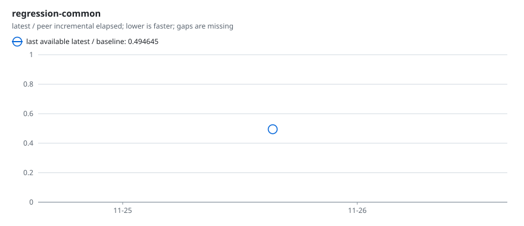


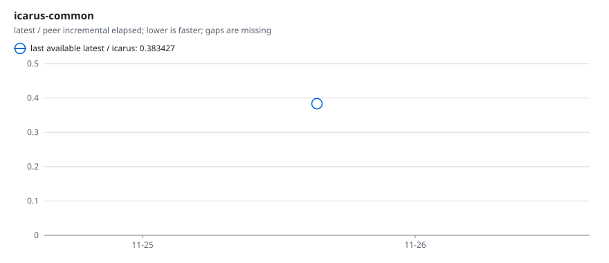


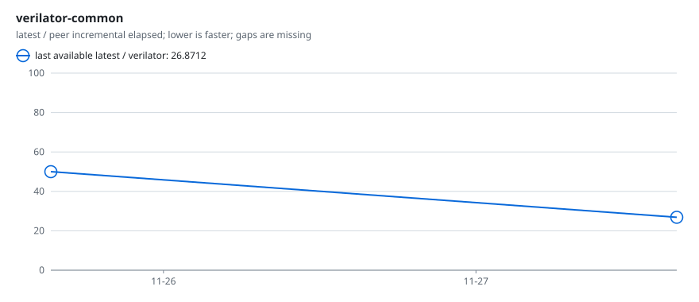


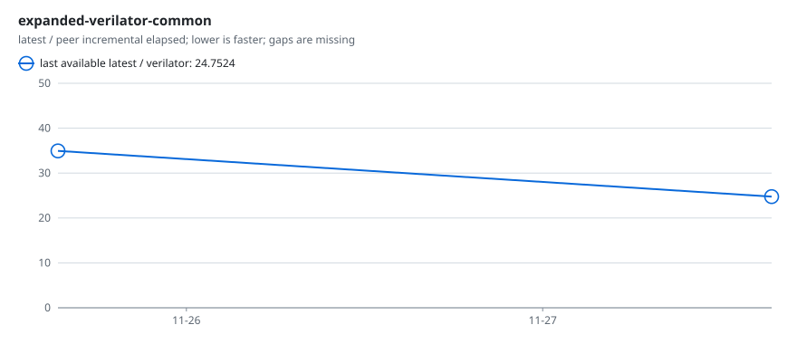

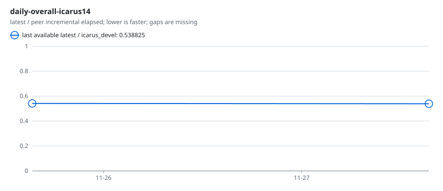

失敗を含む各回：

- [actions-45745212803-1](runs/actions-45745212803-1.json): complete — `8a20a6d9337c`
### `cde4aa9dacf5983c`

1 runs; 2026-11-25T03:47:30.324610+00:00 → 2026-11-25T03:47:30.324610+00:00

測定定義: `daily-v4-icarus14`; ケース数: **25**


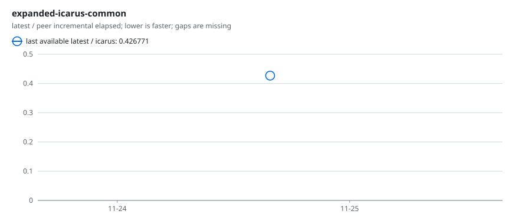

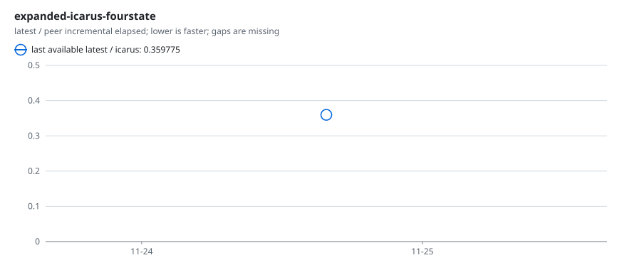


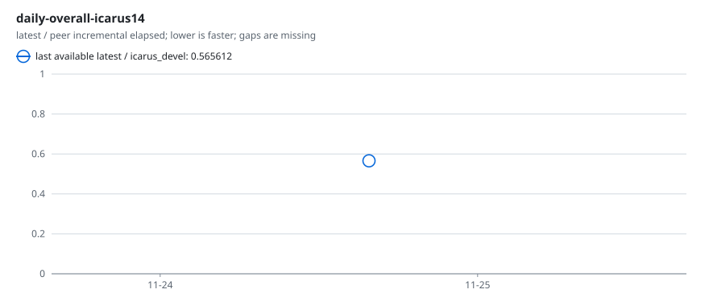

失敗を含む各回：

- [actions-45540765572-1](runs/actions-45540765572-1.json): incomplete — `a50ec73c37d8`
### `ce6cd82e24d95f55`

1 runs; 2026-11-23T04:17:20.572534+00:00 → 2026-11-23T04:17:20.572534+00:00

測定定義: `weekly-v2-icarus14`; ケース数: **3**


失敗を含む各回：

- [actions-45109202660-1](runs/actions-45109202660-1.json): complete — `378a66ab3240`
### `39bb1735b0601635`

1 runs; 2026-11-23T02:20:58.341830+00:00 → 2026-11-23T02:20:58.341830+00:00

測定定義: `daily-v4-icarus14`; ケース数: **25**


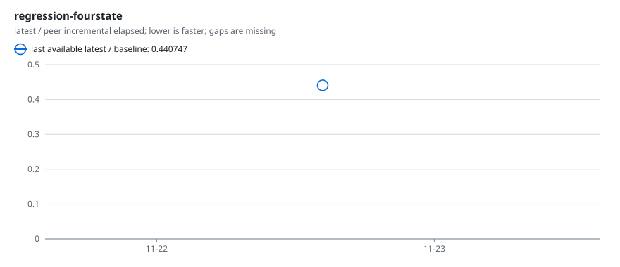

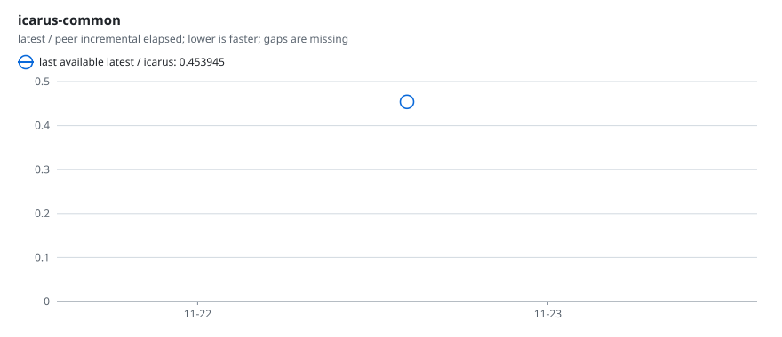


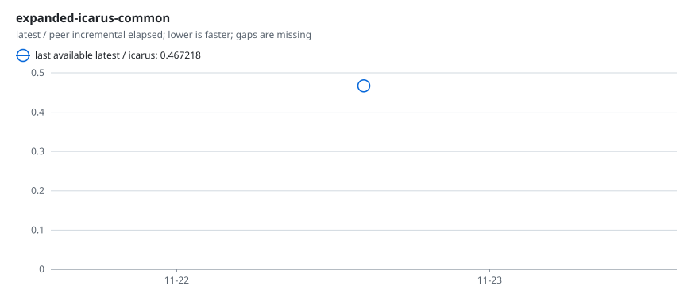


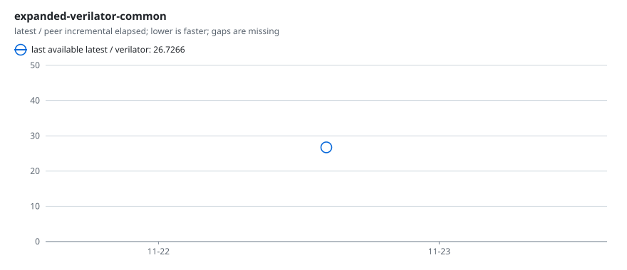


失敗を含む各回：

- [actions-45091454959-1](runs/actions-45091454959-1.json): complete — `1d2cac97a4fe`
### `341b44a021dff5eb`

3 runs; 2026-11-21T02:30:14.755165+00:00 → 2026-11-24T05:23:13.874403+00:00

測定定義: `daily-v4-icarus14`; ケース数: **25**


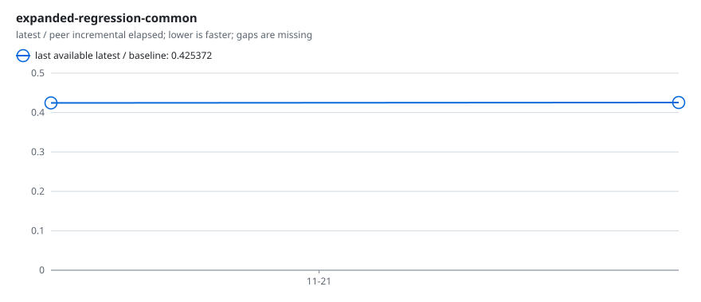


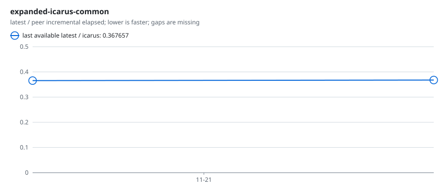


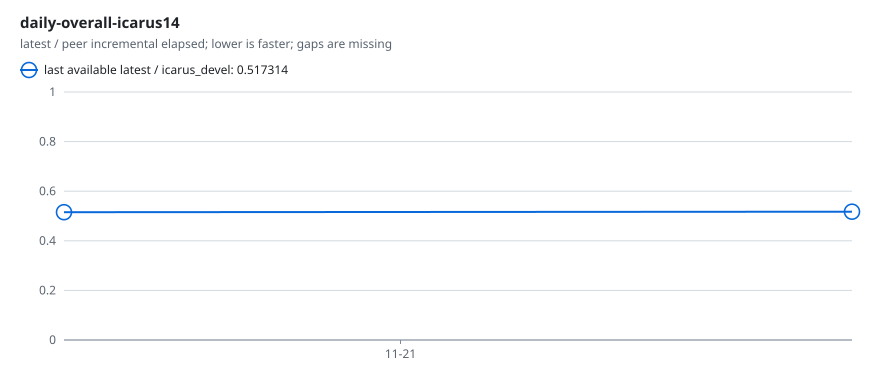

失敗を含む各回：

- [actions-45328846151-1](runs/actions-45328846151-1.json): complete — `e93839fdcbea`
- [actions-44966152659-1](runs/actions-44966152659-1.json): complete — `ad004a67d861`
- [actions-44850710627-1](runs/actions-44850710627-1.json): complete — `256839f71089`
### `cc3a300591d180c9`

3 runs; 2026-11-18T13:42:55.941756+00:00 → 2026-11-20T01:57:13.586055+00:00

測定定義: `daily-v4-icarus14`; ケース数: **25**


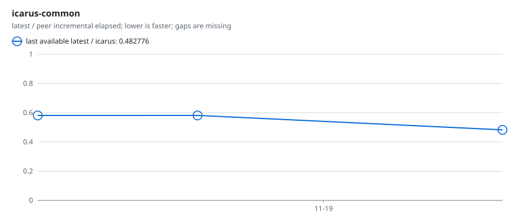

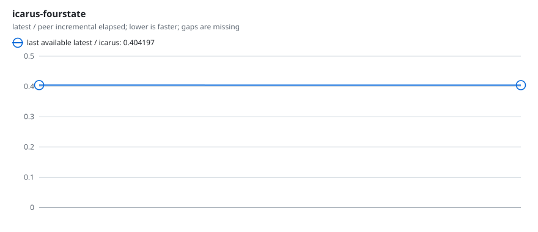


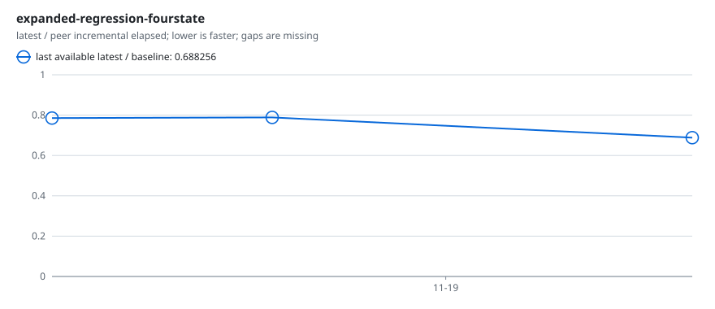


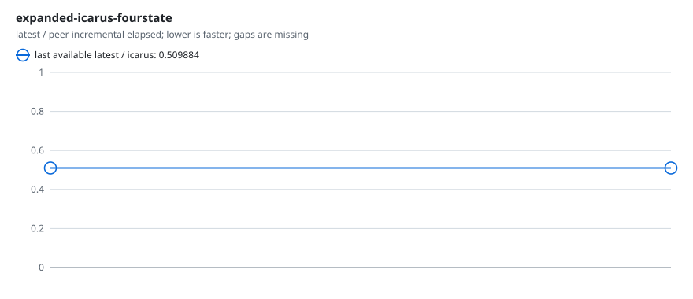


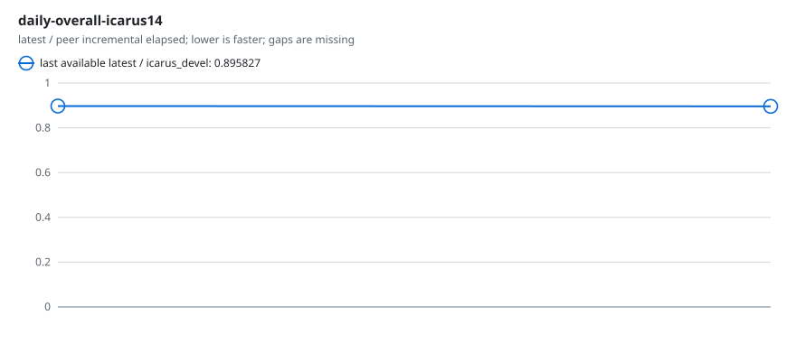

失敗を含む各回：

- [actions-44656096600-1](runs/actions-44656096600-1.json): complete — `cb97fc93bf6b`
- [actions-44440143026-1](runs/actions-44440143026-1.json): incomplete — `a6222f0656d4`
- [actions-44311501813-1](runs/actions-44311501813-1.json): complete — `441dddbd0fcd`
### `25a1c78c12d65db9`

1 runs; 2026-11-18T02:38:15.609997+00:00 → 2026-11-18T02:38:15.609997+00:00

測定定義: `daily-v3-expanded`; ケース数: **25**


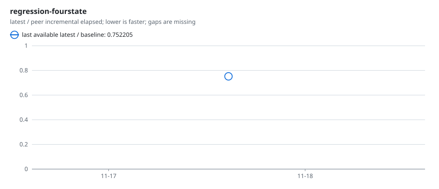


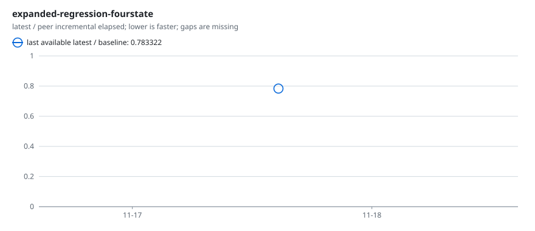


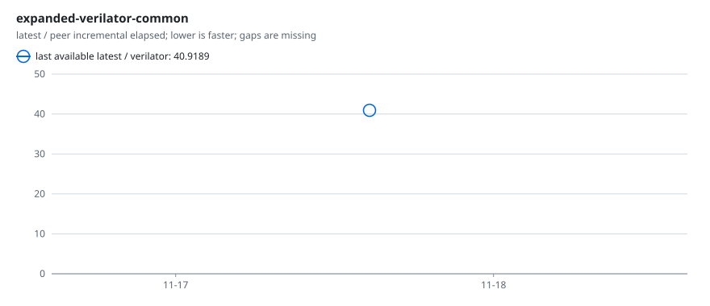

失敗を含む各回：

- [actions-44223268236-1](runs/actions-44223268236-1.json): complete — `441dddbd0fcd`
### `079515db5b1afbed`

1 runs; 2026-11-17T22:58:29.331708+00:00 → 2026-11-17T22:58:29.331708+00:00

測定定義: `weekly-v1-scale`; ケース数: **3**


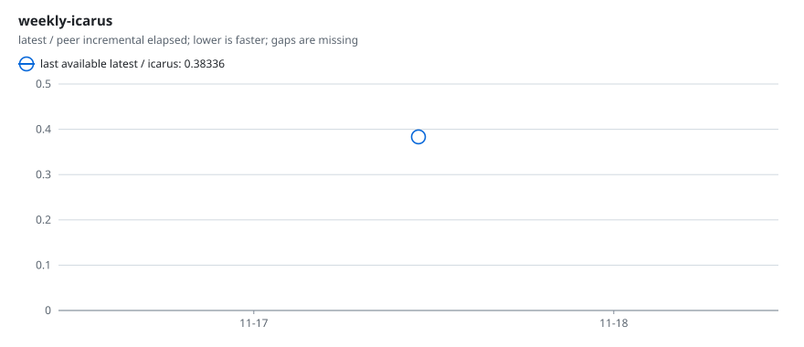


失敗を含む各回：

- [actions-44186811554-1](runs/actions-44186811554-1.json): complete — `441dddbd0fcd`
### `ff82f2d3ef6ff628`

1 runs; 2026-11-17T21:58:35.859990+00:00 → 2026-11-17T21:58:35.859990+00:00

測定定義: `daily-v3-expanded`; ケース数: **25**


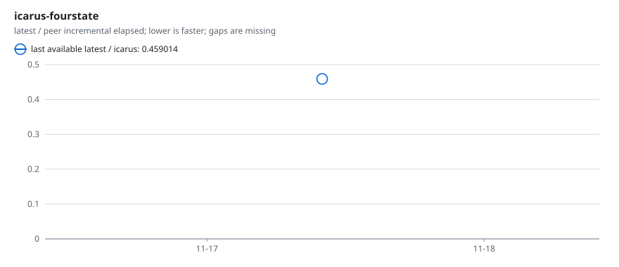


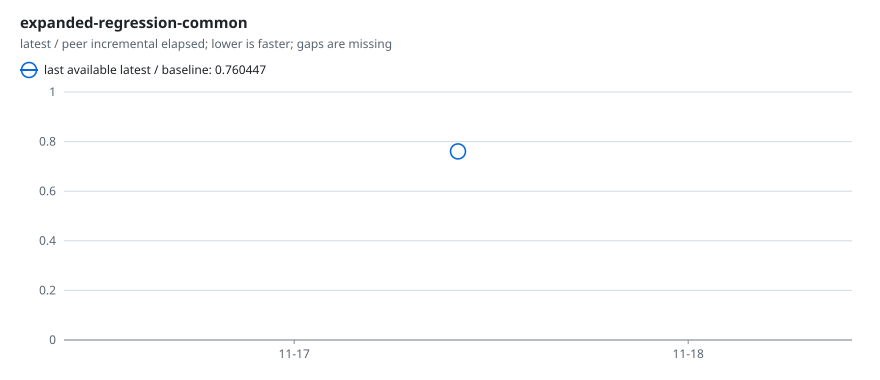


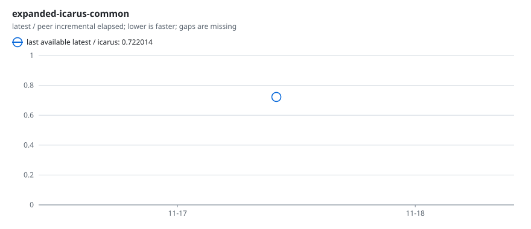

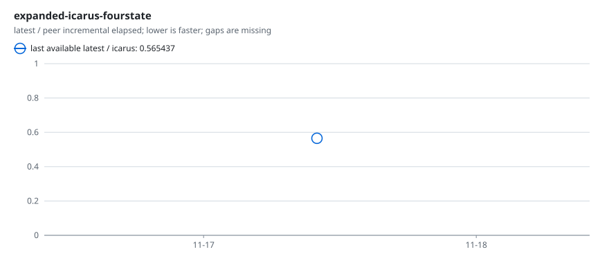


失敗を含む各回：

- [actions-44183926839-1](runs/actions-44183926839-1.json): complete — `234f65f6b205`
### `962ea28f5124b999`

1 runs; 2026-11-17T15:00:17.437065+00:00 → 2026-11-17T15:00:17.437065+00:00

測定定義: `daily-v2-thirteen`; ケース数: **13**


失敗を含む各回：

- [actions-44103555558-1](runs/actions-44103555558-1.json): complete — `13d52dde3c49`
### `ff134f2dfe29a369`

1 runs; 2026-11-17T13:04:45.723115+00:00 → 2026-11-17T13:04:45.723115+00:00

測定定義: `daily-v1`; ケース数: **5**

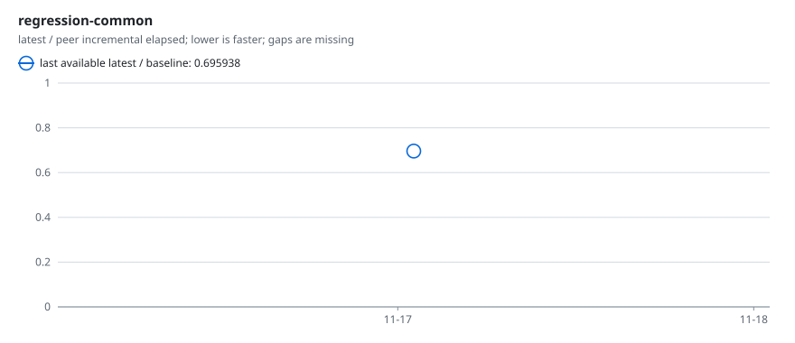


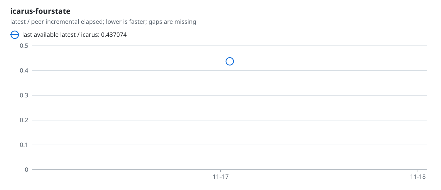


失敗を含む各回：

- [actions-44085771320-1](runs/actions-44085771320-1.json): complete — `26f359bcd504`

<!-- holdout-start -->

## 最新の別枠の測定（報告のみ）

日次・週次の集合に入らない設計で、週に1回測ります。kirimasimの最適化の判断には使わず、日次の総合値・headline.json・総合グラフにも入れません。比較の集合には相手が実行できる条件だけを入れ、宣言した非対応は欠測として示します。

[JSON](latest-holdout.json)

**測定回:** `actions-45186535033-1` — complete
2026-11-23T13:53:27.681573+00:00 → 2026-11-23T14:01:27.543368+00:00

比率は最新kirimasimの差分時間÷比較対象の差分時間です。1未満なら最新kirimasimが速いことを示します。

この環境での参考値です。失敗・欠測はゼロ秒ではありません。

[JSON](holdout/runs/actions-45186535033-1.json) · [Actions logs / ログ](https://github.com/kurochan001/kirimasim-tests/actions/runs/45186535033/attempts/1) · [Method / 測定方法](https://github.com/kurochan001/kirimasim-tests/blob/main/docs/daily-benchmark.md)

環境: github-hosted-ubuntu-24.04 / Intel(R) Xeon(R) 6975P-C / Linux-7.0.0-1014-aws-x86_64-with-glibc2.39

<details><summary>測定条件</summary>

```json
{
  "machine": {
    "os": "Linux-7.0.0-1014-aws-x86_64-with-glibc2.39",
    "cores": 4,
    "cpu": "Intel(R) Xeon(R) 6975P-C",
    "memory_gib": 15,
    "distribution": "Ubuntu 24.04.5 LTS",
    "architecture": "x86_64"
  },
  "compiler": "g++ (Ubuntu 13.3.0-6ubuntu2~24.04.1) 13.3.0",
  "profile": "holdout",
  "environment": "github-hosted-ubuntu-24.04",
  "image_os": "ubuntu24",
  "image_version": "20261116.133.1",
  "settings": {
    "runs": 5,
    "warmups": 1,
    "timeout_seconds": 600,
    "short_seconds": 0.05,
    "regression_warning_ratio": 1.15,
    "simulation_threads": 1,
    "waveforms": false,
    "assertions": false,
    "verilator_build_jobs": 1
  },
  "mode": "formal",
  "runs": 5,
  "tool_builds": {
    "latest": {
      "compiler": "g++ (Ubuntu 13.3.0-6ubuntu2~24.04.1) 13.3.0",
      "c_compiler": "gcc (Ubuntu 13.3.0-6ubuntu2~24.04.1) 13.3.0",
      "flags": {
        "CC": "gcc",
        "CXX": "g++",
        "CFLAGS": "",
        "CXXFLAGS": "",
        "preset": "release",
        "cmake": "-O3 -DNDEBUG -ffp-contract=off, no fast-math",
        "make_jobs": 2
      }
    },
    "baseline": {
      "compiler": "g++ (Ubuntu 13.3.0-6ubuntu2~24.04.1) 13.3.0",
      "c_compiler": "gcc (Ubuntu 13.3.0-6ubuntu2~24.04.1) 13.3.0",
      "flags": {
        "CC": "gcc",
        "CXX": "g++",
        "CFLAGS": "",
        "CXXFLAGS": "",
        "preset": "release",
        "cmake": "-O3 -DNDEBUG -ffp-contract=off, no fast-math",
        "make_jobs": 2
      }
    },
    "icarus": {
      "compiler": "g++ (Ubuntu 13.3.0-6ubuntu2~24.04.1) 13.3.0",
      "c_compiler": "gcc (Ubuntu 13.3.0-6ubuntu2~24.04.1) 13.3.0",
      "flags": {
        "CC": "gcc",
        "CXX": "g++",
        "CFLAGS": "",
        "CXXFLAGS": "",
        "preset": "release",
        "cmake": "-O3 -DNDEBUG -ffp-contract=off, no fast-math",
        "make_jobs": 2
      }
    },
    "verilator": {
      "compiler": "g++ (Ubuntu 13.3.0-6ubuntu2~24.04.1) 13.3.0",
      "c_compiler": "gcc (Ubuntu 13.3.0-6ubuntu2~24.04.1) 13.3.0",
      "flags": {
        "CC": "gcc",
        "CXX": "g++",
        "CFLAGS": "",
        "CXXFLAGS": "",
        "preset": "release",
        "cmake": "-O3 -DNDEBUG -ffp-contract=off, no fast-math",
        "make_jobs": 2
      }
    },
    "icarus_devel": {
      "compiler": "g++ (Ubuntu 13.3.0-6ubuntu2~24.04.1) 13.3.0",
      "c_compiler": "gcc (Ubuntu 13.3.0-6ubuntu2~24.04.1) 13.3.0",
      "flags": {
        "CC": "gcc",
        "CXX": "g++",
        "CFLAGS": "",
        "CXXFLAGS": "",
        "preset": "release",
        "cmake": "-O3 -DNDEBUG -ffp-contract=off, no fast-math",
        "make_jobs": 2
      }
    }
  },
  "verilator_options": "--binary --timing --threads 1 --build-jobs 1; default C++ optimization; assertions/tracing off",
  "icarus_options": "-g2012; vvp -n; single process",
  "kirimasim_options": "default four-state; interpreter; no waveform/assertion request"
}
```

</details>

- `latest`: `3fcc3ee078b33009c63c7e4df603ce237555618e` — kirimasim 0.2.0 (commit 3fcc3ee078b3), built with GNU 13.3.0
- `baseline`: `cfa2ccd75989c1ebb9ed63303271183377364cf0` — kirimasim 0.1.0 (commit cfa2ccd75989), built with GNU 13.3.0
- `icarus`: `dfeee909ed9f20b4870dd93423156c0170c0e1ff` — Icarus Verilog version 13.0 (stable) (dfeee90-dirty)
- `verilator`: `bbb60a403932a9f695cb6ff001ceb73de6ad9234` — Verilator 5.054 2026-11-01 rev vUNKNOWN-built20261121-bbb60a4
- `icarus_devel`: `587c033991b76b38e78f62803453f24dc7eef304` — Icarus Verilog version 14.0 (devel) (587c033)

定義・測定処理の識別情報: `{'config_sha256': '3b1543f8256fb66a689c77e1e8350434b8ff9d645e4d507e1f433d8ade07d16f', 'driver_sha256': '0edb91f5cbc17e8d1eec9e77ab4c87fb7dbcf4b9ff57d233c5e94628770ad077', 'comparison_sha256': '2896f429781d5eaff2d0ecec465726de342f840892056d20304d2df179ad6be0', 'history_sha256': 'bda014f86bbbea0bd769b5458656bfda07cbcaec712624cfad17960b10b5c887', 'setup_sha256': 'aa89dd6c7df5268f361f96049069cfe68b524ff93819afc4351fcb557c91d8f9', 'adapter_sha256': '4811f9d50d4a09d8794710296d644350468c49a9579a794f27af42ac9fb6b5bc', 'benchmark_commit': 'cfa2ccd75989c1ebb9ed63303271183377364cf0', 'reference_sha256': {'bench/reference_expanded.py': 'a1196d79efb88425f61cc69ba1d9ec99542f7f5dc41fac2a07ade82090b00f4a', 'bench/reference_holdout.py': '422e7ec147459f8dca2f42b91af07e6c2cf05435345a7eb11757a93305c500c2'}}`

| ケース | 処理系 | 状態 | ビルド秒 | T(1)中央値秒 | T(N)中央値秒 | 差分秒 | T(N) MAD秒 | RSS MiB | 最新/対象 | 理由・注意 |
|---|---|---|---:|---:|---:|---:|---:|---:|---:|---|
| class_pool (N=800000) | latest | measured | — | 0.0055532 | 2.8198 | 2.8143 | 0.011126 | 31.574 | — |  |
| class_pool (N=800000) | baseline | measured | — | 0.0054749 | 3.5209 | 3.5154 | 0.010191 | 30.359 | 0.80054 |  |
| class_pool (N=800000) | icarus | unsupported | — | — | — | — | — | — | — | Icarus Verilog 13.0 calls the base-class method instead of the virtual override for a base-class handle (8.20); 14.0 devel calls the override; declared before execution |
| class_pool (N=800000) | verilator | measured | 4.8743 | 0.0013233 | 0.084766 | 0.083443 | 0.00075647 | 52.844 | 33.727 |  |
| class_pool (N=800000) | icarus_devel | measured | 0.0038651 | 0.002776 | 3.6027 | 3.6 | 0.0012064 | 7.6719 | 0.78175 |  |
| dynarray_resize (N=120000) | latest | measured | — | 0.0054285 | 0.81674 | 0.81131 | 0.004125 | 31.641 | — |  |
| dynarray_resize (N=120000) | baseline | measured | — | 0.0050991 | 1.3439 | 1.3388 | 0.0016931 | 28.32 | 0.60599 |  |
| dynarray_resize (N=120000) | icarus | measured | 0.0038624 | 0.0024619 | 3.1556 | 3.1531 | 0.0067614 | 7.4219 | 0.2573 |  |
| dynarray_resize (N=120000) | verilator | measured | 4.8225 | 0.0012997 | 0.032622 | 0.031322 | 1.8219e-05 | 3.8516 | 25.902 | short incremental time; sensitive to timing noise |
| dynarray_resize (N=120000) | icarus_devel | measured | 0.0036606 | 0.0022353 | 2.4627 | 2.4604 | 0.0030426 | 7.6992 | 0.32974 |  |
| intf_modport (N=1000000) | latest | measured | — | 0.0050209 | 2.0162 | 2.0112 | 0.0070858 | 29.762 | — |  |
| intf_modport (N=1000000) | baseline | measured | — | 0.0052263 | 3.5477 | 3.5425 | 0.0037842 | 28.309 | 0.56773 |  |
| intf_modport (N=1000000) | icarus | unsupported | — | — | — | — | — | — | — | Icarus Verilog 13.0 does not parse modport port declarations; 14.0 devel does; declared before execution |
| intf_modport (N=1000000) | verilator | measured | 5.4029 | 0.0013405 | 0.48446 | 0.48312 | 0.00069707 | 3.8516 | 4.1628 |  |
| intf_modport (N=1000000) | icarus_devel | measured | 0.0037169 | 0.0026618 | 2.0337 | 2.0311 | 0.0041618 | 7.5859 | 0.99021 |  |
| real_filter (N=2000000) | latest | measured | — | 0.0055598 | 1.1011 | 1.0955 | 0.0033106 | 29.676 | — |  |
| real_filter (N=2000000) | baseline | measured | — | 0.0049299 | 1.9864 | 1.9815 | 0.0010052 | 28.32 | 0.55288 |  |
| real_filter (N=2000000) | icarus | measured | 0.0039117 | 0.0023325 | 4.7685 | 4.7662 | 0.011536 | 7.4102 | 0.22985 |  |
| real_filter (N=2000000) | verilator | measured | 4.6674 | 0.0013135 | 0.019859 | 0.018546 | 0.00011228 | 3.8359 | 59.07 | short incremental time; sensitive to timing noise |
| real_filter (N=2000000) | icarus_devel | measured | 0.0036209 | 0.0023793 | 3.2432 | 3.2408 | 0.0021554 | 7.5469 | 0.33804 |  |
| force_release (N=1500000) | latest | measured | — | 0.0051603 | 1.6446 | 1.6395 | 0.0044734 | 29.699 | — |  |
| force_release (N=1500000) | baseline | measured | — | 0.0052299 | 2.6182 | 2.613 | 0.0081236 | 28.309 | 0.62745 |  |
| force_release (N=1500000) | icarus | unsupported | — | — | — | — | — | — | — | Icarus Verilog evaluates the right-hand side of assign and force once (its &quot;sorry: procedural continuous assignments are not yet fully supported&quot;), while 10.6 reevaluates it when an operand changes; declared before execution |
| force_release (N=1500000) | verilator | measured | 5.5142 | 0.001333 | 0.19559 | 0.19426 | 0.00020495 | 3.8516 | 8.4396 |  |
| force_release (N=1500000) | icarus_devel | unsupported | — | — | — | — | — | — | — | Icarus Verilog evaluates the right-hand side of assign and force once (its &quot;sorry: procedural continuous assignments are not yet fully supported&quot;), while 10.6 reevaluates it when an operand changes; declared before execution |
| delayed_nets (N=400000) | latest | measured | — | 0.0054106 | 1.2792 | 1.2738 | 0.0077118 | 29.699 | — |  |
| delayed_nets (N=400000) | baseline | measured | — | 0.0052448 | 2.145 | 2.1397 | 0.0035043 | 28.371 | 0.59531 |  |
| delayed_nets (N=400000) | icarus | measured | 0.0040832 | 0.002703 | 2.1714 | 2.1687 | 0.0058275 | 7.418 | 0.58736 |  |
| delayed_nets (N=400000) | verilator | measured | 5.5798 | 0.0013092 | 0.56811 | 0.5668 | 0.0012515 | 3.832 | 2.2474 |  |
| delayed_nets (N=400000) | icarus_devel | measured | 0.0036722 | 0.0025209 | 1.7697 | 1.7672 | 0.00091432 | 7.6992 | 0.7208 |  |
| specify_paths (N=400000) | latest | measured | — | 0.0051603 | 2.0482 | 2.043 | 0.0022109 | 29.703 | — |  |
| specify_paths (N=400000) | baseline | measured | — | 0.0054841 | 3.2663 | 3.2609 | 0.0079521 | 28.32 | 0.62653 |  |
| specify_paths (N=400000) | icarus | measured | 0.003936 | 0.0028334 | 2.7463 | 2.7435 | 0.0023401 | 7.4453 | 0.74468 |  |
| specify_paths (N=400000) | verilator | unsupported | — | — | — | — | — | — | — | Verilator does not apply module path delays (30.4); its output equals that of zero-delay paths; declared before execution |
| specify_paths (N=400000) | icarus_devel | measured | 0.003787 | 0.0027277 | 2.3327 | 2.33 | 0.0003768 | 7.6641 | 0.87685 |  |
| file_output (N=1000000) | latest | measured | — | 0.0053495 | 2.0607 | 2.0554 | 0.0014948 | 29.637 | — |  |
| file_output (N=1000000) | baseline | measured | — | 0.0055434 | 2.5074 | 2.5018 | 0.00056502 | 28.371 | 0.82156 |  |
| file_output (N=1000000) | icarus | measured | 0.0039565 | 0.0027987 | 3.8523 | 3.8495 | 0.010111 | 7.418 | 0.53393 |  |
| file_output (N=1000000) | verilator | measured | 4.7823 | 0.0013308 | 0.58154 | 0.58021 | 0.00020676 | 3.9688 | 3.5424 |  |
| file_output (N=1000000) | icarus_devel | measured | 0.0036633 | 0.0023978 | 3.5376 | 3.5352 | 0.0039738 | 7.5586 | 0.58139 |  |
| bus_fabric_vcd (N=100000) | latest | measured | — | 0.006193 | 0.91935 | 0.91315 | 0.0016257 | 31.676 | — |  |
| bus_fabric_vcd (N=100000) | baseline | measured | — | 0.00566 | 1.7717 | 1.766 | 0.00094944 | 28.281 | 0.51707 |  |
| bus_fabric_vcd (N=100000) | icarus | measured | 0.0045948 | 0.0033658 | 1.6556 | 1.6522 | 0.0039584 | 7.6953 | 0.55267 |  |
| bus_fabric_vcd (N=100000) | verilator | measured | 6.6854 | 0.0014393 | 0.13143 | 0.12999 | 0.00079613 | 4.0234 | 7.0246 |  |
| bus_fabric_vcd (N=100000) | icarus_devel | measured | 0.0043696 | 0.003252 | 1.576 | 1.5727 | 0.0021657 | 7.8789 | 0.58062 |  |
| bus_fabric_fst (N=100000) | latest | measured | — | 0.0067122 | 1.1645 | 1.1578 | 0.031107 | 123.72 | — |  |
| bus_fabric_fst (N=100000) | baseline | measured | — | 0.0065996 | 1.9607 | 1.9541 | 0.025559 | 122.51 | 0.5925 |  |
| bus_fabric_fst (N=100000) | icarus | measured | 0.005243 | 0.0037713 | 1.8932 | 1.8894 | 0.012322 | 140.87 | 0.61277 |  |
| bus_fabric_fst (N=100000) | verilator | measured | 7.5771 | 0.0016658 | 0.23205 | 0.23039 | 0.00067279 | 59.164 | 5.0254 |  |
| bus_fabric_fst (N=100000) | icarus_devel | measured | 0.0043479 | 0.00317 | 1.8457 | 1.8426 | 0.006946 | 141.03 | 0.62836 |  |

固定した総合値の集合（全ケースの有効値が必要です）：

- **holdout-icarus14**: 0.60926; 9/9; class_pool, dynarray_resize, intf_modport, real_filter, delayed_nets, specify_paths, file_output, bus_fabric_vcd, bus_fabric_fst
- **holdout-regression**: 0.62413; 10/10; class_pool, dynarray_resize, intf_modport, real_filter, force_release, delayed_nets, specify_paths, file_output, bus_fabric_vcd, bus_fabric_fst
- **holdout-verilator**: 9.2782; 9/9; class_pool, dynarray_resize, intf_modport, real_filter, force_release, delayed_nets, file_output, bus_fabric_vcd, bus_fabric_fst

完全なNでの波形ファイルの大きさ（バイトの中央値。中身は比べていません）：

| 条件 | 処理系 | バイト |
|---|---|---:|
| bus_fabric_vcd (N=100000) | latest | 74,839,976 |
| bus_fabric_vcd (N=100000) | baseline | 74,839,978 |
| bus_fabric_vcd (N=100000) | icarus | 130,983,583 |
| bus_fabric_vcd (N=100000) | verilator | 62,699,582 |
| bus_fabric_vcd (N=100000) | icarus_devel | 130,983,583 |
| bus_fabric_fst (N=100000) | latest | 3,084,969 |
| bus_fabric_fst (N=100000) | baseline | 3,084,970 |
| bus_fabric_fst (N=100000) | icarus | 3,300,103 |
| bus_fabric_fst (N=100000) | verilator | 4,698,181 |
| bus_fabric_fst (N=100000) | icarus_devel | 3,300,103 |

失敗を含む別枠の各回：

- [actions-45186535033-1](holdout/runs/actions-45186535033-1.json): complete — `3fcc3ee078b3`
- [actions-44895777688-1](holdout/runs/actions-44895777688-1.json): complete — `557aae7ef84f`

<!-- holdout-end -->
</details>
