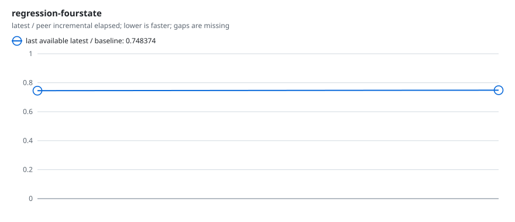
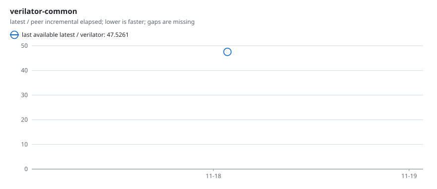
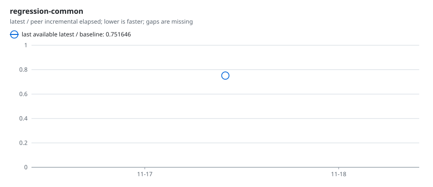
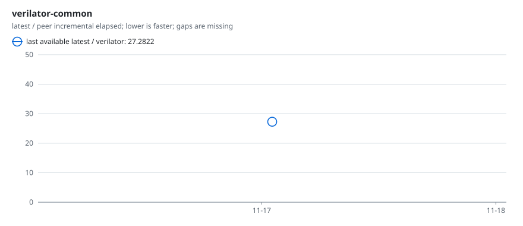

# 日次・週次シミュレーション速度ベンチマーク

[English](README.md) / [日本語](README.ja.md)

機能テストのNightlyとは独立しています。GitHub標準ランナーの値は参考値で、5回の測定から統計的有意性を断言しません。


日次25種類（共通22＋4値3）の等重み幾何平均です。比率はkirimasim÷Icarus 14.0 develの差分所要時間。0.97は所要時間が3%短い意味で、小さいほど高速です。

両開発版のコミットを測定開始時に一度解決します。JSTの各日の最後の正式測定を使い、1種類でも無効なら総合値は欠測です。環境・定義ごとに線を分けます。双方の変更が推移に影響するため、固定版との比較も下に残します。

[JSON](headline.json) · [Method / 測定方法](https://github.com/kurochan001/kirimasim-tests/blob/main/docs/daily-benchmark.md)

最新の総合測定: **2026-11-19 JST — 0.89583** (25/25; incomplete)

[Raw / 生データ](runs/actions-44440143026-1.json) · [Actions logs / ログ](https://github.com/kurochan001/kirimasim-tests/actions/runs/44440143026/attempts/1)

<details><summary>ケース別結果・固定版との比較・過去の系列</summary>

## 最新の日次測定

[JSON](latest-daily.json)

**測定回:** `actions-44440143026-1` — incomplete
2026-11-19T02:10:44.846201+00:00 → 2026-11-19T03:06:56.497631+00:00

比率は最新kirimasimの差分時間÷比較対象の差分時間です。1未満なら最新kirimasimが速いことを示します。

この環境での参考値です。失敗・欠測はゼロ秒ではありません。

[JSON](runs/actions-44440143026-1.json) · [Actions logs / ログ](https://github.com/kurochan001/kirimasim-tests/actions/runs/44440143026/attempts/1) · [Method / 測定方法](https://github.com/kurochan001/kirimasim-tests/blob/main/docs/daily-benchmark.md)

環境: github-hosted-ubuntu-24.04 / Intel(R) Xeon(R) 6975P-C / Linux-7.0.0-1014-aws-x86_64-with-glibc2.39

<details><summary>測定条件</summary>

```json
{
  "machine": {
    "os": "Linux-7.0.0-1014-aws-x86_64-with-glibc2.39",
    "cores": 4,
    "cpu": "Intel(R) Xeon(R) 6975P-C",
    "memory_gib": 15,
    "distribution": "Ubuntu 24.04.5 LTS",
    "architecture": "x86_64"
  },
  "compiler": "g++ (Ubuntu 13.3.0-6ubuntu2~24.04.1) 13.3.0",
  "profile": "daily",
  "environment": "github-hosted-ubuntu-24.04",
  "image_os": "ubuntu24",
  "image_version": "20261111.127.1",
  "settings": {
    "runs": 5,
    "warmups": 1,
    "timeout_seconds": 600,
    "short_seconds": 0.05,
    "regression_warning_ratio": 1.15,
    "simulation_threads": 1,
    "waveforms": false,
    "assertions": false,
    "verilator_build_jobs": 1
  },
  "mode": "formal",
  "runs": 5,
  "tool_builds": {
    "latest": {
      "compiler": "g++ (Ubuntu 13.3.0-6ubuntu2~24.04.1) 13.3.0",
      "c_compiler": "gcc (Ubuntu 13.3.0-6ubuntu2~24.04.1) 13.3.0",
      "flags": {
        "CC": "gcc",
        "CXX": "g++",
        "CFLAGS": "",
        "CXXFLAGS": "",
        "preset": "release",
        "cmake": "-O3 -DNDEBUG -ffp-contract=off, no fast-math",
        "make_jobs": 2
      }
    },
    "baseline": {
      "compiler": "g++ (Ubuntu 13.3.0-6ubuntu2~24.04.1) 13.3.0",
      "c_compiler": "gcc (Ubuntu 13.3.0-6ubuntu2~24.04.1) 13.3.0",
      "flags": {
        "CC": "gcc",
        "CXX": "g++",
        "CFLAGS": "",
        "CXXFLAGS": "",
        "preset": "release",
        "cmake": "-O3 -DNDEBUG -ffp-contract=off, no fast-math",
        "make_jobs": 2
      }
    },
    "icarus": {
      "compiler": "g++ (Ubuntu 13.3.0-6ubuntu2~24.04.1) 13.3.0",
      "c_compiler": "gcc (Ubuntu 13.3.0-6ubuntu2~24.04.1) 13.3.0",
      "flags": {
        "CC": "gcc",
        "CXX": "g++",
        "CFLAGS": "",
        "CXXFLAGS": "",
        "preset": "release",
        "cmake": "-O3 -DNDEBUG -ffp-contract=off, no fast-math",
        "make_jobs": 2
      }
    },
    "verilator": {
      "compiler": "g++ (Ubuntu 13.3.0-6ubuntu2~24.04.1) 13.3.0",
      "c_compiler": "gcc (Ubuntu 13.3.0-6ubuntu2~24.04.1) 13.3.0",
      "flags": {
        "CC": "gcc",
        "CXX": "g++",
        "CFLAGS": "",
        "CXXFLAGS": "",
        "preset": "release",
        "cmake": "-O3 -DNDEBUG -ffp-contract=off, no fast-math",
        "make_jobs": 2
      }
    },
    "icarus_devel": {
      "compiler": "g++ (Ubuntu 13.3.0-6ubuntu2~24.04.1) 13.3.0",
      "c_compiler": "gcc (Ubuntu 13.3.0-6ubuntu2~24.04.1) 13.3.0",
      "flags": {
        "CC": "gcc",
        "CXX": "g++",
        "CFLAGS": "",
        "CXXFLAGS": "",
        "preset": "release",
        "cmake": "-O3 -DNDEBUG -ffp-contract=off, no fast-math",
        "make_jobs": 2
      }
    }
  },
  "verilator_options": "--binary --timing --threads 1 --build-jobs 1; default C++ optimization; assertions/tracing off",
  "icarus_options": "-g2012; vvp -n; single process",
  "kirimasim_options": "default four-state; interpreter; no waveform/assertion request"
}
```

</details>

- `latest`: `a6222f0656d46fbafc332ba8d8adaebb9273b964` — kirimasim 0.1.1 (commit a6222f0656d4), built with GNU 13.3.0
- `baseline`: `cfa2ccd75989c1ebb9ed63303271183377364cf0` — kirimasim 0.1.0 (commit cfa2ccd75989), built with GNU 13.3.0
- `icarus`: `dfeee909ed9f20b4870dd93423156c0170c0e1ff` — Icarus Verilog version 13.0 (stable) (dfeee90-dirty)
- `verilator`: `bbb60a403932a9f695cb6ff001ceb73de6ad9234` — Verilator 5.054 2026-11-01 rev vUNKNOWN-built20261118-bbb60a4
- `icarus_devel`: `cf020c56d2953fc35ccf7af5ce35dda193a068f0` — Icarus Verilog version 14.0 (devel) (cf020c5)

定義・測定処理の識別情報: `{'config_sha256': '4006a76543b7c88eed78ba128e7459c54ac2ee82a78efdd401ac2d85643bef9b', 'driver_sha256': '0edb91f5cbc17e8d1eec9e77ab4c87fb7dbcf4b9ff57d233c5e94628770ad077', 'comparison_sha256': '2896f429781d5eaff2d0ecec465726de342f840892056d20304d2df179ad6be0', 'history_sha256': 'bda014f86bbbea0bd769b5458656bfda07cbcaec712624cfad17960b10b5c887', 'setup_sha256': 'aa89dd6c7df5268f361f96049069cfe68b524ff93819afc4351fcb557c91d8f9', 'adapter_sha256': '4811f9d50d4a09d8794710296d644350468c49a9579a794f27af42ac9fb6b5bc', 'benchmark_commit': 'cfa2ccd75989c1ebb9ed63303271183377364cf0', 'reference_sha256': {'bench/reference_expanded.py': 'a1196d79efb88425f61cc69ba1d9ec99542f7f5dc41fac2a07ade82090b00f4a', 'bench/reference_fourstate_mix.py': '586fb643e9ef9df9e304df83e04e711aa1b875e6cb4393e6e3c98cd1707b70e1'}}`

| ケース | 処理系 | 状態 | ビルド秒 | T(1)中央値秒 | T(N)中央値秒 | 差分秒 | T(N) MAD秒 | RSS MiB | 最新/対象 | 理由・注意 |
|---|---|---|---:|---:|---:|---:|---:|---:|---:|---|
| casez_struct (N=5000000) | latest | measured | — | 0.0046074 | 3.6258 | 3.6212 | 0.021997 | 28.457 | — |  |
| casez_struct (N=5000000) | baseline | measured | — | 0.0051361 | 5.0192 | 5.014 | 0.010108 | 28.363 | 0.72222 |  |
| casez_struct (N=5000000) | icarus | measured | 0.0040563 | 0.0027638 | 5.4995 | 5.4967 | 0.012307 | 7.3594 | 0.6588 |  |
| casez_struct (N=5000000) | verilator | measured | 4.8289 | 0.0013027 | 0.029714 | 0.028412 | 7.7403e-05 | 3.8047 | 127.46 | short incremental time; sensitive to timing noise |
| casez_struct (N=5000000) | icarus_devel | measured | 0.0037186 | 0.0025618 | 5.0519 | 5.0493 | 0.0095781 | 7.5859 | 0.71717 |  |
| comb_chain (N=3000000) | latest | measured | — | 0.0049407 | 10.224 | 10.219 | 0.017149 | 28.422 | — |  |
| comb_chain (N=3000000) | baseline | measured | — | 0.0053918 | 13.487 | 13.482 | 0.0709 | 28.367 | 0.75796 |  |
| comb_chain (N=3000000) | icarus | measured | 0.0039256 | 0.0027373 | 19.412 | 19.409 | 0.023504 | 7.4062 | 0.5265 |  |
| comb_chain (N=3000000) | verilator | measured | 5.4891 | 0.0013384 | 0.32397 | 0.32263 | 0.00072943 | 3.8164 | 31.673 |  |
| comb_chain (N=3000000) | icarus_devel | measured | 0.0039526 | 0.0025917 | 12.905 | 12.902 | 0.0094882 | 7.5547 | 0.79201 |  |
| dyn_queue (N=4000000) | latest | measured | — | 0.0048381 | 4.4238 | 4.419 | 0.0036933 | 28.422 | — |  |
| dyn_queue (N=4000000) | baseline | measured | — | 0.0052144 | 5.5353 | 5.5301 | 0.0094292 | 28.184 | 0.79908 |  |
| dyn_queue (N=4000000) | icarus | measured | 0.0038066 | 0.0028023 | 10.304 | 10.301 | 0.015099 | 7.375 | 0.42899 |  |
| dyn_queue (N=4000000) | verilator | measured | 4.9491 | 0.0013237 | 0.10501 | 0.10369 | 0.00031212 | 3.8047 | 42.617 |  |
| dyn_queue (N=4000000) | icarus_devel | measured | 0.003702 | 0.0025934 | 9.4862 | 9.4836 | 0.010717 | 7.6328 | 0.46596 |  |
| fork_join (N=4000000) | latest | measured | — | 0.0054461 | 5.9422 | 5.9367 | 0.0083651 | 28.344 | — |  |
| fork_join (N=4000000) | baseline | measured | — | 0.0054752 | 6.9622 | 6.9567 | 0.0018522 | 28.137 | 0.85338 |  |
| fork_join (N=4000000) | icarus | measured | 0.0039653 | 0.0027359 | 9.0109 | 9.0081 | 0.01308 | 7.3906 | 0.65904 |  |
| fork_join (N=4000000) | verilator | measured | 5.6403 | 0.0013412 | 1.7569 | 1.7555 | 0.0012917 | 3.8242 | 3.3818 |  |
| fork_join (N=4000000) | icarus_devel | measured | 0.0035427 | 0.0024346 | 6.7591 | 6.7566 | 0.0045264 | 7.5234 | 0.87865 |  |
| func_call (N=1500000) | latest | measured | — | 0.0046099 | 5.5481 | 5.5435 | 0.02959 | 28.258 | — |  |
| func_call (N=1500000) | baseline | measured | — | 0.0056161 | 6.7265 | 6.7209 | 0.010896 | 28.125 | 0.82481 |  |
| func_call (N=1500000) | icarus | measured | 0.0039487 | 0.0028135 | 15.266 | 15.263 | 0.026772 | 7.3516 | 0.3632 |  |
| func_call (N=1500000) | verilator | measured | 4.8999 | 0.0013223 | 0.0085456 | 0.0072233 | 0.00013723 | 0.31641 | 767.44 | short incremental time; sensitive to timing noise |
| func_call (N=1500000) | icarus_devel | measured | 0.0037654 | 0.0024129 | 10.349 | 10.347 | 0.012104 | 7.5391 | 0.53578 |  |
| gate_udp (N=400000) | latest | measured | — | 0.006732 | 5.8825 | 5.8758 | 0.0029125 | 28.27 | — |  |
| gate_udp (N=400000) | baseline | measured | — | 0.0066341 | 7.625 | 7.6184 | 0.0098648 | 28.199 | 0.77127 |  |
| gate_udp (N=400000) | icarus | measured | 0.0053642 | 0.0036508 | 4.906 | 4.9023 | 0.019131 | 7.4883 | 1.1986 |  |
| gate_udp (N=400000) | verilator | measured | 5.7778 | 0.00134 | 0.063136 | 0.061796 | 0.00014544 | 3.8203 | 95.084 |  |
| gate_udp (N=400000) | icarus_devel | measured | 0.0052328 | 0.0034389 | 4.5305 | 4.527 | 0.0021584 | 7.6484 | 1.2979 |  |
| mem_rw (N=4000000) | latest | measured | — | 0.0061241 | 5.8432 | 5.8371 | 0.024171 | 28.25 | — |  |
| mem_rw (N=4000000) | baseline | measured | — | 0.0064456 | 7.2835 | 7.277 | 0.023769 | 28.242 | 0.80213 |  |
| mem_rw (N=4000000) | icarus | measured | 0.0047944 | 0.0032558 | 6.0746 | 6.0713 | 0.012643 | 7.4141 | 0.96143 |  |
| mem_rw (N=4000000) | verilator | measured | 5.6399 | 0.0013427 | 0.97568 | 0.97434 | 0.00061086 | 3.8555 | 5.9908 |  |
| mem_rw (N=4000000) | icarus_devel | measured | 0.0038889 | 0.0031616 | 4.4094 | 4.4063 | 0.0022559 | 7.5742 | 1.3247 |  |
| nba_burst (N=500000) | latest | measured | — | 0.0043477 | 0.12962 | 0.12528 | 0.00019228 | 124.51 | — |  |
| nba_burst (N=500000) | baseline | measured | — | 0.0050567 | 0.15419 | 0.14914 | 0.00051571 | 124.32 | 0.84 |  |
| nba_burst (N=500000) | icarus | measured | 0.0043453 | 0.0023673 | 0.17017 | 0.1678 | 0.00014542 | 33.832 | 0.74658 |  |
| nba_burst (N=500000) | verilator | incomparable | 5.713 | 0.0013163 | 0.0013046 | — | 1.0825e-05 | 0.3125 | — | non-positive or non-finite incremental elapsed time |
| nba_burst (N=500000) | icarus_devel | measured | 0.0037341 | 0.0023578 | 0.1672 | 0.16485 | 0.00016231 | 34 | 0.75995 |  |
| nba_shift (N=1000000) | latest | measured | — | 0.0048257 | 28.15 | 28.145 | 0.021208 | 28.547 | — |  |
| nba_shift (N=1000000) | baseline | measured | — | 0.0061723 | 35.488 | 35.482 | 0.014745 | 28.25 | 0.79323 |  |
| nba_shift (N=1000000) | icarus | measured | 0.0044247 | 0.0030678 | 34.591 | 34.588 | 0.0094847 | 7.4883 | 0.81372 |  |
| nba_shift (N=1000000) | verilator | measured | 5.8178 | 0.0013525 | 0.28355 | 0.2822 | 0.00085501 | 3.8555 | 99.735 |  |
| nba_shift (N=1000000) | icarus_devel | measured | 0.0042216 | 0.0029924 | 34.048 | 34.045 | 0.032098 | 7.6289 | 0.8267 |  |
| proc_wait (N=1000000) | latest | measured | — | 0.0072768 | 8.9271 | 8.9198 | 0.02481 | 32.41 | — |  |
| proc_wait (N=1000000) | baseline | measured | — | 0.0066278 | 10.479 | 10.473 | 0.029812 | 30.223 | 0.85174 |  |
| proc_wait (N=1000000) | icarus | measured | 0.0051581 | 0.0038107 | 8.635 | 8.6312 | 0.0050135 | 7.8359 | 1.0334 |  |
| proc_wait (N=1000000) | verilator | measured | 7.4949 | 0.0014041 | 2.9348 | 2.9334 | 0.004254 | 3.9492 | 3.0407 |  |
| proc_wait (N=1000000) | icarus_devel | measured | 0.0051298 | 0.0035709 | 8.7342 | 8.7306 | 0.0072243 | 8.0938 | 1.0217 |  |
| string_fmt (N=500000) | latest | measured | — | 0.0045018 | 4.5189 | 4.5144 | 0.017073 | 28.395 | — |  |
| string_fmt (N=500000) | baseline | measured | — | 0.0052698 | 5.8298 | 5.8245 | 0.012724 | 28.227 | 0.77506 |  |
| string_fmt (N=500000) | icarus | measured | 0.0048137 | 0.0028059 | 15.044 | 15.041 | 0.045352 | 7.4023 | 0.30013 |  |
| string_fmt (N=500000) | verilator | measured | 4.8257 | 0.0013453 | 0.19995 | 0.19861 | 0.00044263 | 3.9609 | 22.73 |  |
| string_fmt (N=500000) | icarus_devel | measured | 0.0038142 | 0.0027297 | 11.625 | 11.622 | 0.032288 | 7.6328 | 0.38842 |  |
| wide_arith (N=1500000) | latest | measured | — | 0.0053433 | 2.8193 | 2.814 | 0.010379 | 28.449 | — |  |
| wide_arith (N=1500000) | baseline | measured | — | 0.0047201 | 7.1432 | 7.1385 | 0.0075947 | 28.113 | 0.3942 |  |
| wide_arith (N=1500000) | icarus | measured | 0.0039996 | 0.0025938 | 14.594 | 14.591 | 0.0047202 | 7.3242 | 0.19285 |  |
| wide_arith (N=1500000) | verilator | measured | 4.9507 | 0.0013213 | 0.12037 | 0.11905 | 0.00041413 | 3.8359 | 23.637 |  |
| wide_arith (N=1500000) | icarus_devel | measured | 0.0038959 | 0.0022783 | 2.6909 | 2.6886 | 0.0024301 | 7.5547 | 1.0466 |  |
| fourstate_mix (N=1000000) | latest | measured | — | 0.0046049 | 1.2991 | 1.2945 | 0.00068359 | 28.547 | — |  |
| fourstate_mix (N=1000000) | baseline | measured | — | 0.0055433 | 1.7353 | 1.7298 | 0.0021148 | 28.449 | 0.74837 |  |
| fourstate_mix (N=1000000) | icarus | measured | 0.0049378 | 0.0027814 | 3.2055 | 3.2027 | 0.0083343 | 7.3516 | 0.4042 |  |
| fourstate_mix (N=1000000) | verilator | unsupported | — | — | — | — | — | — | — | X/Z observations require four-state semantics; excluded before execution |
| fourstate_mix (N=1000000) | icarus_devel | measured | 0.0038504 | 0.0026963 | 2.2238 | 2.2211 | 0.0052456 | 7.5781 | 0.58283 |  |
| fifo_stream (N=200000) | latest | measured | — | 0.0057985 | 0.6242 | 0.6184 | 0.0026877 | 28.539 | — |  |
| fifo_stream (N=200000) | baseline | measured | — | 0.005568 | 0.77915 | 0.77358 | 0.0055675 | 28.293 | 0.7994 |  |
| fifo_stream (N=200000) | icarus | measured | 0.0042266 | 0.0027731 | 0.55822 | 0.55544 | 0.0018849 | 7.4414 | 1.1134 |  |
| fifo_stream (N=200000) | verilator | measured | 5.6862 | 0.0013394 | 0.063502 | 0.062162 | 0.00022303 | 3.8516 | 9.9482 |  |
| fifo_stream (N=200000) | icarus_devel | measured | 0.0042901 | 0.0023442 | 0.47765 | 0.4753 | 0.00026937 | 7.5625 | 1.3011 |  |
| uart_loopback (N=20000) | latest | measured | — | 0.0047829 | 0.61305 | 0.60826 | 0.00025191 | 28.543 | — |  |
| uart_loopback (N=20000) | baseline | measured | — | 0.0057534 | 0.71031 | 0.70456 | 0.0028746 | 28.312 | 0.86333 |  |
| uart_loopback (N=20000) | icarus | measured | 0.0043845 | 0.0028917 | 0.33551 | 0.33262 | 0.00037213 | 7.4375 | 1.8287 |  |
| uart_loopback (N=20000) | verilator | measured | 5.6986 | 0.0013459 | 0.07381 | 0.072465 | 0.0004465 | 3.8477 | 8.3939 |  |
| uart_loopback (N=20000) | icarus_devel | measured | 0.0041802 | 0.0027456 | 0.29473 | 0.29198 | 0.00065909 | 7.5586 | 2.0832 |  |
| bus_fabric (N=150000) | latest | measured | — | 0.0054438 | 1.7406 | 1.7351 | 0.005185 | 28.422 | — |  |
| bus_fabric (N=150000) | baseline | measured | — | 0.0060662 | 2.1404 | 2.1343 | 0.0064611 | 28.312 | 0.81296 |  |
| bus_fabric (N=150000) | icarus | measured | 0.0046736 | 0.003105 | 0.72564 | 0.72254 | 0.00073328 | 7.4648 | 2.4014 |  |
| bus_fabric (N=150000) | verilator | measured | 5.7108 | 0.0013315 | 0.080839 | 0.079507 | 5.3133e-05 | 3.8516 | 21.823 |  |
| bus_fabric (N=150000) | icarus_devel | measured | 0.0046911 | 0.0028666 | 0.66291 | 0.66005 | 0.0023283 | 7.6641 | 2.6288 |  |
| hierarchy_fanout (N=100000) | latest | measured | — | 0.0094563 | 8.9032 | 8.8938 | 0.012646 | 36.359 | — |  |
| hierarchy_fanout (N=100000) | baseline | measured | — | 0.0099965 | 11.295 | 11.285 | 0.0014028 | 36.246 | 0.78812 |  |
| hierarchy_fanout (N=100000) | icarus | measured | 0.0089135 | 0.0089546 | 25.938 | 25.929 | 0.020466 | 8.3086 | 0.34301 |  |
| hierarchy_fanout (N=100000) | verilator | measured | 5.5612 | 0.0012996 | 0.026805 | 0.025505 | 0.00030049 | 3.8242 | 348.7 | short incremental time; sensitive to timing noise |
| hierarchy_fanout (N=100000) | icarus_devel | measured | 0.0084205 | 0.0083956 | 7.8891 | 7.8807 | 0.017697 | 8.4531 | 1.1286 |  |
| event_fanout (N=50000) | latest | measured | — | 0.012738 | 2.4602 | 2.4475 | 0.0019696 | 42.484 | — |  |
| event_fanout (N=50000) | baseline | measured | — | 0.013019 | 2.8869 | 2.8739 | 0.004245 | 42.312 | 0.85162 |  |
| event_fanout (N=50000) | icarus | measured | 0.010038 | 0.0074704 | 3.4446 | 3.4371 | 0.012291 | 9.0859 | 0.71207 |  |
| event_fanout (N=50000) | verilator | measured | 5.9991 | 0.0013397 | 0.054521 | 0.053181 | 0.00024555 | 3.8711 | 46.021 |  |
| event_fanout (N=50000) | icarus_devel | measured | 0.010076 | 0.0069943 | 3.3766 | 3.3696 | 0.003115 | 9.2461 | 0.72633 |  |
| word_boundary (N=4000000) | latest | measured | — | 0.0043523 | 5.7668 | 5.7625 | 0.016496 | 28.305 | — |  |
| word_boundary (N=4000000) | baseline | measured | — | 0.0053965 | 10.233 | 10.228 | 0.017212 | 28.352 | 0.5634 |  |
| word_boundary (N=4000000) | icarus | measured | 0.0044088 | 0.0027138 | 23.908 | 23.905 | 0.042478 | 7.3008 | 0.24106 |  |
| word_boundary (N=4000000) | verilator | measured | 4.8508 | 0.001326 | 0.037916 | 0.03659 | 9.993e-05 | 3.8008 | 157.49 | short incremental time; sensitive to timing noise |
| word_boundary (N=4000000) | icarus_devel | measured | 0.0037609 | 0.0024245 | 8.3291 | 8.3267 | 0.0074803 | 7.5312 | 0.69205 |  |
| wide_divide (N=80000) | latest | measured | — | 0.0051329 | 1.0669 | 1.0617 | 0.00045453 | 28.492 | — |  |
| wide_divide (N=80000) | baseline | measured | — | 0.0052815 | 1.1665 | 1.1612 | 0.002954 | 28.324 | 0.91436 |  |
| wide_divide (N=80000) | icarus | measured | 0.004712 | 0.0025312 | 1.0774 | 1.0748 | 0.0052714 | 7.3516 | 0.9878 |  |
| wide_divide (N=80000) | verilator | measured | 4.862 | 0.0013737 | 0.0095886 | 0.0082149 | 1.7519e-05 | 0.31641 | 129.24 | short incremental time; sensitive to timing noise |
| wide_divide (N=80000) | icarus_devel | measured | 0.0035778 | 0.0024659 | 0.53924 | 0.53678 | 0.0011868 | 7.5469 | 1.978 |  |
| packed_slice (N=1500000) | latest | measured | — | 0.0046195 | 2.5968 | 2.5922 | 0.0093036 | 28.492 | — |  |
| packed_slice (N=1500000) | baseline | measured | — | 0.005169 | 6.1302 | 6.125 | 0.0044356 | 28.121 | 0.42321 |  |
| packed_slice (N=1500000) | icarus | measured | 0.0041994 | 0.0028042 | 8.914 | 8.9112 | 0.018965 | 7.3086 | 0.29089 |  |
| packed_slice (N=1500000) | verilator | measured | 4.9182 | 0.0013497 | 0.093244 | 0.091894 | 0.0001806 | 3.832 | 28.209 |  |
| packed_slice (N=1500000) | icarus_devel | measured | 0.003541 | 0.0026686 | 3.2894 | 3.2867 | 0.0029537 | 7.5703 | 0.78868 |  |
| memory_scatter (N=5000000) | latest | measured | — | 0.045847 | 3.6362 | 3.5904 | 0.010046 | 42.543 | — |  |
| memory_scatter (N=5000000) | baseline | measured | — | 0.047753 | 5.1615 | 5.1137 | 0.0026122 | 42.375 | 0.7021 |  |
| memory_scatter (N=5000000) | icarus | measured | 0.0041068 | 0.026148 | 12.383 | 12.357 | 0.015749 | 7.8477 | 0.29056 |  |
| memory_scatter (N=5000000) | verilator | measured | 4.9138 | 0.0014306 | 0.0085514 | 0.0071208 | 0.00016719 | 0.31641 | 504.21 | short incremental time; sensitive to timing noise |
| memory_scatter (N=5000000) | icarus_devel | measured | 0.0038937 | 0.016687 | 7.0347 | 7.018 | 0.0055874 | 8.0859 | 0.5116 |  |
| clock_domains (N=20000) | latest | measured | — | 0.0045591 | 0.17993 | 0.17537 | 0.0016139 | 28.543 | — |  |
| clock_domains (N=20000) | baseline | measured | — | 0.0058667 | 0.2135 | 0.20763 | 0.0010119 | 28.277 | 0.84461 |  |
| clock_domains (N=20000) | icarus | measured | 0.0039774 | 0.002726 | 0.10948 | 0.10676 | 0.00019782 | 7.4102 | 1.6427 |  |
| clock_domains (N=20000) | verilator | measured | 5.7353 | 0.0013656 | 0.073172 | 0.071806 | 0.00023788 | 3.8203 | 2.4423 |  |
| clock_domains (N=20000) | icarus_devel | measured | 0.003764 | 0.0026138 | 0.10775 | 0.10514 | 0.00020239 | 7.5508 | 1.668 |  |
| fourstate_arith (N=100000) | latest | measured | — | 0.0051165 | 0.14242 | 0.1373 | 0.001229 | 28.574 | — |  |
| fourstate_arith (N=100000) | baseline | measured | — | 0.0053434 | 0.17164 | 0.1663 | 0.00088322 | 28.375 | 0.82562 |  |
| fourstate_arith (N=100000) | icarus | measured | 0.0041217 | 0.0027369 | 0.2408 | 0.23807 | 9.125e-05 | 7.3477 | 0.57674 |  |
| fourstate_arith (N=100000) | verilator | unsupported | — | — | — | — | — | — | — | X/Z observations require four-state semantics; excluded before execution |
| fourstate_arith (N=100000) | icarus_devel | measured | 0.0035956 | 0.0025281 | 0.22677 | 0.22424 | 0.00059472 | 7.5742 | 0.61229 |  |
| resolved_bus (N=50000) | latest | measured | — | 0.0050558 | 0.27527 | 0.27021 | 0.001177 | 28.551 | — |  |
| resolved_bus (N=50000) | baseline | measured | — | 0.0055015 | 0.34555 | 0.34005 | 0.0010581 | 28.32 | 0.79462 |  |
| resolved_bus (N=50000) | icarus | measured | 0.0043935 | 0.0028984 | 0.47808 | 0.47518 | 4.0515e-05 | 7.4336 | 0.56865 |  |
| resolved_bus (N=50000) | verilator | unsupported | — | — | — | — | — | — | — | X/Z observations require four-state semantics; excluded before execution |
| resolved_bus (N=50000) | icarus_devel | measured | 0.0038141 | 0.0027309 | 0.45654 | 0.45381 | 0.00037884 | 7.5586 | 0.59543 |  |

固定した総合値の集合（全ケースの有効値が必要です）：

- **regression-common**: 0.75262; 12/12; casez_struct, comb_chain, dyn_queue, fork_join, func_call, gate_udp, mem_rw, nba_burst, nba_shift, proc_wait, string_fmt, wide_arith
- **regression-fourstate**: 0.74837; 1/1; fourstate_mix
- **icarus-common**: 0.58139; 12/12; casez_struct, comb_chain, dyn_queue, fork_join, func_call, gate_udp, mem_rw, nba_burst, nba_shift, proc_wait, string_fmt, wide_arith
- **icarus-fourstate**: 0.4042; 1/1; fourstate_mix
- **verilator-common**: —; 11/12; casez_struct, comb_chain, dyn_queue, fork_join, func_call, gate_udp, mem_rw, nba_burst, nba_shift, proc_wait, string_fmt, wide_arith — fixed comparison set incomplete or campaign invalid
- **expanded-regression-common**: 0.74647; 22/22; casez_struct, comb_chain, dyn_queue, fork_join, func_call, gate_udp, mem_rw, nba_burst, nba_shift, proc_wait, string_fmt, wide_arith, fifo_stream, uart_loopback, bus_fabric, hierarchy_fanout, event_fanout, word_boundary, wide_divide, packed_slice, memory_scatter, clock_domains
- **expanded-regression-fourstate**: 0.7889; 3/3; fourstate_mix, fourstate_arith, resolved_bus
- **expanded-icarus-common**: 0.64228; 22/22; casez_struct, comb_chain, dyn_queue, fork_join, func_call, gate_udp, mem_rw, nba_burst, nba_shift, proc_wait, string_fmt, wide_arith, fifo_stream, uart_loopback, bus_fabric, hierarchy_fanout, event_fanout, word_boundary, wide_divide, packed_slice, memory_scatter, clock_domains
- **expanded-icarus-fourstate**: 0.50988; 3/3; fourstate_mix, fourstate_arith, resolved_bus
- **expanded-verilator-common**: —; 21/22; casez_struct, comb_chain, dyn_queue, fork_join, func_call, gate_udp, mem_rw, nba_burst, nba_shift, proc_wait, string_fmt, wide_arith, fifo_stream, uart_loopback, bus_fabric, hierarchy_fanout, event_fanout, word_boundary, wide_divide, packed_slice, memory_scatter, clock_domains — fixed comparison set incomplete or campaign invalid
- **daily-overall-icarus14**: 0.89583; 25/25; casez_struct, comb_chain, dyn_queue, fork_join, func_call, gate_udp, mem_rw, nba_burst, nba_shift, proc_wait, string_fmt, wide_arith, fourstate_mix, fifo_stream, uart_loopback, bus_fabric, hierarchy_fanout, event_fanout, word_boundary, wide_divide, packed_slice, memory_scatter, clock_domains, fourstate_arith, resolved_bus
## 最新の週次測定

[JSON](latest-weekly.json)

**測定回:** `actions-44186811554-1` — complete
2026-11-17T22:58:29.331708+00:00 → 2026-11-17T23:35:53.816729+00:00

比率は最新kirimasimの差分時間÷比較対象の差分時間です。1未満なら最新kirimasimが速いことを示します。

この環境での参考値です。失敗・欠測はゼロ秒ではありません。

[JSON](runs/actions-44186811554-1.json) · [Actions logs / ログ](https://github.com/kurochan001/kirimasim-tests/actions/runs/44186811554/attempts/1) · [Method / 測定方法](https://github.com/kurochan001/kirimasim-tests/blob/main/docs/daily-benchmark.md)

環境: github-hosted-ubuntu-24.04 / AMD EPYC 7763 64-Core Processor / Linux-7.0.0-1017-azure-x86_64-with-glibc2.39

<details><summary>測定条件</summary>

```json
{
  "machine": {
    "os": "Linux-7.0.0-1017-azure-x86_64-with-glibc2.39",
    "cores": 4,
    "cpu": "AMD EPYC 7763 64-Core Processor",
    "memory_gib": 16,
    "distribution": "Ubuntu 24.04.5 LTS",
    "architecture": "x86_64"
  },
  "compiler": "g++ (Ubuntu 13.3.0-6ubuntu2~24.04.1) 13.3.0",
  "profile": "weekly",
  "environment": "github-hosted-ubuntu-24.04",
  "image_os": "ubuntu24",
  "image_version": "20261111.370.1",
  "settings": {
    "runs": 5,
    "warmups": 1,
    "timeout_seconds": 600,
    "short_seconds": 0.05,
    "regression_warning_ratio": 1.15,
    "simulation_threads": 1,
    "waveforms": false,
    "assertions": false,
    "verilator_build_jobs": 1
  },
  "mode": "formal",
  "runs": 5,
  "tool_builds": {
    "latest": {
      "compiler": "g++ (Ubuntu 13.3.0-6ubuntu2~24.04.1) 13.3.0",
      "c_compiler": "gcc (Ubuntu 13.3.0-6ubuntu2~24.04.1) 13.3.0",
      "flags": {
        "CC": "gcc",
        "CXX": "g++",
        "CFLAGS": "",
        "CXXFLAGS": "",
        "preset": "release",
        "cmake": "-O3 -DNDEBUG -ffp-contract=off, no fast-math",
        "make_jobs": 2
      }
    },
    "baseline": {
      "compiler": "g++ (Ubuntu 13.3.0-6ubuntu2~24.04.1) 13.3.0",
      "c_compiler": "gcc (Ubuntu 13.3.0-6ubuntu2~24.04.1) 13.3.0",
      "flags": {
        "CC": "gcc",
        "CXX": "g++",
        "CFLAGS": "",
        "CXXFLAGS": "",
        "preset": "release",
        "cmake": "-O3 -DNDEBUG -ffp-contract=off, no fast-math",
        "make_jobs": 2
      }
    },
    "icarus": {
      "compiler": "g++ (Ubuntu 13.3.0-6ubuntu2~24.04.1) 13.3.0",
      "c_compiler": "gcc (Ubuntu 13.3.0-6ubuntu2~24.04.1) 13.3.0",
      "flags": {
        "CC": "gcc",
        "CXX": "g++",
        "CFLAGS": "",
        "CXXFLAGS": "",
        "preset": "release",
        "cmake": "-O3 -DNDEBUG -ffp-contract=off, no fast-math",
        "make_jobs": 2
      }
    },
    "verilator": {
      "compiler": "g++ (Ubuntu 13.3.0-6ubuntu2~24.04.1) 13.3.0",
      "c_compiler": "gcc (Ubuntu 13.3.0-6ubuntu2~24.04.1) 13.3.0",
      "flags": {
        "CC": "gcc",
        "CXX": "g++",
        "CFLAGS": "",
        "CXXFLAGS": "",
        "preset": "release",
        "cmake": "-O3 -DNDEBUG -ffp-contract=off, no fast-math",
        "make_jobs": 2
      }
    }
  },
  "verilator_options": "--binary --timing --threads 1 --build-jobs 1; default C++ optimization; assertions/tracing off",
  "icarus_options": "-g2012; vvp -n; single process",
  "kirimasim_options": "default four-state; interpreter; no waveform/assertion request"
}
```

</details>

- `latest`: `441dddbd0fcd80aed298ca33311f2ee67aa8866c` — kirimasim 0.1.1 (commit 441dddbd0fcd), built with GNU 13.3.0
- `baseline`: `cfa2ccd75989c1ebb9ed63303271183377364cf0` — kirimasim 0.1.0 (commit cfa2ccd75989), built with GNU 13.3.0
- `icarus`: `dfeee909ed9f20b4870dd93423156c0170c0e1ff` — Icarus Verilog version 13.0 (stable) (dfeee90-dirty)
- `verilator`: `bbb60a403932a9f695cb6ff001ceb73de6ad9234` — Verilator 5.054 2026-11-01 rev vUNKNOWN-built20261117-bbb60a4

定義・測定処理の識別情報: `{'config_sha256': '56c0140f54b187d0bc8506e9ab0627cbdc616b69d2a1910aa6fd9b324b2ab9b7', 'driver_sha256': '0037fb4780de47740de92f102487477aac29570998a2aa3ca095bbcbb94219fa', 'comparison_sha256': '2896f429781d5eaff2d0ecec465726de342f840892056d20304d2df179ad6be0', 'history_sha256': '50af56d972f3e551c2a9bc7ae0b8ee158405c6ab25ab7f97c36cd32bebe90f8a', 'setup_sha256': '35fd0861a6a91f6bd13719ca3a926142a8a248cb672d9499e328bfdd04c791e3', 'adapter_sha256': '4811f9d50d4a09d8794710296d644350468c49a9579a794f27af42ac9fb6b5bc', 'benchmark_commit': 'cfa2ccd75989c1ebb9ed63303271183377364cf0', 'reference_sha256': {'bench/reference_expanded.py': 'a1196d79efb88425f61cc69ba1d9ec99542f7f5dc41fac2a07ade82090b00f4a', 'bench/reference_fourstate_mix.py': '586fb643e9ef9df9e304df83e04e711aa1b875e6cb4393e6e3c98cd1707b70e1'}}`

| ケース | 処理系 | 状態 | ビルド秒 | T(1)中央値秒 | T(N)中央値秒 | 差分秒 | T(N) MAD秒 | RSS MiB | 最新/対象 | 理由・注意 |
|---|---|---|---:|---:|---:|---:|---:|---:|---:|---|
| large_hierarchy (N=20000) | latest | measured | — | 0.1501 | 30.488 | 30.338 | 0.093651 | 108.37 | — |  |
| large_hierarchy (N=20000) | baseline | measured | — | 0.15133 | 37.609 | 37.458 | 0.22551 | 108.23 | 0.80991 |  |
| large_hierarchy (N=20000) | icarus | measured | 0.18767 | 0.10443 | 88.929 | 88.824 | 0.29512 | 22.973 | 0.34155 |  |
| large_hierarchy (N=20000) | verilator | measured | 15.048 | 0.0018306 | 0.10806 | 0.10623 | 0.0010759 | 3.7969 | 285.58 |  |
| large_memory (N=500000) | latest | measured | — | 0.11288 | 29.145 | 29.032 | 0.10063 | 44.539 | — |  |
| large_memory (N=500000) | baseline | measured | — | 0.146 | 41.798 | 41.652 | 0.24891 | 44.41 | 0.69701 |  |
| large_memory (N=500000) | icarus | measured | 0.0055652 | 0.21439 | 61.457 | 61.242 | 0.016669 | 11.301 | 0.47405 |  |
| large_memory (N=500000) | verilator | measured | 8.1158 | 0.0024141 | 0.13945 | 0.13704 | 0.00082314 | 4.7266 | 211.85 |  |
| stream_pipeline (N=250000) | latest | measured | — | 0.0085583 | 29.059 | 29.051 | 0.11181 | 28.254 | — |  |
| stream_pipeline (N=250000) | baseline | measured | — | 0.010272 | 38.925 | 38.915 | 0.24568 | 28.285 | 0.74652 |  |
| stream_pipeline (N=250000) | icarus | measured | 0.0087869 | 0.0063252 | 83.492 | 83.486 | 0.28265 | 7.4883 | 0.34797 |  |
| stream_pipeline (N=250000) | verilator | measured | 8.3722 | 0.0018094 | 0.13704 | 0.13523 | 0.00030075 | 3.707 | 214.82 |  |

固定した総合値の集合（全ケースの有効値が必要です）：

- **weekly-regression**: 0.74973; 3/3; large_hierarchy, large_memory, stream_pipeline
- **weekly-icarus**: 0.38336; 3/3; large_hierarchy, large_memory, stream_pipeline
- **weekly-verilator**: 235.12; 3/3; large_hierarchy, large_memory, stream_pipeline

## 環境・定義別の推移

### `cc3a300591d180c9`

2 runs; 2026-11-18T13:42:55.941756+00:00 → 2026-11-19T02:10:44.846201+00:00

測定定義: `daily-v4-icarus14`; ケース数: **25**








失敗を含む各回：

- [actions-44440143026-1](runs/actions-44440143026-1.json): incomplete — `a6222f0656d4`
- [actions-44311501813-1](runs/actions-44311501813-1.json): complete — `441dddbd0fcd`
### `25a1c78c12d65db9`

1 runs; 2026-11-18T02:38:15.609997+00:00 → 2026-11-18T02:38:15.609997+00:00

測定定義: `daily-v3-expanded`; ケース数: **25**


失敗を含む各回：

- [actions-44223268236-1](runs/actions-44223268236-1.json): complete — `441dddbd0fcd`
### `079515db5b1afbed`

1 runs; 2026-11-17T22:58:29.331708+00:00 → 2026-11-17T22:58:29.331708+00:00

測定定義: `weekly-v1-scale`; ケース数: **3**


失敗を含む各回：

- [actions-44186811554-1](runs/actions-44186811554-1.json): complete — `441dddbd0fcd`
### `ff82f2d3ef6ff628`

1 runs; 2026-11-17T21:58:35.859990+00:00 → 2026-11-17T21:58:35.859990+00:00

測定定義: `daily-v3-expanded`; ケース数: **25**




失敗を含む各回：

- [actions-44183926839-1](runs/actions-44183926839-1.json): complete — `234f65f6b205`
### `962ea28f5124b999`

1 runs; 2026-11-17T15:00:17.437065+00:00 → 2026-11-17T15:00:17.437065+00:00

測定定義: `daily-v2-thirteen`; ケース数: **13**


失敗を含む各回：

- [actions-44103555558-1](runs/actions-44103555558-1.json): complete — `13d52dde3c49`
### `ff134f2dfe29a369`

1 runs; 2026-11-17T13:04:45.723115+00:00 → 2026-11-17T13:04:45.723115+00:00

測定定義: `daily-v1`; ケース数: **5**




失敗を含む各回：

- [actions-44085771320-1](runs/actions-44085771320-1.json): complete — `26f359bcd504`

</details>
