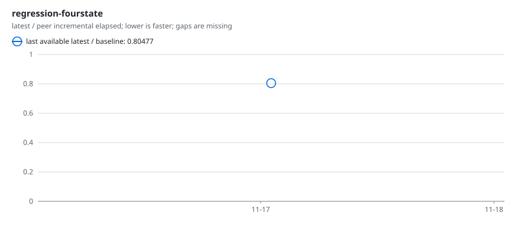

# 日次・週次シミュレーション速度ベンチマーク

[English](README.md) / [日本語](README.ja.md)

機能テストのNightlyとは独立しています。GitHub標準ランナーの値は参考値で、5回の測定から統計的有意性を断言しません。

## 最新の日次測定

[JSON](latest-daily.json)

**測定回:** `actions-44223268236-1` — complete
2026-11-18T02:38:15.609997+00:00 → 2026-11-18T03:22:01.021116+00:00

比率は最新kirimasimの差分時間÷比較対象の差分時間です。1未満なら最新kirimasimが速いことを示します。

この環境での参考値です。失敗・欠測はゼロ秒ではありません。

[JSON](runs/actions-44223268236-1.json) · [Actions logs / ログ](https://github.com/kurochan001/kirimasim-tests/actions/runs/44223268236/attempts/1) · [Method / 測定方法](https://github.com/kurochan001/kirimasim-tests/blob/main/docs/daily-benchmark.md)

環境: github-hosted-ubuntu-24.04 / Intel(R) Xeon(R) 6975P-C / Linux-7.0.0-1014-aws-x86_64-with-glibc2.39

<details><summary>測定条件</summary>

```json
{
  "machine": {
    "os": "Linux-7.0.0-1014-aws-x86_64-with-glibc2.39",
    "cores": 4,
    "cpu": "Intel(R) Xeon(R) 6975P-C",
    "memory_gib": 15,
    "distribution": "Ubuntu 24.04.5 LTS",
    "architecture": "x86_64"
  },
  "compiler": "g++ (Ubuntu 13.3.0-6ubuntu2~24.04.1) 13.3.0",
  "profile": "daily",
  "environment": "github-hosted-ubuntu-24.04",
  "image_os": "ubuntu24",
  "image_version": "20261111.127.1",
  "settings": {
    "runs": 5,
    "warmups": 1,
    "timeout_seconds": 600,
    "short_seconds": 0.05,
    "regression_warning_ratio": 1.15,
    "simulation_threads": 1,
    "waveforms": false,
    "assertions": false,
    "verilator_build_jobs": 1
  },
  "mode": "formal",
  "runs": 5,
  "tool_builds": {
    "latest": {
      "compiler": "g++ (Ubuntu 13.3.0-6ubuntu2~24.04.1) 13.3.0",
      "c_compiler": "gcc (Ubuntu 13.3.0-6ubuntu2~24.04.1) 13.3.0",
      "flags": {
        "CC": "gcc",
        "CXX": "g++",
        "CFLAGS": "",
        "CXXFLAGS": "",
        "preset": "release",
        "cmake": "-O3 -DNDEBUG -ffp-contract=off, no fast-math",
        "make_jobs": 2
      }
    },
    "baseline": {
      "compiler": "g++ (Ubuntu 13.3.0-6ubuntu2~24.04.1) 13.3.0",
      "c_compiler": "gcc (Ubuntu 13.3.0-6ubuntu2~24.04.1) 13.3.0",
      "flags": {
        "CC": "gcc",
        "CXX": "g++",
        "CFLAGS": "",
        "CXXFLAGS": "",
        "preset": "release",
        "cmake": "-O3 -DNDEBUG -ffp-contract=off, no fast-math",
        "make_jobs": 2
      }
    },
    "icarus": {
      "compiler": "g++ (Ubuntu 13.3.0-6ubuntu2~24.04.1) 13.3.0",
      "c_compiler": "gcc (Ubuntu 13.3.0-6ubuntu2~24.04.1) 13.3.0",
      "flags": {
        "CC": "gcc",
        "CXX": "g++",
        "CFLAGS": "",
        "CXXFLAGS": "",
        "preset": "release",
        "cmake": "-O3 -DNDEBUG -ffp-contract=off, no fast-math",
        "make_jobs": 2
      }
    },
    "verilator": {
      "compiler": "g++ (Ubuntu 13.3.0-6ubuntu2~24.04.1) 13.3.0",
      "c_compiler": "gcc (Ubuntu 13.3.0-6ubuntu2~24.04.1) 13.3.0",
      "flags": {
        "CC": "gcc",
        "CXX": "g++",
        "CFLAGS": "",
        "CXXFLAGS": "",
        "preset": "release",
        "cmake": "-O3 -DNDEBUG -ffp-contract=off, no fast-math",
        "make_jobs": 2
      }
    }
  },
  "verilator_options": "--binary --timing --threads 1 --build-jobs 1; default C++ optimization; assertions/tracing off",
  "icarus_options": "-g2012; vvp -n; single process",
  "kirimasim_options": "default four-state; interpreter; no waveform/assertion request"
}
```

</details>

- `latest`: `441dddbd0fcd80aed298ca33311f2ee67aa8866c` — kirimasim 0.1.1 (commit 441dddbd0fcd), built with GNU 13.3.0
- `baseline`: `cfa2ccd75989c1ebb9ed63303271183377364cf0` — kirimasim 0.1.0 (commit cfa2ccd75989), built with GNU 13.3.0
- `icarus`: `dfeee909ed9f20b4870dd93423156c0170c0e1ff` — Icarus Verilog version 13.0 (stable) (dfeee90-dirty)
- `verilator`: `bbb60a403932a9f695cb6ff001ceb73de6ad9234` — Verilator 5.054 2026-11-01 rev vUNKNOWN-built20261117-bbb60a4

定義・測定処理の識別情報: `{'config_sha256': '56c0140f54b187d0bc8506e9ab0627cbdc616b69d2a1910aa6fd9b324b2ab9b7', 'driver_sha256': '0037fb4780de47740de92f102487477aac29570998a2aa3ca095bbcbb94219fa', 'comparison_sha256': '2896f429781d5eaff2d0ecec465726de342f840892056d20304d2df179ad6be0', 'history_sha256': '50af56d972f3e551c2a9bc7ae0b8ee158405c6ab25ab7f97c36cd32bebe90f8a', 'setup_sha256': '35fd0861a6a91f6bd13719ca3a926142a8a248cb672d9499e328bfdd04c791e3', 'adapter_sha256': '4811f9d50d4a09d8794710296d644350468c49a9579a794f27af42ac9fb6b5bc', 'benchmark_commit': 'cfa2ccd75989c1ebb9ed63303271183377364cf0', 'reference_sha256': {'bench/reference_expanded.py': 'a1196d79efb88425f61cc69ba1d9ec99542f7f5dc41fac2a07ade82090b00f4a', 'bench/reference_fourstate_mix.py': '586fb643e9ef9df9e304df83e04e711aa1b875e6cb4393e6e3c98cd1707b70e1'}}`

| ケース | 処理系 | 状態 | ビルド秒 | T(1)中央値秒 | T(N)中央値秒 | 差分秒 | T(N) MAD秒 | RSS MiB | 最新/対象 | 理由・注意 |
|---|---|---|---:|---:|---:|---:|---:|---:|---:|---|
| casez_struct (N=5000000) | latest | measured | — | 0.0045594 | 3.6568 | 3.6522 | 0.009235 | 28.445 | — |  |
| casez_struct (N=5000000) | baseline | measured | — | 0.005633 | 5.141 | 5.1354 | 0.023435 | 28.367 | 0.71118 |  |
| casez_struct (N=5000000) | icarus | measured | 0.0046161 | 0.002746 | 5.4946 | 5.4919 | 0.0349 | 7.3242 | 0.66502 |  |
| casez_struct (N=5000000) | verilator | measured | 4.6648 | 0.0012824 | 0.029428 | 0.028145 | 8.0559e-05 | 3.8359 | 129.76 | short incremental time; sensitive to timing noise |
| comb_chain (N=3000000) | latest | measured | — | 0.0048782 | 10.173 | 10.168 | 0.012702 | 28.457 | — |  |
| comb_chain (N=3000000) | baseline | measured | — | 0.0051836 | 13.402 | 13.397 | 0.092034 | 28.375 | 0.75898 |  |
| comb_chain (N=3000000) | icarus | measured | 0.0037485 | 0.0026113 | 19.387 | 19.385 | 0.0091569 | 7.4375 | 0.52454 |  |
| comb_chain (N=3000000) | verilator | measured | 5.3644 | 0.0010016 | 0.32141 | 0.32041 | 0.00033953 | 3.8125 | 31.734 |  |
| dyn_queue (N=4000000) | latest | measured | — | 0.0046417 | 4.4089 | 4.4043 | 0.0048104 | 28.48 | — |  |
| dyn_queue (N=4000000) | baseline | measured | — | 0.0047124 | 5.5227 | 5.518 | 0.0029639 | 28.172 | 0.79816 |  |
| dyn_queue (N=4000000) | icarus | measured | 0.0047397 | 0.0027991 | 10.296 | 10.293 | 0.0028123 | 7.3945 | 0.42788 |  |
| dyn_queue (N=4000000) | verilator | measured | 4.7936 | 0.0013018 | 0.10447 | 0.10317 | 0.00066435 | 3.8398 | 42.69 |  |
| fork_join (N=4000000) | latest | measured | — | 0.0047449 | 5.935 | 5.9302 | 0.020863 | 28.277 | — |  |
| fork_join (N=4000000) | baseline | measured | — | 0.0051225 | 6.9589 | 6.9538 | 0.019725 | 28.191 | 0.8528 |  |
| fork_join (N=4000000) | icarus | measured | 0.0044894 | 0.0026548 | 9.0005 | 8.9979 | 0.0073815 | 7.3828 | 0.65907 |  |
| fork_join (N=4000000) | verilator | measured | 5.537 | 0.0011724 | 1.749 | 1.7478 | 0.0024663 | 3.8516 | 3.3929 |  |
| func_call (N=1500000) | latest | measured | — | 0.0044604 | 5.5072 | 5.5027 | 0.01094 | 28.312 | — |  |
| func_call (N=1500000) | baseline | measured | — | 0.0049114 | 6.7197 | 6.7148 | 0.011335 | 28.25 | 0.81949 |  |
| func_call (N=1500000) | icarus | measured | 0.0043721 | 0.0027617 | 15.313 | 15.31 | 0.08834 | 7.3516 | 0.35941 |  |
| func_call (N=1500000) | verilator | measured | 4.628 | 0.0012897 | 0.0081268 | 0.0068371 | 0.00017249 | 0.31641 | 804.84 | short incremental time; sensitive to timing noise |
| gate_udp (N=400000) | latest | measured | — | 0.0055314 | 5.8741 | 5.8686 | 0.008854 | 28.391 | — |  |
| gate_udp (N=400000) | baseline | measured | — | 0.0057675 | 7.6153 | 7.6095 | 0.0013456 | 28.168 | 0.77121 |  |
| gate_udp (N=400000) | icarus | measured | 0.0050919 | 0.0033211 | 4.8973 | 4.894 | 0.017883 | 7.4844 | 1.1991 |  |
| gate_udp (N=400000) | verilator | measured | 5.3789 | 0.0010038 | 0.062168 | 0.061164 | 0.00041003 | 3.8164 | 95.947 |  |
| mem_rw (N=4000000) | latest | measured | — | 0.0062738 | 5.8016 | 5.7953 | 0.013527 | 28.391 | — |  |
| mem_rw (N=4000000) | baseline | measured | — | 0.0064282 | 7.2611 | 7.2547 | 0.026458 | 28.133 | 0.79883 |  |
| mem_rw (N=4000000) | icarus | measured | 0.0044819 | 0.0031963 | 6.0426 | 6.0394 | 0.010162 | 7.4102 | 0.95957 |  |
| mem_rw (N=4000000) | verilator | measured | 5.4872 | 0.001298 | 0.97407 | 0.97277 | 0.0005965 | 3.8555 | 5.9575 |  |
| nba_burst (N=500000) | latest | measured | — | 0.0040698 | 0.12541 | 0.12134 | 0.0015083 | 124.55 | — |  |
| nba_burst (N=500000) | baseline | measured | — | 0.0045915 | 0.14959 | 0.145 | 0.00080607 | 124.39 | 0.83684 |  |
| nba_burst (N=500000) | icarus | measured | 0.0046508 | 0.0021913 | 0.16888 | 0.16669 | 0.00058801 | 33.848 | 0.72795 |  |
| nba_burst (N=500000) | verilator | measured | 5.3826 | 0.00096523 | 0.0013496 | 0.00038439 | 5.4291e-05 | 0.32031 | 315.68 | short incremental time; sensitive to timing noise |
| nba_shift (N=1000000) | latest | measured | — | 0.004948 | 28.005 | 28 | 0.0081858 | 28.539 | — |  |
| nba_shift (N=1000000) | baseline | measured | — | 0.0054975 | 35.449 | 35.443 | 0.068839 | 28.18 | 0.79001 |  |
| nba_shift (N=1000000) | icarus | measured | 0.0047342 | 0.0030757 | 34.459 | 34.456 | 0.023235 | 7.5 | 0.81264 |  |
| nba_shift (N=1000000) | verilator | measured | 5.5733 | 0.0013142 | 0.28195 | 0.28064 | 0.00061923 | 3.8281 | 99.775 |  |
| proc_wait (N=1000000) | latest | measured | — | 0.0070368 | 8.8903 | 8.8833 | 0.014693 | 32.445 | — |  |
| proc_wait (N=1000000) | baseline | measured | — | 0.0070039 | 10.446 | 10.439 | 0.0099122 | 30.234 | 0.85096 |  |
| proc_wait (N=1000000) | icarus | measured | 0.0065815 | 0.0037433 | 8.5994 | 8.5957 | 0.0068257 | 7.8086 | 1.0335 |  |
| proc_wait (N=1000000) | verilator | measured | 7.2156 | 0.001115 | 2.9239 | 2.9228 | 0.0023291 | 3.9844 | 3.0394 |  |
| string_fmt (N=500000) | latest | measured | — | 0.0043663 | 4.5086 | 4.5042 | 0.0025619 | 28.422 | — |  |
| string_fmt (N=500000) | baseline | measured | — | 0.0050059 | 5.8089 | 5.8039 | 0.024056 | 28.359 | 0.77607 |  |
| string_fmt (N=500000) | icarus | measured | 0.0046273 | 0.002702 | 14.966 | 14.964 | 0.019106 | 7.4023 | 0.30101 |  |
| string_fmt (N=500000) | verilator | measured | 4.7837 | 0.0013116 | 0.19777 | 0.19646 | 0.00021753 | 3.9297 | 22.927 |  |
| wide_arith (N=1500000) | latest | measured | — | 0.0045062 | 2.8066 | 2.8021 | 0.011144 | 28.48 | — |  |
| wide_arith (N=1500000) | baseline | measured | — | 0.0049396 | 7.106 | 7.1011 | 0.011563 | 28.285 | 0.3946 |  |
| wide_arith (N=1500000) | icarus | measured | 0.0045386 | 0.0023353 | 14.531 | 14.528 | 0.0050643 | 7.332 | 0.19287 |  |
| wide_arith (N=1500000) | verilator | measured | 4.6895 | 0.00095696 | 0.12007 | 0.11911 | 0.00029696 | 3.8359 | 23.525 |  |
| fourstate_mix (N=1000000) | latest | measured | — | 0.0041294 | 1.2986 | 1.2945 | 0.0026327 | 28.547 | — |  |
| fourstate_mix (N=1000000) | baseline | measured | — | 0.0046355 | 1.7255 | 1.7209 | 0.0057898 | 28.379 | 0.75221 |  |
| fourstate_mix (N=1000000) | icarus | measured | 0.0050816 | 0.002707 | 3.1859 | 3.1832 | 0.0024441 | 7.4141 | 0.40666 |  |
| fourstate_mix (N=1000000) | verilator | unsupported | — | — | — | — | — | — | — | X/Z observations require four-state semantics; excluded before execution |
| fifo_stream (N=200000) | latest | measured | — | 0.0049625 | 0.61673 | 0.61176 | 0.0005085 | 28.535 | — |  |
| fifo_stream (N=200000) | baseline | measured | — | 0.0046395 | 0.77023 | 0.76559 | 0.0040701 | 28.363 | 0.79908 |  |
| fifo_stream (N=200000) | icarus | measured | 0.0043052 | 0.002206 | 0.55253 | 0.55032 | 0.00096543 | 7.4023 | 1.1116 |  |
| fifo_stream (N=200000) | verilator | measured | 5.2755 | 0.00094079 | 0.062582 | 0.061641 | 1.3109e-05 | 3.8242 | 9.9246 |  |
| uart_loopback (N=20000) | latest | measured | — | 0.0046328 | 0.60972 | 0.60509 | 0.0018276 | 28.453 | — |  |
| uart_loopback (N=20000) | baseline | measured | — | 0.0045666 | 0.70192 | 0.69735 | 0.00082246 | 28.398 | 0.86769 |  |
| uart_loopback (N=20000) | icarus | measured | 0.0037449 | 0.002298 | 0.33223 | 0.32993 | 0.00047796 | 7.4336 | 1.834 |  |
| uart_loopback (N=20000) | verilator | measured | 5.2578 | 0.0009585 | 0.072609 | 0.07165 | 0.00014688 | 3.8203 | 8.445 |  |
| bus_fabric (N=150000) | latest | measured | — | 0.0054657 | 1.7319 | 1.7265 | 0.0014216 | 28.492 | — |  |
| bus_fabric (N=150000) | baseline | measured | — | 0.0054068 | 2.1348 | 2.1294 | 0.0051707 | 28.391 | 0.81076 |  |
| bus_fabric (N=150000) | icarus | measured | 0.0041049 | 0.0026686 | 0.72302 | 0.72036 | 0.0013015 | 7.4688 | 2.3967 |  |
| bus_fabric (N=150000) | verilator | measured | 5.2966 | 0.00097584 | 0.080028 | 0.079052 | 6.9622e-05 | 3.8242 | 21.84 |  |
| hierarchy_fanout (N=100000) | latest | measured | — | 0.0088255 | 8.8853 | 8.8765 | 0.01531 | 36.434 | — |  |
| hierarchy_fanout (N=100000) | baseline | measured | — | 0.0099442 | 11.244 | 11.234 | 0.017737 | 36.297 | 0.79015 |  |
| hierarchy_fanout (N=100000) | icarus | measured | 0.0091215 | 0.0088851 | 25.844 | 25.835 | 0.060761 | 8.3125 | 0.34359 |  |
| hierarchy_fanout (N=100000) | verilator | measured | 5.3862 | 0.0012997 | 0.026346 | 0.025046 | 7.7969e-05 | 3.8203 | 354.4 | short incremental time; sensitive to timing noise |
| event_fanout (N=50000) | latest | measured | — | 0.012032 | 2.4457 | 2.4336 | 0.00028902 | 42.484 | — |  |
| event_fanout (N=50000) | baseline | measured | — | 0.012028 | 2.8798 | 2.8678 | 0.004578 | 42.316 | 0.84861 |  |
| event_fanout (N=50000) | icarus | measured | 0.0091561 | 0.0067683 | 3.4205 | 3.4138 | 0.003474 | 9.0859 | 0.71289 |  |
| event_fanout (N=50000) | verilator | measured | 5.6568 | 0.0010365 | 0.054214 | 0.053177 | 5.1204e-05 | 3.8359 | 45.764 |  |
| word_boundary (N=4000000) | latest | measured | — | 0.004303 | 5.7477 | 5.7434 | 0.0035704 | 28.398 | — |  |
| word_boundary (N=4000000) | baseline | measured | — | 0.0054674 | 10.21 | 10.204 | 0.033267 | 28.309 | 0.56285 |  |
| word_boundary (N=4000000) | icarus | measured | 0.0039361 | 0.0026747 | 23.721 | 23.718 | 0.059771 | 7.3359 | 0.24215 |  |
| word_boundary (N=4000000) | verilator | measured | 4.6344 | 0.0012997 | 0.037723 | 0.036423 | 0.00013713 | 3.8125 | 157.69 | short incremental time; sensitive to timing noise |
| wide_divide (N=80000) | latest | measured | — | 0.0046299 | 1.059 | 1.0544 | 0.0062174 | 28.547 | — |  |
| wide_divide (N=80000) | baseline | measured | — | 0.0050657 | 1.155 | 1.15 | 0.0012337 | 28.324 | 0.91686 |  |
| wide_divide (N=80000) | icarus | measured | 0.0042121 | 0.0022332 | 1.0647 | 1.0625 | 0.00060105 | 7.3398 | 0.99236 |  |
| wide_divide (N=80000) | verilator | measured | 4.6352 | 0.0010303 | 0.0093069 | 0.0082766 | 4.5833e-05 | 0.3125 | 127.39 | short incremental time; sensitive to timing noise |
| packed_slice (N=1500000) | latest | measured | — | 0.0044068 | 2.5764 | 2.572 | 0.004138 | 28.48 | — |  |
| packed_slice (N=1500000) | baseline | measured | — | 0.0047918 | 6.0974 | 6.0926 | 0.0048246 | 28.152 | 0.42215 |  |
| packed_slice (N=1500000) | icarus | measured | 0.0050991 | 0.0026743 | 8.8643 | 8.8616 | 0.01065 | 7.3438 | 0.29024 |  |
| packed_slice (N=1500000) | verilator | measured | 4.6548 | 0.001325 | 0.092439 | 0.091114 | 4.902e-05 | 3.8008 | 28.228 |  |
| memory_scatter (N=5000000) | latest | measured | — | 0.044286 | 3.611 | 3.5667 | 0.0066967 | 42.418 | — |  |
| memory_scatter (N=5000000) | baseline | measured | — | 0.046806 | 5.1494 | 5.1026 | 0.017245 | 42.363 | 0.699 |  |
| memory_scatter (N=5000000) | icarus | measured | 0.0038141 | 0.02548 | 12.298 | 12.272 | 0.0089372 | 7.8555 | 0.29062 |  |
| memory_scatter (N=5000000) | verilator | measured | 4.614 | 0.001075 | 0.0082246 | 0.0071497 | 1.6343e-05 | 0.31641 | 498.86 | short incremental time; sensitive to timing noise |
| clock_domains (N=20000) | latest | measured | — | 0.0041037 | 0.17796 | 0.17386 | 0.00092699 | 28.539 | — |  |
| clock_domains (N=20000) | baseline | measured | — | 0.0044266 | 0.2103 | 0.20588 | 0.00049832 | 28.406 | 0.84446 |  |
| clock_domains (N=20000) | icarus | measured | 0.0037196 | 0.0024406 | 0.10765 | 0.10521 | 0.00011329 | 7.3672 | 1.6525 |  |
| clock_domains (N=20000) | verilator | measured | 5.4214 | 0.00099608 | 0.072341 | 0.071344 | 0.00010611 | 3.8477 | 2.4368 |  |
| fourstate_arith (N=100000) | latest | measured | — | 0.0049061 | 0.14188 | 0.13698 | 0.0013921 | 28.543 | — |  |
| fourstate_arith (N=100000) | baseline | measured | — | 0.0048364 | 0.1757 | 0.17087 | 0.0041807 | 28.383 | 0.80168 |  |
| fourstate_arith (N=100000) | icarus | measured | 0.003744 | 0.0022684 | 0.23841 | 0.23614 | 0.00034725 | 7.3477 | 0.58007 |  |
| fourstate_arith (N=100000) | verilator | unsupported | — | — | — | — | — | — | — | X/Z observations require four-state semantics; excluded before execution |
| resolved_bus (N=50000) | latest | measured | — | 0.0042266 | 0.27223 | 0.268 | 0.0026933 | 28.418 | — |  |
| resolved_bus (N=50000) | baseline | measured | — | 0.0056181 | 0.34186 | 0.33624 | 0.00029265 | 28.398 | 0.79705 |  |
| resolved_bus (N=50000) | icarus | measured | 0.0045217 | 0.002714 | 0.47293 | 0.47021 | 0.00061992 | 7.4102 | 0.56996 |  |
| resolved_bus (N=50000) | verilator | unsupported | — | — | — | — | — | — | — | X/Z observations require four-state semantics; excluded before execution |

固定した総合値の集合（全ケースの有効値が必要です）：

- **regression-common**: 0.75055; 12/12; casez_struct, comb_chain, dyn_queue, fork_join, func_call, gate_udp, mem_rw, nba_burst, nba_shift, proc_wait, string_fmt, wide_arith
- **regression-fourstate**: 0.75221; 1/1; fourstate_mix
- **icarus-common**: 0.57982; 12/12; casez_struct, comb_chain, dyn_queue, fork_join, func_call, gate_udp, mem_rw, nba_burst, nba_shift, proc_wait, string_fmt, wide_arith
- **icarus-fourstate**: 0.40666; 1/1; fourstate_mix
- **verilator-common**: 39.441; 12/12; casez_struct, comb_chain, dyn_queue, fork_join, func_call, gate_udp, mem_rw, nba_burst, nba_shift, proc_wait, string_fmt, wide_arith
- **expanded-regression-common**: 0.7452; 22/22; casez_struct, comb_chain, dyn_queue, fork_join, func_call, gate_udp, mem_rw, nba_burst, nba_shift, proc_wait, string_fmt, wide_arith, fifo_stream, uart_loopback, bus_fabric, hierarchy_fanout, event_fanout, word_boundary, wide_divide, packed_slice, memory_scatter, clock_domains
- **expanded-regression-fourstate**: 0.78332; 3/3; fourstate_mix, fourstate_arith, resolved_bus
- **expanded-icarus-common**: 0.64178; 22/22; casez_struct, comb_chain, dyn_queue, fork_join, func_call, gate_udp, mem_rw, nba_burst, nba_shift, proc_wait, string_fmt, wide_arith, fifo_stream, uart_loopback, bus_fabric, hierarchy_fanout, event_fanout, word_boundary, wide_divide, packed_slice, memory_scatter, clock_domains
- **expanded-icarus-fourstate**: 0.51229; 3/3; fourstate_mix, fourstate_arith, resolved_bus
- **expanded-verilator-common**: 40.919; 22/22; casez_struct, comb_chain, dyn_queue, fork_join, func_call, gate_udp, mem_rw, nba_burst, nba_shift, proc_wait, string_fmt, wide_arith, fifo_stream, uart_loopback, bus_fabric, hierarchy_fanout, event_fanout, word_boundary, wide_divide, packed_slice, memory_scatter, clock_domains
## 最新の週次測定

[JSON](latest-weekly.json)

**測定回:** `actions-44186811554-1` — complete
2026-11-17T22:58:29.331708+00:00 → 2026-11-17T23:35:53.816729+00:00

比率は最新kirimasimの差分時間÷比較対象の差分時間です。1未満なら最新kirimasimが速いことを示します。

この環境での参考値です。失敗・欠測はゼロ秒ではありません。

[JSON](runs/actions-44186811554-1.json) · [Actions logs / ログ](https://github.com/kurochan001/kirimasim-tests/actions/runs/44186811554/attempts/1) · [Method / 測定方法](https://github.com/kurochan001/kirimasim-tests/blob/main/docs/daily-benchmark.md)

環境: github-hosted-ubuntu-24.04 / AMD EPYC 7763 64-Core Processor / Linux-7.0.0-1017-azure-x86_64-with-glibc2.39

<details><summary>測定条件</summary>

```json
{
  "machine": {
    "os": "Linux-7.0.0-1017-azure-x86_64-with-glibc2.39",
    "cores": 4,
    "cpu": "AMD EPYC 7763 64-Core Processor",
    "memory_gib": 16,
    "distribution": "Ubuntu 24.04.5 LTS",
    "architecture": "x86_64"
  },
  "compiler": "g++ (Ubuntu 13.3.0-6ubuntu2~24.04.1) 13.3.0",
  "profile": "weekly",
  "environment": "github-hosted-ubuntu-24.04",
  "image_os": "ubuntu24",
  "image_version": "20261111.370.1",
  "settings": {
    "runs": 5,
    "warmups": 1,
    "timeout_seconds": 600,
    "short_seconds": 0.05,
    "regression_warning_ratio": 1.15,
    "simulation_threads": 1,
    "waveforms": false,
    "assertions": false,
    "verilator_build_jobs": 1
  },
  "mode": "formal",
  "runs": 5,
  "tool_builds": {
    "latest": {
      "compiler": "g++ (Ubuntu 13.3.0-6ubuntu2~24.04.1) 13.3.0",
      "c_compiler": "gcc (Ubuntu 13.3.0-6ubuntu2~24.04.1) 13.3.0",
      "flags": {
        "CC": "gcc",
        "CXX": "g++",
        "CFLAGS": "",
        "CXXFLAGS": "",
        "preset": "release",
        "cmake": "-O3 -DNDEBUG -ffp-contract=off, no fast-math",
        "make_jobs": 2
      }
    },
    "baseline": {
      "compiler": "g++ (Ubuntu 13.3.0-6ubuntu2~24.04.1) 13.3.0",
      "c_compiler": "gcc (Ubuntu 13.3.0-6ubuntu2~24.04.1) 13.3.0",
      "flags": {
        "CC": "gcc",
        "CXX": "g++",
        "CFLAGS": "",
        "CXXFLAGS": "",
        "preset": "release",
        "cmake": "-O3 -DNDEBUG -ffp-contract=off, no fast-math",
        "make_jobs": 2
      }
    },
    "icarus": {
      "compiler": "g++ (Ubuntu 13.3.0-6ubuntu2~24.04.1) 13.3.0",
      "c_compiler": "gcc (Ubuntu 13.3.0-6ubuntu2~24.04.1) 13.3.0",
      "flags": {
        "CC": "gcc",
        "CXX": "g++",
        "CFLAGS": "",
        "CXXFLAGS": "",
        "preset": "release",
        "cmake": "-O3 -DNDEBUG -ffp-contract=off, no fast-math",
        "make_jobs": 2
      }
    },
    "verilator": {
      "compiler": "g++ (Ubuntu 13.3.0-6ubuntu2~24.04.1) 13.3.0",
      "c_compiler": "gcc (Ubuntu 13.3.0-6ubuntu2~24.04.1) 13.3.0",
      "flags": {
        "CC": "gcc",
        "CXX": "g++",
        "CFLAGS": "",
        "CXXFLAGS": "",
        "preset": "release",
        "cmake": "-O3 -DNDEBUG -ffp-contract=off, no fast-math",
        "make_jobs": 2
      }
    }
  },
  "verilator_options": "--binary --timing --threads 1 --build-jobs 1; default C++ optimization; assertions/tracing off",
  "icarus_options": "-g2012; vvp -n; single process",
  "kirimasim_options": "default four-state; interpreter; no waveform/assertion request"
}
```

</details>

- `latest`: `441dddbd0fcd80aed298ca33311f2ee67aa8866c` — kirimasim 0.1.1 (commit 441dddbd0fcd), built with GNU 13.3.0
- `baseline`: `cfa2ccd75989c1ebb9ed63303271183377364cf0` — kirimasim 0.1.0 (commit cfa2ccd75989), built with GNU 13.3.0
- `icarus`: `dfeee909ed9f20b4870dd93423156c0170c0e1ff` — Icarus Verilog version 13.0 (stable) (dfeee90-dirty)
- `verilator`: `bbb60a403932a9f695cb6ff001ceb73de6ad9234` — Verilator 5.054 2026-11-01 rev vUNKNOWN-built20261117-bbb60a4

定義・測定処理の識別情報: `{'config_sha256': '56c0140f54b187d0bc8506e9ab0627cbdc616b69d2a1910aa6fd9b324b2ab9b7', 'driver_sha256': '0037fb4780de47740de92f102487477aac29570998a2aa3ca095bbcbb94219fa', 'comparison_sha256': '2896f429781d5eaff2d0ecec465726de342f840892056d20304d2df179ad6be0', 'history_sha256': '50af56d972f3e551c2a9bc7ae0b8ee158405c6ab25ab7f97c36cd32bebe90f8a', 'setup_sha256': '35fd0861a6a91f6bd13719ca3a926142a8a248cb672d9499e328bfdd04c791e3', 'adapter_sha256': '4811f9d50d4a09d8794710296d644350468c49a9579a794f27af42ac9fb6b5bc', 'benchmark_commit': 'cfa2ccd75989c1ebb9ed63303271183377364cf0', 'reference_sha256': {'bench/reference_expanded.py': 'a1196d79efb88425f61cc69ba1d9ec99542f7f5dc41fac2a07ade82090b00f4a', 'bench/reference_fourstate_mix.py': '586fb643e9ef9df9e304df83e04e711aa1b875e6cb4393e6e3c98cd1707b70e1'}}`

| ケース | 処理系 | 状態 | ビルド秒 | T(1)中央値秒 | T(N)中央値秒 | 差分秒 | T(N) MAD秒 | RSS MiB | 最新/対象 | 理由・注意 |
|---|---|---|---:|---:|---:|---:|---:|---:|---:|---|
| large_hierarchy (N=20000) | latest | measured | — | 0.1501 | 30.488 | 30.338 | 0.093651 | 108.37 | — |  |
| large_hierarchy (N=20000) | baseline | measured | — | 0.15133 | 37.609 | 37.458 | 0.22551 | 108.23 | 0.80991 |  |
| large_hierarchy (N=20000) | icarus | measured | 0.18767 | 0.10443 | 88.929 | 88.824 | 0.29512 | 22.973 | 0.34155 |  |
| large_hierarchy (N=20000) | verilator | measured | 15.048 | 0.0018306 | 0.10806 | 0.10623 | 0.0010759 | 3.7969 | 285.58 |  |
| large_memory (N=500000) | latest | measured | — | 0.11288 | 29.145 | 29.032 | 0.10063 | 44.539 | — |  |
| large_memory (N=500000) | baseline | measured | — | 0.146 | 41.798 | 41.652 | 0.24891 | 44.41 | 0.69701 |  |
| large_memory (N=500000) | icarus | measured | 0.0055652 | 0.21439 | 61.457 | 61.242 | 0.016669 | 11.301 | 0.47405 |  |
| large_memory (N=500000) | verilator | measured | 8.1158 | 0.0024141 | 0.13945 | 0.13704 | 0.00082314 | 4.7266 | 211.85 |  |
| stream_pipeline (N=250000) | latest | measured | — | 0.0085583 | 29.059 | 29.051 | 0.11181 | 28.254 | — |  |
| stream_pipeline (N=250000) | baseline | measured | — | 0.010272 | 38.925 | 38.915 | 0.24568 | 28.285 | 0.74652 |  |
| stream_pipeline (N=250000) | icarus | measured | 0.0087869 | 0.0063252 | 83.492 | 83.486 | 0.28265 | 7.4883 | 0.34797 |  |
| stream_pipeline (N=250000) | verilator | measured | 8.3722 | 0.0018094 | 0.13704 | 0.13523 | 0.00030075 | 3.707 | 214.82 |  |

固定した総合値の集合（全ケースの有効値が必要です）：

- **weekly-regression**: 0.74973; 3/3; large_hierarchy, large_memory, stream_pipeline
- **weekly-icarus**: 0.38336; 3/3; large_hierarchy, large_memory, stream_pipeline
- **weekly-verilator**: 235.12; 3/3; large_hierarchy, large_memory, stream_pipeline

## 環境・定義別の推移

### `25a1c78c12d65db9`

1 runs; 2026-11-18T02:38:15.609997+00:00 → 2026-11-18T02:38:15.609997+00:00

測定定義: `daily-v3-expanded`; ケース数: **25**


失敗を含む各回：

- [actions-44223268236-1](runs/actions-44223268236-1.json): complete — `441dddbd0fcd`
### `079515db5b1afbed`

1 runs; 2026-11-17T22:58:29.331708+00:00 → 2026-11-17T22:58:29.331708+00:00

測定定義: `weekly-v1-scale`; ケース数: **3**


失敗を含む各回：

- [actions-44186811554-1](runs/actions-44186811554-1.json): complete — `441dddbd0fcd`
### `ff82f2d3ef6ff628`

1 runs; 2026-11-17T21:58:35.859990+00:00 → 2026-11-17T21:58:35.859990+00:00

測定定義: `daily-v3-expanded`; ケース数: **25**


失敗を含む各回：

- [actions-44183926839-1](runs/actions-44183926839-1.json): complete — `234f65f6b205`
### `962ea28f5124b999`

1 runs; 2026-11-17T15:00:17.437065+00:00 → 2026-11-17T15:00:17.437065+00:00

測定定義: `daily-v2-thirteen`; ケース数: **13**


失敗を含む各回：

- [actions-44103555558-1](runs/actions-44103555558-1.json): complete — `13d52dde3c49`
### `ff134f2dfe29a369`

1 runs; 2026-11-17T13:04:45.723115+00:00 → 2026-11-17T13:04:45.723115+00:00

測定定義: `daily-v1`; ケース数: **5**





失敗を含む各回：

- [actions-44085771320-1](runs/actions-44085771320-1.json): complete — `26f359bcd504`
