# 日次・週次シミュレーション速度ベンチマーク

[English](README.md) / [日本語](README.ja.md)

機能テストのNightlyとは独立しています。GitHub標準ランナーの値は参考値で、5回の測定から統計的有意性を断言しません。


日次25種類（共通22＋4値3）の等重み幾何平均です。比率はkirimasim÷Icarus 14.0 develの差分所要時間。0.97は所要時間が3%短い意味で、小さいほど高速です。

両開発版のコミットを測定開始時に一度解決します。JSTの各日の最後の正式測定を使い、1種類でも無効なら総合値は欠測です。環境・定義ごとに線を分けます。双方の変更が推移に影響するため、固定版との比較も下に残します。

[JSON](headline.json) · [Method / 測定方法](https://github.com/kurochan001/kirimasim-tests/blob/main/docs/daily-benchmark.md)

最新の総合測定: **2026-11-27 JST — 0.53219** (25/25; complete)

[Raw / 生データ](runs/actions-45930807119-1.json) · [Actions logs / ログ](https://github.com/kurochan001/kirimasim-tests/actions/runs/45930807119/attempts/1)

<details><summary>ケース別結果・固定版との比較・過去の系列</summary>

## 最新の日次測定

[JSON](latest-daily.json)

**測定回:** `actions-45930807119-1` — complete
2026-11-27T03:02:31.626226+00:00 → 2026-11-27T03:54:51.777996+00:00

比率は最新kirimasimの差分時間÷比較対象の差分時間です。1未満なら最新kirimasimが速いことを示します。

この環境での参考値です。失敗・欠測はゼロ秒ではありません。

[JSON](runs/actions-45930807119-1.json) · [Actions logs / ログ](https://github.com/kurochan001/kirimasim-tests/actions/runs/45930807119/attempts/1) · [Method / 測定方法](https://github.com/kurochan001/kirimasim-tests/blob/main/docs/daily-benchmark.md)

環境: github-hosted-ubuntu-24.04 / Intel(R) Xeon(R) 6975P-C / Linux-7.0.0-1014-aws-x86_64-with-glibc2.39

<details><summary>測定条件</summary>

```json
{
  "machine": {
    "os": "Linux-7.0.0-1014-aws-x86_64-with-glibc2.39",
    "cores": 4,
    "cpu": "Intel(R) Xeon(R) 6975P-C",
    "memory_gib": 15,
    "distribution": "Ubuntu 24.04.5 LTS",
    "architecture": "x86_64"
  },
  "compiler": "g++ (Ubuntu 13.3.0-6ubuntu2~24.04.1) 13.3.0",
  "profile": "daily",
  "environment": "github-hosted-ubuntu-24.04",
  "image_os": "ubuntu24",
  "image_version": "20261116.133.1",
  "settings": {
    "runs": 5,
    "warmups": 1,
    "timeout_seconds": 600,
    "short_seconds": 0.05,
    "regression_warning_ratio": 1.15,
    "simulation_threads": 1,
    "waveforms": false,
    "assertions": false,
    "verilator_build_jobs": 1
  },
  "mode": "formal",
  "runs": 5,
  "tool_builds": {
    "latest": {
      "compiler": "g++ (Ubuntu 13.3.0-6ubuntu2~24.04.1) 13.3.0",
      "c_compiler": "gcc (Ubuntu 13.3.0-6ubuntu2~24.04.1) 13.3.0",
      "flags": {
        "CC": "gcc",
        "CXX": "g++",
        "CFLAGS": "",
        "CXXFLAGS": "",
        "preset": "release",
        "cmake": "-O3 -DNDEBUG -ffp-contract=off, no fast-math",
        "make_jobs": 2
      }
    },
    "baseline": {
      "compiler": "g++ (Ubuntu 13.3.0-6ubuntu2~24.04.1) 13.3.0",
      "c_compiler": "gcc (Ubuntu 13.3.0-6ubuntu2~24.04.1) 13.3.0",
      "flags": {
        "CC": "gcc",
        "CXX": "g++",
        "CFLAGS": "",
        "CXXFLAGS": "",
        "preset": "release",
        "cmake": "-O3 -DNDEBUG -ffp-contract=off, no fast-math",
        "make_jobs": 2
      }
    },
    "icarus": {
      "compiler": "g++ (Ubuntu 13.3.0-6ubuntu2~24.04.1) 13.3.0",
      "c_compiler": "gcc (Ubuntu 13.3.0-6ubuntu2~24.04.1) 13.3.0",
      "flags": {
        "CC": "gcc",
        "CXX": "g++",
        "CFLAGS": "",
        "CXXFLAGS": "",
        "preset": "release",
        "cmake": "-O3 -DNDEBUG -ffp-contract=off, no fast-math",
        "make_jobs": 2
      }
    },
    "verilator": {
      "compiler": "g++ (Ubuntu 13.3.0-6ubuntu2~24.04.1) 13.3.0",
      "c_compiler": "gcc (Ubuntu 13.3.0-6ubuntu2~24.04.1) 13.3.0",
      "flags": {
        "CC": "gcc",
        "CXX": "g++",
        "CFLAGS": "",
        "CXXFLAGS": "",
        "preset": "release",
        "cmake": "-O3 -DNDEBUG -ffp-contract=off, no fast-math",
        "make_jobs": 2
      }
    },
    "icarus_devel": {
      "compiler": "g++ (Ubuntu 13.3.0-6ubuntu2~24.04.1) 13.3.0",
      "c_compiler": "gcc (Ubuntu 13.3.0-6ubuntu2~24.04.1) 13.3.0",
      "flags": {
        "CC": "gcc",
        "CXX": "g++",
        "CFLAGS": "",
        "CXXFLAGS": "",
        "preset": "release",
        "cmake": "-O3 -DNDEBUG -ffp-contract=off, no fast-math",
        "make_jobs": 2
      }
    }
  },
  "verilator_options": "--binary --timing --threads 1 --build-jobs 1; default C++ optimization; assertions/tracing off",
  "icarus_options": "-g2012; vvp -n; single process",
  "kirimasim_options": "default four-state; interpreter; no waveform/assertion request"
}
```

</details>

- `latest`: `b1ad0cb96a408893f99c78f2131f8e430f37b82a` — kirimasim 0.3.0 (commit b1ad0cb96a40), built with GNU 13.3.0
- `baseline`: `cfa2ccd75989c1ebb9ed63303271183377364cf0` — kirimasim 0.1.0 (commit cfa2ccd75989), built with GNU 13.3.0
- `icarus`: `dfeee909ed9f20b4870dd93423156c0170c0e1ff` — Icarus Verilog version 13.0 (stable) (dfeee90-dirty)
- `verilator`: `bbb60a403932a9f695cb6ff001ceb73de6ad9234` — Verilator 5.054 2026-11-01 rev vUNKNOWN-built20261121-bbb60a4
- `icarus_devel`: `24acba16baba765484df7b3f29c8fa931c10e6ec` — Icarus Verilog version 14.0 (devel) (24acba1)

定義・測定処理の識別情報: `{'config_sha256': '4006a76543b7c88eed78ba128e7459c54ac2ee82a78efdd401ac2d85643bef9b', 'driver_sha256': '0edb91f5cbc17e8d1eec9e77ab4c87fb7dbcf4b9ff57d233c5e94628770ad077', 'comparison_sha256': '2896f429781d5eaff2d0ecec465726de342f840892056d20304d2df179ad6be0', 'history_sha256': 'bda014f86bbbea0bd769b5458656bfda07cbcaec712624cfad17960b10b5c887', 'setup_sha256': 'aa89dd6c7df5268f361f96049069cfe68b524ff93819afc4351fcb557c91d8f9', 'adapter_sha256': '4811f9d50d4a09d8794710296d644350468c49a9579a794f27af42ac9fb6b5bc', 'benchmark_commit': 'cfa2ccd75989c1ebb9ed63303271183377364cf0', 'reference_sha256': {'bench/reference_expanded.py': 'a1196d79efb88425f61cc69ba1d9ec99542f7f5dc41fac2a07ade82090b00f4a', 'bench/reference_fourstate_mix.py': '586fb643e9ef9df9e304df83e04e711aa1b875e6cb4393e6e3c98cd1707b70e1'}}`

| ケース | 処理系 | 状態 | ビルド秒 | T(1)中央値秒 | T(N)中央値秒 | 差分秒 | T(N) MAD秒 | RSS MiB | 最新/対象 | 理由・注意 |
|---|---|---|---:|---:|---:|---:|---:|---:|---:|---|
| casez_struct (N=5000000) | latest | measured | — | 0.0055861 | 2.468 | 2.4624 | 0.0083724 | 29.824 | — |  |
| casez_struct (N=5000000) | baseline | measured | — | 0.0053075 | 5.0432 | 5.0379 | 0.022837 | 28.312 | 0.48877 |  |
| casez_struct (N=5000000) | icarus | measured | 0.0035912 | 0.0027782 | 5.5657 | 5.5629 | 0.027843 | 7.332 | 0.44264 |  |
| casez_struct (N=5000000) | verilator | measured | 4.7466 | 0.001318 | 0.02965 | 0.028332 | 0.00014494 | 3.8359 | 86.911 | short incremental time; sensitive to timing noise |
| casez_struct (N=5000000) | icarus_devel | measured | 0.0037412 | 0.0025624 | 5.1325 | 5.13 | 0.012917 | 7.5508 | 0.48 |  |
| comb_chain (N=3000000) | latest | measured | — | 0.0058919 | 3.7865 | 3.7806 | 0.0058496 | 29.684 | — |  |
| comb_chain (N=3000000) | baseline | measured | — | 0.0052199 | 13.593 | 13.588 | 0.064278 | 28.398 | 0.27824 |  |
| comb_chain (N=3000000) | icarus | measured | 0.0039933 | 0.0028248 | 19.477 | 19.474 | 0.087402 | 7.4375 | 0.19414 |  |
| comb_chain (N=3000000) | verilator | measured | 5.5805 | 0.0013463 | 0.32493 | 0.32358 | 0.00016292 | 3.8438 | 11.684 |  |
| comb_chain (N=3000000) | icarus_devel | measured | 0.0036811 | 0.0024768 | 13.015 | 13.012 | 0.029174 | 7.5391 | 0.29054 |  |
| dyn_queue (N=4000000) | latest | measured | — | 0.00491 | 3.844 | 3.8391 | 0.0029001 | 29.734 | — |  |
| dyn_queue (N=4000000) | baseline | measured | — | 0.0053181 | 5.5713 | 5.566 | 0.0025951 | 28.262 | 0.68975 |  |
| dyn_queue (N=4000000) | icarus | measured | 0.0040633 | 0.0028858 | 10.388 | 10.385 | 0.0024439 | 7.3984 | 0.36968 |  |
| dyn_queue (N=4000000) | verilator | measured | 5.0642 | 0.0013322 | 0.10588 | 0.10455 | 0.00097015 | 3.8164 | 36.721 |  |
| dyn_queue (N=4000000) | icarus_devel | measured | 0.0038923 | 0.0027113 | 9.7774 | 9.7747 | 0.026229 | 7.6641 | 0.39276 |  |
| fork_join (N=4000000) | latest | measured | — | 0.0058094 | 5.0456 | 5.0398 | 0.0085498 | 29.43 | — |  |
| fork_join (N=4000000) | baseline | measured | — | 0.0055279 | 7.0061 | 7.0006 | 0.014291 | 28.125 | 0.71991 |  |
| fork_join (N=4000000) | icarus | measured | 0.0046847 | 0.002764 | 9.0248 | 9.0221 | 0.0076527 | 7.3828 | 0.5586 |  |
| fork_join (N=4000000) | verilator | measured | 5.8001 | 0.0013584 | 1.7758 | 1.7745 | 0.00077134 | 3.8516 | 2.8402 |  |
| fork_join (N=4000000) | icarus_devel | measured | 0.0037738 | 0.0023144 | 6.7905 | 6.7881 | 0.009189 | 7.5352 | 0.74244 |  |
| func_call (N=1500000) | latest | measured | — | 0.0051986 | 4.1911 | 4.1859 | 0.013526 | 29.57 | — |  |
| func_call (N=1500000) | baseline | measured | — | 0.0048392 | 6.7311 | 6.7262 | 0.031786 | 28.273 | 0.62233 |  |
| func_call (N=1500000) | icarus | measured | 0.0038868 | 0.0028198 | 15.168 | 15.165 | 0.027891 | 7.3398 | 0.27603 |  |
| func_call (N=1500000) | verilator | measured | 4.8955 | 0.0013408 | 0.008369 | 0.0070282 | 5.3216e-05 | 0.30469 | 595.59 | short incremental time; sensitive to timing noise |
| func_call (N=1500000) | icarus_devel | measured | 0.0039301 | 0.0025949 | 10.424 | 10.421 | 0.030284 | 7.5117 | 0.40167 |  |
| gate_udp (N=400000) | latest | measured | — | 0.0077581 | 4.8826 | 4.8748 | 0.011645 | 33.676 | — |  |
| gate_udp (N=400000) | baseline | measured | — | 0.0062044 | 7.6708 | 7.6646 | 0.0082218 | 28.207 | 0.63601 |  |
| gate_udp (N=400000) | icarus | measured | 0.0054415 | 0.0037097 | 4.9033 | 4.8996 | 0.01337 | 7.5195 | 0.99494 |  |
| gate_udp (N=400000) | verilator | measured | 5.798 | 0.0013378 | 0.063341 | 0.062003 | 0.00048331 | 3.8438 | 78.622 |  |
| gate_udp (N=400000) | icarus_devel | measured | 0.0050374 | 0.0032957 | 4.5846 | 4.5813 | 0.010351 | 7.6836 | 1.0641 |  |
| mem_rw (N=4000000) | latest | measured | — | 0.0066669 | 3.2608 | 3.2542 | 0.0033881 | 29.777 | — |  |
| mem_rw (N=4000000) | baseline | measured | — | 0.0070932 | 7.2761 | 7.269 | 0.015132 | 28.234 | 0.44768 |  |
| mem_rw (N=4000000) | icarus | measured | 0.0042699 | 0.0032353 | 6.0632 | 6.06 | 0.0076992 | 7.4062 | 0.53699 |  |
| mem_rw (N=4000000) | verilator | measured | 5.7137 | 0.0013602 | 0.97901 | 0.97765 | 0.0027938 | 3.8203 | 3.3286 |  |
| mem_rw (N=4000000) | icarus_devel | measured | 0.0039553 | 0.0031645 | 4.3907 | 4.3876 | 0.0065619 | 7.6406 | 0.74168 |  |
| nba_burst (N=500000) | latest | measured | — | 0.0048564 | 0.079283 | 0.074427 | 0.00049053 | 105.77 | — |  |
| nba_burst (N=500000) | baseline | measured | — | 0.0051087 | 0.15545 | 0.15034 | 0.0023618 | 124.38 | 0.49505 |  |
| nba_burst (N=500000) | icarus | measured | 0.0047216 | 0.0024937 | 0.16943 | 0.16693 | 0.00020072 | 33.836 | 0.44585 |  |
| nba_burst (N=500000) | verilator | measured | 5.723 | 0.0014032 | 0.0014766 | 7.3405e-05 | 2.1184e-05 | 0.32031 | 1013.9 | short incremental time; sensitive to timing noise; incremental time is close to observed dispersion |
| nba_burst (N=500000) | icarus_devel | measured | 0.0037082 | 0.0023478 | 0.1652 | 0.16285 | 2.4037e-05 | 33.535 | 0.45703 |  |
| nba_shift (N=1000000) | latest | measured | — | 0.0062165 | 11.902 | 11.896 | 0.033435 | 31.633 | — |  |
| nba_shift (N=1000000) | baseline | measured | — | 0.0061999 | 35.739 | 35.732 | 0.10057 | 28.168 | 0.33293 |  |
| nba_shift (N=1000000) | icarus | measured | 0.0050433 | 0.0030801 | 34.693 | 34.69 | 0.10132 | 7.4961 | 0.34293 |  |
| nba_shift (N=1000000) | verilator | measured | 5.8628 | 0.0013629 | 0.28625 | 0.28489 | 0.00024583 | 3.8242 | 41.757 |  |
| nba_shift (N=1000000) | icarus_devel | measured | 0.0043049 | 0.0029501 | 33.732 | 33.729 | 0.017771 | 7.6367 | 0.3527 |  |
| proc_wait (N=1000000) | latest | measured | — | 0.0094649 | 5.5109 | 5.5014 | 0.025877 | 39.707 | — |  |
| proc_wait (N=1000000) | baseline | measured | — | 0.0070197 | 10.447 | 10.44 | 0.013653 | 30.16 | 0.52697 |  |
| proc_wait (N=1000000) | icarus | measured | 0.0064913 | 0.0038043 | 8.6221 | 8.6183 | 0.0073813 | 7.8008 | 0.63834 |  |
| proc_wait (N=1000000) | verilator | measured | 7.2668 | 0.0013895 | 2.928 | 2.9266 | 0.006559 | 3.9492 | 1.8798 |  |
| proc_wait (N=1000000) | icarus_devel | measured | 0.0049163 | 0.0036077 | 8.4447 | 8.4411 | 0.0083517 | 8.1055 | 0.65175 |  |
| string_fmt (N=500000) | latest | measured | — | 0.0046543 | 3.1939 | 3.1892 | 0.0041641 | 29.746 | — |  |
| string_fmt (N=500000) | baseline | measured | — | 0.0048951 | 5.8558 | 5.8509 | 0.031677 | 28.082 | 0.54508 |  |
| string_fmt (N=500000) | icarus | measured | 0.0036545 | 0.0027709 | 15.027 | 15.024 | 0.036375 | 7.3984 | 0.21227 |  |
| string_fmt (N=500000) | verilator | measured | 4.7842 | 0.0012783 | 0.19994 | 0.19866 | 0.00013382 | 3.9609 | 16.054 |  |
| string_fmt (N=500000) | icarus_devel | measured | 0.0034728 | 0.0026334 | 11.737 | 11.735 | 0.037243 | 7.5547 | 0.27178 |  |
| wide_arith (N=1500000) | latest | measured | — | 0.0048752 | 2.4081 | 2.4032 | 0.003439 | 29.762 | — |  |
| wide_arith (N=1500000) | baseline | measured | — | 0.0048411 | 7.1337 | 7.1289 | 0.010234 | 28.219 | 0.33711 |  |
| wide_arith (N=1500000) | icarus | measured | 0.003662 | 0.0025908 | 14.627 | 14.624 | 0.023818 | 7.3203 | 0.16433 |  |
| wide_arith (N=1500000) | verilator | measured | 4.7709 | 0.0013261 | 0.11962 | 0.11829 | 0.00011898 | 3.8359 | 20.316 |  |
| wide_arith (N=1500000) | icarus_devel | measured | 0.0036319 | 0.0023073 | 2.7077 | 2.7054 | 0.0046699 | 7.5312 | 0.8883 |  |
| fourstate_mix (N=1000000) | latest | measured | — | 0.0044943 | 0.79628 | 0.79178 | 0.0015576 | 29.824 | — |  |
| fourstate_mix (N=1000000) | baseline | measured | — | 0.0050159 | 1.7313 | 1.7262 | 0.0060949 | 28.414 | 0.45867 |  |
| fourstate_mix (N=1000000) | icarus | measured | 0.004122 | 0.0027505 | 3.1956 | 3.1929 | 0.0063137 | 7.3789 | 0.24799 |  |
| fourstate_mix (N=1000000) | verilator | unsupported | — | — | — | — | — | — | — | X/Z observations require four-state semantics; excluded before execution |
| fourstate_mix (N=1000000) | icarus_devel | measured | 0.0038348 | 0.0026672 | 2.2298 | 2.2271 | 0.0015017 | 7.5781 | 0.35552 |  |
| fifo_stream (N=200000) | latest | measured | — | 0.005715 | 0.35271 | 0.34699 | 0.00033107 | 29.762 | — |  |
| fifo_stream (N=200000) | baseline | measured | — | 0.0054775 | 0.77245 | 0.76698 | 0.0027067 | 28.387 | 0.45241 |  |
| fifo_stream (N=200000) | icarus | measured | 0.0044418 | 0.0027701 | 0.55558 | 0.55281 | 0.0026779 | 7.4062 | 0.62769 |  |
| fifo_stream (N=200000) | verilator | measured | 5.4302 | 0.0013315 | 0.063369 | 0.062038 | 0.00024785 | 3.8516 | 5.5932 |  |
| fifo_stream (N=200000) | icarus_devel | measured | 0.0039222 | 0.0022933 | 0.47685 | 0.47455 | 0.00089644 | 7.5859 | 0.7312 |  |
| uart_loopback (N=20000) | latest | measured | — | 0.0058018 | 0.34412 | 0.33832 | 0.00033319 | 31.887 | — |  |
| uart_loopback (N=20000) | baseline | measured | — | 0.005464 | 0.70727 | 0.70181 | 0.0036685 | 28.379 | 0.48207 |  |
| uart_loopback (N=20000) | icarus | measured | 0.0041465 | 0.002846 | 0.33323 | 0.33038 | 0.00040489 | 7.4336 | 1.024 |  |
| uart_loopback (N=20000) | verilator | measured | 5.5202 | 0.0013171 | 0.073511 | 0.072194 | 8.0447e-05 | 3.8242 | 4.6863 |  |
| uart_loopback (N=20000) | icarus_devel | measured | 0.0038749 | 0.0025919 | 0.29201 | 0.28942 | 0.0010381 | 7.5859 | 1.169 |  |
| bus_fabric (N=150000) | latest | measured | — | 0.0067821 | 0.83829 | 0.83151 | 0.0058365 | 31.805 | — |  |
| bus_fabric (N=150000) | baseline | measured | — | 0.0055952 | 2.1476 | 2.142 | 0.010071 | 28.391 | 0.3882 |  |
| bus_fabric (N=150000) | icarus | measured | 0.0046277 | 0.0030799 | 0.72786 | 0.72478 | 0.0018907 | 7.4688 | 1.1473 |  |
| bus_fabric (N=150000) | verilator | measured | 5.5166 | 0.0012954 | 0.081669 | 0.080374 | 0.00017176 | 3.8555 | 10.345 |  |
| bus_fabric (N=150000) | icarus_devel | measured | 0.0045281 | 0.0028764 | 0.66481 | 0.66193 | 0.00045162 | 7.6445 | 1.2562 |  |
| hierarchy_fanout (N=100000) | latest | measured | — | 0.014682 | 4.773 | 4.7584 | 0.006142 | 47.656 | — |  |
| hierarchy_fanout (N=100000) | baseline | measured | — | 0.010462 | 11.344 | 11.333 | 0.0086859 | 36.234 | 0.41986 |  |
| hierarchy_fanout (N=100000) | icarus | measured | 0.0085689 | 0.0089307 | 26.106 | 26.097 | 0.090665 | 8.293 | 0.18233 |  |
| hierarchy_fanout (N=100000) | verilator | measured | 5.5856 | 0.0013621 | 0.02734 | 0.025977 | 0.00013867 | 3.8086 | 183.17 | short incremental time; sensitive to timing noise |
| hierarchy_fanout (N=100000) | icarus_devel | measured | 0.0088642 | 0.0084927 | 7.8758 | 7.8673 | 0.021999 | 8.5078 | 0.60483 |  |
| event_fanout (N=50000) | latest | measured | — | 0.020013 | 2.3548 | 2.3348 | 0.006408 | 49.742 | — |  |
| event_fanout (N=50000) | baseline | measured | — | 0.012804 | 2.8903 | 2.8775 | 0.0043392 | 42.375 | 0.81141 |  |
| event_fanout (N=50000) | icarus | measured | 0.0099866 | 0.0073477 | 3.4417 | 3.4343 | 0.0021114 | 9.0859 | 0.67985 |  |
| event_fanout (N=50000) | verilator | measured | 6.022 | 0.0013468 | 0.054671 | 0.053325 | 0.00014102 | 3.8516 | 43.785 |  |
| event_fanout (N=50000) | icarus_devel | measured | 0.0099423 | 0.0070755 | 3.412 | 3.4049 | 0.0074015 | 9.2773 | 0.68573 |  |
| word_boundary (N=4000000) | latest | measured | — | 0.0048658 | 4.2011 | 4.1962 | 0.052348 | 29.633 | — |  |
| word_boundary (N=4000000) | baseline | measured | — | 0.0051115 | 10.262 | 10.257 | 0.040584 | 28.289 | 0.40911 |  |
| word_boundary (N=4000000) | icarus | measured | 0.0040246 | 0.002759 | 23.939 | 23.936 | 0.010547 | 7.3164 | 0.17531 |  |
| word_boundary (N=4000000) | verilator | measured | 4.9165 | 0.0013331 | 0.037772 | 0.036439 | 0.00020766 | 3.8047 | 115.16 | short incremental time; sensitive to timing noise |
| word_boundary (N=4000000) | icarus_devel | measured | 0.0037524 | 0.0026149 | 8.4346 | 8.432 | 0.018793 | 7.4961 | 0.49766 |  |
| wide_divide (N=80000) | latest | measured | — | 0.0052732 | 0.12365 | 0.11838 | 0.00051008 | 29.824 | — |  |
| wide_divide (N=80000) | baseline | measured | — | 0.0055886 | 1.1642 | 1.1587 | 0.0053088 | 28.375 | 0.10217 |  |
| wide_divide (N=80000) | icarus | measured | 0.004404 | 0.0023587 | 1.0668 | 1.0645 | 0.00075141 | 7.3516 | 0.11121 |  |
| wide_divide (N=80000) | verilator | measured | 4.8082 | 0.0012833 | 0.0094881 | 0.0082048 | 3.8752e-05 | 0.30469 | 14.428 | short incremental time; sensitive to timing noise |
| wide_divide (N=80000) | icarus_devel | measured | 0.0038529 | 0.0021414 | 0.54141 | 0.53927 | 0.00047871 | 7.5273 | 0.21952 |  |
| packed_slice (N=1500000) | latest | measured | — | 0.0046156 | 1.7027 | 1.6981 | 0.0018466 | 29.699 | — |  |
| packed_slice (N=1500000) | baseline | measured | — | 0.0050788 | 6.1305 | 6.1255 | 0.01206 | 28.172 | 0.27722 |  |
| packed_slice (N=1500000) | icarus | measured | 0.0041915 | 0.002704 | 8.8931 | 8.8904 | 0.0020543 | 7.3242 | 0.191 |  |
| packed_slice (N=1500000) | verilator | measured | 4.7768 | 0.0013149 | 0.093441 | 0.092126 | 0.00015567 | 3.8047 | 18.432 |  |
| packed_slice (N=1500000) | icarus_devel | measured | 0.0035875 | 0.0025169 | 3.3915 | 3.389 | 0.0075802 | 7.5078 | 0.50106 |  |
| memory_scatter (N=5000000) | latest | measured | — | 0.041284 | 2.426 | 2.3847 | 0.0014864 | 43.766 | — |  |
| memory_scatter (N=5000000) | baseline | measured | — | 0.047246 | 5.1552 | 5.108 | 0.013757 | 42.395 | 0.46686 |  |
| memory_scatter (N=5000000) | icarus | measured | 0.0039489 | 0.026014 | 12.341 | 12.315 | 0.022493 | 7.8633 | 0.19364 |  |
| memory_scatter (N=5000000) | verilator | measured | 4.7616 | 0.0013866 | 0.0084192 | 0.0070327 | 0.00012208 | 0.32031 | 339.09 | short incremental time; sensitive to timing noise |
| memory_scatter (N=5000000) | icarus_devel | measured | 0.0036434 | 0.016495 | 7.0456 | 7.0291 | 0.012405 | 7.9961 | 0.33927 |  |
| clock_domains (N=20000) | latest | measured | — | 0.0045351 | 0.10123 | 0.096695 | 0.00045257 | 29.699 | — |  |
| clock_domains (N=20000) | baseline | measured | — | 0.0049527 | 0.21124 | 0.20629 | 0.00014045 | 28.371 | 0.46874 |  |
| clock_domains (N=20000) | icarus | measured | 0.0037354 | 0.0026726 | 0.10808 | 0.10541 | 0.00047327 | 7.3789 | 0.91735 |  |
| clock_domains (N=20000) | verilator | measured | 5.5409 | 0.0011947 | 0.073244 | 0.072049 | 6.6667e-05 | 3.8281 | 1.3421 |  |
| clock_domains (N=20000) | icarus_devel | measured | 0.003613 | 0.0024296 | 0.1069 | 0.10447 | 8.4652e-05 | 7.5625 | 0.92556 |  |
| fourstate_arith (N=100000) | latest | measured | — | 0.0053008 | 0.11222 | 0.10691 | 0.00035285 | 29.824 | — |  |
| fourstate_arith (N=100000) | baseline | measured | — | 0.0055342 | 0.17062 | 0.16508 | 0.00085651 | 28.422 | 0.64765 |  |
| fourstate_arith (N=100000) | icarus | measured | 0.0039718 | 0.0027552 | 0.23968 | 0.23693 | 0.00041177 | 7.3477 | 0.45126 |  |
| fourstate_arith (N=100000) | verilator | unsupported | — | — | — | — | — | — | — | X/Z observations require four-state semantics; excluded before execution |
| fourstate_arith (N=100000) | icarus_devel | measured | 0.0035035 | 0.0023872 | 0.22504 | 0.22265 | 0.00015162 | 7.5469 | 0.48019 |  |
| resolved_bus (N=50000) | latest | measured | — | 0.0047142 | 0.15583 | 0.15112 | 0.00063131 | 29.754 | — |  |
| resolved_bus (N=50000) | baseline | measured | — | 0.0056591 | 0.3426 | 0.33694 | 0.00028049 | 28.371 | 0.4485 |  |
| resolved_bus (N=50000) | icarus | measured | 0.0048158 | 0.0027892 | 0.47263 | 0.46984 | 0.00043403 | 7.4023 | 0.32164 |  |
| resolved_bus (N=50000) | verilator | unsupported | — | — | — | — | — | — | — | X/Z observations require four-state semantics; excluded before execution |
| resolved_bus (N=50000) | icarus_devel | measured | 0.0038449 | 0.002675 | 0.45802 | 0.45534 | 0.00042107 | 7.5703 | 0.33188 |  |

固定した総合値の集合（全ケースの有効値が必要です）：

- **regression-common**: 0.48987; 12/12; casez_struct, comb_chain, dyn_queue, fork_join, func_call, gate_udp, mem_rw, nba_burst, nba_shift, proc_wait, string_fmt, wide_arith
- **regression-fourstate**: 0.45867; 1/1; fourstate_mix
- **icarus-common**: 0.37945; 12/12; casez_struct, comb_chain, dyn_queue, fork_join, func_call, gate_udp, mem_rw, nba_burst, nba_shift, proc_wait, string_fmt, wide_arith
- **icarus-fourstate**: 0.24799; 1/1; fourstate_mix
- **verilator-common**: 29.466; 12/12; casez_struct, comb_chain, dyn_queue, fork_join, func_call, gate_udp, mem_rw, nba_burst, nba_shift, proc_wait, string_fmt, wide_arith
- **expanded-regression-common**: 0.4395; 22/22; casez_struct, comb_chain, dyn_queue, fork_join, func_call, gate_udp, mem_rw, nba_burst, nba_shift, proc_wait, string_fmt, wide_arith, fifo_stream, uart_loopback, bus_fabric, hierarchy_fanout, event_fanout, word_boundary, wide_divide, packed_slice, memory_scatter, clock_domains
- **expanded-regression-fourstate**: 0.51074; 3/3; fourstate_mix, fourstate_arith, resolved_bus
- **expanded-icarus-common**: 0.37905; 22/22; casez_struct, comb_chain, dyn_queue, fork_join, func_call, gate_udp, mem_rw, nba_burst, nba_shift, proc_wait, string_fmt, wide_arith, fifo_stream, uart_loopback, bus_fabric, hierarchy_fanout, event_fanout, word_boundary, wide_divide, packed_slice, memory_scatter, clock_domains
- **expanded-icarus-fourstate**: 0.33017; 3/3; fourstate_mix, fourstate_arith, resolved_bus
- **expanded-verilator-common**: 25.957; 22/22; casez_struct, comb_chain, dyn_queue, fork_join, func_call, gate_udp, mem_rw, nba_burst, nba_shift, proc_wait, string_fmt, wide_arith, fifo_stream, uart_loopback, bus_fabric, hierarchy_fanout, event_fanout, word_boundary, wide_divide, packed_slice, memory_scatter, clock_domains
- **daily-overall-icarus14**: 0.53219; 25/25; casez_struct, comb_chain, dyn_queue, fork_join, func_call, gate_udp, mem_rw, nba_burst, nba_shift, proc_wait, string_fmt, wide_arith, fourstate_mix, fifo_stream, uart_loopback, bus_fabric, hierarchy_fanout, event_fanout, word_boundary, wide_divide, packed_slice, memory_scatter, clock_domains, fourstate_arith, resolved_bus
## 最新の週次測定

[JSON](latest-weekly.json)

**測定回:** `actions-45109202660-1` — complete
2026-11-23T04:17:20.572534+00:00 → 2026-11-23T04:54:00.119674+00:00

比率は最新kirimasimの差分時間÷比較対象の差分時間です。1未満なら最新kirimasimが速いことを示します。

この環境での参考値です。失敗・欠測はゼロ秒ではありません。

[JSON](runs/actions-45109202660-1.json) · [Actions logs / ログ](https://github.com/kurochan001/kirimasim-tests/actions/runs/45109202660/attempts/1) · [Method / 測定方法](https://github.com/kurochan001/kirimasim-tests/blob/main/docs/daily-benchmark.md)

環境: github-hosted-ubuntu-24.04 / AMD EPYC 9V74 80-Core Processor / Linux-7.0.0-1017-azure-x86_64-with-glibc2.39

<details><summary>測定条件</summary>

```json
{
  "machine": {
    "os": "Linux-7.0.0-1017-azure-x86_64-with-glibc2.39",
    "cores": 4,
    "cpu": "AMD EPYC 9V74 80-Core Processor",
    "memory_gib": 16,
    "distribution": "Ubuntu 24.04.5 LTS",
    "architecture": "x86_64"
  },
  "compiler": "g++ (Ubuntu 13.3.0-6ubuntu2~24.04.1) 13.3.0",
  "profile": "weekly",
  "environment": "github-hosted-ubuntu-24.04",
  "image_os": "ubuntu24",
  "image_version": "20261116.376.1",
  "settings": {
    "runs": 5,
    "warmups": 1,
    "timeout_seconds": 600,
    "short_seconds": 0.05,
    "regression_warning_ratio": 1.15,
    "simulation_threads": 1,
    "waveforms": false,
    "assertions": false,
    "verilator_build_jobs": 1
  },
  "mode": "formal",
  "runs": 5,
  "tool_builds": {
    "latest": {
      "compiler": "g++ (Ubuntu 13.3.0-6ubuntu2~24.04.1) 13.3.0",
      "c_compiler": "gcc (Ubuntu 13.3.0-6ubuntu2~24.04.1) 13.3.0",
      "flags": {
        "CC": "gcc",
        "CXX": "g++",
        "CFLAGS": "",
        "CXXFLAGS": "",
        "preset": "release",
        "cmake": "-O3 -DNDEBUG -ffp-contract=off, no fast-math",
        "make_jobs": 2
      }
    },
    "baseline": {
      "compiler": "g++ (Ubuntu 13.3.0-6ubuntu2~24.04.1) 13.3.0",
      "c_compiler": "gcc (Ubuntu 13.3.0-6ubuntu2~24.04.1) 13.3.0",
      "flags": {
        "CC": "gcc",
        "CXX": "g++",
        "CFLAGS": "",
        "CXXFLAGS": "",
        "preset": "release",
        "cmake": "-O3 -DNDEBUG -ffp-contract=off, no fast-math",
        "make_jobs": 2
      }
    },
    "icarus": {
      "compiler": "g++ (Ubuntu 13.3.0-6ubuntu2~24.04.1) 13.3.0",
      "c_compiler": "gcc (Ubuntu 13.3.0-6ubuntu2~24.04.1) 13.3.0",
      "flags": {
        "CC": "gcc",
        "CXX": "g++",
        "CFLAGS": "",
        "CXXFLAGS": "",
        "preset": "release",
        "cmake": "-O3 -DNDEBUG -ffp-contract=off, no fast-math",
        "make_jobs": 2
      }
    },
    "verilator": {
      "compiler": "g++ (Ubuntu 13.3.0-6ubuntu2~24.04.1) 13.3.0",
      "c_compiler": "gcc (Ubuntu 13.3.0-6ubuntu2~24.04.1) 13.3.0",
      "flags": {
        "CC": "gcc",
        "CXX": "g++",
        "CFLAGS": "",
        "CXXFLAGS": "",
        "preset": "release",
        "cmake": "-O3 -DNDEBUG -ffp-contract=off, no fast-math",
        "make_jobs": 2
      }
    },
    "icarus_devel": {
      "compiler": "g++ (Ubuntu 13.3.0-6ubuntu2~24.04.1) 13.3.0",
      "c_compiler": "gcc (Ubuntu 13.3.0-6ubuntu2~24.04.1) 13.3.0",
      "flags": {
        "CC": "gcc",
        "CXX": "g++",
        "CFLAGS": "",
        "CXXFLAGS": "",
        "preset": "release",
        "cmake": "-O3 -DNDEBUG -ffp-contract=off, no fast-math",
        "make_jobs": 2
      }
    }
  },
  "verilator_options": "--binary --timing --threads 1 --build-jobs 1; default C++ optimization; assertions/tracing off",
  "icarus_options": "-g2012; vvp -n; single process",
  "kirimasim_options": "default four-state; interpreter; no waveform/assertion request"
}
```

</details>

- `latest`: `378a66ab3240edf824a1b59f10697ecff3efa441` — kirimasim 0.2.0 (commit 378a66ab3240), built with GNU 13.3.0
- `baseline`: `cfa2ccd75989c1ebb9ed63303271183377364cf0` — kirimasim 0.1.0 (commit cfa2ccd75989), built with GNU 13.3.0
- `icarus`: `dfeee909ed9f20b4870dd93423156c0170c0e1ff` — Icarus Verilog version 13.0 (stable) (dfeee90-dirty)
- `verilator`: `bbb60a403932a9f695cb6ff001ceb73de6ad9234` — Verilator 5.054 2026-11-01 rev vUNKNOWN-built20261123-bbb60a4
- `icarus_devel`: `8a4ce429e15e712d82067d4747cd9ec67503a0f8` — Icarus Verilog version 14.0 (devel) (8a4ce42)

定義・測定処理の識別情報: `{'config_sha256': '4006a76543b7c88eed78ba128e7459c54ac2ee82a78efdd401ac2d85643bef9b', 'driver_sha256': '0edb91f5cbc17e8d1eec9e77ab4c87fb7dbcf4b9ff57d233c5e94628770ad077', 'comparison_sha256': '2896f429781d5eaff2d0ecec465726de342f840892056d20304d2df179ad6be0', 'history_sha256': 'bda014f86bbbea0bd769b5458656bfda07cbcaec712624cfad17960b10b5c887', 'setup_sha256': 'aa89dd6c7df5268f361f96049069cfe68b524ff93819afc4351fcb557c91d8f9', 'adapter_sha256': '4811f9d50d4a09d8794710296d644350468c49a9579a794f27af42ac9fb6b5bc', 'benchmark_commit': 'cfa2ccd75989c1ebb9ed63303271183377364cf0', 'reference_sha256': {'bench/reference_expanded.py': 'a1196d79efb88425f61cc69ba1d9ec99542f7f5dc41fac2a07ade82090b00f4a', 'bench/reference_fourstate_mix.py': '586fb643e9ef9df9e304df83e04e711aa1b875e6cb4393e6e3c98cd1707b70e1'}}`

| ケース | 処理系 | 状態 | ビルド秒 | T(1)中央値秒 | T(N)中央値秒 | 差分秒 | T(N) MAD秒 | RSS MiB | 最新/対象 | 理由・注意 |
|---|---|---|---:|---:|---:|---:|---:|---:|---:|---|
| large_hierarchy (N=20000) | latest | measured | — | 0.17569 | 18.079 | 17.903 | 0.11446 | 129.63 | — |  |
| large_hierarchy (N=20000) | baseline | measured | — | 0.10914 | 28.952 | 28.843 | 0.16433 | 108.25 | 0.62071 |  |
| large_hierarchy (N=20000) | icarus | measured | 0.13305 | 0.087124 | 74.086 | 73.998 | 0.1766 | 23.039 | 0.24194 |  |
| large_hierarchy (N=20000) | verilator | measured | 11.83 | 0.0016562 | 0.080178 | 0.078522 | 0.0018308 | 3.9258 | 228 |  |
| large_hierarchy (N=20000) | icarus_devel | measured | 0.13914 | 0.085931 | 12.41 | 12.324 | 0.021666 | 23.316 | 1.4527 |  |
| large_memory (N=500000) | latest | measured | — | 0.054258 | 13.588 | 13.534 | 0.15501 | 45.887 | — |  |
| large_memory (N=500000) | baseline | measured | — | 0.11138 | 31.854 | 31.742 | 0.1146 | 44.395 | 0.42637 |  |
| large_memory (N=500000) | icarus | measured | 0.004978 | 0.17122 | 49.224 | 49.053 | 0.044034 | 11.359 | 0.27591 |  |
| large_memory (N=500000) | verilator | measured | 6.1891 | 0.0023293 | 0.10887 | 0.10654 | 0.00023025 | 4.8125 | 127.03 |  |
| large_memory (N=500000) | icarus_devel | measured | 0.0047116 | 0.11654 | 41.1 | 40.984 | 0.21041 | 11.496 | 0.33023 |  |
| stream_pipeline (N=250000) | latest | measured | — | 0.0073843 | 11.884 | 11.877 | 0.047667 | 33.652 | — |  |
| stream_pipeline (N=250000) | baseline | measured | — | 0.0069906 | 29.166 | 29.16 | 0.1411 | 28.242 | 0.40731 |  |
| stream_pipeline (N=250000) | icarus | measured | 0.0075874 | 0.0052828 | 66.983 | 66.978 | 0.043374 | 7.5469 | 0.17733 |  |
| stream_pipeline (N=250000) | verilator | measured | 6.2715 | 0.0016095 | 0.099629 | 0.098019 | 0.00060947 | 3.832 | 121.17 |  |
| stream_pipeline (N=250000) | icarus_devel | measured | 0.0058586 | 0.0052535 | 54.677 | 54.672 | 0.092473 | 7.7383 | 0.21724 |  |

固定した総合値の集合（全ケースの有効値が必要です）：

- **weekly-regression**: 0.47592; 3/3; large_hierarchy, large_memory, stream_pipeline
- **weekly-icarus**: 0.2279; 3/3; large_hierarchy, large_memory, stream_pipeline
- **weekly-verilator**: 151.97; 3/3; large_hierarchy, large_memory, stream_pipeline
- **weekly-icarus14-common**: 0.47059; 3/3; large_hierarchy, large_memory, stream_pipeline

## 環境・定義別の推移

### `9ae54601059f9e60`

1 runs; 2026-11-26T03:20:54.621535+00:00 → 2026-11-26T03:20:54.621535+00:00

測定定義: `daily-v4-icarus14`; ケース数: **25**


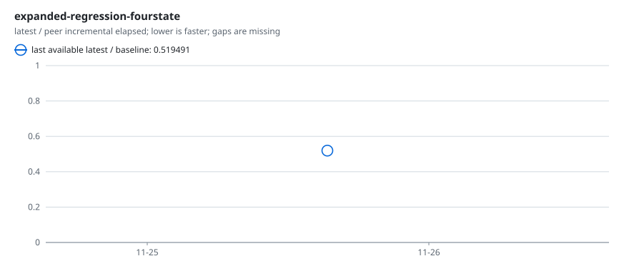


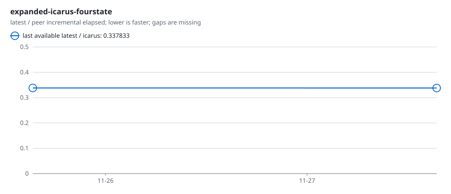


失敗を含む各回：

- [actions-45745212803-1](runs/actions-45745212803-1.json): complete — `8a20a6d9337c`
### `cde4aa9dacf5983c`

1 runs; 2026-11-25T03:47:30.324610+00:00 → 2026-11-25T03:47:30.324610+00:00

測定定義: `daily-v4-icarus14`; ケース数: **25**


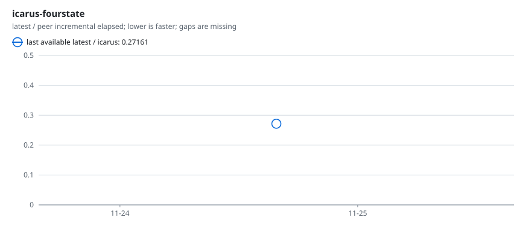


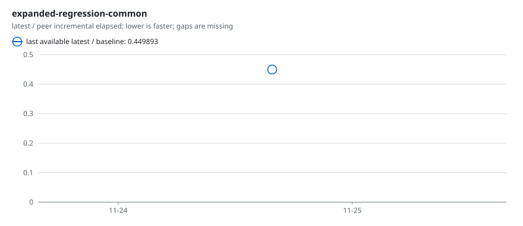


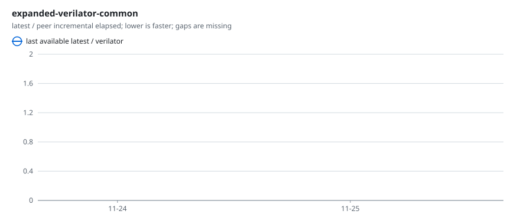


失敗を含む各回：

- [actions-45540765572-1](runs/actions-45540765572-1.json): incomplete — `a50ec73c37d8`
### `ce6cd82e24d95f55`

1 runs; 2026-11-23T04:17:20.572534+00:00 → 2026-11-23T04:17:20.572534+00:00

測定定義: `weekly-v2-icarus14`; ケース数: **3**


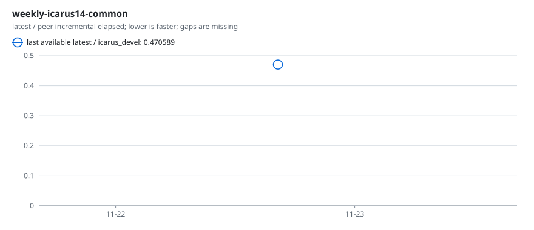

失敗を含む各回：

- [actions-45109202660-1](runs/actions-45109202660-1.json): complete — `378a66ab3240`
### `39bb1735b0601635`

1 runs; 2026-11-23T02:20:58.341830+00:00 → 2026-11-23T02:20:58.341830+00:00

測定定義: `daily-v4-icarus14`; ケース数: **25**


失敗を含む各回：

- [actions-45091454959-1](runs/actions-45091454959-1.json): complete — `1d2cac97a4fe`
### `341b44a021dff5eb`

4 runs; 2026-11-21T02:30:14.755165+00:00 → 2026-11-27T03:02:31.626226+00:00

測定定義: `daily-v4-icarus14`; ケース数: **25**


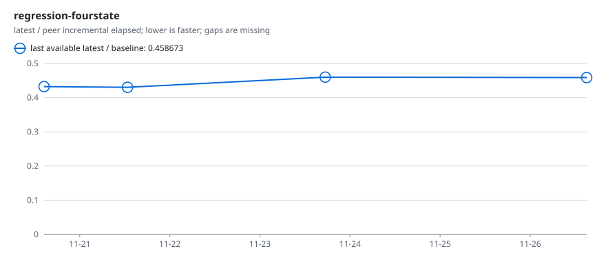

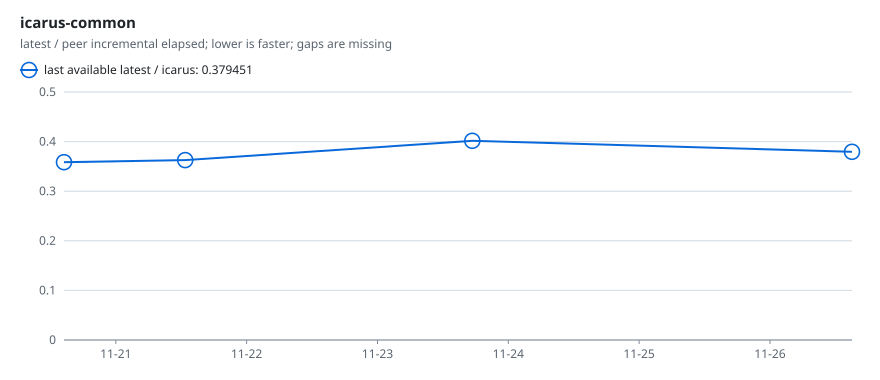


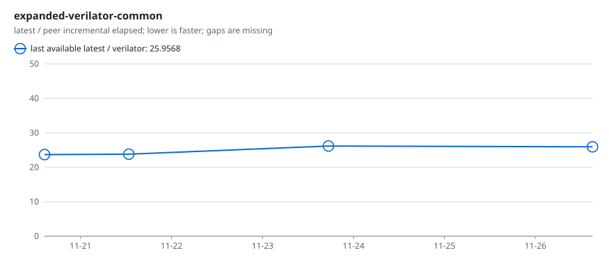


失敗を含む各回：

- [actions-45930807119-1](runs/actions-45930807119-1.json): complete — `b1ad0cb96a40`
- [actions-45328846151-1](runs/actions-45328846151-1.json): complete — `e93839fdcbea`
- [actions-44966152659-1](runs/actions-44966152659-1.json): complete — `ad004a67d861`
- [actions-44850710627-1](runs/actions-44850710627-1.json): complete — `256839f71089`
### `cc3a300591d180c9`

3 runs; 2026-11-18T13:42:55.941756+00:00 → 2026-11-20T01:57:13.586055+00:00

測定定義: `daily-v4-icarus14`; ケース数: **25**


失敗を含む各回：

- [actions-44656096600-1](runs/actions-44656096600-1.json): complete — `cb97fc93bf6b`
- [actions-44440143026-1](runs/actions-44440143026-1.json): incomplete — `a6222f0656d4`
- [actions-44311501813-1](runs/actions-44311501813-1.json): complete — `441dddbd0fcd`
### `25a1c78c12d65db9`

1 runs; 2026-11-18T02:38:15.609997+00:00 → 2026-11-18T02:38:15.609997+00:00

測定定義: `daily-v3-expanded`; ケース数: **25**


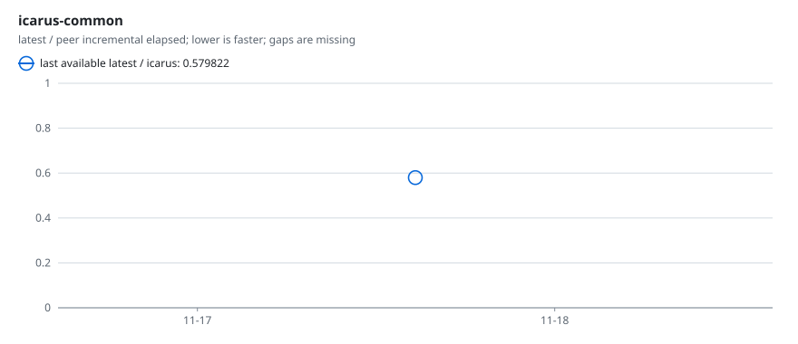


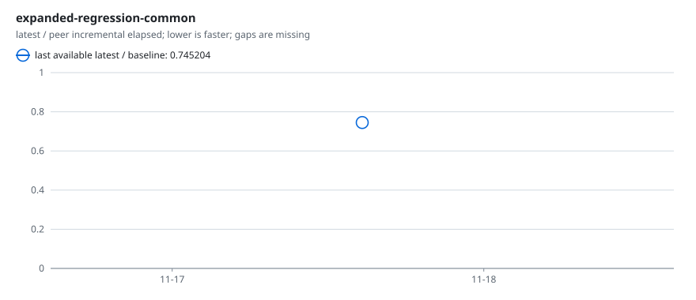


失敗を含む各回：

- [actions-44223268236-1](runs/actions-44223268236-1.json): complete — `441dddbd0fcd`
### `079515db5b1afbed`

1 runs; 2026-11-17T22:58:29.331708+00:00 → 2026-11-17T22:58:29.331708+00:00

測定定義: `weekly-v1-scale`; ケース数: **3**


失敗を含む各回：

- [actions-44186811554-1](runs/actions-44186811554-1.json): complete — `441dddbd0fcd`
### `ff82f2d3ef6ff628`

1 runs; 2026-11-17T21:58:35.859990+00:00 → 2026-11-17T21:58:35.859990+00:00

測定定義: `daily-v3-expanded`; ケース数: **25**


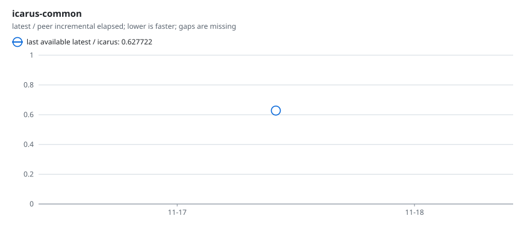


失敗を含む各回：

- [actions-44183926839-1](runs/actions-44183926839-1.json): complete — `234f65f6b205`
### `962ea28f5124b999`

1 runs; 2026-11-17T15:00:17.437065+00:00 → 2026-11-17T15:00:17.437065+00:00

測定定義: `daily-v2-thirteen`; ケース数: **13**


失敗を含む各回：

- [actions-44103555558-1](runs/actions-44103555558-1.json): complete — `13d52dde3c49`
### `ff134f2dfe29a369`

1 runs; 2026-11-17T13:04:45.723115+00:00 → 2026-11-17T13:04:45.723115+00:00

測定定義: `daily-v1`; ケース数: **5**


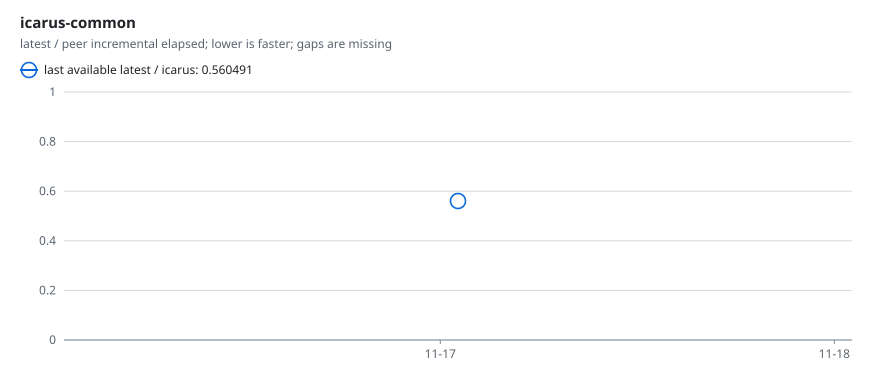


失敗を含む各回：

- [actions-44085771320-1](runs/actions-44085771320-1.json): complete — `26f359bcd504`

<!-- holdout-start -->

## 最新の別枠の測定（報告のみ）

日次・週次の集合に入らない設計で、週に1回測ります。kirimasimの最適化の判断には使わず、日次の総合値・headline.json・総合グラフにも入れません。比較の集合には相手が実行できる条件だけを入れ、宣言した非対応は欠測として示します。

[JSON](latest-holdout.json)

**測定回:** `actions-45186535033-1` — complete
2026-11-23T13:53:27.681573+00:00 → 2026-11-23T14:01:27.543368+00:00

比率は最新kirimasimの差分時間÷比較対象の差分時間です。1未満なら最新kirimasimが速いことを示します。

この環境での参考値です。失敗・欠測はゼロ秒ではありません。

[JSON](holdout/runs/actions-45186535033-1.json) · [Actions logs / ログ](https://github.com/kurochan001/kirimasim-tests/actions/runs/45186535033/attempts/1) · [Method / 測定方法](https://github.com/kurochan001/kirimasim-tests/blob/main/docs/daily-benchmark.md)

環境: github-hosted-ubuntu-24.04 / Intel(R) Xeon(R) 6975P-C / Linux-7.0.0-1014-aws-x86_64-with-glibc2.39

<details><summary>測定条件</summary>

```json
{
  "machine": {
    "os": "Linux-7.0.0-1014-aws-x86_64-with-glibc2.39",
    "cores": 4,
    "cpu": "Intel(R) Xeon(R) 6975P-C",
    "memory_gib": 15,
    "distribution": "Ubuntu 24.04.5 LTS",
    "architecture": "x86_64"
  },
  "compiler": "g++ (Ubuntu 13.3.0-6ubuntu2~24.04.1) 13.3.0",
  "profile": "holdout",
  "environment": "github-hosted-ubuntu-24.04",
  "image_os": "ubuntu24",
  "image_version": "20261116.133.1",
  "settings": {
    "runs": 5,
    "warmups": 1,
    "timeout_seconds": 600,
    "short_seconds": 0.05,
    "regression_warning_ratio": 1.15,
    "simulation_threads": 1,
    "waveforms": false,
    "assertions": false,
    "verilator_build_jobs": 1
  },
  "mode": "formal",
  "runs": 5,
  "tool_builds": {
    "latest": {
      "compiler": "g++ (Ubuntu 13.3.0-6ubuntu2~24.04.1) 13.3.0",
      "c_compiler": "gcc (Ubuntu 13.3.0-6ubuntu2~24.04.1) 13.3.0",
      "flags": {
        "CC": "gcc",
        "CXX": "g++",
        "CFLAGS": "",
        "CXXFLAGS": "",
        "preset": "release",
        "cmake": "-O3 -DNDEBUG -ffp-contract=off, no fast-math",
        "make_jobs": 2
      }
    },
    "baseline": {
      "compiler": "g++ (Ubuntu 13.3.0-6ubuntu2~24.04.1) 13.3.0",
      "c_compiler": "gcc (Ubuntu 13.3.0-6ubuntu2~24.04.1) 13.3.0",
      "flags": {
        "CC": "gcc",
        "CXX": "g++",
        "CFLAGS": "",
        "CXXFLAGS": "",
        "preset": "release",
        "cmake": "-O3 -DNDEBUG -ffp-contract=off, no fast-math",
        "make_jobs": 2
      }
    },
    "icarus": {
      "compiler": "g++ (Ubuntu 13.3.0-6ubuntu2~24.04.1) 13.3.0",
      "c_compiler": "gcc (Ubuntu 13.3.0-6ubuntu2~24.04.1) 13.3.0",
      "flags": {
        "CC": "gcc",
        "CXX": "g++",
        "CFLAGS": "",
        "CXXFLAGS": "",
        "preset": "release",
        "cmake": "-O3 -DNDEBUG -ffp-contract=off, no fast-math",
        "make_jobs": 2
      }
    },
    "verilator": {
      "compiler": "g++ (Ubuntu 13.3.0-6ubuntu2~24.04.1) 13.3.0",
      "c_compiler": "gcc (Ubuntu 13.3.0-6ubuntu2~24.04.1) 13.3.0",
      "flags": {
        "CC": "gcc",
        "CXX": "g++",
        "CFLAGS": "",
        "CXXFLAGS": "",
        "preset": "release",
        "cmake": "-O3 -DNDEBUG -ffp-contract=off, no fast-math",
        "make_jobs": 2
      }
    },
    "icarus_devel": {
      "compiler": "g++ (Ubuntu 13.3.0-6ubuntu2~24.04.1) 13.3.0",
      "c_compiler": "gcc (Ubuntu 13.3.0-6ubuntu2~24.04.1) 13.3.0",
      "flags": {
        "CC": "gcc",
        "CXX": "g++",
        "CFLAGS": "",
        "CXXFLAGS": "",
        "preset": "release",
        "cmake": "-O3 -DNDEBUG -ffp-contract=off, no fast-math",
        "make_jobs": 2
      }
    }
  },
  "verilator_options": "--binary --timing --threads 1 --build-jobs 1; default C++ optimization; assertions/tracing off",
  "icarus_options": "-g2012; vvp -n; single process",
  "kirimasim_options": "default four-state; interpreter; no waveform/assertion request"
}
```

</details>

- `latest`: `3fcc3ee078b33009c63c7e4df603ce237555618e` — kirimasim 0.2.0 (commit 3fcc3ee078b3), built with GNU 13.3.0
- `baseline`: `cfa2ccd75989c1ebb9ed63303271183377364cf0` — kirimasim 0.1.0 (commit cfa2ccd75989), built with GNU 13.3.0
- `icarus`: `dfeee909ed9f20b4870dd93423156c0170c0e1ff` — Icarus Verilog version 13.0 (stable) (dfeee90-dirty)
- `verilator`: `bbb60a403932a9f695cb6ff001ceb73de6ad9234` — Verilator 5.054 2026-11-01 rev vUNKNOWN-built20261121-bbb60a4
- `icarus_devel`: `587c033991b76b38e78f62803453f24dc7eef304` — Icarus Verilog version 14.0 (devel) (587c033)

定義・測定処理の識別情報: `{'config_sha256': '3b1543f8256fb66a689c77e1e8350434b8ff9d645e4d507e1f433d8ade07d16f', 'driver_sha256': '0edb91f5cbc17e8d1eec9e77ab4c87fb7dbcf4b9ff57d233c5e94628770ad077', 'comparison_sha256': '2896f429781d5eaff2d0ecec465726de342f840892056d20304d2df179ad6be0', 'history_sha256': 'bda014f86bbbea0bd769b5458656bfda07cbcaec712624cfad17960b10b5c887', 'setup_sha256': 'aa89dd6c7df5268f361f96049069cfe68b524ff93819afc4351fcb557c91d8f9', 'adapter_sha256': '4811f9d50d4a09d8794710296d644350468c49a9579a794f27af42ac9fb6b5bc', 'benchmark_commit': 'cfa2ccd75989c1ebb9ed63303271183377364cf0', 'reference_sha256': {'bench/reference_expanded.py': 'a1196d79efb88425f61cc69ba1d9ec99542f7f5dc41fac2a07ade82090b00f4a', 'bench/reference_holdout.py': '422e7ec147459f8dca2f42b91af07e6c2cf05435345a7eb11757a93305c500c2'}}`

| ケース | 処理系 | 状態 | ビルド秒 | T(1)中央値秒 | T(N)中央値秒 | 差分秒 | T(N) MAD秒 | RSS MiB | 最新/対象 | 理由・注意 |
|---|---|---|---:|---:|---:|---:|---:|---:|---:|---|
| class_pool (N=800000) | latest | measured | — | 0.0055532 | 2.8198 | 2.8143 | 0.011126 | 31.574 | — |  |
| class_pool (N=800000) | baseline | measured | — | 0.0054749 | 3.5209 | 3.5154 | 0.010191 | 30.359 | 0.80054 |  |
| class_pool (N=800000) | icarus | unsupported | — | — | — | — | — | — | — | Icarus Verilog 13.0 calls the base-class method instead of the virtual override for a base-class handle (8.20); 14.0 devel calls the override; declared before execution |
| class_pool (N=800000) | verilator | measured | 4.8743 | 0.0013233 | 0.084766 | 0.083443 | 0.00075647 | 52.844 | 33.727 |  |
| class_pool (N=800000) | icarus_devel | measured | 0.0038651 | 0.002776 | 3.6027 | 3.6 | 0.0012064 | 7.6719 | 0.78175 |  |
| dynarray_resize (N=120000) | latest | measured | — | 0.0054285 | 0.81674 | 0.81131 | 0.004125 | 31.641 | — |  |
| dynarray_resize (N=120000) | baseline | measured | — | 0.0050991 | 1.3439 | 1.3388 | 0.0016931 | 28.32 | 0.60599 |  |
| dynarray_resize (N=120000) | icarus | measured | 0.0038624 | 0.0024619 | 3.1556 | 3.1531 | 0.0067614 | 7.4219 | 0.2573 |  |
| dynarray_resize (N=120000) | verilator | measured | 4.8225 | 0.0012997 | 0.032622 | 0.031322 | 1.8219e-05 | 3.8516 | 25.902 | short incremental time; sensitive to timing noise |
| dynarray_resize (N=120000) | icarus_devel | measured | 0.0036606 | 0.0022353 | 2.4627 | 2.4604 | 0.0030426 | 7.6992 | 0.32974 |  |
| intf_modport (N=1000000) | latest | measured | — | 0.0050209 | 2.0162 | 2.0112 | 0.0070858 | 29.762 | — |  |
| intf_modport (N=1000000) | baseline | measured | — | 0.0052263 | 3.5477 | 3.5425 | 0.0037842 | 28.309 | 0.56773 |  |
| intf_modport (N=1000000) | icarus | unsupported | — | — | — | — | — | — | — | Icarus Verilog 13.0 does not parse modport port declarations; 14.0 devel does; declared before execution |
| intf_modport (N=1000000) | verilator | measured | 5.4029 | 0.0013405 | 0.48446 | 0.48312 | 0.00069707 | 3.8516 | 4.1628 |  |
| intf_modport (N=1000000) | icarus_devel | measured | 0.0037169 | 0.0026618 | 2.0337 | 2.0311 | 0.0041618 | 7.5859 | 0.99021 |  |
| real_filter (N=2000000) | latest | measured | — | 0.0055598 | 1.1011 | 1.0955 | 0.0033106 | 29.676 | — |  |
| real_filter (N=2000000) | baseline | measured | — | 0.0049299 | 1.9864 | 1.9815 | 0.0010052 | 28.32 | 0.55288 |  |
| real_filter (N=2000000) | icarus | measured | 0.0039117 | 0.0023325 | 4.7685 | 4.7662 | 0.011536 | 7.4102 | 0.22985 |  |
| real_filter (N=2000000) | verilator | measured | 4.6674 | 0.0013135 | 0.019859 | 0.018546 | 0.00011228 | 3.8359 | 59.07 | short incremental time; sensitive to timing noise |
| real_filter (N=2000000) | icarus_devel | measured | 0.0036209 | 0.0023793 | 3.2432 | 3.2408 | 0.0021554 | 7.5469 | 0.33804 |  |
| force_release (N=1500000) | latest | measured | — | 0.0051603 | 1.6446 | 1.6395 | 0.0044734 | 29.699 | — |  |
| force_release (N=1500000) | baseline | measured | — | 0.0052299 | 2.6182 | 2.613 | 0.0081236 | 28.309 | 0.62745 |  |
| force_release (N=1500000) | icarus | unsupported | — | — | — | — | — | — | — | Icarus Verilog evaluates the right-hand side of assign and force once (its &quot;sorry: procedural continuous assignments are not yet fully supported&quot;), while 10.6 reevaluates it when an operand changes; declared before execution |
| force_release (N=1500000) | verilator | measured | 5.5142 | 0.001333 | 0.19559 | 0.19426 | 0.00020495 | 3.8516 | 8.4396 |  |
| force_release (N=1500000) | icarus_devel | unsupported | — | — | — | — | — | — | — | Icarus Verilog evaluates the right-hand side of assign and force once (its &quot;sorry: procedural continuous assignments are not yet fully supported&quot;), while 10.6 reevaluates it when an operand changes; declared before execution |
| delayed_nets (N=400000) | latest | measured | — | 0.0054106 | 1.2792 | 1.2738 | 0.0077118 | 29.699 | — |  |
| delayed_nets (N=400000) | baseline | measured | — | 0.0052448 | 2.145 | 2.1397 | 0.0035043 | 28.371 | 0.59531 |  |
| delayed_nets (N=400000) | icarus | measured | 0.0040832 | 0.002703 | 2.1714 | 2.1687 | 0.0058275 | 7.418 | 0.58736 |  |
| delayed_nets (N=400000) | verilator | measured | 5.5798 | 0.0013092 | 0.56811 | 0.5668 | 0.0012515 | 3.832 | 2.2474 |  |
| delayed_nets (N=400000) | icarus_devel | measured | 0.0036722 | 0.0025209 | 1.7697 | 1.7672 | 0.00091432 | 7.6992 | 0.7208 |  |
| specify_paths (N=400000) | latest | measured | — | 0.0051603 | 2.0482 | 2.043 | 0.0022109 | 29.703 | — |  |
| specify_paths (N=400000) | baseline | measured | — | 0.0054841 | 3.2663 | 3.2609 | 0.0079521 | 28.32 | 0.62653 |  |
| specify_paths (N=400000) | icarus | measured | 0.003936 | 0.0028334 | 2.7463 | 2.7435 | 0.0023401 | 7.4453 | 0.74468 |  |
| specify_paths (N=400000) | verilator | unsupported | — | — | — | — | — | — | — | Verilator does not apply module path delays (30.4); its output equals that of zero-delay paths; declared before execution |
| specify_paths (N=400000) | icarus_devel | measured | 0.003787 | 0.0027277 | 2.3327 | 2.33 | 0.0003768 | 7.6641 | 0.87685 |  |
| file_output (N=1000000) | latest | measured | — | 0.0053495 | 2.0607 | 2.0554 | 0.0014948 | 29.637 | — |  |
| file_output (N=1000000) | baseline | measured | — | 0.0055434 | 2.5074 | 2.5018 | 0.00056502 | 28.371 | 0.82156 |  |
| file_output (N=1000000) | icarus | measured | 0.0039565 | 0.0027987 | 3.8523 | 3.8495 | 0.010111 | 7.418 | 0.53393 |  |
| file_output (N=1000000) | verilator | measured | 4.7823 | 0.0013308 | 0.58154 | 0.58021 | 0.00020676 | 3.9688 | 3.5424 |  |
| file_output (N=1000000) | icarus_devel | measured | 0.0036633 | 0.0023978 | 3.5376 | 3.5352 | 0.0039738 | 7.5586 | 0.58139 |  |
| bus_fabric_vcd (N=100000) | latest | measured | — | 0.006193 | 0.91935 | 0.91315 | 0.0016257 | 31.676 | — |  |
| bus_fabric_vcd (N=100000) | baseline | measured | — | 0.00566 | 1.7717 | 1.766 | 0.00094944 | 28.281 | 0.51707 |  |
| bus_fabric_vcd (N=100000) | icarus | measured | 0.0045948 | 0.0033658 | 1.6556 | 1.6522 | 0.0039584 | 7.6953 | 0.55267 |  |
| bus_fabric_vcd (N=100000) | verilator | measured | 6.6854 | 0.0014393 | 0.13143 | 0.12999 | 0.00079613 | 4.0234 | 7.0246 |  |
| bus_fabric_vcd (N=100000) | icarus_devel | measured | 0.0043696 | 0.003252 | 1.576 | 1.5727 | 0.0021657 | 7.8789 | 0.58062 |  |
| bus_fabric_fst (N=100000) | latest | measured | — | 0.0067122 | 1.1645 | 1.1578 | 0.031107 | 123.72 | — |  |
| bus_fabric_fst (N=100000) | baseline | measured | — | 0.0065996 | 1.9607 | 1.9541 | 0.025559 | 122.51 | 0.5925 |  |
| bus_fabric_fst (N=100000) | icarus | measured | 0.005243 | 0.0037713 | 1.8932 | 1.8894 | 0.012322 | 140.87 | 0.61277 |  |
| bus_fabric_fst (N=100000) | verilator | measured | 7.5771 | 0.0016658 | 0.23205 | 0.23039 | 0.00067279 | 59.164 | 5.0254 |  |
| bus_fabric_fst (N=100000) | icarus_devel | measured | 0.0043479 | 0.00317 | 1.8457 | 1.8426 | 0.006946 | 141.03 | 0.62836 |  |

固定した総合値の集合（全ケースの有効値が必要です）：

- **holdout-icarus14**: 0.60926; 9/9; class_pool, dynarray_resize, intf_modport, real_filter, delayed_nets, specify_paths, file_output, bus_fabric_vcd, bus_fabric_fst
- **holdout-regression**: 0.62413; 10/10; class_pool, dynarray_resize, intf_modport, real_filter, force_release, delayed_nets, specify_paths, file_output, bus_fabric_vcd, bus_fabric_fst
- **holdout-verilator**: 9.2782; 9/9; class_pool, dynarray_resize, intf_modport, real_filter, force_release, delayed_nets, file_output, bus_fabric_vcd, bus_fabric_fst

完全なNでの波形ファイルの大きさ（バイトの中央値。中身は比べていません）：

| 条件 | 処理系 | バイト |
|---|---|---:|
| bus_fabric_vcd (N=100000) | latest | 74,839,976 |
| bus_fabric_vcd (N=100000) | baseline | 74,839,978 |
| bus_fabric_vcd (N=100000) | icarus | 130,983,583 |
| bus_fabric_vcd (N=100000) | verilator | 62,699,582 |
| bus_fabric_vcd (N=100000) | icarus_devel | 130,983,583 |
| bus_fabric_fst (N=100000) | latest | 3,084,969 |
| bus_fabric_fst (N=100000) | baseline | 3,084,970 |
| bus_fabric_fst (N=100000) | icarus | 3,300,103 |
| bus_fabric_fst (N=100000) | verilator | 4,698,181 |
| bus_fabric_fst (N=100000) | icarus_devel | 3,300,103 |

失敗を含む別枠の各回：

- [actions-45186535033-1](holdout/runs/actions-45186535033-1.json): complete — `3fcc3ee078b3`
- [actions-44895777688-1](holdout/runs/actions-44895777688-1.json): complete — `557aae7ef84f`

<!-- holdout-end -->
</details>
