# 日次・週次シミュレーション速度ベンチマーク

[English](README.md) / [日本語](README.ja.md)

機能テストのNightlyとは独立しています。GitHub標準ランナーの値は参考値で、5回の測定から統計的有意性を断言しません。


日次25種類（共通22＋4値3）の等重み幾何平均です。比率はkirimasim÷Icarus 14.0 develの差分所要時間。0.97は所要時間が3%短い意味で、小さいほど高速です。

両開発版のコミットを測定開始時に一度解決します。JSTの各日の最後の正式測定を使い、1種類でも無効なら総合値は欠測です。環境・定義ごとに線を分けます。双方の変更が推移に影響するため、固定版との比較も下に残します。

[JSON](headline.json) · [Method / 測定方法](https://github.com/kurochan001/kirimasim-tests/blob/main/docs/daily-benchmark.md)

最新の総合測定: **2026-11-28 JST — 0.53882** (25/25; complete)

[Raw / 生データ](runs/actions-46099311864-1.json) · [Actions logs / ログ](https://github.com/kurochan001/kirimasim-tests/actions/runs/46099311864/attempts/1)

<details><summary>ケース別結果・固定版との比較・過去の系列</summary>

## 最新の日次測定

[JSON](latest-daily.json)

**測定回:** `actions-46099311864-1` — complete
2026-11-28T03:25:10.929357+00:00 → 2026-11-28T04:17:10.258050+00:00

比率は最新kirimasimの差分時間÷比較対象の差分時間です。1未満なら最新kirimasimが速いことを示します。

この環境での参考値です。失敗・欠測はゼロ秒ではありません。

[JSON](runs/actions-46099311864-1.json) · [Actions logs / ログ](https://github.com/kurochan001/kirimasim-tests/actions/runs/46099311864/attempts/1) · [Method / 測定方法](https://github.com/kurochan001/kirimasim-tests/blob/main/docs/daily-benchmark.md)

環境: github-hosted-ubuntu-24.04 / Intel(R) Xeon(R) 6975P-C / Linux-7.0.0-1018-aws-x86_64-with-glibc2.39

<details><summary>測定条件</summary>

```json
{
  "machine": {
    "os": "Linux-7.0.0-1018-aws-x86_64-with-glibc2.39",
    "cores": 4,
    "cpu": "Intel(R) Xeon(R) 6975P-C",
    "memory_gib": 15,
    "distribution": "Ubuntu 24.04.5 LTS",
    "architecture": "x86_64"
  },
  "compiler": "g++ (Ubuntu 13.3.0-6ubuntu2~24.04.1) 13.3.0",
  "profile": "daily",
  "environment": "github-hosted-ubuntu-24.04",
  "image_os": "ubuntu24",
  "image_version": "20261122.23.1",
  "settings": {
    "runs": 5,
    "warmups": 1,
    "timeout_seconds": 600,
    "short_seconds": 0.05,
    "regression_warning_ratio": 1.15,
    "simulation_threads": 1,
    "waveforms": false,
    "assertions": false,
    "verilator_build_jobs": 1
  },
  "mode": "formal",
  "runs": 5,
  "tool_builds": {
    "latest": {
      "compiler": "g++ (Ubuntu 13.3.0-6ubuntu2~24.04.1) 13.3.0",
      "c_compiler": "gcc (Ubuntu 13.3.0-6ubuntu2~24.04.1) 13.3.0",
      "flags": {
        "CC": "gcc",
        "CXX": "g++",
        "CFLAGS": "",
        "CXXFLAGS": "",
        "preset": "release",
        "cmake": "-O3 -DNDEBUG -ffp-contract=off, no fast-math",
        "make_jobs": 2
      }
    },
    "baseline": {
      "compiler": "g++ (Ubuntu 13.3.0-6ubuntu2~24.04.1) 13.3.0",
      "c_compiler": "gcc (Ubuntu 13.3.0-6ubuntu2~24.04.1) 13.3.0",
      "flags": {
        "CC": "gcc",
        "CXX": "g++",
        "CFLAGS": "",
        "CXXFLAGS": "",
        "preset": "release",
        "cmake": "-O3 -DNDEBUG -ffp-contract=off, no fast-math",
        "make_jobs": 2
      }
    },
    "icarus": {
      "compiler": "g++ (Ubuntu 13.3.0-6ubuntu2~24.04.1) 13.3.0",
      "c_compiler": "gcc (Ubuntu 13.3.0-6ubuntu2~24.04.1) 13.3.0",
      "flags": {
        "CC": "gcc",
        "CXX": "g++",
        "CFLAGS": "",
        "CXXFLAGS": "",
        "preset": "release",
        "cmake": "-O3 -DNDEBUG -ffp-contract=off, no fast-math",
        "make_jobs": 2
      }
    },
    "verilator": {
      "compiler": "g++ (Ubuntu 13.3.0-6ubuntu2~24.04.1) 13.3.0",
      "c_compiler": "gcc (Ubuntu 13.3.0-6ubuntu2~24.04.1) 13.3.0",
      "flags": {
        "CC": "gcc",
        "CXX": "g++",
        "CFLAGS": "",
        "CXXFLAGS": "",
        "preset": "release",
        "cmake": "-O3 -DNDEBUG -ffp-contract=off, no fast-math",
        "make_jobs": 2
      }
    },
    "icarus_devel": {
      "compiler": "g++ (Ubuntu 13.3.0-6ubuntu2~24.04.1) 13.3.0",
      "c_compiler": "gcc (Ubuntu 13.3.0-6ubuntu2~24.04.1) 13.3.0",
      "flags": {
        "CC": "gcc",
        "CXX": "g++",
        "CFLAGS": "",
        "CXXFLAGS": "",
        "preset": "release",
        "cmake": "-O3 -DNDEBUG -ffp-contract=off, no fast-math",
        "make_jobs": 2
      }
    }
  },
  "verilator_options": "--binary --timing --threads 1 --build-jobs 1; default C++ optimization; assertions/tracing off",
  "icarus_options": "-g2012; vvp -n; single process",
  "kirimasim_options": "default four-state; interpreter; no waveform/assertion request"
}
```

</details>

- `latest`: `e71da22b2f336bb2ec1470df17397a694ed4f854` — kirimasim 0.3.0 (commit e71da22b2f33), built with GNU 13.3.0
- `baseline`: `cfa2ccd75989c1ebb9ed63303271183377364cf0` — kirimasim 0.1.0 (commit cfa2ccd75989), built with GNU 13.3.0
- `icarus`: `dfeee909ed9f20b4870dd93423156c0170c0e1ff` — Icarus Verilog version 13.0 (stable) (dfeee90-dirty)
- `verilator`: `bbb60a403932a9f695cb6ff001ceb73de6ad9234` — Verilator 5.054 2026-11-01 rev vUNKNOWN-built20261126-bbb60a4
- `icarus_devel`: `24acba16baba765484df7b3f29c8fa931c10e6ec` — Icarus Verilog version 14.0 (devel) (24acba1)

定義・測定処理の識別情報: `{'config_sha256': '4006a76543b7c88eed78ba128e7459c54ac2ee82a78efdd401ac2d85643bef9b', 'driver_sha256': '0edb91f5cbc17e8d1eec9e77ab4c87fb7dbcf4b9ff57d233c5e94628770ad077', 'comparison_sha256': '2896f429781d5eaff2d0ecec465726de342f840892056d20304d2df179ad6be0', 'history_sha256': 'bda014f86bbbea0bd769b5458656bfda07cbcaec712624cfad17960b10b5c887', 'setup_sha256': 'aa89dd6c7df5268f361f96049069cfe68b524ff93819afc4351fcb557c91d8f9', 'adapter_sha256': '4811f9d50d4a09d8794710296d644350468c49a9579a794f27af42ac9fb6b5bc', 'benchmark_commit': 'cfa2ccd75989c1ebb9ed63303271183377364cf0', 'reference_sha256': {'bench/reference_expanded.py': 'a1196d79efb88425f61cc69ba1d9ec99542f7f5dc41fac2a07ade82090b00f4a', 'bench/reference_fourstate_mix.py': '586fb643e9ef9df9e304df83e04e711aa1b875e6cb4393e6e3c98cd1707b70e1'}}`

| ケース | 処理系 | 状態 | ビルド秒 | T(1)中央値秒 | T(N)中央値秒 | 差分秒 | T(N) MAD秒 | RSS MiB | 最新/対象 | 理由・注意 |
|---|---|---|---:|---:|---:|---:|---:|---:|---:|---|
| casez_struct (N=5000000) | latest | measured | — | 0.0038322 | 2.4615 | 2.4577 | 0.018531 | 27.891 | — |  |
| casez_struct (N=5000000) | baseline | measured | — | 0.0036981 | 5.0129 | 5.0092 | 0.03484 | 28.395 | 0.49064 |  |
| casez_struct (N=5000000) | icarus | measured | 0.0041346 | 0.0021457 | 5.4902 | 5.488 | 0.032592 | 7.3633 | 0.44783 |  |
| casez_struct (N=5000000) | verilator | measured | 4.5915 | 0.00096657 | 0.029449 | 0.028483 | 5.3688e-05 | 3.8359 | 86.288 | short incremental time; sensitive to timing noise |
| casez_struct (N=5000000) | icarus_devel | measured | 0.0036642 | 0.0021775 | 5.098 | 5.0958 | 0.01279 | 7.543 | 0.4823 |  |
| comb_chain (N=3000000) | latest | measured | — | 0.0035596 | 3.7915 | 3.7879 | 0.023013 | 27.82 | — |  |
| comb_chain (N=3000000) | baseline | measured | — | 0.0040367 | 13.466 | 13.462 | 0.03553 | 28.414 | 0.28138 |  |
| comb_chain (N=3000000) | icarus | measured | 0.0045408 | 0.0020355 | 19.334 | 19.331 | 0.051913 | 7.4336 | 0.19595 |  |
| comb_chain (N=3000000) | verilator | measured | 5.272 | 0.00093104 | 0.3216 | 0.32067 | 0.00010898 | 3.8477 | 11.812 |  |
| comb_chain (N=3000000) | icarus_devel | measured | 0.0036263 | 0.0020586 | 12.952 | 12.95 | 0.068896 | 7.5742 | 0.29251 |  |
| dyn_queue (N=4000000) | latest | measured | — | 0.0039193 | 3.8434 | 3.8394 | 0.0070601 | 29.949 | — |  |
| dyn_queue (N=4000000) | baseline | measured | — | 0.0037195 | 5.5346 | 5.5309 | 0.014597 | 28.223 | 0.69418 |  |
| dyn_queue (N=4000000) | icarus | measured | 0.0041931 | 0.0020403 | 10.289 | 10.287 | 0.020907 | 7.3984 | 0.37323 |  |
| dyn_queue (N=4000000) | verilator | measured | 4.72 | 0.00094386 | 0.10284 | 0.10189 | 0.0005606 | 3.8164 | 37.681 |  |
| dyn_queue (N=4000000) | icarus_devel | measured | 0.0035417 | 0.0020575 | 9.7016 | 9.6995 | 0.010257 | 7.6719 | 0.39584 |  |
| fork_join (N=4000000) | latest | measured | — | 0.003397 | 4.9342 | 4.9308 | 0.0062334 | 27.953 | — |  |
| fork_join (N=4000000) | baseline | measured | — | 0.0033214 | 6.9717 | 6.9684 | 0.014289 | 28.047 | 0.70759 |  |
| fork_join (N=4000000) | icarus | measured | 0.0042136 | 0.0019117 | 8.9662 | 8.9643 | 0.019213 | 7.3945 | 0.55004 |  |
| fork_join (N=4000000) | verilator | measured | 5.3876 | 0.00094164 | 1.76 | 1.7591 | 0.0015783 | 3.8164 | 2.8031 |  |
| fork_join (N=4000000) | icarus_devel | measured | 0.0034935 | 0.0019072 | 6.7258 | 6.7239 | 0.0051578 | 7.5352 | 0.73332 |  |
| func_call (N=1500000) | latest | measured | — | 0.0036932 | 4.2885 | 4.2848 | 0.01225 | 27.957 | — |  |
| func_call (N=1500000) | baseline | measured | — | 0.0034991 | 6.7315 | 6.728 | 0.02701 | 28.195 | 0.63686 |  |
| func_call (N=1500000) | icarus | measured | 0.004089 | 0.001986 | 15.092 | 15.09 | 0.011764 | 7.3555 | 0.28395 |  |
| func_call (N=1500000) | verilator | measured | 4.5462 | 0.00092458 | 0.0079256 | 0.007001 | 0.00028217 | 0.31641 | 612.03 | short incremental time; sensitive to timing noise |
| func_call (N=1500000) | icarus_devel | measured | 0.003548 | 0.0020434 | 10.39 | 10.388 | 0.095997 | 7.5312 | 0.41248 |  |
| gate_udp (N=400000) | latest | measured | — | 0.0068806 | 4.8656 | 4.8587 | 0.006293 | 31.812 | — |  |
| gate_udp (N=400000) | baseline | measured | — | 0.0052365 | 7.6175 | 7.6123 | 0.012538 | 28.18 | 0.63827 |  |
| gate_udp (N=400000) | icarus | measured | 0.0063369 | 0.0030496 | 4.9018 | 4.8988 | 0.012849 | 7.4688 | 0.99181 |  |
| gate_udp (N=400000) | verilator | measured | 5.3104 | 0.0009371 | 0.062597 | 0.06166 | 5.5439e-05 | 3.8516 | 78.798 |  |
| gate_udp (N=400000) | icarus_devel | measured | 0.0048509 | 0.00297 | 4.5356 | 4.5327 | 0.0057089 | 7.668 | 1.0719 |  |
| mem_rw (N=4000000) | latest | measured | — | 0.0059462 | 3.3304 | 3.3245 | 0.012599 | 29.879 | — |  |
| mem_rw (N=4000000) | baseline | measured | — | 0.0070389 | 7.3151 | 7.3081 | 0.02901 | 28.281 | 0.4549 |  |
| mem_rw (N=4000000) | icarus | measured | 0.0037641 | 0.0031133 | 6.0551 | 6.052 | 0.012503 | 7.4375 | 0.54932 |  |
| mem_rw (N=4000000) | verilator | measured | 5.3514 | 0.0012858 | 0.97641 | 0.97513 | 0.0019637 | 3.8555 | 3.4093 |  |
| mem_rw (N=4000000) | icarus_devel | measured | 0.0036658 | 0.0031751 | 4.3862 | 4.3831 | 0.0052274 | 7.5781 | 0.75848 |  |
| nba_burst (N=500000) | latest | measured | — | 0.004644 | 0.085095 | 0.080451 | 0.0015683 | 103.84 | — |  |
| nba_burst (N=500000) | baseline | measured | — | 0.0045893 | 0.15076 | 0.14617 | 0.0021532 | 124.38 | 0.5504 |  |
| nba_burst (N=500000) | icarus | measured | 0.0049712 | 0.0021696 | 0.16832 | 0.16615 | 0.0012985 | 33.836 | 0.48421 |  |
| nba_burst (N=500000) | verilator | measured | 5.3798 | 0.0009884 | 0.0012411 | 0.0002527 | 5.8099e-05 | 0.32031 | 318.36 | short incremental time; sensitive to timing noise; incremental time is close to observed dispersion |
| nba_burst (N=500000) | icarus_devel | measured | 0.0035228 | 0.0020727 | 0.16371 | 0.16164 | 0.00046223 | 33.504 | 0.49773 |  |
| nba_shift (N=1000000) | latest | measured | — | 0.005103 | 11.907 | 11.902 | 0.027837 | 29.832 | — |  |
| nba_shift (N=1000000) | baseline | measured | — | 0.0052582 | 35.261 | 35.255 | 0.21198 | 28.137 | 0.3376 |  |
| nba_shift (N=1000000) | icarus | measured | 0.0048852 | 0.0029852 | 34.523 | 34.52 | 0.091166 | 7.5 | 0.34479 |  |
| nba_shift (N=1000000) | verilator | measured | 5.4952 | 0.0010096 | 0.28422 | 0.28321 | 0.00033491 | 3.8555 | 42.025 |  |
| nba_shift (N=1000000) | icarus_devel | measured | 0.0040376 | 0.0025653 | 33.379 | 33.376 | 0.010398 | 7.6797 | 0.3566 |  |
| proc_wait (N=1000000) | latest | measured | — | 0.0083895 | 5.4828 | 5.4744 | 0.016864 | 31.926 | — |  |
| proc_wait (N=1000000) | baseline | measured | — | 0.0064566 | 10.408 | 10.402 | 0.0060448 | 30.16 | 0.52629 |  |
| proc_wait (N=1000000) | icarus | measured | 0.0057635 | 0.0032059 | 8.5881 | 8.5849 | 0.0099622 | 7.7773 | 0.63768 |  |
| proc_wait (N=1000000) | verilator | measured | 7.0363 | 0.0010234 | 2.9225 | 2.9215 | 0.00058473 | 3.9844 | 1.8738 |  |
| proc_wait (N=1000000) | icarus_devel | measured | 0.0047992 | 0.0033564 | 8.4186 | 8.4152 | 0.010345 | 8.0547 | 0.65054 |  |
| string_fmt (N=500000) | latest | measured | — | 0.0042278 | 3.1904 | 3.1862 | 0.00818 | 29.828 | — |  |
| string_fmt (N=500000) | baseline | measured | — | 0.0047863 | 5.7931 | 5.7884 | 0.024126 | 28.266 | 0.55045 |  |
| string_fmt (N=500000) | icarus | measured | 0.0044163 | 0.002469 | 14.962 | 14.959 | 0.068351 | 7.4023 | 0.21299 |  |
| string_fmt (N=500000) | verilator | measured | 4.6311 | 0.0010371 | 0.19873 | 0.19769 | 0.00019004 | 3.9609 | 16.117 |  |
| string_fmt (N=500000) | icarus_devel | measured | 0.0035531 | 0.002312 | 11.701 | 11.699 | 0.012935 | 7.5703 | 0.27235 |  |
| wide_arith (N=1500000) | latest | measured | — | 0.0037314 | 2.3595 | 2.3558 | 0.036639 | 27.926 | — |  |
| wide_arith (N=1500000) | baseline | measured | — | 0.003428 | 7.1129 | 7.1095 | 0.011948 | 28.188 | 0.33135 |  |
| wide_arith (N=1500000) | icarus | measured | 0.0041951 | 0.0019818 | 14.518 | 14.516 | 0.01667 | 7.293 | 0.16228 |  |
| wide_arith (N=1500000) | verilator | measured | 4.6162 | 0.00093459 | 0.11982 | 0.11889 | 0.00022911 | 3.8398 | 19.815 |  |
| wide_arith (N=1500000) | icarus_devel | measured | 0.0035024 | 0.0019432 | 2.701 | 2.6991 | 0.014407 | 7.4688 | 0.87279 |  |
| fourstate_mix (N=1000000) | latest | measured | — | 0.0034825 | 0.79527 | 0.79179 | 0.001344 | 28.016 | — |  |
| fourstate_mix (N=1000000) | baseline | measured | — | 0.0038599 | 1.728 | 1.7242 | 0.0025038 | 28.398 | 0.45923 |  |
| fourstate_mix (N=1000000) | icarus | measured | 0.0046243 | 0.0019953 | 3.1882 | 3.1862 | 0.0156 | 7.4141 | 0.2485 |  |
| fourstate_mix (N=1000000) | verilator | unsupported | — | — | — | — | — | — | — | X/Z observations require four-state semantics; excluded before execution |
| fourstate_mix (N=1000000) | icarus_devel | measured | 0.0036239 | 0.002045 | 2.2267 | 2.2247 | 0.0039225 | 7.5703 | 0.35591 |  |
| fifo_stream (N=200000) | latest | measured | — | 0.0039132 | 0.3591 | 0.35519 | 0.0071904 | 27.891 | — |  |
| fifo_stream (N=200000) | baseline | measured | — | 0.0039135 | 0.77307 | 0.76916 | 0.0034568 | 28.363 | 0.46179 |  |
| fifo_stream (N=200000) | icarus | measured | 0.0041398 | 0.0020369 | 0.55177 | 0.54973 | 0.0018188 | 7.4219 | 0.64612 |  |
| fifo_stream (N=200000) | verilator | measured | 5.267 | 0.00093655 | 0.062472 | 0.061535 | 9.5578e-05 | 3.8203 | 5.7721 |  |
| fifo_stream (N=200000) | icarus_devel | measured | 0.0040073 | 0.0020514 | 0.47504 | 0.47299 | 0.0008919 | 7.5938 | 0.75095 |  |
| uart_loopback (N=20000) | latest | measured | — | 0.0040858 | 0.34398 | 0.33989 | 0.00079515 | 27.949 | — |  |
| uart_loopback (N=20000) | baseline | measured | — | 0.0039261 | 0.70313 | 0.69921 | 8.1126e-05 | 28.387 | 0.48611 |  |
| uart_loopback (N=20000) | icarus | measured | 0.0047799 | 0.0021909 | 0.33141 | 0.32922 | 0.00079849 | 7.3867 | 1.0324 |  |
| uart_loopback (N=20000) | verilator | measured | 5.3107 | 0.00095335 | 0.072951 | 0.071998 | 0.00011319 | 3.8281 | 4.7209 |  |
| uart_loopback (N=20000) | icarus_devel | measured | 0.0038436 | 0.0021199 | 0.29094 | 0.28882 | 0.00023914 | 7.582 | 1.1768 |  |
| bus_fabric (N=150000) | latest | measured | — | 0.0059122 | 0.83734 | 0.83143 | 0.0031623 | 27.812 | — |  |
| bus_fabric (N=150000) | baseline | measured | — | 0.005774 | 2.1348 | 2.1291 | 0.0042458 | 28.32 | 0.39051 |  |
| bus_fabric (N=150000) | icarus | measured | 0.0043614 | 0.0028727 | 0.72239 | 0.71952 | 0.0024292 | 7.4648 | 1.1555 |  |
| bus_fabric (N=150000) | verilator | measured | 5.344 | 0.0011101 | 0.080964 | 0.079854 | 5.0606e-05 | 3.8008 | 10.412 |  |
| bus_fabric (N=150000) | icarus_devel | measured | 0.0042829 | 0.002726 | 0.66137 | 0.65864 | 0.0012434 | 7.6484 | 1.2623 |  |
| hierarchy_fanout (N=100000) | latest | measured | — | 0.012463 | 4.7539 | 4.7414 | 0.0026964 | 35.832 | — |  |
| hierarchy_fanout (N=100000) | baseline | measured | — | 0.009936 | 11.29 | 11.28 | 0.0014747 | 36.18 | 0.42033 |  |
| hierarchy_fanout (N=100000) | icarus | measured | 0.01097 | 0.0087432 | 25.857 | 25.848 | 0.022307 | 8.3086 | 0.18343 |  |
| hierarchy_fanout (N=100000) | verilator | measured | 5.3776 | 0.00097081 | 0.026421 | 0.02545 | 0.00014354 | 3.8516 | 186.3 | short incremental time; sensitive to timing noise |
| hierarchy_fanout (N=100000) | icarus_devel | measured | 0.0086439 | 0.0082243 | 7.8407 | 7.8325 | 0.022419 | 8.4844 | 0.60535 |  |
| event_fanout (N=50000) | latest | measured | — | 0.015713 | 2.3982 | 2.3825 | 0.0031594 | 35.977 | — |  |
| event_fanout (N=50000) | baseline | measured | — | 0.010438 | 2.8695 | 2.8591 | 0.012378 | 42.32 | 0.83332 |  |
| event_fanout (N=50000) | icarus | measured | 0.0088205 | 0.0063551 | 3.4355 | 3.4291 | 0.012711 | 9.0859 | 0.6948 |  |
| event_fanout (N=50000) | verilator | measured | 5.5878 | 0.00093529 | 0.05453 | 0.053594 | 0.00015479 | 3.8711 | 44.455 |  |
| event_fanout (N=50000) | icarus_devel | measured | 0.0095433 | 0.0063649 | 3.3986 | 3.3922 | 0.0058904 | 9.2773 | 0.70235 |  |
| word_boundary (N=4000000) | latest | measured | — | 0.003732 | 4.2379 | 4.2342 | 0.029216 | 27.887 | — |  |
| word_boundary (N=4000000) | baseline | measured | — | 0.0037102 | 10.192 | 10.188 | 0.011823 | 28.18 | 0.41561 |  |
| word_boundary (N=4000000) | icarus | measured | 0.0037793 | 0.0020963 | 23.809 | 23.807 | 0.042483 | 7.3359 | 0.17786 |  |
| word_boundary (N=4000000) | verilator | measured | 4.6168 | 0.00094589 | 0.03763 | 0.036684 | 1.4092e-05 | 3.8359 | 115.42 | short incremental time; sensitive to timing noise |
| word_boundary (N=4000000) | icarus_devel | measured | 0.0035003 | 0.0020768 | 8.3857 | 8.3837 | 0.018166 | 7.5039 | 0.50505 |  |
| wide_divide (N=80000) | latest | measured | — | 0.0033827 | 0.1225 | 0.11911 | 0.0012558 | 27.984 | — |  |
| wide_divide (N=80000) | baseline | measured | — | 0.0040896 | 1.1551 | 1.151 | 0.0011773 | 28.367 | 0.10349 |  |
| wide_divide (N=80000) | icarus | measured | 0.0042059 | 0.001958 | 1.0654 | 1.0634 | 0.0011904 | 7.3516 | 0.11201 |  |
| wide_divide (N=80000) | verilator | measured | 4.6506 | 0.00092921 | 0.0092779 | 0.0083487 | 1.9574e-05 | 0.3125 | 14.268 | short incremental time; sensitive to timing noise |
| wide_divide (N=80000) | icarus_devel | measured | 0.0034924 | 0.0020493 | 0.53772 | 0.53567 | 0.00089379 | 7.5508 | 0.22237 |  |
| packed_slice (N=1500000) | latest | measured | — | 0.0044253 | 1.6471 | 1.6427 | 0.0031631 | 27.961 | — |  |
| packed_slice (N=1500000) | baseline | measured | — | 0.0046867 | 6.07 | 6.0653 | 0.0069165 | 28.141 | 0.27083 |  |
| packed_slice (N=1500000) | icarus | measured | 0.0036181 | 0.0024165 | 8.866 | 8.8636 | 0.0073067 | 7.3398 | 0.18533 |  |
| packed_slice (N=1500000) | verilator | measured | 4.6315 | 0.00098292 | 0.092194 | 0.091211 | 0.00014786 | 3.8047 | 18.01 |  |
| packed_slice (N=1500000) | icarus_devel | measured | 0.0035696 | 0.0021622 | 3.3672 | 3.365 | 0.0052212 | 7.4844 | 0.48816 |  |
| memory_scatter (N=5000000) | latest | measured | — | 0.03876 | 2.4106 | 2.3719 | 0.0041068 | 37.898 | — |  |
| memory_scatter (N=5000000) | baseline | measured | — | 0.047185 | 5.1314 | 5.0842 | 0.0029978 | 42.367 | 0.46652 |  |
| memory_scatter (N=5000000) | icarus | measured | 0.0034323 | 0.025318 | 12.275 | 12.249 | 0.0045144 | 7.8594 | 0.19363 |  |
| memory_scatter (N=5000000) | verilator | measured | 4.5792 | 0.0010005 | 0.008164 | 0.0071635 | 1.1828e-05 | 0.32031 | 331.11 | short incremental time; sensitive to timing noise |
| memory_scatter (N=5000000) | icarus_devel | measured | 0.0035001 | 0.015697 | 7.0065 | 6.9908 | 0.039098 | 8.0039 | 0.33928 |  |
| clock_domains (N=20000) | latest | measured | — | 0.0034728 | 0.10348 | 0.10001 | 0.00025363 | 27.957 | — |  |
| clock_domains (N=20000) | baseline | measured | — | 0.0032456 | 0.21107 | 0.20783 | 0.0012571 | 28.367 | 0.48122 |  |
| clock_domains (N=20000) | icarus | measured | 0.0041049 | 0.0019536 | 0.1079 | 0.10594 | 0.00021604 | 7.3789 | 0.94401 |  |
| clock_domains (N=20000) | verilator | measured | 5.3576 | 0.00093024 | 0.072554 | 0.071624 | 0.00011851 | 3.8516 | 1.3963 |  |
| clock_domains (N=20000) | icarus_devel | measured | 0.0035417 | 0.0019349 | 0.10614 | 0.1042 | 0.00032814 | 7.6172 | 0.95975 |  |
| fourstate_arith (N=100000) | latest | measured | — | 0.0037647 | 0.11723 | 0.11347 | 0.0045697 | 28.008 | — |  |
| fourstate_arith (N=100000) | baseline | measured | — | 0.0035481 | 0.16918 | 0.16563 | 0.00020836 | 28.398 | 0.68509 |  |
| fourstate_arith (N=100000) | icarus | measured | 0.0049858 | 0.0019261 | 0.23741 | 0.23548 | 0.00070847 | 7.3828 | 0.48186 |  |
| fourstate_arith (N=100000) | verilator | unsupported | — | — | — | — | — | — | — | X/Z observations require four-state semantics; excluded before execution |
| fourstate_arith (N=100000) | icarus_devel | measured | 0.0036011 | 0.0019416 | 0.22382 | 0.22188 | 0.0003008 | 7.5156 | 0.51141 |  |
| resolved_bus (N=50000) | latest | measured | — | 0.0038564 | 0.155 | 0.15115 | 0.0016458 | 27.891 | — |  |
| resolved_bus (N=50000) | baseline | measured | — | 0.0035935 | 0.34165 | 0.33806 | 0.00082751 | 28.395 | 0.4471 |  |
| resolved_bus (N=50000) | icarus | measured | 0.0044293 | 0.0020335 | 0.47144 | 0.46941 | 0.0003012 | 7.4023 | 0.32199 |  |
| resolved_bus (N=50000) | verilator | unsupported | — | — | — | — | — | — | — | X/Z observations require four-state semantics; excluded before execution |
| resolved_bus (N=50000) | icarus_devel | measured | 0.0036329 | 0.0020577 | 0.45636 | 0.4543 | 0.0016014 | 7.5742 | 0.3327 |  |

固定した総合値の集合（全ケースの有効値が必要です）：

- **regression-common**: 0.49636; 12/12; casez_struct, comb_chain, dyn_queue, fork_join, func_call, gate_udp, mem_rw, nba_burst, nba_shift, proc_wait, string_fmt, wide_arith
- **regression-fourstate**: 0.45923; 1/1; fourstate_mix
- **icarus-common**: 0.38392; 12/12; casez_struct, comb_chain, dyn_queue, fork_join, func_call, gate_udp, mem_rw, nba_burst, nba_shift, proc_wait, string_fmt, wide_arith
- **icarus-fourstate**: 0.2485; 1/1; fourstate_mix
- **verilator-common**: 26.871; 12/12; casez_struct, comb_chain, dyn_queue, fork_join, func_call, gate_udp, mem_rw, nba_burst, nba_shift, proc_wait, string_fmt, wide_arith
- **expanded-regression-common**: 0.44455; 22/22; casez_struct, comb_chain, dyn_queue, fork_join, func_call, gate_udp, mem_rw, nba_burst, nba_shift, proc_wait, string_fmt, wide_arith, fifo_stream, uart_loopback, bus_fabric, hierarchy_fanout, event_fanout, word_boundary, wide_divide, packed_slice, memory_scatter, clock_domains
- **expanded-regression-fourstate**: 0.52007; 3/3; fourstate_mix, fourstate_arith, resolved_bus
- **expanded-icarus-common**: 0.38308; 22/22; casez_struct, comb_chain, dyn_queue, fork_join, func_call, gate_udp, mem_rw, nba_burst, nba_shift, proc_wait, string_fmt, wide_arith, fifo_stream, uart_loopback, bus_fabric, hierarchy_fanout, event_fanout, word_boundary, wide_divide, packed_slice, memory_scatter, clock_domains
- **expanded-icarus-fourstate**: 0.33783; 3/3; fourstate_mix, fourstate_arith, resolved_bus
- **expanded-verilator-common**: 24.752; 22/22; casez_struct, comb_chain, dyn_queue, fork_join, func_call, gate_udp, mem_rw, nba_burst, nba_shift, proc_wait, string_fmt, wide_arith, fifo_stream, uart_loopback, bus_fabric, hierarchy_fanout, event_fanout, word_boundary, wide_divide, packed_slice, memory_scatter, clock_domains
- **daily-overall-icarus14**: 0.53882; 25/25; casez_struct, comb_chain, dyn_queue, fork_join, func_call, gate_udp, mem_rw, nba_burst, nba_shift, proc_wait, string_fmt, wide_arith, fourstate_mix, fifo_stream, uart_loopback, bus_fabric, hierarchy_fanout, event_fanout, word_boundary, wide_divide, packed_slice, memory_scatter, clock_domains, fourstate_arith, resolved_bus
## 最新の週次測定

[JSON](latest-weekly.json)

**測定回:** `actions-45109202660-1` — complete
2026-11-23T04:17:20.572534+00:00 → 2026-11-23T04:54:00.119674+00:00

比率は最新kirimasimの差分時間÷比較対象の差分時間です。1未満なら最新kirimasimが速いことを示します。

この環境での参考値です。失敗・欠測はゼロ秒ではありません。

[JSON](runs/actions-45109202660-1.json) · [Actions logs / ログ](https://github.com/kurochan001/kirimasim-tests/actions/runs/45109202660/attempts/1) · [Method / 測定方法](https://github.com/kurochan001/kirimasim-tests/blob/main/docs/daily-benchmark.md)

環境: github-hosted-ubuntu-24.04 / AMD EPYC 9V74 80-Core Processor / Linux-7.0.0-1017-azure-x86_64-with-glibc2.39

<details><summary>測定条件</summary>

```json
{
  "machine": {
    "os": "Linux-7.0.0-1017-azure-x86_64-with-glibc2.39",
    "cores": 4,
    "cpu": "AMD EPYC 9V74 80-Core Processor",
    "memory_gib": 16,
    "distribution": "Ubuntu 24.04.5 LTS",
    "architecture": "x86_64"
  },
  "compiler": "g++ (Ubuntu 13.3.0-6ubuntu2~24.04.1) 13.3.0",
  "profile": "weekly",
  "environment": "github-hosted-ubuntu-24.04",
  "image_os": "ubuntu24",
  "image_version": "20261116.376.1",
  "settings": {
    "runs": 5,
    "warmups": 1,
    "timeout_seconds": 600,
    "short_seconds": 0.05,
    "regression_warning_ratio": 1.15,
    "simulation_threads": 1,
    "waveforms": false,
    "assertions": false,
    "verilator_build_jobs": 1
  },
  "mode": "formal",
  "runs": 5,
  "tool_builds": {
    "latest": {
      "compiler": "g++ (Ubuntu 13.3.0-6ubuntu2~24.04.1) 13.3.0",
      "c_compiler": "gcc (Ubuntu 13.3.0-6ubuntu2~24.04.1) 13.3.0",
      "flags": {
        "CC": "gcc",
        "CXX": "g++",
        "CFLAGS": "",
        "CXXFLAGS": "",
        "preset": "release",
        "cmake": "-O3 -DNDEBUG -ffp-contract=off, no fast-math",
        "make_jobs": 2
      }
    },
    "baseline": {
      "compiler": "g++ (Ubuntu 13.3.0-6ubuntu2~24.04.1) 13.3.0",
      "c_compiler": "gcc (Ubuntu 13.3.0-6ubuntu2~24.04.1) 13.3.0",
      "flags": {
        "CC": "gcc",
        "CXX": "g++",
        "CFLAGS": "",
        "CXXFLAGS": "",
        "preset": "release",
        "cmake": "-O3 -DNDEBUG -ffp-contract=off, no fast-math",
        "make_jobs": 2
      }
    },
    "icarus": {
      "compiler": "g++ (Ubuntu 13.3.0-6ubuntu2~24.04.1) 13.3.0",
      "c_compiler": "gcc (Ubuntu 13.3.0-6ubuntu2~24.04.1) 13.3.0",
      "flags": {
        "CC": "gcc",
        "CXX": "g++",
        "CFLAGS": "",
        "CXXFLAGS": "",
        "preset": "release",
        "cmake": "-O3 -DNDEBUG -ffp-contract=off, no fast-math",
        "make_jobs": 2
      }
    },
    "verilator": {
      "compiler": "g++ (Ubuntu 13.3.0-6ubuntu2~24.04.1) 13.3.0",
      "c_compiler": "gcc (Ubuntu 13.3.0-6ubuntu2~24.04.1) 13.3.0",
      "flags": {
        "CC": "gcc",
        "CXX": "g++",
        "CFLAGS": "",
        "CXXFLAGS": "",
        "preset": "release",
        "cmake": "-O3 -DNDEBUG -ffp-contract=off, no fast-math",
        "make_jobs": 2
      }
    },
    "icarus_devel": {
      "compiler": "g++ (Ubuntu 13.3.0-6ubuntu2~24.04.1) 13.3.0",
      "c_compiler": "gcc (Ubuntu 13.3.0-6ubuntu2~24.04.1) 13.3.0",
      "flags": {
        "CC": "gcc",
        "CXX": "g++",
        "CFLAGS": "",
        "CXXFLAGS": "",
        "preset": "release",
        "cmake": "-O3 -DNDEBUG -ffp-contract=off, no fast-math",
        "make_jobs": 2
      }
    }
  },
  "verilator_options": "--binary --timing --threads 1 --build-jobs 1; default C++ optimization; assertions/tracing off",
  "icarus_options": "-g2012; vvp -n; single process",
  "kirimasim_options": "default four-state; interpreter; no waveform/assertion request"
}
```

</details>

- `latest`: `378a66ab3240edf824a1b59f10697ecff3efa441` — kirimasim 0.2.0 (commit 378a66ab3240), built with GNU 13.3.0
- `baseline`: `cfa2ccd75989c1ebb9ed63303271183377364cf0` — kirimasim 0.1.0 (commit cfa2ccd75989), built with GNU 13.3.0
- `icarus`: `dfeee909ed9f20b4870dd93423156c0170c0e1ff` — Icarus Verilog version 13.0 (stable) (dfeee90-dirty)
- `verilator`: `bbb60a403932a9f695cb6ff001ceb73de6ad9234` — Verilator 5.054 2026-11-01 rev vUNKNOWN-built20261123-bbb60a4
- `icarus_devel`: `8a4ce429e15e712d82067d4747cd9ec67503a0f8` — Icarus Verilog version 14.0 (devel) (8a4ce42)

定義・測定処理の識別情報: `{'config_sha256': '4006a76543b7c88eed78ba128e7459c54ac2ee82a78efdd401ac2d85643bef9b', 'driver_sha256': '0edb91f5cbc17e8d1eec9e77ab4c87fb7dbcf4b9ff57d233c5e94628770ad077', 'comparison_sha256': '2896f429781d5eaff2d0ecec465726de342f840892056d20304d2df179ad6be0', 'history_sha256': 'bda014f86bbbea0bd769b5458656bfda07cbcaec712624cfad17960b10b5c887', 'setup_sha256': 'aa89dd6c7df5268f361f96049069cfe68b524ff93819afc4351fcb557c91d8f9', 'adapter_sha256': '4811f9d50d4a09d8794710296d644350468c49a9579a794f27af42ac9fb6b5bc', 'benchmark_commit': 'cfa2ccd75989c1ebb9ed63303271183377364cf0', 'reference_sha256': {'bench/reference_expanded.py': 'a1196d79efb88425f61cc69ba1d9ec99542f7f5dc41fac2a07ade82090b00f4a', 'bench/reference_fourstate_mix.py': '586fb643e9ef9df9e304df83e04e711aa1b875e6cb4393e6e3c98cd1707b70e1'}}`

| ケース | 処理系 | 状態 | ビルド秒 | T(1)中央値秒 | T(N)中央値秒 | 差分秒 | T(N) MAD秒 | RSS MiB | 最新/対象 | 理由・注意 |
|---|---|---|---:|---:|---:|---:|---:|---:|---:|---|
| large_hierarchy (N=20000) | latest | measured | — | 0.17569 | 18.079 | 17.903 | 0.11446 | 129.63 | — |  |
| large_hierarchy (N=20000) | baseline | measured | — | 0.10914 | 28.952 | 28.843 | 0.16433 | 108.25 | 0.62071 |  |
| large_hierarchy (N=20000) | icarus | measured | 0.13305 | 0.087124 | 74.086 | 73.998 | 0.1766 | 23.039 | 0.24194 |  |
| large_hierarchy (N=20000) | verilator | measured | 11.83 | 0.0016562 | 0.080178 | 0.078522 | 0.0018308 | 3.9258 | 228 |  |
| large_hierarchy (N=20000) | icarus_devel | measured | 0.13914 | 0.085931 | 12.41 | 12.324 | 0.021666 | 23.316 | 1.4527 |  |
| large_memory (N=500000) | latest | measured | — | 0.054258 | 13.588 | 13.534 | 0.15501 | 45.887 | — |  |
| large_memory (N=500000) | baseline | measured | — | 0.11138 | 31.854 | 31.742 | 0.1146 | 44.395 | 0.42637 |  |
| large_memory (N=500000) | icarus | measured | 0.004978 | 0.17122 | 49.224 | 49.053 | 0.044034 | 11.359 | 0.27591 |  |
| large_memory (N=500000) | verilator | measured | 6.1891 | 0.0023293 | 0.10887 | 0.10654 | 0.00023025 | 4.8125 | 127.03 |  |
| large_memory (N=500000) | icarus_devel | measured | 0.0047116 | 0.11654 | 41.1 | 40.984 | 0.21041 | 11.496 | 0.33023 |  |
| stream_pipeline (N=250000) | latest | measured | — | 0.0073843 | 11.884 | 11.877 | 0.047667 | 33.652 | — |  |
| stream_pipeline (N=250000) | baseline | measured | — | 0.0069906 | 29.166 | 29.16 | 0.1411 | 28.242 | 0.40731 |  |
| stream_pipeline (N=250000) | icarus | measured | 0.0075874 | 0.0052828 | 66.983 | 66.978 | 0.043374 | 7.5469 | 0.17733 |  |
| stream_pipeline (N=250000) | verilator | measured | 6.2715 | 0.0016095 | 0.099629 | 0.098019 | 0.00060947 | 3.832 | 121.17 |  |
| stream_pipeline (N=250000) | icarus_devel | measured | 0.0058586 | 0.0052535 | 54.677 | 54.672 | 0.092473 | 7.7383 | 0.21724 |  |

固定した総合値の集合（全ケースの有効値が必要です）：

- **weekly-regression**: 0.47592; 3/3; large_hierarchy, large_memory, stream_pipeline
- **weekly-icarus**: 0.2279; 3/3; large_hierarchy, large_memory, stream_pipeline
- **weekly-verilator**: 151.97; 3/3; large_hierarchy, large_memory, stream_pipeline
- **weekly-icarus14-common**: 0.47059; 3/3; large_hierarchy, large_memory, stream_pipeline

## 環境・定義別の推移

### `9ae54601059f9e60`

2 runs; 2026-11-26T03:20:54.621535+00:00 → 2026-11-28T03:25:10.929357+00:00

測定定義: `daily-v4-icarus14`; ケース数: **25**


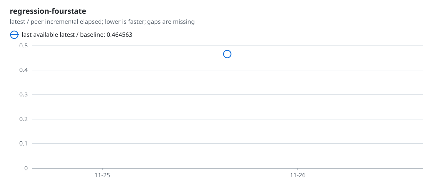


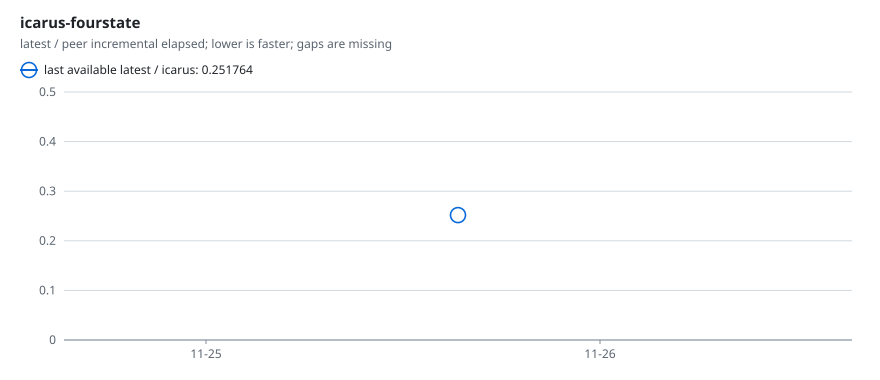


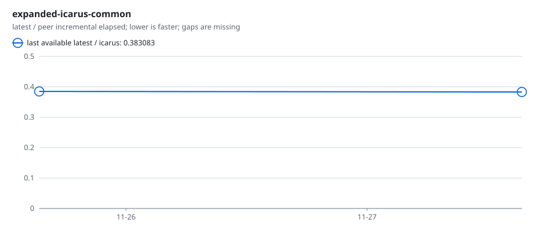


失敗を含む各回：

- [actions-46099311864-1](runs/actions-46099311864-1.json): complete — `e71da22b2f33`
- [actions-45745212803-1](runs/actions-45745212803-1.json): complete — `8a20a6d9337c`
### `cde4aa9dacf5983c`

1 runs; 2026-11-25T03:47:30.324610+00:00 → 2026-11-25T03:47:30.324610+00:00

測定定義: `daily-v4-icarus14`; ケース数: **25**

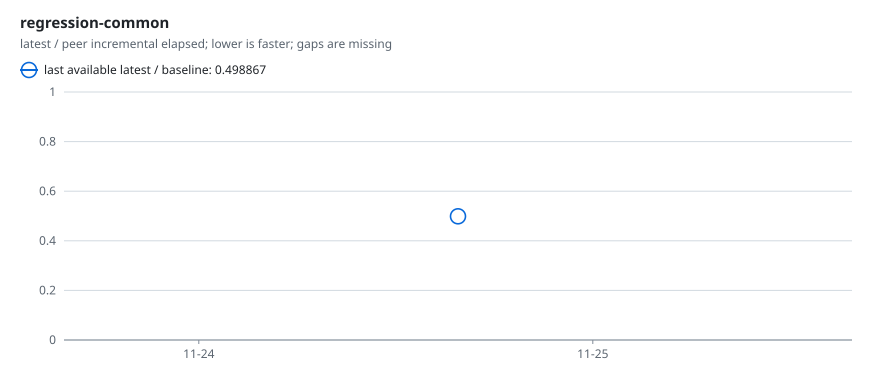

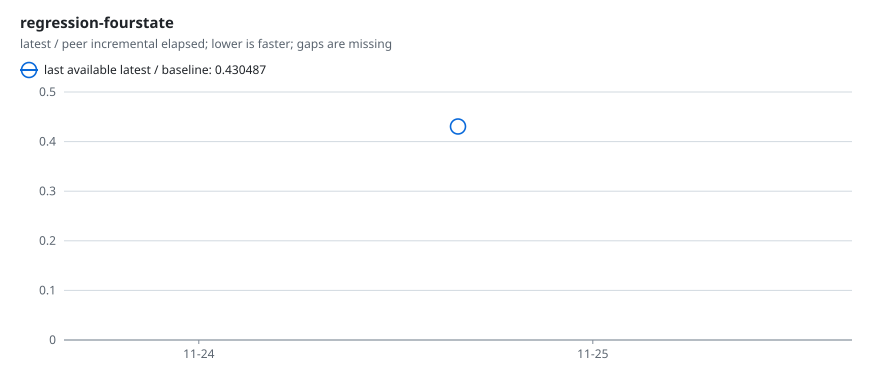

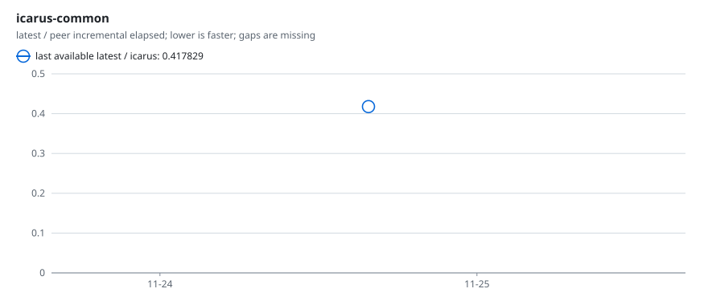


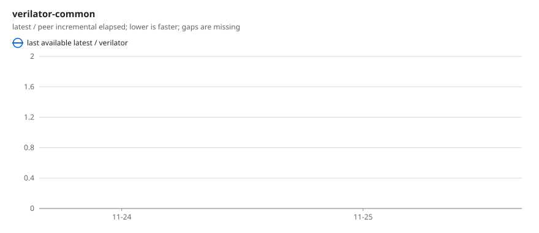


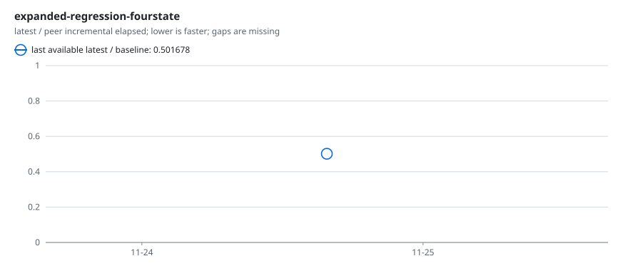


失敗を含む各回：

- [actions-45540765572-1](runs/actions-45540765572-1.json): incomplete — `a50ec73c37d8`
### `ce6cd82e24d95f55`

1 runs; 2026-11-23T04:17:20.572534+00:00 → 2026-11-23T04:17:20.572534+00:00

測定定義: `weekly-v2-icarus14`; ケース数: **3**


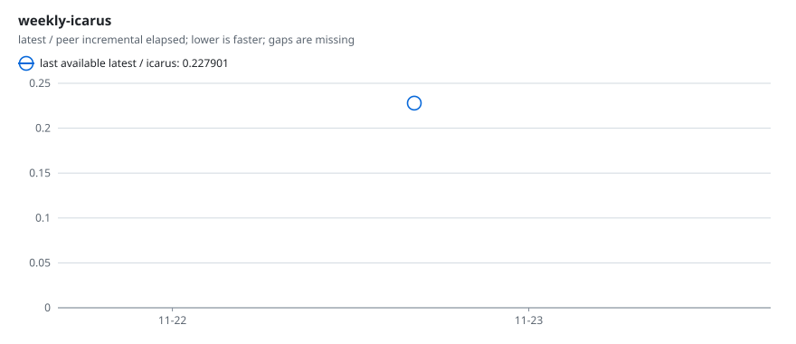


失敗を含む各回：

- [actions-45109202660-1](runs/actions-45109202660-1.json): complete — `378a66ab3240`
### `39bb1735b0601635`

1 runs; 2026-11-23T02:20:58.341830+00:00 → 2026-11-23T02:20:58.341830+00:00

測定定義: `daily-v4-icarus14`; ケース数: **25**

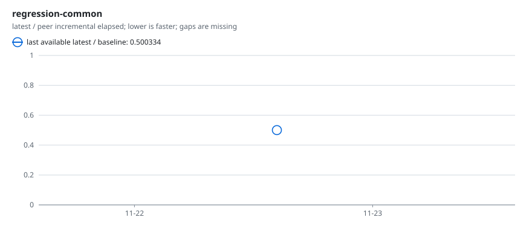


失敗を含む各回：

- [actions-45091454959-1](runs/actions-45091454959-1.json): complete — `1d2cac97a4fe`
### `341b44a021dff5eb`

4 runs; 2026-11-21T02:30:14.755165+00:00 → 2026-11-27T03:02:31.626226+00:00

測定定義: `daily-v4-icarus14`; ケース数: **25**


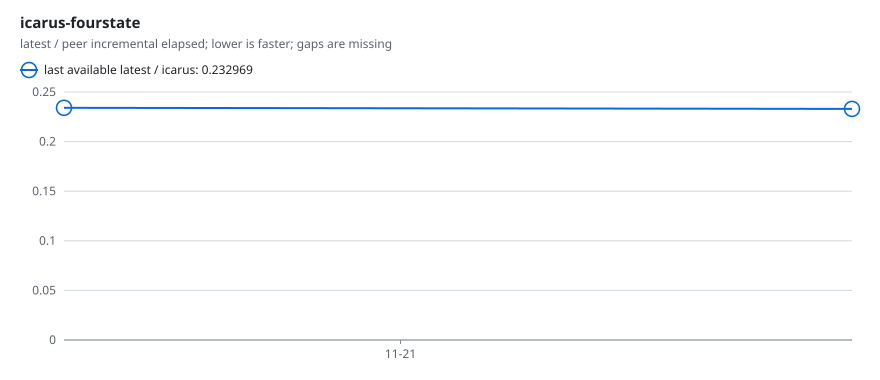


失敗を含む各回：

- [actions-45930807119-1](runs/actions-45930807119-1.json): complete — `b1ad0cb96a40`
- [actions-45328846151-1](runs/actions-45328846151-1.json): complete — `e93839fdcbea`
- [actions-44966152659-1](runs/actions-44966152659-1.json): complete — `ad004a67d861`
- [actions-44850710627-1](runs/actions-44850710627-1.json): complete — `256839f71089`
### `cc3a300591d180c9`

3 runs; 2026-11-18T13:42:55.941756+00:00 → 2026-11-20T01:57:13.586055+00:00

測定定義: `daily-v4-icarus14`; ケース数: **25**


失敗を含む各回：

- [actions-44656096600-1](runs/actions-44656096600-1.json): complete — `cb97fc93bf6b`
- [actions-44440143026-1](runs/actions-44440143026-1.json): incomplete — `a6222f0656d4`
- [actions-44311501813-1](runs/actions-44311501813-1.json): complete — `441dddbd0fcd`
### `25a1c78c12d65db9`

1 runs; 2026-11-18T02:38:15.609997+00:00 → 2026-11-18T02:38:15.609997+00:00

測定定義: `daily-v3-expanded`; ケース数: **25**


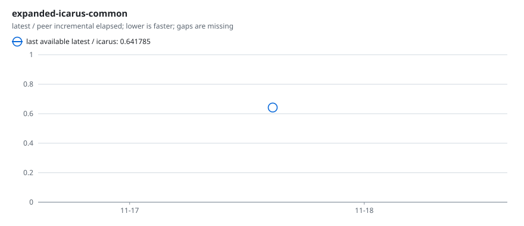

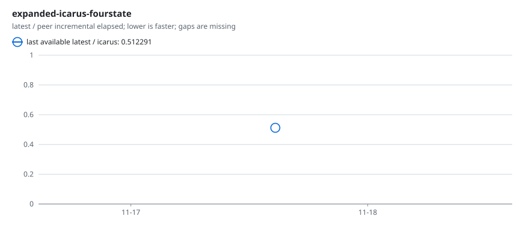


失敗を含む各回：

- [actions-44223268236-1](runs/actions-44223268236-1.json): complete — `441dddbd0fcd`
### `079515db5b1afbed`

1 runs; 2026-11-17T22:58:29.331708+00:00 → 2026-11-17T22:58:29.331708+00:00

測定定義: `weekly-v1-scale`; ケース数: **3**


失敗を含む各回：

- [actions-44186811554-1](runs/actions-44186811554-1.json): complete — `441dddbd0fcd`
### `ff82f2d3ef6ff628`

1 runs; 2026-11-17T21:58:35.859990+00:00 → 2026-11-17T21:58:35.859990+00:00

測定定義: `daily-v3-expanded`; ケース数: **25**


失敗を含む各回：

- [actions-44183926839-1](runs/actions-44183926839-1.json): complete — `234f65f6b205`
### `962ea28f5124b999`

1 runs; 2026-11-17T15:00:17.437065+00:00 → 2026-11-17T15:00:17.437065+00:00

測定定義: `daily-v2-thirteen`; ケース数: **13**


失敗を含む各回：

- [actions-44103555558-1](runs/actions-44103555558-1.json): complete — `13d52dde3c49`
### `ff134f2dfe29a369`

1 runs; 2026-11-17T13:04:45.723115+00:00 → 2026-11-17T13:04:45.723115+00:00

測定定義: `daily-v1`; ケース数: **5**


失敗を含む各回：

- [actions-44085771320-1](runs/actions-44085771320-1.json): complete — `26f359bcd504`

<!-- holdout-start -->

## 最新の別枠の測定（報告のみ）

日次・週次の集合に入らない設計で、週に1回測ります。kirimasimの最適化の判断には使わず、日次の総合値・headline.json・総合グラフにも入れません。比較の集合には相手が実行できる条件だけを入れ、宣言した非対応は欠測として示します。

[JSON](latest-holdout.json)

**測定回:** `actions-45186535033-1` — complete
2026-11-23T13:53:27.681573+00:00 → 2026-11-23T14:01:27.543368+00:00

比率は最新kirimasimの差分時間÷比較対象の差分時間です。1未満なら最新kirimasimが速いことを示します。

この環境での参考値です。失敗・欠測はゼロ秒ではありません。

[JSON](holdout/runs/actions-45186535033-1.json) · [Actions logs / ログ](https://github.com/kurochan001/kirimasim-tests/actions/runs/45186535033/attempts/1) · [Method / 測定方法](https://github.com/kurochan001/kirimasim-tests/blob/main/docs/daily-benchmark.md)

環境: github-hosted-ubuntu-24.04 / Intel(R) Xeon(R) 6975P-C / Linux-7.0.0-1014-aws-x86_64-with-glibc2.39

<details><summary>測定条件</summary>

```json
{
  "machine": {
    "os": "Linux-7.0.0-1014-aws-x86_64-with-glibc2.39",
    "cores": 4,
    "cpu": "Intel(R) Xeon(R) 6975P-C",
    "memory_gib": 15,
    "distribution": "Ubuntu 24.04.5 LTS",
    "architecture": "x86_64"
  },
  "compiler": "g++ (Ubuntu 13.3.0-6ubuntu2~24.04.1) 13.3.0",
  "profile": "holdout",
  "environment": "github-hosted-ubuntu-24.04",
  "image_os": "ubuntu24",
  "image_version": "20261116.133.1",
  "settings": {
    "runs": 5,
    "warmups": 1,
    "timeout_seconds": 600,
    "short_seconds": 0.05,
    "regression_warning_ratio": 1.15,
    "simulation_threads": 1,
    "waveforms": false,
    "assertions": false,
    "verilator_build_jobs": 1
  },
  "mode": "formal",
  "runs": 5,
  "tool_builds": {
    "latest": {
      "compiler": "g++ (Ubuntu 13.3.0-6ubuntu2~24.04.1) 13.3.0",
      "c_compiler": "gcc (Ubuntu 13.3.0-6ubuntu2~24.04.1) 13.3.0",
      "flags": {
        "CC": "gcc",
        "CXX": "g++",
        "CFLAGS": "",
        "CXXFLAGS": "",
        "preset": "release",
        "cmake": "-O3 -DNDEBUG -ffp-contract=off, no fast-math",
        "make_jobs": 2
      }
    },
    "baseline": {
      "compiler": "g++ (Ubuntu 13.3.0-6ubuntu2~24.04.1) 13.3.0",
      "c_compiler": "gcc (Ubuntu 13.3.0-6ubuntu2~24.04.1) 13.3.0",
      "flags": {
        "CC": "gcc",
        "CXX": "g++",
        "CFLAGS": "",
        "CXXFLAGS": "",
        "preset": "release",
        "cmake": "-O3 -DNDEBUG -ffp-contract=off, no fast-math",
        "make_jobs": 2
      }
    },
    "icarus": {
      "compiler": "g++ (Ubuntu 13.3.0-6ubuntu2~24.04.1) 13.3.0",
      "c_compiler": "gcc (Ubuntu 13.3.0-6ubuntu2~24.04.1) 13.3.0",
      "flags": {
        "CC": "gcc",
        "CXX": "g++",
        "CFLAGS": "",
        "CXXFLAGS": "",
        "preset": "release",
        "cmake": "-O3 -DNDEBUG -ffp-contract=off, no fast-math",
        "make_jobs": 2
      }
    },
    "verilator": {
      "compiler": "g++ (Ubuntu 13.3.0-6ubuntu2~24.04.1) 13.3.0",
      "c_compiler": "gcc (Ubuntu 13.3.0-6ubuntu2~24.04.1) 13.3.0",
      "flags": {
        "CC": "gcc",
        "CXX": "g++",
        "CFLAGS": "",
        "CXXFLAGS": "",
        "preset": "release",
        "cmake": "-O3 -DNDEBUG -ffp-contract=off, no fast-math",
        "make_jobs": 2
      }
    },
    "icarus_devel": {
      "compiler": "g++ (Ubuntu 13.3.0-6ubuntu2~24.04.1) 13.3.0",
      "c_compiler": "gcc (Ubuntu 13.3.0-6ubuntu2~24.04.1) 13.3.0",
      "flags": {
        "CC": "gcc",
        "CXX": "g++",
        "CFLAGS": "",
        "CXXFLAGS": "",
        "preset": "release",
        "cmake": "-O3 -DNDEBUG -ffp-contract=off, no fast-math",
        "make_jobs": 2
      }
    }
  },
  "verilator_options": "--binary --timing --threads 1 --build-jobs 1; default C++ optimization; assertions/tracing off",
  "icarus_options": "-g2012; vvp -n; single process",
  "kirimasim_options": "default four-state; interpreter; no waveform/assertion request"
}
```

</details>

- `latest`: `3fcc3ee078b33009c63c7e4df603ce237555618e` — kirimasim 0.2.0 (commit 3fcc3ee078b3), built with GNU 13.3.0
- `baseline`: `cfa2ccd75989c1ebb9ed63303271183377364cf0` — kirimasim 0.1.0 (commit cfa2ccd75989), built with GNU 13.3.0
- `icarus`: `dfeee909ed9f20b4870dd93423156c0170c0e1ff` — Icarus Verilog version 13.0 (stable) (dfeee90-dirty)
- `verilator`: `bbb60a403932a9f695cb6ff001ceb73de6ad9234` — Verilator 5.054 2026-11-01 rev vUNKNOWN-built20261121-bbb60a4
- `icarus_devel`: `587c033991b76b38e78f62803453f24dc7eef304` — Icarus Verilog version 14.0 (devel) (587c033)

定義・測定処理の識別情報: `{'config_sha256': '3b1543f8256fb66a689c77e1e8350434b8ff9d645e4d507e1f433d8ade07d16f', 'driver_sha256': '0edb91f5cbc17e8d1eec9e77ab4c87fb7dbcf4b9ff57d233c5e94628770ad077', 'comparison_sha256': '2896f429781d5eaff2d0ecec465726de342f840892056d20304d2df179ad6be0', 'history_sha256': 'bda014f86bbbea0bd769b5458656bfda07cbcaec712624cfad17960b10b5c887', 'setup_sha256': 'aa89dd6c7df5268f361f96049069cfe68b524ff93819afc4351fcb557c91d8f9', 'adapter_sha256': '4811f9d50d4a09d8794710296d644350468c49a9579a794f27af42ac9fb6b5bc', 'benchmark_commit': 'cfa2ccd75989c1ebb9ed63303271183377364cf0', 'reference_sha256': {'bench/reference_expanded.py': 'a1196d79efb88425f61cc69ba1d9ec99542f7f5dc41fac2a07ade82090b00f4a', 'bench/reference_holdout.py': '422e7ec147459f8dca2f42b91af07e6c2cf05435345a7eb11757a93305c500c2'}}`

| ケース | 処理系 | 状態 | ビルド秒 | T(1)中央値秒 | T(N)中央値秒 | 差分秒 | T(N) MAD秒 | RSS MiB | 最新/対象 | 理由・注意 |
|---|---|---|---:|---:|---:|---:|---:|---:|---:|---|
| class_pool (N=800000) | latest | measured | — | 0.0055532 | 2.8198 | 2.8143 | 0.011126 | 31.574 | — |  |
| class_pool (N=800000) | baseline | measured | — | 0.0054749 | 3.5209 | 3.5154 | 0.010191 | 30.359 | 0.80054 |  |
| class_pool (N=800000) | icarus | unsupported | — | — | — | — | — | — | — | Icarus Verilog 13.0 calls the base-class method instead of the virtual override for a base-class handle (8.20); 14.0 devel calls the override; declared before execution |
| class_pool (N=800000) | verilator | measured | 4.8743 | 0.0013233 | 0.084766 | 0.083443 | 0.00075647 | 52.844 | 33.727 |  |
| class_pool (N=800000) | icarus_devel | measured | 0.0038651 | 0.002776 | 3.6027 | 3.6 | 0.0012064 | 7.6719 | 0.78175 |  |
| dynarray_resize (N=120000) | latest | measured | — | 0.0054285 | 0.81674 | 0.81131 | 0.004125 | 31.641 | — |  |
| dynarray_resize (N=120000) | baseline | measured | — | 0.0050991 | 1.3439 | 1.3388 | 0.0016931 | 28.32 | 0.60599 |  |
| dynarray_resize (N=120000) | icarus | measured | 0.0038624 | 0.0024619 | 3.1556 | 3.1531 | 0.0067614 | 7.4219 | 0.2573 |  |
| dynarray_resize (N=120000) | verilator | measured | 4.8225 | 0.0012997 | 0.032622 | 0.031322 | 1.8219e-05 | 3.8516 | 25.902 | short incremental time; sensitive to timing noise |
| dynarray_resize (N=120000) | icarus_devel | measured | 0.0036606 | 0.0022353 | 2.4627 | 2.4604 | 0.0030426 | 7.6992 | 0.32974 |  |
| intf_modport (N=1000000) | latest | measured | — | 0.0050209 | 2.0162 | 2.0112 | 0.0070858 | 29.762 | — |  |
| intf_modport (N=1000000) | baseline | measured | — | 0.0052263 | 3.5477 | 3.5425 | 0.0037842 | 28.309 | 0.56773 |  |
| intf_modport (N=1000000) | icarus | unsupported | — | — | — | — | — | — | — | Icarus Verilog 13.0 does not parse modport port declarations; 14.0 devel does; declared before execution |
| intf_modport (N=1000000) | verilator | measured | 5.4029 | 0.0013405 | 0.48446 | 0.48312 | 0.00069707 | 3.8516 | 4.1628 |  |
| intf_modport (N=1000000) | icarus_devel | measured | 0.0037169 | 0.0026618 | 2.0337 | 2.0311 | 0.0041618 | 7.5859 | 0.99021 |  |
| real_filter (N=2000000) | latest | measured | — | 0.0055598 | 1.1011 | 1.0955 | 0.0033106 | 29.676 | — |  |
| real_filter (N=2000000) | baseline | measured | — | 0.0049299 | 1.9864 | 1.9815 | 0.0010052 | 28.32 | 0.55288 |  |
| real_filter (N=2000000) | icarus | measured | 0.0039117 | 0.0023325 | 4.7685 | 4.7662 | 0.011536 | 7.4102 | 0.22985 |  |
| real_filter (N=2000000) | verilator | measured | 4.6674 | 0.0013135 | 0.019859 | 0.018546 | 0.00011228 | 3.8359 | 59.07 | short incremental time; sensitive to timing noise |
| real_filter (N=2000000) | icarus_devel | measured | 0.0036209 | 0.0023793 | 3.2432 | 3.2408 | 0.0021554 | 7.5469 | 0.33804 |  |
| force_release (N=1500000) | latest | measured | — | 0.0051603 | 1.6446 | 1.6395 | 0.0044734 | 29.699 | — |  |
| force_release (N=1500000) | baseline | measured | — | 0.0052299 | 2.6182 | 2.613 | 0.0081236 | 28.309 | 0.62745 |  |
| force_release (N=1500000) | icarus | unsupported | — | — | — | — | — | — | — | Icarus Verilog evaluates the right-hand side of assign and force once (its &quot;sorry: procedural continuous assignments are not yet fully supported&quot;), while 10.6 reevaluates it when an operand changes; declared before execution |
| force_release (N=1500000) | verilator | measured | 5.5142 | 0.001333 | 0.19559 | 0.19426 | 0.00020495 | 3.8516 | 8.4396 |  |
| force_release (N=1500000) | icarus_devel | unsupported | — | — | — | — | — | — | — | Icarus Verilog evaluates the right-hand side of assign and force once (its &quot;sorry: procedural continuous assignments are not yet fully supported&quot;), while 10.6 reevaluates it when an operand changes; declared before execution |
| delayed_nets (N=400000) | latest | measured | — | 0.0054106 | 1.2792 | 1.2738 | 0.0077118 | 29.699 | — |  |
| delayed_nets (N=400000) | baseline | measured | — | 0.0052448 | 2.145 | 2.1397 | 0.0035043 | 28.371 | 0.59531 |  |
| delayed_nets (N=400000) | icarus | measured | 0.0040832 | 0.002703 | 2.1714 | 2.1687 | 0.0058275 | 7.418 | 0.58736 |  |
| delayed_nets (N=400000) | verilator | measured | 5.5798 | 0.0013092 | 0.56811 | 0.5668 | 0.0012515 | 3.832 | 2.2474 |  |
| delayed_nets (N=400000) | icarus_devel | measured | 0.0036722 | 0.0025209 | 1.7697 | 1.7672 | 0.00091432 | 7.6992 | 0.7208 |  |
| specify_paths (N=400000) | latest | measured | — | 0.0051603 | 2.0482 | 2.043 | 0.0022109 | 29.703 | — |  |
| specify_paths (N=400000) | baseline | measured | — | 0.0054841 | 3.2663 | 3.2609 | 0.0079521 | 28.32 | 0.62653 |  |
| specify_paths (N=400000) | icarus | measured | 0.003936 | 0.0028334 | 2.7463 | 2.7435 | 0.0023401 | 7.4453 | 0.74468 |  |
| specify_paths (N=400000) | verilator | unsupported | — | — | — | — | — | — | — | Verilator does not apply module path delays (30.4); its output equals that of zero-delay paths; declared before execution |
| specify_paths (N=400000) | icarus_devel | measured | 0.003787 | 0.0027277 | 2.3327 | 2.33 | 0.0003768 | 7.6641 | 0.87685 |  |
| file_output (N=1000000) | latest | measured | — | 0.0053495 | 2.0607 | 2.0554 | 0.0014948 | 29.637 | — |  |
| file_output (N=1000000) | baseline | measured | — | 0.0055434 | 2.5074 | 2.5018 | 0.00056502 | 28.371 | 0.82156 |  |
| file_output (N=1000000) | icarus | measured | 0.0039565 | 0.0027987 | 3.8523 | 3.8495 | 0.010111 | 7.418 | 0.53393 |  |
| file_output (N=1000000) | verilator | measured | 4.7823 | 0.0013308 | 0.58154 | 0.58021 | 0.00020676 | 3.9688 | 3.5424 |  |
| file_output (N=1000000) | icarus_devel | measured | 0.0036633 | 0.0023978 | 3.5376 | 3.5352 | 0.0039738 | 7.5586 | 0.58139 |  |
| bus_fabric_vcd (N=100000) | latest | measured | — | 0.006193 | 0.91935 | 0.91315 | 0.0016257 | 31.676 | — |  |
| bus_fabric_vcd (N=100000) | baseline | measured | — | 0.00566 | 1.7717 | 1.766 | 0.00094944 | 28.281 | 0.51707 |  |
| bus_fabric_vcd (N=100000) | icarus | measured | 0.0045948 | 0.0033658 | 1.6556 | 1.6522 | 0.0039584 | 7.6953 | 0.55267 |  |
| bus_fabric_vcd (N=100000) | verilator | measured | 6.6854 | 0.0014393 | 0.13143 | 0.12999 | 0.00079613 | 4.0234 | 7.0246 |  |
| bus_fabric_vcd (N=100000) | icarus_devel | measured | 0.0043696 | 0.003252 | 1.576 | 1.5727 | 0.0021657 | 7.8789 | 0.58062 |  |
| bus_fabric_fst (N=100000) | latest | measured | — | 0.0067122 | 1.1645 | 1.1578 | 0.031107 | 123.72 | — |  |
| bus_fabric_fst (N=100000) | baseline | measured | — | 0.0065996 | 1.9607 | 1.9541 | 0.025559 | 122.51 | 0.5925 |  |
| bus_fabric_fst (N=100000) | icarus | measured | 0.005243 | 0.0037713 | 1.8932 | 1.8894 | 0.012322 | 140.87 | 0.61277 |  |
| bus_fabric_fst (N=100000) | verilator | measured | 7.5771 | 0.0016658 | 0.23205 | 0.23039 | 0.00067279 | 59.164 | 5.0254 |  |
| bus_fabric_fst (N=100000) | icarus_devel | measured | 0.0043479 | 0.00317 | 1.8457 | 1.8426 | 0.006946 | 141.03 | 0.62836 |  |

固定した総合値の集合（全ケースの有効値が必要です）：

- **holdout-icarus14**: 0.60926; 9/9; class_pool, dynarray_resize, intf_modport, real_filter, delayed_nets, specify_paths, file_output, bus_fabric_vcd, bus_fabric_fst
- **holdout-regression**: 0.62413; 10/10; class_pool, dynarray_resize, intf_modport, real_filter, force_release, delayed_nets, specify_paths, file_output, bus_fabric_vcd, bus_fabric_fst
- **holdout-verilator**: 9.2782; 9/9; class_pool, dynarray_resize, intf_modport, real_filter, force_release, delayed_nets, file_output, bus_fabric_vcd, bus_fabric_fst

完全なNでの波形ファイルの大きさ（バイトの中央値。中身は比べていません）：

| 条件 | 処理系 | バイト |
|---|---|---:|
| bus_fabric_vcd (N=100000) | latest | 74,839,976 |
| bus_fabric_vcd (N=100000) | baseline | 74,839,978 |
| bus_fabric_vcd (N=100000) | icarus | 130,983,583 |
| bus_fabric_vcd (N=100000) | verilator | 62,699,582 |
| bus_fabric_vcd (N=100000) | icarus_devel | 130,983,583 |
| bus_fabric_fst (N=100000) | latest | 3,084,969 |
| bus_fabric_fst (N=100000) | baseline | 3,084,970 |
| bus_fabric_fst (N=100000) | icarus | 3,300,103 |
| bus_fabric_fst (N=100000) | verilator | 4,698,181 |
| bus_fabric_fst (N=100000) | icarus_devel | 3,300,103 |

失敗を含む別枠の各回：

- [actions-45186535033-1](holdout/runs/actions-45186535033-1.json): complete — `3fcc3ee078b3`
- [actions-44895777688-1](holdout/runs/actions-44895777688-1.json): complete — `557aae7ef84f`

<!-- holdout-end -->
</details>
