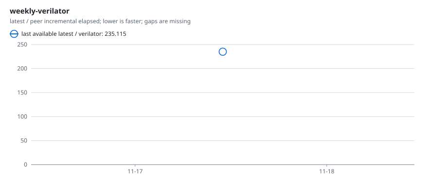
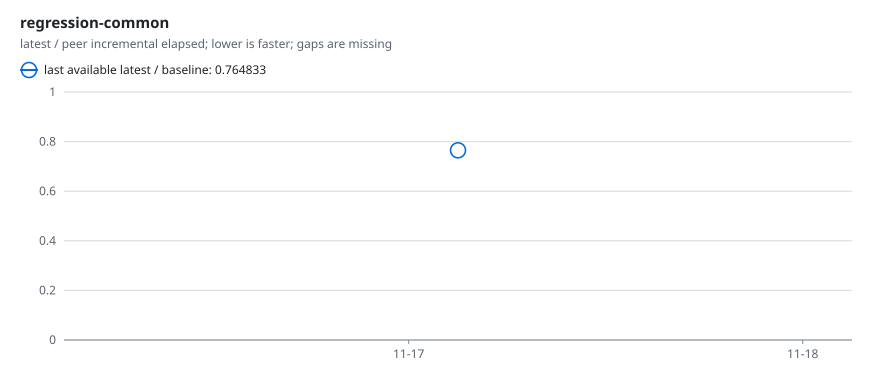

# 日次・週次シミュレーション速度ベンチマーク

[English](README.md) / [日本語](README.ja.md)

機能テストのNightlyとは独立しています。GitHub標準ランナーの値は参考値で、5回の測定から統計的有意性を断言しません。


日次25種類（共通22＋4値3）の等重み幾何平均です。比率はkirimasim÷Icarus 14.0 develの差分所要時間。0.97は所要時間が3%短い意味で、小さいほど高速です。

両開発版のコミットを測定開始時に一度解決します。JSTの各日の最後の正式測定を使い、1種類でも無効なら総合値は欠測です。環境・定義ごとに線を分けます。双方の変更が推移に影響するため、固定版との比較も下に残します。

[JSON](headline.json) · [Method / 測定方法](https://github.com/kurochan001/kirimasim-tests/blob/main/docs/daily-benchmark.md)

最新の総合測定: **2026-11-18 JST — 0.89719** (25/25; complete)

[Raw / 生データ](runs/actions-44311501813-1.json) · [Actions logs / ログ](https://github.com/kurochan001/kirimasim-tests/actions/runs/44311501813/attempts/1)

<details><summary>ケース別結果・固定版との比較・過去の系列</summary>

## 最新の日次測定

[JSON](latest-daily.json)

**測定回:** `actions-44311501813-1` — complete
2026-11-18T13:42:55.941756+00:00 → 2026-11-18T14:39:10.210799+00:00

比率は最新kirimasimの差分時間÷比較対象の差分時間です。1未満なら最新kirimasimが速いことを示します。

この環境での参考値です。失敗・欠測はゼロ秒ではありません。

[JSON](runs/actions-44311501813-1.json) · [Actions logs / ログ](https://github.com/kurochan001/kirimasim-tests/actions/runs/44311501813/attempts/1) · [Method / 測定方法](https://github.com/kurochan001/kirimasim-tests/blob/main/docs/daily-benchmark.md)

環境: github-hosted-ubuntu-24.04 / Intel(R) Xeon(R) 6975P-C / Linux-7.0.0-1014-aws-x86_64-with-glibc2.39

<details><summary>測定条件</summary>

```json
{
  "machine": {
    "os": "Linux-7.0.0-1014-aws-x86_64-with-glibc2.39",
    "cores": 4,
    "cpu": "Intel(R) Xeon(R) 6975P-C",
    "memory_gib": 15,
    "distribution": "Ubuntu 24.04.5 LTS",
    "architecture": "x86_64"
  },
  "compiler": "g++ (Ubuntu 13.3.0-6ubuntu2~24.04.1) 13.3.0",
  "profile": "daily",
  "environment": "github-hosted-ubuntu-24.04",
  "image_os": "ubuntu24",
  "image_version": "20261111.127.1",
  "settings": {
    "runs": 5,
    "warmups": 1,
    "timeout_seconds": 600,
    "short_seconds": 0.05,
    "regression_warning_ratio": 1.15,
    "simulation_threads": 1,
    "waveforms": false,
    "assertions": false,
    "verilator_build_jobs": 1
  },
  "mode": "formal",
  "runs": 5,
  "tool_builds": {
    "latest": {
      "compiler": "g++ (Ubuntu 13.3.0-6ubuntu2~24.04.1) 13.3.0",
      "c_compiler": "gcc (Ubuntu 13.3.0-6ubuntu2~24.04.1) 13.3.0",
      "flags": {
        "CC": "gcc",
        "CXX": "g++",
        "CFLAGS": "",
        "CXXFLAGS": "",
        "preset": "release",
        "cmake": "-O3 -DNDEBUG -ffp-contract=off, no fast-math",
        "make_jobs": 2
      }
    },
    "baseline": {
      "compiler": "g++ (Ubuntu 13.3.0-6ubuntu2~24.04.1) 13.3.0",
      "c_compiler": "gcc (Ubuntu 13.3.0-6ubuntu2~24.04.1) 13.3.0",
      "flags": {
        "CC": "gcc",
        "CXX": "g++",
        "CFLAGS": "",
        "CXXFLAGS": "",
        "preset": "release",
        "cmake": "-O3 -DNDEBUG -ffp-contract=off, no fast-math",
        "make_jobs": 2
      }
    },
    "icarus": {
      "compiler": "g++ (Ubuntu 13.3.0-6ubuntu2~24.04.1) 13.3.0",
      "c_compiler": "gcc (Ubuntu 13.3.0-6ubuntu2~24.04.1) 13.3.0",
      "flags": {
        "CC": "gcc",
        "CXX": "g++",
        "CFLAGS": "",
        "CXXFLAGS": "",
        "preset": "release",
        "cmake": "-O3 -DNDEBUG -ffp-contract=off, no fast-math",
        "make_jobs": 2
      }
    },
    "verilator": {
      "compiler": "g++ (Ubuntu 13.3.0-6ubuntu2~24.04.1) 13.3.0",
      "c_compiler": "gcc (Ubuntu 13.3.0-6ubuntu2~24.04.1) 13.3.0",
      "flags": {
        "CC": "gcc",
        "CXX": "g++",
        "CFLAGS": "",
        "CXXFLAGS": "",
        "preset": "release",
        "cmake": "-O3 -DNDEBUG -ffp-contract=off, no fast-math",
        "make_jobs": 2
      }
    },
    "icarus_devel": {
      "compiler": "g++ (Ubuntu 13.3.0-6ubuntu2~24.04.1) 13.3.0",
      "c_compiler": "gcc (Ubuntu 13.3.0-6ubuntu2~24.04.1) 13.3.0",
      "flags": {
        "CC": "gcc",
        "CXX": "g++",
        "CFLAGS": "",
        "CXXFLAGS": "",
        "preset": "release",
        "cmake": "-O3 -DNDEBUG -ffp-contract=off, no fast-math",
        "make_jobs": 2
      }
    }
  },
  "verilator_options": "--binary --timing --threads 1 --build-jobs 1; default C++ optimization; assertions/tracing off",
  "icarus_options": "-g2012; vvp -n; single process",
  "kirimasim_options": "default four-state; interpreter; no waveform/assertion request"
}
```

</details>

- `latest`: `441dddbd0fcd80aed298ca33311f2ee67aa8866c` — kirimasim 0.1.1 (commit 441dddbd0fcd), built with GNU 13.3.0
- `baseline`: `cfa2ccd75989c1ebb9ed63303271183377364cf0` — kirimasim 0.1.0 (commit cfa2ccd75989), built with GNU 13.3.0
- `icarus`: `dfeee909ed9f20b4870dd93423156c0170c0e1ff` — Icarus Verilog version 13.0 (stable) (dfeee90-dirty)
- `verilator`: `bbb60a403932a9f695cb6ff001ceb73de6ad9234` — Verilator 5.054 2026-11-01 rev vUNKNOWN-built20261118-bbb60a4
- `icarus_devel`: `0b15315c14177986b98fcad2940c0c3f98fdc8f9` — Icarus Verilog version 14.0 (devel) (0b15315)

定義・測定処理の識別情報: `{'config_sha256': '4006a76543b7c88eed78ba128e7459c54ac2ee82a78efdd401ac2d85643bef9b', 'driver_sha256': '0edb91f5cbc17e8d1eec9e77ab4c87fb7dbcf4b9ff57d233c5e94628770ad077', 'comparison_sha256': '2896f429781d5eaff2d0ecec465726de342f840892056d20304d2df179ad6be0', 'history_sha256': 'bda014f86bbbea0bd769b5458656bfda07cbcaec712624cfad17960b10b5c887', 'setup_sha256': 'aa89dd6c7df5268f361f96049069cfe68b524ff93819afc4351fcb557c91d8f9', 'adapter_sha256': '4811f9d50d4a09d8794710296d644350468c49a9579a794f27af42ac9fb6b5bc', 'benchmark_commit': 'cfa2ccd75989c1ebb9ed63303271183377364cf0', 'reference_sha256': {'bench/reference_expanded.py': 'a1196d79efb88425f61cc69ba1d9ec99542f7f5dc41fac2a07ade82090b00f4a', 'bench/reference_fourstate_mix.py': '586fb643e9ef9df9e304df83e04e711aa1b875e6cb4393e6e3c98cd1707b70e1'}}`

| ケース | 処理系 | 状態 | ビルド秒 | T(1)中央値秒 | T(N)中央値秒 | 差分秒 | T(N) MAD秒 | RSS MiB | 最新/対象 | 理由・注意 |
|---|---|---|---:|---:|---:|---:|---:|---:|---:|---|
| casez_struct (N=5000000) | latest | measured | — | 0.0048853 | 3.6475 | 3.6426 | 0.024613 | 28.484 | — |  |
| casez_struct (N=5000000) | baseline | measured | — | 0.0051372 | 5.0184 | 5.0133 | 0.018589 | 28.48 | 0.72659 |  |
| casez_struct (N=5000000) | icarus | measured | 0.0050261 | 0.0027798 | 5.5456 | 5.5429 | 0.018924 | 7.3633 | 0.65718 |  |
| casez_struct (N=5000000) | verilator | measured | 4.9344 | 0.0013324 | 0.029767 | 0.028434 | 0.00010045 | 3.8359 | 128.11 | short incremental time; sensitive to timing noise |
| casez_struct (N=5000000) | icarus_devel | measured | 0.0040148 | 0.0026422 | 5.0448 | 5.0421 | 0.02411 | 7.5781 | 0.72244 |  |
| comb_chain (N=3000000) | latest | measured | — | 0.0054403 | 10.217 | 10.212 | 0.018083 | 28.48 | — |  |
| comb_chain (N=3000000) | baseline | measured | — | 0.0053334 | 13.462 | 13.457 | 0.052973 | 28.484 | 0.75885 |  |
| comb_chain (N=3000000) | icarus | measured | 0.0038377 | 0.0027605 | 19.467 | 19.464 | 0.018809 | 7.4336 | 0.52465 |  |
| comb_chain (N=3000000) | verilator | measured | 5.7091 | 0.0013593 | 0.32524 | 0.32388 | 0.00064446 | 3.8516 | 31.53 |  |
| comb_chain (N=3000000) | icarus_devel | measured | 0.0038299 | 0.0025666 | 12.663 | 12.66 | 0.027399 | 7.5859 | 0.80661 |  |
| dyn_queue (N=4000000) | latest | measured | — | 0.0044156 | 4.4368 | 4.4324 | 0.0058601 | 28.418 | — |  |
| dyn_queue (N=4000000) | baseline | measured | — | 0.005196 | 5.5513 | 5.5461 | 0.013055 | 28.246 | 0.79919 |  |
| dyn_queue (N=4000000) | icarus | measured | 0.0038641 | 0.0027977 | 10.339 | 10.336 | 0.012861 | 7.4023 | 0.42883 |  |
| dyn_queue (N=4000000) | verilator | measured | 4.9977 | 0.0013027 | 0.10432 | 0.10302 | 0.00097468 | 3.8477 | 43.025 |  |
| dyn_queue (N=4000000) | icarus_devel | measured | 0.0035817 | 0.002624 | 9.4272 | 9.4246 | 0.015711 | 7.6797 | 0.4703 |  |
| fork_join (N=4000000) | latest | measured | — | 0.0049279 | 5.9538 | 5.9488 | 0.011192 | 28.332 | — |  |
| fork_join (N=4000000) | baseline | measured | — | 0.0048316 | 7.0017 | 6.9969 | 0.042862 | 28.309 | 0.85021 |  |
| fork_join (N=4000000) | icarus | measured | 0.0037942 | 0.0026779 | 9.0515 | 9.0488 | 0.0075076 | 7.3555 | 0.65742 |  |
| fork_join (N=4000000) | verilator | measured | 5.6232 | 0.0013618 | 1.7535 | 1.7522 | 0.0024269 | 3.8203 | 3.3951 |  |
| fork_join (N=4000000) | icarus_devel | measured | 0.0036544 | 0.0023908 | 6.7099 | 6.7075 | 0.020453 | 7.5156 | 0.88689 |  |
| func_call (N=1500000) | latest | measured | — | 0.0047898 | 5.5423 | 5.5375 | 0.012733 | 28.32 | — |  |
| func_call (N=1500000) | baseline | measured | — | 0.0051158 | 6.7387 | 6.7336 | 0.012483 | 28.254 | 0.82236 |  |
| func_call (N=1500000) | icarus | measured | 0.0036833 | 0.0027235 | 15.23 | 15.227 | 0.010163 | 7.3828 | 0.36366 |  |
| func_call (N=1500000) | verilator | measured | 4.7793 | 0.0012835 | 0.0085352 | 0.0072518 | 9.1643e-05 | 0.31641 | 763.6 | short incremental time; sensitive to timing noise |
| func_call (N=1500000) | icarus_devel | measured | 0.0036539 | 0.0025193 | 10.691 | 10.688 | 0.07803 | 7.5117 | 0.51808 |  |
| gate_udp (N=400000) | latest | measured | — | 0.0056521 | 5.9309 | 5.9252 | 0.0033522 | 28.398 | — |  |
| gate_udp (N=400000) | baseline | measured | — | 0.0061902 | 7.6775 | 7.6713 | 0.0082743 | 28.34 | 0.77239 |  |
| gate_udp (N=400000) | icarus | measured | 0.0060214 | 0.0035476 | 4.9299 | 4.9263 | 0.01421 | 7.4297 | 1.2028 |  |
| gate_udp (N=400000) | verilator | measured | 5.5891 | 0.0013607 | 0.063218 | 0.061857 | 0.00018552 | 3.8438 | 95.789 |  |
| gate_udp (N=400000) | icarus_devel | measured | 0.0049347 | 0.0031807 | 4.5737 | 4.5705 | 0.0073615 | 7.625 | 1.2964 |  |
| mem_rw (N=4000000) | latest | measured | — | 0.0058458 | 5.8276 | 5.8217 | 0.024667 | 28.391 | — |  |
| mem_rw (N=4000000) | baseline | measured | — | 0.0068919 | 7.2846 | 7.2777 | 0.0063401 | 28.375 | 0.79994 |  |
| mem_rw (N=4000000) | icarus | measured | 0.0047844 | 0.0031317 | 6.069 | 6.0658 | 0.013977 | 7.4375 | 0.95975 |  |
| mem_rw (N=4000000) | verilator | measured | 5.6493 | 0.001317 | 0.97832 | 0.977 | 0.002198 | 3.8555 | 5.9588 |  |
| mem_rw (N=4000000) | icarus_devel | measured | 0.0038578 | 0.0031249 | 4.3779 | 4.3748 | 0.0090383 | 7.5742 | 1.3307 |  |
| nba_burst (N=500000) | latest | measured | — | 0.0047528 | 0.12986 | 0.12511 | 0.0026655 | 124.55 | — |  |
| nba_burst (N=500000) | baseline | measured | — | 0.0048396 | 0.15352 | 0.14868 | 0.0025108 | 124.5 | 0.84147 |  |
| nba_burst (N=500000) | icarus | measured | 0.0036474 | 0.0024336 | 0.17077 | 0.16834 | 0.0021439 | 33.824 | 0.74323 |  |
| nba_burst (N=500000) | verilator | measured | 5.5327 | 0.0013171 | 0.0013569 | 3.9777e-05 | 6.0383e-05 | 0.31641 | 3145.3 | short incremental time; sensitive to timing noise; incremental time is close to observed dispersion |
| nba_burst (N=500000) | icarus_devel | measured | 0.0036797 | 0.0021418 | 0.16851 | 0.16637 | 0.00062923 | 34.016 | 0.752 |  |
| nba_shift (N=1000000) | latest | measured | — | 0.0058072 | 28.273 | 28.267 | 0.033902 | 28.441 | — |  |
| nba_shift (N=1000000) | baseline | measured | — | 0.0061523 | 35.763 | 35.757 | 0.44323 | 28.305 | 0.79052 |  |
| nba_shift (N=1000000) | icarus | measured | 0.0040603 | 0.0030368 | 34.694 | 34.69 | 0.10591 | 7.5 | 0.81483 |  |
| nba_shift (N=1000000) | verilator | measured | 5.7171 | 0.0013357 | 0.28357 | 0.28223 | 6.8134e-05 | 3.8242 | 100.15 |  |
| nba_shift (N=1000000) | icarus_devel | measured | 0.0042645 | 0.0029987 | 34.124 | 34.121 | 0.0092477 | 7.5586 | 0.82842 |  |
| proc_wait (N=1000000) | latest | measured | — | 0.0068884 | 8.9541 | 8.9472 | 0.017038 | 32.375 | — |  |
| proc_wait (N=1000000) | baseline | measured | — | 0.007101 | 10.497 | 10.49 | 0.023777 | 30.43 | 0.85292 |  |
| proc_wait (N=1000000) | icarus | measured | 0.0067631 | 0.0037918 | 8.6487 | 8.645 | 0.025788 | 7.7969 | 1.035 |  |
| proc_wait (N=1000000) | verilator | measured | 7.3966 | 0.0013795 | 2.9507 | 2.9493 | 0.006884 | 3.9844 | 3.0337 |  |
| proc_wait (N=1000000) | icarus_devel | measured | 0.0051163 | 0.0035224 | 8.6055 | 8.602 | 0.032753 | 8.0586 | 1.0401 |  |
| string_fmt (N=500000) | latest | measured | — | 0.0045998 | 4.5138 | 4.5092 | 0.0038172 | 28.531 | — |  |
| string_fmt (N=500000) | baseline | measured | — | 0.0047413 | 5.8583 | 5.8535 | 0.040215 | 28.383 | 0.77034 |  |
| string_fmt (N=500000) | icarus | measured | 0.0038528 | 0.0027541 | 15.035 | 15.032 | 0.066073 | 7.4023 | 0.29997 |  |
| string_fmt (N=500000) | verilator | measured | 4.7847 | 0.0013408 | 0.19827 | 0.19693 | 0.00041368 | 3.9297 | 22.898 |  |
| string_fmt (N=500000) | icarus_devel | measured | 0.0035278 | 0.0025974 | 11.642 | 11.639 | 0.01639 | 7.5898 | 0.38742 |  |
| wide_arith (N=1500000) | latest | measured | — | 0.0048645 | 2.8167 | 2.8118 | 0.013636 | 28.539 | — |  |
| wide_arith (N=1500000) | baseline | measured | — | 0.00542 | 7.1384 | 7.133 | 0.010845 | 28.332 | 0.3942 |  |
| wide_arith (N=1500000) | icarus | measured | 0.0037577 | 0.0025443 | 14.615 | 14.612 | 0.016313 | 7.3242 | 0.19243 |  |
| wide_arith (N=1500000) | verilator | measured | 4.837 | 0.0013377 | 0.12049 | 0.11915 | 0.00028258 | 3.8398 | 23.598 |  |
| wide_arith (N=1500000) | icarus_devel | measured | 0.0037688 | 0.0023616 | 2.6585 | 2.6561 | 0.0027271 | 7.4844 | 1.0586 |  |
| fourstate_mix (N=1000000) | latest | measured | — | 0.004682 | 1.2949 | 1.2903 | 0.0044685 | 28.605 | — |  |
| fourstate_mix (N=1000000) | baseline | measured | — | 0.005701 | 1.7374 | 1.7317 | 0.0029997 | 28.543 | 0.74509 |  |
| fourstate_mix (N=1000000) | icarus | measured | 0.0040474 | 0.0027684 | 3.1934 | 3.1907 | 0.0083275 | 7.332 | 0.40438 |  |
| fourstate_mix (N=1000000) | verilator | unsupported | — | — | — | — | — | — | — | X/Z observations require four-state semantics; excluded before execution |
| fourstate_mix (N=1000000) | icarus_devel | measured | 0.0036119 | 0.0027405 | 2.1994 | 2.1966 | 0.0030941 | 7.5664 | 0.58738 |  |
| fifo_stream (N=200000) | latest | measured | — | 0.0055771 | 0.61966 | 0.61409 | 0.00064509 | 28.539 | — |  |
| fifo_stream (N=200000) | baseline | measured | — | 0.0051238 | 0.7753 | 0.77018 | 0.0043271 | 28.492 | 0.79733 |  |
| fifo_stream (N=200000) | icarus | measured | 0.00407 | 0.0027353 | 0.55677 | 0.55403 | 0.00084967 | 7.4414 | 1.1084 |  |
| fifo_stream (N=200000) | verilator | measured | 5.5813 | 0.0013496 | 0.063121 | 0.061772 | 6.3726e-05 | 3.8516 | 9.9413 |  |
| fifo_stream (N=200000) | icarus_devel | measured | 0.0039842 | 0.0025082 | 0.47434 | 0.47183 | 0.00041565 | 7.5742 | 1.3015 |  |
| uart_loopback (N=20000) | latest | measured | — | 0.0052293 | 0.61137 | 0.60615 | 0.0031243 | 28.535 | — |  |
| uart_loopback (N=20000) | baseline | measured | — | 0.0058868 | 0.70509 | 0.69921 | 0.001005 | 28.488 | 0.8669 |  |
| uart_loopback (N=20000) | icarus | measured | 0.0048224 | 0.0028101 | 0.335 | 0.33219 | 0.00036209 | 7.4297 | 1.8247 |  |
| uart_loopback (N=20000) | verilator | measured | 5.5651 | 0.0013494 | 0.073332 | 0.071983 | 0.00015031 | 3.8281 | 8.4207 |  |
| uart_loopback (N=20000) | icarus_devel | measured | 0.0040976 | 0.0027176 | 0.29437 | 0.29166 | 0.00067017 | 7.5938 | 2.0783 |  |
| bus_fabric (N=150000) | latest | measured | — | 0.0054214 | 1.7445 | 1.7391 | 0.0019361 | 28.496 | — |  |
| bus_fabric (N=150000) | baseline | measured | — | 0.0062111 | 2.1392 | 2.133 | 0.0052688 | 28.48 | 0.81531 |  |
| bus_fabric (N=150000) | icarus | measured | 0.0051367 | 0.0030251 | 0.72462 | 0.7216 | 0.0022993 | 7.4727 | 2.41 |  |
| bus_fabric (N=150000) | verilator | measured | 5.5714 | 0.0012936 | 0.080679 | 0.079385 | 1.9614e-05 | 3.8164 | 21.907 |  |
| bus_fabric (N=150000) | icarus_devel | measured | 0.0045217 | 0.0028878 | 0.65561 | 0.65273 | 0.0011864 | 7.5977 | 2.6643 |  |
| hierarchy_fanout (N=100000) | latest | measured | — | 0.0092702 | 8.9329 | 8.9236 | 0.013331 | 36.379 | — |  |
| hierarchy_fanout (N=100000) | baseline | measured | — | 0.0097411 | 11.3 | 11.29 | 0.019482 | 36.469 | 0.79039 |  |
| hierarchy_fanout (N=100000) | icarus | measured | 0.0094285 | 0.0089529 | 25.95 | 25.941 | 0.03266 | 8.2812 | 0.34399 |  |
| hierarchy_fanout (N=100000) | verilator | measured | 5.6571 | 0.0013025 | 0.027766 | 0.026463 | 0.00025135 | 3.8203 | 337.21 | short incremental time; sensitive to timing noise |
| hierarchy_fanout (N=100000) | icarus_devel | measured | 0.0088369 | 0.0084453 | 7.9478 | 7.9393 | 0.016353 | 8.4688 | 1.124 |  |
| event_fanout (N=50000) | latest | measured | — | 0.012334 | 2.4604 | 2.4481 | 0.0052787 | 42.516 | — |  |
| event_fanout (N=50000) | baseline | measured | — | 0.013095 | 2.8942 | 2.8811 | 0.0031915 | 42.484 | 0.84969 |  |
| event_fanout (N=50000) | icarus | measured | 0.0094799 | 0.0071997 | 3.4345 | 3.4273 | 0.0093136 | 9.0938 | 0.71429 |  |
| event_fanout (N=50000) | verilator | measured | 5.9946 | 0.0013303 | 0.054798 | 0.053468 | 5.9256e-05 | 3.8438 | 45.786 |  |
| event_fanout (N=50000) | icarus_devel | measured | 0.0094297 | 0.0071554 | 3.4161 | 3.4089 | 0.0052734 | 9.293 | 0.71813 |  |
| word_boundary (N=4000000) | latest | measured | — | 0.0048188 | 5.7703 | 5.7654 | 0.0069511 | 28.387 | — |  |
| word_boundary (N=4000000) | baseline | measured | — | 0.004904 | 10.265 | 10.26 | 0.0554 | 28.438 | 0.56191 |  |
| word_boundary (N=4000000) | icarus | measured | 0.003676 | 0.0027041 | 23.952 | 23.949 | 0.044889 | 7.332 | 0.24074 |  |
| word_boundary (N=4000000) | verilator | measured | 4.8701 | 0.001333 | 0.038508 | 0.037175 | 0.00021458 | 3.8125 | 155.09 | short incremental time; sensitive to timing noise |
| word_boundary (N=4000000) | icarus_devel | measured | 0.0036994 | 0.0025463 | 8.401 | 8.3985 | 0.018503 | 7.5117 | 0.68648 |  |
| wide_divide (N=80000) | latest | measured | — | 0.0049623 | 1.062 | 1.0571 | 0.0016729 | 28.539 | — |  |
| wide_divide (N=80000) | baseline | measured | — | 0.0052534 | 1.1678 | 1.1626 | 0.0010379 | 28.48 | 0.90924 |  |
| wide_divide (N=80000) | icarus | measured | 0.0042884 | 0.0024597 | 1.0741 | 1.0716 | 0.0015497 | 7.3125 | 0.98641 |  |
| wide_divide (N=80000) | verilator | measured | 4.9325 | 0.0013225 | 0.0095303 | 0.0082078 | 0.00011711 | 0.3125 | 128.79 | short incremental time; sensitive to timing noise |
| wide_divide (N=80000) | icarus_devel | measured | 0.0038793 | 0.0023469 | 0.53886 | 0.53652 | 0.00097145 | 7.5117 | 1.9702 |  |
| packed_slice (N=1500000) | latest | measured | — | 0.0045204 | 2.5814 | 2.5769 | 0.0069921 | 28.543 | — |  |
| packed_slice (N=1500000) | baseline | measured | — | 0.0050711 | 6.1069 | 6.1018 | 0.009823 | 28.398 | 0.42232 |  |
| packed_slice (N=1500000) | icarus | measured | 0.0038006 | 0.0027223 | 8.8795 | 8.8768 | 0.020418 | 7.3438 | 0.29029 |  |
| packed_slice (N=1500000) | verilator | measured | 4.919 | 0.0013475 | 0.093301 | 0.091953 | 0.00044636 | 3.7969 | 28.024 |  |
| packed_slice (N=1500000) | icarus_devel | measured | 0.0036002 | 0.0025868 | 3.3046 | 3.3021 | 0.0025375 | 7.5352 | 0.78039 |  |
| memory_scatter (N=5000000) | latest | measured | — | 0.04537 | 3.6515 | 3.6061 | 0.010044 | 42.422 | — |  |
| memory_scatter (N=5000000) | baseline | measured | — | 0.048084 | 5.1669 | 5.1188 | 0.0080977 | 42.488 | 0.70449 |  |
| memory_scatter (N=5000000) | icarus | measured | 0.0040567 | 0.026185 | 12.385 | 12.359 | 0.039291 | 7.8594 | 0.29179 |  |
| memory_scatter (N=5000000) | verilator | measured | 4.9471 | 0.0013984 | 0.0084531 | 0.0070547 | 2.3411e-05 | 0.31641 | 511.17 | short incremental time; sensitive to timing noise |
| memory_scatter (N=5000000) | icarus_devel | measured | 0.0040366 | 0.016407 | 6.9451 | 6.9287 | 0.011005 | 8.0391 | 0.52046 |  |
| clock_domains (N=20000) | latest | measured | — | 0.0044927 | 0.17828 | 0.17379 | 0.00057879 | 28.539 | — |  |
| clock_domains (N=20000) | baseline | measured | — | 0.005156 | 0.21256 | 0.2074 | 0.0011055 | 28.48 | 0.83792 |  |
| clock_domains (N=20000) | icarus | measured | 0.0038182 | 0.0026714 | 0.1083 | 0.10563 | 0.00052177 | 7.4141 | 1.6452 |  |
| clock_domains (N=20000) | verilator | measured | 5.6684 | 0.0013073 | 0.072921 | 0.071614 | 0.00016079 | 3.8516 | 2.4267 |  |
| clock_domains (N=20000) | icarus_devel | measured | 0.0036074 | 0.002609 | 0.10507 | 0.10246 | 0.00026233 | 7.5742 | 1.6961 |  |
| fourstate_arith (N=100000) | latest | measured | — | 0.0055485 | 0.14258 | 0.13703 | 0.0014526 | 28.598 | — |  |
| fourstate_arith (N=100000) | baseline | measured | — | 0.0051265 | 0.17127 | 0.16615 | 0.00014716 | 28.543 | 0.82475 |  |
| fourstate_arith (N=100000) | icarus | measured | 0.0044919 | 0.0026889 | 0.24032 | 0.23764 | 0.00020684 | 7.3438 | 0.57663 |  |
| fourstate_arith (N=100000) | verilator | unsupported | — | — | — | — | — | — | — | X/Z observations require four-state semantics; excluded before execution |
| fourstate_arith (N=100000) | icarus_devel | measured | 0.0036707 | 0.0024348 | 0.22548 | 0.22304 | 0.00046419 | 7.4961 | 0.61436 |  |
| resolved_bus (N=50000) | latest | measured | — | 0.0045184 | 0.27332 | 0.2688 | 0.0012229 | 28.543 | — |  |
| resolved_bus (N=50000) | baseline | measured | — | 0.0055456 | 0.34637 | 0.34082 | 0.0022203 | 28.48 | 0.78868 |  |
| resolved_bus (N=50000) | icarus | measured | 0.0042523 | 0.0027981 | 0.47517 | 0.47238 | 0.00049573 | 7.3594 | 0.56904 |  |
| resolved_bus (N=50000) | verilator | unsupported | — | — | — | — | — | — | — | X/Z observations require four-state semantics; excluded before execution |
| resolved_bus (N=50000) | icarus_devel | measured | 0.0037752 | 0.0027152 | 0.45988 | 0.45716 | 0.0012581 | 7.5469 | 0.58797 |  |

固定した総合値の集合（全ケースの有効値が必要です）：

- **regression-common**: 0.75218; 12/12; casez_struct, comb_chain, dyn_queue, fork_join, func_call, gate_udp, mem_rw, nba_burst, nba_shift, proc_wait, string_fmt, wide_arith
- **regression-fourstate**: 0.74509; 1/1; fourstate_mix
- **icarus-common**: 0.5809; 12/12; casez_struct, comb_chain, dyn_queue, fork_join, func_call, gate_udp, mem_rw, nba_burst, nba_shift, proc_wait, string_fmt, wide_arith
- **icarus-fourstate**: 0.40438; 1/1; fourstate_mix
- **verilator-common**: 47.526; 12/12; casez_struct, comb_chain, dyn_queue, fork_join, func_call, gate_udp, mem_rw, nba_burst, nba_shift, proc_wait, string_fmt, wide_arith
- **expanded-regression-common**: 0.7459; 22/22; casez_struct, comb_chain, dyn_queue, fork_join, func_call, gate_udp, mem_rw, nba_burst, nba_shift, proc_wait, string_fmt, wide_arith, fifo_stream, uart_loopback, bus_fabric, hierarchy_fanout, event_fanout, word_boundary, wide_divide, packed_slice, memory_scatter, clock_domains
- **expanded-regression-fourstate**: 0.78549; 3/3; fourstate_mix, fourstate_arith, resolved_bus
- **expanded-icarus-common**: 0.6421; 22/22; casez_struct, comb_chain, dyn_queue, fork_join, func_call, gate_udp, mem_rw, nba_burst, nba_shift, proc_wait, string_fmt, wide_arith, fifo_stream, uart_loopback, bus_fabric, hierarchy_fanout, event_fanout, word_boundary, wide_divide, packed_slice, memory_scatter, clock_domains
- **expanded-icarus-fourstate**: 0.51005; 3/3; fourstate_mix, fourstate_arith, resolved_bus
- **expanded-verilator-common**: 45.218; 22/22; casez_struct, comb_chain, dyn_queue, fork_join, func_call, gate_udp, mem_rw, nba_burst, nba_shift, proc_wait, string_fmt, wide_arith, fifo_stream, uart_loopback, bus_fabric, hierarchy_fanout, event_fanout, word_boundary, wide_divide, packed_slice, memory_scatter, clock_domains
- **daily-overall-icarus14**: 0.89719; 25/25; casez_struct, comb_chain, dyn_queue, fork_join, func_call, gate_udp, mem_rw, nba_burst, nba_shift, proc_wait, string_fmt, wide_arith, fourstate_mix, fifo_stream, uart_loopback, bus_fabric, hierarchy_fanout, event_fanout, word_boundary, wide_divide, packed_slice, memory_scatter, clock_domains, fourstate_arith, resolved_bus
## 最新の週次測定

[JSON](latest-weekly.json)

**測定回:** `actions-44186811554-1` — complete
2026-11-17T22:58:29.331708+00:00 → 2026-11-17T23:35:53.816729+00:00

比率は最新kirimasimの差分時間÷比較対象の差分時間です。1未満なら最新kirimasimが速いことを示します。

この環境での参考値です。失敗・欠測はゼロ秒ではありません。

[JSON](runs/actions-44186811554-1.json) · [Actions logs / ログ](https://github.com/kurochan001/kirimasim-tests/actions/runs/44186811554/attempts/1) · [Method / 測定方法](https://github.com/kurochan001/kirimasim-tests/blob/main/docs/daily-benchmark.md)

環境: github-hosted-ubuntu-24.04 / AMD EPYC 7763 64-Core Processor / Linux-7.0.0-1017-azure-x86_64-with-glibc2.39

<details><summary>測定条件</summary>

```json
{
  "machine": {
    "os": "Linux-7.0.0-1017-azure-x86_64-with-glibc2.39",
    "cores": 4,
    "cpu": "AMD EPYC 7763 64-Core Processor",
    "memory_gib": 16,
    "distribution": "Ubuntu 24.04.5 LTS",
    "architecture": "x86_64"
  },
  "compiler": "g++ (Ubuntu 13.3.0-6ubuntu2~24.04.1) 13.3.0",
  "profile": "weekly",
  "environment": "github-hosted-ubuntu-24.04",
  "image_os": "ubuntu24",
  "image_version": "20261111.370.1",
  "settings": {
    "runs": 5,
    "warmups": 1,
    "timeout_seconds": 600,
    "short_seconds": 0.05,
    "regression_warning_ratio": 1.15,
    "simulation_threads": 1,
    "waveforms": false,
    "assertions": false,
    "verilator_build_jobs": 1
  },
  "mode": "formal",
  "runs": 5,
  "tool_builds": {
    "latest": {
      "compiler": "g++ (Ubuntu 13.3.0-6ubuntu2~24.04.1) 13.3.0",
      "c_compiler": "gcc (Ubuntu 13.3.0-6ubuntu2~24.04.1) 13.3.0",
      "flags": {
        "CC": "gcc",
        "CXX": "g++",
        "CFLAGS": "",
        "CXXFLAGS": "",
        "preset": "release",
        "cmake": "-O3 -DNDEBUG -ffp-contract=off, no fast-math",
        "make_jobs": 2
      }
    },
    "baseline": {
      "compiler": "g++ (Ubuntu 13.3.0-6ubuntu2~24.04.1) 13.3.0",
      "c_compiler": "gcc (Ubuntu 13.3.0-6ubuntu2~24.04.1) 13.3.0",
      "flags": {
        "CC": "gcc",
        "CXX": "g++",
        "CFLAGS": "",
        "CXXFLAGS": "",
        "preset": "release",
        "cmake": "-O3 -DNDEBUG -ffp-contract=off, no fast-math",
        "make_jobs": 2
      }
    },
    "icarus": {
      "compiler": "g++ (Ubuntu 13.3.0-6ubuntu2~24.04.1) 13.3.0",
      "c_compiler": "gcc (Ubuntu 13.3.0-6ubuntu2~24.04.1) 13.3.0",
      "flags": {
        "CC": "gcc",
        "CXX": "g++",
        "CFLAGS": "",
        "CXXFLAGS": "",
        "preset": "release",
        "cmake": "-O3 -DNDEBUG -ffp-contract=off, no fast-math",
        "make_jobs": 2
      }
    },
    "verilator": {
      "compiler": "g++ (Ubuntu 13.3.0-6ubuntu2~24.04.1) 13.3.0",
      "c_compiler": "gcc (Ubuntu 13.3.0-6ubuntu2~24.04.1) 13.3.0",
      "flags": {
        "CC": "gcc",
        "CXX": "g++",
        "CFLAGS": "",
        "CXXFLAGS": "",
        "preset": "release",
        "cmake": "-O3 -DNDEBUG -ffp-contract=off, no fast-math",
        "make_jobs": 2
      }
    }
  },
  "verilator_options": "--binary --timing --threads 1 --build-jobs 1; default C++ optimization; assertions/tracing off",
  "icarus_options": "-g2012; vvp -n; single process",
  "kirimasim_options": "default four-state; interpreter; no waveform/assertion request"
}
```

</details>

- `latest`: `441dddbd0fcd80aed298ca33311f2ee67aa8866c` — kirimasim 0.1.1 (commit 441dddbd0fcd), built with GNU 13.3.0
- `baseline`: `cfa2ccd75989c1ebb9ed63303271183377364cf0` — kirimasim 0.1.0 (commit cfa2ccd75989), built with GNU 13.3.0
- `icarus`: `dfeee909ed9f20b4870dd93423156c0170c0e1ff` — Icarus Verilog version 13.0 (stable) (dfeee90-dirty)
- `verilator`: `bbb60a403932a9f695cb6ff001ceb73de6ad9234` — Verilator 5.054 2026-11-01 rev vUNKNOWN-built20261117-bbb60a4

定義・測定処理の識別情報: `{'config_sha256': '56c0140f54b187d0bc8506e9ab0627cbdc616b69d2a1910aa6fd9b324b2ab9b7', 'driver_sha256': '0037fb4780de47740de92f102487477aac29570998a2aa3ca095bbcbb94219fa', 'comparison_sha256': '2896f429781d5eaff2d0ecec465726de342f840892056d20304d2df179ad6be0', 'history_sha256': '50af56d972f3e551c2a9bc7ae0b8ee158405c6ab25ab7f97c36cd32bebe90f8a', 'setup_sha256': '35fd0861a6a91f6bd13719ca3a926142a8a248cb672d9499e328bfdd04c791e3', 'adapter_sha256': '4811f9d50d4a09d8794710296d644350468c49a9579a794f27af42ac9fb6b5bc', 'benchmark_commit': 'cfa2ccd75989c1ebb9ed63303271183377364cf0', 'reference_sha256': {'bench/reference_expanded.py': 'a1196d79efb88425f61cc69ba1d9ec99542f7f5dc41fac2a07ade82090b00f4a', 'bench/reference_fourstate_mix.py': '586fb643e9ef9df9e304df83e04e711aa1b875e6cb4393e6e3c98cd1707b70e1'}}`

| ケース | 処理系 | 状態 | ビルド秒 | T(1)中央値秒 | T(N)中央値秒 | 差分秒 | T(N) MAD秒 | RSS MiB | 最新/対象 | 理由・注意 |
|---|---|---|---:|---:|---:|---:|---:|---:|---:|---|
| large_hierarchy (N=20000) | latest | measured | — | 0.1501 | 30.488 | 30.338 | 0.093651 | 108.37 | — |  |
| large_hierarchy (N=20000) | baseline | measured | — | 0.15133 | 37.609 | 37.458 | 0.22551 | 108.23 | 0.80991 |  |
| large_hierarchy (N=20000) | icarus | measured | 0.18767 | 0.10443 | 88.929 | 88.824 | 0.29512 | 22.973 | 0.34155 |  |
| large_hierarchy (N=20000) | verilator | measured | 15.048 | 0.0018306 | 0.10806 | 0.10623 | 0.0010759 | 3.7969 | 285.58 |  |
| large_memory (N=500000) | latest | measured | — | 0.11288 | 29.145 | 29.032 | 0.10063 | 44.539 | — |  |
| large_memory (N=500000) | baseline | measured | — | 0.146 | 41.798 | 41.652 | 0.24891 | 44.41 | 0.69701 |  |
| large_memory (N=500000) | icarus | measured | 0.0055652 | 0.21439 | 61.457 | 61.242 | 0.016669 | 11.301 | 0.47405 |  |
| large_memory (N=500000) | verilator | measured | 8.1158 | 0.0024141 | 0.13945 | 0.13704 | 0.00082314 | 4.7266 | 211.85 |  |
| stream_pipeline (N=250000) | latest | measured | — | 0.0085583 | 29.059 | 29.051 | 0.11181 | 28.254 | — |  |
| stream_pipeline (N=250000) | baseline | measured | — | 0.010272 | 38.925 | 38.915 | 0.24568 | 28.285 | 0.74652 |  |
| stream_pipeline (N=250000) | icarus | measured | 0.0087869 | 0.0063252 | 83.492 | 83.486 | 0.28265 | 7.4883 | 0.34797 |  |
| stream_pipeline (N=250000) | verilator | measured | 8.3722 | 0.0018094 | 0.13704 | 0.13523 | 0.00030075 | 3.707 | 214.82 |  |

固定した総合値の集合（全ケースの有効値が必要です）：

- **weekly-regression**: 0.74973; 3/3; large_hierarchy, large_memory, stream_pipeline
- **weekly-icarus**: 0.38336; 3/3; large_hierarchy, large_memory, stream_pipeline
- **weekly-verilator**: 235.12; 3/3; large_hierarchy, large_memory, stream_pipeline

## 環境・定義別の推移

### `cc3a300591d180c9`

1 runs; 2026-11-18T13:42:55.941756+00:00 → 2026-11-18T13:42:55.941756+00:00

測定定義: `daily-v4-icarus14`; ケース数: **25**


失敗を含む各回：

- [actions-44311501813-1](runs/actions-44311501813-1.json): complete — `441dddbd0fcd`
### `25a1c78c12d65db9`

1 runs; 2026-11-18T02:38:15.609997+00:00 → 2026-11-18T02:38:15.609997+00:00

測定定義: `daily-v3-expanded`; ケース数: **25**


失敗を含む各回：

- [actions-44223268236-1](runs/actions-44223268236-1.json): complete — `441dddbd0fcd`
### `079515db5b1afbed`

1 runs; 2026-11-17T22:58:29.331708+00:00 → 2026-11-17T22:58:29.331708+00:00

測定定義: `weekly-v1-scale`; ケース数: **3**




失敗を含む各回：

- [actions-44186811554-1](runs/actions-44186811554-1.json): complete — `441dddbd0fcd`
### `ff82f2d3ef6ff628`

1 runs; 2026-11-17T21:58:35.859990+00:00 → 2026-11-17T21:58:35.859990+00:00

測定定義: `daily-v3-expanded`; ケース数: **25**


失敗を含む各回：

- [actions-44183926839-1](runs/actions-44183926839-1.json): complete — `234f65f6b205`
### `962ea28f5124b999`

1 runs; 2026-11-17T15:00:17.437065+00:00 → 2026-11-17T15:00:17.437065+00:00

測定定義: `daily-v2-thirteen`; ケース数: **13**




失敗を含む各回：

- [actions-44103555558-1](runs/actions-44103555558-1.json): complete — `13d52dde3c49`
### `ff134f2dfe29a369`

1 runs; 2026-11-17T13:04:45.723115+00:00 → 2026-11-17T13:04:45.723115+00:00

測定定義: `daily-v1`; ケース数: **5**


失敗を含む各回：

- [actions-44085771320-1](runs/actions-44085771320-1.json): complete — `26f359bcd504`

</details>
