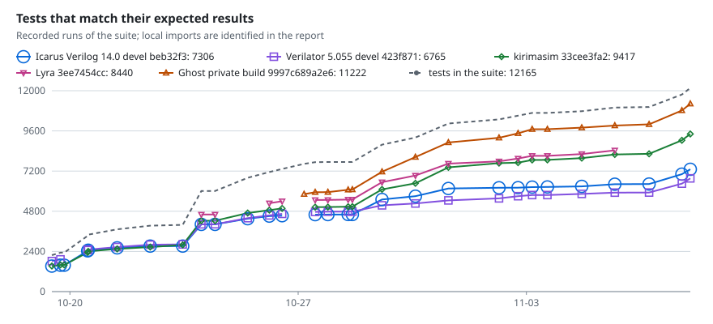
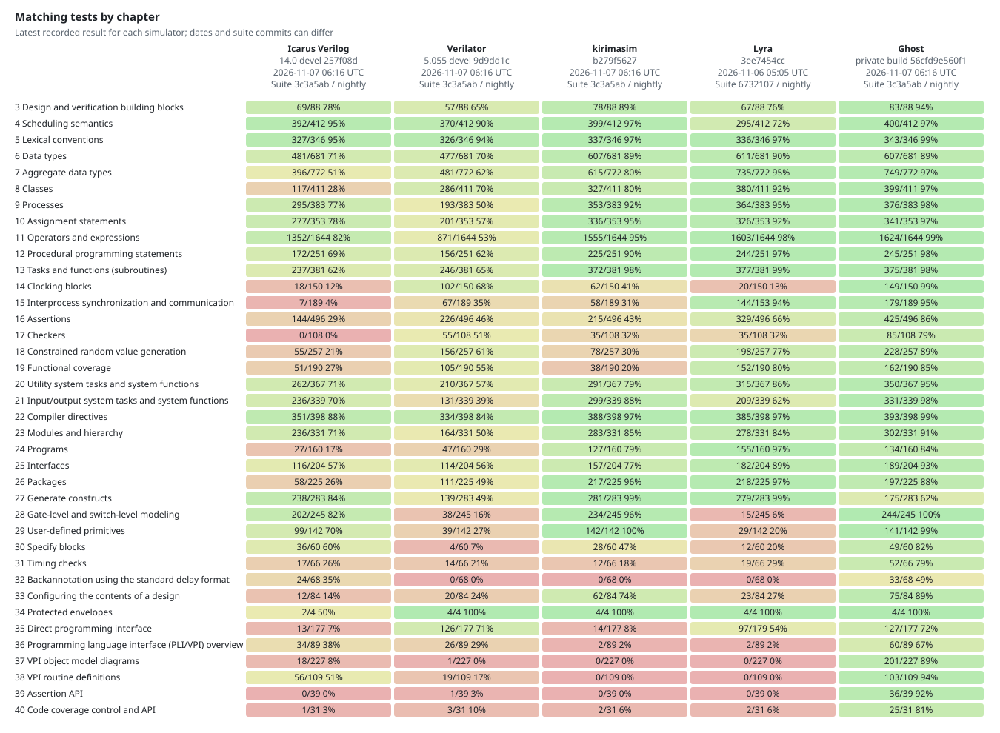

# kirimasim-tests

[English](README.md)

[](https://github.com/kurochan001/kirimasim-tests/actions/workflows/check.yml)
[](https://github.com/kurochan001/kirimasim-tests/actions/workflows/nightly.yml)
[](LICENSE)

IEEE 1800-2023 SystemVerilogのシミュレーションの意味論を確認する適合性テストスイートです。

用語やよくある質問は、[用語集](docs/glossary.md)と[FAQ](docs/faq.md)を参照してください。
期待値、結果の分類、Nightly、網羅率、SVA・フォーマル検証について説明しています。
このREADMEには現時点の情報だけを載せます。以前の作業の記録や測定は[履歴](docs/history.ja.md)にあります。
[資料一覧](docs/README.ja.md)から、ガイド・生成レポート・過去の記録の日英両版を辿れます。
2026-11-06（日本時間）に確認した[最新の検証状況](docs/nightly-results.md#latest-verified-checkpoint)では、
`67321079`の[Check](https://github.com/kurochan001/kirimasim-tests/actions/runs/42120289584)と、
`67321079`の[Nightly](https://github.com/kurochan001/kirimasim-tests/actions/runs/42136599265)が成功しています。
開発を引き継ぐ場合は、現行ガイドと、当時の状態を記録した[2026-11-06の引き継ぎ資料](docs/codex-handoff-20261106.md)を参照してください。

各シミュレーションテストは、期待結果を持つ小さな独立した設計です。規格上正しいコードは、正規化した標準出力が
期待出力に一致し、指定された終了コード・診断の検査にも通れば合格です。
不正な設計は、必要な診断を出して拒否されれば合格です
（[合否の判定方法](#合否の判定方法)を参照）。
このスイートは[kirimasim](https://github.com/kurochan001/kirimasim)向けに作っています。
Icarus Verilog、Verilator、kirimasim、
[Lyra](https://github.com/hankhsu1996/lyra)用の実行スクリプトがあります。
当面は公開前のゲスト**Ghost**も仮名で参加します。メタデータは
[sv-tests](https://github.com/chipsalliance/sv-tests)の形式に従っています。

通常のシミュレーションの期待値は、シミュレータに依存しない規格の規則に基づきます。
実装依存の形式を確認するテストでは前提を明記します。
[FST波形テスト](docs/fst-tests-20261029.ja.md)はkirimasimのFSTバックエンド向けで、
すべてのシミュレータにFST形式を要求するものではありません。

このスイートには、次の特徴があります。

- **すべてのテストが規格の条項を示します。** `:lrm:`に確認対象のIEEE 1800-2023の
  条項番号を記録し、テスト冒頭のコメントで何を確かめるかを自分たちの言葉で説明します。
- **期待出力の根拠を記録します。** `:oracle:`には、規格との照合と、どのシミュレータで
  再現できたかを記録します。可能な場合はIcarus Verilog 13.0で確認し、コンパイルできない、
  または規格と異なる場合はVerilator 5.052で確認します。どちらも規格どおりに動かない場合は、
  規格から期待出力を決めます。
- **規格が定める結果だけを出力します。** 規格が決めていないイベント順、乱数そのもの、
  既定の時間単位、シミュレータの診断文の正確な言い回しには依存しません。

> **開発の初期段階です。** すべてのテストをAIモデルが規格と照合していますが、
> 人による照合はまだありません（`:spec_check: ai`）。期待値の誤りの報告を歓迎します。

初めてテストを読むなら[実在する24行の読み解き](docs/faq.md#q49-read-a-real-test)、結果を読むなら[緑でもDifferが残る理由](docs/faq.md#q11-why-can-nightly-be-green-with-differ-results)、検証済みの範囲を調べるなら[分子と分母の具体例](docs/faq.md#q16-how-do-design-and-execution-coverage-differ)から始められます。

<a id="contents"></a>

## 収録内容

以下は収録本数と確認元の内訳で、現在のシミュレータのPASS数ではありません。[`:lrm:`と`:oracle:`が記録すること](docs/faq.md#q4-are-expected-outputs-copied-from-a-simulator)を参照してください。

<!-- suite-stats:begin -->
スイートには38章にわたり**11920本のテスト**があります。 うち5483本は自動生成です。生成器ごとの本数と対象は[生成器カタログ](docs/generators.ja.md)で確認できます。

| 期待結果の確認元 | テスト数 |
| --- | ---: |
| Icarus Verilog 13.0（`:oracle:`に`iverilog@13.0`） | 6492 |
| Verilator 5.052（Icarus Verilog 13.0のoracle登録なし） | 2172 |
| 規格のみ（固定リリースのシミュレータのoracle登録なし） | 3256 |

2865本はx/z値に依存します（`:fourstate: yes`）。684本にはCコードがあり、内訳はDPIが189本（`:dpi_c:`）、VPIが495本（`:vpi_c:`）です。1930本はシミュレータが拒否すべき不正な設計です（`:should_fail_because:`）。33本はシミュレーションの終了コードを確認します（`:expected_exit:`）。実行条件の指定は、複数ソースファイル23本（`:files:`）、マクロ定義4本（`:defines:`）、インクルードディレクトリ指定7本（`:incdirs:`）、トップレベルのモジュールまたは構成指定54本（`:top_module:`）、実行時引数13本（`:args:`）です。すべてのテストをAIモデルが規格と照合しました（`:spec_check: ai`）。人による照合はまだありません。

| 章 | 題名 | テスト数 | Icarus | Verilator | 規格のみ |
| ---: | --- | ---: | ---: | ---: | ---: |
| 3 | 設計と検証の構成要素 | 136 | 110 | 12 | 14 |
| 4 | スケジューリングの意味論 | 473 | 442 | 7 | 24 |
| 5 | 字句規則 | 412 | 391 | 14 | 7 |
| 6 | データ型 | 682 | 396 | 163 | 123 |
| 7 | 集合データ型 | 772 | 290 | 281 | 201 |
| 8 | クラス | 411 | 82 | 220 | 109 |
| 9 | プロセス | 383 | 279 | 48 | 56 |
| 10 | 代入文 | 425 | 314 | 64 | 47 |
| 11 | 演算子と式 | 1644 | 1262 | 132 | 250 |
| 12 | 手続き型プログラミング文 | 306 | 224 | 33 | 49 |
| 13 | タスクと関数（サブルーチン） | 443 | 283 | 96 | 64 |
| 14 | クロッキングブロック | 150 | 4 | 88 | 58 |
| 15 | プロセス間の同期と通信 | 189 | 2 | 58 | 129 |
| 16 | アサーション | 794 | 122 | 124 | 548 |
| 17 | チェッカー | 108 |  | 47 | 61 |
| 18 | 制約付き乱数値の生成 | 257 | 25 | 127 | 105 |
| 19 | 機能カバレッジ | 190 | 2 | 61 | 127 |
| 20 | ユーティリティ用システムタスク・関数 | 407 | 253 | 60 | 94 |
| 21 | 入出力用システムタスク・関数 | 495 | 353 | 37 | 105 |
| 22 | コンパイラ指令 | 512 | 439 | 37 | 36 |
| 23 | モジュールと階層 | 417 | 287 | 58 | 72 |
| 24 | プログラム | 160 | 27 | 23 | 110 |
| 25 | インターフェース | 253 | 103 | 119 | 31 |
| 26 | パッケージ | 225 | 53 | 70 | 102 |
| 27 | generate構文 | 283 | 232 | 20 | 31 |
| 28 | ゲートレベル・スイッチレベルのモデリング | 297 | 228 | 3 | 66 |
| 29 | ユーザー定義プリミティブ | 142 | 95 | 11 | 36 |
| 30 | specifyブロック | 60 | 35 | 1 | 24 |
| 31 | タイミング検査 | 66 | 17 | 1 | 48 |
| 32 | 標準遅延形式によるバックアノテーション | 68 | 19 |  | 49 |
| 33 | 設計内容の構成指定 | 84 | 8 | 9 | 67 |
| 34 | 保護エンベロープ | 4 | 2 | 2 |  |
| 35 | 直接プログラミングインターフェース（DPI） | 177 | 4 | 114 | 59 |
| 36 | プログラミング言語インターフェース（PLI/VPI）の概要 | 89 | 34 | 19 | 36 |
| 37 | VPIオブジェクトモデル図 | 227 | 18 | 1 | 208 |
| 38 | VPIルーチンの定義 | 109 | 56 | 9 | 44 |
| 39 | アサーションAPI | 39 |  | 1 | 38 |
| 40 | コードカバレッジの制御とAPI | 31 | 1 | 2 | 28 |
<!-- suite-stats:end -->

総数には`:type: formal`の268本を含みます。これらはシミュレータの標準出力を比較せず、
`:formal_case:`を使ってSymbiYosysで検査します。[実行方法](#symbiyosys)を参照してください。

SVAやformalのPASSは、通常のシミュレーションと確認範囲が異なります。[BMC・PDR・cover・反例の実レポートの読み方](docs/faq.md#q21-do-bmc-and-pdr-pass-mean-the-same-thing)を参照してください。

SVAの追加検証は別に記録しています。参照評価器は**45本のテスト出力**を再現し、
フォーマル検証の証跡は**267ケースのカタログ**と、別の**111ケースの境界値検査**を対象とします。
二つのモデル集合には重複があり、収録済みのテスト本数や上のoracle別件数へ加算しません。
範囲・証跡・再実行手順は[SVA参照評価器とフォーマル検証](docs/sva-reference-formal-verification.md)、
詳しい件数と再実行日は[過去のSVA検証記録](docs/readme-records-20261101.ja.md#sva-verification-record-2026-10-29)と
[境界値の拡張結果](docs/sva-formal-expansion-20261026.md)を参照してください。

[テストカタログ](docs/tests/README.ja.md)は、各テストが何を確かめ、どの条項を引用するかを
章ごとに示します。[条項一覧](docs/tests/clauses.ja.md)では、各章のどの条項をテストが引用しているかを
確認できます。[条項別テスト数レポート](docs/coverage-depth.ja.md)は、条項ごとのテスト数と、
規格のみから決めた期待出力を持つ1本のテストしかない条項を示します。
3〜40章の対象範囲内の末端条項には、それぞれ2本以上の直接引用するテストがあります。
対象外の条項とその理由も同じページに記載しています（`tools/clauses.txt`のタグ）：
一般的な説明、34章、ツールに委ねられた動作、VCDファイルの内容です。
ただしVCDのうち、`test_vcd_dump_readback`が読み返す部分
（21.7.2.1〜21.7.2.3、21.7.5）は対象に含めています。

これは条項の引用網羅率であり、IEEE 1800-2023のすべての要求や組合せを検査した証明ではありません。
条項別テスト数の範囲は`tools/clauses.txt`が選ぶ3〜40章の末端条項で、現在の件数と除外理由は
[条項別テスト数レポート](docs/coverage-depth.ja.md)に記載しています。
附属書や明示的な除外条項を、規格全体を網羅したという主張に暗黙に含めることはしません。
CIは`tools/coverage_depth.py --check --minimum-tests 2`で2本以上を必須にします。
親条項の引用だけでは、その子条項の本数を満たしません。

[設計した・実行した・期待どおりだったの違い](docs/faq.md#q16-how-do-design-and-execution-coverage-differ)を読むと、以下の割合の分子と分母を区別できます。

[要求カバレッジの要約](docs/behavior-coverage-summary.md)と
[詳細レポート](docs/behavior-coverage.md)では、明示的にレビューした要求と、
テストで観測する結果を測定します。[台帳と作業手順](coverage/README.md)は、
1〜41章と附属書A〜Qを、親条項の導入や従来の対象外部分も含めて棚卸しします。
原文レビューは全1,740節を対象にしています。暫定率の分母には、解釈を保留している行や
テスト未対応の行も含め、登録済みの要求・条件・観測の全行を使います。
規格要求カバレッジの確定値には、解釈と重複する要求単位を整理して承認した分母を使います。
要求カバレッジ（テスト設計）、実行証拠、シミュレータ別の結果、原文レビューの進捗は分けて報告します。
CIは台帳と生成した要約を検査します。Nightlyは、率、残件、シミュレータ別の結果、
分母の識別情報を`results`ブランチに記録します。
既存テストは、入力と期待される観測を要求に対応付けた後にのみ計上します。
要約には、少なくとも一つレビュー済みの対応があるテストファイル数も示します。
未対応のテストが、まだ計上していない要求を検査している可能性はあります。
未対応の要求に新しいテストを書く前に、既存テストを確認してください。
[既存テストの要求照合一覧](docs/test-requirement-matching.md)に、章ごとの進捗と、
候補の全作業リスト・内容の指摘へのリンクがあります。
複数テストを一組の証拠とする場合は、同じシミュレータの同じ実行スナップショットで
すべて合格する必要があります。別々の実行の部分的な成功を合わせて要求の成功にはしません。

2因子100%は全因子の全組合せを試した意味ではありません。[3因子を4行で覆う具体例](docs/faq.md#q28-why-not-simply-cross-every-feature)で確認できます。

[機能間クロス検証](docs/interaction-verification.md)は、制約付きの2因子網羅を基本に、
重点的に確認する高次因子群と必須の境界ケースを併用します。短時間実行用の選択は
**104モデル・4,170件**です。値・型の変換、スケジューリング、引数・参照の結合先、
スコープ・階層、状態保持、I/Oなどの相互作用を扱います。通常の全件実行では既存テストを
すべて保持し、規格要求の分母は変更しません。

最新のmainをビルドした**kirimasim `28c6c1a1cb83`**による
[最新の全クロス保存実行](coverage/interaction-results/cross104-kirimasim-28c6c1a1-hierloop.json)は、
**3,683 pass・479 unsupported・8 fail**です。階層名によるプロセスの制御・%mの階層名・配列の問い合わせ関数とループの追加147件は全PASSです。
`eee8cd16ba1d`の[前回の全実行](coverage/interaction-results/cross101-kirimasim-eee8cd16-paramassertlit.json)と比べて、従来4,023件の状態と入力は不変です。
[基点67321079のCheck](https://github.com/kurochan001/kirimasim-tests/actions/runs/42120289584)は成功し、追加前の88モデルを含む固定版比較・静的検査を確認しました。
[同じ基点のNightly](https://github.com/kurochan001/kirimasim-tests/actions/runs/42136599265)もworkflowと全ジョブが成功しましたが、個別artifactは未照合です。その後の追加は両実行の対象外です。
入力と元の期待値を保持し、failのうち4件は固定版slangへ
切り分けたconfigのパラメータリセット、4件は[`defparam`の型と範囲](docs/interaction-verification.md#parameter-override-type)の不一致です。11→9→4の履歴、全出力の再現、未対応19機構の内訳、
章対の精査は[不一致対応と次の優先順位](docs/cross-verification-followup.md)に記録しています。
章間CSVの出典は単一の全クロスローカル実行cross89とし、正式実行による確認は別に記録しています。

名前付きイベントとループ制御（第12章×第15章）は、代表化後の合法2,016通りから36件を選びます。
同じタイムスロットでの待機開始、blocking/NBA発火、break/continueによる受信・保持・終了を照合します。
最新kirimasimは全36件PASSです。[設計・具体例・固定版の差異](docs/interaction-verification.md#named-event-loop-transfer)を参照してください。

packageの配列問い合わせと名前解決（第20章×第26章）は、合法3,456通りから36件を選びます。
関数内のimportと修飾参照で問い合わせ先を決め、幅・境界・向きが実際の走査と全幅集計に反映されるかを確認します。
最新kirimasimは全36件PASSです。[設計・独立検算・固定版比較](docs/interaction-verification.md#package-array-query-scope)から同名ローカル配列を含む具体例を辿れます。

programの終了とautomatic task（第13章×第24章・第12章×第24章）は、合法3,456通りから36件を選びます。
重なる呼出しの局所値、正常復帰時の出力コピー、途中終了時のコピー抑止と別programの生存を確認します。
最新kirimasimは全36件PASS、固定Icarusは6 pass・30 known、固定Verilatorは36 knownです。[設計・独立検算・確認範囲](docs/interaction-verification.md#program-task-frame-lifetime)を参照してください。

書式付き読取りと部分書込み（第11章×第21章・第20章×第21章）は、代表化後の合法5,760通りから36件を選びます。
途中で止まった変換の書込み範囲・後続出力の保持・全成功の再呼出しを、全格納語で確認します。
最新kirimasimは全36件PASS、固定Icarusは17 pass・19 knownです。[設計・独立検算・固定版の差異](docs/interaction-verification.md#formatted-scan-partial-write)を参照してください。

定数式とgenerate（第11章×第27章・第20章×第27章）は、合法6,912通りから36件を選びます。
オペランドの符号・文脈幅・結果の宣言符号を分離し、実際の分岐・生成個数・要素幅・全幅データを観測します。
最新kirimasimと固定Icarusは全36件PASSです。[設計・独立検算・固定版比較](docs/interaction-verification.md#generated-constant-expression-shape)を参照してください。

interface内の配列問い合わせ（第7章×第25章・第20章×第25章・第13章×第20章）は、合法4,608通りから36件を選びます。
問い合わせの値で走査の開始位置・回数・方向を決め、順序依存の全幅チェックサムと、呼出し後の別実体の保持を観測します。
最新kirimasimと固定Icarusは全36件PASSです。[設計・独立検算・固定版比較](docs/interaction-verification.md#interface-array-query-walk)を参照してください。

生成プロセスとループ制御（第12章×第27章・第9章×第27章、および第7章×第27章）は、合法6,912通りから36件を選びます。
各スコープのbreak/continue、全配列要素と結果、入力変更後の再起動、立下り・待機中の保持を確認します。
最新kirimasimは全36件PASS、固定Icarusは31 pass・5 known、固定Verilatorの両seedは各12 pass・24 knownです。
[設計・独立検算・repeat回数1の差異](docs/interaction-verification.md#generated-process-loop-transfer)を参照してください。

クラスの条件選択と早期return（第8章×第11章・第8章×第12章）は、合法1,296通りから36件を選びます。
直呼び・virtual/非virtual、if/caseと条件演算子のX/Z、receiverだけの更新、型付き結果の拡張、再束縛後の別名を区別します。
最新kirimasimは全36件がPASS、固定Verilatorのseed 1/73は各12 pass・24 knownです。
[設計・独立検算・制限](docs/interaction-verification.md#class-conditional-return)を参照してください。

生成スコープのサブルーチンと配列状態（第13章×第27章・第7章×第27章、および第7章×第13章）は、合法2,304通りから36件を選びます。
既定引数の再評価、局所型と定数、functionの戻り値とtaskのcopy-out、配列境界、各呼出し後の別スコープの独立性を照合します。
最新kirimasimと固定Icarus 13.0は36件すべてPASS、固定Verilatorの両seedは各11 pass・25 knownです。
[設計・独立検算・保存した差異](docs/interaction-verification.md#generated-subroutine-binding)を参照してください。

クラスメソッドとpackage import（第8章×第26章）は、合法3,264通りから34件を選びます。
メソッド内と外側の名前解決、型付きのfunction/taskの結果、共有package状態、オブジェクトの別名とハンドル再束縛を照合します。
追加34件は最新kirimasimで全PASSです。固定Verilatorの両seedは各18 pass・16 known、固定Icarusは全34件のビルドを拒否します。
[設計・独立検算・制限](docs/interaction-verification.md#class-method-package-lookup)を参照してください。

disableと遅延報告（第9章×第16章）は、720通りから31件を選びます。取消し対象、引数取得と副作用、報告時の生値、通常の制御移動を照合します。最新kirimasimは31件すべてPASSで、兄弟報告・入力取得の副作用・成熟済み履歴を保持します。固定Verilatorは両seedで13 pass・18 knownです。[範囲と再現出力](docs/interaction-verification.md#deferred-disable-reports)を参照してください。

遅延報告の引数（第13章×第16章）は合法368通りから29件を選び、値渡しでの取得・静的な参照・幅と符号の変換・引数評価の副作用を照合します。追加29件は最新kirimasimで全PASSです。固定Verilatorは両seedで各29 known、固定Icarusは29件コンパイル拒否で、共通期待値を保持しています。[設計・独立検算・制限](docs/interaction-verification.md#deferred-argument-capture)を参照してください。

package変数の変更通知（第9章×第26章、第11章×第26章）は合法2,592通りから36件を選び、複数モジュールのイベント待機・wait・関数経由のalways_comb感度を照合します。全体と最下位ビットの変化、条件のX、起床履歴、再書込みと隣接要素・別packageの独立性を確認し、最新kirimasimで全36件PASSです。[設計・独立検算・制限](docs/interaction-verification.md#package-change-observers)を参照してください。

package変数とNBA（第10章×第26章）は合法1,296通りを36件に絞り、モジュールをまたぐ共有状態、予約時の値と添字、同じinitial内での予約順序、遅延と状態型変換を照合します。追加36件は最新kirimasimで全PASSです。固定Verilatorは既知値12件が両seedでPASS、X/Z観測の24件は2値実行の既知差です。[設計・独立検算・制限](docs/interaction-verification.md#package-nba-capture)を参照してください。

列挙型とgenerate（第6章×第27章）は合法1,056通りを36件に絞り、生成要素ごとの幅・符号・値表、next/prevの巡回と保持コピーを照合します。追加36件は最新kirimasimで全PASSです。固定Verilatorは両seedとも18 pass・18 known、固定Icarusは36 knownです。[設計・独立検算・制限](docs/interaction-verification.md#generated-enum-navigation)を参照してください。

clocking入力と名前付きイベントの待機（第14×15章）は192通りから24件を選択し、採取値の保持、生値、通知回数、複数待機者への通知、再待機を確認します。最新kirimasimは12 pass・`input #0`未対応12件、固定Verilatorの両seedは各12 pass・非ブロッキング通知の既知差12件です。[設計・対照・制限](docs/interaction-verification.md#clocking-named-event)を参照してください。

- [クロス検証レポート](docs/interaction-coverage.md)：計画上の網羅と、入力・ランナーのハッシュが
  一致した保存実行の合格を分けて集計します。
- [章間クロス検証マトリクス](docs/chapter-cross-matrix.md)：重複を除く**131章対**を対応付けています。
  登録モデル数、全選択ケースPASSのモデル数（上記の実行では**61モデル**）、
  テスト・実行の明細を41章×41章のCSVから確認できます。
- [0セルの仕分けと優先候補](docs/chapter-cross-triage.md)：既存検証あり・追加検証候補・対象外・
  要精査を区別し、根拠と次の観測目標を記録しています。0は既存テストがないという意味ではありません。
- [考え方と実践手順](docs/interaction-verification-method.md)：設計思想、モデルの選び方、追加・再実行、
  他プロジェクトやLSIへの適用方法を説明します。[用語集](docs/glossary.md#8-機能間クロス検証)と
  [FAQ](docs/faq.md#7-機能間クロス検証)には、指標の意味とレビュー時の確認事項をまとめています。

章間表の数字をテスト本数として合計できない理由は[Q32](docs/faq.md#q32-can-i-sum-matrix-cells-to-get-the-cross-test-total)、合格モデル数とcompleteの違いは[Q34](docs/faq.md#q34-are-complete-and-all-selected-tests-pass-the-same-judgment)を参照してください。

[モデルに基づくランダムクロス比較](docs/random-cross-verification.md)も導入しています。Nightlyで算術式・除算／剰余・添字付き書込み列・条件演算子・package変更通知・シフト・キャスト・ストリーミング・連結代入・比較・リダクション・配列リダクション・配列コピー列の13プロファイルを合計96ケース比較し、seedと実際の刺激を専用artifactへ保存します。最新の確認済みNightlyは`50a897dee62a`・seed `41941310616`で**96件すべて有効なPASS**です。固定回帰の本数やカバレッジとは別集計です。
[目的と役割分担](docs/random-cross-verification.md#purpose-and-roles)と[検証の流れ](docs/random-cross-verification.md#verification-process)に、固定ケースを補う探索の狙い、入力生成・モデル比較・保存再現・固定回帰化をまとめています。
現在は13プロファイルで追加を区切り、[重点探索と独立検算](docs/random-cross-verification.md#thirteen-profile-stabilization)を優先します。既定のNightly予算を保ち、追加探索の結果は別に記録します。
同資料に、任意の追加探索の投入管理、参照変更を明示する保存刺激の再実行、同じ刺激でのIcarus／Verilator確認、レビュー済み失敗からの固定回帰候補の作成手順を記載しています。固定回帰・正式Nightly・明示的なreplayは毎回実行します。

ランダムでも期待値が分かる理由とPythonモデル・生成SV・照合処理の役割は、[A5の下位4ビットを書き換える具体例](docs/faq.md#q46-can-existing-models-support-random-verification-comparisons)を参照してください。

計画上の網羅とCheckの成功を、各シミュレータでの全クロス合格とは扱いません。
ビルド版・実行範囲・結果の内訳は[保存実行の概要](docs/interaction-verification.md#保存実行の概要)を確認してください。

[規格PDFからテストに至る方法](docs/requirements-to-tests-method.md)は、要求の抽出、
既存テストとの照合と追加テストの作成、独立したレビュー、統合と測定までを順に説明します。
作業には[照合キット](tools/matching_kit/README.ja.md)を使います。

要求カバレッジの分母は、重複を統合した**12,298要求**です。
[分母レビュー](docs/denominator-review-20261028.md)で承認しました。
レビューしたのはAIで、人による独立したレビュー・承認ではありません。
現在の要求カバレッジ（テスト設計）は**89.28%（10,980/12,298）**、
`coverage/results/`の保存済み証跡による実行確認率は
**77.55%（9,537/12,298）**で、Icarus Verilog・Verilator・SymbiYosys・Ghostの結果です。
1〜40章だけの要求カバレッジ（テスト設計）は87.35%（8,268/9,465）です。
測定入力と分母は[生成した要求カバレッジ集計](docs/behavior-coverage-summary.md)を参照してください。
既存テスト全体の検証内容のレビューはまだ完了していません。
要求の抽出・照合・テスト追加の各回の報告は[履歴](docs/history.ja.md)から辿れます。
報告には、観測、規格から決めた期待値、シミュレータとの差、意図的な誤りを入れる検査、
実行証拠を記録しています。

テストの配置先は、`:lrm:`の先頭の条項が属するIEEE 1800-2023の章に対応するディレクトリです。
表のIcarus・Verilator・規格のみの列は、最初の表と同じく、期待結果の確認元別の件数です。
1・2章には検査対象の動作がありません。34章（保護エンベロープ）のテストは、
エンベロープの構文と、Verilatorがdata_blockをソースから外すことを確かめる4本だけです。
Icarus VerilogもVerilatorもエンベロープを復号しないためで、監査当時の理由は
[保護エンベロープの境界](docs/protected-envelope-boundary.md)にあります。
分母レビュー後は34章の214要求中209要求が未対応です。設計のどこにコードカバレッジを持つかは
ツールとオプションに依存するので、40章のテストは、許される値やカバレッジ関数の結果同士の
関係など、すべての結果に共通して成り立つことだけを出力します。

<a id="nightly-results"></a>

## Nightlyの結果


毎晩、[GitHub Actionsワークフロー](.github/workflows/nightly.yml)が、各シミュレータで
`main`の各ランナーの対象テストを実行します。Icarus VerilogとVerilatorは`master`、kirimasimは`main`の
最新開発版を使います。Lyraもジョブ開始時に`main`先端のコミットを取得し、
同じコミットのビルドだけをキャッシュから再利用します。
Ghostは非公開のビルドで参加します。
結果は[`results`](https://github.com/kurochan001/kirimasim-tests/tree/results)ブランチの履歴に追加します。
下のグラフは実行ごとに更新します。
[同ブランチのレポート](https://github.com/kurochan001/kirimasim-tests/tree/results#readme)には、
一致率、章別の結果、シミュレータごとの推移、前夜から結果が変わったテストも載せています。

**Ghost**は、公開前の正体不明なシミュレータです。毎晩のテストに姿を現し、
今は結果だけを残していきます。正体・ソース・ビルドログは、まだ幕の向こう側です。
他の参加者と同じテストを、同じ規格に基づく期待結果で判定します。

開始予定は毎日**日本時間04:23（JST、UTC+09:00）**、UTCでは前日の19:23です。
結果はシミュレータのジョブが終わってから公開します。GitHubのスケジュール遅延やビルド時間で、
更新が数時間遅れることがあります。結果レポートの`Latest run`と`Recent runs`は**UTC**で、
ワークフローの開始時刻ではなくレポートを生成した時刻です。日本時間にするには9時間を足します。
実際の開始時刻と待機中の実行は[GitHub Actions](https://github.com/kurochan001/kirimasim-tests/actions/workflows/nightly.yml)で確認できます。
詳細は[更新時刻とレポートの版について](docs/nightly-results.md)を参照してください。

グラフが示すのは、レポートに記載されたスイートのコミットとテスト数での結果です。
`main`にテストを追加するとカタログと集計は変わりますが、Nightlyの結果は、そのコミットを
後続のワークフローが実行して公開するまで変わりません。現在のスイートと比較するときは、
`suite commit`とテスト数を確認してください。

[Nightlyが緑でもDifferが残る理由](docs/faq.md#q11-why-can-nightly-be-green-with-differ-results)を先に確認し、各テストの結果とworkflow全体の成功を分けて読んでください。



シミュレータごとに、Icarus Verilogは丸、Verilatorは四角、kirimasimはひし形、
Lyraは下向き三角、Ghostはオレンジの上向き三角を使います。
一致数が同じ、または近い場合も見えるように、マーカーは互いに重ねて収まる輪郭で描きます。
凡例には、最新の実行の件数も示します。

<a id="by-chapter"></a>

### 章別の結果

各セルは**一致したテスト数 / 結果が記録されたテスト数**と、その章・シミュレータの一致率です。
既知の差異と未対応のテストは、実行前にスキップしたものも含めて分母に残します。
表はNightlyのグラフとともに更新し、上部に日付とシミュレータの版を表示します。
クリックすると原寸の画像を開けます。

この分母に未対応も残る理由は[8/10＝80%の具体例](docs/faq.md#q12-what-percentage-does-by-chapter-show)、規格要求の割合との違いは[Q15](docs/faq.md#q15-is-the-nightly-match-rate-requirement-coverage)を参照してください。

[](https://raw.githubusercontent.com/kurochan001/kirimasim-tests/results/charts/chapters.svg)

<a id="result-statuses"></a>

### 結果の分類

各テストの結果は、次のいずれかになります。

| 結果 | 意味 |
| --- | --- |
| match（一致） | 出力と、指定された終了コード・実行時診断の検査が一致した、または不正な設計が必要な診断付きで拒否された |
| differ（不一致） | 結果が一致しない、必要な診断がない、不正な設計が受理された、または他の分類に当たらないビルド・実行の失敗 |
| known difference（既知の差異） | IcarusまたはVerilatorで一致せず、その固定リリースのoracleトークンもない。または、kirimasimで使える共通・専用の期待出力がなく、他ツール専用の期待出力だけがある |
| unsupported（未対応） | 使用した構文などが未対応と診断された、またはその種類のテストを実行できない。kirimasimはDPI/VPI、LyraはVPIのCコードをまだ読み込めない |

Icarus VerilogとVerilatorのNightlyでのdifferは、固定リリースのoracleが付いたテストが、
選択した開発版で一致しない場合です。oracleのないテストが一致するようになった場合は、
拒否の理由も含めてレビューする候補になります。結果だけで修正を認定したり、oracleを追加したりはしません。

Nightlyの固定スイートは結果を報告し、不一致だけでは原則として失敗にしません。
kirimasimでは、前夜に一致した固定テストが今回は不一致になったときにratchetで失敗させます。
新規・未対応の固定テストはその条件だけでは失敗にしません。別途のランダム比較は全ケースのPASSを要求し、
不一致・未対応・時間切れ・証跡の変化などで失敗します。[判定と再現手順](docs/random-cross-verification.md)を参照してください。
Icarus Verilog 13.0とVerilator 5.052で記録した期待結果は、テストやツールの変更時に
[別のワークフロー](.github/workflows/check.yml)で同じリリースを使って確認します。

表の区分から個別の原因を確認する手順は[Q9](docs/faq.md#q9-what-do-match-differ-known-difference-and-unsupported-mean)、緑のCheck/Nightlyが保証する範囲は[Q11](docs/faq.md#q11-why-can-nightly-be-green-with-differ-results)を参照してください。

<a id="simulation-speed"></a>

## シミュレーション速度

このスイートはシミュレーション結果を検査します。過去の速度測定は
[測定記録](docs/readme-records-20261101.ja.md#シミュレーション速度)へまとめています。
実行コードと手順は[シミュレータのベンチマーク](https://github.com/kurochan001/kirimasim/tree/main/bench)を参照してください。

<a id="layout"></a>

## ディレクトリ構成

```text
tests/chNN/<name>.sv            メタデータ付きのテスト
tests/chNN/<name>.expected      期待する標準出力
tests/chNN/<name>.c             DPIまたはVPIテストのCコード
tests/chNN/<other>.sv, .svh     :files:で指定するソース・インクルードファイル
tests/chNN/<dir>/               :incdirs:で指定するインクルードディレクトリ
tests/gen/chNN/<name>.sv        自動生成テスト（直接編集しない）
generators/<generator>.py       テスト生成器と参照モデル
generators/generate.py          tests/gen/の生成、--checkによる検査
generators/oracles.txt          各生成テストの期待出力を再現したリリース
docs/simulator-differences.ja.md   Icarus Verilog 13.0・Verilator 5.052と規格との差
docs/history.ja.md              以前の作業の記録・測定・確認結果
docs/README.ja.md               日英の全資料への入口
docs/generators.ja.md           全生成器の件数と観測対象
docs/tests/                     章ごとのテストカタログ
docs/tests/clauses.ja.md           テストが引用する規格の条項
docs/glossary.md               このスイートの用語・略語
docs/faq.md                    期待値・結果・網羅率・検証のFAQ
docs/coverage-depth.ja.md          条項ごとの本数と優先して補う不足
docs/behavior-coverage-summary.md 章別・シミュレータ別の要求カバレッジの集計
docs/interaction-verification.md 機能間クロスのモデル・短時間実行・証跡の扱い
docs/interaction-coverage.md     登録したクロスモデルの計画と実行確認
docs/p1-combination-regressions-20261030.md Issue #21の境界条件と実行証跡
coverage/combination-gaps.json   Issue #21の候補と回帰テストの確認済み対応
docs/requirements-to-tests-method.md 規格PDFから要求・テスト・網羅率に至る方法
coverage/behavior-summary.json  現在の要求カバレッジの集計結果と分母の識別情報
coverage/behavior-history.json  分母の識別情報を含む測定履歴
tools/run_icarus.py             Icarus Verilogでの実行
tools/run_verilator.py          Verilatorでの実行
tools/run_kirimasim.py          kirimasimでの実行
tools/run_lyra.py               Lyraでの実行
tools/run_ghost.py              公開前のゲストを仮名で実行
tools/normalize_output.py       比較前の出力正規化
tools/suite_results.py          実行結果のJSON形式（--json）
tools/results_history.py        Nightlyの履歴とグラフ生成
tools/results_ratchet.py        前回一致して今回不一致のテストの一覧
tools/differences_status.py     差異一覧のテストの最新masterでの結果
tools/suite_stats.py            テスト集計と両言語のREADMEの表の更新
tools/suite_catalog.py          docs/tests/のカタログ生成
tools/coverage_depth.py         docs/coverage-depth.mdの生成
tools/interaction_coverage.py   クロス検証の実行対象選択と充足の集計
tools/combination_gaps.py       Issue #21の回帰対象一覧と台帳・レポートの整合性検査
tools/clauses.txt               docs/tests/clauses.md用の条項番号
tools/lint_metadata.py          メタデータとテストの形式の検査
tools/lint_baseline.txt         既存テストの既知の問題
tools/new_test.py               新規テストのひな型生成
tools/matching_kit/             要求とテストの対応の提案・検査・判定・統合
.github/workflows/check.yml     固定リリースでの期待結果の検査
.github/workflows/nightly.yml   Nightly実行
```

`results`ブランチには、`history.json`（1実行1エントリ）、
`latest/<simulator>.json`（各シミュレータの最新の保存実行のテスト別結果）、`charts/*.svg`、
レポートの`README.md`（英語）と`README.ja.md`（日本語）があります。
グラフにも`.ja.svg`の日本語版を生成します。グラフとレポートには`tools/`に実行スクリプトがある
シミュレータだけを表示します。実行スクリプトがなくなったものも履歴には残しますが、描画しません。
publishジョブは、その実行の要求カバレッジとして`behavior-coverage-summary.md`、
`behavior-coverage.md`、`behavior-summary.json`、`behavior-coverage.json`、`behavior-history.json`も
書き出します。機能間クロスのシミュレータ別の実行確認は`interaction-coverage.md`と
`interaction-coverage.json`に書き出します。3種類のカバレッジMarkdownは日本語の`.md`に
英語の`.en.md`を併設し、相互リンクで切り替えます。両言語は同じ実行データを使います。
`main`の保存済み証跡との違いは
[Nightlyの説明](docs/nightly-results.md)を参照してください。
通常はNightlyのpublishジョブが更新します。ローカル結果を取り込む場合も、
実行日時・スイートのコミットと`--source local`を指定して履歴へ追加します。

<a id="test-format"></a>

## テストの形式

一つのテストは一つのSystemVerilogファイルです。一部は隣にCコード、別のソース、
インクルードファイルも持ちます（`:dpi_c:`、`:vpi_c:`、`:files:`、`:incdirs:`）。
冒頭のメタデータコメント、何を確認するかの説明コメント、設計本体の順に書きます。
初めて読む際は、[実在する短いテスト](tests/ch10/test_declaration_initialization_is_not_driver.sv)を開き、[入力・観測・期待値・合格条件の読み解き](docs/faq.md#q49-read-a-real-test)と照合してください。コードにPASS表示がなくても、ランナーが期待出力と比較して判定することが分かります。

<a id="metadata"></a>

### メタデータ

メタデータコメントはsv-testsと互換で、sv-testsが知らないフィールドは無視されます。

| フィールド | 意味 |
| --- | --- |
| `:name:` | スイート内で一意のテスト名。ファイル名と同じ |
| `:description:` | テストが確認すること |
| `:tags:` | ディレクトリの`chNN`。`:lrm:`の先頭条項の章 |
| `:type:` | シミュレーションは`simulation`、拒否すべき不正な設計は`elaboration`、SymbiYosysによるモデル検査は`formal` |
| `:formal_case:` | `:type: formal`の検証対象。`tools/sva_reference/formal_cases.py`のケース名を指定し、`tools/run_sby.py`で検査する。期待する標準出力は不要 |
| `:lrm:` | 確認対象のIEEE 1800-2023の条項。例：`1800-2023 11.4.3` |
| `:oracle:` | 期待出力の根拠。`spec`は引用条項と照合済み（担当は`:spec_check:`）、`iverilog@13.0`はIcarus Verilog 13.0で再現、`verilator@5.052`はVerilator 5.052で再現 |
| `:spec_check:` | `spec`の期待値を規格と照合した担当。`ai`はAIモデル（人による照合はまだなし）、`human`は人 |
| `:fourstate:` | x/zに依存するか（`yes` / `no`）。x/zリテラル、`$isunknown`、`casex`/`casez`、三状態・強度構文、期待出力のx/zなど |
| `:nondeterministic:` | 規格が決めていない実行順に結果が依存し得るか |
| `:expected_stdout:` | 期待する標準出力、または隣のファイルを示す`@<file>`。シミュレータ別のフィールドがない場合の共通の期待値 |
| `:expected_stdout_<simulator>:` | シミュレータ別の期待する標準出力。`<simulator>`は`icarus`、`verilator`、`kirimasim`、`lyra`。`:expected_stdout:`より優先し、`:expected_stdout:`は他のシミュレータ用の共通値として残せる。差分が規格に由来する場合（規格がツールに委ねた表示形式など）だけ追加し、理由をテストのコメントに書く。参照する全期待値ファイルは入力ハッシュに含めるので、どれを変えても保存済みの実行証跡は無効になる |
| `:dpi_c:` | 隣のCコード`@<file>`。DPIインポートを実装し、エクスポートを呼び出す（35章） |
| `:vpi_c:` | 隣のVPIアプリケーション`@<file>`。`vlog_startup_routines`からシステムタスク・関数とコールバックを登録する（36〜40章） |
| `:should_fail_because:` | 不正な設計である理由。シミュレータは拒否する必要がある。`:type: elaboration`とし、期待出力（`:expected_stdout:`またはシミュレータ別フィールド）は置かず、`:expected_stderr_regex:`でエラー箇所を指定する |
| `:expected_exit:` | 終了コード。`0`、`nonzero`（0より大きい）、または数値。規格は`$fatal`がエラーコードで終了することだけを定めるので、`nonzero`を使う（20.10） |
| `:expected_stderr_regex:` | 実行スクリプトが渡す診断テキストに対するPython正規表現（後述の「合否の判定方法」）。不正な設計では、レビューした位置（例：`test_x\.sv:12:`）と必要な診断の概念をエラー行が満たす必要がある。妥当な別位置も許容できるが、未対応構文の診断は意図した違反の証拠にしない。他のテストでは実行時のメッセージがパターンを満たすことを確認する。診断全文の言い回しは固定しない |
| `:args:` | 空白区切りの実行時引数。例：`+count=3` |
| `:generator:` | `<generator>@<version>`。`generators/<generator>.py`が生成したテスト |
| `:interaction_model:` | `<model>@<version>`。生成したクロステストが属するモデル |
| `:interaction_values:` | モデルの`因子=値`の組。集計時は生成器と実行結果の入力ハッシュも検査する |
| `:files:` | 隣の追加ソース（`.sv`、`.v`。指定順にテストより先にコンパイル）とインクルードファイル（そのディレクトリを検索先に追加）。名前は`test_`で始めない。コンパイル単位が一つか複数かはツールに委ね、テストは依存しない（3.12.1） |
| `:defines:` | 最初のソースより前に定義するマクロ。空白区切りの`NAME`または`NAME=VALUE`。ツールの`-D`や`+define+`を使い、`` `ifdef ``やマクロ参照から`` `define ``と同様に見えるようにする（22.5.1）。オプション自体は規格の範囲外 |
| `:incdirs:` | テストのディレクトリを基準としたインクルードディレクトリ。空白区切り。`` `include "<file>" ``が作業ディレクトリの後に探す場所（22.4）。`:files:`のインクルードファイルのディレクトリより後に渡す |
| `:top_module:` | エラボレーション対象のトップレベルモジュールまたは構成。未指定なら、他からインスタンス化されないすべてのモジュールがトップレベル（23.3.1）。モジュールはその階層、構成は宣言した設計とバインド規則を選ぶ（33.4、33.5.3） |

<a id="how-a-test-is-judged"></a>

### 合否の判定方法

X/Z・bit/logic・幅と符号で観測が変わる理由は[SVの小さな具体例](docs/faq.md#q50-sv-values-change-observations)、`:lrm:`と`:oracle:`の役割は[Q4](docs/faq.md#q4-are-expected-outputs-copied-from-a-simulator)を参照してください。

標準出力から空行とシミュレータ自身のバナーを取り除き、期待出力と完全一致すれば合格です
（`tools/normalize_output.py`と各実行スクリプト）。空でない行の空白は保持します。
`$info`・`$warning`・`$error`・`$fatal`のメッセージは、形式がツールに委ねられ（20.10）、
Icarus VerilogとVerilatorが標準出力に出すため、取り除きます。
終了コードや実行時のメッセージは、`:expected_exit:`や`:expected_stderr_regex:`で
要求された場合だけ確認します。実行時診断の正規表現は、Icarus・Verilator・Lyraでは
除去前の標準出力と標準エラーの両方、kirimasimでは標準エラーだけを対象にします。
連想配列の診断テストは、正規化後の出力が一致していても、警告の欠落や余計な警告を検出できます。
警告の重大度を示す印を使い、全文の言い回しやソース位置を固定しません。
[追加報告](docs/associative-gap-tests-20261023.md)を参照してください。

不正な設計（`:should_fail_because:`）は、指定した箇所のエラーで拒否されれば合格し、
受理されたり別の箇所でエラーが出たりすると不合格です。kirimasimで未対応の構文などに
よるエラーの場合は、他のテストと同じく未対応に分類します。

時間単位や精度に結果が依存するテスト（`%t`の非ゼロ時刻、`$timeformat`、`$printtimescale`、
小数の遅延、単位付き遅延）は、最初の設計要素より前に`` `timescale ``を置きます。
既定の時間単位・精度は実装依存です（IEEE 1800-2023 3.14.2.3）。

ファイル入出力（21.3〜21.5）と、読み込むSDFファイルを自分で書くSDFアノテーション（32章）の
テストは、作業ディレクトリにテスト名由来のファイルを作ります。`$coverage_save`（40.3.2.5）も
同じ場所にデータを保存できます。各実行スクリプトは、テストごとに一時ディレクトリで実行します。

<a id="tests-with-c-code"></a>

### Cコードを伴うテスト

`:dpi_c:`や`:vpi_c:`を持つテストは、SystemVerilogと同名のCファイルが一組です。
Cコードがインクルードするのは標準の`svdpi.h`（附属書I）、`vpi_user.h`（附属書K）、
`sv_vpi_user.h`（附属書M）とCライブラリのヘッダーだけです。定義を`extern "C"`で囲み、
CとしてもC++としてもコンパイルできるようにします（VerilatorはC++としてコンパイルします）。
`extern "C"`の開始・終了は`#ifdef __cplusplus`で囲み、C++の場合だけ有効にします。
可能なら結果をSystemVerilogに返して`$display`で出力します。C側から出力するときは
`vpi_printf`、または`printf`の後に`fflush(stdout)`を使います。
VPIが登録するシステムタスク・関数は、組み込みの上書きテストを除き、`$vt_...`という名前にします。
sv-testsの実行スクリプトはこれらのフィールドを知らず、SystemVerilogだけをコンパイルするため、
こうしたテストはsv-testsでは失敗します。

<a id="where-the-expected-outputs-come-from"></a>

### 期待出力の決め方

まず引用条項から期待出力を決め、その後にIcarus Verilog 13.0で実行します。

1. Icarus Verilogが期待出力を再現すれば、`:oracle:`の`spec`に`iverilog@13.0`を加えます。
2. コンパイルできない、または規格どおりでない場合は、Verilator 5.052で初期値用の乱数シードを
   2種類変えて実行します。両方で再現すれば`verilator@5.052`を記録します。
   Verilatorは2値シミュレータなので、そのテストは`:fourstate: no`です。
   両リリースで実行し、両方で再現できた場合は両方を記録します。
3. どちらも規格どおりに動かない場合は`:oracle: spec`だけとし、規格の要求をコメントに書きます。

1本のテストは、`:expected_stdout_icarus:`・`:expected_stdout_verilator:`・
`:expected_stdout_kirimasim:`・`:expected_stdout_lyra:`でシミュレータ別の期待出力を持てます。
シミュレータ別のキーは`:expected_stdout:`より優先し、共通キーは残りのシミュレータの
期待値になります。追加してよいのは、両方の出力が規格に適合し、`%p`の空白のように
規格がツールに委ねた形式だけが異なる場合です。理由はテストのコメントに書きます。
これらのキーが参照する全期待値ファイルは入力ハッシュに含まれ、別のシミュレータが使う
ファイルを変えた場合も保存済みの実行結果は無効になります。

不正な設計では、指定箇所のエラーで拒否されることが期待結果です。
`:oracle:`の`iverilog@13.0`や`verilator@5.052`は、そのリリースがそこで拒否したことを表します。
未対応構文など別の理由で拒否するツールは数えません。そのエラーが指定行に出る場合は
実行スクリプトでは区別できないので、テストのコメントにその事情を記載します。
`tools/run_icarus.py`が`NOW MATCHES`と表示しても、`iverilog@13.0`を登録しているとは限りません。

シミュレータと期待出力が異なる場合に、出力をコピーして解決することはしません。判断基準は条項です。
見つかったIcarus Verilog 13.0・Verilator 5.052と規格との差は
[差異一覧](docs/simulator-differences.ja.md)に記録しています。

<a id="independent-sva-checks-and-formal-models"></a>

### SVAの独立確認とフォーマルモデル

[SVA参照評価器](tools/sva_reference/README.ja.md)は、サンプル済みの入力トレースから、
選択した45本のテスト出力を独立に再現します。任意で実行するYosys/SymbiYosysの検査は、
入力を固定せず、別に書いたRTLモデルと計算規則を比較します。
2026-10-29の現行カタログの再実行は267件のBMCと、入力長の上限を置かない44件のPDR証明に成功しました。
後続の[境界値の拡張](docs/sva-formal-expansion-20261026.md)は全111ケースでBMC・PDRに成功し、
28本のテストの127個のシーケンス部分式と対応付けています。セット同士には重複があります。
対応付けが対象とするのは0／1のシーケンス計算で、アサーション全体やシミュレータの動作ではありません。
両セットは到達例と、意図的な誤りに対する反例も含みます。
oracleメタデータやシミュレータ実行確認率は変更しません。
[日本語ガイド](docs/sva-reference-formal-verification.md)に範囲・結果・再実行方法、
[技術報告](tools/sva_reference/FORMAL_REVIEW.ja.md)に保存済み証跡へのリンクがあります。

<a id="generated-tests"></a>

### 自動生成テスト

`tests/gen/`は`generators/`の生成器が作ります。各生成器には、シミュレータを使わず
規格からPythonで書いた参照モデルがあり、期待出力を計算して、一つの種類の小さな変形を多数作ります。

[生成器カタログ](docs/generators.ja.md)に、現在の全生成器、テスト本数、章、観測範囲をまとめています。本数と両言語の資料は、現在のメタデータから生成します。

各生成器のdocstringに、従う規則と、規格が結果を定めないため除いた組合せを記載しています。
変更するのは生成器であり、生成済みファイルを直接編集しません。

```sh
python3 generators/generate.py            # tests/gen/を生成
python3 generators/generate.py --check    # 生成内容が最新か検査
```

その後は通常のテスト追加と同じく、両言語のREADMEの表とカタログを更新します（「変更への参加」を参照）。
他のテストと同様にIcarus Verilog 13.0とVerilator 5.052で期待出力を確認し、
`generators/record_oracles.py`が再現できたリリースを`generators/oracles.txt`に記録します。
そこから`:oracle:`を書き出します。どちらも再現しないものはモデルだけが根拠の`:oracle: spec`です。
モデルとシミュレータが異なる場合は、ここでも条項で判断します。

<a id="running-the-suite"></a>

## スイートの実行

シミュレーションランナーにはPython 3.10以降が必要です。共通のオプションは次のとおりです。

| オプション | 意味 |
| --- | --- |
| `TEST ...` | 指定したテストだけを実行。どのシミュレーションランナーも明示指定でも`:type: formal`を除外する。Verilatorの既定は自分のoracleがあるテスト、`--all`はformal以外の全テスト。Icarus・kirimasim・Lyra・Ghostの既定もformal以外の全テスト |
| `-j N`、`--jobs N` | 同時にN本を実行（既定：1） |
| `--json FILE` | 各テストの結果をFILEにも保存（`tools/suite_results.py`） |

実行条件のメタデータは、各シミュレータが受け取る形式で渡します。

| フィールド | Icarus Verilog | Verilator | kirimasim | Lyra |
| --- | --- | --- | --- | --- |
| `:files:`（ソース） | テストより先 | テストより先 | テストより先 | テストより先 |
| `:files:`（インクルード）と`:incdirs:` | `-I` | `-I` | `+incdir+` | `-I` |
| `:defines:` | `-D` | `-D` | `+define+` | `-D` |
| `:top_module:` | `-s` | `--top-module` | `--top=` | `--top` |
| `:args:` | `vvp`へ | 実行モデルへ | テストの後 | `--`の後 |

不一致のテストごとに1行（`FAIL`、既知の差異は`KNOWN`、kirimasimとLyraの未対応は
`UNSUPPORTED`）を表示します。`tools/run_icarus.py`は、一致するようになった既知の差異も
`NOW MATCHES`と表示します。最後に要約を出し、集計対象に不一致があれば終了コード1になります。

IcarusとVerilatorの端末の要約が数えるのは、その固定リリースのoracleが付いたテストだけです。
JSONには、oracleなしでも一致したテストを`pass`として記録します。
Nightlyは記録された全結果を読むので、端末の要約とは分母や一致数が異なることがあります。
oracleメタデータは自動では変わりません。

### Icarus Verilog

```sh
python3 tools/run_icarus.py -j 8
python3 tools/run_icarus.py --iverilog-bin /path/to/icarus-13.0/bin
```

`iverilog -g2012 -gspecify -ginterconnect`でコンパイルします。`-gspecify`なしでは
specifyブロックを無視し、`-ginterconnect`はSDFの相互接続遅延のアノテーションを有効にします。
`:vpi_c:`は`iverilog-vpi`でビルドして`vvp -m`で実行時に読み込みます。
Icarus Verilogはユーザー定義システム関数の戻り値の型をコンパイル時に`.sft`から読みますが、
この実行スクリプトはそれを渡しません。手続き内の呼び出しは32ビットの結果になり、
継続代入での呼び出しはコンパイルできません。DPIはなく、`:dpi_c:`は既知の差異です。
期待出力は13.0で確認しているため、`PATH`上が別の版なら`--iverilog-bin`で13.0のディレクトリを指定します。

13.0が規格に従わない箇所でも期待出力は規格に従い、`:oracle:`に`iverilog@13.0`を付けません。
そのテストは既知の差異として報告し、失敗に数えません（一致すれば`NOW MATCHES`）。
コンパイルできないテストも同様で、Verilator 5.052で確認できたものは`verilator@5.052`、
どちらの固定リリースも未登録なら`spec`だけを記録します。

### Verilator

```sh
python3 tools/run_verilator.py -j 8
python3 tools/run_verilator.py --seed 7
python3 tools/run_verilator.py --all -j 8
```

既定では`:oracle:`に`verilator@5.052`があるテストだけを実行します。
`--all`はformal以外の全件を実行し、Verilatorが未登録のテストが一致しなければ既知の差異に数えます。
`verilator --binary --timing --coverage-user`でビルドし、乱数初期値で実行します
（`--seed`で指定）。`--coverage-user`なしではcover文が動きません。
比較前に、標準出力に出るバナーや実行時の`%Warning-...`などを除去します。
例えば`randomize()`の制約を満たせない場合の警告も対象です。
モデルは`+verilator+error+limit+1000000`で実行します。既定では最初の`$error`で止まりますが、
規格はエラーを報告して続けることを求めます（20.10）。
乱数を使うテストでも、すべての制約を満たしたかなど、規格が定めることだけを出力します。
`:dpi_c:`のCコードはモデルに組み込みます。`:vpi_c:`では`--vpi`と`--public-flat-rw`も
付けますが、VPIテストが使うユーザー定義システムタスクはVerilatorが未対応です。
`randomize()`の制約にはSMTソルバー（既定は`z3`）が必要で、`PATH`になければ乱数テストは一致しません。

時間の多くは、各テストで共通のVerilatorランタイムライブラリのコンパイルに使います。
環境変数`OBJCACHE=ccache`で各モデルのmakefileが[ccache](https://ccache.dev)を使い、
ライブラリのコンパイルを一度にできます。後の実行では、変更のないテストのC++も再利用します。
両ワークフローでこれを使います。

### kirimasim

```sh
python3 tools/run_kirimasim.py --kirimasim /path/to/kirimasim -j 8
```

一時ディレクトリで`kirimasim <test>.sv`を実行します。標準出力には設計の出力だけが出るので、
シミュレータ自身の行を除去する必要はありません。未対応の構文など
（終了コード2と`error: unsupported:`メッセージ）は未対応として報告します。
Cコードをまだ読み込めないため、Cコード付きのテストも未対応です。
kirimasimを根拠に記録したoracleはなく、formal以外を実行対象にします。
使える共通・kirimasim専用の期待出力がなく、他ツール専用の期待出力だけがある場合は、
`known`として端末の一致率の分母から除きます。JSONにはその結果も記録します。

### Lyra

```sh
python3 tools/run_lyra.py --lyra /path/to/lyra --commit SHA -j 8
```

[Lyra](https://github.com/hankhsu1996/lyra)はslangとLLVMを通して設計を実行プログラムに変換します。
x86-64 Linuxだけでビルドでき、リリースがないため、`--commit`でビルドしたコミットを指定し、
結果に版として記録します。一時ディレクトリで`lyra run`を実行します。
`:top_module:`がなければ、slangが他からインスタンス化されない全モジュールを選びます。
`:dpi_c:`は`--dpi-link`、`:args:`は`--`の後に渡します。
ビルド結果は共通のキャッシュディレクトリ（`--cache-dir`、または一時ディレクトリ）に保存し、
各テストを`-j 1`でビルドします。
Lyraは標準エラーに診断を出し、未対応の機能を"is not yet supported"と示すので、未対応に分類します。
標準出力のうち、Lyra自身が出す位置情報で始まる行（cover文の回数など）を除去し、
テストが出した行を残して比較します。不正な設計は`lyra check`で確認します。
VPIがないため`:vpi_c:`は未対応です。Lyraを根拠に記録した期待出力はなく、formal以外の全テストを集計対象にします。

### Ghost

```sh
python3 tools/run_ghost.py --simulator /path/to/private/simulator \
  --profile /path/to/private-profile.json --include /path/to/include -j 8 \
  --json out/ghost.json
```

Ghostは、公開前のシミュレータが当面使う仮名です。非公開の実行プロファイルに
`arguments`、`environment`、`include_subdirs`、`trailer`、`banner_pattern`、
`severity_pattern`を指定し、このリポジトリの外に置きます。
共通の`:expected_stdout:`を使い、終了コードと必要な診断も確認します。
DPI/VPIのCコードは共有ライブラリにビルドします。formal以外の全テストを集計対象とし、既知の差異として除外しません。
プロファイルに従ってツール自身のバナーとseverityメッセージを除き、テストの出力は残します。
公開結果に含めるのは、一般化した不一致理由と、実行ファイルを識別するハッシュです。
実行ファイルの版表示と内部の診断は公開しません。実行中に実行ファイルやプロファイルが変わった場合、結果は破棄します。

NightlyはリポジトリのSecretsから`GHOST_REPOSITORY`、`GHOST_DEPLOY_KEY`、
`GHOST_PARSER_REPOSITORY`、`GHOST_PARSER_REF`、`GHOST_PARSER_PATH`、
`GHOST_BUILD_TARGET`、`GHOST_EXECUTABLE`（非公開チェックアウト内の相対パス）、
`GHOST_PROFILE`を読みます。このジョブは本リポジトリだけで動き、forkでは公開シミュレータを実行できます。
ゲスト参加を終えるときは、ジョブと`publish.needs`の項目、実行スクリプトを外します。
過去の履歴は、他の比較対象を外した場合と同じ仕組みで残ります。

### SymbiYosys

[BMC・証明・coverのPASSと予定したFAILの違い](docs/faq.md#q21-do-bmc-and-pdr-pass-mean-the-same-thing)を確認してから、モデル名と検証範囲を選んでください。

スイートには`:type: formal`のテストが268本あります。`:formal_case:`に検証ケース名を
指定し、`tools/run_sby.py`が参照評価器と独立したRTLモデルを比較します。
Icarus・Verilator・kirimasim・Lyra・Ghostのランナーはこれらを除外します。

```sh
python3 tools/run_sby.py --sby "$SBY_BIN" --json /tmp/sby.json
```

Python 3.10以上と、動作するSymbiYosys・Yosys・ソルバーの環境が必要です。
ケースは逐次実行します。`--no-prove`はPDR証明を省略する指定で、BMCに加え、
登録されたcoverと意図的な誤りの検出も実行します。`--timeout N`は各フォーマルジョブへ渡す制限時間です。
[ランナーの選択規則](docs/runner-selection-20261028.md)と
[フォーマル検証のガイド](docs/sva-reference-formal-verification.md)も参照してください。

<a id="other-simulators"></a>

### 他のシミュレータ

別のシミュレータの実行スクリプトは、テストごとに次を行います。
空の一時ディレクトリを用意し、メタデータのソース、マクロ、検索先、トップレベル、引数を渡して実行し、
シミュレータ自身の標準出力の行を除去し、残りを`tools/normalize_output.py`で正規化して期待出力と比較します。
既存の短い実行スクリプトをひな型にできます。`--json`と`tools/suite_results.py`を使えば、
新しい実行スクリプトの結果もNightly履歴に追加できます。

<a id="recording-and-drawing-results-locally"></a>

### ローカルでの結果記録とグラフ生成

Nightlyと同じ履歴をローカル実行からも作れます。例えば`my-results/`に保存する場合です。

```sh
python3 tools/run_icarus.py -j 8 --json out/icarus.json
python3 tools/run_kirimasim.py --kirimasim /path/to/kirimasim -j 8 --json out/kirimasim.json
python3 tools/results_history.py update --history my-results --source local out/*.json
```

`update`は同じ履歴内の各シミュレータの前回と比較して`my-results/history.json`に追加し、
日英の`my-results/charts/*.svg`と`my-results/README.md`・`my-results/README.ja.md`を生成します。
実行例の保存先`my-results/`はGitの管理対象外です。
既定では実行日時に現在時刻、スイートのコミットに`HEAD`を使います。過去の結果を取り込む場合は、
`--time`、`--suite-commit`、`--run-url`で実際の実行日時・コミット・結果の参照先を指定します。
`tools/`から実行スクリプトがなくなったシミュレータも履歴には残しますが、描画しません。
`python3 tools/results_history.py render --history my-results`で履歴だけから再生成できます。

<a id="workflows"></a>

## ワークフロー

`.github/workflows/check.yml`は、`tests/`、`tools/`、`generators/`、`docs/`、
英語版または日本語版README、`coverage/`、またはワークフロー自身を変更するmainへのpushとプルリクエストで動きます。
Actionsタブから手動実行もできます（`workflow_dispatch`）。スイートに問題がある場合に失敗します。

- **icarus**：Icarus Verilog 13.0を`v13_0`タグからビルドし、Actionsのキャッシュに保存してformal以外の全件を実行します。
  `:oracle:`に`iverilog@13.0`があるテストはすべて一致する必要があり、残りは既知の差異です。
- **verilator**：Verilator 5.052を`v5.052`タグからビルドしてキャッシュし、`randomize()`用の`z3`と
  ccacheを導入します。ccacheも次回用に保存します。`verilator@5.052`があるテストを実行し、すべての一致を求めます。
- **readme**：両言語のREADMEの表（`tools/suite_stats.py --check`）、生成テスト
  （`generators/generate.py --check`）、カタログ（`tools/suite_catalog.py --check`）、
  条項別テスト数レポートと対象の末端条項の直接テスト2本以上
  （`tools/coverage_depth.py --check --minimum-tests 2`）を確認します。
  `tools/lint_metadata.py`が確認できるメタデータ・参加ルール違反が、
  `tools/lint_baseline.txt`の既知の問題以外にないことも検査します。
  ツールの単体テスト、原文レビュー必須での要求カバレッジとベースラインの検査、
  要求照合一覧の更新状況の確認も行います。クロスのモデル・選択ケース・保存済み実行集計は
  `tools/interaction_coverage.py --check`で検査します。
  全生成器のカタログと日英の全資料も検査し、手書き資料の更新漏れをハッシュで検出し、
  自動生成資料の両言語版が最新の状態であることを確認します。
  ランダム比較の刺激生成とmanifestからの再現も検査し、SVと期待値のバイト一致を確認します。

`.github/workflows/nightly.yml`は毎日19:23 UTC（翌日の04:23 JST）に予定され、手動実行もできます。
最新のスイートと設定で再実行するときは、
[`main`を指定して新しい実行を起動](docs/nightly-results.md#最新のmainで手動実行する)します。
GitHubが混雑していると数時間遅れることがあります。実行は重複せず、実行中に始まったものは待機し、
さらに新しいものが来ると待機中の古いものを置き換えます。固定スイートの結果報告に加え、kirimasimのratchetと件数制限付きランダム比較を成功条件にします。
次の6ジョブがあります。

- **icarus**：最新の`master`をビルドし、コミット別にキャッシュしてformal以外の全件を実行します。
- **verilator**：最新の`master`をビルドしてコミット別にキャッシュし、`z3`とccacheを使って
  `--all`でformal以外の全件を実行します。各プロセスのアドレス空間を最大6 GBに制限します（`ulimit -v`）。
  Verilatorが無限再帰する設計でランナーのメモリを使い尽くし、ジョブが止まるのを防ぐためです。
- **kirimasim**：最新の`main`を`release`プリセットでビルドしてformal以外の全件を実行します。
  `tools/results_ratchet.py`で、`results`ブランチの`latest/kirimasim.json`にある前夜の結果と比較し、
  前回一致したテストが今回不一致なら失敗にします。新規・未対応や前回結果がない場合は数えません。
  結果は先にアップロードするので、ジョブの成否によらずその晩の履歴に含められます。
  固定スイートの後に上流mainを再取得・ビルドしてランダム比較を実行し、非PASSがあれば失敗させます。
  再現資料は専用の`random-cross-kirimasim` artifactに保存し、固定結果の公開集計には加算しません。
- **lyra**：ジョブ開始時に`main`の最新コミットを取得し、そのSHAを`LYRA_COMMIT`に設定します。
  ソースの取得・ビルドキャッシュ・結果に記録するコミットには、同じSHAを使います。
  未キャッシュのコミットはBazelでLLVMを含めてビルドします。
  実行ファイルとrunfilesをBazelのツリーからコピーし、場所に依存するrunfilesマニフェストを除いて保存します。
  formal以外の全テストを実行します。過去の所要時間は[Lyraの実行記録](docs/readme-records-20261101.ja.md#lyra-runtime-records)を参照してください。
- **ghost**：公開前のゲストを非公開でビルドし、formal以外の全テストを実行します。
  取得先と実行プロファイルはSecretsから読みます。公開するのは仮名・ビルドのハッシュ・テスト結果で、
  ソースやビルド出力はランナー内に留めます。
- **publish**：完了したジョブの`--json`結果を集め、`tools/results_history.py update`で
  `results`ブランチの履歴に追加し、その実行の結果ファイルだけで要求カバレッジを測定し、
  [差異一覧](docs/simulator-differences.ja.md)が挙げる各テストの最新`master`での結果を
  `differences-on-master.ja.md`に書いて（`tools/differences_status.py`）、pushします。
  実行の要約には、各シミュレータの件数、結果が変わったテスト、要求カバレッジを載せます。
  失敗したものも含めて5シミュレータすべての完了を待ち、publish成功時にグラフとレポートが更新されます。
  公開するのは`main`の実行だけです。別ブランチでの手動実行は、シミュレータを動かして結果を
  アップロードしますが、公開はしません。

結果を作る前にNightlyジョブが失敗したシミュレータは、その晩の履歴から除きます。
次の実行では最後に保存できた結果と比較します。

<a id="contributing"></a>

## 変更への参加

Issueとコメントには、商用シミュレータの出力・診断を含めないでください。
添付ファイル・画像・波形・外部リンク・匿名化した抜粋・要約も対象です。
期待する動作はIEEE 1800-2023の条項番号と自作の再現例を使って説明してください。
[投稿方針](docs/faq.md#q45-issueに商用シミュレータの出力診断を載せてもよいですか)を確認し、
投稿前にも方針を表示する[Issueフォーム](.github/ISSUE_TEMPLATE/report.yml)を使ってください。

既存の期待結果を変更・削除・緩和するときは、理由とIEEE 1800-2023の条項を示してください。
規格の本文・図・サンプルコードはコピーせず、自分たちの言葉で動作を説明し、条項番号を引用します。

`tools/new_test.py`は、メタデータと空の`.expected`を持つひな型を作ります。
説明、コメント、設計、期待出力が必要な箇所にはTODOが残ります。

```sh
python3 tools/new_test.py ch16 test_sequence_and --lrm "16.9.5"
python3 tools/new_test.py ch9 test_illegal_always_comb_delay --lrm "9.2.2.2" --illegal
```

新しいテストは、次を満たすようにします。

- 名前は`test_<確認内容>.sv`とし、`:lrm:`の先頭条項の章に対応する`tests/chNN/`に置きます。
- メタデータコメントと、引用条項の要求とその観測方法を説明するコメントで始めます。
  コメントは1行80桁、コードは100桁までです。コメント行の先頭を`Verilator`にしません。
  Verilatorが指令と解釈し、BADVLTPRAGMAで止まるためです。
- 規格が定める結果だけを出力し、`$finish`かイベントの終了で終わります。
  信号と、その信号から計算した値（継続代入の出力など）の両方を待つイベント制御は、
  同じ時間ステップに1回または2回起動し得るので、そのような値は固定時刻に出力します。
- 不正な設計の意図した一つの誤りを除き、規格上正しいコードにします。特にANSI形式の入力ポートで、
  2値型や仮想インターフェースなどネットにできない型を使うなら、`var`を付けます（`input var bit d`）。
  ポート種別を省略した入力はネットであり、ネットの型は4値の整数型か、その配列・構造体です（23.2.2.3、6.7.1）。
- 不正な設計は`:should_fail_because:`に理由、`:expected_stderr_regex:`にエラーのファイルと行を
  指定します。妥当な報告位置が複数あればすべてを許容し、他の誤りを含めません。
  リリースが未対応の構文だけを理由にその行で拒否する場合は、コメントに明記します。
- 「期待出力の決め方」に従って規格から期待値を決め、可能ならIcarus Verilog 13.0かVerilator 5.052で
  確認します。規格と異なる箇所は[差異一覧](docs/simulator-differences.ja.md)とテストのコメントに記録します。

新しくレビューした要求ごとに、境界値・不正ケースも含め、要求と観測を
[`coverage/behaviors.json`](coverage/behaviors.json)に記録します。
条項の引用から要求カバレッジを推測せず、未レビューの要求は未レビューのまま見えるようにします。

テスト追加後は、両言語のREADMEの表、カタログ、引用条項のページを更新し、メタデータを確認します。
チェック用ワークフローと同じ手順です。

```sh
python3 tools/suite_stats.py --update
python3 tools/suite_catalog.py --update
python3 tools/coverage_depth.py --update
python3 tools/behavior_coverage.py --update
python3 tools/requirement_matching.py --update
python3 tools/interaction_coverage.py --update
python3 tools/chapter_cross_matrix.py --update
python3 tools/chapter_cross_triage.py --update
python3 tools/combination_gaps.py --update
python3 tools/generator_catalog.py --update
python3 tools/documentation_languages.py --update
python3 tools/lint_metadata.py
```

手書き資料は日英の両方を更新してから、
`python3 tools/documentation_languages.py --record`と`--check`を実行してください。
[翻訳の保守手順](tools/doc_locales/README.ja.md)と[資料一覧](docs/README.ja.md)を参照してください。
現在の状態はREADMEに記載し、日付付きの作業・測定記録は[履歴](docs/history.ja.md)に残します。

`tools/lint_metadata.py`は、上のルールのうちスクリプトで確認できるものを報告します。
フィールドと値、`:lrm:`とディレクトリ、`:fourstate: no`でのx/zリテラル、期待出力、
不正な設計のフィールド、指定ファイル、行長、`Verilator`で始まるコメント、
時刻を出力する場合の`` `timescale ``、ひな型のTODO残りなどです。ルールの一覧はdocstringにあります。

このリポジトリの資料の多くはAI（Claude Code、Codex、OpenCode）の支援で作りました。
期待結果を規格と照合する責任は人にあります。

<a id="license"></a>

## ライセンス

Apache License 2.0 with LLVM Exceptions（`Apache-2.0 WITH LLVM-exception`）。
[LICENSE](LICENSE)を参照してください。
