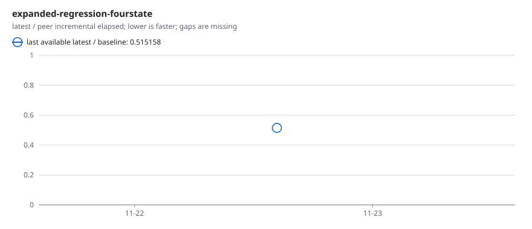
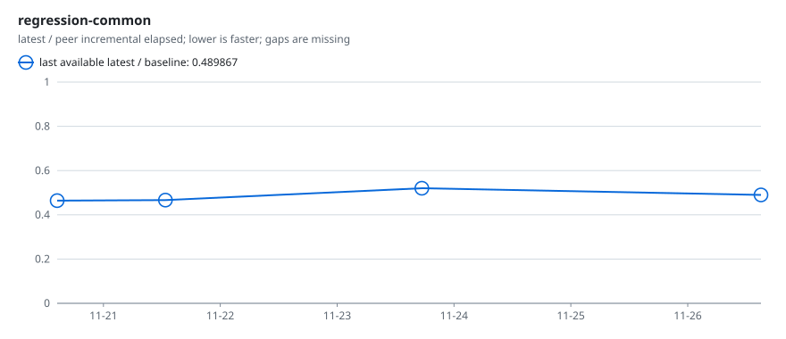
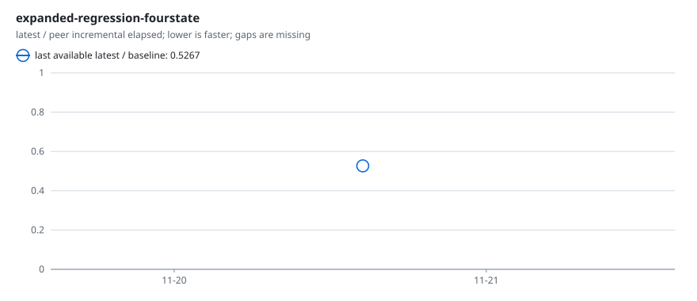
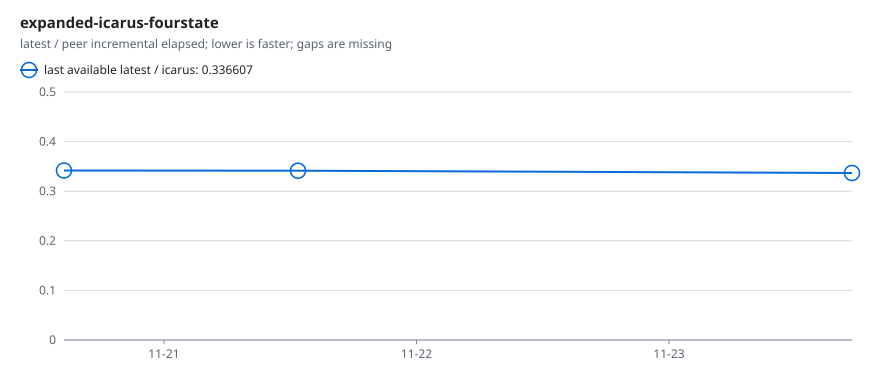
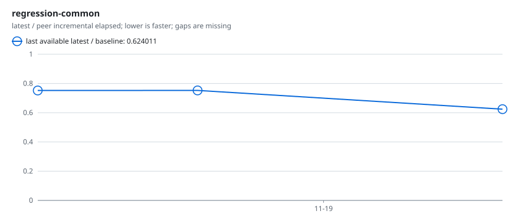
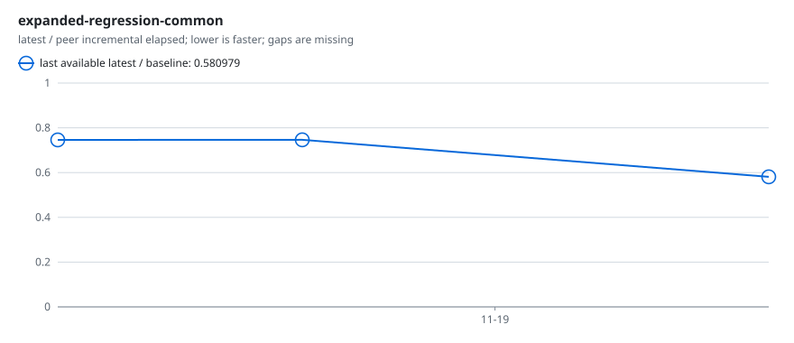
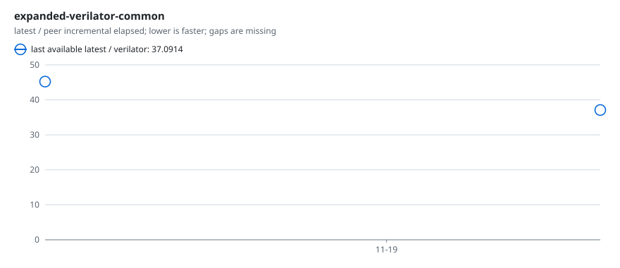

# 日次・週次シミュレーション速度ベンチマーク

[English](README.md) / [日本語](README.ja.md)

機能テストのNightlyとは独立しています。GitHub標準ランナーの値は参考値で、5回の測定から統計的有意性を断言しません。


日次25種類（共通22＋4値3）の等重み幾何平均です。比率はkirimasim÷Icarus 14.0 develの差分所要時間。0.97は所要時間が3%短い意味で、小さいほど高速です。

両開発版のコミットを測定開始時に一度解決します。JSTの各日の最後の正式測定を使い、1種類でも無効なら総合値は欠測です。環境・定義ごとに線を分けます。双方の変更が推移に影響するため、固定版との比較も下に残します。

[JSON](headline.json) · [Method / 測定方法](https://github.com/kurochan001/kirimasim-tests/blob/main/docs/daily-benchmark.md)

最新の総合測定: **2026-11-24 JST — 0.55718** (25/25; complete)

[Raw / 生データ](runs/actions-45328846151-1.json) · [Actions logs / ログ](https://github.com/kurochan001/kirimasim-tests/actions/runs/45328846151/attempts/1)

<details><summary>ケース別結果・固定版との比較・過去の系列</summary>

## 最新の日次測定

[JSON](latest-daily.json)

**測定回:** `actions-45328846151-1` — complete
2026-11-24T05:23:13.874403+00:00 → 2026-11-24T06:16:00.053712+00:00

比率は最新kirimasimの差分時間÷比較対象の差分時間です。1未満なら最新kirimasimが速いことを示します。

この環境での参考値です。失敗・欠測はゼロ秒ではありません。

[JSON](runs/actions-45328846151-1.json) · [Actions logs / ログ](https://github.com/kurochan001/kirimasim-tests/actions/runs/45328846151/attempts/1) · [Method / 測定方法](https://github.com/kurochan001/kirimasim-tests/blob/main/docs/daily-benchmark.md)

環境: github-hosted-ubuntu-24.04 / Intel(R) Xeon(R) 6975P-C / Linux-7.0.0-1014-aws-x86_64-with-glibc2.39

<details><summary>測定条件</summary>

```json
{
  "machine": {
    "os": "Linux-7.0.0-1014-aws-x86_64-with-glibc2.39",
    "cores": 4,
    "cpu": "Intel(R) Xeon(R) 6975P-C",
    "memory_gib": 15,
    "distribution": "Ubuntu 24.04.5 LTS",
    "architecture": "x86_64"
  },
  "compiler": "g++ (Ubuntu 13.3.0-6ubuntu2~24.04.1) 13.3.0",
  "profile": "daily",
  "environment": "github-hosted-ubuntu-24.04",
  "image_os": "ubuntu24",
  "image_version": "20261116.133.1",
  "settings": {
    "runs": 5,
    "warmups": 1,
    "timeout_seconds": 600,
    "short_seconds": 0.05,
    "regression_warning_ratio": 1.15,
    "simulation_threads": 1,
    "waveforms": false,
    "assertions": false,
    "verilator_build_jobs": 1
  },
  "mode": "formal",
  "runs": 5,
  "tool_builds": {
    "latest": {
      "compiler": "g++ (Ubuntu 13.3.0-6ubuntu2~24.04.1) 13.3.0",
      "c_compiler": "gcc (Ubuntu 13.3.0-6ubuntu2~24.04.1) 13.3.0",
      "flags": {
        "CC": "gcc",
        "CXX": "g++",
        "CFLAGS": "",
        "CXXFLAGS": "",
        "preset": "release",
        "cmake": "-O3 -DNDEBUG -ffp-contract=off, no fast-math",
        "make_jobs": 2
      }
    },
    "baseline": {
      "compiler": "g++ (Ubuntu 13.3.0-6ubuntu2~24.04.1) 13.3.0",
      "c_compiler": "gcc (Ubuntu 13.3.0-6ubuntu2~24.04.1) 13.3.0",
      "flags": {
        "CC": "gcc",
        "CXX": "g++",
        "CFLAGS": "",
        "CXXFLAGS": "",
        "preset": "release",
        "cmake": "-O3 -DNDEBUG -ffp-contract=off, no fast-math",
        "make_jobs": 2
      }
    },
    "icarus": {
      "compiler": "g++ (Ubuntu 13.3.0-6ubuntu2~24.04.1) 13.3.0",
      "c_compiler": "gcc (Ubuntu 13.3.0-6ubuntu2~24.04.1) 13.3.0",
      "flags": {
        "CC": "gcc",
        "CXX": "g++",
        "CFLAGS": "",
        "CXXFLAGS": "",
        "preset": "release",
        "cmake": "-O3 -DNDEBUG -ffp-contract=off, no fast-math",
        "make_jobs": 2
      }
    },
    "verilator": {
      "compiler": "g++ (Ubuntu 13.3.0-6ubuntu2~24.04.1) 13.3.0",
      "c_compiler": "gcc (Ubuntu 13.3.0-6ubuntu2~24.04.1) 13.3.0",
      "flags": {
        "CC": "gcc",
        "CXX": "g++",
        "CFLAGS": "",
        "CXXFLAGS": "",
        "preset": "release",
        "cmake": "-O3 -DNDEBUG -ffp-contract=off, no fast-math",
        "make_jobs": 2
      }
    },
    "icarus_devel": {
      "compiler": "g++ (Ubuntu 13.3.0-6ubuntu2~24.04.1) 13.3.0",
      "c_compiler": "gcc (Ubuntu 13.3.0-6ubuntu2~24.04.1) 13.3.0",
      "flags": {
        "CC": "gcc",
        "CXX": "g++",
        "CFLAGS": "",
        "CXXFLAGS": "",
        "preset": "release",
        "cmake": "-O3 -DNDEBUG -ffp-contract=off, no fast-math",
        "make_jobs": 2
      }
    }
  },
  "verilator_options": "--binary --timing --threads 1 --build-jobs 1; default C++ optimization; assertions/tracing off",
  "icarus_options": "-g2012; vvp -n; single process",
  "kirimasim_options": "default four-state; interpreter; no waveform/assertion request"
}
```

</details>

- `latest`: `e93839fdcbea43035a4e58ca271535f16cd3b4ad` — kirimasim 0.2.1 (commit e93839fdcbea), built with GNU 13.3.0
- `baseline`: `cfa2ccd75989c1ebb9ed63303271183377364cf0` — kirimasim 0.1.0 (commit cfa2ccd75989), built with GNU 13.3.0
- `icarus`: `dfeee909ed9f20b4870dd93423156c0170c0e1ff` — Icarus Verilog version 13.0 (stable) (dfeee90-dirty)
- `verilator`: `bbb60a403932a9f695cb6ff001ceb73de6ad9234` — Verilator 5.054 2026-11-01 rev vUNKNOWN-built20261121-bbb60a4
- `icarus_devel`: `addeab31d5297092ccafbde326f726f3c0d45e60` — Icarus Verilog version 14.0 (devel) (addeab3)

定義・測定処理の識別情報: `{'config_sha256': '4006a76543b7c88eed78ba128e7459c54ac2ee82a78efdd401ac2d85643bef9b', 'driver_sha256': '0edb91f5cbc17e8d1eec9e77ab4c87fb7dbcf4b9ff57d233c5e94628770ad077', 'comparison_sha256': '2896f429781d5eaff2d0ecec465726de342f840892056d20304d2df179ad6be0', 'history_sha256': 'bda014f86bbbea0bd769b5458656bfda07cbcaec712624cfad17960b10b5c887', 'setup_sha256': 'aa89dd6c7df5268f361f96049069cfe68b524ff93819afc4351fcb557c91d8f9', 'adapter_sha256': '4811f9d50d4a09d8794710296d644350468c49a9579a794f27af42ac9fb6b5bc', 'benchmark_commit': 'cfa2ccd75989c1ebb9ed63303271183377364cf0', 'reference_sha256': {'bench/reference_expanded.py': 'a1196d79efb88425f61cc69ba1d9ec99542f7f5dc41fac2a07ade82090b00f4a', 'bench/reference_fourstate_mix.py': '586fb643e9ef9df9e304df83e04e711aa1b875e6cb4393e6e3c98cd1707b70e1'}}`

| ケース | 処理系 | 状態 | ビルド秒 | T(1)中央値秒 | T(N)中央値秒 | 差分秒 | T(N) MAD秒 | RSS MiB | 最新/対象 | 理由・注意 |
|---|---|---|---:|---:|---:|---:|---:|---:|---:|---|
| casez_struct (N=5000000) | latest | measured | — | 0.0053458 | 2.4504 | 2.445 | 0.0044061 | 29.762 | — |  |
| casez_struct (N=5000000) | baseline | measured | — | 0.0052085 | 5.0605 | 5.0553 | 0.015782 | 28.316 | 0.48365 |  |
| casez_struct (N=5000000) | icarus | measured | 0.0039358 | 0.0027948 | 5.5359 | 5.5331 | 0.010763 | 7.3359 | 0.44189 |  |
| casez_struct (N=5000000) | verilator | measured | 4.8313 | 0.0013201 | 0.029737 | 0.028417 | 5.6681e-05 | 3.8359 | 86.042 | short incremental time; sensitive to timing noise |
| casez_struct (N=5000000) | icarus_devel | measured | 0.0037676 | 0.0025957 | 5.1319 | 5.1293 | 0.012854 | 7.5117 | 0.47668 |  |
| comb_chain (N=3000000) | latest | measured | — | 0.005435 | 3.8966 | 3.8912 | 0.0089442 | 29.703 | — |  |
| comb_chain (N=3000000) | baseline | measured | — | 0.0051038 | 13.507 | 13.502 | 0.031549 | 28.359 | 0.2882 |  |
| comb_chain (N=3000000) | icarus | measured | 0.0041906 | 0.0027645 | 19.531 | 19.528 | 0.035891 | 7.4375 | 0.19926 |  |
| comb_chain (N=3000000) | verilator | measured | 5.6385 | 0.0013118 | 0.32625 | 0.32493 | 0.00072217 | 3.8477 | 11.975 |  |
| comb_chain (N=3000000) | icarus_devel | measured | 0.0038585 | 0.0023939 | 12.816 | 12.813 | 0.018628 | 7.5703 | 0.30368 |  |
| dyn_queue (N=4000000) | latest | measured | — | 0.0048301 | 3.9014 | 3.8966 | 0.011967 | 29.695 | — |  |
| dyn_queue (N=4000000) | baseline | measured | — | 0.0051891 | 5.5731 | 5.568 | 0.021143 | 28.102 | 0.69982 |  |
| dyn_queue (N=4000000) | icarus | measured | 0.0039996 | 0.002851 | 10.368 | 10.365 | 0.034934 | 7.3945 | 0.37595 |  |
| dyn_queue (N=4000000) | verilator | measured | 5.0836 | 0.0013125 | 0.10524 | 0.10393 | 0.00041985 | 3.8164 | 37.494 |  |
| dyn_queue (N=4000000) | icarus_devel | measured | 0.0039012 | 0.0026728 | 9.4474 | 9.4448 | 0.02919 | 7.6641 | 0.41257 |  |
| fork_join (N=4000000) | latest | measured | — | 0.0052791 | 4.9791 | 4.9738 | 0.015342 | 29.559 | — |  |
| fork_join (N=4000000) | baseline | measured | — | 0.0054558 | 6.9822 | 6.9767 | 0.0085521 | 28.137 | 0.71291 |  |
| fork_join (N=4000000) | icarus | measured | 0.0040971 | 0.002668 | 8.9994 | 8.9967 | 0.029071 | 7.3672 | 0.55284 |  |
| fork_join (N=4000000) | verilator | measured | 5.6849 | 0.001322 | 1.7674 | 1.766 | 0.00096784 | 3.8281 | 2.8163 |  |
| fork_join (N=4000000) | icarus_devel | measured | 0.003681 | 0.0023762 | 6.8871 | 6.8847 | 0.00030728 | 7.5039 | 0.72244 |  |
| func_call (N=1500000) | latest | measured | — | 0.0056474 | 4.2685 | 4.2628 | 0.0022733 | 29.473 | — |  |
| func_call (N=1500000) | baseline | measured | — | 0.0051206 | 6.7173 | 6.7121 | 0.02454 | 28.277 | 0.63509 |  |
| func_call (N=1500000) | icarus | measured | 0.003785 | 0.0027616 | 15.252 | 15.249 | 0.0144 | 7.3477 | 0.27954 |  |
| func_call (N=1500000) | verilator | measured | 4.7651 | 0.0013072 | 0.0084953 | 0.0071881 | 0.00013179 | 0.31641 | 593.04 | short incremental time; sensitive to timing noise |
| func_call (N=1500000) | icarus_devel | measured | 0.0035969 | 0.0024208 | 10.902 | 10.899 | 0.060991 | 7.5156 | 0.39111 |  |
| gate_udp (N=400000) | latest | measured | — | 0.0070614 | 5.8453 | 5.8383 | 0.0048356 | 33.641 | — |  |
| gate_udp (N=400000) | baseline | measured | — | 0.0060359 | 7.6579 | 7.6519 | 0.015941 | 28.188 | 0.76298 |  |
| gate_udp (N=400000) | icarus | measured | 0.0050058 | 0.0035368 | 4.9226 | 4.9191 | 0.010407 | 7.5234 | 1.1869 |  |
| gate_udp (N=400000) | verilator | measured | 5.4993 | 0.0012989 | 0.063333 | 0.062034 | 0.00017698 | 3.8516 | 94.114 |  |
| gate_udp (N=400000) | icarus_devel | measured | 0.0049934 | 0.0031983 | 4.6071 | 4.6039 | 0.010431 | 7.6758 | 1.2681 |  |
| mem_rw (N=4000000) | latest | measured | — | 0.006326 | 3.7459 | 3.7396 | 0.0065015 | 29.754 | — |  |
| mem_rw (N=4000000) | baseline | measured | — | 0.0063721 | 7.3273 | 7.321 | 0.028468 | 28.172 | 0.51081 |  |
| mem_rw (N=4000000) | icarus | measured | 0.0050013 | 0.0031814 | 6.1037 | 6.1005 | 0.023534 | 7.4102 | 0.613 |  |
| mem_rw (N=4000000) | verilator | measured | 5.4813 | 0.0013388 | 0.98199 | 0.98065 | 0.0017174 | 3.8203 | 3.8134 |  |
| mem_rw (N=4000000) | icarus_devel | measured | 0.0037306 | 0.0031438 | 4.3869 | 4.3837 | 0.015562 | 7.5508 | 0.85307 |  |
| nba_burst (N=500000) | latest | measured | — | 0.0047864 | 0.090284 | 0.085497 | 0.00046693 | 133.77 | — |  |
| nba_burst (N=500000) | baseline | measured | — | 0.0048133 | 0.15163 | 0.14682 | 0.00045355 | 124.4 | 0.58232 |  |
| nba_burst (N=500000) | icarus | measured | 0.0035032 | 0.0022862 | 0.16905 | 0.16676 | 0.00052107 | 33.84 | 0.51268 |  |
| nba_burst (N=500000) | verilator | measured | 5.4927 | 0.001193 | 0.0013915 | 0.0001985 | 6.588e-06 | 0.3125 | 430.72 | short incremental time; sensitive to timing noise; incremental time is close to observed dispersion |
| nba_burst (N=500000) | icarus_devel | measured | 0.003438 | 0.0022386 | 0.16784 | 0.1656 | 0.0004783 | 34.039 | 0.51627 |  |
| nba_shift (N=1000000) | latest | measured | — | 0.0056851 | 13.066 | 13.06 | 0.0098394 | 31.609 | — |  |
| nba_shift (N=1000000) | baseline | measured | — | 0.0058947 | 35.558 | 35.552 | 0.31126 | 28.309 | 0.36735 |  |
| nba_shift (N=1000000) | icarus | measured | 0.0056932 | 0.0030122 | 34.744 | 34.741 | 0.032341 | 7.5 | 0.37593 |  |
| nba_shift (N=1000000) | verilator | measured | 5.5715 | 0.0012949 | 0.28732 | 0.28603 | 0.00090425 | 3.8047 | 45.66 |  |
| nba_shift (N=1000000) | icarus_devel | measured | 0.004115 | 0.0029664 | 34.585 | 34.582 | 0.035275 | 7.6914 | 0.37765 |  |
| proc_wait (N=1000000) | latest | measured | — | 0.009349 | 5.5021 | 5.4927 | 0.035442 | 39.57 | — |  |
| proc_wait (N=1000000) | baseline | measured | — | 0.0075994 | 10.511 | 10.503 | 0.05545 | 30.238 | 0.52295 |  |
| proc_wait (N=1000000) | icarus | measured | 0.0066794 | 0.0038168 | 8.6554 | 8.6516 | 0.033231 | 7.8359 | 0.63488 |  |
| proc_wait (N=1000000) | verilator | measured | 7.4296 | 0.0014064 | 2.928 | 2.9266 | 0.0073081 | 3.9883 | 1.8769 |  |
| proc_wait (N=1000000) | icarus_devel | measured | 0.0049736 | 0.0033018 | 8.5376 | 8.5343 | 0.053435 | 8.0664 | 0.64361 |  |
| string_fmt (N=500000) | latest | measured | — | 0.0053939 | 3.1886 | 3.1832 | 0.010617 | 29.766 | — |  |
| string_fmt (N=500000) | baseline | measured | — | 0.0052398 | 5.8523 | 5.8471 | 0.012656 | 28.203 | 0.54441 |  |
| string_fmt (N=500000) | icarus | measured | 0.0049541 | 0.0027886 | 15.067 | 15.064 | 0.027649 | 7.3672 | 0.21131 |  |
| string_fmt (N=500000) | verilator | measured | 4.8398 | 0.0013486 | 0.20066 | 0.19931 | 0.0007176 | 3.9336 | 15.971 |  |
| string_fmt (N=500000) | icarus_devel | measured | 0.0035123 | 0.0027575 | 11.607 | 11.604 | 0.01142 | 7.543 | 0.27431 |  |
| wide_arith (N=1500000) | latest | measured | — | 0.0054169 | 2.6963 | 2.6909 | 0.0040873 | 29.742 | — |  |
| wide_arith (N=1500000) | baseline | measured | — | 0.0058041 | 7.1921 | 7.1863 | 0.011167 | 28.176 | 0.37445 |  |
| wide_arith (N=1500000) | icarus | measured | 0.0038339 | 0.0026765 | 14.68 | 14.678 | 0.012373 | 7.2969 | 0.18333 |  |
| wide_arith (N=1500000) | verilator | measured | 4.9435 | 0.0013554 | 0.12142 | 0.12006 | 0.00017423 | 3.8359 | 22.412 |  |
| wide_arith (N=1500000) | icarus_devel | measured | 0.0038568 | 0.0023793 | 2.7335 | 2.7311 | 0.0064018 | 7.5273 | 0.98526 |  |
| fourstate_mix (N=1000000) | latest | measured | — | 0.0048783 | 0.80189 | 0.79701 | 0.0030128 | 29.812 | — |  |
| fourstate_mix (N=1000000) | baseline | measured | — | 0.0056236 | 1.7384 | 1.7328 | 0.00572 | 28.422 | 0.45996 |  |
| fourstate_mix (N=1000000) | icarus | measured | 0.0042536 | 0.002751 | 3.1999 | 3.1971 | 0.01338 | 7.4141 | 0.24929 |  |
| fourstate_mix (N=1000000) | verilator | unsupported | — | — | — | — | — | — | — | X/Z observations require four-state semantics; excluded before execution |
| fourstate_mix (N=1000000) | icarus_devel | measured | 0.0037487 | 0.002686 | 2.2474 | 2.2447 | 0.0011071 | 7.5508 | 0.35507 |  |
| fifo_stream (N=200000) | latest | measured | — | 0.0060551 | 0.37145 | 0.36539 | 0.00041479 | 29.766 | — |  |
| fifo_stream (N=200000) | baseline | measured | — | 0.0057689 | 0.7743 | 0.76853 | 0.0021065 | 28.363 | 0.47544 |  |
| fifo_stream (N=200000) | icarus | measured | 0.0043679 | 0.0027037 | 0.55851 | 0.55581 | 0.0028334 | 7.4141 | 0.65741 |  |
| fifo_stream (N=200000) | verilator | measured | 5.5331 | 0.0013106 | 0.063461 | 0.06215 | 0.00036188 | 3.8516 | 5.8792 |  |
| fifo_stream (N=200000) | icarus_devel | measured | 0.0040218 | 0.0023559 | 0.48586 | 0.4835 | 0.00050248 | 7.5781 | 0.75572 |  |
| uart_loopback (N=20000) | latest | measured | — | 0.0058201 | 0.37779 | 0.37197 | 0.0026022 | 31.699 | — |  |
| uart_loopback (N=20000) | baseline | measured | — | 0.0061232 | 0.7136 | 0.70748 | 0.0063208 | 28.395 | 0.52577 |  |
| uart_loopback (N=20000) | icarus | measured | 0.0047638 | 0.002876 | 0.33681 | 0.33394 | 0.00043242 | 7.4414 | 1.1139 |  |
| uart_loopback (N=20000) | verilator | measured | 5.6416 | 0.0013129 | 0.074025 | 0.072712 | 7.7063e-05 | 3.8516 | 5.1157 |  |
| uart_loopback (N=20000) | icarus_devel | measured | 0.004029 | 0.0027356 | 0.30181 | 0.29908 | 0.00039332 | 7.6055 | 1.2437 |  |
| bus_fabric (N=150000) | latest | measured | — | 0.0069463 | 0.88594 | 0.87899 | 0.0044535 | 31.766 | — |  |
| bus_fabric (N=150000) | baseline | measured | — | 0.0061766 | 2.1413 | 2.1352 | 0.0051072 | 28.395 | 0.41167 |  |
| bus_fabric (N=150000) | icarus | measured | 0.0043631 | 0.0030673 | 0.72634 | 0.72328 | 0.0021631 | 7.4531 | 1.2153 |  |
| bus_fabric (N=150000) | verilator | measured | 5.5765 | 0.001335 | 0.081433 | 0.080098 | 0.00015416 | 3.8516 | 10.974 |  |
| bus_fabric (N=150000) | icarus_devel | measured | 0.0043255 | 0.0026697 | 0.67536 | 0.67269 | 0.0011684 | 7.6367 | 1.3067 |  |
| hierarchy_fanout (N=100000) | latest | measured | — | 0.014804 | 4.8829 | 4.8681 | 0.0027584 | 47.625 | — |  |
| hierarchy_fanout (N=100000) | baseline | measured | — | 0.0096944 | 11.329 | 11.319 | 0.0049708 | 36.172 | 0.43009 |  |
| hierarchy_fanout (N=100000) | icarus | measured | 0.0090101 | 0.0089637 | 25.897 | 25.888 | 0.021047 | 8.2891 | 0.18804 |  |
| hierarchy_fanout (N=100000) | verilator | measured | 5.5396 | 0.0013117 | 0.027031 | 0.025719 | 0.00048727 | 3.8477 | 189.28 | short incremental time; sensitive to timing noise |
| hierarchy_fanout (N=100000) | icarus_devel | measured | 0.0087345 | 0.0083668 | 8.0531 | 8.0447 | 0.033167 | 8.5 | 0.60513 |  |
| event_fanout (N=50000) | latest | measured | — | 0.019903 | 2.4339 | 2.414 | 0.001049 | 49.703 | — |  |
| event_fanout (N=50000) | baseline | measured | — | 0.01311 | 2.8997 | 2.8865 | 0.0027751 | 42.414 | 0.8363 |  |
| event_fanout (N=50000) | icarus | measured | 0.011407 | 0.0071901 | 3.4621 | 3.4549 | 0.021427 | 9.1211 | 0.69872 |  |
| event_fanout (N=50000) | verilator | measured | 5.7984 | 0.0013073 | 0.05525 | 0.053943 | 0.00011887 | 3.8438 | 44.751 |  |
| event_fanout (N=50000) | icarus_devel | measured | 0.0094099 | 0.0069609 | 3.3717 | 3.3648 | 0.0082261 | 9.2734 | 0.71744 |  |
| word_boundary (N=4000000) | latest | measured | — | 0.0046066 | 4.5422 | 4.5376 | 0.022314 | 29.504 | — |  |
| word_boundary (N=4000000) | baseline | measured | — | 0.0059677 | 10.358 | 10.352 | 0.105 | 28.191 | 0.43831 |  |
| word_boundary (N=4000000) | icarus | measured | 0.0038517 | 0.0027306 | 24.019 | 24.016 | 0.041737 | 7.2891 | 0.18894 |  |
| word_boundary (N=4000000) | verilator | measured | 4.7203 | 0.0012997 | 0.037932 | 0.036632 | 0.00031554 | 3.8359 | 123.87 | short incremental time; sensitive to timing noise |
| word_boundary (N=4000000) | icarus_devel | measured | 0.003526 | 0.002447 | 8.4281 | 8.4256 | 0.0097304 | 7.5391 | 0.53854 |  |
| wide_divide (N=80000) | latest | measured | — | 0.0057562 | 0.13504 | 0.12928 | 0.00031129 | 29.762 | — |  |
| wide_divide (N=80000) | baseline | measured | — | 0.0051397 | 1.157 | 1.1519 | 0.0022871 | 28.391 | 0.11223 |  |
| wide_divide (N=80000) | icarus | measured | 0.0038104 | 0.0025472 | 1.0707 | 1.0682 | 0.00036059 | 7.3477 | 0.12103 |  |
| wide_divide (N=80000) | verilator | measured | 4.8182 | 0.0013126 | 0.0095723 | 0.0082597 | 2.5181e-05 | 0.31641 | 15.652 | short incremental time; sensitive to timing noise |
| wide_divide (N=80000) | icarus_devel | measured | 0.0035687 | 0.0022279 | 0.53817 | 0.53594 | 0.0014475 | 7.5508 | 0.24122 |  |
| packed_slice (N=1500000) | latest | measured | — | 0.0051639 | 1.7922 | 1.787 | 0.0071407 | 29.699 | — |  |
| packed_slice (N=1500000) | baseline | measured | — | 0.0052273 | 6.1362 | 6.1309 | 0.016826 | 28.133 | 0.29147 |  |
| packed_slice (N=1500000) | icarus | measured | 0.0041815 | 0.0027236 | 8.9523 | 8.9496 | 0.043504 | 7.3477 | 0.19967 |  |
| packed_slice (N=1500000) | verilator | measured | 4.7475 | 0.0012516 | 0.093334 | 0.092083 | 0.00024796 | 3.8359 | 19.407 |  |
| packed_slice (N=1500000) | icarus_devel | measured | 0.0035501 | 0.0025706 | 3.4289 | 3.4263 | 0.0013677 | 7.5352 | 0.52156 |  |
| memory_scatter (N=5000000) | latest | measured | — | 0.042146 | 2.425 | 2.3828 | 0.0050218 | 43.766 | — |  |
| memory_scatter (N=5000000) | baseline | measured | — | 0.048406 | 5.1907 | 5.1423 | 0.0019584 | 42.324 | 0.46338 |  |
| memory_scatter (N=5000000) | icarus | measured | 0.0042526 | 0.026097 | 12.424 | 12.398 | 0.043901 | 7.8203 | 0.19219 |  |
| memory_scatter (N=5000000) | verilator | measured | 4.9225 | 0.0014367 | 0.0084595 | 0.0070228 | 7.2901e-05 | 0.32031 | 339.3 | short incremental time; sensitive to timing noise |
| memory_scatter (N=5000000) | icarus_devel | measured | 0.0038273 | 0.01663 | 7.0387 | 7.022 | 0.0082352 | 8.0117 | 0.33934 |  |
| clock_domains (N=20000) | latest | measured | — | 0.0052943 | 0.10956 | 0.10426 | 0.0010668 | 29.699 | — |  |
| clock_domains (N=20000) | baseline | measured | — | 0.0056123 | 0.21812 | 0.21251 | 0.0052205 | 28.32 | 0.49063 |  |
| clock_domains (N=20000) | icarus | measured | 0.0040689 | 0.0027626 | 0.10939 | 0.10663 | 0.00043756 | 7.375 | 0.97778 |  |
| clock_domains (N=20000) | verilator | measured | 5.7633 | 0.0013425 | 0.07421 | 0.072868 | 0.00041865 | 3.832 | 1.4308 |  |
| clock_domains (N=20000) | icarus_devel | measured | 0.003739 | 0.002599 | 0.10698 | 0.10438 | 0.00013194 | 7.5547 | 0.99888 |  |
| fourstate_arith (N=100000) | latest | measured | — | 0.0058424 | 0.1181 | 0.11226 | 0.00030063 | 29.824 | — |  |
| fourstate_arith (N=100000) | baseline | measured | — | 0.0055917 | 0.17155 | 0.16596 | 0.00063238 | 28.387 | 0.67642 |  |
| fourstate_arith (N=100000) | icarus | measured | 0.00412 | 0.0027916 | 0.24129 | 0.2385 | 0.0001681 | 7.3477 | 0.47068 |  |
| fourstate_arith (N=100000) | verilator | unsupported | — | — | — | — | — | — | — | X/Z observations require four-state semantics; excluded before execution |
| fourstate_arith (N=100000) | icarus_devel | measured | 0.0036085 | 0.002283 | 0.22579 | 0.22351 | 2.0621e-05 | 7.5156 | 0.50224 |  |
| resolved_bus (N=50000) | latest | measured | — | 0.0054772 | 0.15919 | 0.15372 | 0.0016148 | 29.754 | — |  |
| resolved_bus (N=50000) | baseline | measured | — | 0.0061757 | 0.34534 | 0.33917 | 0.00052389 | 28.32 | 0.45322 |  |
| resolved_bus (N=50000) | icarus | measured | 0.0041226 | 0.002886 | 0.47579 | 0.47291 | 0.0012353 | 7.3984 | 0.32505 |  |
| resolved_bus (N=50000) | verilator | unsupported | — | — | — | — | — | — | — | X/Z observations require four-state semantics; excluded before execution |
| resolved_bus (N=50000) | icarus_devel | measured | 0.0038373 | 0.0027372 | 0.46803 | 0.46529 | 0.00054779 | 7.5273 | 0.33037 |  |

固定した総合値の集合（全ケースの有効値が必要です）：

- **regression-common**: 0.52018; 12/12; casez_struct, comb_chain, dyn_queue, fork_join, func_call, gate_udp, mem_rw, nba_burst, nba_shift, proc_wait, string_fmt, wide_arith
- **regression-fourstate**: 0.45996; 1/1; fourstate_mix
- **icarus-common**: 0.40168; 12/12; casez_struct, comb_chain, dyn_queue, fork_join, func_call, gate_udp, mem_rw, nba_burst, nba_shift, proc_wait, string_fmt, wide_arith
- **icarus-fourstate**: 0.24929; 1/1; fourstate_mix
- **verilator-common**: 28.651; 12/12; casez_struct, comb_chain, dyn_queue, fork_join, func_call, gate_udp, mem_rw, nba_burst, nba_shift, proc_wait, string_fmt, wide_arith
- **expanded-regression-common**: 0.46459; 22/22; casez_struct, comb_chain, dyn_queue, fork_join, func_call, gate_udp, mem_rw, nba_burst, nba_shift, proc_wait, string_fmt, wide_arith, fifo_stream, uart_loopback, bus_fabric, hierarchy_fanout, event_fanout, word_boundary, wide_divide, packed_slice, memory_scatter, clock_domains
- **expanded-regression-fourstate**: 0.52049; 3/3; fourstate_mix, fourstate_arith, resolved_bus
- **expanded-icarus-common**: 0.40011; 22/22; casez_struct, comb_chain, dyn_queue, fork_join, func_call, gate_udp, mem_rw, nba_burst, nba_shift, proc_wait, string_fmt, wide_arith, fifo_stream, uart_loopback, bus_fabric, hierarchy_fanout, event_fanout, word_boundary, wide_divide, packed_slice, memory_scatter, clock_domains
- **expanded-icarus-fourstate**: 0.33661; 3/3; fourstate_mix, fourstate_arith, resolved_bus
- **expanded-verilator-common**: 26.176; 22/22; casez_struct, comb_chain, dyn_queue, fork_join, func_call, gate_udp, mem_rw, nba_burst, nba_shift, proc_wait, string_fmt, wide_arith, fifo_stream, uart_loopback, bus_fabric, hierarchy_fanout, event_fanout, word_boundary, wide_divide, packed_slice, memory_scatter, clock_domains
- **daily-overall-icarus14**: 0.55718; 25/25; casez_struct, comb_chain, dyn_queue, fork_join, func_call, gate_udp, mem_rw, nba_burst, nba_shift, proc_wait, string_fmt, wide_arith, fourstate_mix, fifo_stream, uart_loopback, bus_fabric, hierarchy_fanout, event_fanout, word_boundary, wide_divide, packed_slice, memory_scatter, clock_domains, fourstate_arith, resolved_bus
## 最新の週次測定

[JSON](latest-weekly.json)

**測定回:** `actions-45109202660-1` — complete
2026-11-23T04:17:20.572534+00:00 → 2026-11-23T04:54:00.119674+00:00

比率は最新kirimasimの差分時間÷比較対象の差分時間です。1未満なら最新kirimasimが速いことを示します。

この環境での参考値です。失敗・欠測はゼロ秒ではありません。

[JSON](runs/actions-45109202660-1.json) · [Actions logs / ログ](https://github.com/kurochan001/kirimasim-tests/actions/runs/45109202660/attempts/1) · [Method / 測定方法](https://github.com/kurochan001/kirimasim-tests/blob/main/docs/daily-benchmark.md)

環境: github-hosted-ubuntu-24.04 / AMD EPYC 9V74 80-Core Processor / Linux-7.0.0-1017-azure-x86_64-with-glibc2.39

<details><summary>測定条件</summary>

```json
{
  "machine": {
    "os": "Linux-7.0.0-1017-azure-x86_64-with-glibc2.39",
    "cores": 4,
    "cpu": "AMD EPYC 9V74 80-Core Processor",
    "memory_gib": 16,
    "distribution": "Ubuntu 24.04.5 LTS",
    "architecture": "x86_64"
  },
  "compiler": "g++ (Ubuntu 13.3.0-6ubuntu2~24.04.1) 13.3.0",
  "profile": "weekly",
  "environment": "github-hosted-ubuntu-24.04",
  "image_os": "ubuntu24",
  "image_version": "20261116.376.1",
  "settings": {
    "runs": 5,
    "warmups": 1,
    "timeout_seconds": 600,
    "short_seconds": 0.05,
    "regression_warning_ratio": 1.15,
    "simulation_threads": 1,
    "waveforms": false,
    "assertions": false,
    "verilator_build_jobs": 1
  },
  "mode": "formal",
  "runs": 5,
  "tool_builds": {
    "latest": {
      "compiler": "g++ (Ubuntu 13.3.0-6ubuntu2~24.04.1) 13.3.0",
      "c_compiler": "gcc (Ubuntu 13.3.0-6ubuntu2~24.04.1) 13.3.0",
      "flags": {
        "CC": "gcc",
        "CXX": "g++",
        "CFLAGS": "",
        "CXXFLAGS": "",
        "preset": "release",
        "cmake": "-O3 -DNDEBUG -ffp-contract=off, no fast-math",
        "make_jobs": 2
      }
    },
    "baseline": {
      "compiler": "g++ (Ubuntu 13.3.0-6ubuntu2~24.04.1) 13.3.0",
      "c_compiler": "gcc (Ubuntu 13.3.0-6ubuntu2~24.04.1) 13.3.0",
      "flags": {
        "CC": "gcc",
        "CXX": "g++",
        "CFLAGS": "",
        "CXXFLAGS": "",
        "preset": "release",
        "cmake": "-O3 -DNDEBUG -ffp-contract=off, no fast-math",
        "make_jobs": 2
      }
    },
    "icarus": {
      "compiler": "g++ (Ubuntu 13.3.0-6ubuntu2~24.04.1) 13.3.0",
      "c_compiler": "gcc (Ubuntu 13.3.0-6ubuntu2~24.04.1) 13.3.0",
      "flags": {
        "CC": "gcc",
        "CXX": "g++",
        "CFLAGS": "",
        "CXXFLAGS": "",
        "preset": "release",
        "cmake": "-O3 -DNDEBUG -ffp-contract=off, no fast-math",
        "make_jobs": 2
      }
    },
    "verilator": {
      "compiler": "g++ (Ubuntu 13.3.0-6ubuntu2~24.04.1) 13.3.0",
      "c_compiler": "gcc (Ubuntu 13.3.0-6ubuntu2~24.04.1) 13.3.0",
      "flags": {
        "CC": "gcc",
        "CXX": "g++",
        "CFLAGS": "",
        "CXXFLAGS": "",
        "preset": "release",
        "cmake": "-O3 -DNDEBUG -ffp-contract=off, no fast-math",
        "make_jobs": 2
      }
    },
    "icarus_devel": {
      "compiler": "g++ (Ubuntu 13.3.0-6ubuntu2~24.04.1) 13.3.0",
      "c_compiler": "gcc (Ubuntu 13.3.0-6ubuntu2~24.04.1) 13.3.0",
      "flags": {
        "CC": "gcc",
        "CXX": "g++",
        "CFLAGS": "",
        "CXXFLAGS": "",
        "preset": "release",
        "cmake": "-O3 -DNDEBUG -ffp-contract=off, no fast-math",
        "make_jobs": 2
      }
    }
  },
  "verilator_options": "--binary --timing --threads 1 --build-jobs 1; default C++ optimization; assertions/tracing off",
  "icarus_options": "-g2012; vvp -n; single process",
  "kirimasim_options": "default four-state; interpreter; no waveform/assertion request"
}
```

</details>

- `latest`: `378a66ab3240edf824a1b59f10697ecff3efa441` — kirimasim 0.2.0 (commit 378a66ab3240), built with GNU 13.3.0
- `baseline`: `cfa2ccd75989c1ebb9ed63303271183377364cf0` — kirimasim 0.1.0 (commit cfa2ccd75989), built with GNU 13.3.0
- `icarus`: `dfeee909ed9f20b4870dd93423156c0170c0e1ff` — Icarus Verilog version 13.0 (stable) (dfeee90-dirty)
- `verilator`: `bbb60a403932a9f695cb6ff001ceb73de6ad9234` — Verilator 5.054 2026-11-01 rev vUNKNOWN-built20261123-bbb60a4
- `icarus_devel`: `8a4ce429e15e712d82067d4747cd9ec67503a0f8` — Icarus Verilog version 14.0 (devel) (8a4ce42)

定義・測定処理の識別情報: `{'config_sha256': '4006a76543b7c88eed78ba128e7459c54ac2ee82a78efdd401ac2d85643bef9b', 'driver_sha256': '0edb91f5cbc17e8d1eec9e77ab4c87fb7dbcf4b9ff57d233c5e94628770ad077', 'comparison_sha256': '2896f429781d5eaff2d0ecec465726de342f840892056d20304d2df179ad6be0', 'history_sha256': 'bda014f86bbbea0bd769b5458656bfda07cbcaec712624cfad17960b10b5c887', 'setup_sha256': 'aa89dd6c7df5268f361f96049069cfe68b524ff93819afc4351fcb557c91d8f9', 'adapter_sha256': '4811f9d50d4a09d8794710296d644350468c49a9579a794f27af42ac9fb6b5bc', 'benchmark_commit': 'cfa2ccd75989c1ebb9ed63303271183377364cf0', 'reference_sha256': {'bench/reference_expanded.py': 'a1196d79efb88425f61cc69ba1d9ec99542f7f5dc41fac2a07ade82090b00f4a', 'bench/reference_fourstate_mix.py': '586fb643e9ef9df9e304df83e04e711aa1b875e6cb4393e6e3c98cd1707b70e1'}}`

| ケース | 処理系 | 状態 | ビルド秒 | T(1)中央値秒 | T(N)中央値秒 | 差分秒 | T(N) MAD秒 | RSS MiB | 最新/対象 | 理由・注意 |
|---|---|---|---:|---:|---:|---:|---:|---:|---:|---|
| large_hierarchy (N=20000) | latest | measured | — | 0.17569 | 18.079 | 17.903 | 0.11446 | 129.63 | — |  |
| large_hierarchy (N=20000) | baseline | measured | — | 0.10914 | 28.952 | 28.843 | 0.16433 | 108.25 | 0.62071 |  |
| large_hierarchy (N=20000) | icarus | measured | 0.13305 | 0.087124 | 74.086 | 73.998 | 0.1766 | 23.039 | 0.24194 |  |
| large_hierarchy (N=20000) | verilator | measured | 11.83 | 0.0016562 | 0.080178 | 0.078522 | 0.0018308 | 3.9258 | 228 |  |
| large_hierarchy (N=20000) | icarus_devel | measured | 0.13914 | 0.085931 | 12.41 | 12.324 | 0.021666 | 23.316 | 1.4527 |  |
| large_memory (N=500000) | latest | measured | — | 0.054258 | 13.588 | 13.534 | 0.15501 | 45.887 | — |  |
| large_memory (N=500000) | baseline | measured | — | 0.11138 | 31.854 | 31.742 | 0.1146 | 44.395 | 0.42637 |  |
| large_memory (N=500000) | icarus | measured | 0.004978 | 0.17122 | 49.224 | 49.053 | 0.044034 | 11.359 | 0.27591 |  |
| large_memory (N=500000) | verilator | measured | 6.1891 | 0.0023293 | 0.10887 | 0.10654 | 0.00023025 | 4.8125 | 127.03 |  |
| large_memory (N=500000) | icarus_devel | measured | 0.0047116 | 0.11654 | 41.1 | 40.984 | 0.21041 | 11.496 | 0.33023 |  |
| stream_pipeline (N=250000) | latest | measured | — | 0.0073843 | 11.884 | 11.877 | 0.047667 | 33.652 | — |  |
| stream_pipeline (N=250000) | baseline | measured | — | 0.0069906 | 29.166 | 29.16 | 0.1411 | 28.242 | 0.40731 |  |
| stream_pipeline (N=250000) | icarus | measured | 0.0075874 | 0.0052828 | 66.983 | 66.978 | 0.043374 | 7.5469 | 0.17733 |  |
| stream_pipeline (N=250000) | verilator | measured | 6.2715 | 0.0016095 | 0.099629 | 0.098019 | 0.00060947 | 3.832 | 121.17 |  |
| stream_pipeline (N=250000) | icarus_devel | measured | 0.0058586 | 0.0052535 | 54.677 | 54.672 | 0.092473 | 7.7383 | 0.21724 |  |

固定した総合値の集合（全ケースの有効値が必要です）：

- **weekly-regression**: 0.47592; 3/3; large_hierarchy, large_memory, stream_pipeline
- **weekly-icarus**: 0.2279; 3/3; large_hierarchy, large_memory, stream_pipeline
- **weekly-verilator**: 151.97; 3/3; large_hierarchy, large_memory, stream_pipeline
- **weekly-icarus14-common**: 0.47059; 3/3; large_hierarchy, large_memory, stream_pipeline

## 環境・定義別の推移

### `ce6cd82e24d95f55`

1 runs; 2026-11-23T04:17:20.572534+00:00 → 2026-11-23T04:17:20.572534+00:00

測定定義: `weekly-v2-icarus14`; ケース数: **3**


失敗を含む各回：

- [actions-45109202660-1](runs/actions-45109202660-1.json): complete — `378a66ab3240`
### `39bb1735b0601635`

1 runs; 2026-11-23T02:20:58.341830+00:00 → 2026-11-23T02:20:58.341830+00:00

測定定義: `daily-v4-icarus14`; ケース数: **25**





失敗を含む各回：

- [actions-45091454959-1](runs/actions-45091454959-1.json): complete — `1d2cac97a4fe`
### `341b44a021dff5eb`

3 runs; 2026-11-21T02:30:14.755165+00:00 → 2026-11-24T05:23:13.874403+00:00

測定定義: `daily-v4-icarus14`; ケース数: **25**










失敗を含む各回：

- [actions-45328846151-1](runs/actions-45328846151-1.json): complete — `e93839fdcbea`
- [actions-44966152659-1](runs/actions-44966152659-1.json): complete — `ad004a67d861`
- [actions-44850710627-1](runs/actions-44850710627-1.json): complete — `256839f71089`
### `cc3a300591d180c9`

3 runs; 2026-11-18T13:42:55.941756+00:00 → 2026-11-20T01:57:13.586055+00:00

測定定義: `daily-v4-icarus14`; ケース数: **25**










失敗を含む各回：

- [actions-44656096600-1](runs/actions-44656096600-1.json): complete — `cb97fc93bf6b`
- [actions-44440143026-1](runs/actions-44440143026-1.json): incomplete — `a6222f0656d4`
- [actions-44311501813-1](runs/actions-44311501813-1.json): complete — `441dddbd0fcd`
### `25a1c78c12d65db9`

1 runs; 2026-11-18T02:38:15.609997+00:00 → 2026-11-18T02:38:15.609997+00:00

測定定義: `daily-v3-expanded`; ケース数: **25**


失敗を含む各回：

- [actions-44223268236-1](runs/actions-44223268236-1.json): complete — `441dddbd0fcd`
### `079515db5b1afbed`

1 runs; 2026-11-17T22:58:29.331708+00:00 → 2026-11-17T22:58:29.331708+00:00

測定定義: `weekly-v1-scale`; ケース数: **3**


失敗を含む各回：

- [actions-44186811554-1](runs/actions-44186811554-1.json): complete — `441dddbd0fcd`
### `ff82f2d3ef6ff628`

1 runs; 2026-11-17T21:58:35.859990+00:00 → 2026-11-17T21:58:35.859990+00:00

測定定義: `daily-v3-expanded`; ケース数: **25**


失敗を含む各回：

- [actions-44183926839-1](runs/actions-44183926839-1.json): complete — `234f65f6b205`
### `962ea28f5124b999`

1 runs; 2026-11-17T15:00:17.437065+00:00 → 2026-11-17T15:00:17.437065+00:00

測定定義: `daily-v2-thirteen`; ケース数: **13**


失敗を含む各回：

- [actions-44103555558-1](runs/actions-44103555558-1.json): complete — `13d52dde3c49`
### `ff134f2dfe29a369`

1 runs; 2026-11-17T13:04:45.723115+00:00 → 2026-11-17T13:04:45.723115+00:00

測定定義: `daily-v1`; ケース数: **5**


失敗を含む各回：

- [actions-44085771320-1](runs/actions-44085771320-1.json): complete — `26f359bcd504`

<!-- holdout-start -->

## 最新の別枠の測定（報告のみ）

日次・週次の集合に入らない設計で、週に1回測ります。kirimasimの最適化の判断には使わず、日次の総合値・headline.json・総合グラフにも入れません。比較の集合には相手が実行できる条件だけを入れ、宣言した非対応は欠測として示します。

[JSON](latest-holdout.json)

**測定回:** `actions-45186535033-1` — complete
2026-11-23T13:53:27.681573+00:00 → 2026-11-23T14:01:27.543368+00:00

比率は最新kirimasimの差分時間÷比較対象の差分時間です。1未満なら最新kirimasimが速いことを示します。

この環境での参考値です。失敗・欠測はゼロ秒ではありません。

[JSON](holdout/runs/actions-45186535033-1.json) · [Actions logs / ログ](https://github.com/kurochan001/kirimasim-tests/actions/runs/45186535033/attempts/1) · [Method / 測定方法](https://github.com/kurochan001/kirimasim-tests/blob/main/docs/daily-benchmark.md)

環境: github-hosted-ubuntu-24.04 / Intel(R) Xeon(R) 6975P-C / Linux-7.0.0-1014-aws-x86_64-with-glibc2.39

<details><summary>測定条件</summary>

```json
{
  "machine": {
    "os": "Linux-7.0.0-1014-aws-x86_64-with-glibc2.39",
    "cores": 4,
    "cpu": "Intel(R) Xeon(R) 6975P-C",
    "memory_gib": 15,
    "distribution": "Ubuntu 24.04.5 LTS",
    "architecture": "x86_64"
  },
  "compiler": "g++ (Ubuntu 13.3.0-6ubuntu2~24.04.1) 13.3.0",
  "profile": "holdout",
  "environment": "github-hosted-ubuntu-24.04",
  "image_os": "ubuntu24",
  "image_version": "20261116.133.1",
  "settings": {
    "runs": 5,
    "warmups": 1,
    "timeout_seconds": 600,
    "short_seconds": 0.05,
    "regression_warning_ratio": 1.15,
    "simulation_threads": 1,
    "waveforms": false,
    "assertions": false,
    "verilator_build_jobs": 1
  },
  "mode": "formal",
  "runs": 5,
  "tool_builds": {
    "latest": {
      "compiler": "g++ (Ubuntu 13.3.0-6ubuntu2~24.04.1) 13.3.0",
      "c_compiler": "gcc (Ubuntu 13.3.0-6ubuntu2~24.04.1) 13.3.0",
      "flags": {
        "CC": "gcc",
        "CXX": "g++",
        "CFLAGS": "",
        "CXXFLAGS": "",
        "preset": "release",
        "cmake": "-O3 -DNDEBUG -ffp-contract=off, no fast-math",
        "make_jobs": 2
      }
    },
    "baseline": {
      "compiler": "g++ (Ubuntu 13.3.0-6ubuntu2~24.04.1) 13.3.0",
      "c_compiler": "gcc (Ubuntu 13.3.0-6ubuntu2~24.04.1) 13.3.0",
      "flags": {
        "CC": "gcc",
        "CXX": "g++",
        "CFLAGS": "",
        "CXXFLAGS": "",
        "preset": "release",
        "cmake": "-O3 -DNDEBUG -ffp-contract=off, no fast-math",
        "make_jobs": 2
      }
    },
    "icarus": {
      "compiler": "g++ (Ubuntu 13.3.0-6ubuntu2~24.04.1) 13.3.0",
      "c_compiler": "gcc (Ubuntu 13.3.0-6ubuntu2~24.04.1) 13.3.0",
      "flags": {
        "CC": "gcc",
        "CXX": "g++",
        "CFLAGS": "",
        "CXXFLAGS": "",
        "preset": "release",
        "cmake": "-O3 -DNDEBUG -ffp-contract=off, no fast-math",
        "make_jobs": 2
      }
    },
    "verilator": {
      "compiler": "g++ (Ubuntu 13.3.0-6ubuntu2~24.04.1) 13.3.0",
      "c_compiler": "gcc (Ubuntu 13.3.0-6ubuntu2~24.04.1) 13.3.0",
      "flags": {
        "CC": "gcc",
        "CXX": "g++",
        "CFLAGS": "",
        "CXXFLAGS": "",
        "preset": "release",
        "cmake": "-O3 -DNDEBUG -ffp-contract=off, no fast-math",
        "make_jobs": 2
      }
    },
    "icarus_devel": {
      "compiler": "g++ (Ubuntu 13.3.0-6ubuntu2~24.04.1) 13.3.0",
      "c_compiler": "gcc (Ubuntu 13.3.0-6ubuntu2~24.04.1) 13.3.0",
      "flags": {
        "CC": "gcc",
        "CXX": "g++",
        "CFLAGS": "",
        "CXXFLAGS": "",
        "preset": "release",
        "cmake": "-O3 -DNDEBUG -ffp-contract=off, no fast-math",
        "make_jobs": 2
      }
    }
  },
  "verilator_options": "--binary --timing --threads 1 --build-jobs 1; default C++ optimization; assertions/tracing off",
  "icarus_options": "-g2012; vvp -n; single process",
  "kirimasim_options": "default four-state; interpreter; no waveform/assertion request"
}
```

</details>

- `latest`: `3fcc3ee078b33009c63c7e4df603ce237555618e` — kirimasim 0.2.0 (commit 3fcc3ee078b3), built with GNU 13.3.0
- `baseline`: `cfa2ccd75989c1ebb9ed63303271183377364cf0` — kirimasim 0.1.0 (commit cfa2ccd75989), built with GNU 13.3.0
- `icarus`: `dfeee909ed9f20b4870dd93423156c0170c0e1ff` — Icarus Verilog version 13.0 (stable) (dfeee90-dirty)
- `verilator`: `bbb60a403932a9f695cb6ff001ceb73de6ad9234` — Verilator 5.054 2026-11-01 rev vUNKNOWN-built20261121-bbb60a4
- `icarus_devel`: `587c033991b76b38e78f62803453f24dc7eef304` — Icarus Verilog version 14.0 (devel) (587c033)

定義・測定処理の識別情報: `{'config_sha256': '3b1543f8256fb66a689c77e1e8350434b8ff9d645e4d507e1f433d8ade07d16f', 'driver_sha256': '0edb91f5cbc17e8d1eec9e77ab4c87fb7dbcf4b9ff57d233c5e94628770ad077', 'comparison_sha256': '2896f429781d5eaff2d0ecec465726de342f840892056d20304d2df179ad6be0', 'history_sha256': 'bda014f86bbbea0bd769b5458656bfda07cbcaec712624cfad17960b10b5c887', 'setup_sha256': 'aa89dd6c7df5268f361f96049069cfe68b524ff93819afc4351fcb557c91d8f9', 'adapter_sha256': '4811f9d50d4a09d8794710296d644350468c49a9579a794f27af42ac9fb6b5bc', 'benchmark_commit': 'cfa2ccd75989c1ebb9ed63303271183377364cf0', 'reference_sha256': {'bench/reference_expanded.py': 'a1196d79efb88425f61cc69ba1d9ec99542f7f5dc41fac2a07ade82090b00f4a', 'bench/reference_holdout.py': '422e7ec147459f8dca2f42b91af07e6c2cf05435345a7eb11757a93305c500c2'}}`

| ケース | 処理系 | 状態 | ビルド秒 | T(1)中央値秒 | T(N)中央値秒 | 差分秒 | T(N) MAD秒 | RSS MiB | 最新/対象 | 理由・注意 |
|---|---|---|---:|---:|---:|---:|---:|---:|---:|---|
| class_pool (N=800000) | latest | measured | — | 0.0055532 | 2.8198 | 2.8143 | 0.011126 | 31.574 | — |  |
| class_pool (N=800000) | baseline | measured | — | 0.0054749 | 3.5209 | 3.5154 | 0.010191 | 30.359 | 0.80054 |  |
| class_pool (N=800000) | icarus | unsupported | — | — | — | — | — | — | — | Icarus Verilog 13.0 calls the base-class method instead of the virtual override for a base-class handle (8.20); 14.0 devel calls the override; declared before execution |
| class_pool (N=800000) | verilator | measured | 4.8743 | 0.0013233 | 0.084766 | 0.083443 | 0.00075647 | 52.844 | 33.727 |  |
| class_pool (N=800000) | icarus_devel | measured | 0.0038651 | 0.002776 | 3.6027 | 3.6 | 0.0012064 | 7.6719 | 0.78175 |  |
| dynarray_resize (N=120000) | latest | measured | — | 0.0054285 | 0.81674 | 0.81131 | 0.004125 | 31.641 | — |  |
| dynarray_resize (N=120000) | baseline | measured | — | 0.0050991 | 1.3439 | 1.3388 | 0.0016931 | 28.32 | 0.60599 |  |
| dynarray_resize (N=120000) | icarus | measured | 0.0038624 | 0.0024619 | 3.1556 | 3.1531 | 0.0067614 | 7.4219 | 0.2573 |  |
| dynarray_resize (N=120000) | verilator | measured | 4.8225 | 0.0012997 | 0.032622 | 0.031322 | 1.8219e-05 | 3.8516 | 25.902 | short incremental time; sensitive to timing noise |
| dynarray_resize (N=120000) | icarus_devel | measured | 0.0036606 | 0.0022353 | 2.4627 | 2.4604 | 0.0030426 | 7.6992 | 0.32974 |  |
| intf_modport (N=1000000) | latest | measured | — | 0.0050209 | 2.0162 | 2.0112 | 0.0070858 | 29.762 | — |  |
| intf_modport (N=1000000) | baseline | measured | — | 0.0052263 | 3.5477 | 3.5425 | 0.0037842 | 28.309 | 0.56773 |  |
| intf_modport (N=1000000) | icarus | unsupported | — | — | — | — | — | — | — | Icarus Verilog 13.0 does not parse modport port declarations; 14.0 devel does; declared before execution |
| intf_modport (N=1000000) | verilator | measured | 5.4029 | 0.0013405 | 0.48446 | 0.48312 | 0.00069707 | 3.8516 | 4.1628 |  |
| intf_modport (N=1000000) | icarus_devel | measured | 0.0037169 | 0.0026618 | 2.0337 | 2.0311 | 0.0041618 | 7.5859 | 0.99021 |  |
| real_filter (N=2000000) | latest | measured | — | 0.0055598 | 1.1011 | 1.0955 | 0.0033106 | 29.676 | — |  |
| real_filter (N=2000000) | baseline | measured | — | 0.0049299 | 1.9864 | 1.9815 | 0.0010052 | 28.32 | 0.55288 |  |
| real_filter (N=2000000) | icarus | measured | 0.0039117 | 0.0023325 | 4.7685 | 4.7662 | 0.011536 | 7.4102 | 0.22985 |  |
| real_filter (N=2000000) | verilator | measured | 4.6674 | 0.0013135 | 0.019859 | 0.018546 | 0.00011228 | 3.8359 | 59.07 | short incremental time; sensitive to timing noise |
| real_filter (N=2000000) | icarus_devel | measured | 0.0036209 | 0.0023793 | 3.2432 | 3.2408 | 0.0021554 | 7.5469 | 0.33804 |  |
| force_release (N=1500000) | latest | measured | — | 0.0051603 | 1.6446 | 1.6395 | 0.0044734 | 29.699 | — |  |
| force_release (N=1500000) | baseline | measured | — | 0.0052299 | 2.6182 | 2.613 | 0.0081236 | 28.309 | 0.62745 |  |
| force_release (N=1500000) | icarus | unsupported | — | — | — | — | — | — | — | Icarus Verilog evaluates the right-hand side of assign and force once (its &quot;sorry: procedural continuous assignments are not yet fully supported&quot;), while 10.6 reevaluates it when an operand changes; declared before execution |
| force_release (N=1500000) | verilator | measured | 5.5142 | 0.001333 | 0.19559 | 0.19426 | 0.00020495 | 3.8516 | 8.4396 |  |
| force_release (N=1500000) | icarus_devel | unsupported | — | — | — | — | — | — | — | Icarus Verilog evaluates the right-hand side of assign and force once (its &quot;sorry: procedural continuous assignments are not yet fully supported&quot;), while 10.6 reevaluates it when an operand changes; declared before execution |
| delayed_nets (N=400000) | latest | measured | — | 0.0054106 | 1.2792 | 1.2738 | 0.0077118 | 29.699 | — |  |
| delayed_nets (N=400000) | baseline | measured | — | 0.0052448 | 2.145 | 2.1397 | 0.0035043 | 28.371 | 0.59531 |  |
| delayed_nets (N=400000) | icarus | measured | 0.0040832 | 0.002703 | 2.1714 | 2.1687 | 0.0058275 | 7.418 | 0.58736 |  |
| delayed_nets (N=400000) | verilator | measured | 5.5798 | 0.0013092 | 0.56811 | 0.5668 | 0.0012515 | 3.832 | 2.2474 |  |
| delayed_nets (N=400000) | icarus_devel | measured | 0.0036722 | 0.0025209 | 1.7697 | 1.7672 | 0.00091432 | 7.6992 | 0.7208 |  |
| specify_paths (N=400000) | latest | measured | — | 0.0051603 | 2.0482 | 2.043 | 0.0022109 | 29.703 | — |  |
| specify_paths (N=400000) | baseline | measured | — | 0.0054841 | 3.2663 | 3.2609 | 0.0079521 | 28.32 | 0.62653 |  |
| specify_paths (N=400000) | icarus | measured | 0.003936 | 0.0028334 | 2.7463 | 2.7435 | 0.0023401 | 7.4453 | 0.74468 |  |
| specify_paths (N=400000) | verilator | unsupported | — | — | — | — | — | — | — | Verilator does not apply module path delays (30.4); its output equals that of zero-delay paths; declared before execution |
| specify_paths (N=400000) | icarus_devel | measured | 0.003787 | 0.0027277 | 2.3327 | 2.33 | 0.0003768 | 7.6641 | 0.87685 |  |
| file_output (N=1000000) | latest | measured | — | 0.0053495 | 2.0607 | 2.0554 | 0.0014948 | 29.637 | — |  |
| file_output (N=1000000) | baseline | measured | — | 0.0055434 | 2.5074 | 2.5018 | 0.00056502 | 28.371 | 0.82156 |  |
| file_output (N=1000000) | icarus | measured | 0.0039565 | 0.0027987 | 3.8523 | 3.8495 | 0.010111 | 7.418 | 0.53393 |  |
| file_output (N=1000000) | verilator | measured | 4.7823 | 0.0013308 | 0.58154 | 0.58021 | 0.00020676 | 3.9688 | 3.5424 |  |
| file_output (N=1000000) | icarus_devel | measured | 0.0036633 | 0.0023978 | 3.5376 | 3.5352 | 0.0039738 | 7.5586 | 0.58139 |  |
| bus_fabric_vcd (N=100000) | latest | measured | — | 0.006193 | 0.91935 | 0.91315 | 0.0016257 | 31.676 | — |  |
| bus_fabric_vcd (N=100000) | baseline | measured | — | 0.00566 | 1.7717 | 1.766 | 0.00094944 | 28.281 | 0.51707 |  |
| bus_fabric_vcd (N=100000) | icarus | measured | 0.0045948 | 0.0033658 | 1.6556 | 1.6522 | 0.0039584 | 7.6953 | 0.55267 |  |
| bus_fabric_vcd (N=100000) | verilator | measured | 6.6854 | 0.0014393 | 0.13143 | 0.12999 | 0.00079613 | 4.0234 | 7.0246 |  |
| bus_fabric_vcd (N=100000) | icarus_devel | measured | 0.0043696 | 0.003252 | 1.576 | 1.5727 | 0.0021657 | 7.8789 | 0.58062 |  |
| bus_fabric_fst (N=100000) | latest | measured | — | 0.0067122 | 1.1645 | 1.1578 | 0.031107 | 123.72 | — |  |
| bus_fabric_fst (N=100000) | baseline | measured | — | 0.0065996 | 1.9607 | 1.9541 | 0.025559 | 122.51 | 0.5925 |  |
| bus_fabric_fst (N=100000) | icarus | measured | 0.005243 | 0.0037713 | 1.8932 | 1.8894 | 0.012322 | 140.87 | 0.61277 |  |
| bus_fabric_fst (N=100000) | verilator | measured | 7.5771 | 0.0016658 | 0.23205 | 0.23039 | 0.00067279 | 59.164 | 5.0254 |  |
| bus_fabric_fst (N=100000) | icarus_devel | measured | 0.0043479 | 0.00317 | 1.8457 | 1.8426 | 0.006946 | 141.03 | 0.62836 |  |

固定した総合値の集合（全ケースの有効値が必要です）：

- **holdout-icarus14**: 0.60926; 9/9; class_pool, dynarray_resize, intf_modport, real_filter, delayed_nets, specify_paths, file_output, bus_fabric_vcd, bus_fabric_fst
- **holdout-regression**: 0.62413; 10/10; class_pool, dynarray_resize, intf_modport, real_filter, force_release, delayed_nets, specify_paths, file_output, bus_fabric_vcd, bus_fabric_fst
- **holdout-verilator**: 9.2782; 9/9; class_pool, dynarray_resize, intf_modport, real_filter, force_release, delayed_nets, file_output, bus_fabric_vcd, bus_fabric_fst

完全なNでの波形ファイルの大きさ（バイトの中央値。中身は比べていません）：

| 条件 | 処理系 | バイト |
|---|---|---:|
| bus_fabric_vcd (N=100000) | latest | 74,839,976 |
| bus_fabric_vcd (N=100000) | baseline | 74,839,978 |
| bus_fabric_vcd (N=100000) | icarus | 130,983,583 |
| bus_fabric_vcd (N=100000) | verilator | 62,699,582 |
| bus_fabric_vcd (N=100000) | icarus_devel | 130,983,583 |
| bus_fabric_fst (N=100000) | latest | 3,084,969 |
| bus_fabric_fst (N=100000) | baseline | 3,084,970 |
| bus_fabric_fst (N=100000) | icarus | 3,300,103 |
| bus_fabric_fst (N=100000) | verilator | 4,698,181 |
| bus_fabric_fst (N=100000) | icarus_devel | 3,300,103 |

失敗を含む別枠の各回：

- [actions-45186535033-1](holdout/runs/actions-45186535033-1.json): complete — `3fcc3ee078b3`
- [actions-44895777688-1](holdout/runs/actions-44895777688-1.json): complete — `557aae7ef84f`

<!-- holdout-end -->
</details>
