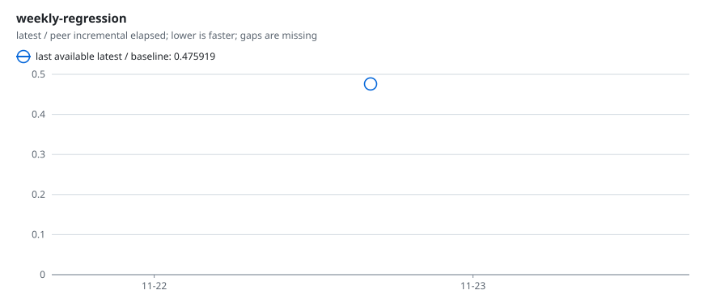
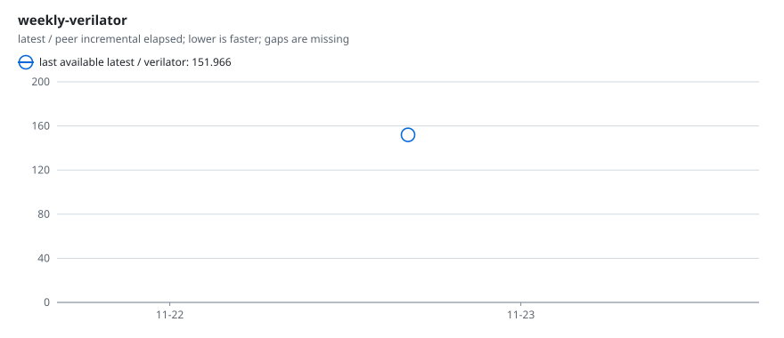
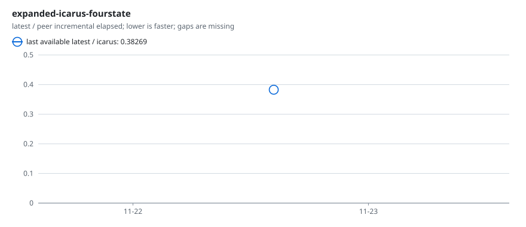
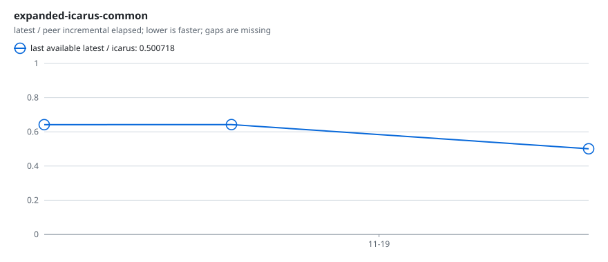
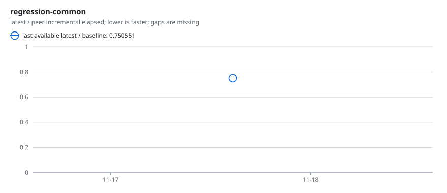
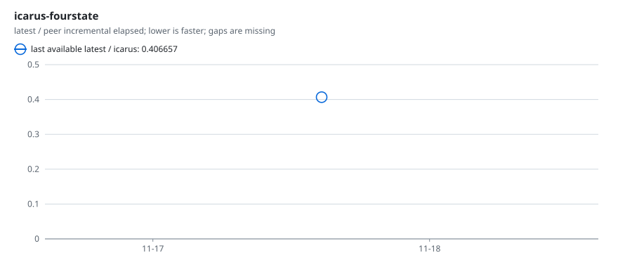
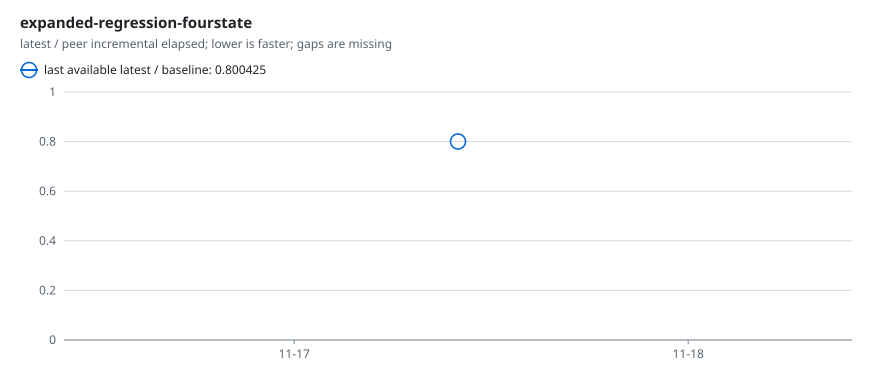
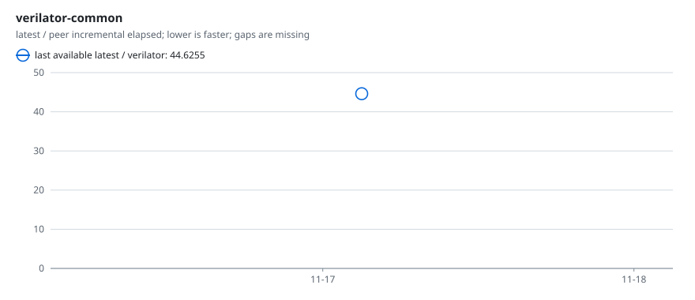

# 日次・週次シミュレーション速度ベンチマーク

[English](README.md) / [日本語](README.ja.md)

機能テストのNightlyとは独立しています。GitHub標準ランナーの値は参考値で、5回の測定から統計的有意性を断言しません。


日次25種類（共通22＋4値3）の等重み幾何平均です。比率はkirimasim÷Icarus 14.0 develの差分所要時間。0.97は所要時間が3%短い意味で、小さいほど高速です。

両開発版のコミットを測定開始時に一度解決します。JSTの各日の最後の正式測定を使い、1種類でも無効なら総合値は欠測です。環境・定義ごとに線を分けます。双方の変更が推移に影響するため、固定版との比較も下に残します。

[JSON](headline.json) · [Method / 測定方法](https://github.com/kurochan001/kirimasim-tests/blob/main/docs/daily-benchmark.md)

最新の総合測定: **2026-11-23 JST — 0.60902** (25/25; complete)

[Raw / 生データ](runs/actions-45091454959-1.json) · [Actions logs / ログ](https://github.com/kurochan001/kirimasim-tests/actions/runs/45091454959/attempts/1)

<details><summary>ケース別結果・固定版との比較・過去の系列</summary>

## 最新の日次測定

[JSON](latest-daily.json)

**測定回:** `actions-45091454959-1` — complete
2026-11-23T02:20:58.341830+00:00 → 2026-11-23T03:36:46.831778+00:00

比率は最新kirimasimの差分時間÷比較対象の差分時間です。1未満なら最新kirimasimが速いことを示します。

この環境での参考値です。失敗・欠測はゼロ秒ではありません。

[JSON](runs/actions-45091454959-1.json) · [Actions logs / ログ](https://github.com/kurochan001/kirimasim-tests/actions/runs/45091454959/attempts/1) · [Method / 測定方法](https://github.com/kurochan001/kirimasim-tests/blob/main/docs/daily-benchmark.md)

環境: github-hosted-ubuntu-24.04 / AMD EPYC 7763 64-Core Processor / Linux-7.0.0-1017-azure-x86_64-with-glibc2.39

<details><summary>測定条件</summary>

```json
{
  "machine": {
    "os": "Linux-7.0.0-1017-azure-x86_64-with-glibc2.39",
    "cores": 4,
    "cpu": "AMD EPYC 7763 64-Core Processor",
    "memory_gib": 16,
    "distribution": "Ubuntu 24.04.5 LTS",
    "architecture": "x86_64"
  },
  "compiler": "g++ (Ubuntu 13.3.0-6ubuntu2~24.04.1) 13.3.0",
  "profile": "daily",
  "environment": "github-hosted-ubuntu-24.04",
  "image_os": "ubuntu24",
  "image_version": "20261116.376.1",
  "settings": {
    "runs": 5,
    "warmups": 1,
    "timeout_seconds": 600,
    "short_seconds": 0.05,
    "regression_warning_ratio": 1.15,
    "simulation_threads": 1,
    "waveforms": false,
    "assertions": false,
    "verilator_build_jobs": 1
  },
  "mode": "formal",
  "runs": 5,
  "tool_builds": {
    "latest": {
      "compiler": "g++ (Ubuntu 13.3.0-6ubuntu2~24.04.1) 13.3.0",
      "c_compiler": "gcc (Ubuntu 13.3.0-6ubuntu2~24.04.1) 13.3.0",
      "flags": {
        "CC": "gcc",
        "CXX": "g++",
        "CFLAGS": "",
        "CXXFLAGS": "",
        "preset": "release",
        "cmake": "-O3 -DNDEBUG -ffp-contract=off, no fast-math",
        "make_jobs": 2
      }
    },
    "baseline": {
      "compiler": "g++ (Ubuntu 13.3.0-6ubuntu2~24.04.1) 13.3.0",
      "c_compiler": "gcc (Ubuntu 13.3.0-6ubuntu2~24.04.1) 13.3.0",
      "flags": {
        "CC": "gcc",
        "CXX": "g++",
        "CFLAGS": "",
        "CXXFLAGS": "",
        "preset": "release",
        "cmake": "-O3 -DNDEBUG -ffp-contract=off, no fast-math",
        "make_jobs": 2
      }
    },
    "icarus": {
      "compiler": "g++ (Ubuntu 13.3.0-6ubuntu2~24.04.1) 13.3.0",
      "c_compiler": "gcc (Ubuntu 13.3.0-6ubuntu2~24.04.1) 13.3.0",
      "flags": {
        "CC": "gcc",
        "CXX": "g++",
        "CFLAGS": "",
        "CXXFLAGS": "",
        "preset": "release",
        "cmake": "-O3 -DNDEBUG -ffp-contract=off, no fast-math",
        "make_jobs": 2
      }
    },
    "verilator": {
      "compiler": "g++ (Ubuntu 13.3.0-6ubuntu2~24.04.1) 13.3.0",
      "c_compiler": "gcc (Ubuntu 13.3.0-6ubuntu2~24.04.1) 13.3.0",
      "flags": {
        "CC": "gcc",
        "CXX": "g++",
        "CFLAGS": "",
        "CXXFLAGS": "",
        "preset": "release",
        "cmake": "-O3 -DNDEBUG -ffp-contract=off, no fast-math",
        "make_jobs": 2
      }
    },
    "icarus_devel": {
      "compiler": "g++ (Ubuntu 13.3.0-6ubuntu2~24.04.1) 13.3.0",
      "c_compiler": "gcc (Ubuntu 13.3.0-6ubuntu2~24.04.1) 13.3.0",
      "flags": {
        "CC": "gcc",
        "CXX": "g++",
        "CFLAGS": "",
        "CXXFLAGS": "",
        "preset": "release",
        "cmake": "-O3 -DNDEBUG -ffp-contract=off, no fast-math",
        "make_jobs": 2
      }
    }
  },
  "verilator_options": "--binary --timing --threads 1 --build-jobs 1; default C++ optimization; assertions/tracing off",
  "icarus_options": "-g2012; vvp -n; single process",
  "kirimasim_options": "default four-state; interpreter; no waveform/assertion request"
}
```

</details>

- `latest`: `1d2cac97a4fe89cd231000b9c3f981f2c867da08` — kirimasim 0.1.3 (commit 1d2cac97a4fe), built with GNU 13.3.0
- `baseline`: `cfa2ccd75989c1ebb9ed63303271183377364cf0` — kirimasim 0.1.0 (commit cfa2ccd75989), built with GNU 13.3.0
- `icarus`: `dfeee909ed9f20b4870dd93423156c0170c0e1ff` — Icarus Verilog version 13.0 (stable) (dfeee90-dirty)
- `verilator`: `bbb60a403932a9f695cb6ff001ceb73de6ad9234` — Verilator 5.054 2026-11-01 rev vUNKNOWN-built20261123-bbb60a4
- `icarus_devel`: `8a4ce429e15e712d82067d4747cd9ec67503a0f8` — Icarus Verilog version 14.0 (devel) (8a4ce42)

定義・測定処理の識別情報: `{'config_sha256': '4006a76543b7c88eed78ba128e7459c54ac2ee82a78efdd401ac2d85643bef9b', 'driver_sha256': '0edb91f5cbc17e8d1eec9e77ab4c87fb7dbcf4b9ff57d233c5e94628770ad077', 'comparison_sha256': '2896f429781d5eaff2d0ecec465726de342f840892056d20304d2df179ad6be0', 'history_sha256': 'bda014f86bbbea0bd769b5458656bfda07cbcaec712624cfad17960b10b5c887', 'setup_sha256': 'aa89dd6c7df5268f361f96049069cfe68b524ff93819afc4351fcb557c91d8f9', 'adapter_sha256': '4811f9d50d4a09d8794710296d644350468c49a9579a794f27af42ac9fb6b5bc', 'benchmark_commit': 'cfa2ccd75989c1ebb9ed63303271183377364cf0', 'reference_sha256': {'bench/reference_expanded.py': 'a1196d79efb88425f61cc69ba1d9ec99542f7f5dc41fac2a07ade82090b00f4a', 'bench/reference_fourstate_mix.py': '586fb643e9ef9df9e304df83e04e711aa1b875e6cb4393e6e3c98cd1707b70e1'}}`

| ケース | 処理系 | 状態 | ビルド秒 | T(1)中央値秒 | T(N)中央値秒 | 差分秒 | T(N) MAD秒 | RSS MiB | 最新/対象 | 理由・注意 |
|---|---|---|---:|---:|---:|---:|---:|---:|---:|---|
| casez_struct (N=5000000) | latest | measured | — | 0.005875 | 3.5011 | 3.4952 | 0.0072783 | 29.824 | — |  |
| casez_struct (N=5000000) | baseline | measured | — | 0.0054767 | 7.6974 | 7.6919 | 0.042796 | 28.484 | 0.4544 |  |
| casez_struct (N=5000000) | icarus | measured | 0.0060958 | 0.0038392 | 8.4032 | 8.3994 | 0.0718 | 7.2969 | 0.41613 |  |
| casez_struct (N=5000000) | verilator | measured | 7.081 | 0.0017464 | 0.031224 | 0.029477 | 7.5864e-05 | 3.7734 | 118.57 | short incremental time; sensitive to timing noise |
| casez_struct (N=5000000) | icarus_devel | measured | 0.0053002 | 0.0034817 | 7.7715 | 7.7681 | 0.06322 | 7.4609 | 0.44995 |  |
| comb_chain (N=3000000) | latest | measured | — | 0.0051509 | 6.4393 | 6.4342 | 0.010871 | 29.762 | — |  |
| comb_chain (N=3000000) | baseline | measured | — | 0.0053645 | 22.244 | 22.239 | 0.34693 | 28.535 | 0.28932 |  |
| comb_chain (N=3000000) | icarus | measured | 0.0055063 | 0.003505 | 26.544 | 26.54 | 0.021411 | 7.3906 | 0.24243 |  |
| comb_chain (N=3000000) | verilator | measured | 7.7822 | 0.0017631 | 0.46006 | 0.4583 | 0.00096954 | 3.7227 | 14.039 |  |
| comb_chain (N=3000000) | icarus_devel | measured | 0.0053342 | 0.0035005 | 19.025 | 19.022 | 0.084702 | 7.5078 | 0.33826 |  |
| dyn_queue (N=4000000) | latest | measured | — | 0.0053278 | 6.3178 | 6.3125 | 0.042769 | 29.676 | — |  |
| dyn_queue (N=4000000) | baseline | measured | — | 0.0046598 | 8.7515 | 8.7468 | 0.07018 | 28.367 | 0.72169 |  |
| dyn_queue (N=4000000) | icarus | measured | 0.0063322 | 0.0037997 | 13.92 | 13.916 | 0.05404 | 7.3359 | 0.45361 |  |
| dyn_queue (N=4000000) | verilator | measured | 6.8242 | 0.0017298 | 0.16539 | 0.16366 | 0.00038774 | 3.6875 | 38.572 |  |
| dyn_queue (N=4000000) | icarus_devel | measured | 0.0051717 | 0.0036779 | 13.058 | 13.055 | 0.022314 | 7.5977 | 0.48355 |  |
| fork_join (N=4000000) | latest | measured | — | 0.0052828 | 8.7065 | 8.7012 | 0.04872 | 29.605 | — |  |
| fork_join (N=4000000) | baseline | measured | — | 0.0043725 | 11.637 | 11.633 | 0.078895 | 28.332 | 0.74797 |  |
| fork_join (N=4000000) | icarus | measured | 0.0052502 | 0.0036872 | 12.742 | 12.739 | 0.063435 | 7.3281 | 0.68305 |  |
| fork_join (N=4000000) | verilator | measured | 7.9014 | 0.0017623 | 2.443 | 2.4412 | 0.041156 | 3.7227 | 3.5642 |  |
| fork_join (N=4000000) | icarus_devel | measured | 0.0051561 | 0.0034691 | 9.8889 | 9.8854 | 0.016593 | 7.4648 | 0.8802 |  |
| func_call (N=1500000) | latest | measured | — | 0.0056426 | 6.8114 | 6.8058 | 0.010872 | 29.59 | — |  |
| func_call (N=1500000) | baseline | measured | — | 0.0046024 | 11.07 | 11.065 | 0.096675 | 28.492 | 0.61505 |  |
| func_call (N=1500000) | icarus | measured | 0.0053957 | 0.0036641 | 20.946 | 20.942 | 0.023555 | 7.2852 | 0.32498 |  |
| func_call (N=1500000) | verilator | measured | 6.6586 | 0.0017569 | 0.011381 | 0.009624 | 4.9146e-05 | 3.7109 | 707.17 | short incremental time; sensitive to timing noise |
| func_call (N=1500000) | icarus_devel | measured | 0.0052121 | 0.0034444 | 16.636 | 16.632 | 0.21865 | 7.4805 | 0.40919 |  |
| gate_udp (N=400000) | latest | measured | — | 0.0083425 | 7.3706 | 7.3623 | 0.020985 | 33.652 | — |  |
| gate_udp (N=400000) | baseline | measured | — | 0.006711 | 12.912 | 12.905 | 0.054444 | 28.441 | 0.57048 |  |
| gate_udp (N=400000) | icarus | measured | 0.0082297 | 0.0050118 | 6.3392 | 6.3341 | 0.032537 | 7.3633 | 1.1623 |  |
| gate_udp (N=400000) | verilator | measured | 7.8188 | 0.0017395 | 0.090473 | 0.088734 | 0.00028465 | 3.7266 | 82.971 |  |
| gate_udp (N=400000) | icarus_devel | measured | 0.0071107 | 0.0047681 | 6.0499 | 6.0451 | 0.034886 | 7.582 | 1.2179 |  |
| mem_rw (N=4000000) | latest | measured | — | 0.0070798 | 5.6623 | 5.6552 | 0.032634 | 29.594 | — |  |
| mem_rw (N=4000000) | baseline | measured | — | 0.0074346 | 11.516 | 11.508 | 0.14766 | 28.457 | 0.4914 |  |
| mem_rw (N=4000000) | icarus | measured | 0.0067244 | 0.0043918 | 8.7299 | 8.7256 | 0.045581 | 7.375 | 0.64812 |  |
| mem_rw (N=4000000) | verilator | measured | 7.9721 | 0.0018107 | 1.3514 | 1.3496 | 0.00021365 | 3.7305 | 4.1903 |  |
| mem_rw (N=4000000) | icarus_devel | measured | 0.0053335 | 0.0044594 | 6.7634 | 6.759 | 0.031199 | 7.5391 | 0.8367 |  |
| nba_burst (N=500000) | latest | measured | — | 0.0048416 | 0.11548 | 0.11064 | 0.00025993 | 133.69 | — |  |
| nba_burst (N=500000) | baseline | measured | — | 0.0044521 | 0.21727 | 0.21281 | 0.001305 | 124.55 | 0.51988 |  |
| nba_burst (N=500000) | icarus | measured | 0.0062637 | 0.0032485 | 0.24019 | 0.23694 | 0.0015699 | 33.773 | 0.46693 |  |
| nba_burst (N=500000) | verilator | measured | 7.8558 | 0.0017256 | 0.0021641 | 0.00043856 | 4.8e-05 | 0.55859 | 252.27 | short incremental time; sensitive to timing noise |
| nba_burst (N=500000) | icarus_devel | measured | 0.0052439 | 0.0033258 | 0.24024 | 0.23691 | 0.0019938 | 33.969 | 0.46699 |  |
| nba_shift (N=1000000) | latest | measured | — | 0.0065554 | 20.326 | 20.32 | 0.043773 | 31.691 | — |  |
| nba_shift (N=1000000) | baseline | measured | — | 0.0056927 | 54.822 | 54.817 | 0.42992 | 28.48 | 0.37069 |  |
| nba_shift (N=1000000) | icarus | measured | 0.0088852 | 0.0042441 | 49.43 | 49.426 | 0.32833 | 7.4062 | 0.41111 |  |
| nba_shift (N=1000000) | verilator | measured | 8.0815 | 0.0017961 | 0.42249 | 0.42069 | 0.0044578 | 3.6992 | 48.301 |  |
| nba_shift (N=1000000) | icarus_devel | measured | 0.0059649 | 0.0041857 | 49.772 | 49.768 | 0.052282 | 7.625 | 0.40829 |  |
| proc_wait (N=1000000) | latest | measured | — | 0.01194 | 8.9494 | 8.9375 | 0.032789 | 39.703 | — |  |
| proc_wait (N=1000000) | baseline | measured | — | 0.0078351 | 19.319 | 19.311 | 0.054487 | 30.355 | 0.46281 |  |
| proc_wait (N=1000000) | icarus | measured | 0.01105 | 0.0054355 | 10.278 | 10.273 | 0.034246 | 7.7539 | 0.87003 |  |
| proc_wait (N=1000000) | verilator | measured | 10.37 | 0.0018474 | 4.1244 | 4.1226 | 0.020796 | 3.8594 | 2.1679 |  |
| proc_wait (N=1000000) | icarus_devel | measured | 0.0071854 | 0.0051704 | 10.196 | 10.191 | 0.0086997 | 8.0352 | 0.87697 |  |
| string_fmt (N=500000) | latest | measured | — | 0.004982 | 4.9156 | 4.9106 | 0.0075429 | 29.539 | — |  |
| string_fmt (N=500000) | baseline | measured | — | 0.004661 | 9.1256 | 9.1209 | 0.0092617 | 28.348 | 0.53839 |  |
| string_fmt (N=500000) | icarus | measured | 0.0063119 | 0.0037722 | 20.249 | 20.246 | 0.061267 | 7.3945 | 0.24255 |  |
| string_fmt (N=500000) | verilator | measured | 6.6695 | 0.0017913 | 0.28709 | 0.2853 | 0.0017623 | 3.8281 | 17.212 |  |
| string_fmt (N=500000) | icarus_devel | measured | 0.0050759 | 0.003634 | 17.076 | 17.072 | 0.06456 | 7.4805 | 0.28763 |  |
| wide_arith (N=1500000) | latest | measured | — | 0.0054502 | 3.968 | 3.9626 | 0.0065956 | 29.781 | — |  |
| wide_arith (N=1500000) | baseline | measured | — | 0.0059531 | 9.466 | 9.46 | 0.015116 | 28.344 | 0.41887 |  |
| wide_arith (N=1500000) | icarus | measured | 0.0074331 | 0.0037393 | 16.046 | 16.043 | 0.037805 | 7.2695 | 0.247 |  |
| wide_arith (N=1500000) | verilator | measured | 6.891 | 0.0017883 | 0.14503 | 0.14325 | 5.829e-05 | 3.707 | 27.663 |  |
| wide_arith (N=1500000) | icarus_devel | measured | 0.0052224 | 0.0034597 | 4.1815 | 4.1781 | 0.048076 | 7.4062 | 0.94843 |  |
| fourstate_mix (N=1000000) | latest | measured | — | 0.0057922 | 1.2209 | 1.2151 | 0.011341 | 29.762 | — |  |
| fourstate_mix (N=1000000) | baseline | measured | — | 0.0052777 | 2.7622 | 2.7569 | 0.0092636 | 28.523 | 0.44075 |  |
| fourstate_mix (N=1000000) | icarus | measured | 0.0056036 | 0.00376 | 4.24 | 4.2363 | 0.038611 | 7.2891 | 0.28684 |  |
| fourstate_mix (N=1000000) | verilator | unsupported | — | — | — | — | — | — | — | X/Z observations require four-state semantics; excluded before execution |
| fourstate_mix (N=1000000) | icarus_devel | measured | 0.0053513 | 0.0037006 | 3.0706 | 3.0669 | 0.011458 | 7.5156 | 0.3962 |  |
| fifo_stream (N=200000) | latest | measured | — | 0.0052631 | 0.61635 | 0.61108 | 0.0025694 | 29.832 | — |  |
| fifo_stream (N=200000) | baseline | measured | — | 0.0056161 | 1.2407 | 1.235 | 0.016151 | 28.48 | 0.49479 |  |
| fifo_stream (N=200000) | icarus | measured | 0.0061256 | 0.0037682 | 0.76225 | 0.75848 | 0.0031718 | 7.3477 | 0.80567 |  |
| fifo_stream (N=200000) | verilator | measured | 7.7738 | 0.0017276 | 0.096905 | 0.095177 | 0.00089584 | 3.7266 | 6.4205 |  |
| fifo_stream (N=200000) | icarus_devel | measured | 0.005651 | 0.0033405 | 0.67641 | 0.67307 | 0.0038151 | 7.5312 | 0.9079 |  |
| uart_loopback (N=20000) | latest | measured | — | 0.0065455 | 0.6317 | 0.62515 | 0.0041682 | 31.699 | — |  |
| uart_loopback (N=20000) | baseline | measured | — | 0.0053131 | 1.1509 | 1.1456 | 0.0036708 | 28.484 | 0.54569 |  |
| uart_loopback (N=20000) | icarus | measured | 0.0062898 | 0.0039874 | 0.48913 | 0.48514 | 0.0011745 | 7.3789 | 1.2886 |  |
| uart_loopback (N=20000) | verilator | measured | 7.8923 | 0.0016952 | 0.11095 | 0.10925 | 0.00051333 | 3.6953 | 5.7222 |  |
| uart_loopback (N=20000) | icarus_devel | measured | 0.0056474 | 0.0037754 | 0.43779 | 0.43402 | 0.0039952 | 7.5117 | 1.4404 |  |
| bus_fabric (N=150000) | latest | measured | — | 0.0073965 | 1.4141 | 1.4067 | 0.0040905 | 31.777 | — |  |
| bus_fabric (N=150000) | baseline | measured | — | 0.0054795 | 3.4759 | 3.4704 | 0.063719 | 28.539 | 0.40533 |  |
| bus_fabric (N=150000) | icarus | measured | 0.0063733 | 0.0042955 | 1.0409 | 1.0366 | 0.0073408 | 7.4375 | 1.3569 |  |
| bus_fabric (N=150000) | verilator | measured | 7.8314 | 0.0017424 | 0.12495 | 0.12321 | 0.00060736 | 3.6953 | 11.417 |  |
| bus_fabric (N=150000) | icarus_devel | measured | 0.0061116 | 0.0040177 | 0.99071 | 0.98669 | 0.0017995 | 7.5469 | 1.4256 |  |
| hierarchy_fanout (N=100000) | latest | measured | — | 0.0165 | 8.0517 | 8.0352 | 0.011363 | 47.551 | — |  |
| hierarchy_fanout (N=100000) | baseline | measured | — | 0.011903 | 20.402 | 20.39 | 0.088734 | 36.379 | 0.39407 |  |
| hierarchy_fanout (N=100000) | icarus | measured | 0.012691 | 0.013205 | 31.354 | 31.341 | 0.0094557 | 8.2188 | 0.25638 |  |
| hierarchy_fanout (N=100000) | verilator | measured | 7.7918 | 0.0017837 | 0.063799 | 0.062015 | 0.00020851 | 3.7266 | 129.57 |  |
| hierarchy_fanout (N=100000) | icarus_devel | measured | 0.013083 | 0.012909 | 11.383 | 11.37 | 0.041858 | 8.4219 | 0.70668 |  |
| event_fanout (N=50000) | latest | measured | — | 0.024518 | 3.8736 | 3.849 | 0.032811 | 49.75 | — |  |
| event_fanout (N=50000) | baseline | measured | — | 0.016074 | 5.1197 | 5.1036 | 0.0067072 | 42.488 | 0.75418 |  |
| event_fanout (N=50000) | icarus | measured | 0.017583 | 0.010883 | 4.3349 | 4.324 | 0.0087235 | 9.0156 | 0.89015 |  |
| event_fanout (N=50000) | verilator | measured | 8.2767 | 0.001781 | 0.093622 | 0.091841 | 0.0018041 | 3.7148 | 41.91 |  |
| event_fanout (N=50000) | icarus_devel | measured | 0.014061 | 0.010857 | 4.3399 | 4.3291 | 0.0075169 | 9.2344 | 0.88911 |  |
| word_boundary (N=4000000) | latest | measured | — | 0.0051104 | 6.8371 | 6.832 | 0.023567 | 29.547 | — |  |
| word_boundary (N=4000000) | baseline | measured | — | 0.0063524 | 13.883 | 13.877 | 0.064884 | 28.422 | 0.49233 |  |
| word_boundary (N=4000000) | icarus | measured | 0.0068614 | 0.0038429 | 28.522 | 28.518 | 0.09543 | 7.2773 | 0.23956 |  |
| word_boundary (N=4000000) | verilator | measured | 6.7485 | 0.0018519 | 0.076321 | 0.074469 | 0.00013573 | 3.7109 | 91.743 |  |
| word_boundary (N=4000000) | icarus_devel | measured | 0.0051668 | 0.0037574 | 11.949 | 11.945 | 0.025511 | 7.4727 | 0.57194 |  |
| wide_divide (N=80000) | latest | measured | — | 0.0054039 | 0.20196 | 0.19656 | 0.0019369 | 29.742 | — |  |
| wide_divide (N=80000) | baseline | measured | — | 0.0056041 | 1.5638 | 1.5582 | 0.0043367 | 28.512 | 0.12614 |  |
| wide_divide (N=80000) | icarus | measured | 0.006991 | 0.0034925 | 1.2737 | 1.2702 | 0.0043141 | 7.3398 | 0.15475 |  |
| wide_divide (N=80000) | verilator | measured | 6.7727 | 0.0017428 | 0.012642 | 0.010899 | 0.00018357 | 3.7109 | 18.034 | short incremental time; sensitive to timing noise |
| wide_divide (N=80000) | icarus_devel | measured | 0.005218 | 0.0033227 | 0.74881 | 0.74549 | 0.0020618 | 7.4531 | 0.26366 |  |
| packed_slice (N=1500000) | latest | measured | — | 0.0050566 | 2.657 | 2.6519 | 0.025719 | 29.762 | — |  |
| packed_slice (N=1500000) | baseline | measured | — | 0.0055734 | 7.7833 | 7.7777 | 0.016442 | 28.391 | 0.34096 |  |
| packed_slice (N=1500000) | icarus | measured | 0.0058177 | 0.0037522 | 11.406 | 11.402 | 0.17232 | 7.2812 | 0.23257 |  |
| packed_slice (N=1500000) | verilator | measured | 6.6923 | 0.0017826 | 0.10579 | 0.10401 | 0.0016418 | 3.7031 | 25.497 |  |
| packed_slice (N=1500000) | icarus_devel | measured | 0.0051559 | 0.0036324 | 4.5938 | 4.5901 | 0.023215 | 7.4453 | 0.57774 |  |
| memory_scatter (N=5000000) | latest | measured | — | 0.060951 | 3.5184 | 3.4575 | 0.0039516 | 43.703 | — |  |
| memory_scatter (N=5000000) | baseline | measured | — | 0.070314 | 8.133 | 8.0627 | 0.037296 | 42.48 | 0.42882 |  |
| memory_scatter (N=5000000) | icarus | measured | 0.0054187 | 0.033824 | 15.926 | 15.893 | 0.027381 | 7.8555 | 0.21755 |  |
| memory_scatter (N=5000000) | verilator | measured | 6.7137 | 0.0019717 | 0.018566 | 0.016594 | 9.2898e-05 | 3.8398 | 208.35 | short incremental time; sensitive to timing noise |
| memory_scatter (N=5000000) | icarus_devel | measured | 0.005314 | 0.02289 | 9.9686 | 9.9457 | 0.0306 | 7.9648 | 0.34763 |  |
| clock_domains (N=20000) | latest | measured | — | 0.0048719 | 0.18083 | 0.17595 | 0.002987 | 29.746 | — |  |
| clock_domains (N=20000) | baseline | measured | — | 0.0057726 | 0.36233 | 0.35656 | 0.0021611 | 28.453 | 0.49348 |  |
| clock_domains (N=20000) | icarus | measured | 0.0065208 | 0.0036712 | 0.15515 | 0.15148 | 0.0016149 | 7.3164 | 1.1616 |  |
| clock_domains (N=20000) | verilator | measured | 8.04 | 0.0017896 | 0.1027 | 0.10091 | 0.00033277 | 3.7188 | 1.7438 |  |
| clock_domains (N=20000) | icarus_devel | measured | 0.0051591 | 0.0035108 | 0.15575 | 0.15224 | 0.00068591 | 7.4922 | 1.1558 |  |
| fourstate_arith (N=100000) | latest | measured | — | 0.0054637 | 0.17454 | 0.16907 | 0.00088742 | 29.766 | — |  |
| fourstate_arith (N=100000) | baseline | measured | — | 0.0055673 | 0.24701 | 0.24144 | 0.0019333 | 28.609 | 0.70028 |  |
| fourstate_arith (N=100000) | icarus | measured | 0.0062224 | 0.0037613 | 0.32536 | 0.3216 | 0.00029525 | 7.25 | 0.52572 |  |
| fourstate_arith (N=100000) | verilator | unsupported | — | — | — | — | — | — | — | X/Z observations require four-state semantics; excluded before execution |
| fourstate_arith (N=100000) | icarus_devel | measured | 0.0051606 | 0.0032267 | 0.30436 | 0.30113 | 0.0016609 | 7.4258 | 0.56147 |  |
| resolved_bus (N=50000) | latest | measured | — | 0.0056399 | 0.2363 | 0.23066 | 0.0042875 | 29.758 | — |  |
| resolved_bus (N=50000) | baseline | measured | — | 0.0057312 | 0.52645 | 0.52072 | 0.00047116 | 28.535 | 0.44296 |  |
| resolved_bus (N=50000) | icarus | measured | 0.0065926 | 0.0039523 | 0.62455 | 0.6206 | 0.00083051 | 7.3125 | 0.37167 |  |
| resolved_bus (N=50000) | verilator | unsupported | — | — | — | — | — | — | — | X/Z observations require four-state semantics; excluded before execution |
| resolved_bus (N=50000) | icarus_devel | measured | 0.0054975 | 0.0040005 | 0.63201 | 0.62801 | 0.0038457 | 7.4688 | 0.36728 |  |

固定した総合値の集合（全ケースの有効値が必要です）：

- **regression-common**: 0.50033; 12/12; casez_struct, comb_chain, dyn_queue, fork_join, func_call, gate_udp, mem_rw, nba_burst, nba_shift, proc_wait, string_fmt, wide_arith
- **regression-fourstate**: 0.44075; 1/1; fourstate_mix
- **icarus-common**: 0.45395; 12/12; casez_struct, comb_chain, dyn_queue, fork_join, func_call, gate_udp, mem_rw, nba_burst, nba_shift, proc_wait, string_fmt, wide_arith
- **icarus-fourstate**: 0.28684; 1/1; fourstate_mix
- **verilator-common**: 30.725; 12/12; casez_struct, comb_chain, dyn_queue, fork_join, func_call, gate_udp, mem_rw, nba_burst, nba_shift, proc_wait, string_fmt, wide_arith
- **expanded-regression-common**: 0.45875; 22/22; casez_struct, comb_chain, dyn_queue, fork_join, func_call, gate_udp, mem_rw, nba_burst, nba_shift, proc_wait, string_fmt, wide_arith, fifo_stream, uart_loopback, bus_fabric, hierarchy_fanout, event_fanout, word_boundary, wide_divide, packed_slice, memory_scatter, clock_domains
- **expanded-regression-fourstate**: 0.51516; 3/3; fourstate_mix, fourstate_arith, resolved_bus
- **expanded-icarus-common**: 0.46722; 22/22; casez_struct, comb_chain, dyn_queue, fork_join, func_call, gate_udp, mem_rw, nba_burst, nba_shift, proc_wait, string_fmt, wide_arith, fifo_stream, uart_loopback, bus_fabric, hierarchy_fanout, event_fanout, word_boundary, wide_divide, packed_slice, memory_scatter, clock_domains
- **expanded-icarus-fourstate**: 0.38269; 3/3; fourstate_mix, fourstate_arith, resolved_bus
- **expanded-verilator-common**: 26.727; 22/22; casez_struct, comb_chain, dyn_queue, fork_join, func_call, gate_udp, mem_rw, nba_burst, nba_shift, proc_wait, string_fmt, wide_arith, fifo_stream, uart_loopback, bus_fabric, hierarchy_fanout, event_fanout, word_boundary, wide_divide, packed_slice, memory_scatter, clock_domains
- **daily-overall-icarus14**: 0.60902; 25/25; casez_struct, comb_chain, dyn_queue, fork_join, func_call, gate_udp, mem_rw, nba_burst, nba_shift, proc_wait, string_fmt, wide_arith, fourstate_mix, fifo_stream, uart_loopback, bus_fabric, hierarchy_fanout, event_fanout, word_boundary, wide_divide, packed_slice, memory_scatter, clock_domains, fourstate_arith, resolved_bus
## 最新の週次測定

[JSON](latest-weekly.json)

**測定回:** `actions-45109202660-1` — complete
2026-11-23T04:17:20.572534+00:00 → 2026-11-23T04:54:00.119674+00:00

比率は最新kirimasimの差分時間÷比較対象の差分時間です。1未満なら最新kirimasimが速いことを示します。

この環境での参考値です。失敗・欠測はゼロ秒ではありません。

[JSON](runs/actions-45109202660-1.json) · [Actions logs / ログ](https://github.com/kurochan001/kirimasim-tests/actions/runs/45109202660/attempts/1) · [Method / 測定方法](https://github.com/kurochan001/kirimasim-tests/blob/main/docs/daily-benchmark.md)

環境: github-hosted-ubuntu-24.04 / AMD EPYC 9V74 80-Core Processor / Linux-7.0.0-1017-azure-x86_64-with-glibc2.39

<details><summary>測定条件</summary>

```json
{
  "machine": {
    "os": "Linux-7.0.0-1017-azure-x86_64-with-glibc2.39",
    "cores": 4,
    "cpu": "AMD EPYC 9V74 80-Core Processor",
    "memory_gib": 16,
    "distribution": "Ubuntu 24.04.5 LTS",
    "architecture": "x86_64"
  },
  "compiler": "g++ (Ubuntu 13.3.0-6ubuntu2~24.04.1) 13.3.0",
  "profile": "weekly",
  "environment": "github-hosted-ubuntu-24.04",
  "image_os": "ubuntu24",
  "image_version": "20261116.376.1",
  "settings": {
    "runs": 5,
    "warmups": 1,
    "timeout_seconds": 600,
    "short_seconds": 0.05,
    "regression_warning_ratio": 1.15,
    "simulation_threads": 1,
    "waveforms": false,
    "assertions": false,
    "verilator_build_jobs": 1
  },
  "mode": "formal",
  "runs": 5,
  "tool_builds": {
    "latest": {
      "compiler": "g++ (Ubuntu 13.3.0-6ubuntu2~24.04.1) 13.3.0",
      "c_compiler": "gcc (Ubuntu 13.3.0-6ubuntu2~24.04.1) 13.3.0",
      "flags": {
        "CC": "gcc",
        "CXX": "g++",
        "CFLAGS": "",
        "CXXFLAGS": "",
        "preset": "release",
        "cmake": "-O3 -DNDEBUG -ffp-contract=off, no fast-math",
        "make_jobs": 2
      }
    },
    "baseline": {
      "compiler": "g++ (Ubuntu 13.3.0-6ubuntu2~24.04.1) 13.3.0",
      "c_compiler": "gcc (Ubuntu 13.3.0-6ubuntu2~24.04.1) 13.3.0",
      "flags": {
        "CC": "gcc",
        "CXX": "g++",
        "CFLAGS": "",
        "CXXFLAGS": "",
        "preset": "release",
        "cmake": "-O3 -DNDEBUG -ffp-contract=off, no fast-math",
        "make_jobs": 2
      }
    },
    "icarus": {
      "compiler": "g++ (Ubuntu 13.3.0-6ubuntu2~24.04.1) 13.3.0",
      "c_compiler": "gcc (Ubuntu 13.3.0-6ubuntu2~24.04.1) 13.3.0",
      "flags": {
        "CC": "gcc",
        "CXX": "g++",
        "CFLAGS": "",
        "CXXFLAGS": "",
        "preset": "release",
        "cmake": "-O3 -DNDEBUG -ffp-contract=off, no fast-math",
        "make_jobs": 2
      }
    },
    "verilator": {
      "compiler": "g++ (Ubuntu 13.3.0-6ubuntu2~24.04.1) 13.3.0",
      "c_compiler": "gcc (Ubuntu 13.3.0-6ubuntu2~24.04.1) 13.3.0",
      "flags": {
        "CC": "gcc",
        "CXX": "g++",
        "CFLAGS": "",
        "CXXFLAGS": "",
        "preset": "release",
        "cmake": "-O3 -DNDEBUG -ffp-contract=off, no fast-math",
        "make_jobs": 2
      }
    },
    "icarus_devel": {
      "compiler": "g++ (Ubuntu 13.3.0-6ubuntu2~24.04.1) 13.3.0",
      "c_compiler": "gcc (Ubuntu 13.3.0-6ubuntu2~24.04.1) 13.3.0",
      "flags": {
        "CC": "gcc",
        "CXX": "g++",
        "CFLAGS": "",
        "CXXFLAGS": "",
        "preset": "release",
        "cmake": "-O3 -DNDEBUG -ffp-contract=off, no fast-math",
        "make_jobs": 2
      }
    }
  },
  "verilator_options": "--binary --timing --threads 1 --build-jobs 1; default C++ optimization; assertions/tracing off",
  "icarus_options": "-g2012; vvp -n; single process",
  "kirimasim_options": "default four-state; interpreter; no waveform/assertion request"
}
```

</details>

- `latest`: `378a66ab3240edf824a1b59f10697ecff3efa441` — kirimasim 0.2.0 (commit 378a66ab3240), built with GNU 13.3.0
- `baseline`: `cfa2ccd75989c1ebb9ed63303271183377364cf0` — kirimasim 0.1.0 (commit cfa2ccd75989), built with GNU 13.3.0
- `icarus`: `dfeee909ed9f20b4870dd93423156c0170c0e1ff` — Icarus Verilog version 13.0 (stable) (dfeee90-dirty)
- `verilator`: `bbb60a403932a9f695cb6ff001ceb73de6ad9234` — Verilator 5.054 2026-11-01 rev vUNKNOWN-built20261123-bbb60a4
- `icarus_devel`: `8a4ce429e15e712d82067d4747cd9ec67503a0f8` — Icarus Verilog version 14.0 (devel) (8a4ce42)

定義・測定処理の識別情報: `{'config_sha256': '4006a76543b7c88eed78ba128e7459c54ac2ee82a78efdd401ac2d85643bef9b', 'driver_sha256': '0edb91f5cbc17e8d1eec9e77ab4c87fb7dbcf4b9ff57d233c5e94628770ad077', 'comparison_sha256': '2896f429781d5eaff2d0ecec465726de342f840892056d20304d2df179ad6be0', 'history_sha256': 'bda014f86bbbea0bd769b5458656bfda07cbcaec712624cfad17960b10b5c887', 'setup_sha256': 'aa89dd6c7df5268f361f96049069cfe68b524ff93819afc4351fcb557c91d8f9', 'adapter_sha256': '4811f9d50d4a09d8794710296d644350468c49a9579a794f27af42ac9fb6b5bc', 'benchmark_commit': 'cfa2ccd75989c1ebb9ed63303271183377364cf0', 'reference_sha256': {'bench/reference_expanded.py': 'a1196d79efb88425f61cc69ba1d9ec99542f7f5dc41fac2a07ade82090b00f4a', 'bench/reference_fourstate_mix.py': '586fb643e9ef9df9e304df83e04e711aa1b875e6cb4393e6e3c98cd1707b70e1'}}`

| ケース | 処理系 | 状態 | ビルド秒 | T(1)中央値秒 | T(N)中央値秒 | 差分秒 | T(N) MAD秒 | RSS MiB | 最新/対象 | 理由・注意 |
|---|---|---|---:|---:|---:|---:|---:|---:|---:|---|
| large_hierarchy (N=20000) | latest | measured | — | 0.17569 | 18.079 | 17.903 | 0.11446 | 129.63 | — |  |
| large_hierarchy (N=20000) | baseline | measured | — | 0.10914 | 28.952 | 28.843 | 0.16433 | 108.25 | 0.62071 |  |
| large_hierarchy (N=20000) | icarus | measured | 0.13305 | 0.087124 | 74.086 | 73.998 | 0.1766 | 23.039 | 0.24194 |  |
| large_hierarchy (N=20000) | verilator | measured | 11.83 | 0.0016562 | 0.080178 | 0.078522 | 0.0018308 | 3.9258 | 228 |  |
| large_hierarchy (N=20000) | icarus_devel | measured | 0.13914 | 0.085931 | 12.41 | 12.324 | 0.021666 | 23.316 | 1.4527 |  |
| large_memory (N=500000) | latest | measured | — | 0.054258 | 13.588 | 13.534 | 0.15501 | 45.887 | — |  |
| large_memory (N=500000) | baseline | measured | — | 0.11138 | 31.854 | 31.742 | 0.1146 | 44.395 | 0.42637 |  |
| large_memory (N=500000) | icarus | measured | 0.004978 | 0.17122 | 49.224 | 49.053 | 0.044034 | 11.359 | 0.27591 |  |
| large_memory (N=500000) | verilator | measured | 6.1891 | 0.0023293 | 0.10887 | 0.10654 | 0.00023025 | 4.8125 | 127.03 |  |
| large_memory (N=500000) | icarus_devel | measured | 0.0047116 | 0.11654 | 41.1 | 40.984 | 0.21041 | 11.496 | 0.33023 |  |
| stream_pipeline (N=250000) | latest | measured | — | 0.0073843 | 11.884 | 11.877 | 0.047667 | 33.652 | — |  |
| stream_pipeline (N=250000) | baseline | measured | — | 0.0069906 | 29.166 | 29.16 | 0.1411 | 28.242 | 0.40731 |  |
| stream_pipeline (N=250000) | icarus | measured | 0.0075874 | 0.0052828 | 66.983 | 66.978 | 0.043374 | 7.5469 | 0.17733 |  |
| stream_pipeline (N=250000) | verilator | measured | 6.2715 | 0.0016095 | 0.099629 | 0.098019 | 0.00060947 | 3.832 | 121.17 |  |
| stream_pipeline (N=250000) | icarus_devel | measured | 0.0058586 | 0.0052535 | 54.677 | 54.672 | 0.092473 | 7.7383 | 0.21724 |  |

固定した総合値の集合（全ケースの有効値が必要です）：

- **weekly-regression**: 0.47592; 3/3; large_hierarchy, large_memory, stream_pipeline
- **weekly-icarus**: 0.2279; 3/3; large_hierarchy, large_memory, stream_pipeline
- **weekly-verilator**: 151.97; 3/3; large_hierarchy, large_memory, stream_pipeline
- **weekly-icarus14-common**: 0.47059; 3/3; large_hierarchy, large_memory, stream_pipeline

## 環境・定義別の推移

### `ce6cd82e24d95f55`

1 runs; 2026-11-23T04:17:20.572534+00:00 → 2026-11-23T04:17:20.572534+00:00

測定定義: `weekly-v2-icarus14`; ケース数: **3**







失敗を含む各回：

- [actions-45109202660-1](runs/actions-45109202660-1.json): complete — `378a66ab3240`
### `39bb1735b0601635`

1 runs; 2026-11-23T02:20:58.341830+00:00 → 2026-11-23T02:20:58.341830+00:00

測定定義: `daily-v4-icarus14`; ケース数: **25**





失敗を含む各回：

- [actions-45091454959-1](runs/actions-45091454959-1.json): complete — `1d2cac97a4fe`
### `341b44a021dff5eb`

2 runs; 2026-11-21T02:30:14.755165+00:00 → 2026-11-22T00:44:24.628416+00:00

測定定義: `daily-v4-icarus14`; ケース数: **25**


失敗を含む各回：

- [actions-44966152659-1](runs/actions-44966152659-1.json): complete — `ad004a67d861`
- [actions-44850710627-1](runs/actions-44850710627-1.json): complete — `256839f71089`
### `cc3a300591d180c9`

3 runs; 2026-11-18T13:42:55.941756+00:00 → 2026-11-20T01:57:13.586055+00:00

測定定義: `daily-v4-icarus14`; ケース数: **25**





失敗を含む各回：

- [actions-44656096600-1](runs/actions-44656096600-1.json): complete — `cb97fc93bf6b`
- [actions-44440143026-1](runs/actions-44440143026-1.json): incomplete — `a6222f0656d4`
- [actions-44311501813-1](runs/actions-44311501813-1.json): complete — `441dddbd0fcd`
### `25a1c78c12d65db9`

1 runs; 2026-11-18T02:38:15.609997+00:00 → 2026-11-18T02:38:15.609997+00:00

測定定義: `daily-v3-expanded`; ケース数: **25**







失敗を含む各回：

- [actions-44223268236-1](runs/actions-44223268236-1.json): complete — `441dddbd0fcd`
### `079515db5b1afbed`

1 runs; 2026-11-17T22:58:29.331708+00:00 → 2026-11-17T22:58:29.331708+00:00

測定定義: `weekly-v1-scale`; ケース数: **3**


失敗を含む各回：

- [actions-44186811554-1](runs/actions-44186811554-1.json): complete — `441dddbd0fcd`
### `ff82f2d3ef6ff628`

1 runs; 2026-11-17T21:58:35.859990+00:00 → 2026-11-17T21:58:35.859990+00:00

測定定義: `daily-v3-expanded`; ケース数: **25**





失敗を含む各回：

- [actions-44183926839-1](runs/actions-44183926839-1.json): complete — `234f65f6b205`
### `962ea28f5124b999`

1 runs; 2026-11-17T15:00:17.437065+00:00 → 2026-11-17T15:00:17.437065+00:00

測定定義: `daily-v2-thirteen`; ケース数: **13**




失敗を含む各回：

- [actions-44103555558-1](runs/actions-44103555558-1.json): complete — `13d52dde3c49`
### `ff134f2dfe29a369`

1 runs; 2026-11-17T13:04:45.723115+00:00 → 2026-11-17T13:04:45.723115+00:00

測定定義: `daily-v1`; ケース数: **5**


失敗を含む各回：

- [actions-44085771320-1](runs/actions-44085771320-1.json): complete — `26f359bcd504`

<!-- holdout-start -->

## 最新の別枠の測定（報告のみ）

日次・週次の集合に入らない設計で、週に1回測ります。kirimasimの最適化の判断には使わず、日次の総合値・headline.json・総合グラフにも入れません。比較の集合には相手が実行できる条件だけを入れ、宣言した非対応は欠測として示します。

[JSON](latest-holdout.json)

**測定回:** `actions-44895777688-1` — complete
2026-11-21T10:52:36.743579+00:00 → 2026-11-21T11:00:32.675678+00:00

比率は最新kirimasimの差分時間÷比較対象の差分時間です。1未満なら最新kirimasimが速いことを示します。

この環境での参考値です。失敗・欠測はゼロ秒ではありません。

[JSON](holdout/runs/actions-44895777688-1.json) · [Actions logs / ログ](https://github.com/kurochan001/kirimasim-tests/actions/runs/44895777688/attempts/1) · [Method / 測定方法](https://github.com/kurochan001/kirimasim-tests/blob/main/docs/daily-benchmark.md)

環境: github-hosted-ubuntu-24.04 / Intel(R) Xeon(R) 6975P-C / Linux-7.0.0-1014-aws-x86_64-with-glibc2.39

<details><summary>測定条件</summary>

```json
{
  "machine": {
    "os": "Linux-7.0.0-1014-aws-x86_64-with-glibc2.39",
    "cores": 4,
    "cpu": "Intel(R) Xeon(R) 6975P-C",
    "memory_gib": 15,
    "distribution": "Ubuntu 24.04.5 LTS",
    "architecture": "x86_64"
  },
  "compiler": "g++ (Ubuntu 13.3.0-6ubuntu2~24.04.1) 13.3.0",
  "profile": "holdout",
  "environment": "github-hosted-ubuntu-24.04",
  "image_os": "ubuntu24",
  "image_version": "20261116.133.1",
  "settings": {
    "runs": 5,
    "warmups": 1,
    "timeout_seconds": 600,
    "short_seconds": 0.05,
    "regression_warning_ratio": 1.15,
    "simulation_threads": 1,
    "waveforms": false,
    "assertions": false,
    "verilator_build_jobs": 1
  },
  "mode": "formal",
  "runs": 5,
  "tool_builds": {
    "latest": {
      "compiler": "g++ (Ubuntu 13.3.0-6ubuntu2~24.04.1) 13.3.0",
      "c_compiler": "gcc (Ubuntu 13.3.0-6ubuntu2~24.04.1) 13.3.0",
      "flags": {
        "CC": "gcc",
        "CXX": "g++",
        "CFLAGS": "",
        "CXXFLAGS": "",
        "preset": "release",
        "cmake": "-O3 -DNDEBUG -ffp-contract=off, no fast-math",
        "make_jobs": 2
      }
    },
    "baseline": {
      "compiler": "g++ (Ubuntu 13.3.0-6ubuntu2~24.04.1) 13.3.0",
      "c_compiler": "gcc (Ubuntu 13.3.0-6ubuntu2~24.04.1) 13.3.0",
      "flags": {
        "CC": "gcc",
        "CXX": "g++",
        "CFLAGS": "",
        "CXXFLAGS": "",
        "preset": "release",
        "cmake": "-O3 -DNDEBUG -ffp-contract=off, no fast-math",
        "make_jobs": 2
      }
    },
    "icarus": {
      "compiler": "g++ (Ubuntu 13.3.0-6ubuntu2~24.04.1) 13.3.0",
      "c_compiler": "gcc (Ubuntu 13.3.0-6ubuntu2~24.04.1) 13.3.0",
      "flags": {
        "CC": "gcc",
        "CXX": "g++",
        "CFLAGS": "",
        "CXXFLAGS": "",
        "preset": "release",
        "cmake": "-O3 -DNDEBUG -ffp-contract=off, no fast-math",
        "make_jobs": 2
      }
    },
    "verilator": {
      "compiler": "g++ (Ubuntu 13.3.0-6ubuntu2~24.04.1) 13.3.0",
      "c_compiler": "gcc (Ubuntu 13.3.0-6ubuntu2~24.04.1) 13.3.0",
      "flags": {
        "CC": "gcc",
        "CXX": "g++",
        "CFLAGS": "",
        "CXXFLAGS": "",
        "preset": "release",
        "cmake": "-O3 -DNDEBUG -ffp-contract=off, no fast-math",
        "make_jobs": 2
      }
    },
    "icarus_devel": {
      "compiler": "g++ (Ubuntu 13.3.0-6ubuntu2~24.04.1) 13.3.0",
      "c_compiler": "gcc (Ubuntu 13.3.0-6ubuntu2~24.04.1) 13.3.0",
      "flags": {
        "CC": "gcc",
        "CXX": "g++",
        "CFLAGS": "",
        "CXXFLAGS": "",
        "preset": "release",
        "cmake": "-O3 -DNDEBUG -ffp-contract=off, no fast-math",
        "make_jobs": 2
      }
    }
  },
  "verilator_options": "--binary --timing --threads 1 --build-jobs 1; default C++ optimization; assertions/tracing off",
  "icarus_options": "-g2012; vvp -n; single process",
  "kirimasim_options": "default four-state; interpreter; no waveform/assertion request"
}
```

</details>

- `latest`: `557aae7ef84f67bb41dd7ac508a94cb00e411b45` — kirimasim 0.1.3 (commit 557aae7ef84f), built with GNU 13.3.0
- `baseline`: `cfa2ccd75989c1ebb9ed63303271183377364cf0` — kirimasim 0.1.0 (commit cfa2ccd75989), built with GNU 13.3.0
- `icarus`: `dfeee909ed9f20b4870dd93423156c0170c0e1ff` — Icarus Verilog version 13.0 (stable) (dfeee90-dirty)
- `verilator`: `bbb60a403932a9f695cb6ff001ceb73de6ad9234` — Verilator 5.054 2026-11-01 rev vUNKNOWN-built20261121-bbb60a4
- `icarus_devel`: `c20d73fe3b36ca93ebcf5f1b67f85e0d5f61a91b` — Icarus Verilog version 14.0 (devel) (c20d73f)

定義・測定処理の識別情報: `{'config_sha256': '3b1543f8256fb66a689c77e1e8350434b8ff9d645e4d507e1f433d8ade07d16f', 'driver_sha256': '0edb91f5cbc17e8d1eec9e77ab4c87fb7dbcf4b9ff57d233c5e94628770ad077', 'comparison_sha256': '2896f429781d5eaff2d0ecec465726de342f840892056d20304d2df179ad6be0', 'history_sha256': 'bda014f86bbbea0bd769b5458656bfda07cbcaec712624cfad17960b10b5c887', 'setup_sha256': 'aa89dd6c7df5268f361f96049069cfe68b524ff93819afc4351fcb557c91d8f9', 'adapter_sha256': '4811f9d50d4a09d8794710296d644350468c49a9579a794f27af42ac9fb6b5bc', 'benchmark_commit': 'cfa2ccd75989c1ebb9ed63303271183377364cf0', 'reference_sha256': {'bench/reference_expanded.py': 'a1196d79efb88425f61cc69ba1d9ec99542f7f5dc41fac2a07ade82090b00f4a', 'bench/reference_holdout.py': '422e7ec147459f8dca2f42b91af07e6c2cf05435345a7eb11757a93305c500c2'}}`

| ケース | 処理系 | 状態 | ビルド秒 | T(1)中央値秒 | T(N)中央値秒 | 差分秒 | T(N) MAD秒 | RSS MiB | 最新/対象 | 理由・注意 |
|---|---|---|---:|---:|---:|---:|---:|---:|---:|---|
| class_pool (N=800000) | latest | measured | — | 0.0054256 | 2.6649 | 2.6595 | 0.0077682 | 30.797 | — |  |
| class_pool (N=800000) | baseline | measured | — | 0.0058064 | 3.5732 | 3.5674 | 0.021868 | 30.363 | 0.74551 |  |
| class_pool (N=800000) | icarus | unsupported | — | — | — | — | — | — | — | Icarus Verilog 13.0 calls the base-class method instead of the virtual override for a base-class handle (8.20); 14.0 devel calls the override; declared before execution |
| class_pool (N=800000) | verilator | measured | 4.8922 | 0.0013617 | 0.08377 | 0.082409 | 9.63e-05 | 52.84 | 32.272 |  |
| class_pool (N=800000) | icarus_devel | measured | 0.0039864 | 0.0027551 | 3.6242 | 3.6215 | 0.012089 | 7.6406 | 0.73438 |  |
| dynarray_resize (N=120000) | latest | measured | — | 0.0048941 | 0.75963 | 0.75473 | 0.0020854 | 28.672 | — |  |
| dynarray_resize (N=120000) | baseline | measured | — | 0.0056328 | 1.3469 | 1.3412 | 0.0052747 | 28.383 | 0.56272 |  |
| dynarray_resize (N=120000) | icarus | measured | 0.0047433 | 0.0025335 | 3.1698 | 3.1673 | 0.013183 | 7.4258 | 0.23829 |  |
| dynarray_resize (N=120000) | verilator | measured | 4.8961 | 0.0013058 | 0.032786 | 0.031481 | 2.5507e-05 | 3.8125 | 23.975 | short incremental time; sensitive to timing noise |
| dynarray_resize (N=120000) | icarus_devel | measured | 0.0036834 | 0.0025002 | 2.4716 | 2.4691 | 0.0059044 | 7.6016 | 0.30567 |  |
| intf_modport (N=1000000) | latest | measured | — | 0.004813 | 1.6527 | 1.6478 | 0.0027844 | 28.551 | — |  |
| intf_modport (N=1000000) | baseline | measured | — | 0.0051333 | 3.5618 | 3.5567 | 0.0055416 | 28.371 | 0.46331 |  |
| intf_modport (N=1000000) | icarus | unsupported | — | — | — | — | — | — | — | Icarus Verilog 13.0 does not parse modport port declarations; 14.0 devel does; declared before execution |
| intf_modport (N=1000000) | verilator | measured | 5.6057 | 0.0013458 | 0.48589 | 0.48454 | 0.0011899 | 3.8516 | 3.4008 |  |
| intf_modport (N=1000000) | icarus_devel | measured | 0.0039414 | 0.0027787 | 2.0296 | 2.0268 | 0.004389 | 7.6328 | 0.81301 |  |
| real_filter (N=2000000) | latest | measured | — | 0.0048824 | 1.0304 | 1.0255 | 0.0055552 | 28.547 | — |  |
| real_filter (N=2000000) | baseline | measured | — | 0.0053232 | 2.0003 | 1.995 | 0.0076806 | 28.281 | 0.51404 |  |
| real_filter (N=2000000) | icarus | measured | 0.0037292 | 0.002635 | 4.8018 | 4.7991 | 0.0076281 | 7.4102 | 0.21368 |  |
| real_filter (N=2000000) | verilator | measured | 4.8536 | 0.00129 | 0.019835 | 0.018545 | 0.0001776 | 3.8359 | 55.297 | short incremental time; sensitive to timing noise |
| real_filter (N=2000000) | icarus_devel | measured | 0.0037701 | 0.0022286 | 3.2435 | 3.2412 | 0.013161 | 7.5547 | 0.31639 |  |
| force_release (N=1500000) | latest | measured | — | 0.0046733 | 1.5655 | 1.5608 | 0.0033471 | 28.609 | — |  |
| force_release (N=1500000) | baseline | measured | — | 0.0055195 | 2.6331 | 2.6275 | 0.00091318 | 28.379 | 0.59402 |  |
| force_release (N=1500000) | icarus | unsupported | — | — | — | — | — | — | — | Icarus Verilog evaluates the right-hand side of assign and force once (its &quot;sorry: procedural continuous assignments are not yet fully supported&quot;), while 10.6 reevaluates it when an operand changes; declared before execution |
| force_release (N=1500000) | verilator | measured | 5.63 | 0.0013671 | 0.19834 | 0.19697 | 0.0014066 | 3.8125 | 7.9241 |  |
| force_release (N=1500000) | icarus_devel | unsupported | — | — | — | — | — | — | — | Icarus Verilog evaluates the right-hand side of assign and force once (its &quot;sorry: procedural continuous assignments are not yet fully supported&quot;), while 10.6 reevaluates it when an operand changes; declared before execution |
| delayed_nets (N=400000) | latest | measured | — | 0.0053917 | 1.1971 | 1.1917 | 0.0039275 | 28.609 | — |  |
| delayed_nets (N=400000) | baseline | measured | — | 0.005423 | 2.1375 | 2.1321 | 0.0028362 | 28.391 | 0.55893 |  |
| delayed_nets (N=400000) | icarus | measured | 0.0040364 | 0.0027733 | 2.1664 | 2.1637 | 0.0050686 | 7.4297 | 0.55077 |  |
| delayed_nets (N=400000) | verilator | measured | 5.6755 | 0.0013482 | 0.56849 | 0.56714 | 0.0019837 | 3.8555 | 2.1012 |  |
| delayed_nets (N=400000) | icarus_devel | measured | 0.0038368 | 0.0025103 | 1.7728 | 1.7703 | 0.0064792 | 7.6211 | 0.67314 |  |
| specify_paths (N=400000) | latest | measured | — | 0.004494 | 1.8503 | 1.8459 | 0.0054363 | 28.672 | — |  |
| specify_paths (N=400000) | baseline | measured | — | 0.0055611 | 3.2602 | 3.2547 | 0.0096654 | 28.352 | 0.56714 |  |
| specify_paths (N=400000) | icarus | measured | 0.0041315 | 0.0028534 | 2.7407 | 2.7379 | 0.0033744 | 7.4453 | 0.67419 |  |
| specify_paths (N=400000) | verilator | unsupported | — | — | — | — | — | — | — | Verilator does not apply module path delays (30.4); its output equals that of zero-delay paths; declared before execution |
| specify_paths (N=400000) | icarus_devel | measured | 0.0040778 | 0.0027972 | 2.3329 | 2.3301 | 0.000841 | 7.6992 | 0.79218 |  |
| file_output (N=1000000) | latest | measured | — | 0.0048824 | 1.94 | 1.9351 | 0.0035669 | 28.664 | — |  |
| file_output (N=1000000) | baseline | measured | — | 0.0052705 | 2.5086 | 2.5033 | 0.0011287 | 28.336 | 0.77302 |  |
| file_output (N=1000000) | icarus | measured | 0.0038262 | 0.00282 | 3.8519 | 3.849 | 0.0058837 | 7.4258 | 0.50275 |  |
| file_output (N=1000000) | verilator | measured | 4.7794 | 0.0013784 | 0.5827 | 0.58132 | 0.00058363 | 3.9688 | 3.3288 |  |
| file_output (N=1000000) | icarus_devel | measured | 0.0037044 | 0.002491 | 3.523 | 3.5205 | 0.0049075 | 7.6211 | 0.54968 |  |
| bus_fabric_vcd (N=100000) | latest | measured | — | 0.0053022 | 0.85816 | 0.85285 | 0.0010495 | 28.586 | — |  |
| bus_fabric_vcd (N=100000) | baseline | measured | — | 0.0059164 | 1.7665 | 1.7606 | 0.0066831 | 28.371 | 0.48441 |  |
| bus_fabric_vcd (N=100000) | icarus | measured | 0.0044328 | 0.0034119 | 1.6523 | 1.6489 | 0.001296 | 7.6602 | 0.51723 |  |
| bus_fabric_vcd (N=100000) | verilator | measured | 6.77 | 0.0014054 | 0.13131 | 0.1299 | 0.00051485 | 4.0156 | 6.5652 |  |
| bus_fabric_vcd (N=100000) | icarus_devel | measured | 0.0045772 | 0.0032776 | 1.564 | 1.5607 | 0.0003921 | 7.8477 | 0.54646 |  |
| bus_fabric_fst (N=100000) | latest | measured | — | 0.0062468 | 1.1232 | 1.1169 | 0.023463 | 122.71 | — |  |
| bus_fabric_fst (N=100000) | baseline | measured | — | 0.0063862 | 2.0292 | 2.0228 | 0.021383 | 122.36 | 0.55217 |  |
| bus_fabric_fst (N=100000) | icarus | measured | 0.0045361 | 0.0037393 | 1.9475 | 1.9438 | 0.0054511 | 140.77 | 0.57461 |  |
| bus_fabric_fst (N=100000) | verilator | measured | 7.709 | 0.0017129 | 0.23354 | 0.23183 | 0.00052302 | 59.211 | 4.8178 |  |
| bus_fabric_fst (N=100000) | icarus_devel | measured | 0.0044664 | 0.0034067 | 1.8729 | 1.8695 | 0.012418 | 141.05 | 0.59745 |  |

固定した総合値の集合（全ケースの有効値が必要です）：

- **holdout-icarus14**: 0.56125; 9/9; class_pool, dynarray_resize, intf_modport, real_filter, delayed_nets, specify_paths, file_output, bus_fabric_vcd, bus_fabric_fst
- **holdout-regression**: 0.57411; 10/10; class_pool, dynarray_resize, intf_modport, real_filter, force_release, delayed_nets, specify_paths, file_output, bus_fabric_vcd, bus_fabric_fst
- **holdout-verilator**: 8.5916; 9/9; class_pool, dynarray_resize, intf_modport, real_filter, force_release, delayed_nets, file_output, bus_fabric_vcd, bus_fabric_fst

完全なNでの波形ファイルの大きさ（バイトの中央値。中身は比べていません）：

| 条件 | 処理系 | バイト |
|---|---|---:|
| bus_fabric_vcd (N=100000) | latest | 74,839,976 |
| bus_fabric_vcd (N=100000) | baseline | 74,839,978 |
| bus_fabric_vcd (N=100000) | icarus | 130,983,583 |
| bus_fabric_vcd (N=100000) | verilator | 62,699,582 |
| bus_fabric_vcd (N=100000) | icarus_devel | 130,983,583 |
| bus_fabric_fst (N=100000) | latest | 3,084,970 |
| bus_fabric_fst (N=100000) | baseline | 3,084,971 |
| bus_fabric_fst (N=100000) | icarus | 3,300,103 |
| bus_fabric_fst (N=100000) | verilator | 4,698,181 |
| bus_fabric_fst (N=100000) | icarus_devel | 3,300,103 |

失敗を含む別枠の各回：

- [actions-44895777688-1](holdout/runs/actions-44895777688-1.json): complete — `557aae7ef84f`

<!-- holdout-end -->
</details>
