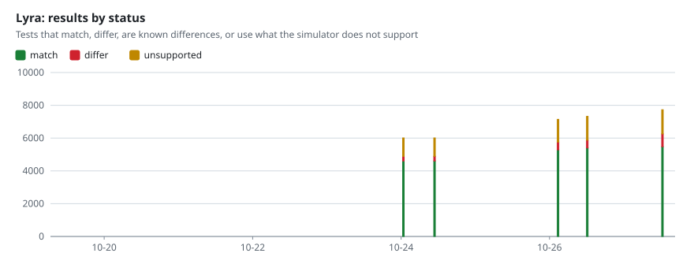

# Nightly results of kirimasim-tests

The [nightly workflow](https://github.com/kurochan001/kirimasim-tests/actions/workflows/nightly.yml) of [kirimasim-tests](https://github.com/kurochan001/kirimasim-tests) writes this branch. Each night it runs every test of the suite's main branch with each simulator, adds the results to `history.json` and draws the charts below. A test matches when the simulator's normalized standard output is exactly its expected output; see the suite's README for what each status means.

Latest run: 2026-10-27 00:11 UTC, suite commit [`1ff9998`](https://github.com/kurochan001/kirimasim-tests/commit/1ff999828c59ca24649bf722f6bfc46b70724520), 7327 tests, [workflow run](https://github.com/kurochan001/kirimasim-tests/actions/runs/40417919375).

| Simulator | Version | Match | Differ | Known differences | Unsupported | Since the previous run |
| --- | --- | ---: | ---: | ---: | ---: | --- |
| Icarus Verilog | Icarus Verilog version 14.0 (devel) (s20260301-724-g0accff4e) | 4535 (61.9%) | 14 | 2778 | 0 | 12 no longer match, 183 new tests (39 match) |
| Verilator | Verilator 5.053 devel rev v5.052-612-gbe33a0f6 | 4646 (63.4%) | 6 | 2675 | 0 | 29 newly match, 4 no longer match, 183 new tests (67 match) |
| kirimasim | kirimasim 0.0.0 (commit 1650064d21c7), built with GNU 13.3.0 | 4969 (67.8%) | 169 | 0 | 2189 | 35 newly match, 183 new tests (68 match) |
| Lyra | Lyra (commit 7e2c604b9ab2) | 5398 (73.7%) | 476 | 0 | 1453 | 25 newly match, 183 new tests (93 match) |

## Changes in the latest run

Tests that match now but did not in the previous run of the same simulator, and tests that matched then but do not now. Tests added to the suite are counted in the table above.

### Icarus Verilog

No longer match (12):

- `ch16/test_illegal_inferred_clock_missing`: known difference — no error matches '^(?![^\\n]*(?i:unsupported|not supported|not implemented|syntax error|invalid module))[^\\n]*test_illegal_inferred_clock_missing\\.sv:(?:25|26|29):(?:\\d+:)?[^\\n]*(?i:(?:no|missing|unresolved)[^\\n]*clock|clock[^\\n]*(?:missing|unresolved|not resolved|cannot be resolved))'; the first is: /home/runner/work/kirimasim-tests/kirimasim-tests/tests/ch16/test_illegal_inferred_clock_missing.sv:25: syntax error
- `ch16/test_illegal_negated_property_reaching_recursion`: known difference — no error matches '^(?![^\\n]*(?i:unsupported|not supported|not implemented|syntax error|invalid module))[^\\n]*test_illegal_negated_property_reaching_recursion\\.sv:(?:31|38):(?:\\d+:)?[^\\n]*(?i:recursive[^\\n]*(?:cannot|shall not|must not|not allowed|illegal)|(?:cannot|shall not|must not|not allowed|illegal)[^\\n]*recursive)'; the first is: /home/runner/work/kirimasim-tests/kirimasim-tests/tests/ch16/test_illegal_negated_property_reaching_recursion.sv:30: syntax error
- `ch16/test_illegal_property_instance_flattened_not_legal`: known difference — no error matches '^(?![^\\n]*(?i:unsupported|not supported|not implemented|syntax error|invalid module))[^\\n]*test_illegal_property_instance_flattened_not_legal\\.sv:(?:27|30):(?:\\d+:)?[^\\n]*(?i:(?:cannot|not allowed|illegal)[^\\n]*property[^\\n]*sequence|property[^\\n]*(?:cannot|not allowed|illegal)[^\\n]*sequence)'; the first is: /home/runner/work/kirimasim-tests/kirimasim-tests/tests/ch16/test_illegal_property_instance_flattened_not_legal.sv:26: syntax error
- `ch16/test_illegal_recursive_property_negated`: known difference — no error matches '^(?![^\\n]*(?i:unsupported|not supported|not implemented|syntax error|invalid module))[^\\n]*test_illegal_recursive_property_negated\\.sv:(?:29|32):(?:\\d+:)?[^\\n]*(?i:recursive[^\\n]*(?:cannot|shall not|must not|not allowed|illegal)|(?:cannot|shall not|must not|not allowed|illegal)[^\\n]*recursive)'; the first is: /home/runner/work/kirimasim-tests/kirimasim-tests/tests/ch16/test_illegal_recursive_property_negated.sv:28: syntax error
- `ch16/test_illegal_recursive_property_s_always`: known difference — no error matches '^(?![^\\n]*(?i:unsupported|not supported|not implemented|syntax error|invalid module))[^\\n]*test_illegal_recursive_property_s_always\\.sv:(?:29|32):(?:\\d+:)?[^\\n]*(?i:recursive[^\\n]*(?:cannot|shall not|must not|not allowed|illegal)|(?:cannot|shall not|must not|not allowed|illegal)[^\\n]*recursive)'; the first is: /home/runner/work/kirimasim-tests/kirimasim-tests/tests/ch16/test_illegal_recursive_property_s_always.sv:28: syntax error
- `ch16/test_illegal_recursive_property_s_eventually`: known difference — no error matches '^(?![^\\n]*(?i:unsupported|not supported|not implemented|syntax error|invalid module))[^\\n]*test_illegal_recursive_property_s_eventually\\.sv:(?:29|32):(?:\\d+:)?[^\\n]*(?i:recursive[^\\n]*(?:cannot|shall not|must not|not allowed|illegal)|(?:cannot|shall not|must not|not allowed|illegal)[^\\n]*recursive)'; the first is: /home/runner/work/kirimasim-tests/kirimasim-tests/tests/ch16/test_illegal_recursive_property_s_eventually.sv:28: syntax error
- `ch16/test_illegal_recursive_property_s_nexttime`: known difference — no error matches '^(?![^\\n]*(?i:unsupported|not supported|not implemented|syntax error|invalid module))[^\\n]*test_illegal_recursive_property_s_nexttime\\.sv:(?:29|32):(?:\\d+:)?[^\\n]*(?i:recursive[^\\n]*(?:cannot|shall not|must not|not allowed|illegal)|(?:cannot|shall not|must not|not allowed|illegal)[^\\n]*recursive)'; the first is: /home/runner/work/kirimasim-tests/kirimasim-tests/tests/ch16/test_illegal_recursive_property_s_nexttime.sv:28: syntax error
- `ch16/test_illegal_recursive_property_s_until`: known difference — no error matches '^(?![^\\n]*(?i:unsupported|not supported|not implemented|syntax error|invalid module))[^\\n]*test_illegal_recursive_property_s_until\\.sv:(?:29|32):(?:\\d+:)?[^\\n]*(?i:recursive[^\\n]*(?:cannot|shall not|must not|not allowed|illegal)|(?:cannot|shall not|must not|not allowed|illegal)[^\\n]*recursive)'; the first is: /home/runner/work/kirimasim-tests/kirimasim-tests/tests/ch16/test_illegal_recursive_property_s_until.sv:28: syntax error
- `ch16/test_illegal_recursive_property_s_until_with`: known difference — no error matches '^(?![^\\n]*(?i:unsupported|not supported|not implemented|syntax error|invalid module))[^\\n]*test_illegal_recursive_property_s_until_with\\.sv:(?:29|32):(?:\\d+:)?[^\\n]*(?i:recursive[^\\n]*(?:cannot|shall not|must not|not allowed|illegal)|(?:cannot|shall not|must not|not allowed|illegal)[^\\n]*recursive)'; the first is: /home/runner/work/kirimasim-tests/kirimasim-tests/tests/ch16/test_illegal_recursive_property_s_until_with.sv:28: syntax error
- `ch16/test_illegal_sequence_local_output_unassigned`: known difference — no error matches '^(?![^\\n]*(?i:unsupported|not supported|not implemented|syntax error|invalid module))[^\\n]*test_illegal_sequence_local_output_unassigned\\.sv:(?:28|29|34):(?:\\d+:)?[^\\n]*(?i:(?:output|inout)[^\\n]*(?:unassigned|not[^\\n]*assigned)|(?:unassigned|not[^\\n]*assigned)[^\\n]*(?:output|inout))'; the first is: /home/runner/work/kirimasim-tests/kirimasim-tests/tests/ch16/test_illegal_sequence_local_output_unassigned.sv:28: syntax error
- `ch25/test_illegal_modport_prototype_argument_count`: known difference — no error matches '^(?![^\\n]*(?i:unsupported|not supported|not implemented|syntax error|invalid module))[^\\n]*test_illegal_modport_prototype_argument_count\\.sv:(?:26|30):(?:\\d+:)?[^\\n]*(?i:(?:number|count)[^\\n]*arguments?|arguments?[^\\n]*(?:number|count|too few|too many))'; the first is: /home/runner/work/kirimasim-tests/kirimasim-tests/tests/ch25/test_illegal_modport_prototype_argument_count.sv:30: error: 'a' has already been declared in this scope.
- `ch25/test_illegal_modport_prototype_type_not_matching`: known difference — no error matches '^(?![^\\n]*(?i:unsupported|not supported|not implemented|syntax error|invalid module))[^\\n]*test_illegal_modport_prototype_type_not_matching\\.sv:(?:27|31):(?:\\d+:)?[^\\n]*(?i:(?:argument|parameter)[^\\n]*type[^\\n]*(?:differ|match|mismatch)|type[^\\n]*(?:differ|match|mismatch)[^\\n]*(?:argument|parameter))'; the first is: /home/runner/work/kirimasim-tests/kirimasim-tests/tests/ch25/test_illegal_modport_prototype_type_not_matching.sv:31: error: 'v' has already been declared in this scope.

### Verilator

Newly match (29): `ch21/test_monitor_end_of_step`, `ch21/test_monitor_new_call_replaces_list`, `ch21/test_monitor_time_functions_do_not_trigger`, `gen/ch4/test_gen_sched_assign_monitor_always_delay0`, `gen/ch4/test_gen_sched_assign_monitor_fork_delay0`, `gen/ch4/test_gen_sched_assign_monitor_function_delay0`, `gen/ch4/test_gen_sched_assign_monitor_generate_delay0`, `gen/ch4/test_gen_sched_assign_monitor_initial_delay0`, `gen/ch4/test_gen_sched_assign_monitor_interface_delay0`, `gen/ch4/test_gen_sched_assign_monitor_task_delay0`, `gen/ch4/test_gen_sched_blocking_monitor_always_delay0`, `gen/ch4/test_gen_sched_blocking_monitor_fork_delay0`, `gen/ch4/test_gen_sched_blocking_monitor_function_delay0`, `gen/ch4/test_gen_sched_blocking_monitor_generate_delay0`, `gen/ch4/test_gen_sched_blocking_monitor_initial_delay0`, `gen/ch4/test_gen_sched_blocking_monitor_interface_delay0`, `gen/ch4/test_gen_sched_blocking_monitor_task_delay0`, `gen/ch4/test_gen_sched_force_monitor_always_delay0`, `gen/ch4/test_gen_sched_force_monitor_fork_delay0`, `gen/ch4/test_gen_sched_force_monitor_generate_delay0`, `gen/ch4/test_gen_sched_force_monitor_initial_delay0`, `gen/ch4/test_gen_sched_force_monitor_interface_delay0`, `gen/ch4/test_gen_sched_force_monitor_task_delay0`, `gen/ch4/test_gen_sched_nba_monitor_always_nodelay`, `gen/ch4/test_gen_sched_nba_monitor_fork_nodelay`, `gen/ch4/test_gen_sched_nba_monitor_generate_nodelay`, `gen/ch4/test_gen_sched_nba_monitor_initial_nodelay`, `gen/ch4/test_gen_sched_nba_monitor_interface_nodelay`, `gen/ch4/test_gen_sched_nba_monitor_task_nodelay`

No longer match (4):

- `ch16/test_illegal_inferred_clock_missing`: known difference — no error matches '^(?![^\\n]*(?i:unsupported|not supported|not implemented|syntax error|invalid module))[^\\n]*test_illegal_inferred_clock_missing\\.sv:(?:25|26|29):(?:\\d+:)?[^\\n]*(?i:(?:no|missing|unresolved)[^\\n]*clock|clock[^\\n]*(?:missing|unresolved|not resolved|cannot be resolved))'; the first is: %Error-UNSUPPORTED: /home/runner/work/kirimasim-tests/kirimasim-tests/tests/ch16/test_illegal_inferred_clock_missing.sv:25:24: Unsupported: IEEE 1800-2005 reserved word not implemented: '$inferred_clock'
- `ch16/test_illegal_property_instance_flattened_not_legal`: known difference — no error matches '^(?![^\\n]*(?i:unsupported|not supported|not implemented|syntax error|invalid module))[^\\n]*test_illegal_property_instance_flattened_not_legal\\.sv:(?:27|30):(?:\\d+:)?[^\\n]*(?i:(?:cannot|not allowed|illegal)[^\\n]*property[^\\n]*sequence|property[^\\n]*(?:cannot|not allowed|illegal)[^\\n]*sequence)'; the first is: %Error: /home/runner/work/kirimasim-tests/kirimasim-tests/tests/ch16/test_illegal_property_instance_flattened_not_legal.sv:29:49: syntax error, unexpected ##, expecting ')'
- `ch16/test_illegal_recursive_property_s_nexttime`: known difference — no error matches '^(?![^\\n]*(?i:unsupported|not supported|not implemented|syntax error|invalid module))[^\\n]*test_illegal_recursive_property_s_nexttime\\.sv:(?:29|32):(?:\\d+:)?[^\\n]*(?i:recursive[^\\n]*(?:cannot|shall not|must not|not allowed|illegal)|(?:cannot|shall not|must not|not allowed|illegal)[^\\n]*recursive)'; the first is: %Error-UNSUPPORTED: /home/runner/work/kirimasim-tests/kirimasim-tests/tests/ch16/test_illegal_recursive_property_s_nexttime.sv:32:52: Unsupported: s_nexttime (in property expression)
- `ch16/test_illegal_sequence_local_output_unassigned`: known difference — no error matches '^(?![^\\n]*(?i:unsupported|not supported|not implemented|syntax error|invalid module))[^\\n]*test_illegal_sequence_local_output_unassigned\\.sv:(?:28|29|34):(?:\\d+:)?[^\\n]*(?i:(?:output|inout)[^\\n]*(?:unassigned|not[^\\n]*assigned)|(?:unassigned|not[^\\n]*assigned)[^\\n]*(?:output|inout))'; the first is: %Error-UNSUPPORTED: /home/runner/work/kirimasim-tests/kirimasim-tests/tests/ch16/test_illegal_sequence_local_output_unassigned.sv:28:20: Unsupported: property port 'local'

### kirimasim

Newly match (35): `ch13/test_constant_function_call_constant_argument_forms`, `ch13/test_parameterized_function_width_truncation`, `ch16/test_illegal_final_deferred_postponed_call`, `ch16/test_illegal_inferred_clock_missing`, `ch16/test_illegal_negated_property_reaching_recursion`, `ch16/test_illegal_property_instance_flattened_not_legal`, `ch16/test_illegal_recursive_property_negated`, `ch16/test_illegal_recursive_property_s_always`, `ch16/test_illegal_recursive_property_s_eventually`, `ch16/test_illegal_recursive_property_s_nexttime`, `ch16/test_illegal_recursive_property_s_until`, `ch16/test_illegal_recursive_property_s_until_with`, `ch16/test_illegal_sequence_local_output_unassigned`, `ch20/test_illegal_pla_descending_memory`, `ch23/test_illegal_ansi_port_net_type_added_in_body`, `ch23/test_illegal_ansi_port_redeclared_in_body`, `ch23/test_illegal_nonansi_net_port_redeclared`, `ch23/test_illegal_nonansi_variable_port_redeclared`, `ch23/test_scope_resolution_edge_cases_2`, `ch23/test_scope_resolution_prefix_downward`, `ch25/test_illegal_modport_prototype_argument_count`, `ch25/test_illegal_modport_prototype_type_not_matching`, `ch26/test_illegal_local_declaration_after_import`, `ch26/test_illegal_search_order_explicit_after_wildcard_reference`, `ch26/test_illegal_search_order_local_after_wildcard_reference`, `ch29/test_illegal_udp_table_without_endtable`, `ch33/test_illegal_config_design_is_config`, `ch33/test_illegal_config_instance_inside_other_config`, `ch6/test_parameterized_data_types`, `ch6/test_parameterized_typedef_specializations`, `ch8/test_extern_method_class_scope_current_specialization`, `ch8/test_interface_diamond_inherited_parameter`, `ch9/test_always_comb_qualified_function_calls`, `ch9/test_illegal_function_contains_fork_join`, `ch9/test_illegal_function_contains_fork_join_any`

### Lyra

Newly match (25): `ch16/test_illegal_inferred_clock_missing`, `ch16/test_illegal_negated_property_reaching_recursion`, `ch16/test_illegal_property_instance_flattened_not_legal`, `ch16/test_illegal_recursive_property_negated`, `ch16/test_illegal_recursive_property_s_always`, `ch16/test_illegal_recursive_property_s_eventually`, `ch16/test_illegal_recursive_property_s_nexttime`, `ch16/test_illegal_recursive_property_s_until`, `ch16/test_illegal_recursive_property_s_until_with`, `ch16/test_illegal_sequence_local_output_unassigned`, `ch20/test_illegal_pla_descending_memory`, `ch23/test_illegal_ansi_port_net_type_added_in_body`, `ch23/test_illegal_ansi_port_redeclared_in_body`, `ch23/test_illegal_nonansi_net_port_redeclared`, `ch23/test_illegal_nonansi_variable_port_redeclared`, `ch25/test_illegal_modport_prototype_argument_count`, `ch25/test_illegal_modport_prototype_type_not_matching`, `ch26/test_illegal_local_declaration_after_import`, `ch26/test_illegal_search_order_explicit_after_wildcard_reference`, `ch26/test_illegal_search_order_local_after_wildcard_reference`, `ch29/test_illegal_udp_table_without_endtable`, `ch33/test_illegal_config_design_is_config`, `ch33/test_illegal_config_instance_inside_other_config`, `ch9/test_illegal_function_contains_fork_join`, `ch9/test_illegal_function_contains_fork_join_any`

## By chapter

## Each simulator over time

## Recent runs

Matching tests of each simulator, with the change since its previous run. The version is shown when it changed.

| Run (UTC) | Suite | Tests | Icarus Verilog | Verilator | kirimasim | Lyra |
| --- | --- | ---: | ---: | ---: | ---: | ---: |
| [2026-10-27 00:11](https://github.com/kurochan001/kirimasim-tests/actions/runs/40417919375) | [`1ff9998`](https://github.com/kurochan001/kirimasim-tests/commit/1ff999828c59ca24649bf722f6bfc46b70724520) | 7327 | 4535 (+39 −12) `14.0 devel 0accff4` | 4646 (+96 −4) `5.053 devel be33a0f` | 4969 (+103 −0) `1650064d2` | 5398 (+118 −0) |
| [2026-10-26 14:44](https://github.com/kurochan001/kirimasim-tests/actions/runs/40333187203) | [`5fb3c45`](https://github.com/kurochan001/kirimasim-tests/commit/5fb3c45d73e4946d99690389752b82c86eecaa50) | 7144 | 4508 (+152 −0) `14.0 devel 1d601c9` | 4554 (+167 −0) `5.053 devel 5dcc718` | 4866 (+174 −0) `5563871fc` | 5280 (+674 −1) |
| [2026-10-25 22:50](https://github.com/kurochan001/kirimasim-tests/actions/runs/40237581816) | [`eadc98d`](https://github.com/kurochan001/kirimasim-tests/commit/eadc98d6c452244167e267a46866808291771198) | 6799 | 4356 (+338 −0) `14.0 devel 49bebc9` | 4387 (+363 −0) `5.053 devel 7fa05ab` | 4692 (+458 −1) `a4f653c1d` | — |
| [2026-10-24 22:48](https://github.com/kurochan001/kirimasim-tests/actions/runs/40135271002) | [`c87448b`](https://github.com/kurochan001/kirimasim-tests/commit/c87448ba87b6b6ca136bf526b1ee8710efcb05a3) | 6009 | 4018 | 4024 (+1 −0) `5.053 devel 441c0df` | 4235 `c507631d2` | 4607 |
| [2026-10-24 12:44](https://github.com/kurochan001/kirimasim-tests/actions/runs/40084390631) | [`0073c69`](https://github.com/kurochan001/kirimasim-tests/commit/0073c6947bc210d7b928d0d651ef34d5095b5999) | 6009 | 4018 (+1298 −0) `14.0 devel 9cfecc9` | 4023 (+1202 −0) | 4235 (+1449 −0) `c0388da8a` | 4607 `7e2c604b9` |
| [2026-10-23 23:03](https://github.com/kurochan001/kirimasim-tests/actions/runs/40033104165) | [`721db37`](https://github.com/kurochan001/kirimasim-tests/commit/721db3743b9db84ecb14fa86a8165dbcff8fdb0d) | 3986 | 2720 (+1 −0) `14.0 devel 1a663cb` | 2821 (+19 −0) `5.053 devel 0041d20` | 2786 (+126 −0) `0d27da4e7` | — |
| [2026-10-22 23:07](https://github.com/kurochan001/kirimasim-tests/actions/runs/39865168055) | [`bc1609d`](https://github.com/kurochan001/kirimasim-tests/commit/bc1609dc005548ac6dd7848355b705983d7aacd5) | 3938 | 2719 (+108 −0) `14.0 devel e072b33` | 2802 (+144 −0) `5.053 devel bb916d0` | 2660 (+108 −0) `499198369` | — |
| [2026-10-21 22:46](https://github.com/kurochan001/kirimasim-tests/actions/runs/39686633157) | [`4752cea`](https://github.com/kurochan001/kirimasim-tests/commit/4752cea52e9dc0d24ef58240eddee11ef055c673) | 3719 | 2611 (+140 −0) `14.0 devel ce98681` | 2659 (+149 −0) `5.053 devel 019f1ca` | 2552 (+147 −0) `b27968d1f` | — |
| [2026-10-21 01:31](https://github.com/kurochan001/kirimasim-tests/actions/runs/39523323680) | [`0cfd00b`](https://github.com/kurochan001/kirimasim-tests/commit/0cfd00b58140ba628bb18a68e439933a07312fa2) | 3403 | 2471 (+36 −0) | 2512 (+35 −0) `5.053 devel 4c98f02` | 2405 (+61 −0) `7b2b17aa1` | — |
| [2026-10-21 01:02](https://github.com/kurochan001/kirimasim-tests/actions/runs/39507186309) | [`824f574`](https://github.com/kurochan001/kirimasim-tests/commit/824f5748dd619afaf472f60fd0ce83d0a547d829) | 3332 | 2435 (+857 −0) | 2477 (+549 −0) `5.053 devel 3cc4981` | 2344 (+754 −0) `0680c67d5` | — |
| [2026-10-20 07:49](https://github.com/kurochan001/kirimasim-tests/actions/runs/39387575855) | [`6bffc4a`](https://github.com/kurochan001/kirimasim-tests/commit/6bffc4a184134250ca4b934ef2b40af9961bc4d5) | 2327 | 1578 `14.0 devel 7e3d0c6` | — | 1590 `b1be7015e` | — |
| [2026-10-20 05:01](https://github.com/kurochan001/kirimasim-tests/actions/runs/39363555028) | [`56508cd`](https://github.com/kurochan001/kirimasim-tests/commit/56508cdce0a414ca1623756c6856dd1f49819977) | 2327 | 1578 (+56 −0) | 1928 (+103 −0) `5.053 devel 0177067` | 1590 (+60 −0) `ff80adcf6` | — |
| [2026-10-19 22:42](https://github.com/kurochan001/kirimasim-tests/actions/runs/39329365210) | [`42081bd`](https://github.com/kurochan001/kirimasim-tests/commit/42081bd73c354db73c20b1b17fb076975ae5a16f) | 2176 | 1522 `14.0 devel eed9291` | 1825 `5.053 devel 60f166e` | 1530 `8b598b574` | — |

## Files

- `history.json`: one entry per run, with the counts of each simulator by status and by chapter, and the tests whose result changed.
- `latest/<simulator>.json`: the result of every test in the latest run of each simulator, which the next run is compared with.
- `charts/*.svg`: the charts above.
