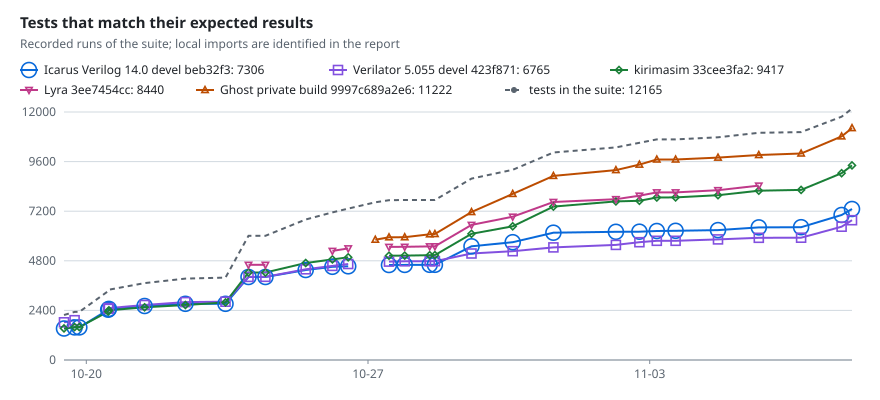
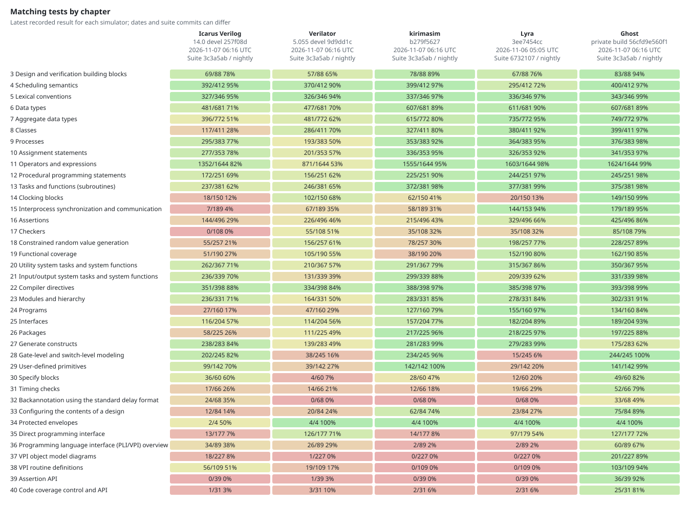

# kirimasim-tests

[日本語](README.ja.md)

[](https://github.com/kurochan001/kirimasim-tests/actions/workflows/check.yml)
[](https://github.com/kurochan001/kirimasim-tests/actions/workflows/nightly.yml)
[](LICENSE)

A conformance test suite for the simulation semantics of IEEE 1800-2023
SystemVerilog.

For terminology and common questions, see the [glossary](docs/glossary.en.md)
and [FAQ](docs/faq.en.md). They explain test expectations, result
statuses, Nightly, coverage and the SVA/formal checks used by this suite.
This README describes the suite as it is now; records of earlier work and
measurements are in the [history](docs/history.md).
The [document index](docs/README.md) links every guide, generated report and historical record in both languages.
The Nightly runs on `main` every night with all seven jobs. Its latest results are in the
[report on the `results` branch](https://github.com/kurochan001/kirimasim-tests/tree/results#readme), and the [Nightly guide](docs/nightly-results.en.md) explains how to read them.
For resuming development, use the current guides with the newest [handoff](docs/claude-code-handoff-20261110.en.md).

Each simulation test is a small, self-contained design with an expected result.
A legal design passes when its normalized standard output matches and any specified
exit-code and diagnostic checks succeed. An illegal design passes when it is
rejected with the required diagnostic (see [how a test is judged](#how-a-test-is-judged)).
The tests are written for the
[kirimasim](https://github.com/kurochan001/kirimasim) simulator. Runners for
Icarus Verilog, Verilator, kirimasim and
[Lyra](https://github.com/hankhsu1996/lyra) are included. An unreleased guest,
**Ghost**, is also taking part under an alias for now. The metadata
format is that of
[sv-tests](https://github.com/chipsalliance/sv-tests).

Most simulation expectations follow simulator-independent standard rules.
Tests of implementation-defined behavior state the assumed format explicitly;
the [FST waveform tests](docs/fst-tests-20261029.md) target kirimasim's
FST backend and are not requirements to use FST in every simulator.

What sets the suite apart:

- **Every test cites the standard.** `:lrm:` lists the clauses of IEEE
  1800-2023 that the test checks, and a comment at the top of the test
  describes, in our own words, what it checks.
- **Every expected output says where it comes from.** `:oracle:` records
  whether the expected output was checked against the standard, and which
  simulators produce it. Where possible it was cross-checked with Icarus
  Verilog 13.0, or with Verilator 5.052 where Icarus Verilog cannot run the
  test or does not follow the standard. Where neither follows the standard,
  the expected output follows the standard.
- **Tests print only what the standard fixes.** They do not depend on the
  order of events that the standard leaves open, on random values, on the
  default time unit or on the exact wording of a simulator's messages.

> **Status: early.** Every test has been checked against the standard by an
> AI model, and none by a person yet (`:spec_check: ai`).
> Reports of wrong expectations are welcome.

For a first test, [walk through 24 real lines](docs/faq.en.md#q49-read-a-real-test); for results, read [why green can coexist with Differ](docs/faq.en.md#q11-why-can-nightly-be-green-with-differ-results); for verified scope, start with [numerator/denominator examples](docs/faq.en.md#q16-how-do-design-and-execution-coverage-differ).

<a id="収録内容"></a>

## Contents

These are inventory and expectation-provenance counts, not current simulator passes. See [what `:lrm:` and `:oracle:` record](docs/faq.en.md#q4-are-expected-outputs-copied-from-a-simulator).

<!-- suite-stats:begin -->
The suite has **12268 tests** in 38 chapters. 5729 of them are generated. The [generator catalog](docs/generators.md) lists their current counts and scope.

| Expected result recorded with | Tests |
| --- | ---: |
| Icarus Verilog 13.0 (`iverilog@13.0` in `:oracle:`) | 6653 |
| Verilator 5.052, with no Icarus Verilog 13.0 oracle recorded | 2246 |
| The standard only, with no fixed-release simulator oracle recorded | 3369 |

2915 tests depend on x or z values (`:fourstate: yes`). 690 tests come with C code: 189 DPI tests (`:dpi_c:`) and 501 VPI tests (`:vpi_c:`). 1976 tests are illegal designs, which a simulator has to reject (`:should_fail_because:`). 33 tests check the exit code of the simulation (`:expected_exit:`). 23 tests have more than one source file (`:files:`), 4 define macros (`:defines:`), 7 name include directories (`:incdirs:`), 54 name the top-level module or configuration (`:top_module:`), and 13 pass arguments to the simulation (`:args:`). Every test has been checked against the standard by an AI model (`:spec_check: ai`); none has been checked by a person yet.

| Clause | Title | Tests | Icarus | Verilator | Standard only |
| ---: | --- | ---: | ---: | ---: | ---: |
| 3 | Design and verification building blocks | 136 | 110 | 12 | 14 |
| 4 | Scheduling semantics | 478 | 443 | 7 | 28 |
| 5 | Lexical conventions | 513 | 438 | 29 | 46 |
| 6 | Data types | 685 | 396 | 166 | 123 |
| 7 | Aggregate data types | 776 | 290 | 281 | 205 |
| 8 | Classes | 459 | 93 | 257 | 109 |
| 9 | Processes | 444 | 339 | 48 | 57 |
| 10 | Assignment statements | 425 | 314 | 64 | 47 |
| 11 | Operators and expressions | 1647 | 1262 | 133 | 252 |
| 12 | Procedural programming statements | 306 | 224 | 33 | 49 |
| 13 | Tasks and functions (subroutines) | 450 | 283 | 96 | 71 |
| 14 | Clocking blocks | 170 | 4 | 101 | 65 |
| 15 | Interprocess synchronization and communication | 192 | 2 | 58 | 132 |
| 16 | Assertions | 794 | 122 | 124 | 548 |
| 17 | Checkers | 108 |  | 47 | 61 |
| 18 | Constrained random value generation | 273 | 25 | 127 | 121 |
| 19 | Functional coverage | 196 | 2 | 61 | 133 |
| 20 | Utility system tasks and system functions | 409 | 253 | 62 | 94 |
| 21 | Input/output system tasks and system functions | 495 | 353 | 37 | 105 |
| 22 | Compiler directives | 516 | 439 | 38 | 39 |
| 23 | Modules and hierarchy | 417 | 287 | 58 | 72 |
| 24 | Programs | 167 | 31 | 24 | 112 |
| 25 | Interfaces | 262 | 104 | 120 | 38 |
| 26 | Packages | 262 | 90 | 70 | 102 |
| 27 | Generate constructs | 283 | 232 | 20 | 31 |
| 28 | Gate-level and switch-level modeling | 297 | 228 | 3 | 66 |
| 29 | User-defined primitives | 142 | 95 | 11 | 36 |
| 30 | Specify blocks | 60 | 35 | 1 | 24 |
| 31 | Timing checks | 66 | 17 | 1 | 48 |
| 32 | Backannotation using the standard delay format | 68 | 19 |  | 49 |
| 33 | Configuring the contents of a design | 88 | 8 | 9 | 71 |
| 34 | Protected envelopes | 4 | 2 | 2 |  |
| 35 | Direct programming interface | 177 | 4 | 114 | 59 |
| 36 | Programming language interface (PLI/VPI) overview | 89 | 34 | 19 | 36 |
| 37 | VPI object model diagrams | 227 | 18 | 1 | 208 |
| 38 | VPI routine definitions | 109 | 56 | 9 | 44 |
| 39 | Assertion API | 39 |  | 1 | 38 |
| 40 | Code coverage control and API | 39 | 1 | 2 | 36 |
<!-- suite-stats:end -->

The total includes 268 `:type: formal` tests. They are checked with SymbiYosys
through `:formal_case:` rather than by comparing simulator standard output;
see [running formal tests](#symbiyosys).

SVA/formal PASS has a different scope from simulation: read [real BMC, PDR, cover and counterexample results](docs/faq.en.md#q21-do-bmc-and-pdr-pass-mean-the-same-thing).

Additional SVA validation is recorded separately: the reference evaluator
reproduces **45 test outputs**; formal evidence covers the **267-case catalogue**
and a separate **111-case parameter-boundary sweep**. These overlapping model
sets are not added to the suite total or the oracle counts above.
The [SVA reference and formal verification guide](docs/sva-reference-formal-verification.en.md)
provides scope, evidence and reproduction commands. Detailed counts and rerun
dates are in the [archived SVA record](docs/readme-records-20261101.md#sva-verification-record-2026-10-29)
and [boundary-sweep report](docs/sva-formal-expansion-20261026.en.md).

The [catalog](docs/tests/README.md) lists every test, chapter by chapter,
with what it checks and the clauses it cites, and
[docs/tests/clauses.md](docs/tests/clauses.md) shows, chapter by chapter,
which clauses of the standard the tests cite. The
[depth report](docs/coverage-depth.md) counts the tests behind each clause
and lists the clauses that one test covers with a standard-only expected
output. Every in-scope leaf clause from 3 to 40 is directly cited by at
least two tests; the page
lists the others and why they are left out (the tags of `tools/clauses.txt`):
general text, clause 34, behavior left to the tool, and the content of VCD
files, except the parts that `test_vcd_dump_readback` reads back (21.7.2.1
to 21.7.2.3 and 21.7.5).

This is clause citation coverage, not proof that every requirement or
combination in IEEE 1800-2023 is exercised. The citation-depth scope is the
leaf clauses of chapters 3 to 40 selected by `tools/clauses.txt`, with the
current count and exclusions in the [depth report](docs/coverage-depth.md).
Annexes and explicitly excluded clauses are not silently included in a
claim about the entire standard. CI enforces the
two-test floor with `tools/coverage_depth.py --check --minimum-tests 2`;
parent-clause citations do not satisfy that floor for a child clause.

Read [designed, executed and passed](docs/faq.en.md#q16-how-do-design-and-execution-coverage-differ) to distinguish the numerators and denominators below.

The [behavior summary](docs/behavior-coverage-summary.en.md) and
[detailed report](docs/behavior-coverage.en.md) measure explicitly reviewed
requirements and observable test outcomes. Their
[registry and workflow](coverage/README.en.md) inventory clauses 1–41 and annexes
A–Q, including parent introductions and previously excluded material. The
source review covers all 1,740 sections. Provisional percentages use every
registered requirement/condition/observation row, including interpretation
holds and unmapped rows. Confirmed whole-standard percentages use the approved
denominator after interpretations and overlapping requirement units have been
reconciled. The reports separate design coverage, execution
evidence, simulator outcomes and source-review progress. CI checks the registry
and generated summaries. Nightly records percentages, outstanding items,
simulator outcomes and denominator identities on the `results` branch.
Existing tests contribute only after their stimuli and expected outcomes have
been linked to requirements. The summary shows how many test files have at least
one reviewed link; unlinked tests may exercise additional requirements that are
not yet counted. Review existing tests before adding new ones for an unmapped row.
The [existing-test matching inventory](docs/test-requirement-matching.en.md) lists
chapter progress and links to the complete candidate worklist and content findings.
Collective witnesses require every member test to pass in one simulator snapshot;
partial successes from separate runs are not combined into a successful requirement.

100% pairwise coverage does not mean every full combination ran: see [four rows covering pairs of three factors](docs/faq.en.md#q28-why-not-simply-cross-every-feature).

[Feature-interaction verification](docs/interaction-verification.en.md) uses constrained
pairwise coverage, selected higher-order factor groups and mandatory boundary cases.
The focused selection contains **4,416 tests across 110 models**; the normal full-suite
run retains all existing tests. Models cover value/type conversion, scheduling,
argument and reference binding, scope and hierarchy, state retention and I/O.
The selection plan does not change the whole-standard requirement denominator.

The [latest complete local cross run](coverage/interaction-results/cross110-kirimasim-f029ddd0-scopecaselit.json),
on kirimasim **`f029ddd0eee1`**, built from the latest main, records
**3,915 pass, 487 unsupported and 14 fail**. Of the 120 additions for scoped classes, case item literals and structure literals, 106 pass.
Compared with the [previous complete run](coverage/interaction-results/cross107-kirimasim-28c6c1a1-delaypkgesc.json) on the earlier build, no status or input of the preceding 4,296 cases changed.
The snapshot is cross110, with 110 models and 4,416 selected cases.
The Check and the Nightly run the generated cross tests with the rest of the fixed suite; the [report on the `results` branch](https://github.com/kurochan001/kirimasim-tests/tree/results#readme) has the latest Nightly results.
All inputs retain their original expectations; four failures are config parameter resets localized to pinned slang, four are the [`defparam` type and range](docs/interaction-verification.en.md#parameter-override-type) mismatch, and six are a kirimasim internal error on [a class in a generate block](docs/interaction-verification.en.md#scoped-class-declaration). The
[follow-up record](docs/cross-verification-followup.en.md) retains the earlier 11→9→4 history,
complete-output replays, the 19-mechanism unsupported inventory and reviewed chapter pairs.
The chapter CSVs use the single complete local cross110 run; formal confirmation is recorded separately.

Named events and loop transfers (Chapters 12×15) select 36 of 2,016 legal representative combinations.
Check same-slot registration, blocking/NBA triggers and break/continue through received words, retention and loop completion.
Latest kirimasim passes all 36. See [design, examples and pinned differences](docs/interaction-verification.en.md#named-event-loop-transfer).

Package array queries and name lookup (Chapters 20×26) select 36 of 3,456 legal combinations.
Function-local imports and qualified references determine query operands; check widths, bounds and directions through actual scans and full-width accumulation.
Latest kirimasim passes all 36. See [design, independent checks and pinned comparisons](docs/interaction-verification.en.md#package-array-query-scope), including local namesakes.

Program termination and automatic tasks (Chapters 13×24 and 12×24) select 36 of 3,456 legal combinations.
Check private overlapping calls, normal-return copyout, cancellation without copyout and a surviving peer program.
Latest kirimasim passes all 36; pinned Icarus records 6 pass / 30 known and Verilator 36 known. See [design, independent checks and scope](docs/interaction-verification.en.md#program-task-frame-lifetime).

Formatted scanning and partial writes (Chapters 11×21 and 20×21) select 36 of 5,760 legal representative combinations.
Observe every full storage word to check writes before a stopped conversion, later-output retention and successful followup scans.
Latest kirimasim passes all 36; pinned Icarus records 17 pass / 19 known. See [design, independent checks and pinned differences](docs/interaction-verification.en.md#formatted-scan-partial-write).

Constant expressions and generate (Chapters 11×27 and 20×27) select 36 of 6,912 legal combinations.
Separate operand signs, context width and result declaration sign; observe actual branches, generated counts, element widths and full-width data.
Latest kirimasim and pinned Icarus pass all 36. See [design, independent checks and pinned comparisons](docs/interaction-verification.en.md#generated-constant-expression-shape).

Interface-local array queries (Chapters 7×25, 20×25 and 13×20) select 36 of 4,608 legal combinations.
Queries determine the scan start, count and direction; observe an order-sensitive full-width checksum and retention of the other instance after calls.
Latest kirimasim and pinned Icarus pass all 36. See [design, independent checks and pinned-release comparisons](docs/interaction-verification.en.md#interface-array-query-walk).

Generated processes and loop transfers (Chapters 12×27 and 9×27, also 7×27) select 36 of 6,912 legal combinations.
Check scope-local break/continue, every array element and result, rearming after input changes and retention after falling edges/idle.
Latest kirimasim passes all 36; pinned Icarus records 31 pass / 5 known, and each Verilator seed records 12 pass / 24 known.
See [design, independent checks and repeat-count-one differences](docs/interaction-verification.en.md#generated-process-loop-transfer).

Class selection and early return (Chapters 8×11 and 8×12) select 36 of 1,296 legal combinations.
They distinguish direct/virtual/nonvirtual calls, if/case versus X/Z conditional merging,
receiver-only updates, typed-result extension and retained aliases after handle rebinding.
All 36 pass on latest kirimasim; pinned Verilator seeds 1/73 each give 12 pass and 24 known.
See [design, independent checks and limits](docs/interaction-verification.en.md#class-conditional-return).

Generated subroutines and array state (Chapters 13×27 and 7×27, also 7×13) select 36 of 2,304 legal combinations.
They check default-argument reevaluation, local types/constants, function returns versus task copy-out,
array bounds and independent scopes after every call. Latest kirimasim and pinned Icarus 13.0 pass all 36;
both pinned Verilator seeds record 11 pass and 25 known results.
See [design, independent checks and saved differences](docs/interaction-verification.en.md#generated-subroutine-binding).

Class methods and package imports (Chapters 8×26) select 34 of 3,264 legal combinations.
They check method-local versus enclosing lookup, typed function/task results, shared package state,
object aliases and handle rebinding. All 34 pass on latest kirimasim; both fixed Verilator seeds record
18 pass and 16 known results, and fixed Icarus rejects all 34 builds.
See [design, independent checks and limits](docs/interaction-verification.en.md#class-method-package-lookup).

Disable and deferred reports (Chapters 9×16) select 31 of 720 combinations. Check cancellation scope, input capture/side effects, live action data and ordinary control transfer. Latest kirimasim matches all 31 cases, retaining sibling reports, captured-input side effects and settled history. Both fixed Verilator seeds record 13 pass and 18 known results. See [scope and complete-output replays](docs/interaction-verification.en.md#deferred-disable-reports).

Deferred report arguments (Chapters 13×16) select 29 of 368 legal combinations, checking input capture, static references, width/signedness conversion and input-evaluation side effects. All 29 additions pass on latest kirimasim. Both fixed Verilator seeds record 29 known results; fixed Icarus rejects all 29 builds. Common expectations remain unchanged. See [design, independent checks and limits](docs/interaction-verification.en.md#deferred-argument-capture).

Package change observers (Chapters 9×26 and 11×26) select 36 of 2,592 legal combinations. They check event/wait fanout, always_comb sensitivity through function reads, whole-word versus low-bit changes, X conditions, retained wake history, repeated writes and independent neighbors/packages. All 36 pass on latest kirimasim. See [design, independent checks and limits](docs/interaction-verification.en.md#package-change-observers).

Package variables and NBA (Chapters 10×26) select 36 of 1,296 legal combinations, checking shared state across modules, captured values/indices, reservation order within one initial thread, delay and state conversion. All 36 additions pass on latest kirimasim. Both fixed Verilator seeds pass the 12 known-value cases; 24 requiring X/Z observations remain known two-state differences. See [design, independent checks and limits](docs/interaction-verification.en.md#package-nba-capture).

Enums and generate (Chapters 6×27) select 36 of 1,056 legal combinations, checking per-element width/signedness/tables, next/prev navigation and held copies. All 36 additions pass on latest kirimasim. Both fixed Verilator seeds record 18 pass and 18 known results; fixed Icarus records 36 known. See [design, independent checks and limits](docs/interaction-verification.en.md#generated-enum-navigation).

Clocking inputs and named-event waiters (Chapters 14×15) select 24 of 192 combinations. Check sample retention, live values, notification counts, fanout and rearming. Latest kirimasim records 12 pass and 12 unsupported `input #0` cases; fixed Verilator seeds each record 12 pass and 12 known nonblocking-notification differences. See [design, controls and limits](docs/interaction-verification.en.md#clocking-named-event).

- The [interaction report](docs/interaction-coverage.en.md) separates the selection plan
  from fingerprint-qualified passes in each saved execution.
- The [chapter interaction matrices](docs/chapter-cross-matrix.en.md) map **131 distinct
  chapter pairs**, with separate CSVs for registered models, models whose full selection
  passed (**61 models** in this run), and detailed test/run evidence.
- The [zero-cell triage](docs/chapter-cross-triage.en.md) records reviewed existing tests,
  proposed additions, scope exclusions and pairs awaiting review. A zero is not a claim
  that no tests exist for that chapter pair.
- The [design rationale and practical methodology](docs/interaction-verification-method.en.md)
  explain how to select, implement and extend models, including application
  to other projects and LSI verification. The [glossary](docs/glossary.en.md#8-機能間クロス検証)
  and [FAQ](docs/faq.en.md#7-機能間クロス検証) explain the metrics and common review questions.

See [Q32](docs/faq.en.md#q32-can-i-sum-matrix-cells-to-get-the-cross-test-total) for why matrix counts cannot be summed as test counts, and [Q34](docs/faq.en.md#q34-are-complete-and-all-selected-tests-pass-the-same-judgment) for passing models versus complete.

[Model-based random cross comparisons](docs/random-cross-verification.en.md) also run in Nightly: a default 96 cases cover thirteen profiles, saving seeds and actual stimuli in a dedicated artifact. The kirimasim job fails unless every case is a valid pass. These samples remain separate from fixed-suite counts and coverage.
The [purpose and roles](docs/random-cross-verification.en.md#purpose-and-roles) and [verification process](docs/random-cross-verification.en.md#verification-process) explain how exploration supplements fixed cases through generation, model comparison, saved replay and fixed regression follow-up.
The thirteen profiles cover arithmetic, division/remainder, indexed writes, conditional context/X/Z merging, package change observers, shifts, cast pipelines, streaming, concatenated-assignment sequences, comparisons, packed reductions, array reductions and array copy sequences within the same default total of 96 cases.
Profile additions are paused at thirteen while [targeted exploration and independent checks](docs/random-cross-verification.en.md#thirteen-profile-stabilization) deepen validation within unchanged default Nightly limits.
The guide also covers optional exploration admission, immutable replay with reference-drift reporting, checks of the same saved stimulus with Icarus/Verilator, and reviewed failure-to-regression drafts. Fixed regressions, formal Nightly and explicit replay always execute.

For why random inputs have defined expectations and how Python, generated SV and comparison divide the work, see [the A5 low-nibble example](docs/faq.en.md#q46-can-existing-models-support-random-verification-comparisons).

A complete selection plan and a successful Check do not mean all crosses passed on
every simulator. Use the [saved-run summary](docs/interaction-verification.en.md#保存実行の概要)
for the build revision, execution scope and status counts.

The [method from the PDF to tests](docs/requirements-to-tests-method.en.md) describes,
step by step, how the requirements were extracted from the standard, how existing
tests are matched to them and new tests written, how an independent reviewer checks
both, and how the results are merged and measured, with the
[matching kit](tools/matching_kit/README.md) that the steps use.

The requirement denominator is **12,298 requirements**, after duplicate rows
were merged; the [denominator review](docs/denominator-review-20261028.en.md)
approved it. The reviewer was an AI, not an independent human.
Design coverage is **90.14% (11,086/12,298)**;
execution coverage from the saved `coverage/results/` evidence of the tools
anyone can reproduce (Icarus Verilog, Verilator and SymbiYosys) is
**51.12% (6,287/12,298)**.
With the results of Ghost, an unreleased simulator, added, it is 78.00% (9,592/12,298).
Clauses 1 to 40 alone are at 88.47% (8,374/9,465) design coverage.
See the [generated behavior summary](docs/behavior-coverage-summary.en.md) for the
measurement inputs and denominator.
The full existing-test semantic review is still incomplete.
The reports of each extraction, matching and test-addition step are linked
from the [history](docs/history.md); they record the observations,
standard-derived expectations, simulator differences, mutation checks and
execution evidence.

Tests are grouped in directories by the chapter (clause) of IEEE 1800-2023
that the first clause in their `:lrm:` belongs to. The columns Icarus,
Verilator and Standard only count the tests by where their expected output
was recorded, as in the first table. Clauses 1 and 2 set out no behavior to
test. Clause 34 (protected envelopes) has only four tests, of the envelope
syntax and of Verilator leaving a data block out of the source: neither
Icarus Verilog nor Verilator decrypts an envelope, and the
[protected-envelope boundary](docs/protected-envelope-boundary.en.md) gives the
audit-time reasons for the untested requirements; after the denominator review,
209 of the 214 clause-34 requirements remain unmapped. Which parts of a design
have coverage depends on the tool and its options, so the tests of clause 40
print only what holds for every result, such as the values the standard
allows and how the results of the coverage functions relate.

<a id="nightlyの結果"></a>

## Nightly results


Every night, a [GitHub Actions workflow](.github/workflows/nightly.yml) runs
the applicable tests of `main` with the latest development version of each simulator:
the `master` branches of Icarus Verilog and Verilator and the `main` branches
of kirimasim and Lyra, resolved anew in each run. Builds are reused
only for the same resolved commit. Ghost joins from a private build. It adds the results to the
history on the
[`results`](https://github.com/kurochan001/kirimasim-tests/tree/results)
branch. The chart below is redrawn after each run; the
[report on that branch](https://github.com/kurochan001/kirimasim-tests/tree/results#readme)
also shows the share of tests that match, the results by chapter, each
simulator's results over time, and the tests whose result changed since the
previous night.

**Ghost** is an unidentified simulator appearing in the nightly tests before
its public debut. For now, only its results step out from behind the curtain:
its real name, source and build logs remain private. It runs the same tests
against the same standard-derived expectations as the other participants.

The scheduled start is **04:23 Japan Standard Time (JST, UTC+09:00)** every
day, or 19:23 UTC on the preceding date. Results are published after the
simulator jobs finish; GitHub scheduling delays and build times can move the
update hours later. The results report's `Latest run` and `Recent runs`
timestamps are in **UTC** and record when the report is generated, rather
than when the workflow starts. Add nine hours to read them in JST. Actual
start times and pending runs are shown in
[GitHub Actions](https://github.com/kurochan001/kirimasim-tests/actions/workflows/nightly.yml).
See the [guide to update times and report versions](docs/nightly-results.en.md).

The chart represents the suite commit and test count named in that report.
Adding tests to `main` updates the catalog and suite statistics; their nightly
results appear after a subsequent workflow runs that commit and publishes
its results. Check `suite commit` and the test count before comparing a chart
with the current suite.

Before reading the chart, see [why a green Nightly can still contain Differ](docs/faq.en.md#q11-why-can-nightly-be-green-with-differ-results); workflow success and individual outcomes answer different questions.



Each simulator has its own marker: a circle for Icarus Verilog, a square for
Verilator, a diamond for kirimasim, a downward triangle for Lyra and an orange
upward triangle for Ghost. The
markers
are drawn as outlines that fit inside each other, so simulators with the same
or close counts stay visible together, and the legend gives each one's count
in the latest run.

<a id="章別の結果"></a>

### By chapter

Each cell shows **matching tests / tests with recorded results**, followed
by the match rate for that chapter and simulator. Known differences and
unsupported tests, including those skipped before execution, remain in the
denominator. This table updates with the Nightly charts;
its date and simulator versions are shown at the top. Click it to view the
full-size image.

See [the 8/10 = 80% example](docs/faq.en.md#q12-what-percentage-does-by-chapter-show) for unsupported cases in the denominator, and [Q15](docs/faq.en.md#q15-is-the-nightly-match-rate-requirement-coverage) for the distinction from requirement coverage.

[](https://raw.githubusercontent.com/kurochan001/kirimasim-tests/results/charts/chapters.svg)

<a id="結果の分類"></a>

### Result statuses

Each test of a run gets one of these statuses:

| Status | Meaning |
| --- | --- |
| match | The output and any specified exit-code and runtime-diagnostic checks match, or an illegal design is rejected with the required diagnostic. |
| differ | A result does not match, a required diagnostic is missing, an illegal design is accepted, or a build or run fails without being classified otherwise. |
| known difference | An Icarus or Verilator test does not match and has no oracle token for that fixed release. Also used by kirimasim when a test has only another simulator's expectation and no common or kirimasim-specific expectation. |
| unsupported | The simulator reported a construct it does not support yet, or it cannot run this kind of test (kirimasim cannot load the C code of DPI and VPI tests yet, and Lyra that of VPI tests). |

For Icarus Verilog and Verilator, a Nightly differ is a test tagged for the
fixed release that does not match with the selected development version.
An untagged test that now matches is a candidate for review, including the
reason for any rejection; the result alone does not certify a fix or add an
oracle token.

Fixed-suite Nightly results are reported without requiring every test to match.
The kirimasim ratchet fails when a previously matching fixed test differs; new or unsupported
fixed tests do not trigger it by themselves. Separate bounded random comparisons require
every case to pass: differences, unsupported features, timeouts or changed evidence fail
that step. See [verdicts and replay](docs/random-cross-verification.en.md). The expected outputs recorded with Icarus Verilog
13.0 and Verilator 5.052 are checked with those releases by a
[second workflow](.github/workflows/check.yml) whenever the tests or the
tools change (see "Workflows").

Use [Q9](docs/faq.en.md#q9-what-do-match-differ-known-difference-and-unsupported-mean) to trace statuses to per-test evidence, and [Q11](docs/faq.en.md#q11-why-can-nightly-be-green-with-differ-results) for the scope of green Check/Nightly indicators.

<a id="シミュレーション速度"></a>

## Simulation speed

This suite checks simulation results. Dated speed measurements are in the
[measurement archive](docs/readme-records-20261101.md#simulation-speed).
The simulator repository maintains the [benchmark code and commands](https://github.com/kurochan001/kirimasim/tree/main/bench).

<a id="ディレクトリ構成"></a>

## Layout

```text
tests/chNN/<name>.sv            a test, with its metadata header
tests/chNN/<name>.expected      its expected standard output
tests/chNN/<name>.c             C code of a DPI or VPI test
tests/chNN/<other>.sv, .svh     a source or include file that a test names in :files:
tests/chNN/<dir>/               an include directory that a test names in :incdirs:
tests/gen/chNN/<name>.sv        a generated test (do not edit; see "Generated tests")
generators/<generator>.py       a generator of tests and its reference model
generators/generate.py          writes tests/gen/, or checks it with --check
generators/oracles.txt          which releases produce each generated test's output
docs/simulator-differences.md   where Icarus Verilog 13.0 and Verilator 5.052 differ from the standard
docs/slang-reference.en.md      how the pinned slang is run as a reference, and what its verdicts mean
docs/review-candidates.en.md    how the list of expected results to review is made and read
docs/history.md                 records of earlier work, measurements and checks
docs/README.md                  bilingual document index
docs/generators.md              complete generated-test inventory and observation scopes
docs/tests/                     the catalog: every test with what it checks, by chapter
docs/tests/clauses.md           which clauses of the standard the tests cite
docs/glossary.en.md            terminology and abbreviations used by this suite
docs/faq.en.md                 questions about expectations, results, coverage and verification
docs/coverage-depth.md          how many tests each clause has, and the priority gaps
docs/behavior-coverage-summary.en.md requirement coverage, by chapter and simulator
docs/interaction-verification.en.md feature-interaction models, focused execution and evidence rules
docs/interaction-coverage.en.md     planned and executed coverage of registered interaction models
docs/p1-combination-regressions-20261030.en.md reviewed boundaries and run evidence for Issue #21
coverage/combination-gaps.json   reviewed links from Issue #21 candidates to regression tests
docs/requirements-to-tests-method.en.md the method from the standard's PDF to requirements, tests and coverage
coverage/behavior-summary.json  the current behavior measurements and denominator identity
coverage/behavior-history.json  saved measurement history with denominator identities
coverage/slang/                 dated records of the slang reference, which are not counted
tools/run_icarus.py             runs the suite with Icarus Verilog
tools/run_verilator.py          runs the suite with Verilator
tools/run_kirimasim.py          runs the suite with kirimasim
tools/run_lyra.py               runs the suite with Lyra
tools/run_ghost.py              runs the unreleased guest under its public alias
tools/run_slang.py              runs the pinned slang as a reference that is not counted
tools/normalize_output.py       normalizes a simulator's output before it is compared
tools/suite_results.py          the JSON form of a runner's results (--json)
tools/results_history.py        keeps the nightly history and draws its charts
tools/results_ratchet.py        lists the tests that matched in the previous run and differ now
tools/differences_status.py     reports the tests of docs/simulator-differences.md on the latest master
tools/review_candidates.py      lists the tests and clauses whose expected results a person should review
tools/suite_stats.py            counts the tests and keeps both README language versions' tables
tools/suite_catalog.py          writes the catalog of the tests, docs/tests/
tools/coverage_depth.py         writes docs/coverage-depth.md, the depth report
tools/interaction_coverage.py   selects focused cross tests and checks execution coverage
tools/combination_gaps.py       lists Issue #21 regression tests and checks the registry/report
tools/clauses.txt               the clause numbers of the standard, for docs/tests/clauses.md
tools/lint_metadata.py          checks the metadata and the form of the tests
tools/lint_baseline.txt         the problems of existing tests that the check reports as known
tools/new_test.py               writes the skeleton of a new test
tools/matching_kit/             proposes, checks, judges and merges links between requirements and tests
.github/workflows/check.yml     checks the expected outputs with the releases
.github/workflows/nightly.yml   the nightly run
```

The `results` branch holds
`history.json` (one entry per run), `latest/<simulator>.json` (test-by-test
results from each simulator's latest saved run), `charts/*.svg` and the report,
`README.md` (English) and `README.ja.md` (Japanese). Charts have matching
Japanese `.ja.svg` versions. The charts and the report show only the simulators that `tools/`
has a runner for. The history keeps the earlier results only of a simulator that
`RETIRED` in `tools/results_history.py` lists, without drawing them, and drops the
results of any other simulator without a runner. The publish job also writes `behavior-coverage-summary.md`,
`behavior-coverage.md`, `behavior-summary.json`, `behavior-coverage.json`
and `behavior-history.json` for behavioral coverage of that run, plus
`interaction-coverage.md` and `interaction-coverage.json` for each simulator's
feature-interaction coverage. It also writes the review candidates,
`review-candidates.md` (English), `review-candidates.ja.md` (Japanese) and
`review-candidates.json`. These three coverage Markdown reports retain
Japanese `.md` filenames and have English `.en.md` counterparts, linked in both
directions. Both languages use the same execution data. The
[Nightly guide](docs/nightly-results.en.md) explains how these differ from the
saved evidence on `main`.
The Nightly publish job normally updates this branch. Local results can also
be imported with their execution time, suite commit and `--source local`.

<a id="テストの形式"></a>

## Test format

A test is one SystemVerilog file (a few also have C code, other source files
or include files next to them, see `:dpi_c:`, `:vpi_c:`, `:files:` and
`:incdirs:`). It starts with a
metadata comment, followed by a comment that explains what the test checks,
and then the design.

Start with [this real short test](tests/ch10/test_declaration_initialization_is_not_driver.sv) and the [input→observation→expectation walkthrough](docs/faq.en.md#q49-read-a-real-test). It explains how the runner can pass a test that never prints PASS.

<a id="メタデータ"></a>

### Metadata

The metadata comment is compatible with sv-tests, which ignores the fields
it does not know.

| Field | Meaning |
| --- | --- |
| `:name:` | Test name, unique in the suite, the same as the file name |
| `:description:` | What the test checks |
| `:tags:` | Directory: `chNN`, the chapter of the first clause in `:lrm:` |
| `:type:` | `simulation` for simulation tests, `elaboration` for illegal designs that must be rejected, or `formal` for SymbiYosys model checks |
| `:formal_case:` | For `:type: formal`, the case in `tools/sva_reference/formal_cases.py` that `tools/run_sby.py` checks; no expected standard output is required |
| `:lrm:` | IEEE 1800-2023 clauses the test checks, for example `1800-2023 11.4.3` |
| `:oracle:` | Where the expected output comes from: `spec` (it was checked against the cited clauses of the standard; `:spec_check:` says by whom), `iverilog@13.0` (Icarus Verilog 13.0 produced it), `verilator@5.052` (Verilator 5.052 produced it) |
| `:spec_check:` | Who checked a `spec` expectation against the standard: `ai` (an AI model read the cited clauses; no person has checked this test yet) or `human` (a person checked it) |
| `:fourstate:` | Whether the result depends on x or z values (`yes` / `no`): the test has x or z literals, `$isunknown`, `casex`/`casez`, tri-state or strength constructs, or x or z in its expected output |
| `:nondeterministic:` | Whether the result can depend on an ordering the standard leaves open |
| `:expected_stdout:` | Expected standard output, or `@<file>` naming a file next to the test. It is the fallback for every simulator that has no field of its own |
| `:expected_stdout_<simulator>:` | Expected standard output for one simulator: `<simulator>` is `icarus`, `verilator`, `kirimasim` or `lyra`. It wins over `:expected_stdout:`, which may stay as the fallback for the other simulators. Add it only when the difference follows from the standard, such as a form the standard leaves to the tool, and say in the test comment why. Every referenced expectation file is part of the input fingerprint, so a change to any of them invalidates the stored execution evidence |
| `:dpi_c:` | `@<file>`: C code next to the test that implements its DPI imports and calls its exports (chapter 35) |
| `:vpi_c:` | `@<file>`: a VPI application next to the test, which registers its system tasks and callbacks from `vlog_startup_routines` (chapters 36 to 40) |
| `:should_fail_because:` | The design is illegal, for the reason given, and a simulator has to reject it. Such a test has `:type: elaboration`, no expected output (`:expected_stdout:` or a simulator-specific field), and an `:expected_stderr_regex:` that names the place of the error |
| `:expected_exit:` | The exit code that the simulation has to end with: `0`, `nonzero` (above 0) or a number. The standard fixes only that `$fatal` ends the run with an error code (20.10), so the tests use `nonzero` for it |
| `:expected_stderr_regex:` | A Python regular expression for the diagnostic text passed by the runner (see "How a test is judged" below). For an illegal design, an error line must match the reviewed source locations, such as `test_x\.sv:12:`, and any required diagnostic concepts. Appropriate alternative locations can be accepted; unsupported syntax is not evidence of the intended violation. For other tests, the run's messages must match the pattern. The full diagnostic text is not fixed |
| `:args:` | Arguments for the simulation, separated by spaces: plusargs such as `+count=3` |
| `:generator:` | `<generator>@<version>`: the test was written by `generators/<generator>.py` (see "Generated tests") |
| `:interaction_model:` | `<model>@<version>`: the registered interaction model for a generated cross test |
| `:interaction_values:` | `factor=value` assignments for that model; coverage also verifies the generator and execution fingerprints |
| `:issue:` | The issue of this repository that asked for a generated test: its number or its URL. The combination regression tests of Issue #21 have it |
| `:combination_gap:` | The candidate of Issue #21 that a generated test was written for: its identifier in `coverage/combination-gaps.json`, such as `U01`. `tools/combination_gaps.py --check` fails when the identifier or the test is not registered there |
| `:files:` | Other files next to the test, separated by spaces: sources (`.sv`, `.v`), compiled before the test in the order written, and files that the design includes with `` `include ``, whose directory becomes an include directory. Their names do not start with `test_`. Whether the files form one compilation unit or several is left to the tool (3.12.1), and the tests do not depend on it, except the tests with `:compilation_unit:` |
| `:compilation_unit:` | `single`: the test needs use model a) of 3.12.1, in which all files of one command line form one compilation unit. A tool has to provide this use model and use model b), in which each file is its own unit, and it may take either by default. No other value is allowed. A test without the field does not depend on the choice |
| `:defines:` | Macros that the simulator defines before the first source file, separated by spaces: `NAME` or `NAME=VALUE` (the `-D` or `+define+` option of a tool). The standard leaves such options to the tool; the tests use them only to set macros that `` `ifdef `` and macro uses then see as if `` `define `` had set them (22.5.1) |
| `:incdirs:` | Include directories, relative to the directory of the test, separated by spaces, where `` `include "<file>" `` looks after the current working directory (22.4); a runner gives them to the simulator after the directories of the include files in `:files:` |
| `:top_module:` | The top-level module or configuration to elaborate. Without it, every module that nothing instantiates is a top-level module (23.3.1). A module selects it and its hierarchy; a configuration selects the design and binding rules it declares (33.4, 33.5.3) |

<a id="合否の判定方法"></a>

### How a test is judged

For how X/Z, bit/logic, width and signedness change observations, see [small SV examples](docs/faq.en.md#q50-sv-values-change-observations); [Q4](docs/faq.en.md#q4-are-expected-outputs-copied-from-a-simulator) explains `:lrm:` versus `:oracle:`.

A test passes when the simulator's standard output, after removing empty
lines and the simulator's own banners (see `tools/normalize_output.py` and the
runners), is exactly the expected output. Spaces on nonempty lines are
preserved. The messages of the severity tasks
(`$info`, `$warning`, `$error` and `$fatal`), whose form the standard leaves to
the tool (20.10), are removed as well, since Icarus Verilog and Verilator
print them on standard output. The exit code and runtime messages are checked
only when the test asks for it with `:expected_exit:` or
`:expected_stderr_regex:`. For runtime checks, Icarus, Verilator and Lyra
match the raw standard output plus standard error before those messages are
removed; the kirimasim runner matches standard error only.
The new associative-array diagnostic tests therefore detect a missing warning,
or an unwanted warning, even when the normalized standard output matches.
They recognize warning severity markers without fixing the complete message
wording or a source location; see the
[test addition report](docs/associative-gap-tests-20261023.en.md).

An illegal design (`:should_fail_because:`) passes when the simulator rejects
it with an error at the place that `:expected_stderr_regex:` names, and fails
when the simulator accepts it or reports its error somewhere else. For
kirimasim, an error saying that the design uses a construct it does not
support yet makes the test unsupported, as for other tests.

A test whose output depends on the time unit or precision (a nonzero time
printed with `%t`, `$timeformat`, `$printtimescale`, fractional delays or
delays with time units) sets them with `` `timescale `` before its first design
element: the default time unit and precision are implementation-specific
(IEEE 1800-2023 3.14.2.3).

Tests of file input and output (IEEE 1800-2023 21.3 to 21.5) and of SDF
annotation (chapter 32), which write the SDF file they annotate, create files
named after the test in the current directory, and `$coverage_save`
(40.3.2.5) can store coverage data there. The runners run every test in a
temporary directory.

<a id="cコードを伴うテスト"></a>

### Tests with C code

A test with `:dpi_c:` or `:vpi_c:` is the SystemVerilog file together with
its C file, which has the same name. The C file includes only the standard
headers `svdpi.h` (Annex I), `vpi_user.h` (Annex K) or `sv_vpi_user.h`
(Annex M) and those of the C library, and it compiles both as C and as C++
(Verilator compiles it as C++). Guard the opening and closing of
`extern "C"` with `#ifdef __cplusplus` so they are enabled only for C++.
Results are returned to SystemVerilog and printed with `$display` where
possible; C code that prints uses `vpi_printf`, or `printf` followed by
`fflush(stdout)`. The system tasks and functions that a VPI application
registers are named `$vt_...`, except in the test of overriding built-in ones.
sv-tests' runners do not know these fields and compile only
the SystemVerilog file, so such a test fails there.

<a id="期待出力の決め方"></a>

### Where the expected outputs come from

Each expected output is decided from the cited clauses of the standard first.
The test is then run with Icarus Verilog 13.0:

1. If Icarus Verilog produces the expected output, `:oracle:` lists
   `iverilog@13.0` next to `spec`.
2. If it cannot compile the test, or does not follow the standard there, the
   test is run with Verilator 5.052 with two different random seeds for the
   initial values. If Verilator produces the expected output both times,
   `:oracle:` lists `verilator@5.052`. Verilator is a two-state simulator, so
   such tests have `:fourstate: no`. A test that was also run with the other
   release lists both when both produce its expected output.
3. If neither simulator follows the standard, `:oracle:` is `spec` alone, and
   the comment of the test says what the standard requires.

A test may keep a separate expectation for one simulator with
`:expected_stdout_icarus:`, `:expected_stdout_verilator:`,
`:expected_stdout_kirimasim:` or `:expected_stdout_lyra:`. That field wins
over `:expected_stdout:`, which stays the fallback for the other simulators.
Add it only when both outputs follow the standard and differ in a form the
standard leaves to the tool, such as the white space of `%p`; the test comment
says why. Every expectation file that any of these fields names is part of the
test's input fingerprint, so changing one invalidates the stored result even
when another simulator uses a different file.

For an illegal design (`:should_fail_because:`), the expected result is that
the design is rejected with an error at the place the test names, and
`iverilog@13.0` or `verilator@5.052` in `:oracle:` means that the release
rejects it there. A tool that rejects the design for another reason, such as
a construct it does not support, does not count. When such an error falls on
the line the test names, the runner cannot tell the difference: the comment of
the test says so, and `tools/run_icarus.py` shows the test as `NOW MATCHES`
without its `:oracle:` listing `iverilog@13.0`.

A disagreement between a simulator and the expected output is never resolved
by copying the simulator's output: the clause decides. The places found so
far where Icarus Verilog 13.0 or Verilator 5.052 differs from the standard are
listed in [docs/simulator-differences.md](docs/simulator-differences.md).

<a id="svaの独立確認とフォーマルモデル"></a>

### Independent SVA checks and formal models

The [SVA reference evaluator](tools/sva_reference/README.md) independently
reproduces 45 selected test outputs from sampled input traces. An optional
Yosys/SymbiYosys suite additionally compares its semantics with separately
written RTL models under unconstrained inputs. The current 267-case catalogue
passed 267 BMC checks and 44 unbounded streaming PDR proofs on 2026-10-29. The
[boundary sweep](docs/sva-formal-expansion-20261026.en.md) passed BMC and PDR for
all 111 cases, with bindings to 127 sequence fragments in 28 suite tests.
These sets overlap; the bindings cover Boolean sequence calculations, not
whole assertions or simulator behavior. Both sets include reachability
witnesses and deliberate-error counterexamples. They do not change oracle
metadata or simulator execution coverage. The
[SVA verification guide](docs/sva-reference-formal-verification.en.md)
explains the scope, results and reproduction commands; the
[technical report](tools/sva_reference/FORMAL_REVIEW.md) links the saved evidence.

<a id="自動生成テスト"></a>

### Generated tests

The tests under `tests/gen/` are written by the generators in `generators/`.
Each generator has a reference model of the clauses it tests, written from the
standard in Python without the help of any simulator, which gives the expected
outputs, and it writes many small variations of one kind of test:

The [generator catalog](docs/generators.md) lists every current generator, its test count, chapters and observation scope. Counts and both language versions are generated from current metadata.

The docstring of each generator says which rules its model follows and which
combinations it leaves out because the standard does not decide them. A
change goes into the generator, not into the generated files:

```sh
python3 generators/generate.py            # write tests/gen/
python3 generators/generate.py --check    # check that tests/gen/ is up to date
```

Then update the tables of this README and the catalog as for any new test
(see "Contributing").

As for other tests, the expected outputs are then run with Icarus Verilog 13.0
and Verilator 5.052, and `generators/record_oracles.py` records which of them
produce them in `generators/oracles.txt`, from which `:oracle:` is written. A
test that neither release produces follows the model alone (`:oracle: spec`);
where the model and a simulator differ, the clause decides, as above.

<a id="スイートの実行"></a>

## Running the suite

The simulation runners need Python 3.10 or later, and have these options in common:

| Option | Meaning |
| --- | --- |
| `TEST ...` | Run only these test files. Every simulation runner excludes `:type: formal`, even when explicitly named. Verilator defaults to its oracle-tagged tests; `--all` selects all non-formal tests. Icarus, kirimasim, Lyra and Ghost default to all non-formal tests |
| `-j N`, `--jobs N` | Run N tests at once (default: 1) |
| `--json FILE` | Also write the result of every test to FILE (see `tools/suite_results.py`) |

Each simulation runner gives the simulator the metadata that sets up a run, in the
form the simulator takes:

| Field | Icarus Verilog | Verilator | kirimasim | Lyra |
| --- | --- | --- | --- | --- |
| `:files:` (sources) | before the test | before the test | before the test | before the test |
| `:files:` (include files) and `:incdirs:` | `-I` | `-I` | `+incdir+` | `-I` |
| `:defines:` | `-D` | `-D` | `+define+` | `-D` |
| `:top_module:` | `-s` | `--top-module` | `--top=` | `--top` |
| `:compilation_unit: single` | the default | the default | not selected | not selected |
| `:args:` | to `vvp` | to the model | after the test | after `--` |

Icarus Verilog and Verilator take use model a) of 3.12.1 by default, so their
runners honour `:compilation_unit: single` without an option. The runners of
kirimasim, Lyra and Ghost pass no option for it yet.

A runner prints one line for each test that does not match (`FAIL`, or
`KNOWN` for a known difference, `UNSUPPORTED` for kirimasim and Lyra), and
`tools/run_icarus.py` one for each known difference that matches (`NOW
MATCHES`), then a summary line, and exits with 1 if a test it counts does not
match.

The Icarus and Verilator terminal summaries count only tests tagged with that
fixed release's oracle. Their JSON output also records an untagged test as
`pass` when it matches. Nightly reads all recorded results, so its denominator
and matching count can differ from the terminal summary. Oracle metadata is
not changed automatically.

### Icarus Verilog

```sh
python3 tools/run_icarus.py -j 8
python3 tools/run_icarus.py --iverilog-bin /path/to/icarus-13.0/bin
```

Each test is compiled with `iverilog -g2012 -gspecify -ginterconnect`: without
`-gspecify` Icarus Verilog ignores specify blocks, and `-ginterconnect` lets it
annotate SDF interconnect delays. For a test with `:vpi_c:`, the C file is
built with `iverilog-vpi` and loaded with `vvp -m`, that is, only when the
design runs. Icarus Verilog takes the return types of user-defined system
functions from a `.sft` file when it compiles, and the runner gives it none:
it takes a call in procedural code as a 32-bit result, and it does not
compile a call in a continuous assignment. Icarus Verilog has no DPI, so the
tests with `:dpi_c:` are known differences. The expected outputs were
checked with Icarus Verilog 13.0; another version can differ, so name the
directory of 13.0 with `--iverilog-bin` when the `iverilog` on `PATH` is
another one.

Where Icarus Verilog 13.0 does not follow the standard, the expected output
follows the standard and `:oracle:` does not list `iverilog@13.0`.
`tools/run_icarus.py` reports such a test as a known difference and does not
count it as a failure (or as `NOW MATCHES` if it matches). The same applies to
tests that Icarus Verilog 13.0 cannot compile; their `:oracle:` lists
`verilator@5.052` when that release was confirmed, or remains `spec` alone
when neither fixed-release oracle is recorded.

### Verilator

```sh
python3 tools/run_verilator.py -j 8
python3 tools/run_verilator.py --seed 7
python3 tools/run_verilator.py --all -j 8
```

By default this runs only the tests whose `:oracle:` lists `verilator@5.052`;
`--all` runs every non-formal test, and counts those not recorded with Verilator as
known differences when they do not match. Each test is built with
`verilator --binary --timing --coverage-user` and run with random initial
values (`--seed` chooses them); without `--coverage-user`, Verilator does not
run cover statements. Verilator's own lines are removed before comparing: its
banners and its run-time warnings (`%Warning-...`), which it prints on
standard output, for example when the constraints of a `randomize()` call
cannot be met. The model runs with `+verilator+error+limit+1000000`: by
default Verilator stops at the first `$error`, which the standard has report
an error and go on (20.10). Tests whose results depend on random values print only what
the standard fixes, such as whether every constraint held. The C file of a
test with `:dpi_c:` is built into the model; for `:vpi_c:` the model is also
built with `--vpi` and `--public-flat-rw`, but Verilator does not support
user-defined system tasks, which the VPI tests use. Verilator solves the
constraints of `randomize()` with an SMT solver, `z3` by default, which has to
be on `PATH`; without it the tests of randomization do not match.

Most of the time of a test goes into compiling the runtime library of
Verilator, which is the same for every test. With `OBJCACHE=ccache` in the
environment, the makefile of each model compiles through
[ccache](https://ccache.dev), so the library is compiled once, and a later run
also reuses the C++ of the tests that did not change; both workflows do this.

### kirimasim

```sh
python3 tools/run_kirimasim.py --kirimasim /path/to/kirimasim -j 8
```

Each test runs as `kirimasim <test>.sv` in a temporary directory. kirimasim
prints only what the design prints on standard output, so nothing of its own
needs to be removed. A test that uses a construct kirimasim does not support
yet (exit code 2 with an `error: unsupported:` message) is reported as
unsupported, and so are the tests with C code, which kirimasim cannot load
yet. No kirimasim oracle is recorded; non-formal tests are selected.
When a test has only another simulator's expectation and neither a common
nor a kirimasim-specific expectation, it is `known` and excluded from the
terminal match-rate denominator. Its status is still recorded in JSON.

### Lyra

```sh
python3 tools/run_lyra.py --lyra /path/to/lyra --commit SHA --cxx c++ -j 8
```

[Lyra](https://github.com/hankhsu1996/lyra) compiles a design through slang
and LLVM into a program and runs it. It builds only on x86-64 Linux and has
no releases, so `--commit` names the commit that was built, which the results
record as the version. Each test runs in a temporary directory as `lyra run`;
without `:top_module:`, slang takes every module that nothing instantiates,
the C file of `:dpi_c:` is given with `--dpi-link`, and the arguments of
`:args:` follow `--`. Lyra keeps what it builds for reuse in a cache
directory that the tests share (`--cache-dir`, or a temporary directory),
and each test is built with `-j 1`. Lyra builds a design with a C++
compiler: the first `clang++` or `c++` on `PATH`, or the one `--cxx` names.
Its libstdc++ has to be 13.2 or newer, and the compiler has to see the C++23
parts of it that Lyra's runtime uses, such as `std::expected`; clang 18 with
libstdc++ 13 does not. The nightly job gives `--cxx c++`, the runner's GCC,
and the results record the compiler and its version. When Lyra cannot
compile what it generated, the reason of the failure also gives the first
error of the C++ compiler. Lyra prints its diagnostics on standard
error and says of every construct it does not carry out yet that it "is not
yet supported", which makes the test unsupported. The lines that Lyra prints
on standard output itself, which open with the place they are about (such as
the count of a cover statement), are removed before comparing, and the lines
that the test prints are kept. An illegal design
is checked with `lyra check`. Lyra has no VPI, so the tests with `:vpi_c:`
are unsupported. No expected output was recorded with Lyra, so every non-formal test
counts.

### Ghost

```sh
python3 tools/run_ghost.py --simulator /path/to/private/simulator \
  --profile /path/to/private-profile.json --include /path/to/include -j 8 \
  --json out/ghost.json
```

Ghost is a temporary alias for an unreleased simulator. The private runtime
profile supplies `arguments`, `environment`, `include_subdirs`, `trailer`,
`banner_pattern` and `severity_pattern`; it stays outside this repository.
The runner uses the common `:expected_stdout:`, checks exit codes and required
diagnostics, and compiles DPI/VPI C sources into shared libraries. Every non-formal test
counts; there are no known-difference exclusions. Tool banners and severity
messages are removed as the profile specifies, while test output is kept.
Only generic failure reasons and a hash identifying the executable enter
public results. The executable's version and private diagnostics stay private.
If the executable or profile changes during a run, its results are discarded.

The nightly job reads `GHOST_REPOSITORY`, `GHOST_DEPLOY_KEY`,
`GHOST_PARSER_REPOSITORY`, `GHOST_PARSER_REF`, `GHOST_PARSER_PATH`,
`GHOST_BUILD_TARGET`, `GHOST_EXECUTABLE` (relative to the private checkout)
and `GHOST_PROFILE` from repository secrets. It runs only in this repository;
forks can still run the public simulators. To end the guest appearance, remove
the job and its entry in `publish.needs`, and remove the runner. Its history
will remain saved, following the same rules as other retired participants.

### SymbiYosys

Check [bounded, proof and cover PASS versus expected FAIL](docs/faq.en.md#q21-do-bmc-and-pdr-pass-mean-the-same-thing) before selecting a model and verification scope.

The suite includes 268 tests with `:type: formal`. They name a `:formal_case:`
and are run by `tools/run_sby.py`, which compares the reference evaluator with
an independent RTL model. The Icarus, Verilator, kirimasim, Lyra and Ghost
runners exclude them.

```sh
python3 tools/run_sby.py --sby "$SBY_BIN" --json /tmp/sby.json
```

This runner needs Python 3.10 or later and a working SymbiYosys/Yosys/solver
environment. It runs cases sequentially. `--no-prove` omits PDR proofs;
BMC, registered cover jobs and deliberate-error checks still run.
`--timeout N` is passed as the timeout for each formal job. See the
[runner selection record](docs/runner-selection-20261028.en.md) and
[formal verification guide](docs/sva-reference-formal-verification.en.md).

<a id="他のシミュレータ"></a>

### Other simulators

A runner for another simulator needs to do four things for each test: run it
in an empty temporary directory, with the sources, macros, include
directories, top-level module and arguments of its metadata (see the table
above), remove the lines the simulator prints on
standard output by itself, pass the rest through `tools/normalize_output.py`,
and compare the result with the expected output. The runners above are short
and can serve as templates; with `--json` and `tools/suite_results.py`, the
results of a new runner can be added to the nightly history as well.

<a id="ローカルでの結果記録とグラフ生成"></a>

### Recording and drawing results locally

The nightly history can be built from local runs too. For example, to keep a
history in `my-results/`:

```sh
python3 tools/run_icarus.py -j 8 --json out/icarus.json
python3 tools/run_kirimasim.py --kirimasim /path/to/kirimasim -j 8 --json out/kirimasim.json
python3 tools/results_history.py update --history my-results --source local out/*.json
```

`update` compares each simulator with its previous run in the same history,
adds the run to `my-results/history.json`, and draws English/Japanese charts
and `my-results/README.md` / `my-results/README.ja.md`. The example directory
`my-results/` is ignored by Git. A simulator that `tools/` no longer has a runner
for is dropped from the history, unless `RETIRED` in `tools/results_history.py`
lists it; then its results stay but are not drawn. `python3 tools/results_history.py render
--history my-results` draws them again from the history alone.
The defaults use the current time and suite `HEAD`. When importing earlier
results, pass `--time`, `--suite-commit` and `--run-url` with the actual
execution time, suite commit and result location.

<a id="ワークフロー"></a>

## Workflows

`.github/workflows/check.yml` runs on every push to `main` and every pull
request that changes `tests/`, `tools/`, `generators/`, `docs/`, this
README or its Japanese version, `coverage/`
or the workflow itself, and can be started by hand from the Actions
tab (`workflow_dispatch`). Its jobs fail when the
suite has a problem:

- **icarus** builds Icarus Verilog 13.0 from its `v13_0` tag (kept in the
  Actions cache) and runs every non-formal test. Every test whose `:oracle:` lists
  `iverilog@13.0` must match; the others are known differences.
- **verilator** builds Verilator 5.052 from its `v5.052` tag (kept in the
  cache), installs `z3` for `randomize()` and ccache, whose cache it keeps for
  the next run, and runs the tests whose `:oracle:` lists `verilator@5.052`,
  which must all match.
- **readme** checks that the tables of both README language versions are up
  to date
  (`tools/suite_stats.py --check`), that the generated tests are what the
  generators write (`generators/generate.py --check`), that the catalog
  in `docs/tests/` is up to date (`tools/suite_catalog.py --check`), that
  `docs/coverage-depth.md` is up to date and every in-scope leaf clause has
  two direct tests (`tools/coverage_depth.py --check --minimum-tests 2`),
  and that no test breaks a rule of the metadata or of "Contributing" that
  `tools/lint_metadata.py` checks, other than the known problems of existing
  tests in `tools/lint_baseline.txt`. It also runs the tooling unit tests,
  validates behavioral coverage and its baseline with source review required,
  checks the freshness of the requirement-matching inventory, and validates the
  interaction models, selected witnesses and saved execution report
  (`tools/interaction_coverage.py --check`). It also checks the complete generator
  catalog and every English/Japanese document pair, including handwritten-page
  fingerprints and generated translations. It also checks random stimulus generation
  and saved-manifest replay, requiring byte-identical SV and expectations.

`.github/workflows/nightly.yml` is scheduled at 19:23 UTC every day
(04:23 JST the following day), and can be
started by hand as well. For a fresh run of the latest suite and settings,
[dispatch it on `main`](docs/nightly-results.en.md#最新のmainで手動実行する).
GitHub can start a scheduled run hours late when it is busy. Runs do not overlap: one that starts while another is running waits
for it, and a newer one replaces a run that is still waiting. Its results are
reported for the fixed suite, with the kirimasim ratchet and bounded random comparisons
as additional gates. It has seven jobs:

- **icarus** builds the latest `master` of Icarus Verilog (kept in the cache
  by its commit) and runs every non-formal test.
- **verilator** builds the latest `master` of Verilator (kept in the cache
  by its commit), installs `z3` and ccache, whose cache it keeps for the next
  night, and runs every non-formal test with `--all`. Each process of the run gets at
  most 6 GB of address space (`ulimit -v`): a design that makes Verilator
  recurse without end would otherwise take all the memory of the runner,
  which stops the job.
- **kirimasim** builds the latest `main` of kirimasim with its `release`
  preset and runs every non-formal test. Then it compares the results with
  `latest/kirimasim.json` of the `results` branch, the previous night's, with
  `tools/results_ratchet.py`, and fails when a test that matched there differs
  now; tests that are new or unsupported, and a night without previous
  results, do not count. The results are uploaded before, so the night's
  entry has them either way. After the fixed suite it fetches/builds upstream main again
  and runs bounded random comparisons, failing on any non-pass. Replay data uses the
  separate `random-cross-kirimasim` artifact and does not enter fixed-result publication.
- **lyra-build** resolves the latest `main` commit of Lyra in every run and
  passes that SHA to the lyra job. The same SHA selects the source checkout,
  build cache and commit recorded with the results. An uncached commit is
  built with Bazel, including LLVM. The executable and its runfiles are copied out of Bazel's tree
  without its location-dependent manifest and saved in the cache.
- **lyra** restores that build, sets `LYRA_COMMIT` to the SHA and runs every non-formal test.
  With the build in a job of its own, the tests have the whole 6-hour limit of this job.
  Historical timings are in the [archived Lyra notes](docs/readme-records-20261101.md#lyra-runtime-records).
- **ghost** privately builds the unreleased guest and runs every non-formal test. Its
  checkout locations and runtime profile come from secrets. Only the public
  alias, build hash and test verdicts are uploaded; source and build output
  stay on the runner.
- **publish** collects the `--json` results of the jobs that finished, adds
  them to the history on the `results` branch with
  `tools/results_history.py update`, measures behavioral coverage using only
  that run's result files, writes `differences-on-master.md`, the result on
  the latest `master` of each test that
  [docs/simulator-differences.md](docs/simulator-differences.md) names
  (`tools/differences_status.py`), writes the [review candidates](docs/review-candidates.en.md),
  `review-candidates.md`, `review-candidates.ja.md` and `review-candidates.json`
  (`tools/review_candidates.py`), and pushes the branch. The summary of the run
  lists each simulator's counts, tests whose result changed and behavioral
  coverage. Publishing waits for all five simulator jobs to finish, including
  failed jobs; a successful publish is what updates the chart and report.
  Only a run of `main` publishes: a run started by hand on another branch
  runs the simulators and uploads their results without publishing them.

A simulator whose nightly job fails before it has results is left out of
that night's entry, and its next run is compared with its last results.

<a id="変更への参加"></a>

## Contributing

Do not include commercial simulator outputs or diagnostics in issues or comments,
including attachments, screenshots, waveforms, external links, anonymized excerpts
or summaries. Use IEEE 1800-2023 clause references and independently written examples
to explain expected behavior. See the [issue posting policy](docs/faq.en.md#q45-issueに商用シミュレータの出力診断を載せてもよいですか).
The [issue form](.github/ISSUE_TEMPLATE/report.yml) presents this policy before submission.

Changes that modify, remove, or relax an existing expected result must say
why and cite the IEEE 1800-2023 clause. Do not copy text, figures, or example
code from the standard; describe behavior in your own words and cite clause
numbers.

`tools/new_test.py` writes the skeleton of a new test, with its metadata
and an empty `.expected` file, and TODO where the test still needs its
description, its comment, its design and its expected output:

```sh
python3 tools/new_test.py ch16 test_sequence_and --lrm "16.9.5"
python3 tools/new_test.py ch9 test_illegal_always_comb_delay --lrm "9.2.2.2" --illegal
```

A new test should:

- be named `test_<what it checks>.sv` and placed in `tests/chNN/`, where NN is
  the chapter of the first clause in its `:lrm:`;
- start with the metadata comment and a comment of lines of at most 80
  columns that explains what the cited clauses require and how the test
  observes it; lines of code are at most 100 columns. No comment line starts
  with the word "Verilator": Verilator reads a comment that starts with it as
  a directive and stops with BADVLTPRAGMA;
- print only what the standard fixes, and end with `$finish` or by running
  out of events. An event control on a signal and on a value computed from
  it, such as the output of a continuous assignment, can wake once or twice
  in the same time step, so print such values at fixed times instead;
- be a legal design apart from the one error of an illegal design. In
  particular, an input port in an ANSI port list needs the keyword `var`
  (`input var bit d`) when a net cannot have its type, such as a two-state
  type or a virtual interface: an input port without a port kind is a net,
  and a net has a four-state integral type or an array or structure of them
  (23.2.2.3, 6.7.1);
- if it is an illegal design, give the reason in `:should_fail_because:` and
  the file and line of the error in `:expected_stderr_regex:` (each line where
  a tool can rightly report it, when there are several), and contain no other
  error. When a release rejects the design on that line only because it does
  not support a construct there, the comment of the test says so;
- have its expected output decided from the standard and, where possible,
  confirmed with Icarus Verilog 13.0 or Verilator 5.052 as described in
  "Where the expected outputs come from"; where either release does not follow
  the standard, the place goes into
  [docs/simulator-differences.md](docs/simulator-differences.md) and the
  comment of the test says so.

For each newly reviewed behavior, record its requirement and observation in
[`coverage/behaviors.json`](coverage/behaviors.json), including boundary and illegal
cases. Keep unreviewed requirements visible rather than inferring behavioral
coverage from the clause citation.

After adding tests, update the tables of both README language versions, the
catalog of the tests and the page of the clauses they cite, and check the
metadata, as the check workflow does:

```sh
python3 tools/suite_stats.py --update
python3 tools/suite_catalog.py --update
python3 tools/coverage_depth.py --update
python3 tools/behavior_coverage.py --update
python3 tools/requirement_matching.py --update
python3 tools/interaction_coverage.py --update
python3 tools/chapter_cross_matrix.py --update
python3 tools/chapter_cross_triage.py --update
python3 tools/combination_gaps.py --update
python3 tools/generator_catalog.py --update
python3 tools/documentation_languages.py --update
python3 tools/lint_metadata.py
```

Update both language versions of handwritten documents, then run
`python3 tools/documentation_languages.py --record` and `--check`. See the
[translation guide](tools/doc_locales/README.md) and [document index](docs/README.md).
Keep current status here; put dated work and measurements in the [history](docs/history.md).

`tools/lint_metadata.py` reports what a script can check of the rules above:
the fields and their values, a field without a value, a `:name:` that another
test has, an `:expected_stderr_regex:` that does not compile, `:lrm:` and the directory, x or z literals in a
test with `:fourstate: no`, the expected output, the fields of an illegal
design, the files that the metadata names, the line lengths, comment lines
that start with the word Verilator, a `` `timescale `` when a time is printed,
and TODO left from the skeleton. Its docstring lists the rules.

Most of the material here was produced with AI assistance (Claude Code,
Codex and OpenCode); people are responsible for checking the expected results
against the standard.

<a id="ライセンス"></a>

## License

Apache License 2.0 with LLVM Exceptions (`Apache-2.0 WITH LLVM-exception`).
See [LICENSE](LICENSE).
