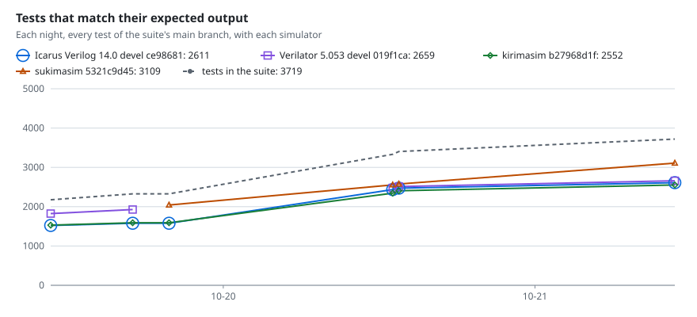
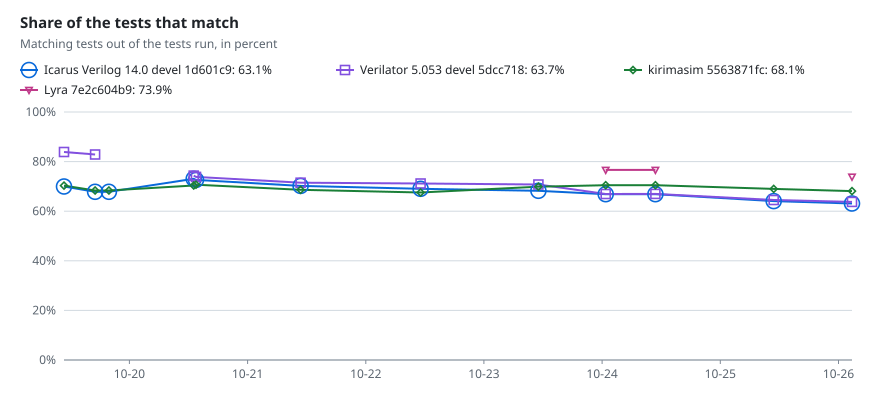
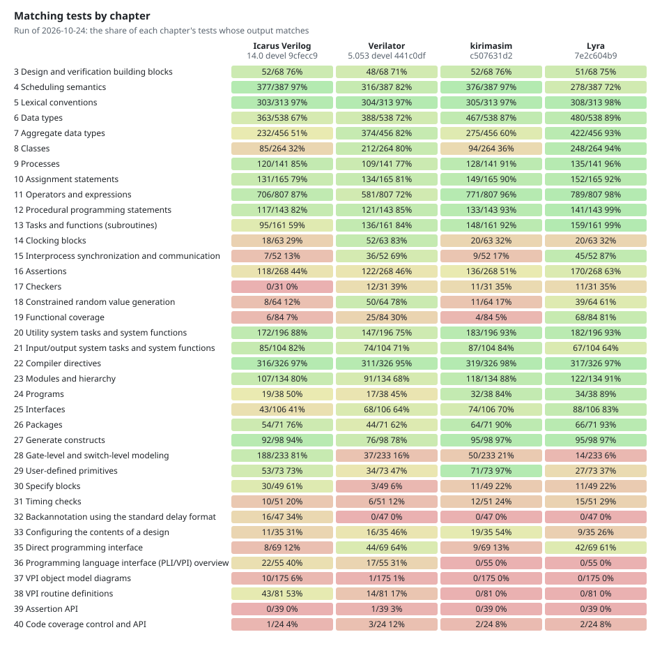
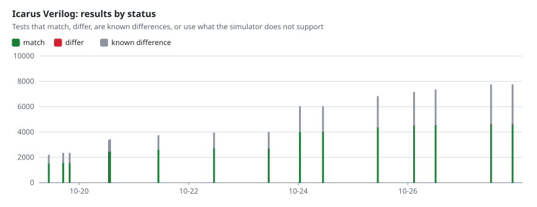
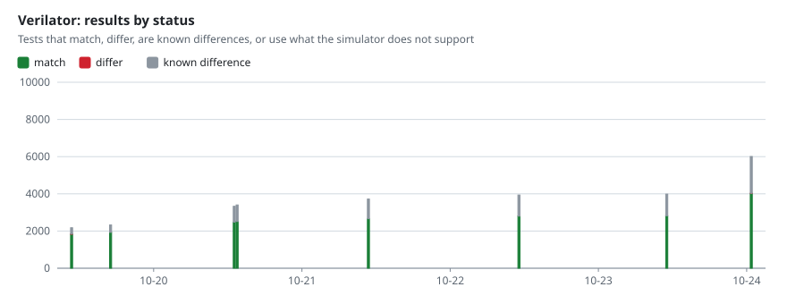
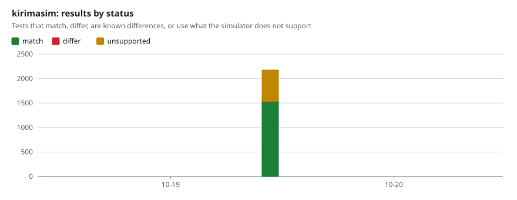
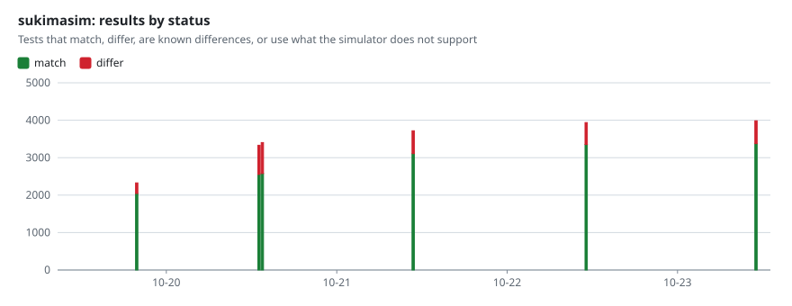

# Nightly results of kirimasim-tests

The [nightly workflow](https://github.com/kurochan001/kirimasim-tests/actions/workflows/nightly.yml) of [kirimasim-tests](https://github.com/kurochan001/kirimasim-tests) writes this branch. Each night it runs every test of the suite's main branch with each simulator, adds the results to `history.json` and draws the charts below. A test matches when the simulator's normalized standard output is exactly its expected output; see the suite's README for what each status means.

Latest run: 2026-10-21 01:02 UTC, suite commit [`824f574`](https://github.com/kurochan001/kirimasim-tests/commit/824f5748dd619afaf472f60fd0ce83d0a547d829), 3332 tests, [workflow run](https://github.com/kurochan001/kirimasim-tests/actions/runs/39507186309).

| Simulator | Version | Match | Differ | Known differences | Unsupported | Since the previous run |
| --- | --- | ---: | ---: | ---: | ---: | --- |
| Icarus Verilog | Icarus Verilog version 14.0 (devel) (s20260301-626-g7e3d0c6b) | 2435 (73.1%) | 0 | 897 | 0 | 1005 new tests (857 match) |
| Verilator | Verilator 5.053 devel rev v5.052-518-g3cc49815 | 2477 (74.3%) | 0 | 855 | 0 | 7 newly match, 1005 new tests (542 match) |
| kirimasim | kirimasim 0.0.0 (commit 0680c67d562e), built with GNU 13.3.0 | 2344 (70.3%) | 10 | 0 | 978 | 2 newly match, 1005 new tests (752 match) |
| sukimasim | sukimasim version 0.9.9.2 (commit 2754b2970fcb) | 2554 (76.7%) | 778 | 0 | 0 | 42 newly match, 1005 new tests (469 match) |

sukimasim's repository is private: the nightly workflow builds its latest `main` from there, and only its results are published.

## Changes in the latest run

Tests that match now but did not in the previous run of the same simulator, and tests that matched then but do not now. Tests added to the suite are counted in the table above.

### Verilator

Newly match (7): `ch16/test_assert_immed_2`, `ch16/test_cover_disable_iff`, `ch16/test_cover_property_restrict`, `ch16/test_immediate_assertions_2`, `ch16/test_untyped_formal_arguments`, `ch19/test_cg_at_least`, `ch35/test_dpi_unpacked_struct`

### kirimasim

Newly match (2): `ch21/test_file_fmonitor_fstrobe`, `ch29/test_udp_initial_value_not_delayed`

### sukimasim

Newly match (42): `ch10/test_nba_verification`, `ch11/test_expression_width`, `ch11/test_string_literal_vector_padding`, `ch16/test_assert_immed_2`, `ch16/test_cover_disable_iff`, `ch16/test_cover_property_restrict`, `ch16/test_immediate_assertions`, `ch16/test_immediate_assertions_2`, `ch16/test_sequence_goto_nonconsecutive`, `ch16/test_untyped_formal_arguments`, `ch19/test_cg_embedded_in_class`, `ch20/test_printtimescale`, `ch20/test_typename`, `ch21/test_format_explicit_field_width`, `ch21/test_numeric_edge_cases`, `ch21/test_readmemh_addresses_comments`, `ch21/test_scanf_functions`, `ch22/test_compiler_directives_comprehensive`, `ch22/test_unconnected_drive`, `ch24/test_program_automatic_lifetime`, `ch24/test_program_comprehensive`, `ch24/test_program_reactive`, `ch24/test_program_reactive_sees_nba`, `ch24/test_program_variables`, `ch26/test_package_task`, `ch29/test_udp_level_edge_mix`, `ch31/test_timing_conditioned_event`, `ch31/test_timing_edge_control_specifier`, `ch31/test_timing_recovery_removal_recrem`, `ch31/test_timing_setup_hold_notifier`, `ch31/test_timing_setuphold`, `ch31/test_timing_vector_signal`, `ch31/test_timing_width_period_notifier`, `ch38/test_vpi_mcd_files`, `ch38/test_vpi_mcd_flush`, `ch6/test_string_getc_is_byte`, `ch6/test_string_ignores_null_characters`, `ch8/test_interface_class_implements`, `ch8/test_ral_block`, `ch9/test_disable_fork_ends_loops_and_class_tasks`, `ch9/test_fork_automatic_declaration_per_iteration`, `ch9/test_wait_fork_disable_fork`

## By chapter

## Each simulator over time

## Recent runs

Matching tests of each simulator, with the change since its previous run. The version is shown when it changed.

| Run (UTC) | Suite | Tests | Icarus Verilog | Verilator | kirimasim | sukimasim |
| --- | --- | ---: | ---: | ---: | ---: | ---: |
| [2026-10-21 01:02](https://github.com/kurochan001/kirimasim-tests/actions/runs/39507186309) | [`824f574`](https://github.com/kurochan001/kirimasim-tests/commit/824f5748dd619afaf472f60fd0ce83d0a547d829) | 3332 | 2435 (+857 −0) | 2477 (+549 −0) `5.053 devel 3cc4981` | 2344 (+754 −0) `0680c67d5` | 2554 (+511 −0) `2754b2970` |
| [2026-10-20 07:49](https://github.com/kurochan001/kirimasim-tests/actions/runs/39387575855) | [`6bffc4a`](https://github.com/kurochan001/kirimasim-tests/commit/6bffc4a184134250ca4b934ef2b40af9961bc4d5) | 2327 | 1578 `14.0 devel 7e3d0c6` | — | 1590 `b1be7015e` | 2043 `02efa6d73` |
| [2026-10-20 05:01](https://github.com/kurochan001/kirimasim-tests/actions/runs/39363555028) | [`56508cd`](https://github.com/kurochan001/kirimasim-tests/commit/56508cdce0a414ca1623756c6856dd1f49819977) | 2327 | 1578 (+56 −0) | 1928 (+103 −0) `5.053 devel 0177067` | 1590 (+60 −0) `ff80adcf6` | — |
| [2026-10-19 22:42](https://github.com/kurochan001/kirimasim-tests/actions/runs/39329365210) | [`42081bd`](https://github.com/kurochan001/kirimasim-tests/commit/42081bd73c354db73c20b1b17fb076975ae5a16f) | 2176 | 1522 `14.0 devel eed9291` | 1825 `5.053 devel 60f166e` | 1530 `8b598b574` | — |

## Files

- `history.json`: one entry per run, with the counts of each simulator by status and by chapter, and the tests whose result changed.
- `latest/<simulator>.json`: the result of every test in the latest run of each simulator, which the next run is compared with.
- `charts/*.svg`: the charts above.
