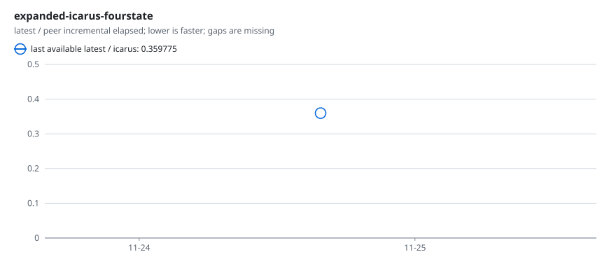
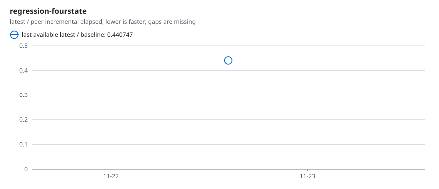
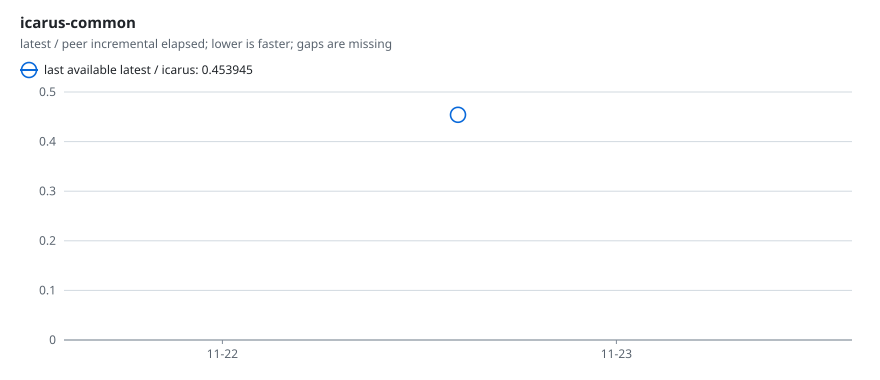
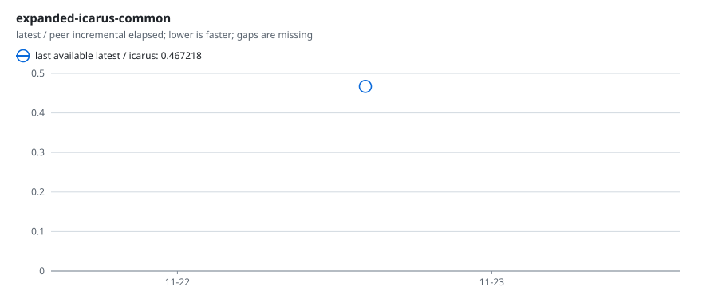
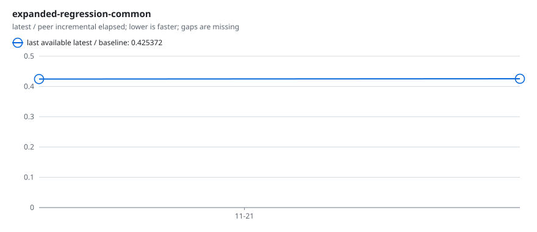
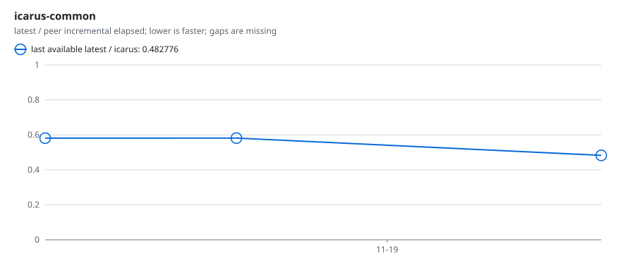
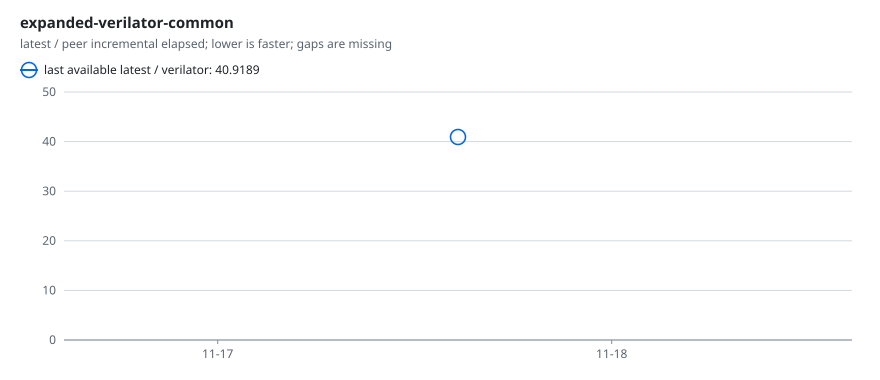
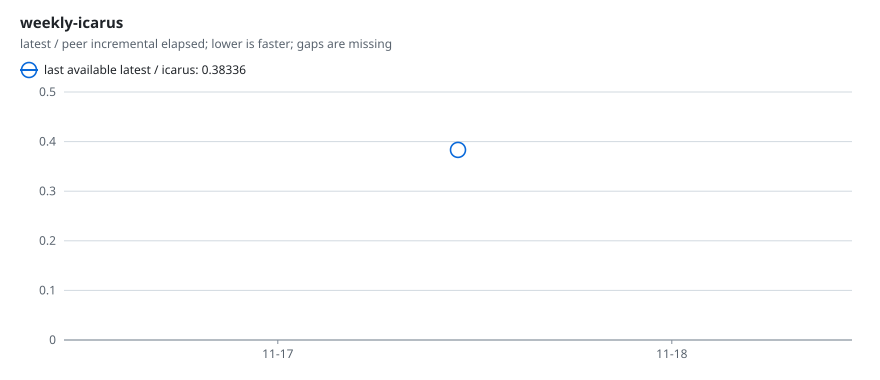
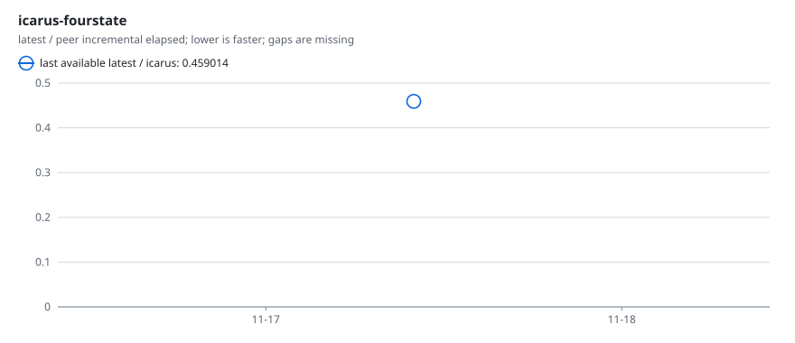

# Daily and weekly simulation-speed benchmarks

[English](README.md) / [日本語](README.ja.md)

Independent of functional Nightly. GitHub-hosted values are reference measurements; five repetitions do not establish statistical significance.


Equal-weight geometric mean of all 25 daily designs (22 common + 3 four-state). Ratio = kirimasim / Icarus 14.0 devel incremental elapsed. 0.97 means 3% less elapsed time; lower is faster.

Both development heads are resolved once per campaign. A day uses its last formal attempt in JST; one invalid member makes the mean missing. Different environments/definitions are separate curves. Both simulators can affect the trend; fixed-version comparisons are below.

[JSON](headline.json) · [Method / 測定方法](https://github.com/kurochan001/kirimasim-tests/blob/main/docs/daily-benchmark.md)

Latest overall attempt: **2026-11-25 JST — 0.56561** (25/25; incomplete)

[Raw / 生データ](runs/actions-45540765572-1.json) · [Actions logs / ログ](https://github.com/kurochan001/kirimasim-tests/actions/runs/45540765572/attempts/1)

<details><summary>Case results, fixed-version comparisons and earlier series</summary>

## Latest daily attempt

[JSON](latest-daily.json)

**Run:** `actions-45540765572-1` — incomplete
2026-11-25T03:47:30.324610+00:00 → 2026-11-25T04:45:24.042738+00:00

Ratios = latest kirimasim / peer incremental elapsed; below 1 favors latest.

This is a descriptive reference on this environment. Missing/failed values are not zero.

[JSON](runs/actions-45540765572-1.json) · [Actions logs / ログ](https://github.com/kurochan001/kirimasim-tests/actions/runs/45540765572/attempts/1) · [Method / 測定方法](https://github.com/kurochan001/kirimasim-tests/blob/main/docs/daily-benchmark.md)

Environment: github-hosted-ubuntu-24.04 / AMD EPYC 9V74 80-Core Processor / Linux-7.0.0-1017-azure-x86_64-with-glibc2.39

<details><summary>Measurement settings</summary>

```json
{
  "machine": {
    "os": "Linux-7.0.0-1017-azure-x86_64-with-glibc2.39",
    "cores": 4,
    "cpu": "AMD EPYC 9V74 80-Core Processor",
    "memory_gib": 16,
    "distribution": "Ubuntu 24.04.5 LTS",
    "architecture": "x86_64"
  },
  "compiler": "g++ (Ubuntu 13.3.0-6ubuntu2~24.04.1) 13.3.0",
  "profile": "daily",
  "environment": "github-hosted-ubuntu-24.04",
  "image_os": "ubuntu24",
  "image_version": "20261116.376.1",
  "settings": {
    "runs": 5,
    "warmups": 1,
    "timeout_seconds": 600,
    "short_seconds": 0.05,
    "regression_warning_ratio": 1.15,
    "simulation_threads": 1,
    "waveforms": false,
    "assertions": false,
    "verilator_build_jobs": 1
  },
  "mode": "formal",
  "runs": 5,
  "tool_builds": {
    "latest": {
      "compiler": "g++ (Ubuntu 13.3.0-6ubuntu2~24.04.1) 13.3.0",
      "c_compiler": "gcc (Ubuntu 13.3.0-6ubuntu2~24.04.1) 13.3.0",
      "flags": {
        "CC": "gcc",
        "CXX": "g++",
        "CFLAGS": "",
        "CXXFLAGS": "",
        "preset": "release",
        "cmake": "-O3 -DNDEBUG -ffp-contract=off, no fast-math",
        "make_jobs": 2
      }
    },
    "baseline": {
      "compiler": "g++ (Ubuntu 13.3.0-6ubuntu2~24.04.1) 13.3.0",
      "c_compiler": "gcc (Ubuntu 13.3.0-6ubuntu2~24.04.1) 13.3.0",
      "flags": {
        "CC": "gcc",
        "CXX": "g++",
        "CFLAGS": "",
        "CXXFLAGS": "",
        "preset": "release",
        "cmake": "-O3 -DNDEBUG -ffp-contract=off, no fast-math",
        "make_jobs": 2
      }
    },
    "icarus": {
      "compiler": "g++ (Ubuntu 13.3.0-6ubuntu2~24.04.1) 13.3.0",
      "c_compiler": "gcc (Ubuntu 13.3.0-6ubuntu2~24.04.1) 13.3.0",
      "flags": {
        "CC": "gcc",
        "CXX": "g++",
        "CFLAGS": "",
        "CXXFLAGS": "",
        "preset": "release",
        "cmake": "-O3 -DNDEBUG -ffp-contract=off, no fast-math",
        "make_jobs": 2
      }
    },
    "verilator": {
      "compiler": "g++ (Ubuntu 13.3.0-6ubuntu2~24.04.1) 13.3.0",
      "c_compiler": "gcc (Ubuntu 13.3.0-6ubuntu2~24.04.1) 13.3.0",
      "flags": {
        "CC": "gcc",
        "CXX": "g++",
        "CFLAGS": "",
        "CXXFLAGS": "",
        "preset": "release",
        "cmake": "-O3 -DNDEBUG -ffp-contract=off, no fast-math",
        "make_jobs": 2
      }
    },
    "icarus_devel": {
      "compiler": "g++ (Ubuntu 13.3.0-6ubuntu2~24.04.1) 13.3.0",
      "c_compiler": "gcc (Ubuntu 13.3.0-6ubuntu2~24.04.1) 13.3.0",
      "flags": {
        "CC": "gcc",
        "CXX": "g++",
        "CFLAGS": "",
        "CXXFLAGS": "",
        "preset": "release",
        "cmake": "-O3 -DNDEBUG -ffp-contract=off, no fast-math",
        "make_jobs": 2
      }
    }
  },
  "verilator_options": "--binary --timing --threads 1 --build-jobs 1; default C++ optimization; assertions/tracing off",
  "icarus_options": "-g2012; vvp -n; single process",
  "kirimasim_options": "default four-state; interpreter; no waveform/assertion request"
}
```

</details>

- `latest`: `a50ec73c37d866bc493ecb76830ef1ddfcf7543b` — kirimasim 0.2.2 (commit a50ec73c37d8), built with GNU 13.3.0
- `baseline`: `cfa2ccd75989c1ebb9ed63303271183377364cf0` — kirimasim 0.1.0 (commit cfa2ccd75989), built with GNU 13.3.0
- `icarus`: `dfeee909ed9f20b4870dd93423156c0170c0e1ff` — Icarus Verilog version 13.0 (stable) (dfeee90-dirty)
- `verilator`: `bbb60a403932a9f695cb6ff001ceb73de6ad9234` — Verilator 5.054 2026-11-01 rev vUNKNOWN-built20261123-bbb60a4
- `icarus_devel`: `3f05f92b0fcd6561d907b0b023d2408371307496` — Icarus Verilog version 14.0 (devel) (3f05f92)

Definition and measurement identity: `{'config_sha256': '4006a76543b7c88eed78ba128e7459c54ac2ee82a78efdd401ac2d85643bef9b', 'driver_sha256': '0edb91f5cbc17e8d1eec9e77ab4c87fb7dbcf4b9ff57d233c5e94628770ad077', 'comparison_sha256': '2896f429781d5eaff2d0ecec465726de342f840892056d20304d2df179ad6be0', 'history_sha256': 'bda014f86bbbea0bd769b5458656bfda07cbcaec712624cfad17960b10b5c887', 'setup_sha256': 'aa89dd6c7df5268f361f96049069cfe68b524ff93819afc4351fcb557c91d8f9', 'adapter_sha256': '4811f9d50d4a09d8794710296d644350468c49a9579a794f27af42ac9fb6b5bc', 'benchmark_commit': 'cfa2ccd75989c1ebb9ed63303271183377364cf0', 'reference_sha256': {'bench/reference_expanded.py': 'a1196d79efb88425f61cc69ba1d9ec99542f7f5dc41fac2a07ade82090b00f4a', 'bench/reference_fourstate_mix.py': '586fb643e9ef9df9e304df83e04e711aa1b875e6cb4393e6e3c98cd1707b70e1'}}`

| Case | Tool | State | Build s | T(1) median s | T(N) median s | Incremental s | MAD T(N) s | RSS MiB | latest/peer | Reason / warning |
|---|---|---|---:|---:|---:|---:|---:|---:|---:|---|
| casez_struct (N=5000000) | latest | measured | — | 0.0044288 | 2.755 | 2.7505 | 0.025406 | 29.75 | — |  |
| casez_struct (N=5000000) | baseline | measured | — | 0.0055122 | 5.7501 | 5.7445 | 0.041197 | 28.293 | 0.47881 |  |
| casez_struct (N=5000000) | icarus | measured | 0.0050758 | 0.0033768 | 6.4757 | 6.4723 | 0.033998 | 7.3672 | 0.42497 |  |
| casez_struct (N=5000000) | verilator | measured | 5.3403 | 0.0016115 | 0.025129 | 0.023517 | 6.6219e-05 | 3.8047 | 116.96 | short incremental time; sensitive to timing noise |
| casez_struct (N=5000000) | icarus_devel | measured | 0.0047141 | 0.003181 | 6.0914 | 6.0883 | 0.052288 | 7.5 | 0.45178 |  |
| comb_chain (N=3000000) | latest | measured | — | 0.0052629 | 4.7103 | 4.7051 | 0.0086863 | 29.762 | — |  |
| comb_chain (N=3000000) | baseline | measured | — | 0.0045376 | 15.711 | 15.706 | 0.017918 | 28.402 | 0.29957 |  |
| comb_chain (N=3000000) | icarus | measured | 0.0060498 | 0.0034377 | 20.92 | 20.917 | 0.11076 | 7.4375 | 0.22495 |  |
| comb_chain (N=3000000) | verilator | measured | 6.0421 | 0.0016499 | 0.35639 | 0.35474 | 0.0011843 | 3.8125 | 13.263 |  |
| comb_chain (N=3000000) | icarus_devel | measured | 0.0047288 | 0.0032246 | 14.565 | 14.562 | 0.012322 | 7.5781 | 0.32312 |  |
| dyn_queue (N=4000000) | latest | measured | — | 0.0047555 | 4.4966 | 4.4918 | 0.0058195 | 29.66 | — |  |
| dyn_queue (N=4000000) | baseline | measured | — | 0.0049491 | 6.1696 | 6.1647 | 0.02893 | 28.246 | 0.72864 |  |
| dyn_queue (N=4000000) | icarus | measured | 0.0066371 | 0.0034796 | 10.884 | 10.881 | 0.095057 | 7.3711 | 0.41282 |  |
| dyn_queue (N=4000000) | verilator | measured | 5.4596 | 0.001649 | 0.12299 | 0.12134 | 7.7874e-05 | 3.8516 | 37.019 |  |
| dyn_queue (N=4000000) | icarus_devel | measured | 0.0045579 | 0.0034135 | 10.525 | 10.521 | 0.03508 | 7.6328 | 0.42693 |  |
| fork_join (N=4000000) | latest | measured | — | 0.0046871 | 6.0848 | 6.0801 | 0.012442 | 29.477 | — |  |
| fork_join (N=4000000) | baseline | measured | — | 0.0049725 | 8.4402 | 8.4352 | 0.00048567 | 28.238 | 0.72081 |  |
| fork_join (N=4000000) | icarus | measured | 0.0055051 | 0.0033013 | 9.8097 | 9.8064 | 0.037842 | 7.3867 | 0.62002 |  |
| fork_join (N=4000000) | verilator | measured | 6.4161 | 0.0016391 | 1.8077 | 1.806 | 0.0059743 | 3.8516 | 3.3665 |  |
| fork_join (N=4000000) | icarus_devel | measured | 0.0044995 | 0.0028418 | 7.5986 | 7.5957 | 0.058476 | 7.5312 | 0.80047 |  |
| func_call (N=1500000) | latest | measured | — | 0.0045824 | 5.0429 | 5.0383 | 0.035114 | 29.613 | — |  |
| func_call (N=1500000) | baseline | measured | — | 0.004668 | 8.1309 | 8.1263 | 0.0096569 | 28.18 | 0.62001 |  |
| func_call (N=1500000) | icarus | measured | 0.0063165 | 0.0033718 | 16.72 | 16.717 | 0.088326 | 7.3203 | 0.30139 |  |
| func_call (N=1500000) | verilator | measured | 5.4635 | 0.0016151 | 0.0094832 | 0.0078682 | 6.9986e-05 | 0.55469 | 640.34 | short incremental time; sensitive to timing noise |
| func_call (N=1500000) | icarus_devel | measured | 0.0046172 | 0.0034071 | 12.61 | 12.606 | 0.047774 | 7.5508 | 0.39967 |  |
| gate_udp (N=400000) | latest | measured | — | 0.0076601 | 5.1934 | 5.1858 | 0.02055 | 33.59 | — |  |
| gate_udp (N=400000) | baseline | measured | — | 0.0062923 | 8.769 | 8.7627 | 0.040641 | 28.113 | 0.5918 |  |
| gate_udp (N=400000) | icarus | measured | 0.0065375 | 0.0049008 | 5.248 | 5.2431 | 0.020757 | 7.5234 | 0.98906 |  |
| gate_udp (N=400000) | verilator | measured | 6.7583 | 0.0017069 | 0.063522 | 0.061815 | 0.00056154 | 3.8516 | 83.891 |  |
| gate_udp (N=400000) | icarus_devel | measured | 0.006598 | 0.0046328 | 4.9245 | 4.9199 | 0.020669 | 7.6602 | 1.054 |  |
| mem_rw (N=4000000) | latest | measured | — | 0.0068007 | 4.0211 | 4.0143 | 0.0092852 | 29.758 | — |  |
| mem_rw (N=4000000) | baseline | measured | — | 0.0063184 | 8.221 | 8.2147 | 0.032004 | 28.227 | 0.48868 |  |
| mem_rw (N=4000000) | icarus | measured | 0.0065294 | 0.0039461 | 6.8787 | 6.8748 | 0.034977 | 7.4258 | 0.58392 |  |
| mem_rw (N=4000000) | verilator | measured | 6.7633 | 0.0016659 | 1.0427 | 1.041 | 0.0084387 | 3.8555 | 3.8561 |  |
| mem_rw (N=4000000) | icarus_devel | measured | 0.0049416 | 0.0040356 | 5.3162 | 5.3122 | 0.057244 | 7.6406 | 0.75569 |  |
| nba_burst (N=500000) | latest | measured | — | 0.0044009 | 0.085867 | 0.081466 | 0.0010056 | 105.77 | — |  |
| nba_burst (N=500000) | baseline | measured | — | 0.0049549 | 0.17034 | 0.16538 | 0.0029256 | 124.4 | 0.49259 |  |
| nba_burst (N=500000) | icarus | measured | 0.0051086 | 0.0029185 | 0.18995 | 0.18703 | 0.00076152 | 33.828 | 0.43558 |  |
| nba_burst (N=500000) | verilator | incomparable | 6.5835 | 0.001651 | 0.001475 | — | 5.8288e-05 | 0.55078 | — | non-positive or non-finite incremental elapsed time |
| nba_burst (N=500000) | icarus_devel | measured | 0.0045594 | 0.0028693 | 0.18327 | 0.1804 | 0.0012746 | 34.035 | 0.45158 |  |
| nba_shift (N=1000000) | latest | measured | — | 0.0061117 | 15.251 | 15.245 | 0.082478 | 31.664 | — |  |
| nba_shift (N=1000000) | baseline | measured | — | 0.0058453 | 40.131 | 40.125 | 0.22065 | 28.195 | 0.37994 |  |
| nba_shift (N=1000000) | icarus | measured | 0.0059408 | 0.0039432 | 37.245 | 37.241 | 0.21069 | 7.4648 | 0.40936 |  |
| nba_shift (N=1000000) | verilator | measured | 6.7289 | 0.0016608 | 0.29768 | 0.29602 | 0.0015076 | 3.8242 | 51.499 |  |
| nba_shift (N=1000000) | icarus_devel | measured | 0.0052225 | 0.0038288 | 37.306 | 37.302 | 0.062767 | 7.6602 | 0.40868 |  |
| proc_wait (N=1000000) | latest | measured | — | 0.009669 | 6.714 | 6.7044 | 0.032374 | 39.723 | — |  |
| proc_wait (N=1000000) | baseline | measured | — | 0.0075233 | 13.014 | 13.007 | 0.12242 | 30.266 | 0.51545 |  |
| proc_wait (N=1000000) | icarus | measured | 0.0085923 | 0.0050065 | 8.0941 | 8.0891 | 0.01379 | 7.8047 | 0.82881 |  |
| proc_wait (N=1000000) | verilator | measured | 8.8815 | 0.0017136 | 3.0666 | 3.0649 | 0.0048815 | 3.9531 | 2.1875 |  |
| proc_wait (N=1000000) | icarus_devel | measured | 0.0063613 | 0.0043426 | 8.6874 | 8.6831 | 0.0030793 | 8.1055 | 0.77212 |  |
| string_fmt (N=500000) | latest | measured | — | 0.0049892 | 3.7481 | 3.7431 | 0.0031016 | 29.789 | — |  |
| string_fmt (N=500000) | baseline | measured | — | 0.0050507 | 6.9772 | 6.9721 | 0.072283 | 28.25 | 0.53687 |  |
| string_fmt (N=500000) | icarus | measured | 0.0063615 | 0.0034618 | 16.596 | 16.592 | 0.12419 | 7.4023 | 0.22559 |  |
| string_fmt (N=500000) | verilator | measured | 5.5765 | 0.0016939 | 0.21061 | 0.20891 | 0.0013858 | 3.9258 | 17.917 |  |
| string_fmt (N=500000) | icarus_devel | measured | 0.004583 | 0.0035918 | 13.386 | 13.382 | 0.17374 | 7.5664 | 0.27971 |  |
| wide_arith (N=1500000) | latest | measured | — | 0.0045388 | 2.6372 | 2.6327 | 0.011216 | 29.758 | — |  |
| wide_arith (N=1500000) | baseline | measured | — | 0.0046746 | 7.7568 | 7.7521 | 0.042296 | 28.168 | 0.33961 |  |
| wide_arith (N=1500000) | icarus | measured | 0.0051324 | 0.0032959 | 13.207 | 13.203 | 0.006525 | 7.3281 | 0.19939 |  |
| wide_arith (N=1500000) | verilator | measured | 5.6499 | 0.0016304 | 0.1236 | 0.12197 | 0.00069133 | 3.8359 | 21.584 |  |
| wide_arith (N=1500000) | icarus_devel | measured | 0.0045734 | 0.0030923 | 3.0778 | 3.0747 | 0.021966 | 7.5352 | 0.85625 |  |
| fourstate_mix (N=1000000) | latest | measured | — | 0.0047922 | 0.89214 | 0.88735 | 0.0028053 | 29.809 | — |  |
| fourstate_mix (N=1000000) | baseline | measured | — | 0.0055062 | 2.0668 | 2.0613 | 0.014881 | 28.449 | 0.43049 |  |
| fourstate_mix (N=1000000) | icarus | measured | 0.0059312 | 0.0034781 | 3.2705 | 3.267 | 0.023387 | 7.4102 | 0.27161 |  |
| fourstate_mix (N=1000000) | verilator | unsupported | — | — | — | — | — | — | — | X/Z observations require four-state semantics; excluded before execution |
| fourstate_mix (N=1000000) | icarus_devel | measured | 0.0048225 | 0.0033792 | 2.3638 | 2.3604 | 0.015183 | 7.5664 | 0.37593 |  |
| fifo_stream (N=200000) | latest | measured | — | 0.0049347 | 0.42795 | 0.42301 | 0.0064135 | 29.816 | — |  |
| fifo_stream (N=200000) | baseline | measured | — | 0.0053742 | 0.86691 | 0.86153 | 0.002514 | 28.367 | 0.491 |  |
| fifo_stream (N=200000) | icarus | measured | 0.0058244 | 0.0034765 | 0.59286 | 0.58938 | 0.0010495 | 7.4102 | 0.71772 |  |
| fifo_stream (N=200000) | verilator | measured | 6.3088 | 0.0016143 | 0.07224 | 0.070626 | 0.00015292 | 3.8555 | 5.9895 |  |
| fifo_stream (N=200000) | icarus_devel | measured | 0.0052428 | 0.0031281 | 0.52196 | 0.51883 | 0.0014648 | 7.5742 | 0.81531 |  |
| uart_loopback (N=20000) | latest | measured | — | 0.0054684 | 0.44333 | 0.43786 | 0.00089543 | 31.875 | — |  |
| uart_loopback (N=20000) | baseline | measured | — | 0.0058581 | 0.82717 | 0.82131 | 0.00040176 | 28.375 | 0.53312 |  |
| uart_loopback (N=20000) | icarus | measured | 0.0064861 | 0.0035717 | 0.36825 | 0.36468 | 0.0017991 | 7.4375 | 1.2007 |  |
| uart_loopback (N=20000) | verilator | measured | 6.4158 | 0.0016218 | 0.084379 | 0.082758 | 0.00066552 | 3.8516 | 5.2909 |  |
| uart_loopback (N=20000) | icarus_devel | measured | 0.005119 | 0.0035299 | 0.32405 | 0.32052 | 0.0013281 | 7.6172 | 1.3661 |  |
| bus_fabric (N=150000) | latest | measured | — | 0.0062385 | 1.035 | 1.0288 | 0.0040986 | 31.809 | — |  |
| bus_fabric (N=150000) | baseline | measured | — | 0.0057495 | 2.4198 | 2.4141 | 0.0022921 | 28.367 | 0.42615 |  |
| bus_fabric (N=150000) | icarus | measured | 0.0064304 | 0.0038373 | 0.78518 | 0.78135 | 0.0037872 | 7.4688 | 1.3167 |  |
| bus_fabric (N=150000) | verilator | measured | 6.2732 | 0.0016054 | 0.093077 | 0.091472 | 9.2872e-05 | 3.8477 | 11.247 |  |
| bus_fabric (N=150000) | icarus_devel | measured | 0.0054179 | 0.0036553 | 0.72369 | 0.72003 | 0.0027783 | 7.6445 | 1.4288 |  |
| hierarchy_fanout (N=100000) | latest | measured | — | 0.014401 | 5.8125 | 5.7981 | 0.01207 | 47.758 | — |  |
| hierarchy_fanout (N=100000) | baseline | measured | — | 0.011286 | 14.405 | 14.393 | 0.018333 | 36.297 | 0.40283 |  |
| hierarchy_fanout (N=100000) | icarus | measured | 0.011714 | 0.011746 | 25.714 | 25.703 | 0.18838 | 8.3125 | 0.22558 |  |
| hierarchy_fanout (N=100000) | verilator | measured | 6.3055 | 0.0017031 | 0.050511 | 0.048808 | 4.0921e-05 | 3.8516 | 118.79 | short incremental time; sensitive to timing noise |
| hierarchy_fanout (N=100000) | icarus_devel | measured | 0.010781 | 0.01137 | 8.7325 | 8.7211 | 0.051727 | 8.4922 | 0.66483 |  |
| event_fanout (N=50000) | latest | measured | — | 0.019185 | 2.5817 | 2.5625 | 0.0019516 | 49.766 | — |  |
| event_fanout (N=50000) | baseline | measured | — | 0.012661 | 3.8335 | 3.8208 | 0.010512 | 42.398 | 0.67067 |  |
| event_fanout (N=50000) | icarus | measured | 0.01515 | 0.0096074 | 3.4928 | 3.4832 | 0.0035366 | 9.1055 | 0.73567 |  |
| event_fanout (N=50000) | verilator | measured | 6.8179 | 0.0016656 | 0.060271 | 0.058606 | 0.00024974 | 3.8711 | 43.724 |  |
| event_fanout (N=50000) | icarus_devel | measured | 0.011721 | 0.0091248 | 3.5286 | 3.5195 | 0.0013121 | 9.2734 | 0.72809 |  |
| word_boundary (N=4000000) | latest | measured | — | 0.0045895 | 4.9205 | 4.9159 | 0.055797 | 29.625 | — |  |
| word_boundary (N=4000000) | baseline | measured | — | 0.0053881 | 10.642 | 10.637 | 0.051399 | 28.324 | 0.46216 |  |
| word_boundary (N=4000000) | icarus | measured | 0.0053264 | 0.003476 | 23.236 | 23.232 | 0.094986 | 7.3359 | 0.2116 |  |
| word_boundary (N=4000000) | verilator | measured | 5.5911 | 0.0016572 | 0.038586 | 0.036928 | 0.00011426 | 3.8359 | 133.12 | short incremental time; sensitive to timing noise |
| word_boundary (N=4000000) | icarus_devel | measured | 0.0045303 | 0.0033541 | 9.1281 | 9.1247 | 0.059315 | 7.4844 | 0.53874 |  |
| wide_divide (N=80000) | latest | measured | — | 0.0054732 | 0.13721 | 0.13174 | 0.0010247 | 29.801 | — |  |
| wide_divide (N=80000) | baseline | measured | — | 0.0052924 | 1.2826 | 1.2773 | 0.0079588 | 28.379 | 0.10314 |  |
| wide_divide (N=80000) | icarus | measured | 0.0055952 | 0.0032769 | 1.0237 | 1.0204 | 0.0053223 | 7.3164 | 0.1291 |  |
| wide_divide (N=80000) | verilator | measured | 5.4438 | 0.0016588 | 0.0094287 | 0.0077699 | 8.3396e-05 | 0.55078 | 16.955 | short incremental time; sensitive to timing noise |
| wide_divide (N=80000) | icarus_devel | measured | 0.004562 | 0.0029367 | 0.59361 | 0.59067 | 0.0028408 | 7.5 | 0.22303 |  |
| packed_slice (N=1500000) | latest | measured | — | 0.0050402 | 1.8846 | 1.8796 | 0.022041 | 29.699 | — |  |
| packed_slice (N=1500000) | baseline | measured | — | 0.0049927 | 6.0768 | 6.0718 | 0.004822 | 28.156 | 0.30956 |  |
| packed_slice (N=1500000) | icarus | measured | 0.0051113 | 0.0033804 | 8.3304 | 8.327 | 0.038658 | 7.332 | 0.22572 |  |
| packed_slice (N=1500000) | verilator | measured | 5.3729 | 0.0016916 | 0.086483 | 0.084791 | 0.00031823 | 3.8008 | 22.167 |  |
| packed_slice (N=1500000) | icarus_devel | measured | 0.0045011 | 0.0033847 | 3.6263 | 3.6229 | 0.014662 | 7.5156 | 0.5188 |  |
| memory_scatter (N=5000000) | latest | measured | — | 0.04706 | 2.7579 | 2.7108 | 0.0048214 | 43.812 | — |  |
| memory_scatter (N=5000000) | baseline | measured | — | 0.05459 | 6.3217 | 6.2671 | 0.11969 | 42.359 | 0.43255 |  |
| memory_scatter (N=5000000) | icarus | measured | 0.0051152 | 0.02727 | 13.098 | 13.07 | 0.02985 | 7.832 | 0.2074 |  |
| memory_scatter (N=5000000) | verilator | measured | 5.4271 | 0.0017068 | 0.016173 | 0.014467 | 8.2595e-05 | 3.918 | 187.39 | short incremental time; sensitive to timing noise |
| memory_scatter (N=5000000) | icarus_devel | measured | 0.004798 | 0.018333 | 8.1674 | 8.149 | 0.041338 | 8.0586 | 0.33266 |  |
| clock_domains (N=20000) | latest | measured | — | 0.0049437 | 0.12424 | 0.1193 | 0.0008327 | 29.801 | — |  |
| clock_domains (N=20000) | baseline | measured | — | 0.0051269 | 0.23854 | 0.23341 | 0.00070359 | 28.395 | 0.5111 |  |
| clock_domains (N=20000) | icarus | measured | 0.0053396 | 0.003356 | 0.11452 | 0.11116 | 0.00022334 | 7.4102 | 1.0732 |  |
| clock_domains (N=20000) | verilator | measured | 6.3699 | 0.0016189 | 0.075149 | 0.07353 | 0.0002262 | 3.8203 | 1.6224 |  |
| clock_domains (N=20000) | icarus_devel | measured | 0.0047287 | 0.0033455 | 0.11433 | 0.11099 | 0.00079851 | 7.5586 | 1.0749 |  |
| fourstate_arith (N=100000) | latest | measured | — | 0.0049454 | 0.1295 | 0.12456 | 0.00084545 | 29.828 | — |  |
| fourstate_arith (N=100000) | baseline | measured | — | 0.0051295 | 0.18939 | 0.18426 | 0.0013132 | 28.375 | 0.67599 |  |
| fourstate_arith (N=100000) | icarus | measured | 0.0051779 | 0.0033807 | 0.25173 | 0.24835 | 0.00069638 | 7.3164 | 0.50154 |  |
| fourstate_arith (N=100000) | verilator | unsupported | — | — | — | — | — | — | — | X/Z observations require four-state semantics; excluded before execution |
| fourstate_arith (N=100000) | icarus_devel | measured | 0.0044572 | 0.0027332 | 0.23197 | 0.22923 | 0.0013254 | 7.5547 | 0.54336 |  |
| resolved_bus (N=50000) | latest | measured | — | 0.0051038 | 0.17055 | 0.16545 | 0.00069337 | 29.727 | — |  |
| resolved_bus (N=50000) | baseline | measured | — | 0.0051161 | 0.38643 | 0.38132 | 0.0015173 | 28.398 | 0.43388 |  |
| resolved_bus (N=50000) | icarus | measured | 0.0056218 | 0.003567 | 0.48754 | 0.48397 | 0.00071513 | 7.4375 | 0.34185 |  |
| resolved_bus (N=50000) | verilator | unsupported | — | — | — | — | — | — | — | X/Z observations require four-state semantics; excluded before execution |
| resolved_bus (N=50000) | icarus_devel | measured | 0.0045784 | 0.0034403 | 0.4872 | 0.48376 | 0.0014583 | 7.5703 | 0.342 |  |

Fixed comparison sets (all members required):

- **regression-common**: 0.49887; 12/12; casez_struct, comb_chain, dyn_queue, fork_join, func_call, gate_udp, mem_rw, nba_burst, nba_shift, proc_wait, string_fmt, wide_arith
- **regression-fourstate**: 0.43049; 1/1; fourstate_mix
- **icarus-common**: 0.41783; 12/12; casez_struct, comb_chain, dyn_queue, fork_join, func_call, gate_udp, mem_rw, nba_burst, nba_shift, proc_wait, string_fmt, wide_arith
- **icarus-fourstate**: 0.27161; 1/1; fourstate_mix
- **verilator-common**: —; 11/12; casez_struct, comb_chain, dyn_queue, fork_join, func_call, gate_udp, mem_rw, nba_burst, nba_shift, proc_wait, string_fmt, wide_arith — fixed comparison set incomplete or campaign invalid
- **expanded-regression-common**: 0.44989; 22/22; casez_struct, comb_chain, dyn_queue, fork_join, func_call, gate_udp, mem_rw, nba_burst, nba_shift, proc_wait, string_fmt, wide_arith, fifo_stream, uart_loopback, bus_fabric, hierarchy_fanout, event_fanout, word_boundary, wide_divide, packed_slice, memory_scatter, clock_domains
- **expanded-regression-fourstate**: 0.50168; 3/3; fourstate_mix, fourstate_arith, resolved_bus
- **expanded-icarus-common**: 0.42677; 22/22; casez_struct, comb_chain, dyn_queue, fork_join, func_call, gate_udp, mem_rw, nba_burst, nba_shift, proc_wait, string_fmt, wide_arith, fifo_stream, uart_loopback, bus_fabric, hierarchy_fanout, event_fanout, word_boundary, wide_divide, packed_slice, memory_scatter, clock_domains
- **expanded-icarus-fourstate**: 0.35977; 3/3; fourstate_mix, fourstate_arith, resolved_bus
- **expanded-verilator-common**: —; 21/22; casez_struct, comb_chain, dyn_queue, fork_join, func_call, gate_udp, mem_rw, nba_burst, nba_shift, proc_wait, string_fmt, wide_arith, fifo_stream, uart_loopback, bus_fabric, hierarchy_fanout, event_fanout, word_boundary, wide_divide, packed_slice, memory_scatter, clock_domains — fixed comparison set incomplete or campaign invalid
- **daily-overall-icarus14**: 0.56561; 25/25; casez_struct, comb_chain, dyn_queue, fork_join, func_call, gate_udp, mem_rw, nba_burst, nba_shift, proc_wait, string_fmt, wide_arith, fourstate_mix, fifo_stream, uart_loopback, bus_fabric, hierarchy_fanout, event_fanout, word_boundary, wide_divide, packed_slice, memory_scatter, clock_domains, fourstate_arith, resolved_bus
## Latest weekly attempt

[JSON](latest-weekly.json)

**Run:** `actions-45109202660-1` — complete
2026-11-23T04:17:20.572534+00:00 → 2026-11-23T04:54:00.119674+00:00

Ratios = latest kirimasim / peer incremental elapsed; below 1 favors latest.

This is a descriptive reference on this environment. Missing/failed values are not zero.

[JSON](runs/actions-45109202660-1.json) · [Actions logs / ログ](https://github.com/kurochan001/kirimasim-tests/actions/runs/45109202660/attempts/1) · [Method / 測定方法](https://github.com/kurochan001/kirimasim-tests/blob/main/docs/daily-benchmark.md)

Environment: github-hosted-ubuntu-24.04 / AMD EPYC 9V74 80-Core Processor / Linux-7.0.0-1017-azure-x86_64-with-glibc2.39

<details><summary>Measurement settings</summary>

```json
{
  "machine": {
    "os": "Linux-7.0.0-1017-azure-x86_64-with-glibc2.39",
    "cores": 4,
    "cpu": "AMD EPYC 9V74 80-Core Processor",
    "memory_gib": 16,
    "distribution": "Ubuntu 24.04.5 LTS",
    "architecture": "x86_64"
  },
  "compiler": "g++ (Ubuntu 13.3.0-6ubuntu2~24.04.1) 13.3.0",
  "profile": "weekly",
  "environment": "github-hosted-ubuntu-24.04",
  "image_os": "ubuntu24",
  "image_version": "20261116.376.1",
  "settings": {
    "runs": 5,
    "warmups": 1,
    "timeout_seconds": 600,
    "short_seconds": 0.05,
    "regression_warning_ratio": 1.15,
    "simulation_threads": 1,
    "waveforms": false,
    "assertions": false,
    "verilator_build_jobs": 1
  },
  "mode": "formal",
  "runs": 5,
  "tool_builds": {
    "latest": {
      "compiler": "g++ (Ubuntu 13.3.0-6ubuntu2~24.04.1) 13.3.0",
      "c_compiler": "gcc (Ubuntu 13.3.0-6ubuntu2~24.04.1) 13.3.0",
      "flags": {
        "CC": "gcc",
        "CXX": "g++",
        "CFLAGS": "",
        "CXXFLAGS": "",
        "preset": "release",
        "cmake": "-O3 -DNDEBUG -ffp-contract=off, no fast-math",
        "make_jobs": 2
      }
    },
    "baseline": {
      "compiler": "g++ (Ubuntu 13.3.0-6ubuntu2~24.04.1) 13.3.0",
      "c_compiler": "gcc (Ubuntu 13.3.0-6ubuntu2~24.04.1) 13.3.0",
      "flags": {
        "CC": "gcc",
        "CXX": "g++",
        "CFLAGS": "",
        "CXXFLAGS": "",
        "preset": "release",
        "cmake": "-O3 -DNDEBUG -ffp-contract=off, no fast-math",
        "make_jobs": 2
      }
    },
    "icarus": {
      "compiler": "g++ (Ubuntu 13.3.0-6ubuntu2~24.04.1) 13.3.0",
      "c_compiler": "gcc (Ubuntu 13.3.0-6ubuntu2~24.04.1) 13.3.0",
      "flags": {
        "CC": "gcc",
        "CXX": "g++",
        "CFLAGS": "",
        "CXXFLAGS": "",
        "preset": "release",
        "cmake": "-O3 -DNDEBUG -ffp-contract=off, no fast-math",
        "make_jobs": 2
      }
    },
    "verilator": {
      "compiler": "g++ (Ubuntu 13.3.0-6ubuntu2~24.04.1) 13.3.0",
      "c_compiler": "gcc (Ubuntu 13.3.0-6ubuntu2~24.04.1) 13.3.0",
      "flags": {
        "CC": "gcc",
        "CXX": "g++",
        "CFLAGS": "",
        "CXXFLAGS": "",
        "preset": "release",
        "cmake": "-O3 -DNDEBUG -ffp-contract=off, no fast-math",
        "make_jobs": 2
      }
    },
    "icarus_devel": {
      "compiler": "g++ (Ubuntu 13.3.0-6ubuntu2~24.04.1) 13.3.0",
      "c_compiler": "gcc (Ubuntu 13.3.0-6ubuntu2~24.04.1) 13.3.0",
      "flags": {
        "CC": "gcc",
        "CXX": "g++",
        "CFLAGS": "",
        "CXXFLAGS": "",
        "preset": "release",
        "cmake": "-O3 -DNDEBUG -ffp-contract=off, no fast-math",
        "make_jobs": 2
      }
    }
  },
  "verilator_options": "--binary --timing --threads 1 --build-jobs 1; default C++ optimization; assertions/tracing off",
  "icarus_options": "-g2012; vvp -n; single process",
  "kirimasim_options": "default four-state; interpreter; no waveform/assertion request"
}
```

</details>

- `latest`: `378a66ab3240edf824a1b59f10697ecff3efa441` — kirimasim 0.2.0 (commit 378a66ab3240), built with GNU 13.3.0
- `baseline`: `cfa2ccd75989c1ebb9ed63303271183377364cf0` — kirimasim 0.1.0 (commit cfa2ccd75989), built with GNU 13.3.0
- `icarus`: `dfeee909ed9f20b4870dd93423156c0170c0e1ff` — Icarus Verilog version 13.0 (stable) (dfeee90-dirty)
- `verilator`: `bbb60a403932a9f695cb6ff001ceb73de6ad9234` — Verilator 5.054 2026-11-01 rev vUNKNOWN-built20261123-bbb60a4
- `icarus_devel`: `8a4ce429e15e712d82067d4747cd9ec67503a0f8` — Icarus Verilog version 14.0 (devel) (8a4ce42)

Definition and measurement identity: `{'config_sha256': '4006a76543b7c88eed78ba128e7459c54ac2ee82a78efdd401ac2d85643bef9b', 'driver_sha256': '0edb91f5cbc17e8d1eec9e77ab4c87fb7dbcf4b9ff57d233c5e94628770ad077', 'comparison_sha256': '2896f429781d5eaff2d0ecec465726de342f840892056d20304d2df179ad6be0', 'history_sha256': 'bda014f86bbbea0bd769b5458656bfda07cbcaec712624cfad17960b10b5c887', 'setup_sha256': 'aa89dd6c7df5268f361f96049069cfe68b524ff93819afc4351fcb557c91d8f9', 'adapter_sha256': '4811f9d50d4a09d8794710296d644350468c49a9579a794f27af42ac9fb6b5bc', 'benchmark_commit': 'cfa2ccd75989c1ebb9ed63303271183377364cf0', 'reference_sha256': {'bench/reference_expanded.py': 'a1196d79efb88425f61cc69ba1d9ec99542f7f5dc41fac2a07ade82090b00f4a', 'bench/reference_fourstate_mix.py': '586fb643e9ef9df9e304df83e04e711aa1b875e6cb4393e6e3c98cd1707b70e1'}}`

| Case | Tool | State | Build s | T(1) median s | T(N) median s | Incremental s | MAD T(N) s | RSS MiB | latest/peer | Reason / warning |
|---|---|---|---:|---:|---:|---:|---:|---:|---:|---|
| large_hierarchy (N=20000) | latest | measured | — | 0.17569 | 18.079 | 17.903 | 0.11446 | 129.63 | — |  |
| large_hierarchy (N=20000) | baseline | measured | — | 0.10914 | 28.952 | 28.843 | 0.16433 | 108.25 | 0.62071 |  |
| large_hierarchy (N=20000) | icarus | measured | 0.13305 | 0.087124 | 74.086 | 73.998 | 0.1766 | 23.039 | 0.24194 |  |
| large_hierarchy (N=20000) | verilator | measured | 11.83 | 0.0016562 | 0.080178 | 0.078522 | 0.0018308 | 3.9258 | 228 |  |
| large_hierarchy (N=20000) | icarus_devel | measured | 0.13914 | 0.085931 | 12.41 | 12.324 | 0.021666 | 23.316 | 1.4527 |  |
| large_memory (N=500000) | latest | measured | — | 0.054258 | 13.588 | 13.534 | 0.15501 | 45.887 | — |  |
| large_memory (N=500000) | baseline | measured | — | 0.11138 | 31.854 | 31.742 | 0.1146 | 44.395 | 0.42637 |  |
| large_memory (N=500000) | icarus | measured | 0.004978 | 0.17122 | 49.224 | 49.053 | 0.044034 | 11.359 | 0.27591 |  |
| large_memory (N=500000) | verilator | measured | 6.1891 | 0.0023293 | 0.10887 | 0.10654 | 0.00023025 | 4.8125 | 127.03 |  |
| large_memory (N=500000) | icarus_devel | measured | 0.0047116 | 0.11654 | 41.1 | 40.984 | 0.21041 | 11.496 | 0.33023 |  |
| stream_pipeline (N=250000) | latest | measured | — | 0.0073843 | 11.884 | 11.877 | 0.047667 | 33.652 | — |  |
| stream_pipeline (N=250000) | baseline | measured | — | 0.0069906 | 29.166 | 29.16 | 0.1411 | 28.242 | 0.40731 |  |
| stream_pipeline (N=250000) | icarus | measured | 0.0075874 | 0.0052828 | 66.983 | 66.978 | 0.043374 | 7.5469 | 0.17733 |  |
| stream_pipeline (N=250000) | verilator | measured | 6.2715 | 0.0016095 | 0.099629 | 0.098019 | 0.00060947 | 3.832 | 121.17 |  |
| stream_pipeline (N=250000) | icarus_devel | measured | 0.0058586 | 0.0052535 | 54.677 | 54.672 | 0.092473 | 7.7383 | 0.21724 |  |

Fixed comparison sets (all members required):

- **weekly-regression**: 0.47592; 3/3; large_hierarchy, large_memory, stream_pipeline
- **weekly-icarus**: 0.2279; 3/3; large_hierarchy, large_memory, stream_pipeline
- **weekly-verilator**: 151.97; 3/3; large_hierarchy, large_memory, stream_pipeline
- **weekly-icarus14-common**: 0.47059; 3/3; large_hierarchy, large_memory, stream_pipeline

## Separate environment / definition series

### `cde4aa9dacf5983c`

1 runs; 2026-11-25T03:47:30.324610+00:00 → 2026-11-25T03:47:30.324610+00:00

Definition: `daily-v4-icarus14`; case count: **25**





Runs, including failures:

- [actions-45540765572-1](runs/actions-45540765572-1.json): incomplete — `a50ec73c37d8`
### `ce6cd82e24d95f55`

1 runs; 2026-11-23T04:17:20.572534+00:00 → 2026-11-23T04:17:20.572534+00:00

Definition: `weekly-v2-icarus14`; case count: **3**


Runs, including failures:

- [actions-45109202660-1](runs/actions-45109202660-1.json): complete — `378a66ab3240`
### `39bb1735b0601635`

1 runs; 2026-11-23T02:20:58.341830+00:00 → 2026-11-23T02:20:58.341830+00:00

Definition: `daily-v4-icarus14`; case count: **25**










Runs, including failures:

- [actions-45091454959-1](runs/actions-45091454959-1.json): complete — `1d2cac97a4fe`
### `341b44a021dff5eb`

3 runs; 2026-11-21T02:30:14.755165+00:00 → 2026-11-24T05:23:13.874403+00:00

Definition: `daily-v4-icarus14`; case count: **25**





Runs, including failures:

- [actions-45328846151-1](runs/actions-45328846151-1.json): complete — `e93839fdcbea`
- [actions-44966152659-1](runs/actions-44966152659-1.json): complete — `ad004a67d861`
- [actions-44850710627-1](runs/actions-44850710627-1.json): complete — `256839f71089`
### `cc3a300591d180c9`

3 runs; 2026-11-18T13:42:55.941756+00:00 → 2026-11-20T01:57:13.586055+00:00

Definition: `daily-v4-icarus14`; case count: **25**





Runs, including failures:

- [actions-44656096600-1](runs/actions-44656096600-1.json): complete — `cb97fc93bf6b`
- [actions-44440143026-1](runs/actions-44440143026-1.json): incomplete — `a6222f0656d4`
- [actions-44311501813-1](runs/actions-44311501813-1.json): complete — `441dddbd0fcd`
### `25a1c78c12d65db9`

1 runs; 2026-11-18T02:38:15.609997+00:00 → 2026-11-18T02:38:15.609997+00:00

Definition: `daily-v3-expanded`; case count: **25**




Runs, including failures:

- [actions-44223268236-1](runs/actions-44223268236-1.json): complete — `441dddbd0fcd`
### `079515db5b1afbed`

1 runs; 2026-11-17T22:58:29.331708+00:00 → 2026-11-17T22:58:29.331708+00:00

Definition: `weekly-v1-scale`; case count: **3**





Runs, including failures:

- [actions-44186811554-1](runs/actions-44186811554-1.json): complete — `441dddbd0fcd`
### `ff82f2d3ef6ff628`

1 runs; 2026-11-17T21:58:35.859990+00:00 → 2026-11-17T21:58:35.859990+00:00

Definition: `daily-v3-expanded`; case count: **25**





Runs, including failures:

- [actions-44183926839-1](runs/actions-44183926839-1.json): complete — `234f65f6b205`
### `962ea28f5124b999`

1 runs; 2026-11-17T15:00:17.437065+00:00 → 2026-11-17T15:00:17.437065+00:00

Definition: `daily-v2-thirteen`; case count: **13**


Runs, including failures:

- [actions-44103555558-1](runs/actions-44103555558-1.json): complete — `13d52dde3c49`
### `ff134f2dfe29a369`

1 runs; 2026-11-17T13:04:45.723115+00:00 → 2026-11-17T13:04:45.723115+00:00

Definition: `daily-v1`; case count: **5**


Runs, including failures:

- [actions-44085771320-1](runs/actions-44085771320-1.json): complete — `26f359bcd504`

<!-- holdout-start -->

## Latest holdout attempt (reported only)

Designs outside the daily and weekly sets, measured once a week. They are not used to decide kirimasim optimizations and never enter the daily overall value, headline.json or the overall graph. Only conditions a peer runs are in its comparison set; a declared exclusion is shown as missing.

[JSON](latest-holdout.json)

**Run:** `actions-45186535033-1` — complete
2026-11-23T13:53:27.681573+00:00 → 2026-11-23T14:01:27.543368+00:00

Ratios = latest kirimasim / peer incremental elapsed; below 1 favors latest.

This is a descriptive reference on this environment. Missing/failed values are not zero.

[JSON](holdout/runs/actions-45186535033-1.json) · [Actions logs / ログ](https://github.com/kurochan001/kirimasim-tests/actions/runs/45186535033/attempts/1) · [Method / 測定方法](https://github.com/kurochan001/kirimasim-tests/blob/main/docs/daily-benchmark.md)

Environment: github-hosted-ubuntu-24.04 / Intel(R) Xeon(R) 6975P-C / Linux-7.0.0-1014-aws-x86_64-with-glibc2.39

<details><summary>Measurement settings</summary>

```json
{
  "machine": {
    "os": "Linux-7.0.0-1014-aws-x86_64-with-glibc2.39",
    "cores": 4,
    "cpu": "Intel(R) Xeon(R) 6975P-C",
    "memory_gib": 15,
    "distribution": "Ubuntu 24.04.5 LTS",
    "architecture": "x86_64"
  },
  "compiler": "g++ (Ubuntu 13.3.0-6ubuntu2~24.04.1) 13.3.0",
  "profile": "holdout",
  "environment": "github-hosted-ubuntu-24.04",
  "image_os": "ubuntu24",
  "image_version": "20261116.133.1",
  "settings": {
    "runs": 5,
    "warmups": 1,
    "timeout_seconds": 600,
    "short_seconds": 0.05,
    "regression_warning_ratio": 1.15,
    "simulation_threads": 1,
    "waveforms": false,
    "assertions": false,
    "verilator_build_jobs": 1
  },
  "mode": "formal",
  "runs": 5,
  "tool_builds": {
    "latest": {
      "compiler": "g++ (Ubuntu 13.3.0-6ubuntu2~24.04.1) 13.3.0",
      "c_compiler": "gcc (Ubuntu 13.3.0-6ubuntu2~24.04.1) 13.3.0",
      "flags": {
        "CC": "gcc",
        "CXX": "g++",
        "CFLAGS": "",
        "CXXFLAGS": "",
        "preset": "release",
        "cmake": "-O3 -DNDEBUG -ffp-contract=off, no fast-math",
        "make_jobs": 2
      }
    },
    "baseline": {
      "compiler": "g++ (Ubuntu 13.3.0-6ubuntu2~24.04.1) 13.3.0",
      "c_compiler": "gcc (Ubuntu 13.3.0-6ubuntu2~24.04.1) 13.3.0",
      "flags": {
        "CC": "gcc",
        "CXX": "g++",
        "CFLAGS": "",
        "CXXFLAGS": "",
        "preset": "release",
        "cmake": "-O3 -DNDEBUG -ffp-contract=off, no fast-math",
        "make_jobs": 2
      }
    },
    "icarus": {
      "compiler": "g++ (Ubuntu 13.3.0-6ubuntu2~24.04.1) 13.3.0",
      "c_compiler": "gcc (Ubuntu 13.3.0-6ubuntu2~24.04.1) 13.3.0",
      "flags": {
        "CC": "gcc",
        "CXX": "g++",
        "CFLAGS": "",
        "CXXFLAGS": "",
        "preset": "release",
        "cmake": "-O3 -DNDEBUG -ffp-contract=off, no fast-math",
        "make_jobs": 2
      }
    },
    "verilator": {
      "compiler": "g++ (Ubuntu 13.3.0-6ubuntu2~24.04.1) 13.3.0",
      "c_compiler": "gcc (Ubuntu 13.3.0-6ubuntu2~24.04.1) 13.3.0",
      "flags": {
        "CC": "gcc",
        "CXX": "g++",
        "CFLAGS": "",
        "CXXFLAGS": "",
        "preset": "release",
        "cmake": "-O3 -DNDEBUG -ffp-contract=off, no fast-math",
        "make_jobs": 2
      }
    },
    "icarus_devel": {
      "compiler": "g++ (Ubuntu 13.3.0-6ubuntu2~24.04.1) 13.3.0",
      "c_compiler": "gcc (Ubuntu 13.3.0-6ubuntu2~24.04.1) 13.3.0",
      "flags": {
        "CC": "gcc",
        "CXX": "g++",
        "CFLAGS": "",
        "CXXFLAGS": "",
        "preset": "release",
        "cmake": "-O3 -DNDEBUG -ffp-contract=off, no fast-math",
        "make_jobs": 2
      }
    }
  },
  "verilator_options": "--binary --timing --threads 1 --build-jobs 1; default C++ optimization; assertions/tracing off",
  "icarus_options": "-g2012; vvp -n; single process",
  "kirimasim_options": "default four-state; interpreter; no waveform/assertion request"
}
```

</details>

- `latest`: `3fcc3ee078b33009c63c7e4df603ce237555618e` — kirimasim 0.2.0 (commit 3fcc3ee078b3), built with GNU 13.3.0
- `baseline`: `cfa2ccd75989c1ebb9ed63303271183377364cf0` — kirimasim 0.1.0 (commit cfa2ccd75989), built with GNU 13.3.0
- `icarus`: `dfeee909ed9f20b4870dd93423156c0170c0e1ff` — Icarus Verilog version 13.0 (stable) (dfeee90-dirty)
- `verilator`: `bbb60a403932a9f695cb6ff001ceb73de6ad9234` — Verilator 5.054 2026-11-01 rev vUNKNOWN-built20261121-bbb60a4
- `icarus_devel`: `587c033991b76b38e78f62803453f24dc7eef304` — Icarus Verilog version 14.0 (devel) (587c033)

Definition and measurement identity: `{'config_sha256': '3b1543f8256fb66a689c77e1e8350434b8ff9d645e4d507e1f433d8ade07d16f', 'driver_sha256': '0edb91f5cbc17e8d1eec9e77ab4c87fb7dbcf4b9ff57d233c5e94628770ad077', 'comparison_sha256': '2896f429781d5eaff2d0ecec465726de342f840892056d20304d2df179ad6be0', 'history_sha256': 'bda014f86bbbea0bd769b5458656bfda07cbcaec712624cfad17960b10b5c887', 'setup_sha256': 'aa89dd6c7df5268f361f96049069cfe68b524ff93819afc4351fcb557c91d8f9', 'adapter_sha256': '4811f9d50d4a09d8794710296d644350468c49a9579a794f27af42ac9fb6b5bc', 'benchmark_commit': 'cfa2ccd75989c1ebb9ed63303271183377364cf0', 'reference_sha256': {'bench/reference_expanded.py': 'a1196d79efb88425f61cc69ba1d9ec99542f7f5dc41fac2a07ade82090b00f4a', 'bench/reference_holdout.py': '422e7ec147459f8dca2f42b91af07e6c2cf05435345a7eb11757a93305c500c2'}}`

| Case | Tool | State | Build s | T(1) median s | T(N) median s | Incremental s | MAD T(N) s | RSS MiB | latest/peer | Reason / warning |
|---|---|---|---:|---:|---:|---:|---:|---:|---:|---|
| class_pool (N=800000) | latest | measured | — | 0.0055532 | 2.8198 | 2.8143 | 0.011126 | 31.574 | — |  |
| class_pool (N=800000) | baseline | measured | — | 0.0054749 | 3.5209 | 3.5154 | 0.010191 | 30.359 | 0.80054 |  |
| class_pool (N=800000) | icarus | unsupported | — | — | — | — | — | — | — | Icarus Verilog 13.0 calls the base-class method instead of the virtual override for a base-class handle (8.20); 14.0 devel calls the override; declared before execution |
| class_pool (N=800000) | verilator | measured | 4.8743 | 0.0013233 | 0.084766 | 0.083443 | 0.00075647 | 52.844 | 33.727 |  |
| class_pool (N=800000) | icarus_devel | measured | 0.0038651 | 0.002776 | 3.6027 | 3.6 | 0.0012064 | 7.6719 | 0.78175 |  |
| dynarray_resize (N=120000) | latest | measured | — | 0.0054285 | 0.81674 | 0.81131 | 0.004125 | 31.641 | — |  |
| dynarray_resize (N=120000) | baseline | measured | — | 0.0050991 | 1.3439 | 1.3388 | 0.0016931 | 28.32 | 0.60599 |  |
| dynarray_resize (N=120000) | icarus | measured | 0.0038624 | 0.0024619 | 3.1556 | 3.1531 | 0.0067614 | 7.4219 | 0.2573 |  |
| dynarray_resize (N=120000) | verilator | measured | 4.8225 | 0.0012997 | 0.032622 | 0.031322 | 1.8219e-05 | 3.8516 | 25.902 | short incremental time; sensitive to timing noise |
| dynarray_resize (N=120000) | icarus_devel | measured | 0.0036606 | 0.0022353 | 2.4627 | 2.4604 | 0.0030426 | 7.6992 | 0.32974 |  |
| intf_modport (N=1000000) | latest | measured | — | 0.0050209 | 2.0162 | 2.0112 | 0.0070858 | 29.762 | — |  |
| intf_modport (N=1000000) | baseline | measured | — | 0.0052263 | 3.5477 | 3.5425 | 0.0037842 | 28.309 | 0.56773 |  |
| intf_modport (N=1000000) | icarus | unsupported | — | — | — | — | — | — | — | Icarus Verilog 13.0 does not parse modport port declarations; 14.0 devel does; declared before execution |
| intf_modport (N=1000000) | verilator | measured | 5.4029 | 0.0013405 | 0.48446 | 0.48312 | 0.00069707 | 3.8516 | 4.1628 |  |
| intf_modport (N=1000000) | icarus_devel | measured | 0.0037169 | 0.0026618 | 2.0337 | 2.0311 | 0.0041618 | 7.5859 | 0.99021 |  |
| real_filter (N=2000000) | latest | measured | — | 0.0055598 | 1.1011 | 1.0955 | 0.0033106 | 29.676 | — |  |
| real_filter (N=2000000) | baseline | measured | — | 0.0049299 | 1.9864 | 1.9815 | 0.0010052 | 28.32 | 0.55288 |  |
| real_filter (N=2000000) | icarus | measured | 0.0039117 | 0.0023325 | 4.7685 | 4.7662 | 0.011536 | 7.4102 | 0.22985 |  |
| real_filter (N=2000000) | verilator | measured | 4.6674 | 0.0013135 | 0.019859 | 0.018546 | 0.00011228 | 3.8359 | 59.07 | short incremental time; sensitive to timing noise |
| real_filter (N=2000000) | icarus_devel | measured | 0.0036209 | 0.0023793 | 3.2432 | 3.2408 | 0.0021554 | 7.5469 | 0.33804 |  |
| force_release (N=1500000) | latest | measured | — | 0.0051603 | 1.6446 | 1.6395 | 0.0044734 | 29.699 | — |  |
| force_release (N=1500000) | baseline | measured | — | 0.0052299 | 2.6182 | 2.613 | 0.0081236 | 28.309 | 0.62745 |  |
| force_release (N=1500000) | icarus | unsupported | — | — | — | — | — | — | — | Icarus Verilog evaluates the right-hand side of assign and force once (its &quot;sorry: procedural continuous assignments are not yet fully supported&quot;), while 10.6 reevaluates it when an operand changes; declared before execution |
| force_release (N=1500000) | verilator | measured | 5.5142 | 0.001333 | 0.19559 | 0.19426 | 0.00020495 | 3.8516 | 8.4396 |  |
| force_release (N=1500000) | icarus_devel | unsupported | — | — | — | — | — | — | — | Icarus Verilog evaluates the right-hand side of assign and force once (its &quot;sorry: procedural continuous assignments are not yet fully supported&quot;), while 10.6 reevaluates it when an operand changes; declared before execution |
| delayed_nets (N=400000) | latest | measured | — | 0.0054106 | 1.2792 | 1.2738 | 0.0077118 | 29.699 | — |  |
| delayed_nets (N=400000) | baseline | measured | — | 0.0052448 | 2.145 | 2.1397 | 0.0035043 | 28.371 | 0.59531 |  |
| delayed_nets (N=400000) | icarus | measured | 0.0040832 | 0.002703 | 2.1714 | 2.1687 | 0.0058275 | 7.418 | 0.58736 |  |
| delayed_nets (N=400000) | verilator | measured | 5.5798 | 0.0013092 | 0.56811 | 0.5668 | 0.0012515 | 3.832 | 2.2474 |  |
| delayed_nets (N=400000) | icarus_devel | measured | 0.0036722 | 0.0025209 | 1.7697 | 1.7672 | 0.00091432 | 7.6992 | 0.7208 |  |
| specify_paths (N=400000) | latest | measured | — | 0.0051603 | 2.0482 | 2.043 | 0.0022109 | 29.703 | — |  |
| specify_paths (N=400000) | baseline | measured | — | 0.0054841 | 3.2663 | 3.2609 | 0.0079521 | 28.32 | 0.62653 |  |
| specify_paths (N=400000) | icarus | measured | 0.003936 | 0.0028334 | 2.7463 | 2.7435 | 0.0023401 | 7.4453 | 0.74468 |  |
| specify_paths (N=400000) | verilator | unsupported | — | — | — | — | — | — | — | Verilator does not apply module path delays (30.4); its output equals that of zero-delay paths; declared before execution |
| specify_paths (N=400000) | icarus_devel | measured | 0.003787 | 0.0027277 | 2.3327 | 2.33 | 0.0003768 | 7.6641 | 0.87685 |  |
| file_output (N=1000000) | latest | measured | — | 0.0053495 | 2.0607 | 2.0554 | 0.0014948 | 29.637 | — |  |
| file_output (N=1000000) | baseline | measured | — | 0.0055434 | 2.5074 | 2.5018 | 0.00056502 | 28.371 | 0.82156 |  |
| file_output (N=1000000) | icarus | measured | 0.0039565 | 0.0027987 | 3.8523 | 3.8495 | 0.010111 | 7.418 | 0.53393 |  |
| file_output (N=1000000) | verilator | measured | 4.7823 | 0.0013308 | 0.58154 | 0.58021 | 0.00020676 | 3.9688 | 3.5424 |  |
| file_output (N=1000000) | icarus_devel | measured | 0.0036633 | 0.0023978 | 3.5376 | 3.5352 | 0.0039738 | 7.5586 | 0.58139 |  |
| bus_fabric_vcd (N=100000) | latest | measured | — | 0.006193 | 0.91935 | 0.91315 | 0.0016257 | 31.676 | — |  |
| bus_fabric_vcd (N=100000) | baseline | measured | — | 0.00566 | 1.7717 | 1.766 | 0.00094944 | 28.281 | 0.51707 |  |
| bus_fabric_vcd (N=100000) | icarus | measured | 0.0045948 | 0.0033658 | 1.6556 | 1.6522 | 0.0039584 | 7.6953 | 0.55267 |  |
| bus_fabric_vcd (N=100000) | verilator | measured | 6.6854 | 0.0014393 | 0.13143 | 0.12999 | 0.00079613 | 4.0234 | 7.0246 |  |
| bus_fabric_vcd (N=100000) | icarus_devel | measured | 0.0043696 | 0.003252 | 1.576 | 1.5727 | 0.0021657 | 7.8789 | 0.58062 |  |
| bus_fabric_fst (N=100000) | latest | measured | — | 0.0067122 | 1.1645 | 1.1578 | 0.031107 | 123.72 | — |  |
| bus_fabric_fst (N=100000) | baseline | measured | — | 0.0065996 | 1.9607 | 1.9541 | 0.025559 | 122.51 | 0.5925 |  |
| bus_fabric_fst (N=100000) | icarus | measured | 0.005243 | 0.0037713 | 1.8932 | 1.8894 | 0.012322 | 140.87 | 0.61277 |  |
| bus_fabric_fst (N=100000) | verilator | measured | 7.5771 | 0.0016658 | 0.23205 | 0.23039 | 0.00067279 | 59.164 | 5.0254 |  |
| bus_fabric_fst (N=100000) | icarus_devel | measured | 0.0043479 | 0.00317 | 1.8457 | 1.8426 | 0.006946 | 141.03 | 0.62836 |  |

Fixed comparison sets (all members required):

- **holdout-icarus14**: 0.60926; 9/9; class_pool, dynarray_resize, intf_modport, real_filter, delayed_nets, specify_paths, file_output, bus_fabric_vcd, bus_fabric_fst
- **holdout-regression**: 0.62413; 10/10; class_pool, dynarray_resize, intf_modport, real_filter, force_release, delayed_nets, specify_paths, file_output, bus_fabric_vcd, bus_fabric_fst
- **holdout-verilator**: 9.2782; 9/9; class_pool, dynarray_resize, intf_modport, real_filter, force_release, delayed_nets, file_output, bus_fabric_vcd, bus_fabric_fst

Waveform file size at full N (median bytes; contents are not compared):

| Condition | Tool | Bytes |
|---|---|---:|
| bus_fabric_vcd (N=100000) | latest | 74,839,976 |
| bus_fabric_vcd (N=100000) | baseline | 74,839,978 |
| bus_fabric_vcd (N=100000) | icarus | 130,983,583 |
| bus_fabric_vcd (N=100000) | verilator | 62,699,582 |
| bus_fabric_vcd (N=100000) | icarus_devel | 130,983,583 |
| bus_fabric_fst (N=100000) | latest | 3,084,969 |
| bus_fabric_fst (N=100000) | baseline | 3,084,970 |
| bus_fabric_fst (N=100000) | icarus | 3,300,103 |
| bus_fabric_fst (N=100000) | verilator | 4,698,181 |
| bus_fabric_fst (N=100000) | icarus_devel | 3,300,103 |

Holdout runs, including failures:

- [actions-45186535033-1](holdout/runs/actions-45186535033-1.json): complete — `3fcc3ee078b3`
- [actions-44895777688-1](holdout/runs/actions-44895777688-1.json): complete — `557aae7ef84f`

<!-- holdout-end -->
</details>
