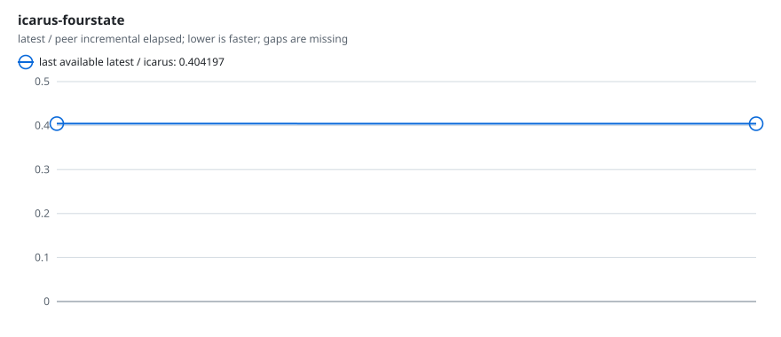
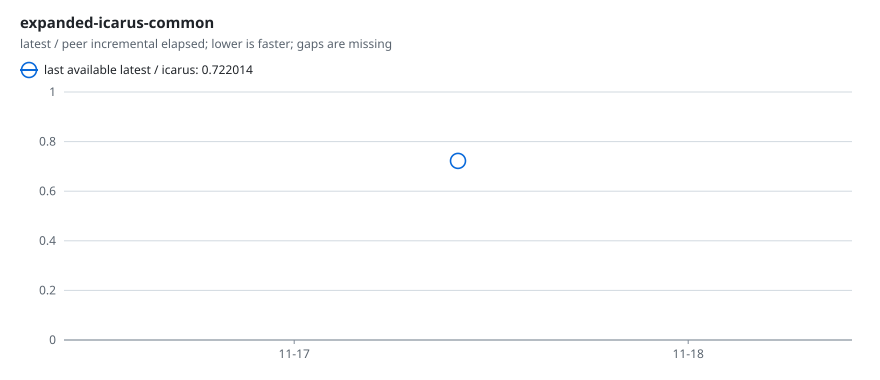

# Daily and weekly simulation-speed benchmarks

[English](README.md) / [日本語](README.ja.md)

Independent of functional Nightly. GitHub-hosted values are reference measurements; five repetitions do not establish statistical significance.


Equal-weight geometric mean of all 25 daily designs (22 common + 3 four-state). Ratio = kirimasim / Icarus 14.0 devel incremental elapsed. 0.97 means 3% less elapsed time; lower is faster.

Both development heads are resolved once per campaign. A day uses its last formal attempt in JST; one invalid member makes the mean missing. Different environments/definitions are separate curves. Both simulators can affect the trend; fixed-version comparisons are below.

[JSON](headline.json) · [Method / 測定方法](https://github.com/kurochan001/kirimasim-tests/blob/main/docs/daily-benchmark.md)

Latest overall attempt: **2026-11-22 JST — 0.51731** (25/25; complete)

[Raw / 生データ](runs/actions-44966152659-1.json) · [Actions logs / ログ](https://github.com/kurochan001/kirimasim-tests/actions/runs/44966152659/attempts/1)

<details><summary>Case results, fixed-version comparisons and earlier series</summary>

## Latest daily attempt

[JSON](latest-daily.json)

**Run:** `actions-44966152659-1` — complete
2026-11-22T00:44:24.628416+00:00 → 2026-11-22T01:36:28.749983+00:00

Ratios = latest kirimasim / peer incremental elapsed; below 1 favors latest.

This is a descriptive reference on this environment. Missing/failed values are not zero.

[JSON](runs/actions-44966152659-1.json) · [Actions logs / ログ](https://github.com/kurochan001/kirimasim-tests/actions/runs/44966152659/attempts/1) · [Method / 測定方法](https://github.com/kurochan001/kirimasim-tests/blob/main/docs/daily-benchmark.md)

Environment: github-hosted-ubuntu-24.04 / Intel(R) Xeon(R) 6975P-C / Linux-7.0.0-1014-aws-x86_64-with-glibc2.39

<details><summary>Measurement settings</summary>

```json
{
  "machine": {
    "os": "Linux-7.0.0-1014-aws-x86_64-with-glibc2.39",
    "cores": 4,
    "cpu": "Intel(R) Xeon(R) 6975P-C",
    "memory_gib": 15,
    "distribution": "Ubuntu 24.04.5 LTS",
    "architecture": "x86_64"
  },
  "compiler": "g++ (Ubuntu 13.3.0-6ubuntu2~24.04.1) 13.3.0",
  "profile": "daily",
  "environment": "github-hosted-ubuntu-24.04",
  "image_os": "ubuntu24",
  "image_version": "20261116.133.1",
  "settings": {
    "runs": 5,
    "warmups": 1,
    "timeout_seconds": 600,
    "short_seconds": 0.05,
    "regression_warning_ratio": 1.15,
    "simulation_threads": 1,
    "waveforms": false,
    "assertions": false,
    "verilator_build_jobs": 1
  },
  "mode": "formal",
  "runs": 5,
  "tool_builds": {
    "latest": {
      "compiler": "g++ (Ubuntu 13.3.0-6ubuntu2~24.04.1) 13.3.0",
      "c_compiler": "gcc (Ubuntu 13.3.0-6ubuntu2~24.04.1) 13.3.0",
      "flags": {
        "CC": "gcc",
        "CXX": "g++",
        "CFLAGS": "",
        "CXXFLAGS": "",
        "preset": "release",
        "cmake": "-O3 -DNDEBUG -ffp-contract=off, no fast-math",
        "make_jobs": 2
      }
    },
    "baseline": {
      "compiler": "g++ (Ubuntu 13.3.0-6ubuntu2~24.04.1) 13.3.0",
      "c_compiler": "gcc (Ubuntu 13.3.0-6ubuntu2~24.04.1) 13.3.0",
      "flags": {
        "CC": "gcc",
        "CXX": "g++",
        "CFLAGS": "",
        "CXXFLAGS": "",
        "preset": "release",
        "cmake": "-O3 -DNDEBUG -ffp-contract=off, no fast-math",
        "make_jobs": 2
      }
    },
    "icarus": {
      "compiler": "g++ (Ubuntu 13.3.0-6ubuntu2~24.04.1) 13.3.0",
      "c_compiler": "gcc (Ubuntu 13.3.0-6ubuntu2~24.04.1) 13.3.0",
      "flags": {
        "CC": "gcc",
        "CXX": "g++",
        "CFLAGS": "",
        "CXXFLAGS": "",
        "preset": "release",
        "cmake": "-O3 -DNDEBUG -ffp-contract=off, no fast-math",
        "make_jobs": 2
      }
    },
    "verilator": {
      "compiler": "g++ (Ubuntu 13.3.0-6ubuntu2~24.04.1) 13.3.0",
      "c_compiler": "gcc (Ubuntu 13.3.0-6ubuntu2~24.04.1) 13.3.0",
      "flags": {
        "CC": "gcc",
        "CXX": "g++",
        "CFLAGS": "",
        "CXXFLAGS": "",
        "preset": "release",
        "cmake": "-O3 -DNDEBUG -ffp-contract=off, no fast-math",
        "make_jobs": 2
      }
    },
    "icarus_devel": {
      "compiler": "g++ (Ubuntu 13.3.0-6ubuntu2~24.04.1) 13.3.0",
      "c_compiler": "gcc (Ubuntu 13.3.0-6ubuntu2~24.04.1) 13.3.0",
      "flags": {
        "CC": "gcc",
        "CXX": "g++",
        "CFLAGS": "",
        "CXXFLAGS": "",
        "preset": "release",
        "cmake": "-O3 -DNDEBUG -ffp-contract=off, no fast-math",
        "make_jobs": 2
      }
    }
  },
  "verilator_options": "--binary --timing --threads 1 --build-jobs 1; default C++ optimization; assertions/tracing off",
  "icarus_options": "-g2012; vvp -n; single process",
  "kirimasim_options": "default four-state; interpreter; no waveform/assertion request"
}
```

</details>

- `latest`: `ad004a67d861a55e5fe605ae028bfdbd4f6648f9` — kirimasim 0.1.3 (commit ad004a67d861), built with GNU 13.3.0
- `baseline`: `cfa2ccd75989c1ebb9ed63303271183377364cf0` — kirimasim 0.1.0 (commit cfa2ccd75989), built with GNU 13.3.0
- `icarus`: `dfeee909ed9f20b4870dd93423156c0170c0e1ff` — Icarus Verilog version 13.0 (stable) (dfeee90-dirty)
- `verilator`: `bbb60a403932a9f695cb6ff001ceb73de6ad9234` — Verilator 5.054 2026-11-01 rev vUNKNOWN-built20261121-bbb60a4
- `icarus_devel`: `fd4a65b2008350bcae14bc6451eefe9a4a964442` — Icarus Verilog version 14.0 (devel) (fd4a65b)

Definition and measurement identity: `{'config_sha256': '4006a76543b7c88eed78ba128e7459c54ac2ee82a78efdd401ac2d85643bef9b', 'driver_sha256': '0edb91f5cbc17e8d1eec9e77ab4c87fb7dbcf4b9ff57d233c5e94628770ad077', 'comparison_sha256': '2896f429781d5eaff2d0ecec465726de342f840892056d20304d2df179ad6be0', 'history_sha256': 'bda014f86bbbea0bd769b5458656bfda07cbcaec712624cfad17960b10b5c887', 'setup_sha256': 'aa89dd6c7df5268f361f96049069cfe68b524ff93819afc4351fcb557c91d8f9', 'adapter_sha256': '4811f9d50d4a09d8794710296d644350468c49a9579a794f27af42ac9fb6b5bc', 'benchmark_commit': 'cfa2ccd75989c1ebb9ed63303271183377364cf0', 'reference_sha256': {'bench/reference_expanded.py': 'a1196d79efb88425f61cc69ba1d9ec99542f7f5dc41fac2a07ade82090b00f4a', 'bench/reference_fourstate_mix.py': '586fb643e9ef9df9e304df83e04e711aa1b875e6cb4393e6e3c98cd1707b70e1'}}`

| Case | Tool | State | Build s | T(1) median s | T(N) median s | Incremental s | MAD T(N) s | RSS MiB | latest/peer | Reason / warning |
|---|---|---|---:|---:|---:|---:|---:|---:|---:|---|
| casez_struct (N=5000000) | latest | measured | — | 0.0055818 | 2.3766 | 2.371 | 0.00568 | 28.797 | — |  |
| casez_struct (N=5000000) | baseline | measured | — | 0.0064228 | 5.004 | 4.9976 | 0.013464 | 28.398 | 0.47444 |  |
| casez_struct (N=5000000) | icarus | measured | 0.0049607 | 0.0029678 | 5.4909 | 5.4879 | 0.007614 | 7.3594 | 0.43205 |  |
| casez_struct (N=5000000) | verilator | measured | 5.1136 | 0.0013317 | 0.029774 | 0.028442 | 0.00011991 | 3.8047 | 83.364 | short incremental time; sensitive to timing noise |
| casez_struct (N=5000000) | icarus_devel | measured | 0.004203 | 0.0028436 | 5.0959 | 5.0931 | 0.0090214 | 7.5117 | 0.46554 |  |
| comb_chain (N=3000000) | latest | measured | — | 0.0055848 | 4.7591 | 4.7535 | 0.015878 | 28.52 | — |  |
| comb_chain (N=3000000) | baseline | measured | — | 0.0055079 | 13.51 | 13.504 | 0.13009 | 28.398 | 0.352 |  |
| comb_chain (N=3000000) | icarus | measured | 0.0045631 | 0.0028464 | 19.366 | 19.363 | 0.049792 | 7.4336 | 0.24549 |  |
| comb_chain (N=3000000) | verilator | measured | 5.9544 | 0.0014105 | 0.32454 | 0.32313 | 0.00022204 | 3.8477 | 14.711 |  |
| comb_chain (N=3000000) | icarus_devel | measured | 0.0044035 | 0.002648 | 12.74 | 12.737 | 0.016856 | 7.5781 | 0.3732 |  |
| dyn_queue (N=4000000) | latest | measured | — | 0.0058576 | 3.4604 | 3.4546 | 0.0085322 | 28.812 | — |  |
| dyn_queue (N=4000000) | baseline | measured | — | 0.0055982 | 5.5265 | 5.5209 | 0.0033024 | 28.254 | 0.62572 |  |
| dyn_queue (N=4000000) | icarus | measured | 0.0042133 | 0.0029752 | 10.32 | 10.317 | 0.0090228 | 7.3633 | 0.33485 |  |
| dyn_queue (N=4000000) | verilator | measured | 5.2357 | 0.0013758 | 0.10538 | 0.104 | 0.0005381 | 3.8477 | 33.217 |  |
| dyn_queue (N=4000000) | icarus_devel | measured | 0.004101 | 0.0028464 | 9.4396 | 9.4368 | 0.0021976 | 7.6484 | 0.36608 |  |
| fork_join (N=4000000) | latest | measured | — | 0.0052956 | 4.5928 | 4.5875 | 0.0081423 | 28.645 | — |  |
| fork_join (N=4000000) | baseline | measured | — | 0.0051042 | 7.0182 | 7.0131 | 0.035435 | 28.105 | 0.65413 |  |
| fork_join (N=4000000) | icarus | measured | 0.0048798 | 0.002841 | 8.9445 | 8.9417 | 0.0050054 | 7.3594 | 0.51305 |  |
| fork_join (N=4000000) | verilator | measured | 6.003 | 0.0013706 | 1.7663 | 1.765 | 0.0043284 | 3.8516 | 2.5992 |  |
| fork_join (N=4000000) | icarus_devel | measured | 0.0039463 | 0.0025099 | 6.8613 | 6.8588 | 0.004646 | 7.5312 | 0.66885 |  |
| func_call (N=1500000) | latest | measured | — | 0.0049699 | 3.9765 | 3.9715 | 0.0097767 | 28.738 | — |  |
| func_call (N=1500000) | baseline | measured | — | 0.0054751 | 6.7227 | 6.7172 | 0.014268 | 28.258 | 0.59124 |  |
| func_call (N=1500000) | icarus | measured | 0.004151 | 0.0028261 | 15.165 | 15.162 | 0.051902 | 7.3477 | 0.26194 |  |
| func_call (N=1500000) | verilator | measured | 5.1214 | 0.0014012 | 0.008573 | 0.0071718 | 0.00014872 | 0.31641 | 553.77 | short incremental time; sensitive to timing noise |
| func_call (N=1500000) | icarus_devel | measured | 0.0041676 | 0.0026224 | 10.863 | 10.86 | 0.023002 | 7.5508 | 0.36571 |  |
| gate_udp (N=400000) | latest | measured | — | 0.0063665 | 2.8933 | 2.8869 | 0.011561 | 28.77 | — |  |
| gate_udp (N=400000) | baseline | measured | — | 0.0074827 | 7.6525 | 7.6451 | 0.01682 | 28.168 | 0.37762 |  |
| gate_udp (N=400000) | icarus | measured | 0.0055762 | 0.0037308 | 4.892 | 4.8883 | 0.0096861 | 7.5195 | 0.59058 |  |
| gate_udp (N=400000) | verilator | measured | 5.915 | 0.0013893 | 0.06323 | 0.061841 | 0.00010044 | 3.8516 | 46.683 |  |
| gate_udp (N=400000) | icarus_devel | measured | 0.0053403 | 0.0036947 | 4.584 | 4.5803 | 0.0087517 | 7.6836 | 0.63029 |  |
| mem_rw (N=4000000) | latest | measured | — | 0.0058626 | 3.0191 | 3.0133 | 0.011199 | 28.797 | — |  |
| mem_rw (N=4000000) | baseline | measured | — | 0.007411 | 7.2672 | 7.2597 | 0.018277 | 28.242 | 0.41507 |  |
| mem_rw (N=4000000) | icarus | measured | 0.0050885 | 0.003312 | 6.0413 | 6.038 | 0.0046268 | 7.4375 | 0.49905 |  |
| mem_rw (N=4000000) | verilator | measured | 5.9886 | 0.0014401 | 0.97961 | 0.97817 | 0.00088653 | 3.8516 | 3.0805 |  |
| mem_rw (N=4000000) | icarus_devel | measured | 0.0040532 | 0.003294 | 4.3834 | 4.3801 | 0.014482 | 7.6016 | 0.68795 |  |
| nba_burst (N=500000) | latest | measured | — | 0.0052657 | 0.091634 | 0.086369 | 6.2526e-05 | 124.75 | — |  |
| nba_burst (N=500000) | baseline | measured | — | 0.005083 | 0.15986 | 0.15477 | 0.0036168 | 124.41 | 0.55803 |  |
| nba_burst (N=500000) | icarus | measured | 0.004034 | 0.0024774 | 0.1695 | 0.16703 | 0.00036488 | 33.816 | 0.5171 |  |
| nba_burst (N=500000) | verilator | measured | 5.9813 | 0.0013229 | 0.0015497 | 0.0002268 | 6.4424e-05 | 0.31641 | 380.81 | short incremental time; sensitive to timing noise; incremental time is close to observed dispersion |
| nba_burst (N=500000) | icarus_devel | measured | 0.0040221 | 0.002632 | 0.16826 | 0.16563 | 0.00040284 | 34.102 | 0.52145 |  |
| nba_shift (N=1000000) | latest | measured | — | 0.005946 | 11.492 | 11.486 | 0.063717 | 28.797 | — |  |
| nba_shift (N=1000000) | baseline | measured | — | 0.0066847 | 35.235 | 35.228 | 0.33111 | 28.234 | 0.32605 |  |
| nba_shift (N=1000000) | icarus | measured | 0.0048073 | 0.0031983 | 34.524 | 34.521 | 0.004166 | 7.4688 | 0.33273 |  |
| nba_shift (N=1000000) | verilator | measured | 6.1634 | 0.0013724 | 0.28674 | 0.28537 | 0.00029618 | 3.8203 | 40.25 |  |
| nba_shift (N=1000000) | icarus_devel | measured | 0.0044237 | 0.0031776 | 34.364 | 34.361 | 0.040244 | 7.6016 | 0.33427 |  |
| proc_wait (N=1000000) | latest | measured | — | 0.0085724 | 4.9397 | 4.9311 | 0.0054177 | 36.613 | — |  |
| proc_wait (N=1000000) | baseline | measured | — | 0.0077399 | 10.445 | 10.437 | 0.013829 | 30.254 | 0.47245 |  |
| proc_wait (N=1000000) | icarus | measured | 0.0071789 | 0.0039962 | 8.6006 | 8.5966 | 0.016165 | 7.8281 | 0.57361 |  |
| proc_wait (N=1000000) | verilator | measured | 7.8457 | 0.0014446 | 2.9228 | 2.9214 | 0.0013438 | 3.9531 | 1.6879 |  |
| proc_wait (N=1000000) | icarus_devel | measured | 0.0055442 | 0.0037688 | 8.4889 | 8.4851 | 0.0097112 | 8.1016 | 0.58115 |  |
| string_fmt (N=500000) | latest | measured | — | 0.005452 | 3.1091 | 3.1036 | 0.002979 | 28.797 | — |  |
| string_fmt (N=500000) | baseline | measured | — | 0.0053439 | 5.8125 | 5.8071 | 0.0034542 | 28.133 | 0.53445 |  |
| string_fmt (N=500000) | icarus | measured | 0.0039959 | 0.0028777 | 15.133 | 15.13 | 0.024222 | 7.4219 | 0.20512 |  |
| string_fmt (N=500000) | verilator | measured | 5.1312 | 0.0013802 | 0.20016 | 0.19878 | 0.00016193 | 3.9609 | 15.613 |  |
| string_fmt (N=500000) | icarus_devel | measured | 0.0040023 | 0.0028635 | 11.585 | 11.583 | 0.03698 | 7.6055 | 0.26795 |  |
| wide_arith (N=1500000) | latest | measured | — | 0.0055825 | 2.6538 | 2.6483 | 0.019941 | 28.797 | — |  |
| wide_arith (N=1500000) | baseline | measured | — | 0.0059351 | 7.265 | 7.2591 | 0.10431 | 28.109 | 0.36482 |  |
| wide_arith (N=1500000) | icarus | measured | 0.0042598 | 0.002824 | 14.583 | 14.58 | 0.0020917 | 7.3281 | 0.18164 |  |
| wide_arith (N=1500000) | verilator | measured | 5.1784 | 0.0013886 | 0.12018 | 0.11879 | 0.00021184 | 3.8047 | 22.294 |  |
| wide_arith (N=1500000) | icarus_devel | measured | 0.0041158 | 0.0025731 | 2.7263 | 2.7237 | 0.0023962 | 7.4922 | 0.97231 |  |
| fourstate_mix (N=1000000) | latest | measured | — | 0.0056148 | 0.74863 | 0.74302 | 0.0017082 | 28.797 | — |  |
| fourstate_mix (N=1000000) | baseline | measured | — | 0.0067083 | 1.7337 | 1.727 | 0.0026701 | 28.426 | 0.43025 |  |
| fourstate_mix (N=1000000) | icarus | measured | 0.0043203 | 0.0029236 | 3.1923 | 3.1893 | 0.0035311 | 7.4023 | 0.23297 |  |
| fourstate_mix (N=1000000) | verilator | unsupported | — | — | — | — | — | — | — | X/Z observations require four-state semantics; excluded before execution |
| fourstate_mix (N=1000000) | icarus_devel | measured | 0.0040017 | 0.0028872 | 2.2459 | 2.243 | 0.005882 | 7.5469 | 0.33126 |  |
| fifo_stream (N=200000) | latest | measured | — | 0.0055194 | 0.32378 | 0.31826 | 0.00050611 | 28.797 | — |  |
| fifo_stream (N=200000) | baseline | measured | — | 0.0059032 | 0.7725 | 0.7666 | 0.0036562 | 28.398 | 0.41516 |  |
| fifo_stream (N=200000) | icarus | measured | 0.004584 | 0.0029657 | 0.55571 | 0.55275 | 0.00098035 | 7.4453 | 0.57579 |  |
| fifo_stream (N=200000) | verilator | measured | 5.9143 | 0.0013983 | 0.064016 | 0.062617 | 0.00049721 | 3.8203 | 5.0827 |  |
| fifo_stream (N=200000) | icarus_devel | measured | 0.0046208 | 0.0028072 | 0.48392 | 0.48111 | 0.00063111 | 7.5742 | 0.66151 |  |
| uart_loopback (N=20000) | latest | measured | — | 0.0052303 | 0.32278 | 0.31755 | 0.00036178 | 28.797 | — |  |
| uart_loopback (N=20000) | baseline | measured | — | 0.005929 | 0.7049 | 0.69897 | 0.0014822 | 28.379 | 0.45431 |  |
| uart_loopback (N=20000) | icarus | measured | 0.0044654 | 0.0030246 | 0.33412 | 0.3311 | 0.00035967 | 7.4414 | 0.95908 |  |
| uart_loopback (N=20000) | verilator | measured | 5.9506 | 0.0014301 | 0.073668 | 0.072238 | 5.0531e-05 | 3.8047 | 4.3958 |  |
| uart_loopback (N=20000) | icarus_devel | measured | 0.0044567 | 0.0028606 | 0.29974 | 0.29688 | 0.00066983 | 7.5859 | 1.0696 |  |
| bus_fabric (N=150000) | latest | measured | — | 0.0060689 | 0.82205 | 0.81599 | 0.0020746 | 28.797 | — |  |
| bus_fabric (N=150000) | baseline | measured | — | 0.0066017 | 2.1444 | 2.1378 | 0.0042502 | 28.371 | 0.3817 |  |
| bus_fabric (N=150000) | icarus | measured | 0.0061482 | 0.0033616 | 0.72655 | 0.72319 | 0.0031939 | 7.4922 | 1.1283 |  |
| bus_fabric (N=150000) | verilator | measured | 5.9401 | 0.0013982 | 0.081399 | 0.080001 | 0.0001135 | 3.8203 | 10.2 |  |
| bus_fabric (N=150000) | icarus_devel | measured | 0.0048768 | 0.0029257 | 0.67665 | 0.67372 | 0.0013373 | 7.6484 | 1.2112 |  |
| hierarchy_fanout (N=100000) | latest | measured | — | 0.010764 | 4.0241 | 4.0133 | 0.0036717 | 38.801 | — |  |
| hierarchy_fanout (N=100000) | baseline | measured | — | 0.011075 | 11.299 | 11.288 | 0.022718 | 36.172 | 0.35555 |  |
| hierarchy_fanout (N=100000) | icarus | measured | 0.0090829 | 0.0092115 | 25.919 | 25.91 | 0.030088 | 8.293 | 0.1549 |  |
| hierarchy_fanout (N=100000) | verilator | measured | 5.9468 | 0.0013986 | 0.026927 | 0.025529 | 0.00016388 | 3.8555 | 157.21 | short incremental time; sensitive to timing noise |
| hierarchy_fanout (N=100000) | icarus_devel | measured | 0.0092774 | 0.0087199 | 8.026 | 8.0173 | 0.049653 | 8.4805 | 0.50058 |  |
| event_fanout (N=50000) | latest | measured | — | 0.013979 | 1.8453 | 1.8314 | 0.0057261 | 46.801 | — |  |
| event_fanout (N=50000) | baseline | measured | — | 0.013356 | 2.8957 | 2.8824 | 0.0032764 | 42.367 | 0.63536 |  |
| event_fanout (N=50000) | icarus | measured | 0.011067 | 0.0076163 | 3.4291 | 3.4215 | 0.0025163 | 9.0859 | 0.53525 |  |
| event_fanout (N=50000) | verilator | measured | 6.2708 | 0.0013508 | 0.054955 | 0.053604 | 0.00023135 | 3.8711 | 34.164 |  |
| event_fanout (N=50000) | icarus_devel | measured | 0.010073 | 0.0072335 | 3.3518 | 3.3445 | 0.0018502 | 9.2734 | 0.54757 |  |
| word_boundary (N=4000000) | latest | measured | — | 0.0052284 | 4.8151 | 4.8099 | 0.011512 | 28.566 | — |  |
| word_boundary (N=4000000) | baseline | measured | — | 0.0058826 | 10.207 | 10.201 | 0.018685 | 28.277 | 0.47151 |  |
| word_boundary (N=4000000) | icarus | measured | 0.0041289 | 0.0029079 | 23.895 | 23.892 | 0.015327 | 7.3359 | 0.20132 |  |
| word_boundary (N=4000000) | verilator | measured | 5.1164 | 0.0013751 | 0.03828 | 0.036904 | 5.1353e-05 | 3.8359 | 130.33 | short incremental time; sensitive to timing noise |
| word_boundary (N=4000000) | icarus_devel | measured | 0.004077 | 0.0028646 | 8.4007 | 8.3979 | 0.0096454 | 7.5039 | 0.57275 |  |
| wide_divide (N=80000) | latest | measured | — | 0.005794 | 0.15706 | 0.15127 | 0.00062239 | 28.797 | — |  |
| wide_divide (N=80000) | baseline | measured | — | 0.0062419 | 1.1584 | 1.1522 | 0.0044859 | 28.383 | 0.13129 |  |
| wide_divide (N=80000) | icarus | measured | 0.0040411 | 0.0026787 | 1.0674 | 1.0647 | 0.0020129 | 7.3438 | 0.14208 |  |
| wide_divide (N=80000) | verilator | measured | 5.1539 | 0.001388 | 0.0096532 | 0.0082652 | 3.2984e-05 | 0.35156 | 18.302 | short incremental time; sensitive to timing noise |
| wide_divide (N=80000) | icarus_devel | measured | 0.0041062 | 0.0025169 | 0.53663 | 0.53412 | 0.0005753 | 7.5 | 0.28321 |  |
| packed_slice (N=1500000) | latest | measured | — | 0.004888 | 2.1441 | 2.1392 | 0.014223 | 28.785 | — |  |
| packed_slice (N=1500000) | baseline | measured | — | 0.0056323 | 6.1023 | 6.0967 | 0.008068 | 28.211 | 0.35089 |  |
| packed_slice (N=1500000) | icarus | measured | 0.003847 | 0.0027275 | 8.8988 | 8.896 | 0.0066529 | 7.3125 | 0.24047 |  |
| packed_slice (N=1500000) | verilator | measured | 5.171 | 0.0013333 | 0.09313 | 0.091797 | 4.4056e-05 | 3.832 | 23.304 |  |
| packed_slice (N=1500000) | icarus_devel | measured | 0.0041393 | 0.0027007 | 3.3962 | 3.3935 | 0.0047148 | 7.5195 | 0.6304 |  |
| memory_scatter (N=5000000) | latest | measured | — | 0.042074 | 2.3293 | 2.2872 | 0.00023065 | 42.762 | — |  |
| memory_scatter (N=5000000) | baseline | measured | — | 0.048762 | 5.1459 | 5.0972 | 0.0035028 | 42.391 | 0.44872 |  |
| memory_scatter (N=5000000) | icarus | measured | 0.00438 | 0.026344 | 12.299 | 12.272 | 0.011062 | 7.8594 | 0.18637 |  |
| memory_scatter (N=5000000) | verilator | measured | 5.129 | 0.0014978 | 0.00859 | 0.0070922 | 0.00010948 | 0.31641 | 322.5 | short incremental time; sensitive to timing noise |
| memory_scatter (N=5000000) | icarus_devel | measured | 0.0041381 | 0.01697 | 6.9842 | 6.9672 | 0.0060054 | 8.0625 | 0.32828 |  |
| clock_domains (N=20000) | latest | measured | — | 0.0052941 | 0.090254 | 0.08496 | 0.00081865 | 28.734 | — |  |
| clock_domains (N=20000) | baseline | measured | — | 0.0056175 | 0.21569 | 0.21007 | 0.0045332 | 28.371 | 0.40444 |  |
| clock_domains (N=20000) | icarus | measured | 0.0040947 | 0.0028943 | 0.10861 | 0.10572 | 0.00055405 | 7.4102 | 0.80366 |  |
| clock_domains (N=20000) | verilator | measured | 5.9741 | 0.0013799 | 0.073723 | 0.072343 | 0.00015467 | 3.8516 | 1.1744 |  |
| clock_domains (N=20000) | icarus_devel | measured | 0.003942 | 0.0027308 | 0.10723 | 0.1045 | 0.00032858 | 7.5391 | 0.81304 |  |
| fourstate_arith (N=100000) | latest | measured | — | 0.005777 | 0.12249 | 0.11671 | 0.0020287 | 28.797 | — |  |
| fourstate_arith (N=100000) | baseline | measured | — | 0.0063846 | 0.17113 | 0.16474 | 0.0010438 | 28.457 | 0.70846 |  |
| fourstate_arith (N=100000) | icarus | measured | 0.0042212 | 0.0029906 | 0.23924 | 0.23624 | 0.00025368 | 7.3477 | 0.49404 |  |
| fourstate_arith (N=100000) | verilator | unsupported | — | — | — | — | — | — | — | X/Z observations require four-state semantics; excluded before execution |
| fourstate_arith (N=100000) | icarus_devel | measured | 0.0038255 | 0.0024449 | 0.22396 | 0.22152 | 5.9852e-05 | 7.4844 | 0.52688 |  |
| resolved_bus (N=50000) | latest | measured | — | 0.0053724 | 0.16756 | 0.16218 | 0.00069525 | 28.785 | — |  |
| resolved_bus (N=50000) | baseline | measured | — | 0.0061458 | 0.34291 | 0.33676 | 0.00065899 | 28.387 | 0.48159 |  |
| resolved_bus (N=50000) | icarus | measured | 0.0043931 | 0.0029683 | 0.47261 | 0.46964 | 8.9629e-05 | 7.3906 | 0.34533 |  |
| resolved_bus (N=50000) | verilator | unsupported | — | — | — | — | — | — | — | X/Z observations require four-state semantics; excluded before execution |
| resolved_bus (N=50000) | icarus_devel | measured | 0.0041698 | 0.0028379 | 0.4657 | 0.46286 | 0.001009 | 7.5664 | 0.35039 |  |

Fixed comparison sets (all members required):

- **regression-common**: 0.46648; 12/12; casez_struct, comb_chain, dyn_queue, fork_join, func_call, gate_udp, mem_rw, nba_burst, nba_shift, proc_wait, string_fmt, wide_arith
- **regression-fourstate**: 0.43025; 1/1; fourstate_mix
- **icarus-common**: 0.36264; 12/12; casez_struct, comb_chain, dyn_queue, fork_join, func_call, gate_udp, mem_rw, nba_burst, nba_shift, proc_wait, string_fmt, wide_arith
- **icarus-fourstate**: 0.23297; 1/1; fourstate_mix
- **verilator-common**: 25.51; 12/12; casez_struct, comb_chain, dyn_queue, fork_join, func_call, gate_udp, mem_rw, nba_burst, nba_shift, proc_wait, string_fmt, wide_arith
- **expanded-regression-common**: 0.42537; 22/22; casez_struct, comb_chain, dyn_queue, fork_join, func_call, gate_udp, mem_rw, nba_burst, nba_shift, proc_wait, string_fmt, wide_arith, fifo_stream, uart_loopback, bus_fabric, hierarchy_fanout, event_fanout, word_boundary, wide_divide, packed_slice, memory_scatter, clock_domains
- **expanded-regression-fourstate**: 0.52752; 3/3; fourstate_mix, fourstate_arith, resolved_bus
- **expanded-icarus-common**: 0.36766; 22/22; casez_struct, comb_chain, dyn_queue, fork_join, func_call, gate_udp, mem_rw, nba_burst, nba_shift, proc_wait, string_fmt, wide_arith, fifo_stream, uart_loopback, bus_fabric, hierarchy_fanout, event_fanout, word_boundary, wide_divide, packed_slice, memory_scatter, clock_domains
- **expanded-icarus-fourstate**: 0.34127; 3/3; fourstate_mix, fourstate_arith, resolved_bus
- **expanded-verilator-common**: 23.817; 22/22; casez_struct, comb_chain, dyn_queue, fork_join, func_call, gate_udp, mem_rw, nba_burst, nba_shift, proc_wait, string_fmt, wide_arith, fifo_stream, uart_loopback, bus_fabric, hierarchy_fanout, event_fanout, word_boundary, wide_divide, packed_slice, memory_scatter, clock_domains
- **daily-overall-icarus14**: 0.51731; 25/25; casez_struct, comb_chain, dyn_queue, fork_join, func_call, gate_udp, mem_rw, nba_burst, nba_shift, proc_wait, string_fmt, wide_arith, fourstate_mix, fifo_stream, uart_loopback, bus_fabric, hierarchy_fanout, event_fanout, word_boundary, wide_divide, packed_slice, memory_scatter, clock_domains, fourstate_arith, resolved_bus
## Latest weekly attempt

[JSON](latest-weekly.json)

**Run:** `actions-44186811554-1` — complete
2026-11-17T22:58:29.331708+00:00 → 2026-11-17T23:35:53.816729+00:00

Ratios = latest kirimasim / peer incremental elapsed; below 1 favors latest.

This is a descriptive reference on this environment. Missing/failed values are not zero.

[JSON](runs/actions-44186811554-1.json) · [Actions logs / ログ](https://github.com/kurochan001/kirimasim-tests/actions/runs/44186811554/attempts/1) · [Method / 測定方法](https://github.com/kurochan001/kirimasim-tests/blob/main/docs/daily-benchmark.md)

Environment: github-hosted-ubuntu-24.04 / AMD EPYC 7763 64-Core Processor / Linux-7.0.0-1017-azure-x86_64-with-glibc2.39

<details><summary>Measurement settings</summary>

```json
{
  "machine": {
    "os": "Linux-7.0.0-1017-azure-x86_64-with-glibc2.39",
    "cores": 4,
    "cpu": "AMD EPYC 7763 64-Core Processor",
    "memory_gib": 16,
    "distribution": "Ubuntu 24.04.5 LTS",
    "architecture": "x86_64"
  },
  "compiler": "g++ (Ubuntu 13.3.0-6ubuntu2~24.04.1) 13.3.0",
  "profile": "weekly",
  "environment": "github-hosted-ubuntu-24.04",
  "image_os": "ubuntu24",
  "image_version": "20261111.370.1",
  "settings": {
    "runs": 5,
    "warmups": 1,
    "timeout_seconds": 600,
    "short_seconds": 0.05,
    "regression_warning_ratio": 1.15,
    "simulation_threads": 1,
    "waveforms": false,
    "assertions": false,
    "verilator_build_jobs": 1
  },
  "mode": "formal",
  "runs": 5,
  "tool_builds": {
    "latest": {
      "compiler": "g++ (Ubuntu 13.3.0-6ubuntu2~24.04.1) 13.3.0",
      "c_compiler": "gcc (Ubuntu 13.3.0-6ubuntu2~24.04.1) 13.3.0",
      "flags": {
        "CC": "gcc",
        "CXX": "g++",
        "CFLAGS": "",
        "CXXFLAGS": "",
        "preset": "release",
        "cmake": "-O3 -DNDEBUG -ffp-contract=off, no fast-math",
        "make_jobs": 2
      }
    },
    "baseline": {
      "compiler": "g++ (Ubuntu 13.3.0-6ubuntu2~24.04.1) 13.3.0",
      "c_compiler": "gcc (Ubuntu 13.3.0-6ubuntu2~24.04.1) 13.3.0",
      "flags": {
        "CC": "gcc",
        "CXX": "g++",
        "CFLAGS": "",
        "CXXFLAGS": "",
        "preset": "release",
        "cmake": "-O3 -DNDEBUG -ffp-contract=off, no fast-math",
        "make_jobs": 2
      }
    },
    "icarus": {
      "compiler": "g++ (Ubuntu 13.3.0-6ubuntu2~24.04.1) 13.3.0",
      "c_compiler": "gcc (Ubuntu 13.3.0-6ubuntu2~24.04.1) 13.3.0",
      "flags": {
        "CC": "gcc",
        "CXX": "g++",
        "CFLAGS": "",
        "CXXFLAGS": "",
        "preset": "release",
        "cmake": "-O3 -DNDEBUG -ffp-contract=off, no fast-math",
        "make_jobs": 2
      }
    },
    "verilator": {
      "compiler": "g++ (Ubuntu 13.3.0-6ubuntu2~24.04.1) 13.3.0",
      "c_compiler": "gcc (Ubuntu 13.3.0-6ubuntu2~24.04.1) 13.3.0",
      "flags": {
        "CC": "gcc",
        "CXX": "g++",
        "CFLAGS": "",
        "CXXFLAGS": "",
        "preset": "release",
        "cmake": "-O3 -DNDEBUG -ffp-contract=off, no fast-math",
        "make_jobs": 2
      }
    }
  },
  "verilator_options": "--binary --timing --threads 1 --build-jobs 1; default C++ optimization; assertions/tracing off",
  "icarus_options": "-g2012; vvp -n; single process",
  "kirimasim_options": "default four-state; interpreter; no waveform/assertion request"
}
```

</details>

- `latest`: `441dddbd0fcd80aed298ca33311f2ee67aa8866c` — kirimasim 0.1.1 (commit 441dddbd0fcd), built with GNU 13.3.0
- `baseline`: `cfa2ccd75989c1ebb9ed63303271183377364cf0` — kirimasim 0.1.0 (commit cfa2ccd75989), built with GNU 13.3.0
- `icarus`: `dfeee909ed9f20b4870dd93423156c0170c0e1ff` — Icarus Verilog version 13.0 (stable) (dfeee90-dirty)
- `verilator`: `bbb60a403932a9f695cb6ff001ceb73de6ad9234` — Verilator 5.054 2026-11-01 rev vUNKNOWN-built20261117-bbb60a4

Definition and measurement identity: `{'config_sha256': '56c0140f54b187d0bc8506e9ab0627cbdc616b69d2a1910aa6fd9b324b2ab9b7', 'driver_sha256': '0037fb4780de47740de92f102487477aac29570998a2aa3ca095bbcbb94219fa', 'comparison_sha256': '2896f429781d5eaff2d0ecec465726de342f840892056d20304d2df179ad6be0', 'history_sha256': '50af56d972f3e551c2a9bc7ae0b8ee158405c6ab25ab7f97c36cd32bebe90f8a', 'setup_sha256': '35fd0861a6a91f6bd13719ca3a926142a8a248cb672d9499e328bfdd04c791e3', 'adapter_sha256': '4811f9d50d4a09d8794710296d644350468c49a9579a794f27af42ac9fb6b5bc', 'benchmark_commit': 'cfa2ccd75989c1ebb9ed63303271183377364cf0', 'reference_sha256': {'bench/reference_expanded.py': 'a1196d79efb88425f61cc69ba1d9ec99542f7f5dc41fac2a07ade82090b00f4a', 'bench/reference_fourstate_mix.py': '586fb643e9ef9df9e304df83e04e711aa1b875e6cb4393e6e3c98cd1707b70e1'}}`

| Case | Tool | State | Build s | T(1) median s | T(N) median s | Incremental s | MAD T(N) s | RSS MiB | latest/peer | Reason / warning |
|---|---|---|---:|---:|---:|---:|---:|---:|---:|---|
| large_hierarchy (N=20000) | latest | measured | — | 0.1501 | 30.488 | 30.338 | 0.093651 | 108.37 | — |  |
| large_hierarchy (N=20000) | baseline | measured | — | 0.15133 | 37.609 | 37.458 | 0.22551 | 108.23 | 0.80991 |  |
| large_hierarchy (N=20000) | icarus | measured | 0.18767 | 0.10443 | 88.929 | 88.824 | 0.29512 | 22.973 | 0.34155 |  |
| large_hierarchy (N=20000) | verilator | measured | 15.048 | 0.0018306 | 0.10806 | 0.10623 | 0.0010759 | 3.7969 | 285.58 |  |
| large_memory (N=500000) | latest | measured | — | 0.11288 | 29.145 | 29.032 | 0.10063 | 44.539 | — |  |
| large_memory (N=500000) | baseline | measured | — | 0.146 | 41.798 | 41.652 | 0.24891 | 44.41 | 0.69701 |  |
| large_memory (N=500000) | icarus | measured | 0.0055652 | 0.21439 | 61.457 | 61.242 | 0.016669 | 11.301 | 0.47405 |  |
| large_memory (N=500000) | verilator | measured | 8.1158 | 0.0024141 | 0.13945 | 0.13704 | 0.00082314 | 4.7266 | 211.85 |  |
| stream_pipeline (N=250000) | latest | measured | — | 0.0085583 | 29.059 | 29.051 | 0.11181 | 28.254 | — |  |
| stream_pipeline (N=250000) | baseline | measured | — | 0.010272 | 38.925 | 38.915 | 0.24568 | 28.285 | 0.74652 |  |
| stream_pipeline (N=250000) | icarus | measured | 0.0087869 | 0.0063252 | 83.492 | 83.486 | 0.28265 | 7.4883 | 0.34797 |  |
| stream_pipeline (N=250000) | verilator | measured | 8.3722 | 0.0018094 | 0.13704 | 0.13523 | 0.00030075 | 3.707 | 214.82 |  |

Fixed comparison sets (all members required):

- **weekly-regression**: 0.74973; 3/3; large_hierarchy, large_memory, stream_pipeline
- **weekly-icarus**: 0.38336; 3/3; large_hierarchy, large_memory, stream_pipeline
- **weekly-verilator**: 235.12; 3/3; large_hierarchy, large_memory, stream_pipeline

## Separate environment / definition series

### `341b44a021dff5eb`

2 runs; 2026-11-21T02:30:14.755165+00:00 → 2026-11-22T00:44:24.628416+00:00

Definition: `daily-v4-icarus14`; case count: **25**


Runs, including failures:

- [actions-44966152659-1](runs/actions-44966152659-1.json): complete — `ad004a67d861`
- [actions-44850710627-1](runs/actions-44850710627-1.json): complete — `256839f71089`
### `cc3a300591d180c9`

3 runs; 2026-11-18T13:42:55.941756+00:00 → 2026-11-20T01:57:13.586055+00:00

Definition: `daily-v4-icarus14`; case count: **25**





Runs, including failures:

- [actions-44656096600-1](runs/actions-44656096600-1.json): complete — `cb97fc93bf6b`
- [actions-44440143026-1](runs/actions-44440143026-1.json): incomplete — `a6222f0656d4`
- [actions-44311501813-1](runs/actions-44311501813-1.json): complete — `441dddbd0fcd`
### `25a1c78c12d65db9`

1 runs; 2026-11-18T02:38:15.609997+00:00 → 2026-11-18T02:38:15.609997+00:00

Definition: `daily-v3-expanded`; case count: **25**


Runs, including failures:

- [actions-44223268236-1](runs/actions-44223268236-1.json): complete — `441dddbd0fcd`
### `079515db5b1afbed`

1 runs; 2026-11-17T22:58:29.331708+00:00 → 2026-11-17T22:58:29.331708+00:00

Definition: `weekly-v1-scale`; case count: **3**


Runs, including failures:

- [actions-44186811554-1](runs/actions-44186811554-1.json): complete — `441dddbd0fcd`
### `ff82f2d3ef6ff628`

1 runs; 2026-11-17T21:58:35.859990+00:00 → 2026-11-17T21:58:35.859990+00:00

Definition: `daily-v3-expanded`; case count: **25**





Runs, including failures:

- [actions-44183926839-1](runs/actions-44183926839-1.json): complete — `234f65f6b205`
### `962ea28f5124b999`

1 runs; 2026-11-17T15:00:17.437065+00:00 → 2026-11-17T15:00:17.437065+00:00

Definition: `daily-v2-thirteen`; case count: **13**


Runs, including failures:

- [actions-44103555558-1](runs/actions-44103555558-1.json): complete — `13d52dde3c49`
### `ff134f2dfe29a369`

1 runs; 2026-11-17T13:04:45.723115+00:00 → 2026-11-17T13:04:45.723115+00:00

Definition: `daily-v1`; case count: **5**


Runs, including failures:

- [actions-44085771320-1](runs/actions-44085771320-1.json): complete — `26f359bcd504`

<!-- holdout-start -->

## Latest holdout attempt (reported only)

Designs outside the daily and weekly sets, measured once a week. They are not used to decide kirimasim optimizations and never enter the daily overall value, headline.json or the overall graph. Only conditions a peer runs are in its comparison set; a declared exclusion is shown as missing.

[JSON](latest-holdout.json)

**Run:** `actions-44895777688-1` — complete
2026-11-21T10:52:36.743579+00:00 → 2026-11-21T11:00:32.675678+00:00

Ratios = latest kirimasim / peer incremental elapsed; below 1 favors latest.

This is a descriptive reference on this environment. Missing/failed values are not zero.

[JSON](holdout/runs/actions-44895777688-1.json) · [Actions logs / ログ](https://github.com/kurochan001/kirimasim-tests/actions/runs/44895777688/attempts/1) · [Method / 測定方法](https://github.com/kurochan001/kirimasim-tests/blob/main/docs/daily-benchmark.md)

Environment: github-hosted-ubuntu-24.04 / Intel(R) Xeon(R) 6975P-C / Linux-7.0.0-1014-aws-x86_64-with-glibc2.39

<details><summary>Measurement settings</summary>

```json
{
  "machine": {
    "os": "Linux-7.0.0-1014-aws-x86_64-with-glibc2.39",
    "cores": 4,
    "cpu": "Intel(R) Xeon(R) 6975P-C",
    "memory_gib": 15,
    "distribution": "Ubuntu 24.04.5 LTS",
    "architecture": "x86_64"
  },
  "compiler": "g++ (Ubuntu 13.3.0-6ubuntu2~24.04.1) 13.3.0",
  "profile": "holdout",
  "environment": "github-hosted-ubuntu-24.04",
  "image_os": "ubuntu24",
  "image_version": "20261116.133.1",
  "settings": {
    "runs": 5,
    "warmups": 1,
    "timeout_seconds": 600,
    "short_seconds": 0.05,
    "regression_warning_ratio": 1.15,
    "simulation_threads": 1,
    "waveforms": false,
    "assertions": false,
    "verilator_build_jobs": 1
  },
  "mode": "formal",
  "runs": 5,
  "tool_builds": {
    "latest": {
      "compiler": "g++ (Ubuntu 13.3.0-6ubuntu2~24.04.1) 13.3.0",
      "c_compiler": "gcc (Ubuntu 13.3.0-6ubuntu2~24.04.1) 13.3.0",
      "flags": {
        "CC": "gcc",
        "CXX": "g++",
        "CFLAGS": "",
        "CXXFLAGS": "",
        "preset": "release",
        "cmake": "-O3 -DNDEBUG -ffp-contract=off, no fast-math",
        "make_jobs": 2
      }
    },
    "baseline": {
      "compiler": "g++ (Ubuntu 13.3.0-6ubuntu2~24.04.1) 13.3.0",
      "c_compiler": "gcc (Ubuntu 13.3.0-6ubuntu2~24.04.1) 13.3.0",
      "flags": {
        "CC": "gcc",
        "CXX": "g++",
        "CFLAGS": "",
        "CXXFLAGS": "",
        "preset": "release",
        "cmake": "-O3 -DNDEBUG -ffp-contract=off, no fast-math",
        "make_jobs": 2
      }
    },
    "icarus": {
      "compiler": "g++ (Ubuntu 13.3.0-6ubuntu2~24.04.1) 13.3.0",
      "c_compiler": "gcc (Ubuntu 13.3.0-6ubuntu2~24.04.1) 13.3.0",
      "flags": {
        "CC": "gcc",
        "CXX": "g++",
        "CFLAGS": "",
        "CXXFLAGS": "",
        "preset": "release",
        "cmake": "-O3 -DNDEBUG -ffp-contract=off, no fast-math",
        "make_jobs": 2
      }
    },
    "verilator": {
      "compiler": "g++ (Ubuntu 13.3.0-6ubuntu2~24.04.1) 13.3.0",
      "c_compiler": "gcc (Ubuntu 13.3.0-6ubuntu2~24.04.1) 13.3.0",
      "flags": {
        "CC": "gcc",
        "CXX": "g++",
        "CFLAGS": "",
        "CXXFLAGS": "",
        "preset": "release",
        "cmake": "-O3 -DNDEBUG -ffp-contract=off, no fast-math",
        "make_jobs": 2
      }
    },
    "icarus_devel": {
      "compiler": "g++ (Ubuntu 13.3.0-6ubuntu2~24.04.1) 13.3.0",
      "c_compiler": "gcc (Ubuntu 13.3.0-6ubuntu2~24.04.1) 13.3.0",
      "flags": {
        "CC": "gcc",
        "CXX": "g++",
        "CFLAGS": "",
        "CXXFLAGS": "",
        "preset": "release",
        "cmake": "-O3 -DNDEBUG -ffp-contract=off, no fast-math",
        "make_jobs": 2
      }
    }
  },
  "verilator_options": "--binary --timing --threads 1 --build-jobs 1; default C++ optimization; assertions/tracing off",
  "icarus_options": "-g2012; vvp -n; single process",
  "kirimasim_options": "default four-state; interpreter; no waveform/assertion request"
}
```

</details>

- `latest`: `557aae7ef84f67bb41dd7ac508a94cb00e411b45` — kirimasim 0.1.3 (commit 557aae7ef84f), built with GNU 13.3.0
- `baseline`: `cfa2ccd75989c1ebb9ed63303271183377364cf0` — kirimasim 0.1.0 (commit cfa2ccd75989), built with GNU 13.3.0
- `icarus`: `dfeee909ed9f20b4870dd93423156c0170c0e1ff` — Icarus Verilog version 13.0 (stable) (dfeee90-dirty)
- `verilator`: `bbb60a403932a9f695cb6ff001ceb73de6ad9234` — Verilator 5.054 2026-11-01 rev vUNKNOWN-built20261121-bbb60a4
- `icarus_devel`: `c20d73fe3b36ca93ebcf5f1b67f85e0d5f61a91b` — Icarus Verilog version 14.0 (devel) (c20d73f)

Definition and measurement identity: `{'config_sha256': '3b1543f8256fb66a689c77e1e8350434b8ff9d645e4d507e1f433d8ade07d16f', 'driver_sha256': '0edb91f5cbc17e8d1eec9e77ab4c87fb7dbcf4b9ff57d233c5e94628770ad077', 'comparison_sha256': '2896f429781d5eaff2d0ecec465726de342f840892056d20304d2df179ad6be0', 'history_sha256': 'bda014f86bbbea0bd769b5458656bfda07cbcaec712624cfad17960b10b5c887', 'setup_sha256': 'aa89dd6c7df5268f361f96049069cfe68b524ff93819afc4351fcb557c91d8f9', 'adapter_sha256': '4811f9d50d4a09d8794710296d644350468c49a9579a794f27af42ac9fb6b5bc', 'benchmark_commit': 'cfa2ccd75989c1ebb9ed63303271183377364cf0', 'reference_sha256': {'bench/reference_expanded.py': 'a1196d79efb88425f61cc69ba1d9ec99542f7f5dc41fac2a07ade82090b00f4a', 'bench/reference_holdout.py': '422e7ec147459f8dca2f42b91af07e6c2cf05435345a7eb11757a93305c500c2'}}`

| Case | Tool | State | Build s | T(1) median s | T(N) median s | Incremental s | MAD T(N) s | RSS MiB | latest/peer | Reason / warning |
|---|---|---|---:|---:|---:|---:|---:|---:|---:|---|
| class_pool (N=800000) | latest | measured | — | 0.0054256 | 2.6649 | 2.6595 | 0.0077682 | 30.797 | — |  |
| class_pool (N=800000) | baseline | measured | — | 0.0058064 | 3.5732 | 3.5674 | 0.021868 | 30.363 | 0.74551 |  |
| class_pool (N=800000) | icarus | unsupported | — | — | — | — | — | — | — | Icarus Verilog 13.0 calls the base-class method instead of the virtual override for a base-class handle (8.20); 14.0 devel calls the override; declared before execution |
| class_pool (N=800000) | verilator | measured | 4.8922 | 0.0013617 | 0.08377 | 0.082409 | 9.63e-05 | 52.84 | 32.272 |  |
| class_pool (N=800000) | icarus_devel | measured | 0.0039864 | 0.0027551 | 3.6242 | 3.6215 | 0.012089 | 7.6406 | 0.73438 |  |
| dynarray_resize (N=120000) | latest | measured | — | 0.0048941 | 0.75963 | 0.75473 | 0.0020854 | 28.672 | — |  |
| dynarray_resize (N=120000) | baseline | measured | — | 0.0056328 | 1.3469 | 1.3412 | 0.0052747 | 28.383 | 0.56272 |  |
| dynarray_resize (N=120000) | icarus | measured | 0.0047433 | 0.0025335 | 3.1698 | 3.1673 | 0.013183 | 7.4258 | 0.23829 |  |
| dynarray_resize (N=120000) | verilator | measured | 4.8961 | 0.0013058 | 0.032786 | 0.031481 | 2.5507e-05 | 3.8125 | 23.975 | short incremental time; sensitive to timing noise |
| dynarray_resize (N=120000) | icarus_devel | measured | 0.0036834 | 0.0025002 | 2.4716 | 2.4691 | 0.0059044 | 7.6016 | 0.30567 |  |
| intf_modport (N=1000000) | latest | measured | — | 0.004813 | 1.6527 | 1.6478 | 0.0027844 | 28.551 | — |  |
| intf_modport (N=1000000) | baseline | measured | — | 0.0051333 | 3.5618 | 3.5567 | 0.0055416 | 28.371 | 0.46331 |  |
| intf_modport (N=1000000) | icarus | unsupported | — | — | — | — | — | — | — | Icarus Verilog 13.0 does not parse modport port declarations; 14.0 devel does; declared before execution |
| intf_modport (N=1000000) | verilator | measured | 5.6057 | 0.0013458 | 0.48589 | 0.48454 | 0.0011899 | 3.8516 | 3.4008 |  |
| intf_modport (N=1000000) | icarus_devel | measured | 0.0039414 | 0.0027787 | 2.0296 | 2.0268 | 0.004389 | 7.6328 | 0.81301 |  |
| real_filter (N=2000000) | latest | measured | — | 0.0048824 | 1.0304 | 1.0255 | 0.0055552 | 28.547 | — |  |
| real_filter (N=2000000) | baseline | measured | — | 0.0053232 | 2.0003 | 1.995 | 0.0076806 | 28.281 | 0.51404 |  |
| real_filter (N=2000000) | icarus | measured | 0.0037292 | 0.002635 | 4.8018 | 4.7991 | 0.0076281 | 7.4102 | 0.21368 |  |
| real_filter (N=2000000) | verilator | measured | 4.8536 | 0.00129 | 0.019835 | 0.018545 | 0.0001776 | 3.8359 | 55.297 | short incremental time; sensitive to timing noise |
| real_filter (N=2000000) | icarus_devel | measured | 0.0037701 | 0.0022286 | 3.2435 | 3.2412 | 0.013161 | 7.5547 | 0.31639 |  |
| force_release (N=1500000) | latest | measured | — | 0.0046733 | 1.5655 | 1.5608 | 0.0033471 | 28.609 | — |  |
| force_release (N=1500000) | baseline | measured | — | 0.0055195 | 2.6331 | 2.6275 | 0.00091318 | 28.379 | 0.59402 |  |
| force_release (N=1500000) | icarus | unsupported | — | — | — | — | — | — | — | Icarus Verilog evaluates the right-hand side of assign and force once (its &quot;sorry: procedural continuous assignments are not yet fully supported&quot;), while 10.6 reevaluates it when an operand changes; declared before execution |
| force_release (N=1500000) | verilator | measured | 5.63 | 0.0013671 | 0.19834 | 0.19697 | 0.0014066 | 3.8125 | 7.9241 |  |
| force_release (N=1500000) | icarus_devel | unsupported | — | — | — | — | — | — | — | Icarus Verilog evaluates the right-hand side of assign and force once (its &quot;sorry: procedural continuous assignments are not yet fully supported&quot;), while 10.6 reevaluates it when an operand changes; declared before execution |
| delayed_nets (N=400000) | latest | measured | — | 0.0053917 | 1.1971 | 1.1917 | 0.0039275 | 28.609 | — |  |
| delayed_nets (N=400000) | baseline | measured | — | 0.005423 | 2.1375 | 2.1321 | 0.0028362 | 28.391 | 0.55893 |  |
| delayed_nets (N=400000) | icarus | measured | 0.0040364 | 0.0027733 | 2.1664 | 2.1637 | 0.0050686 | 7.4297 | 0.55077 |  |
| delayed_nets (N=400000) | verilator | measured | 5.6755 | 0.0013482 | 0.56849 | 0.56714 | 0.0019837 | 3.8555 | 2.1012 |  |
| delayed_nets (N=400000) | icarus_devel | measured | 0.0038368 | 0.0025103 | 1.7728 | 1.7703 | 0.0064792 | 7.6211 | 0.67314 |  |
| specify_paths (N=400000) | latest | measured | — | 0.004494 | 1.8503 | 1.8459 | 0.0054363 | 28.672 | — |  |
| specify_paths (N=400000) | baseline | measured | — | 0.0055611 | 3.2602 | 3.2547 | 0.0096654 | 28.352 | 0.56714 |  |
| specify_paths (N=400000) | icarus | measured | 0.0041315 | 0.0028534 | 2.7407 | 2.7379 | 0.0033744 | 7.4453 | 0.67419 |  |
| specify_paths (N=400000) | verilator | unsupported | — | — | — | — | — | — | — | Verilator does not apply module path delays (30.4); its output equals that of zero-delay paths; declared before execution |
| specify_paths (N=400000) | icarus_devel | measured | 0.0040778 | 0.0027972 | 2.3329 | 2.3301 | 0.000841 | 7.6992 | 0.79218 |  |
| file_output (N=1000000) | latest | measured | — | 0.0048824 | 1.94 | 1.9351 | 0.0035669 | 28.664 | — |  |
| file_output (N=1000000) | baseline | measured | — | 0.0052705 | 2.5086 | 2.5033 | 0.0011287 | 28.336 | 0.77302 |  |
| file_output (N=1000000) | icarus | measured | 0.0038262 | 0.00282 | 3.8519 | 3.849 | 0.0058837 | 7.4258 | 0.50275 |  |
| file_output (N=1000000) | verilator | measured | 4.7794 | 0.0013784 | 0.5827 | 0.58132 | 0.00058363 | 3.9688 | 3.3288 |  |
| file_output (N=1000000) | icarus_devel | measured | 0.0037044 | 0.002491 | 3.523 | 3.5205 | 0.0049075 | 7.6211 | 0.54968 |  |
| bus_fabric_vcd (N=100000) | latest | measured | — | 0.0053022 | 0.85816 | 0.85285 | 0.0010495 | 28.586 | — |  |
| bus_fabric_vcd (N=100000) | baseline | measured | — | 0.0059164 | 1.7665 | 1.7606 | 0.0066831 | 28.371 | 0.48441 |  |
| bus_fabric_vcd (N=100000) | icarus | measured | 0.0044328 | 0.0034119 | 1.6523 | 1.6489 | 0.001296 | 7.6602 | 0.51723 |  |
| bus_fabric_vcd (N=100000) | verilator | measured | 6.77 | 0.0014054 | 0.13131 | 0.1299 | 0.00051485 | 4.0156 | 6.5652 |  |
| bus_fabric_vcd (N=100000) | icarus_devel | measured | 0.0045772 | 0.0032776 | 1.564 | 1.5607 | 0.0003921 | 7.8477 | 0.54646 |  |
| bus_fabric_fst (N=100000) | latest | measured | — | 0.0062468 | 1.1232 | 1.1169 | 0.023463 | 122.71 | — |  |
| bus_fabric_fst (N=100000) | baseline | measured | — | 0.0063862 | 2.0292 | 2.0228 | 0.021383 | 122.36 | 0.55217 |  |
| bus_fabric_fst (N=100000) | icarus | measured | 0.0045361 | 0.0037393 | 1.9475 | 1.9438 | 0.0054511 | 140.77 | 0.57461 |  |
| bus_fabric_fst (N=100000) | verilator | measured | 7.709 | 0.0017129 | 0.23354 | 0.23183 | 0.00052302 | 59.211 | 4.8178 |  |
| bus_fabric_fst (N=100000) | icarus_devel | measured | 0.0044664 | 0.0034067 | 1.8729 | 1.8695 | 0.012418 | 141.05 | 0.59745 |  |

Fixed comparison sets (all members required):

- **holdout-icarus14**: 0.56125; 9/9; class_pool, dynarray_resize, intf_modport, real_filter, delayed_nets, specify_paths, file_output, bus_fabric_vcd, bus_fabric_fst
- **holdout-regression**: 0.57411; 10/10; class_pool, dynarray_resize, intf_modport, real_filter, force_release, delayed_nets, specify_paths, file_output, bus_fabric_vcd, bus_fabric_fst
- **holdout-verilator**: 8.5916; 9/9; class_pool, dynarray_resize, intf_modport, real_filter, force_release, delayed_nets, file_output, bus_fabric_vcd, bus_fabric_fst

Waveform file size at full N (median bytes; contents are not compared):

| Condition | Tool | Bytes |
|---|---|---:|
| bus_fabric_vcd (N=100000) | latest | 74,839,976 |
| bus_fabric_vcd (N=100000) | baseline | 74,839,978 |
| bus_fabric_vcd (N=100000) | icarus | 130,983,583 |
| bus_fabric_vcd (N=100000) | verilator | 62,699,582 |
| bus_fabric_vcd (N=100000) | icarus_devel | 130,983,583 |
| bus_fabric_fst (N=100000) | latest | 3,084,970 |
| bus_fabric_fst (N=100000) | baseline | 3,084,971 |
| bus_fabric_fst (N=100000) | icarus | 3,300,103 |
| bus_fabric_fst (N=100000) | verilator | 4,698,181 |
| bus_fabric_fst (N=100000) | icarus_devel | 3,300,103 |

Holdout runs, including failures:

- [actions-44895777688-1](holdout/runs/actions-44895777688-1.json): complete — `557aae7ef84f`

<!-- holdout-end -->
</details>
