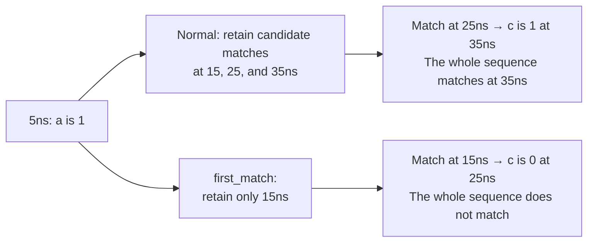
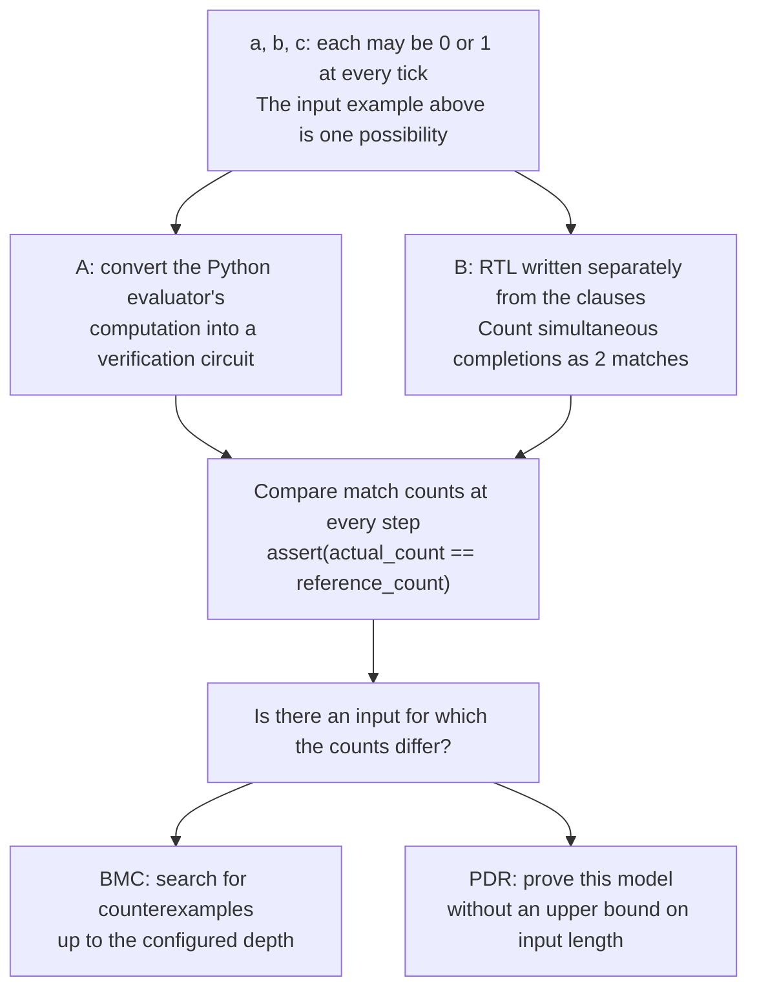
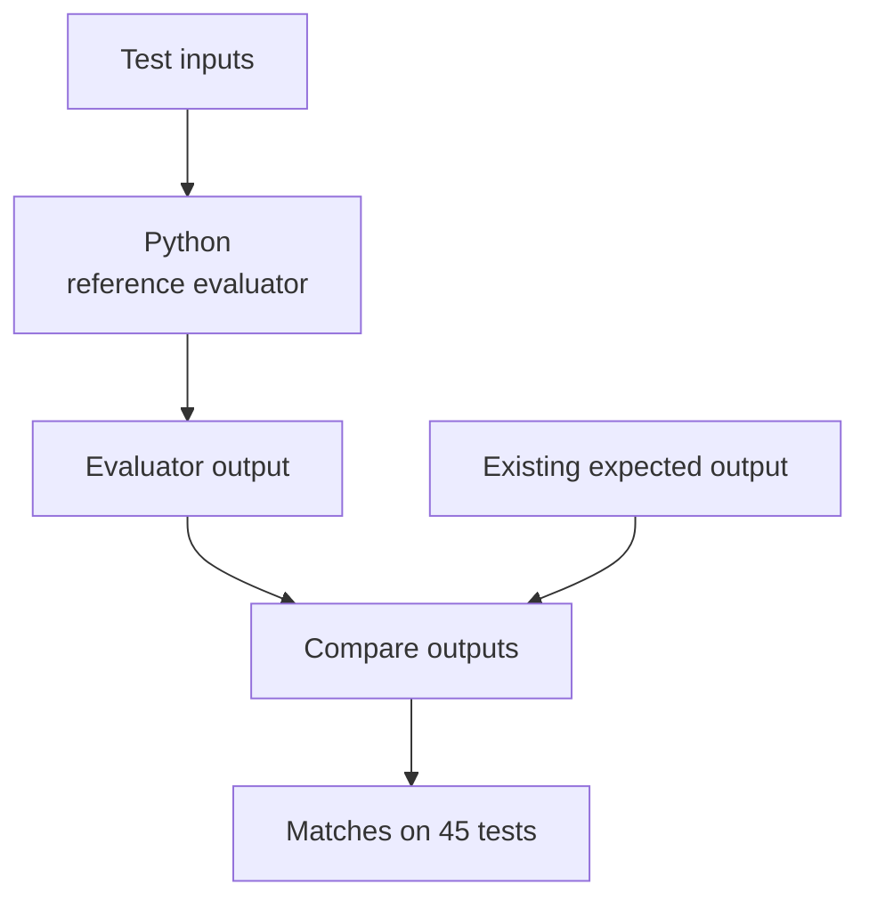
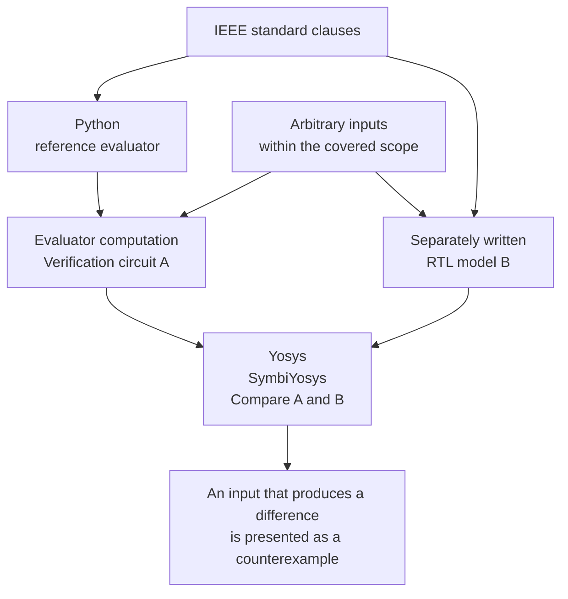

<a id="sva参照評価器とフォーマル検証"></a>

# SVA Reference evaluator and formal verification

[English](sva-reference-formal-verification.en.md) / [日本語](sva-reference-formal-verification.md)

In this work, we have two tasks: to verify the expected output of the test and to verify the calculation rules of the evaluator used for verification.

SVA is a mechanism for writing rules in SystemVerilog, such as "respond at the next clock if the condition is met". The simulator is not compatible with some rules, so we have added a Python reference evaluator based on the standard. In addition, the formal verification is to compare the evaluator with the model written separately.

First, we calculate the output by hand in [The case study 1](#実例1実際のテストから出力を読み解く), and then we see the connection with formal verification in [The case study 2](#実例2同じ規則を決まった入力以外でも確かめる). The number of cases, the scope of proof, and the method of re-executing all cases are summarized below.

<a id="実例1実際のテストから出力を読み解く"></a>

## 1: Read the output from the actual test.

The object is [test_sequence_first_match.sv](../tests/ch16/test_sequence_first_match.sv) in the repository. First, compare the following two equations.

```systemverilog
a ##[1:3] b
first_match(a ##[1:3] b)
```

|Notation|What this means in this example|
| --- | --- |
| tick |1 instants at which values are sampled on rising clock edges. This test is for every 10ns.|
| `a`、`b` |The signal value read from the tick. Here it's 0 or 1.|
| `a ##[1:3] b` |A match occurs when a is 1 at the starting tick and b is 1 after 1–3tick ticks.|
| `first_match(...)` |Leave the earliest match that ended. If several matches end at the same earliest tick, retain all of them|

The first 4tick of this test is the following input. First, we will focus on the evaluation of the 1 rounds starting with 5ns. In the actual test, a new evaluation is started in each subsequent rise.

|Signal and Computation| tick 0：5ns | tick 1：15ns | tick 2：25ns | tick 3：35ns |
| --- | --- | --- | --- | --- |
| a | **1** | 0 | 0 | 0 |
| b | 0 | **1** | **1** | **1** |
|c (for later use)| 0 | 0 | 0 | **1** |
| `a ##[1:3] b` |Start|Consistency|Consistency|Consistency|
| `first_match(a ##[1:3] b)` |Start|Keep Matches|Do not retain|Do not retain|

`a ##[1:3] b` matches 3 times at 15, 25, and 35ns; adding `first_match` leaves only 15ns. A match means the sequence from the start through that point satisfies the expression.

<a id="後ろに条件を付けると何が変わるか"></a>

### What changes when you put a condition behind it?

There is also a formula for the same test with `##1 c` at the end. This is an additional condition, "after a matching 1tick, c is 1".



`first_match` does not reselect a match after looking at the later c. Select the first match first, then check for additional conditions. Therefore, the results of the two equations change.

<a id="実際の期待出力と照合する"></a>

### Compare against the actual expected output

The whole test is 15tick, and [Expected output](../tests/ch16/test_sequence_first_match.expected) is the next 5 line. The values in each row are the times (ns) that `cover sequence` matched and recorded in the display queue.

```text
a ##[1:3] b: 15 25 35 75 115
first_match(a ##[1:3] b): 15 75 115
(a ##[1:3] b) ##1 c: 35 125
first_match(a ##[1:3] b) ##1 c: 125
first_match of the or: 15 75 75 115
```

The first 4 lines contain the preceding hand calculation. The `75 75` on the last line is also meaningful. The two paths matched at the same time, so the recording is 2 times. This point is used in the following example.

Run the following commands from the repository root. The Python standard library and saved input are used, so no simulator or Yosys is needed.

```sh
python3 tools/sva_reference/check.py tests/ch16/test_sequence_first_match.sv
```

```text
MATCH test_sequence_first_match: 15 ticks, 15 actions
1 generated; 1 matched; 0 mismatched
```

Here, `MATCH` means `.expected` matched the 5 output lines produced by the reference evaluator. 15 actions is the sum of the timestamp counts listed on the 5 lines. This does not mean that the specific simulator has executed this SVA correctly.

<a id="実例2同じ規則を決まった入力以外でも確かめる"></a>

## 2: Verify the same rule for inputs other than the fixed one.

In the case of 1, we have verified the input of 15tick, which is the test's default. Next, leave inputs unconstrained and check for disagreements in the same calculation rules.

The object is the expression used for the last display of the same test. In the basic formal set, it is registered as `first_match_tie`.

```systemverilog
first_match((a ##[1:2] b) or (a ##2 c))
```

This `or` matches two sequences. The evaluation starting from 55ns in the actual test is as follows.

|Signal and Computation|55ns: start|65ns: 1tick after|75ns: 2tick after|
| --- | --- | --- | --- |
| a | **1** | 0 | 0 |
| b | 0 | **0** | **1** |
| c | 0 | 0 | **1** |
|Left `a ##[1:2] b`|Start|b is 0, so no match.|Consistency|
|Right side `a ##2 c`|Start|Wait.|Consistency|

Both first matches come to 75ns. Therefore, even `first_match` has a match number of 2, which leads to the expected output `75 75`.

<a id="フォーマル検証では何を比較するか"></a>

### What do we compare in formal verification?



`assert(...)` is a condition that must be met for verification. The checked condition is equality of A's and B's match counts. Instead of running the original SystemVerilog test on Yosys, we compare the computational model of the extracted sequence.

The conversion procedure of A is [formal.py](../tools/sva_reference/formal.py), and the calculation rules of B are [formal_cases.py](../tools/sva_reference/formal_cases.py).

<a id="正しいモデルとわざと間違えたモデルの結果を読む"></a>

### Read the results of the correct model and the intentionally wrong model

Before interpreting PASS/FAIL, read [the different scope of BMC, PDR and cover](faq.en.md#q21-do-bmc-and-pdr-pass-mean-the-same-thing) and [terminology](glossary.en.md#6-formal-verification).

If you say "group matches of the same tick into 1", you will get a difference of 2 versus 1 in this example. In the basic set, we have also verified that the inspection does not miss the error by putting it in the comparison model B.

The relevant 4 job in [Saved results](../tools/sva_reference/fixtures/formal_symbolic_results.json) has the following results. If you rerun it, a row with the same name will be logged.

|Job Name|Saved results|Reading|
| --- | --- | --- |
| `first_match_tie_bmc` |PASS (Expect PASS)|BMC Depth 8 No difference in the number of matches between correct A and B|
| `first_match_tie_prove` |PASS (Expect PASS)|The fixed sequence model is proven to produce the same result without limiting the input length.|
| `first_match_tie_cover` |PASS (Expect PASS)|Actually reached an input producing at least 2 matches|
| `first_match_tie_mutant_bmc` |FAIL (Expect FAIL)|Detected the difference from deliberately incorrect B as a counterexample|

BMC Depth 8 is the setting of the number of steps for this model for verification. This count is separate from the 15tick in the entire test of example 1. You do not need to read success of PDR as "8 step only confirmed".

If FAIL is found in the normal model, investigation is necessary. On the other hand, `mutant` is a check that intentionally makes an error, so FAIL is a planned detection success. The success of `cover` alone does not prove that A and B are the same.

A counterexample is a specific input where two results are different. In [VCD saved in this negative example](../tools/sva_reference/fixtures/formal_counterexamples/first_match_tie_mutant_bmc.vcd), after advancing 3 samples (`age=3`), the state is `actual_count=2`, `reference_count=1`. The solver's input differs from the actual test input, but creates the same situation where two matches end at the earliest tick. The time in VCD is a step display for validation purposes and does not correspond to the actual test 75ns.

This check shows that the calculations of the two implementations match for the selected equation. This does not prove the validity of the entire simulator or of any SVA equation.

<a id="取り組み全体と検証件数"></a>

## Total and number of verification attempts

The example 1 is the "verification of test output" of the table below, and the example 2 is the "formal verification of evaluator: basic set". The results of the verification at the time of 2026-10-26 are summarized as follows.

This table shows the execution log of 2026-10-26. In 2026-10-29, we rerun all the current 267 cases, and the BMC 267 cases, PDR 44 cases, and the cover 267 cases are successful, and the intentional error 5 cases are also counter-exampled. The 583 jobs in total produced the expected 578 PASS results and 5 FAIL results. Also reran the separate boundary-extension 228 job, confirming 225 PASS cases and 3 FAIL cases. Update the saved JSON and counter example VCD of both sets, and successfully perform `--check-results` for the current source. The old basic 40 model is included in the current 267 case. The following breakdown of 40 models describes the initial set. For the execution of the current catalog and the consistency check of the evidence, see [Rerun procedure](#再実行).

|Confirm|What I want to know|Inputs and comparison method|This time, it's the result.|
| --- | --- | --- | --- |
|Checking the test output|The expected output of this test is to determine whether the result of the test is consistent with the result calculated from the standard.|The method is based on the evaluation of the fixed inputs of existing tests and comparison with the expected outputs.|45 matching test outputs|
|Formal verification of evaluators: basic set|Do calculation rules for sequences, properties, and sampled-value functions agree with separately written clause models?|The method compares two models with the object formula and input range.|The 40 model is successfully used to obtain BMC. The 22 model is also successfully proven as PDR.|
|Formal verification of evaluators: Extension of boundary values|Do sequence calculations agree at delay and repetition boundaries too?|Compare sequence models with varied numeric parameters and map them to actual test subexpressions|BMC and PDR succeeded in all 111 cases. Maps to 127 subexpressions in 91 directives across 28 tests|

45 is the number of tests, and 40 and 111 are the number of models of each test set. The number of models is not added to the number of tests, nor are two sets added as non-duplicate numbers.

The values read are called "sample". The sequence is the sequence of changes in the signal, such as `a ##[1:3] b`, and the property is the rule to be observed for the sequence. For example, `a |=> b` is a property that requires the next tick to be b if a is true.

<a id="仕組みを図で見る"></a>

## The mechanism is shown in the diagram.

<a id="1-決まった入力からテストの出力を計算する"></a>

### 1. Calculate the output of the test from the given input.



Based on Chapter 16 and Annex F of IEEE 1800-2023, [Reference evaluator](../tools/sva_reference/README.md) calculates when sequences match, when properties succeed or fail, and related behavior. The expected output is used for comparison after the calculation is completed.

The M2 tests 10, the M3 tests 28, and the M4 tests 7 are affected. Errors in expected output and description found in M3 The 2 issue has been fixed after user approval.

<a id="2-評価器の計算規則を別の実装と照合する"></a>

### 2. Compare the evaluation rules of the evaluator with other implementations.



RTL is here "a model written as a circuit of the state and procedure of the computation." Yosys reads the circuit for verification, and SymbiYosys compares it using the solver.

For example, if the input was 0, and if it was 1, the order of the inputs is changed, and the test is not restricted to a specific test stimulus. Input examples where the results of two models are different are called counter examples. We use BMC to separate the range to be checked and PDR to prove this sequence model by removing the upper limit of the input length.

The formal pilot of the conventional 10 is a model checking with fixed input. This expansion uses free-variable inputs and places no `assume` restricting them to particular stimuli.

<a id="結果の見方"></a>

## View of the result

The basic set in the table below is the 40 model of 2026-10-26. The results of 2026-10-29 in the current catalog are the 267 case and 583 job above. The number of boundary value expansions remains unchanged even after repeated execution.

|Testing|What to verify|Basic set|Boundary expansion|
| --- | --- | --- | --- |
|BMC: bounded model checking|Are there inputs producing different results within the chosen length bound?|40 model successful.|111 case successful.|
|PDR: proof with no bound on input length|Does the target sequence model agree for inputs of any length?|Succeeded for 22 models among the 40 above|All 111 cases successful.|
|cover: reachability checking|Can the situation of interest, such as simultaneous endings, actually occur?|Obtained reachability witnesses for 4 cases|Obtained reachability witnesses for 3 cases|
|Intentional error testing|Can the checker reject an incorrect model and produce a counterexample?|5 Gets counter examples for all types|3. Gets counter examples in all cases.|

The initial basic set is 40 jobs, BMC + 22 jobs, PDR + 4 jobs, cover + 5 jobs, error detection, total 71 jobs. The expected PASS was 66, and the expected FAIL was 5. Separately confirmed 1 cases where first_match errors also produce counterexamples under PDR, then reran on 2026-10-29 and refreshed the saved results.

The boundary value extension is 111 jobs, each of which is BMC, PDR + 3 cover + 3 error detection, totaling 228 jobs. The expected PASS was 225, and the expected FAIL was 3.

The FAIL here is the expected result of detecting a deliberate error. This does not mean that new errors have been found in the current evaluator. UNKNOWN, TIMEOUT, and ERROR are not counted as successes.

<a id="40モデルで何を比べたか"></a>

## What did you compare with the 40 model?

|Target|Model number|Input Range|Results to be compared|
| --- | ---: | --- | --- |
|Sequence| 22 |The signal sequence of 0 / 1 is shown. PDR has no upper limit on input length|Number of matches at each point. The duplicate matches are counted separately.|
|Properties| 16 |0 / 1 inputs over 1–3 samples|Success, failure, vacuous pass, pending, and other states, plus the tick when the outcome becomes final|
|6 kinds of sampled-value functions| 1 |Previous/current values of a 2-bit 4-state vector: all 256 pairs|Current sample, past values, rising/falling edges, and value changes|
|Gated past| 1 |2-bit 0 / 1 inputs and a 1-bit gate over 4 samples: all 4,096 combinations|Values 1 and 2 cycles in the past, both ordinary and gated|

Sequences include empty match, connect, repeat, goto/nonconsecutive, and/or/intersect, first_match, throughout, and within. Properties include implication/followed-by, alignment of empty antecedents, 4 until forms, and strong/weak differences at the trace end.

The sample value functions are `$sampled`, `$past`, `$rose`, `$fell`, `$stable`, and `$changed`. “4-state” means 0, 1, unknown x, and high-impedance z. "Gating" means that only ticks that have been gated are counted as history. In gating models, the default value of the declaration is fixed to 2 bit 1.

Internally, the sequence evaluation is converted to a finite state machine, and the property and function evaluation of finite inputs to a result table of all combinations. The formula, width, and delay range are fixed for each model, and not all SVA formulas are proved.

<a id="111ケースへの拡張で何が増えたか"></a>

## 111 What's new in the case extension?

The method is expanded to include the verification of the combination of delays and repetitions. For example, `a ##[low:high] b` checks all 10 combinations satisfying 0 ≤ low ≤ high ≤ 3. If the delay is 0, then the edge values are also taken into account, such as repetitions with empty matches, if the lower and upper limits are equal.

In the case of 1, not only the `a ##[1:3] b`, but also the nearest values are changed as follows: For each row's expression, check free 0 / 1 input sequences. With `first_match`, examine the same 10 combinations.

| low |Checking formula|Number of cases|Examples of containing boundaries|
| --- | --- | ---: | --- |
| 0 | `a ##[0:0] b`、`a ##[0:1] b`、`a ##[0:2] b`、`a ##[0:3] b` | 4 |This includes the case where a and b are true for the same tick.|
| 1 | `a ##[1:1] b`、`a ##[1:2] b`、`a ##[1:3] b` | 3 |If only after 1tick and if there are multiple candidates for termination|
| 2 | `a ##[2:2] b`、`a ##[2:3] b` | 2 |Even with lower bound 2, are earlier b values excluded?|
| 3 | `a ##[3:3] b` | 1 |If the upper and lower limits are equal, and you only want to check after 3tick|

Here, "10 street" is the number of the expression. This does not mean that you try 10 times on one input example. [111 Case Summary](sva-formal-expansion-20261026.en.md#何を広げたか) also summarizes the values changed for other operators.

In addition, the 38 and 188 instructions of M2 / M3 are examined, and the 127 sequence subexpressions of 28 and 91 instructions are matched to the verification model. Of 111 cases, 24 correspond to actual subexpressions; the remaining 87 are additional variants checking nearby boundary values. Also records 97 directives that were not mapped.

The result of the analysis is that the sequence matches are counted after the input condition is determined to be 0 / 1. This does not prove the entire assertion's outcome, the decision expression's type, 4-state operations or sampling, or execution of `disable iff` or displays. The following is a summary of the number of cases by operation, examples of correspondence, proofs and remaining problems in [Extension details](sva-formal-expansion-20261026.en.md).

<a id="反例の具体例終わりのtickを一つ数え忘れる"></a>

## Specific example of a counterexample: forget to count one tick at the end

`within` denotes that the inner sequence matches within the range of the outer sequence. For example, the following example ends with tick 3 both inside and outside.

|Matched Interval| tick 0 | tick 1 | tick 2 | tick 3 |
| --- | --- | --- | --- | --- |
|Outside `a ##3 b`|a 1: start|Continuation|Continuation|b is 1: end|
|Inside `x ##1 x`| — | — |x is 1: start|x is 1: end|

The standard counts as a match within the range even if the inner ends with the same tick as the outer. If we implement this incorrectly, saying "the inside must end sooner than the outside," the match number will change in this example. Formal verification can provide a concrete input causing that difference as a counterexample.

We also verify the counterexample in the model excluding the right‐end match. Other detected faults include collapsing duplicate simultaneous endings, delaying empty matches by 1tick, treating followed-by with an unmatched antecedent as a vacuous pass, and inserting the current value into gated history too early.

Results and counterexamples can be found in [Technical report](../tools/sva_reference/FORMAL_REVIEW.md), [The result is JSON.](../tools/sva_reference/fixtures/formal_symbolic_results.json), [Add PDR negative example](../tools/sva_reference/fixtures/formal_pdr_negative.json), and [Index of the counterexample VCD](../tools/sva_reference/fixtures/formal_counterexamples/index.json). VCD is a waveform file that stores the value and time of the signal.

<a id="証明範囲の読み方"></a>

## Reading proof ranges

We have confirmed that the evaluator and other text models have the same results under the conditions of the selected formula, width, and single clock. There are the following boundaries.

- Sequence/property inputs are 2-state. Sampled-value functions' 4-state model explicitly handles x/z.
- The properties 16 model and 2 function model are tests on finite inputs. This does not prove arbitrary infinite-time properties.
- Multiple clocks, general event-region scheduling, queues of procedural assertions, arbitrary types/arithmetic/user functions, VPI, and similar features are outside this scope.

The comparison model RTL is also a model created from the standard by AI. The agreement with other implementations is an additional verification material, but it does not claim to cover all exceptions of the standard interpretation. Yosys reads the circuit for verifying the diagram, not the configuration that processes the original unsupported SVA syntax as it is.

<details>
<summary>Technical supplement: Difference in depth and sample number of BMC</summary>

The BMC depth of the sequence is the 8 step of the finite pattern. The 5 pattern, which includes infinite repetitions of the basic set, and the 12 case of the additional set goto/nonconsecutive are the 16 steps. The proof of the sequence by PDR is not limited by the input length of this depth. Numerical parameters are fixed to each model.

Finite-input property/function models are checked by expanding the entire sample sequence into combinational logic. The result JSON SBY depth 2 is the number of steps of the solver, and does not mean that the semantic input is only the 2 sample. The sample number for each model is `semantic_ticks`.

</details>

<a id="再実行"></a>

## Rerun

<a id="準備"></a>

### Prepare.

Run commands from the repository root. Python code uses only the standard library. Running formal checks requires the OSS CAD Suite, including SBY, Yosys, Yices, and ABC.

The execution environment for this run is OSS CAD Suite 20260816, Yosys 0.68 + 71, SBY 0.68, Yices 2.7.0, and ABC 1.01.

For `SBY_BIN`, specify the suite's `sby` executable; for `FORMAL_RUN_DIR`, specify a new or empty output directory. The PATH of the tool is set only for child processes and does not change the normal simulator selection.

<a id="現在のカタログを実行する"></a>

### Run the current catalog

If `--case` is omitted, the entire current catalog is executed. As of 2026-10-29, there are 267 cases and 583 jobs (BMC 267, PDR 44, cover 267, intentional errors 5). The scope of the above 40 model and 71 job is different. The number of tests and cases do not match because the formal test of the suite 268 also refers to the same case.

```sh
python3 tools/sva_reference/formal.py --sby "$SBY_BIN" \
  --timeout 300 --output-dir "$FORMAL_RUN_DIR"
```

Outputs include generated RTL, SBY settings, logs, and VCD and `results.json` for counterexamples and reachability examples. Do not overwrite existing execution results. The PDR negative instance 1 item is not included in this default execution.

For rerunning the entire catalog, set the time limit per job to 300 seconds. The 2026-10-29 confirmation makes `f43_push_nonoverlap_bmc` TIMEOUT in the default 30 seconds, and extending the limit makes it PASS in about 35 seconds. Do not treat timeouts as successes, and run all instances with the same 300 seconds setting. The boundary value extension is the conventional 30 seconds.

<a id="境界値の拡張228ジョブを実行する"></a>

### Run the 228 boundary-expansion jobs

`SWEEP_RUN_DIR` also specifies a new or empty output directory.

```sh
python3 tools/sva_formal_sweep.py --sby "$SBY_BIN" \
  --output-dir "$SWEEP_RUN_DIR"
```

This command records BMC and PDR for 111 cases each, cover and error detection, and mappings to actual tests.

<a id="実例2だけを再実行する"></a>

### Rerun only 2

Specify a new or empty output directory for `FORMAL_EXAMPLE_DIR`. Run the BMC, PDR, cover, intentionally wrong 4 jobs registered in this case.

```sh
python3 tools/sva_reference/formal.py --sby "$SBY_BIN" \
  --case first_match_tie --output-dir "$FORMAL_EXAMPLE_DIR"
```

The expected 4 log lines are as follows. Including the last FAIL, it corresponds to the result table above.

```text
first_match_tie_bmc: PASS (expected PASS)
first_match_tie_prove: PASS (expected PASS)
first_match_tie_cover: PASS (expected PASS)
first_match_tie_mutant_bmc: FAIL (expected FAIL)
```

The end sum is `{"ok": true, "counts": {"PASS": 3, "FAIL": 1}}`. If you want to add another case, add `--case gated_past`, etc.

<a id="ツールを動かさず現在のカタログの生成rtlだけを見る"></a>

### Do not run the tool, only view the current catalog generation RTL

`FORMAL_RTL_DIR` also specifies a new or empty directory.

```sh
python3 tools/sva_reference/formal.py --emit-only --output-dir "$FORMAL_RTL_DIR"
```

<a id="保存済み結果と現在のソースの対応を確かめる"></a>

### Checks the correspondance of saved results with the current source

Check the resulting `results.json`. The new result will be successful if it corresponds to the current source and contains all the required jobs.

The following command checks source hashes and completeness of required jobs without rerunning the solver.

```sh
python3 tools/sva_reference/formal.py \
  --check-results "$FORMAL_RUN_DIR/results.json"

python3 tools/sva_formal_sweep.py \
  --check-results "$SWEEP_RUN_DIR/results.json"

# リポジトリに保存した証跡を確認。
python3 tools/sva_reference/formal.py \
  --check-results tools/sva_reference/fixtures/formal_symbolic_results.json
python3 tools/sva_formal_sweep.py \
  --check-results tools/sva_reference/fixtures/formal_expanded_results.json
```

The basic set detects changes in the Python source of `tools/sva_reference/`. In the additional set, the code for extensions, the tests for the mapping objects, and the model and configuration hashes are also checked. The proof is updated after the difference between the rerun results and the proof is verified. In case of a discrepancy with the expected output, the boundary of model, input, encoding, and finite trace is examined and judged in the text. When modifying an existing expected output or description, follow the approval and [Update procedure](../coverage/README.en.md).

<a id="メタデータci網羅率との関係"></a>

## The relationship between metadata, CI, and coverage rate is discussed.

The basic set and boundary value extension of 2026-10-26 above do not change the value of `:oracle:`. Do not automatically count matches with reference evaluators to the simulator's success.

Subsequently, registered 268 tests with `:type: formal` and `:formal_case:` in the suite, and used the saved SymbiYosys results from `tools/run_sby.py` as verified execution in the requirement ledger. This is a separate evidence from the simulator output matching. The Icarus, Verilator, kirimasim, and Lyra runners exclude formal tests even when explicitly requested. See [Execution procedure](../README.md#symbiyosys) and [Selection rules](runner-selection-20261028.en.md). There is no dedicated formal CI job; Check runs unit tests and ledger consistency checks without launching an external solver.

In addition to the 10 case of the basic set, we have added a regression check of the 12 case to verify the extension of the boundary value and the correspondence to the actual test. These are not executed by external formal tools, and they verify the generation processing, the degree of freedom of input, the negative example, the result judgment, and the consistency of evidence, etc. At the 2026-10-26 expansion, all 205 unit tests, concrete output comparisons for 45 existing tests, evidence checks for both sets, and existing consistency checks passed.

Rechecking 2026-10-29 passed all 263 unit tests and output comparisons for 45 existing tests (10 M2 tests, 28 M3 tests, and 7 M4 tests). The whole scan of M3 would classify `test_ch16_sim_prop_inherited_eventually.sv` and `test_dollar_cycle_delay_and_actual.sv` as `in_scope_unhandled`, and the exit code would be 2, apart from the 28 tests match. The execution verification of this 2 tests is not included in this result.

<a id="m4-checker-cross-scope-2026-11-03"></a>

<a id="m4の対象範囲とcheckerクロス2026-11-03"></a>

## M4 scope and checker crosses (2026-11-03)

M4 covers individually audited single-clock static inputs and report protocols.
The two new spec-only `checker_assertion_sampling@1` cases use checker input substitution/output arguments and two clocks at ticks 8/12.
The existing adapter's scope is retained; source hashes, deferral reasons and separate verification evidence are registered in
[`m4_deferred.json`](../tools/sva_reference/fixtures/m4_deferred.json).
Changed inputs fail the hash check and return to unhandled until re-audited.

At the checker addition, the [M4 comparison](../coverage/interaction-qualification/checksample-m4.json), using validated existing input traces, records seven matches, 44 explicit deferrals and zero unhandled cases.
This is not a new simulator execution. The previous 42 deferrals and seven audited inputs are retained; the two checker cases are not added to matches.
A separate cross-specific model independently checks all 1,296 rows and runs five controls, seven injected faults and two known-difference replays on fixed Verilator.
That does not extend M4 support. See [cross design and execution scope](interaction-verification.en.md#checker-assertion-sampling).

<a id="m4-program-cross-scope-2026-11-03"></a>

<a id="m4の対象範囲とprogramクロス2026-11-03"></a>

## M4 scope and program crosses (2026-11-03)

Nine spec-only `program_assertion_attempts@1` cases need separate auditing of program port/output binding,
two clocks, pending next-cycle attempts and commutative sampled-value sums reported at a later tick.
The existing M4 evaluator and audited scope are retained.
[`m4_deferred.json`](../tools/sva_reference/fixtures/m4_deferred.json) adds nine explicit source-hashed deferrals;
all preceding 44 entries remain unchanged. Source changes return to unhandled until re-audited.

The [current comparison](../coverage/interaction-qualification/progassert-m4.json), using validated existing input traces,
records seven matches, 53 deferrals and zero unhandled cases. This is not a new simulator execution or nine new matches.
Separate cross-specific interpretation checks all 648 rows; six original controls, seven actual SV faults and two known-difference
replays remain separate from M4 support. See [design and runtime limits](interaction-verification.en.md#program-assertion-attempts).
