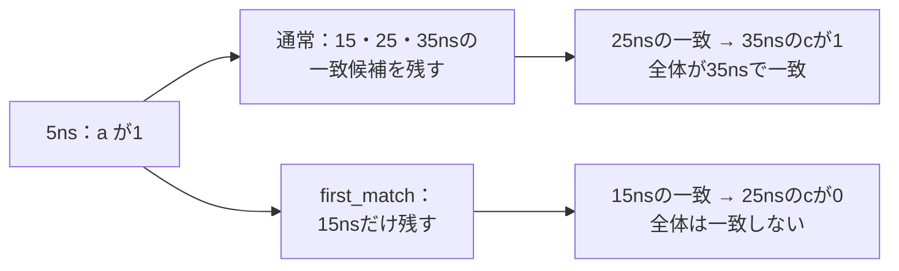
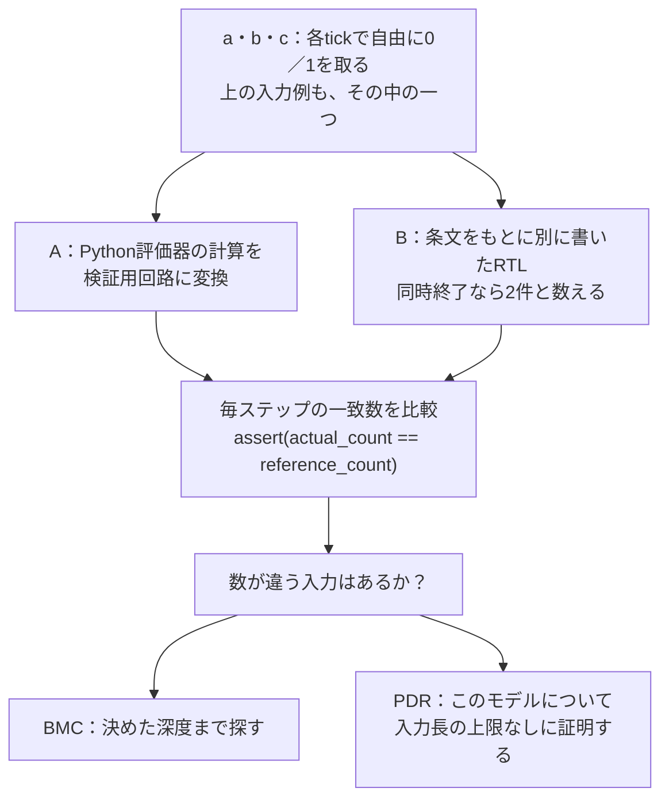
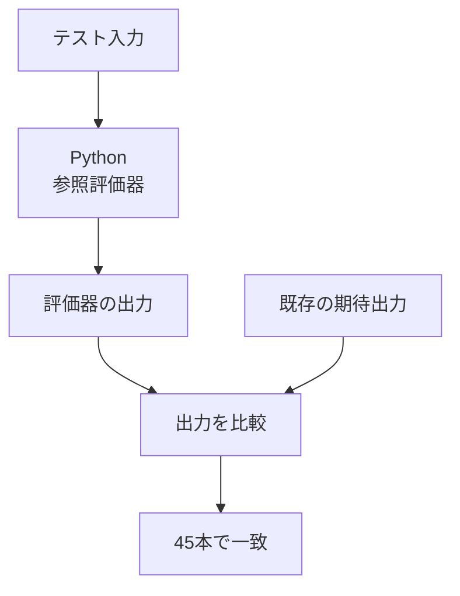
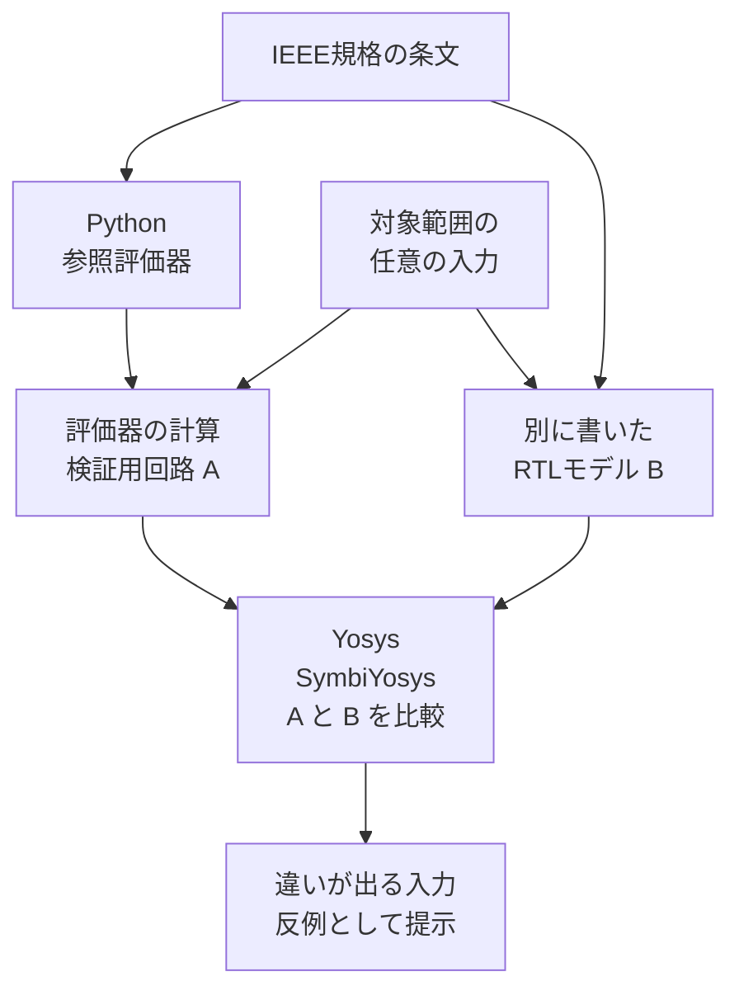

# SVA参照評価器とフォーマル検証

この取り組みでは、**テストの期待出力を確かめること**と、**確認に使う評価器の計算規則を確かめること**の二つを行っています。

SVAは、SystemVerilogで「条件が成立したら次のクロックで応答する」といった規則を書く仕組みです。シミュレータが未対応の規則もあるため、規格から作ったPythonの参照評価器で確認を補っています。さらに、その評価器と別に書いたモデルを照合するのが、ここでのフォーマル検証です。

まず[実例1](#実例1実際のテストから出力を読み解く)で出力を手計算し、[実例2](#実例2同じ規則を決まった入力以外でも確かめる)でフォーマル検証とのつながりを見ます。件数や証明範囲、全件の再実行方法は、その後にまとめています。

## 実例1：実際のテストから出力を読み解く

対象は、リポジトリにある[test_sequence_first_match.sv](../tests/ch16/test_sequence_first_match.sv)です。まず、次の二つの式を比べます。

```systemverilog
a ##[1:3] b
first_match(a ##[1:3] b)
```

| 記法 | この例での意味 |
| --- | --- |
| tick | クロックの立上りで値を読み取る1回の時点。このテストでは10nsごと |
| `a`、`b` | そのtickで読み取った信号値。ここでは0か1 |
| `a ##[1:3] b` | 開始tickでaが1、その1〜3tick後にbが1なら一致 |
| `first_match(...)` | 最も早く終わった一致を残す。同じ最短tickに複数あれば、そのすべてを残す |

このテストの最初の4tickは、次の入力です。**まず5nsから始まる1回の評価に注目します。** 実テストでは、その後の各立上りでも新しい評価を始めます。

| 信号・計算 | tick 0：5ns | tick 1：15ns | tick 2：25ns | tick 3：35ns |
| --- | --- | --- | --- | --- |
| a | **1** | 0 | 0 | 0 |
| b | 0 | **1** | **1** | **1** |
| c（後で使用） | 0 | 0 | 0 | **1** |
| `a ##[1:3] b` | 開始 | 一致 | 一致 | 一致 |
| `first_match(a ##[1:3] b)` | 開始 | **一致を残す** | 残さない | 残さない |

`a ##[1:3] b`は15・25・35nsの3回一致し、`first_match`を付けると15nsだけになります。「一致」は、開始からその時点までが式に合った、という意味です。

### 後ろに条件を付けると、何が変わるか

同じテストには、後ろに`##1 c`を付けた式もあります。これは「一致の1tick後にcが1」という追加条件です。



`first_match`は後続のcを見て選び直す処理ではありません。**先に最初の一致を選び、その後に追加条件を調べます。** そのため、二つの式の結果が変わります。

### 実際の期待出力と照合する

テスト全体は15tickあり、[期待出力](../tests/ch16/test_sequence_first_match.expected)は次の5行です。各行の数値は、`cover sequence`が一致して表示用のキューに記録した時刻（ns）です。

```text
a ##[1:3] b: 15 25 35 75 115
first_match(a ##[1:3] b): 15 75 115
(a ##[1:3] b) ##1 c: 35 125
first_match(a ##[1:3] b) ##1 c: 125
first_match of the or: 15 75 75 115
```

最初の4行に、先ほどの手計算が現れています。最後の行の`75 75`にも意味があります。二つの経路が同じ時刻に一致したため、2回記録します。この点を次の実例で使います。

リポジトリのルートで、次のコマンドを実行できます。Pythonの標準ライブラリと保存済みの入力を使うため、シミュレータやYosysの起動は不要です。

```sh
python3 tools/sva_reference/check.py tests/ch16/test_sequence_first_match.sv
```

```text
MATCH test_sequence_first_match: 15 ticks, 15 actions
1 generated; 1 matched; 0 mismatched
```

ここでの`MATCH`は、参照評価器が作った5行の出力と`.expected`が一致した、という意味です。15 actionsは、5行に並んだ時刻の個数の合計です。特定のシミュレータがこのSVAを正しく実行した、という判定ではありません。

## 実例2：同じ規則を、決まった入力以外でも確かめる

実例1で確かめたのは、**そのテストの決まった15tickの入力**です。次は入力を固定せず、同じ計算規則に食い違いがないかを調べます。

対象は、同じテストの最後の表示に使われる式です。基本フォーマルセットでは`first_match_tie`という名前で登録されています。

```systemverilog
first_match((a ##[1:2] b) or (a ##2 c))
```

この`or`は二つの系列の一致を合わせます。実テストの55nsから始まる評価では、次のようになります。

| 信号・計算 | 55ns：開始 | 65ns：1tick後 | 75ns：2tick後 |
| --- | --- | --- | --- |
| a | **1** | 0 | 0 |
| b | 0 | **0** | **1** |
| c | 0 | 0 | **1** |
| 左側 `a ##[1:2] b` | 開始 | bが0なので一致なし | **一致** |
| 右側 `a ##2 c` | 開始 | 待つ | **一致** |

最初の一致が二つとも75nsに来ます。したがって`first_match`でも**一致数は2**であり、期待出力の`75 75`につながります。

### フォーマル検証では何を比較するか



`assert(...)`は検証時に必ず成り立つべき条件です。今回は「AとBの一致数が等しい」を条件にしています。**元のSystemVerilogテストをYosysで実行するのではなく、取り出した系列の計算モデルを比較します。**

Aの変換処理は[formal.py](../tools/sva_reference/formal.py)、Bの計算規則は[formal_cases.py](../tools/sva_reference/formal_cases.py)にあります。

### 正しいモデルと、わざと間違えたモデルの結果を読む

「同じtickの一致は1件にまとめる」と間違えると、この例で2対1の差が出ます。基本セットでは、比較用モデルBにその誤りを入れて、検査が見逃さないことも確かめています。

[保存済み結果](../tools/sva_reference/fixtures/formal_symbolic_results.json)の該当4ジョブは、次の結果です。再実行すると同名の行がログに出ます。

| ジョブ名 | 保存された結果 | 読み方 |
| --- | --- | --- |
| `first_match_tie_bmc` | PASS（期待もPASS） | BMC深度8の範囲で、正しいAとBの一致数に差がない |
| `first_match_tie_prove` | PASS（期待もPASS） | この固定した系列モデルで、入力長に上限を置かず同じ結果になると証明できた |
| `first_match_tie_cover` | PASS（期待もPASS） | 一致数が2以上になる入力に実際に到達できた |
| `first_match_tie_mutant_bmc` | FAIL（期待もFAIL） | 誤りを入れたBとの違いを、反例として検出できた |

BMC深度8は、この検証用モデルのステップ数の設定です。実例1のテスト全体が15tickあることとは別の数です。PDRの成功を「8ステップだけの確認」と読む必要はありません。

**通常のモデルでFAILが出た場合は調査が必要です。一方、`mutant`は意図的な誤りを入れた検査なので、ここでのFAILは予定した検出成功です。** `cover`の成功だけでは、AとBの一致を証明したことにはなりません。

反例とは、二つの結果が食い違う具体的な入力です。[この負例で保存されたVCD](../tools/sva_reference/fixtures/formal_counterexamples/first_match_tie_mutant_bmc.vcd)では、3サンプルを消費した状態（`age=3`）で`actual_count=2`、`reference_count=1`になっています。ソルバーが選んだ入力は実テストの入力とは別ですが、同じ「最短tickで二つ終わる」状況を作っています。VCD内の時刻は検証用のステップ表示であり、実テストの75nsとは対応させません。

この検査で分かるのは、**選んだ式について二つの実装の計算が合うこと**です。シミュレータ全体や、あらゆるSVA式の正しさを証明したわけではありません。

## 取り組み全体と検証件数

実例1が下表の「テスト出力の確認」、実例2が「評価器のフォーマル検証：基本セット」です。2026-10-26時点の検証結果をまとめると、次のとおりです。

この表は当時の実行記録です。2026-10-29の確認では、基本セットと境界値拡張の保存済みJSONは
現在のソースに対する`--check-results`でstaleになります。現在のカタログによる再実行と、
その出力の鮮度検査は[再実行手順](#再実行)を参照してください。

| 確認 | 知りたいこと | 入力と比べ方 | 今回の結果 |
| --- | --- | --- | --- |
| テスト出力の確認 | このテストの期待出力は、規格から計算した結果と合うか | 既存テストの決まった入力を評価し、期待出力と比較 | **45本一致** |
| 評価器のフォーマル検証：基本セット | 系列・性質・サンプル値関数の計算規則は、別に書いた条文モデルと合うか | 対象の式・入力範囲で、二つのモデルを比較 | **40モデルでBMC成功**。うち22モデルはPDR証明も成功 |
| 評価器のフォーマル検証：境界値の拡張 | 遅延や繰り返しの端の値でも、系列の計算が合うか | 数値パラメータを変えた系列モデルを比較し、実テストの部分式と対応付け | **111ケースすべてでBMC・PDR成功**。28本・91指令内の127部分式に対応 |

**45本はテストの数、40・111はそれぞれの検証セットのモデル数です。モデル数をテスト本数に足したり、二つのセットを重複のない数として足したりはしません。**

読み取った値を「サンプル」と呼びます。「系列」は`a ##[1:3] b`のような信号の変化の並び、「性質」はその並びに対して守るべき規則です。例えば`a |=> b`は、aが成立したら次のtickでbの成立を求める性質です。

## 仕組みを図で見る

### 1. 決まった入力から、テストの出力を計算する



[参照評価器](../tools/sva_reference/README.md)は、IEEE 1800-2023の16章と附属書Fをもとに、系列がいつ一致するか、性質がいつ成功・失敗するかなどを計算します。期待出力は計算が終わってから比較に使います。

M2の10本、M3の28本、M4の7本が対象です。M3で見つかった期待出力・説明の誤り2件は、ユーザー承認後に修正しました。

### 2. 評価器の計算規則を、別の実装と照合する



RTLは、ここでは「計算の状態や手順を回路として書いたモデル」です。Yosysが検証用の回路を読み取り、SymbiYosysがソルバーを使って照合します。

例えば、入力が0だった場合、1だった場合、その順番を変えた場合を、特定のテスト刺激に絞らずに調べます。二つのモデルの結果が食い違う入力例を**反例**と呼びます。検査する範囲を区切るBMCと、今回の系列モデルについて入力長の上限を外して証明するPDRを使っています。

従来の10本のformal-pilotは固定入力でのモデル検査でした。今回の拡張では、入力を自由変数にし、特定の刺激に限定する`assume`は置いていません。

## 結果の見方

| 検査 | 確かめること | 基本セット | 境界値の拡張 |
| --- | --- | --- | --- |
| BMC：有界モデル検査 | 決めた長さの範囲で、結果が食い違う入力がないか | **40モデルで成功** | **111ケースで成功** |
| PDR：入力長に上限を置かない証明 | 対象の系列モデルで、どの長さの入力でも結果が一致するか | **上記40のうち22モデルで成功** | **全111ケースで成功** |
| cover：到達性検査 | 同時終了など、注目する状況が実際に起こり得るか | **4件で到達例を取得** | **3件で到達例を取得** |
| 意図的な誤りを入れる検査 | 誤ったモデルを正しいと判定せず、反例を出せるか | **5種類すべてで反例を取得** | **3件すべてで反例を取得** |

基本セットは、40件のBMC＋22件のPDR＋4件のcover＋5件の誤り検出、計**71ジョブ**です。期待どおりのPASSが66件、期待どおりのFAILが5件でした。first_matchの誤りは、PDR側でも反例が出ることを別に1件確認しています。

境界値の拡張は、111件ずつのBMC・PDR＋3件のcover＋3件の誤り検出、計**228ジョブ**です。期待どおりのPASSが225件、期待どおりのFAILが3件でした。

ここでのFAILは、**わざと入れた誤りを検出できた**という予定どおりの結果です。現行の評価器で新たな誤りが見つかった、という意味ではありません。UNKNOWN・TIMEOUT・ERRORは成功に数えません。

## 40モデルで何を比べたか

| 対象 | モデル数 | 入力の範囲 | 比較する結果 |
| --- | ---: | --- | --- |
| 系列 | 22 | 0／1の信号列。PDRでは入力長の上限なし | 各時点で一致した数。重複する一致も別に数える |
| 性質 | 16 | 0／1の入力を1〜3サンプル | 成功・失敗・空成功・未確定などの状態と、確定tick |
| サンプル値関数6種 | 1 | 2ビットの4値ベクトルの前回値・今回値、全256組 | 現在のサンプル、過去値、立上り・立下り、値の変化 |
| gating付き過去値 | 1 | 2ビットの0／1入力と1ビットのgateを4サンプル、全4,096通り | 通常／gating付きの過去1回・2回の値 |

系列には、空一致、連結、繰り返し、goto/nonconsecutive、and/or/intersect、first_match、throughout、withinを含みます。性質には、implication/followed-by、空前件の位置合わせ、untilの4形、トレース末尾でのstrong/weakの違いを含みます。

サンプル値関数は、`$sampled`・`$past`・`$rose`・`$fell`・`$stable`・`$changed`です。「4値」は0・1・不明値x・高インピーダンスzを指します。「gating付き」は、gateが成立したtickだけを履歴として数える、という意味です。gating付きモデルでは、宣言の既定値を2ビットの1に固定しています。

内部では、系列評価を有限状態機械に、有限入力の性質・関数評価を全組合せの結果表に変換します。式・幅・遅延範囲などはモデルごとに固定しており、すべてのSVA式を証明したわけではありません。

## 111ケースへの拡張で何が増えたか

代表例一つの確認から、遅延や繰り返し回数の組合せを変える確認に広げました。例えば`a ##[low:high] b`は、0 ≤ low ≤ high ≤ 3の全10通りを検査します。遅延が0の場合、下限と上限が等しい場合、空一致を含む繰り返しなど、端の値も対象です。

実例1の`a ##[1:3] b`だけでなく、近くの値を次のように変えます。各行の式ごとに入力を自由な0／1列にして検査します。`first_match`を付けた場合も同じ10通りを調べます。

| low | 検査する式 | 件数 | 含まれる境界の例 |
| --- | --- | ---: | --- |
| 0 | `a ##[0:0] b`、`a ##[0:1] b`、`a ##[0:2] b`、`a ##[0:3] b` | 4 | 同じtickでaとbが成立する場合も含む |
| 1 | `a ##[1:1] b`、`a ##[1:2] b`、`a ##[1:3] b` | 3 | 1tick後だけの場合と、複数の終了候補がある場合 |
| 2 | `a ##[2:2] b`、`a ##[2:3] b` | 2 | 下限が2になっても、それ以前のbを数えないか |
| 3 | `a ##[3:3] b` | 1 | 上限と下限が等しく、3tick後だけを調べる場合 |

ここでの「10通り」は**式の数**です。一つの入力例を10個試す、という意味ではありません。[111ケースの内訳](sva-formal-expansion-20261026.md#何を広げたか)には、ほかの演算子について変えた値もまとめています。

さらに、M2/M3の38本・188指令を調べ、**28本・91指令内の127個の系列部分式**を検証モデルと対応付けました。111ケース中24ケースが実際の部分式に対応し、残り87ケースは近くの境界値を調べる追加バリエーションです。対応しなかった97指令も記録しています。

ここで確かめたのは、**入力条件を0／1に判定した後、系列の一致を数える部分**です。アサーション全体の成否、判定式自体の型・4値演算・サンプリング、`disable iff`や表示の実行まで証明したわけではありません。[拡張の詳細](sva-formal-expansion-20261026.md)に演算別の件数、対応付けの例、証跡と残る課題をまとめています。

## 反例の具体例：終わりのtickを一つ数え忘れる

`within`は、内側の系列が外側の系列の範囲内で一致することを表します。例えば次の場合、内側も外側もtick 3で終わります。

| 一致する区間 | tick 0 | tick 1 | tick 2 | tick 3 |
| --- | --- | --- | --- | --- |
| 外側 `a ##3 b` | aが1：開始 | 継続 | 継続 | bが1：終了 |
| 内側 `x ##1 x` | — | — | xが1：開始 | xが1：終了 |

規格では、**内側が外側と同じtickで終わる場合も、範囲内の一致として数えます**。「内側は外側より早く終わらなければならない」と誤って実装すると、この例で一致数が変わります。フォーマル検証は、その違いを起こす入力を反例として提示できます。

今回も、右端の一致を除外したモデルで反例を確認しました。ほかには、同時終了の重複を潰す、空一致を1tick遅らせる、前件不一致のfollowed-byを空成功とする、gating付き履歴に今回の値を先に入れる、という誤りを検出しています。

結果と反例は、[技術報告](../tools/sva_reference/FORMAL_REVIEW.md)、[結果JSON](../tools/sva_reference/fixtures/formal_symbolic_results.json)、[追加PDR負例](../tools/sva_reference/fixtures/formal_pdr_negative.json)、[反例VCDの索引](../tools/sva_reference/fixtures/formal_counterexamples/index.json)で確認できます。VCDは、信号の値と時刻を保存した波形ファイルです。

## 証明範囲の読み方

今回確認したのは、**選択した式・幅・単一クロックという条件のもとで、評価器と別の条文モデルが同じ結果になること**です。次の境界があります。

- 系列・性質の入力は2値です。x/zを明示的に扱うのは、サンプル値関数の4値モデルです。
- 性質16モデルと関数2モデルは有限入力についての検査です。一般の無限時間の性質を証明したものではありません。
- 複数クロック、一般的なイベント領域のスケジューリング、手続き内アサーションのキュー、任意の型・算術・ユーザー関数、VPIなどは今回の範囲外です。

比較用RTLも、AIが規格から作成したモデルです。別実装との一致は追加の検証材料ですが、規格解釈の全例外を網羅したという主張にはしません。Yosysが読むのは図の検証用回路であり、元の未対応SVA構文をそのまま処理する構成ではありません。

<details>
<summary>技術的な補足：BMCの深度とサンプル数の違い</summary>

系列のBMC深度は、有限パターンが8ステップです。基本セットの無限繰り返し等を含む5パターンと、追加セットのgoto/nonconsecutiveの12ケースは16ステップです。PDRによる系列の証明には、この深度による入力長の制限はありません。数値パラメータは各モデルに固定されています。

有限入力の性質・関数モデルは、サンプル列全体を組合せ回路に展開して検査しています。結果JSONにあるSBY深度2はソルバーのステップ数であり、意味論上の入力が2サンプルだけという意味ではありません。各モデルの`semantic_ticks`がサンプル数です。

</details>

## 再実行

### 準備

コマンドはリポジトリのルートで実行します。Python側のコードは標準ライブラリだけを使います。フォーマル検査を実行するには、SBY・Yosys・Yices・ABCを含むOSS CAD Suiteが必要です。

今回の実行環境はOSS CAD Suite 20260816、Yosys 0.68+71、SBY 0.68、Yices 2.7.0、ABC 1.01です。

`SBY_BIN`にSuite内の`sby`実行ファイル、`FORMAL_RUN_DIR`に新規または空の出力ディレクトリを指定します。ツールのPATHは子プロセスにだけ設定し、通常のシミュレータ選択を変更しません。

### 現在のカタログを実行する

`--case`を省略すると、現在のカタログ全体を実行します。2026-10-29時点では267ケース・
583ジョブ（BMC 267、PDR 44、cover 267、意図的な誤り5）です。上記の旧40モデル・71ジョブの
実行範囲とは異なります。スイートのformalテスト268本には同じケースへの参照もあるため、
テスト本数とケース数は一致しません。

```sh
python3 tools/sva_reference/formal.py --sby "$SBY_BIN" \
  --output-dir "$FORMAL_RUN_DIR"
```

生成RTL、SBY設定、ログ、反例・到達例のVCD、`results.json`が出力されます。既存の実行結果は上書きしません。追加PDR負例1件は、この既定の実行には含まれません。

### 境界値の拡張228ジョブを実行する

`SWEEP_RUN_DIR`にも、新規または空の出力ディレクトリを指定します。

```sh
python3 tools/sva_formal_sweep.py --sby "$SBY_BIN" \
  --output-dir "$SWEEP_RUN_DIR"
```

このコマンドは、111ケースずつのBMC・PDR、cover・誤り検出に加え、実テストとの対応付けも記録します。

### 実例2だけを再実行する

`FORMAL_EXAMPLE_DIR`に新規または空の出力ディレクトリを指定します。このケースに登録されたBMC・PDR・cover・意図的な誤りの4ジョブを実行します。

```sh
python3 tools/sva_reference/formal.py --sby "$SBY_BIN" \
  --case first_match_tie --output-dir "$FORMAL_EXAMPLE_DIR"
```

期待されるログの4行は次のとおりです。最後のFAILを含め、上の結果表と対応しています。

```text
first_match_tie_bmc: PASS (expected PASS)
first_match_tie_prove: PASS (expected PASS)
first_match_tie_cover: PASS (expected PASS)
first_match_tie_mutant_bmc: FAIL (expected FAIL)
```

末尾の集計は`{"ok": true, "counts": {"PASS": 3, "FAIL": 1}}`になります。別のケースも加える場合は、`--case gated_past`などを追加します。

### ツールを動かさず、基本セットの生成RTLだけを見る

`FORMAL_RTL_DIR`も、新規または空のディレクトリを指定します。

```sh
python3 tools/sva_reference/formal.py --emit-only --output-dir "$FORMAL_RTL_DIR"
```

### 保存済み結果と現在のソースの対応を確かめる

再実行して得た`results.json`を検査します。新しい結果が現在のソースと対応し、
必要なジョブをすべて含んでいる場合に成功します。

次のコマンドはソルバーを再実行せず、ソースのハッシュと必要なジョブの揃い方を検査します。

```sh
python3 tools/sva_reference/formal.py \
  --check-results "$FORMAL_RUN_DIR/results.json"

python3 tools/sva_formal_sweep.py \
  --check-results "$SWEEP_RUN_DIR/results.json"
```

基本セットは`tools/sva_reference/`のPythonソースの変更を検出します。追加セットでは、拡張用コードや対応付け対象のテスト、モデル・設定ハッシュも検査します。再実行した結果と差分を確認してから証跡を更新します。期待出力との不一致が出た場合は、モデル・入力・符号化・有限トレースの境界を調べ、条文で判断します。既存の期待出力や説明を修正する際は、承認と[台帳更新手順](../coverage/README.md)に従います。

## メタデータ・CI・網羅率との関係

上記の2026-10-26の基本セットと境界値拡張では、`:oracle:`の値を変更していません。
参照評価器との一致をシミュレータの成功へ自動加算しません。

その後、スイートには`:type: formal`・`:formal_case:`を持つ268本を登録し、
`tools/run_sby.py`の保存済みSymbiYosys結果を要求台帳の実行確認に採用しています。
これはシミュレータの出力一致とは別の証跡です。Icarus・Verilator・kirimasim・Lyraの
ランナーはformalを明示指定でも除外します。[実行手順](../README.md#symbiyosys)と
[選択規則](runner-selection-20261028.md)を参照してください。
専用のフォーマルCIジョブはなく、Checkは外部ソルバーを起動しない単体テストと台帳の整合性を検査します。

基本セットの10件に加え、境界値の拡張と実テストへの対応付けを確認する12件の回帰検査を追加しました。これらは外部フォーマルツールを実行せず、生成処理・入力の自由度・負例・結果判定・証跡の鮮度などを確認します。2026-10-26の拡張時点では全205件の単体テスト、既存45本の具体的な出力照合、両セットの証跡検査、既存の整合性検査が成功しました。
