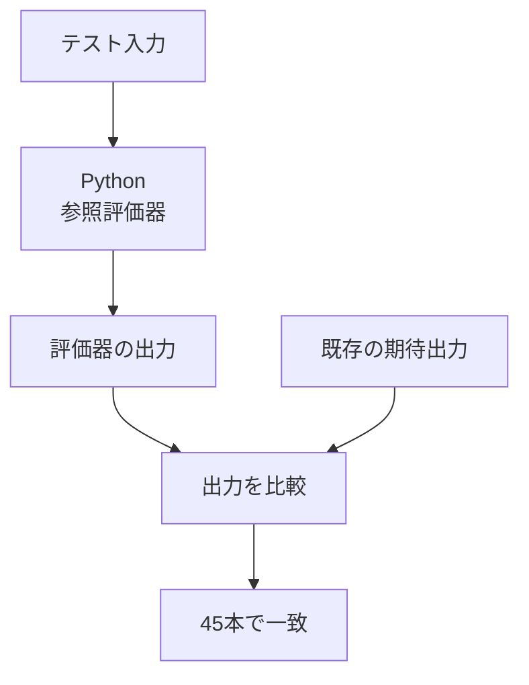
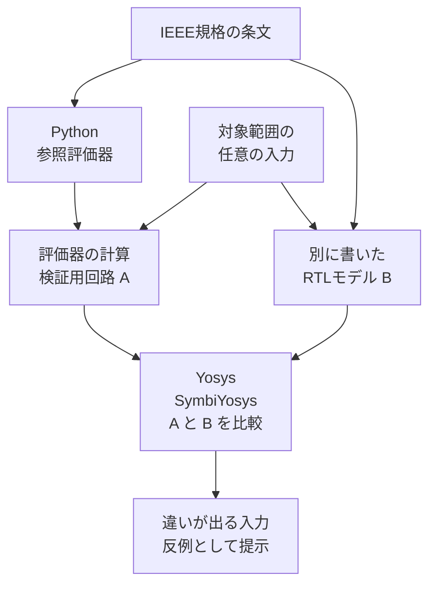

# SVA参照評価器とフォーマル検証

この取り組みでは、**テストの期待出力を確かめること**と、**確認に使う評価器の計算規則を確かめること**の二つを行っています。2026-10-26時点で、45本のテスト出力が一致しています。フォーマル検証は、基本40モデルに加えて、境界値を変えた111ケースの検査まで進みました。

[追加の111ケース](sva-formal-expansion-20261026.md)は、すべてBMCとPDRが成功しています。基本セットとは一部の式が重複するため、合わせて151種類という数え方はしません。

SVAは、SystemVerilogで「信号がこの順番で変わる」「条件が成立したら次のクロックで応答する」といった規則を書く仕組みです。シミュレータが未対応の規則もあるため、規格から作ったPythonの参照評価器で確認を補っています。

## 最初に押さえる二つの確認

| 確認 | 知りたいこと | 入力と比べ方 | 今回の結果 |
| --- | --- | --- | --- |
| テスト出力の確認 | このテストの期待出力は、規格から計算した結果と合うか | 既存テストの決まった入力を評価し、期待出力と比較 | **45本一致** |
| 評価器のフォーマル検証：基本セット | 系列・性質・サンプル値関数の計算規則は、別に書いた条文モデルと合うか | 対象の式・入力範囲で、二つのモデルを比較 | **40モデルでBMC成功**。うち22モデルはPDR証明も成功 |
| 評価器のフォーマル検証：境界値の拡張 | 遅延や繰り返しの端の値でも、系列の計算が合うか | 数値パラメータを変えた系列モデルを比較し、実テストの部分式と対応付け | **111ケースすべてでBMC・PDR成功**。28本・91指令内の127部分式に対応 |

**45本はテストの数、40・111はそれぞれの検証セットのモデル数です。モデル数をテスト本数に足したり、二つのセットを重複のない数として足したりはしません。**

以下では、クロックで信号を読み取る1回の時点を「tick」、読み取った値を「サンプル」と呼びます。「系列」は信号の変化の並び、「性質」はその並びに対して守るべき規則です。

## 仕組みを図で見る

### 1. 決まった入力から、テストの出力を計算する



[参照評価器](../tools/sva_reference/README.md)は、IEEE 1800-2023の16章と附属書Fをもとに、系列がいつ一致するか、性質がいつ成功・失敗するかなどを計算します。期待出力は計算が終わってから比較に使います。

M2の10本、M3の28本、M4の7本が対象です。M3で見つかった期待出力・説明の誤り2件は、ユーザー承認後に修正しました。

### 2. 評価器の計算規則を、別の実装と照合する



RTLは、ここでは「計算の状態や手順を回路として書いたモデル」です。Yosysが検証用の回路を読み取り、SymbiYosysがソルバーを使って照合します。

例えば、入力が0だった場合、1だった場合、その順番を変えた場合を、特定のテスト刺激に絞らずに調べます。二つのモデルの結果が食い違う入力例を**反例**と呼びます。検査する範囲を区切るBMCと、今回の系列モデルについて入力長の上限を外して証明するPDRを使っています。

従来の10本のformal-pilotは固定入力でのモデル検査でした。今回の拡張では、入力を自由変数にし、特定の刺激に限定する`assume`は置いていません。

## 結果の見方

| 検査 | 確かめること | 基本セット | 境界値の拡張 |
| --- | --- | --- | --- |
| BMC：有界モデル検査 | 決めた長さの範囲で、結果が食い違う入力がないか | **40モデルで成功** | **111ケースで成功** |
| PDR：入力長に上限を置かない証明 | 対象の系列モデルで、どの長さの入力でも結果が一致するか | **上記40のうち22モデルで成功** | **全111ケースで成功** |
| cover：到達性検査 | 同時終了など、注目する状況が実際に起こり得るか | **4件で到達例を取得** | **3件で到達例を取得** |
| 意図的な誤りを入れる検査 | 誤ったモデルを正しいと判定せず、反例を出せるか | **5種類すべてで反例を取得** | **3件すべてで反例を取得** |

基本セットは、40件のBMC＋22件のPDR＋4件のcover＋5件の誤り検出、計**71ジョブ**です。期待どおりのPASSが66件、期待どおりのFAILが5件でした。first_matchの誤りは、PDR側でも反例が出ることを別に1件確認しています。

境界値の拡張は、111件ずつのBMC・PDR＋3件のcover＋3件の誤り検出、計**228ジョブ**です。期待どおりのPASSが225件、期待どおりのFAILが3件でした。

ここでのFAILは、**わざと入れた誤りを検出できた**という予定どおりの結果です。現行の評価器で新たな誤りが見つかった、という意味ではありません。UNKNOWN・TIMEOUT・ERRORは成功に数えません。

## 40モデルで何を比べたか

| 対象 | モデル数 | 入力の範囲 | 比較する結果 |
| --- | ---: | --- | --- |
| 系列 | 22 | 0／1の信号列。PDRでは入力長の上限なし | 各時点で一致した数。重複する一致も別に数える |
| 性質 | 16 | 0／1の入力を1〜3サンプル | 成功・失敗・空成功・未確定などの状態と、確定tick |
| サンプル値関数6種 | 1 | 2ビットの4値ベクトルの前回値・今回値、全256組 | 現在のサンプル、過去値、立上り・立下り、値の変化 |
| gating付き過去値 | 1 | 2ビットの0／1入力と1ビットのgateを4サンプル、全4,096通り | 通常／gating付きの過去1回・2回の値 |

系列には、空一致、連結、繰り返し、goto/nonconsecutive、and/or/intersect、first_match、throughout、withinを含みます。性質には、implication/followed-by、空前件の位置合わせ、untilの4形、トレース末尾でのstrong/weakの違いを含みます。

サンプル値関数は、`$sampled`・`$past`・`$rose`・`$fell`・`$stable`・`$changed`です。「4値」は0・1・不明値x・高インピーダンスzを指します。「gating付き」は、gateが成立したtickだけを履歴として数える、という意味です。gating付きモデルでは、宣言の既定値を2ビットの1に固定しています。

内部では、系列評価を有限状態機械に、有限入力の性質・関数評価を全組合せの結果表に変換します。式・幅・遅延範囲などはモデルごとに固定しており、すべてのSVA式を証明したわけではありません。

## 111ケースへの拡張で何が増えたか

代表例一つの確認から、遅延や繰り返し回数の組合せを変える確認に広げました。例えば`a ##[low:high] b`は、0 ≤ low ≤ high ≤ 3の全10通りを検査します。遅延が0の場合、下限と上限が等しい場合、空一致を含む繰り返しなど、端の値も対象です。

さらに、M2/M3の38本・188指令を調べ、**28本・91指令内の127個の系列部分式**を検証モデルと対応付けました。111ケース中24ケースが実際の部分式に対応し、残り87ケースは近くの境界値を調べる追加バリエーションです。対応しなかった97指令も記録しています。

ここで確かめたのは、**入力条件を0／1に判定した後、系列の一致を数える部分**です。アサーション全体の成否、判定式自体の型・4値演算・サンプリング、`disable iff`や表示の実行まで証明したわけではありません。[拡張の詳細](sva-formal-expansion-20261026.md)に演算別の件数、対応付けの例、証跡と残る課題をまとめています。

## 反例の具体例：終わりのtickを一つ数え忘れる

`within`は、内側の系列が外側の系列の範囲内で一致することを表します。例えば次の場合、内側も外側もtick 3で終わります。

| 一致する区間 | tick 0 | tick 1 | tick 2 | tick 3 |
| --- | --- | --- | --- | --- |
| 外側 `a ##3 b` | aが1：開始 | 継続 | 継続 | bが1：終了 |
| 内側 `x ##1 x` | — | — | xが1：開始 | xが1：終了 |

規格では、**内側が外側と同じtickで終わる場合も、範囲内の一致として数えます**。「内側は外側より早く終わらなければならない」と誤って実装すると、この例で一致数が変わります。フォーマル検証は、その違いを起こす入力を反例として提示できます。

今回も、右端の一致を除外したモデルで反例を確認しました。ほかには、同時終了の重複を潰す、空一致を1tick遅らせる、前件不一致のfollowed-byを空成功とする、gating付き履歴に今回の値を先に入れる、という誤りを検出しています。

結果と反例は、[技術報告](../tools/sva_reference/FORMAL_REVIEW.md)、[結果JSON](../tools/sva_reference/fixtures/formal_symbolic_results.json)、[追加PDR負例](../tools/sva_reference/fixtures/formal_pdr_negative.json)、[反例VCDの索引](../tools/sva_reference/fixtures/formal_counterexamples/index.json)で確認できます。VCDは、信号の値と時刻を保存した波形ファイルです。

## 証明範囲の読み方

今回確認したのは、**選択した式・幅・単一クロックという条件のもとで、評価器と別の条文モデルが同じ結果になること**です。次の境界があります。

- 系列・性質の入力は2値です。x/zを明示的に扱うのは、サンプル値関数の4値モデルです。
- 性質16モデルと関数2モデルは有限入力についての検査です。一般の無限時間の性質を証明したものではありません。
- 複数クロック、一般的なイベント領域のスケジューリング、手続き内アサーションのキュー、任意の型・算術・ユーザー関数、VPIなどは今回の範囲外です。

比較用RTLも、AIが規格から作成したモデルです。別実装との一致は追加の検証材料ですが、規格解釈の全例外を網羅したという主張にはしません。Yosysが読むのは図の検証用回路であり、元の未対応SVA構文をそのまま処理する構成ではありません。

<details>
<summary>技術的な補足：BMCの深度とサンプル数の違い</summary>

系列のBMC深度は、有限パターンが8ステップです。基本セットの無限繰り返し等を含む5パターンと、追加セットのgoto/nonconsecutiveの12ケースは16ステップです。PDRによる系列の証明には、この深度による入力長の制限はありません。数値パラメータは各モデルに固定されています。

有限入力の性質・関数モデルは、サンプル列全体を組合せ回路に展開して検査しています。結果JSONにあるSBY深度2はソルバーのステップ数であり、意味論上の入力が2サンプルだけという意味ではありません。各モデルの`semantic_ticks`がサンプル数です。

</details>

## 再実行

### 準備

コマンドはリポジトリのルートで実行します。Python側のコードは標準ライブラリだけを使います。フォーマル検査を実行するには、SBY・Yosys・Yices・ABCを含むOSS CAD Suiteが必要です。

今回の実行環境はOSS CAD Suite 20260816、Yosys 0.68+71、SBY 0.68、Yices 2.7.0、ABC 1.01です。

`SBY_BIN`にSuite内の`sby`実行ファイル、`FORMAL_RUN_DIR`に新規または空の出力ディレクトリを指定します。ツールのPATHは子プロセスにだけ設定し、通常のシミュレータ選択を変更しません。

### 基本セットの全71ジョブを実行する

```sh
python3 tools/sva_reference/formal.py --sby "$SBY_BIN" \
  --output-dir "$FORMAL_RUN_DIR"
```

生成RTL、SBY設定、ログ、反例・到達例のVCD、`results.json`が出力されます。既存の実行結果は上書きしません。追加PDR負例1件は、この既定の71ジョブには含まれません。

### 境界値の拡張228ジョブを実行する

`SWEEP_RUN_DIR`にも、新規または空の出力ディレクトリを指定します。

```sh
python3 tools/sva_formal_sweep.py --sby "$SBY_BIN" \
  --output-dir "$SWEEP_RUN_DIR"
```

このコマンドは、111ケースずつのBMC・PDR、cover・誤り検出に加え、実テストとの対応付けも記録します。

### 基本セットの対象を絞って実行する

`--case`を繰り返します。対象に登録された証明・cover・誤り検出も実行します。

```sh
python3 tools/sva_reference/formal.py --sby "$SBY_BIN" \
  --case first_match_tie --case gated_past --output-dir "$FORMAL_SMALL_DIR"
```

### ツールを動かさず、基本セットの生成RTLだけを見る

`FORMAL_RTL_DIR`も、新規または空のディレクトリを指定します。

```sh
python3 tools/sva_reference/formal.py --emit-only --output-dir "$FORMAL_RTL_DIR"
```

### 保存済み結果と現在のソースの対応を確かめる

次のコマンドはソルバーを再実行せず、ソースのハッシュと必要なジョブの揃い方を検査します。

```sh
python3 tools/sva_reference/formal.py \
  --check-results tools/sva_reference/fixtures/formal_symbolic_results.json

python3 tools/sva_formal_sweep.py \
  --check-results tools/sva_reference/fixtures/formal_expanded_results.json
```

基本セットは`tools/sva_reference/`のPythonソースの変更を検出します。追加セットでは、拡張用コードや対応付け対象のテスト、モデル・設定ハッシュも検査します。再実行した結果と差分を確認してから証跡を更新します。期待出力との不一致が出た場合は、モデル・入力・符号化・有限トレースの境界を調べ、条文で判断します。既存の期待出力や説明を修正する際は、承認と[台帳更新手順](../coverage/README.md)に従います。

## メタデータ・CI・網羅率との関係

`:oracle:`の値は変更していません。参照評価器との一致やフォーマル検査の成功は、シミュレータでの実行確認率には加算しません。専用のフォーマルCIジョブは追加しておらず、必須化の方針は別途決める事項です。

基本セットの10件に加え、境界値の拡張と実テストへの対応付けを確認する12件の回帰検査を追加しました。これらは外部フォーマルツールを実行せず、生成処理・入力の自由度・負例・結果判定・証跡の鮮度などを確認します。拡張後は全205件の単体テスト、既存45本の具体的な出力照合、両セットの証跡検査、既存の整合性検査が成功しています。
